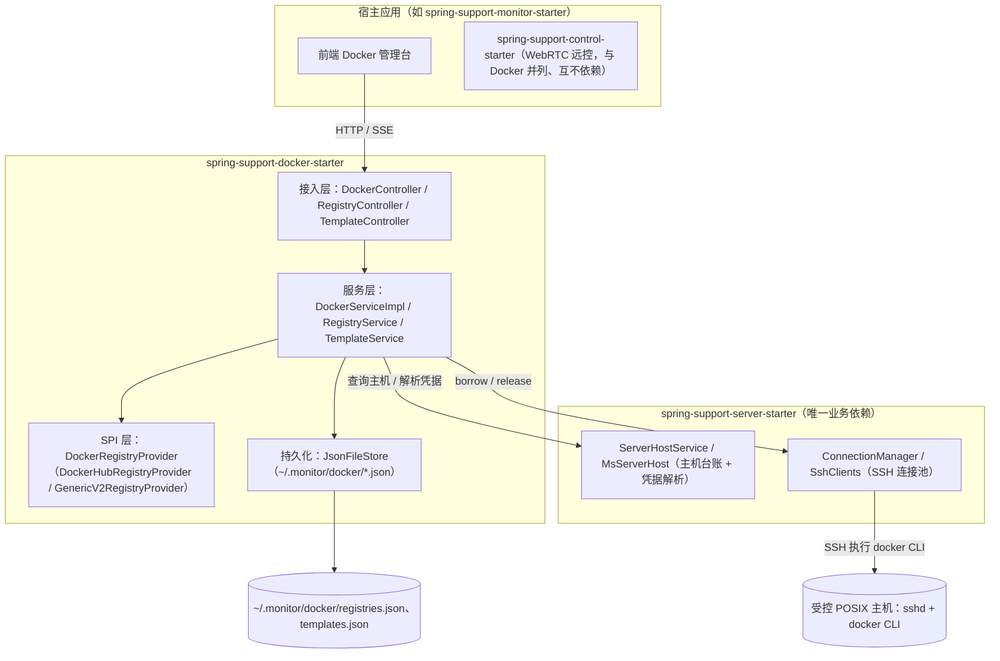
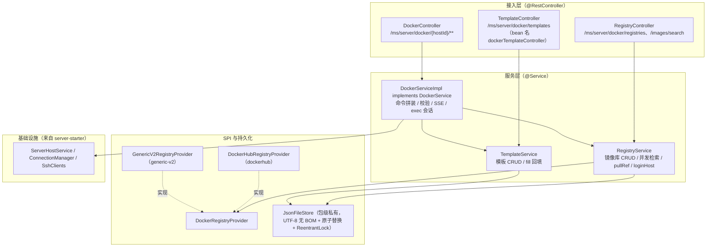
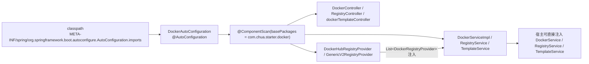
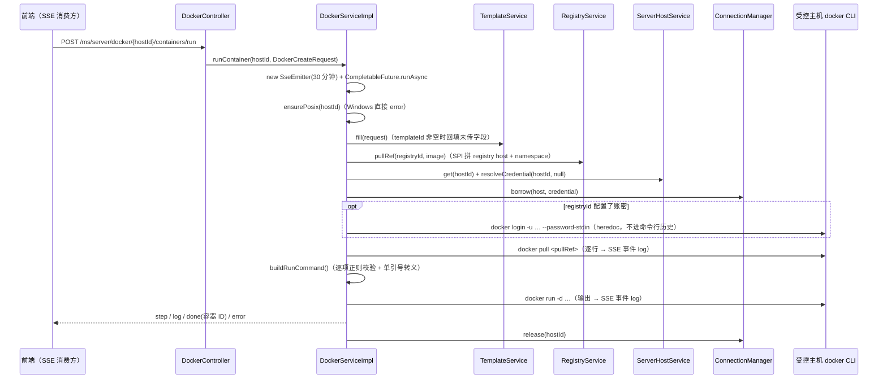

# spring-support-docker-starter

Docker 独立模块：容器、镜像、网络、卷、镜像库与容器模板的完整管理台后端。
全部能力经 SSH 在受控主机上执行 `docker` CLI，**不要求暴露 Docker TCP 端口**；
镜像库走 `DockerRegistryProvider` SPI，长耗时操作统一用 SSE 实时回显。

- Maven 坐标：`com.chua:spring-support-docker-starter:4.0.0.51`（随父工程 `spring-support-parent-starter`）
- 技术基线：Spring Boot 4.1.2 / Java 25（`maven-compiler-plugin` source/target 25，父 pom 实测）
- 接口前缀：`/ms/server/docker`（`ServerConstants.API_PREFIX = "/ms/server"`，源码常量实测值）

## 1. 架构图

### 1.1 模块在体系中的位置



- 本模块**只依赖** `spring-support-server-starter`（外加 web / jackson / swagger-annotations / lombok），不反向依赖 monitor，避免循环依赖（`DockerAutoConfiguration` 类注释口径）。
- `spring-support-monitor-starter` 同时引入本模块与 `spring-support-control-starter`（monitor pom 第 76、86 行实测），两者并列、互相没有依赖：Docker 走 SSH + docker CLI，远控走 WebRTC 信令。
- 项目发布类型扩展（`DockerProjectTypeProvider`）经 `META-INF/extensions` 被发布侧的 `ProjectTypeProviderRegistry` 消费，不属于 HTTP 链路。

### 1.2 模块内部分层



## 2. 核心流程图

### 2.1 装配流程（类路径 → Bean）



注意：本模块**没有 `spring.factories`**，只有 Boot 标准的 `AutoConfiguration.imports`（内容仅一行 `com.chua.starter.docker.config.DockerAutoConfiguration`，Boot 4 唯一自动装配注册方式）。自动配置类上没有任何 `@ConditionalOnXxx`，引入依赖即整体装配。

### 2.2 请求处理流程：创建并启动容器（SSE）



- 拉取镜像步骤仅当 `pull` 不为 `false` 时执行（`request.getPull()` 缺省视为要拉取）。
- 其余 SSE 流程（卸载容器/镜像 `removeContainerStream` / `removeImageStream`、拉取镜像 `pullImage`、日志流 `streamContainerLogs`、交互终端 `execContainer`）复用同一套「borrow → 执行 → step/log/done/error → release」骨架；日志流与终端额外发 `session` 事件，终端数据走 `output` 事件、结束时发 `closed`。

## 3. 能力清单

「入口」均为完整 REST 路径，前缀 `ServerConstants.API_PREFIX = "/ms/server"`（源码实测）。

### 3.1 容器与镜像（`DockerController` → `DockerServiceImpl`，hostId 维度）

| 能力域 | 关键类 / 方法 | 入口（REST 路径） |
|---|---|---|
| 能力探测 | `DockerServiceImpl#capability` | `GET /ms/server/docker/{hostId}/capability` |
| 容器列表 | `DockerServiceImpl#containers` | `GET /ms/server/docker/{hostId}/containers?all=` |
| 容器详情 | `DockerServiceImpl#containerDetail` | `GET /ms/server/docker/{hostId}/containers/{id}` |
| 生命周期操作 | `DockerServiceImpl#containerAction` | `POST /ms/server/docker/{hostId}/containers/{id}/{action}` |
| 删除容器（同步） | `DockerServiceImpl#removeContainer` | `DELETE /ms/server/docker/{hostId}/containers/{id}?force=` |
| 删除容器（SSE） | `DockerServiceImpl#removeContainerStream` | `POST /ms/server/docker/{hostId}/containers/{id}/remove-stream` |
| 创建并启动容器（SSE） | `DockerServiceImpl#runContainer` | `POST /ms/server/docker/{hostId}/containers/run` |
| 容器日志（一次性） | `DockerServiceImpl#containerLogs` | `GET /ms/server/docker/{hostId}/containers/{id}/logs?tail=` |
| 容器日志流（SSE） | `DockerServiceImpl#streamContainerLogs` | `GET /ms/server/docker/{hostId}/containers/{id}/logs/stream?tail=` |
| 进入容器（SSE 交互 PTY） | `DockerServiceImpl#execContainer` | `POST /ms/server/docker/{hostId}/containers/{id}/exec`（body `{command}`，缺省 `/bin/sh`） |
| 交互输入 | `DockerServiceImpl#execInput` | `POST /ms/server/docker/{hostId}/containers/{id}/exec/input`（body `{sessionId, input}`） |
| 关闭交互会话 | `DockerServiceImpl#execClose` | `POST /ms/server/docker/{hostId}/containers/{id}/exec/close`（body `{sessionId}`） |
| 镜像列表 | `DockerServiceImpl#images` | `GET /ms/server/docker/{hostId}/images` |
| 拉取镜像（SSE） | `DockerServiceImpl#pullImage` | `POST /ms/server/docker/{hostId}/images/pull?image=&registryId=` |
| 删除镜像（同步） | `DockerServiceImpl#removeImage` | `DELETE /ms/server/docker/{hostId}/images/{imageId}?force=` |
| 删除镜像（SSE） | `DockerServiceImpl#removeImageStream` | `POST /ms/server/docker/{hostId}/images/{imageId}/remove-stream` |

### 3.2 网络、卷与清理（`DockerController` → `DockerServiceImpl`）

| 能力域 | 关键类 / 方法 | 入口（REST 路径） |
|---|---|---|
| 网络列表 | `DockerServiceImpl#networks` | `GET /ms/server/docker/{hostId}/networks` |
| 创建网络 | `DockerServiceImpl#createNetwork` | `POST /ms/server/docker/{hostId}/networks`（`DockerNetworkRequest`） |
| 删除网络 | `DockerServiceImpl#removeNetwork` | `DELETE /ms/server/docker/{hostId}/networks/{id}` |
| 卷列表 | `DockerServiceImpl#volumes` | `GET /ms/server/docker/{hostId}/volumes` |
| 创建卷 | `DockerServiceImpl#createVolume` | `POST /ms/server/docker/{hostId}/volumes`（`DockerVolumeRequest`） |
| 删除卷 | `DockerServiceImpl#removeVolume` | `DELETE /ms/server/docker/{hostId}/volumes/{name}` |
| 清理悬空资源 | `DockerServiceImpl#prune` | `POST /ms/server/docker/{hostId}/prune`（`docker system prune -af --volumes`） |

### 3.3 镜像库与模板（全局维度，不带 hostId）

| 能力域 | 关键类 / 方法 | 入口（REST 路径） |
|---|---|---|
| 镜像库列表 | `RegistryService#list` | `GET /ms/server/docker/registries` |
| 新增 / 更新镜像库 | `RegistryService#save` | `POST /ms/server/docker/registries` |
| 删除镜像库 | `RegistryService#delete` | `DELETE /ms/server/docker/registries/{id}` |
| 连通性测试 | `RegistryService#test` | `POST /ms/server/docker/registries/{id}/test` |
| 可用库类型 | `RegistryService#types` | `GET /ms/server/docker/registries/types` |
| 镜像标签 | `RegistryService#tags` | `GET /ms/server/docker/registries/{id}/tags?image=` |
| 在线检索镜像 | `RegistryService#search` | `GET /ms/server/docker/images/search?keyword=&registryId=&limit=` |
| 模板列表 | `TemplateService#list` | `GET /ms/server/docker/templates` |
| 新增 / 更新模板 | `TemplateService#save` | `POST /ms/server/docker/templates` |
| 删除模板 | `TemplateService#delete` | `DELETE /ms/server/docker/templates/{id}` |

检索说明（`RegistryService#search`）：`registryId` 为空时用虚拟线程执行器（`MdcWrap.decorate(Executors.newVirtualThreadPerTaskExecutor())`）**并发检索全部启用镜像库**，按 `pullRef` 去重（`putIfAbsent`）后官方镜像优先、星标降序；单库失败只记 warn 日志，不影响其它库。

### 3.4 装配、SPI 与持久化（非 REST）

| 能力域 | 关键类 | 入口 |
|---|---|---|
| 自动配置 | `com.chua.starter.docker.config.DockerAutoConfiguration` | `META-INF/spring/org.springframework.boot.autoconfigure.AutoConfiguration.imports` |
| 镜像库 SPI | `com.chua.starter.docker.spi.DockerRegistryProvider` | Spring Bean 集合，`RegistryService` 构造器按 `type()` 建索引 |
| 内置 SPI 实现 | `DockerHubRegistryProvider`（`dockerhub`）、`GenericV2RegistryProvider`（`generic-v2`） | `@Component` 自动注册 |
| 项目类型扩展 | `com.chua.starter.docker.provider.project.DockerProjectTypeProvider` | `META-INF/extensions/com.chua.starter.server.support.spi.ProjectTypeProvider` |
| JSON 持久化 | `JsonFileStore`（包级私有） | 供 `RegistryService` / `TemplateService` 内部使用，非对外契约 |
| 镜像库 HTTP 工具 | `RegistryHttp`（`spi.impl` 包私有） | 共享 `HttpClient`（连接超时 5s、读取超时 8s）+ Basic Auth |

返回结构约定（逐项来自源码投影）：容器列表项为 `id` / `shortId` / `name` / `image` / `state` / `status` / `ports` / `network` / `runningFor` / `createdAt`；镜像项为 `id` / `shortId` / `repository` / `tag` / `size` / `createdAt`；`capability` 为 `installed` / `version` / `compose` / `runtime`；镜像库视图为 `id` / `name` / `type` / `url` / `username` / `namespace` / `enabled` / `builtin` / `hasPassword`（**永不返回密码明文**）。

SSE 事件名（`DockerService` 注释即契约）：`step`（阶段说明）、`log`（命令行输出增量）、`done`（成功）、`error`（失败原因）；日志流与交互式终端另发 `session`（会话标识）；交互式终端的终端数据走 `output` 事件，终端结束时发 `closed`。

## 4. Bean 能力矩阵

装配总说明：`DockerAutoConfiguration` 上**没有任何 `@ConditionalOnXxx`**，它只做 `@ComponentScan(basePackages = "com.chua.starter.docker")`；下表所有 Bean 均为组件扫描注册的**无条件装配**——只要本 jar 在 classpath 且自动装配未被排除，就会全部注册。

| Bean 名 | 类型 | 装配条件 | 可否覆盖 | 典型注入姿势 |
|---|---|---|---|---|
| `dockerController` | `com.chua.starter.docker.DockerController`（`@RestController`） | 无条件（组件扫描） | 同名覆盖需 `spring.main.allow-bean-definition-overriding=true`；默认重名即启动失败 | 一般不直接注入，经 HTTP 调用 |
| `registryController` | `com.chua.starter.docker.controller.RegistryController`（`@RestController`） | 无条件（组件扫描） | 同上 | 一般不直接注入 |
| `dockerTemplateController` | `com.chua.starter.docker.controller.TemplateController`（`@RestController("dockerTemplateController")`） | 无条件（组件扫描）；**显式 bean 名**避免与其它 starter 的同名 `TemplateController` 冲突（源码注释明确说明） | 同上；改名本身就是为了规避 `ConflictingBeanDefinitionException` | 一般不直接注入 |
| `dockerServiceImpl` | `DockerServiceImpl`（`@Service`，实现 `DockerService`） | 无条件（组件扫描） | 同名覆盖需开 `allow-bean-definition-overriding`；另注册同类型不同名 Bean 会导致按类型注入歧义，需 `@Primary` | 构造器注入接口 `DockerService`（控制器即此写法），字段 `@Autowired` 亦可用 |
| `registryService` | `RegistryService`（`@Service`） | 无条件（组件扫描）；构造器接收 `List<DockerRegistryProvider>` | 同上 | 构造器注入；需要镜像库凭据时经 `config(id)` 取 `RegistryConfig` |
| `templateService` | `TemplateService`（`@Service`） | 无条件（组件扫描） | 同上 | 构造器 / 字段注入 |
| `dockerHubRegistryProvider` | `DockerHubRegistryProvider`（`@Component`，实现 `DockerRegistryProvider`，`type()="dockerhub"`） | 无条件（组件扫描） | **新增优先**：新库类型应新增 Bean；同 `type()` 的 Bean 会按注入顺序后到者覆盖索引（`LinkedHashMap#put`） | 由 `RegistryService` 以 `List<DockerRegistryProvider>` 收集，不推荐业务直接注入 |
| `genericV2RegistryProvider` | `GenericV2RegistryProvider`（`@Component`，`type()="generic-v2"`） | 同上 | 同上 | 同上 |

不是 Spring Bean 的关键组件：

| 组件 | 注册方式 | 说明 |
|---|---|---|
| `DockerProjectTypeProvider` | `META-INF/extensions/com.chua.starter.server.support.spi.ProjectTypeProvider`，`@Spi(value = "docker", order = 100)` | 项目发布类型扩展点实现，由 server 侧 `ProjectTypeProviderRegistry` 首次解析时加载；不进 Spring 容器 |
| `JsonFileStore` | `RegistryService` / `TemplateService` 构造时 `new` | 包级私有 final 工具类，非 Spring 管理 |
| `RegistryHttp` | 静态工具 | `spi.impl` 包私有，共享 `HttpClient`（连接超时 5s、读取超时 8s），带 Basic Auth |

## 5. 完整配置

**本模块没有 `@ConfigurationProperties`，也没有 `@Value`。** 全模块源码逐文件核验：不存在属性绑定类（如 `DockerProperties`）与任何 `application.yml` 配置键，因此没有「路径 / 类型 / 默认值 / 生效开关」意义上的可配置项。

**生效开关**：没有 `docker.enabled` 之类开关。是否启用 = 宿主是否引入本依赖；自动装配无条件，引入即生效。

模块自身固定使用两个本机持久化文件（路径在构造时用 `System.getProperty("user.home")` 写死，**不可配置**）：

| 固定路径 | 内容 | 写入保证（`JsonFileStore`） |
|---|---|---|
| `~/.monitor/docker/registries.json` | 镜像库配置（含明文密码） | UTF-8 无 BOM；同目录临时文件 + `ATOMIC_MOVE` 原子替换（不支持时退化为普通 `REPLACE_EXISTING` move）；`ReentrantLock` 串行化「读—改—写」 |
| `~/.monitor/docker/templates.json` | 容器模板 | 同上 |

以下行为参数为**代码内常量 / 请求级默认值**，同样不可通过配置修改（逐项来自源码）：

| 参数 | 值 / 规则 | 代码位置 |
|---|---|---|
| SSE 会话超时 | 30 分钟（`SSE_TIMEOUT_MILLIS = 30 * 60 * 1000L`），所有 `SseEmitter` 构造时传入 | `DockerServiceImpl` |
| 一次性命令超时 | 30 秒（`EXEC_TIMEOUT_SECONDS = 30`） | `DockerServiceImpl` |
| 一次性输出截断 | 64KB（`OUTPUT_TRUNCATE = 64 * 1024`），超出截断加 `…` | `DockerServiceImpl#truncate` |
| 生命周期 action 白名单 | `start` / `stop` / `restart` / `pause` / `unpause` / `kill` | `DockerServiceImpl#containerAction` |
| 重启策略白名单 | `no` / `always` / `unless-stopped` / `on-failure` | `DockerServiceImpl#buildRunCommand` |
| 镜像名白名单 | `[A-Za-z0-9][A-Za-z0-9._/:@-]*`（允许 registry host / 命名空间 / tag / digest） | `DockerServiceImpl#IMAGE_PATTERN` |
| 端口映射格式 | `\d{1,5}:\d{1,5}(/(tcp|udp))?` | `DockerServiceImpl#buildRunCommand` |
| 环境变量格式 | `[A-Za-z_][A-Za-z0-9_]*=.*`（`KEY=VALUE`） | `DockerServiceImpl#buildRunCommand` |
| 卷映射格式 | `[^:\s]+:[^:\s]+`（宿主路径:容器路径） | `DockerServiceImpl#buildRunCommand` |
| 容器名 / 网络名 / 网络名（创建网络）/ 卷名 | `[A-Za-z0-9][A-Za-z0-9_.-]*` | `DockerServiceImpl#buildRunCommand` / `#createNetwork` / `#createVolume` |
| 容器列表 `all` | 缺省 `true`（含已停止容器） | `DockerServiceImpl#containers` |
| 日志 `tail` | 一次性日志缺省 200；日志流缺省 100 | `DockerServiceImpl#containerLogs` / `#streamContainerLogs` |
| 交互终端 | 默认命令 `/bin/sh`，PTY 初始窗口 120×30 | `DockerServiceImpl#execContainer` |
| 检索 `limit` | 缺省 25、上限 100（`DEFAULT_LIMIT` / `MAX_LIMIT`）；关键词 < 2 字符返回空 | `RegistryService#search` |
| Registry v2 目录拉取上限 | `CATALOG_MAX = 500`（`limit * CATALOG_FACTOR(10)` 后封顶） | `GenericV2RegistryProvider` |
| Docker Hub 标签上限 | `TAG_LIMIT = 100` | `DockerHubRegistryProvider` |
| 内置镜像库 | id 固定 `dockerhub`（`RegistryService.BUILTIN_ID`），`builtin=true`，不可删除，可改地址/凭据 | `RegistryService#ensureBuiltin` |
| 密码「不修改」占位符 | `******`（`RegistryService.PASSWORD_MASK`）或空串 | `RegistryService#save` |
| Docker Hub API 基址 | `https://hub.docker.com`（`HUB_API` 常量，检索不受镜像加速地址影响） | `DockerHubRegistryProvider` |
| `docker login` heredoc 标记 | `CHUA_DOCKER_LOGIN_EOF`（密码经标准输入，不进命令行） | `DockerServiceImpl#LOGIN_EOF` |

## 6. 使用方式

### 6.1 Maven 坐标

```xml
<dependency>
    <groupId>com.chua</groupId>
    <artifactId>spring-support-docker-starter</artifactId>
    <version>4.0.0.51</version>
</dependency>
```

依赖会随 jar 传递带入 `spring-support-server-starter`（主机台账 + SSH 连接池）、`spring-boot-starter-web`、`jackson-databind`、`swagger-annotations`；`lombok` 为 `optional`，仅在编译本模块时需要（父工程版本 `1.18.48`）。

本模块 pom 设置了 `<spring-boot.repackage.skip>true</spring-boot.repackage.skip>`：只产出标准库 jar，**不能 `java -jar` 直接启动**，必须由宿主应用依赖后运行。

### 6.2 前置条件

1. 宿主已接入 `spring-support-server-starter` 的主机台账：存在 `MsServerHost` 记录且 `ServerHostService#resolveCredential` 能解析出 SSH 凭据，否则接口报「主机不存在」或凭据解析失败。
2. 目标主机为 POSIX（Linux/macOS）。所有入口先 `ensurePosix(hostId)`（`WindowsSshShell.isWindows` 判定），Windows 主机抛 `UnsupportedOperationException`（“该主机为 Windows，暂不支持 Docker 管理”）。
3. 主机上**无需暴露** Docker TCP 端口（2375/2376），全部经 SSH 执行 `docker` CLI。

### 6.3 最小可运行示例

```java
@SpringBootApplication
public class App {
    public static void main(String[] args) {
        SpringApplication.run(App.class, args);  // 无需扫描 com.chua.starter.docker
    }
}

@RestController
@RequiredArgsConstructor
class DemoController {
    private final DockerService dockerService;   // 接口注入，实现为 DockerServiceImpl

    @GetMapping("/demo/capability")
    public ReturnResult<Map<String, Object>> capability() {
        return dockerService.capability(1L);     // hostId=1 的主机
    }

    @GetMapping("/demo/containers")
    public ReturnResult<List<Map<String, Object>>> containers() {
        return dockerService.containers(1L, true);
    }
}
```

服务层完整调用（与控制器同一契约；`DockerService#pullImage(hostId, image)` 还有委托到 `pullImage(hostId, image, null)` 的 default 方法）：

```java
@Autowired
private DockerService dockerService;

ReturnResult<Map<String, Object>> capability = dockerService.capability(1L);
ReturnResult<Boolean> started = dockerService.containerAction(1L, "nginx", "restart"); // action 白名单见第 5 节
ReturnResult<String> logs = dockerService.containerLogs(1L, "nginx", 200);

DockerCreateRequest request = new DockerCreateRequest();   // @Data POJO，setter 赋值，无 Builder、无链式 API
request.setName("demo-nginx");
request.setImage("nginx:alpine");
request.setPorts(List.of("8080:80"));
request.setEnv(List.of("TZ=Asia/Shanghai"));
request.setVolumes(List.of("/data/nginx:/usr/share/nginx/html"));
request.setRestartPolicy("unless-stopped");
request.setPull(true);
request.setRegistryId("dockerhub");   // 可空；非空时先按库凭据 docker login
request.setTemplateId(null);          // 可空；非空时先按模板回填未传字段
SseEmitter emitter = dockerService.runContainer(1L, request);
```

前端消费 SSE（创建容器）：

```bash
curl -N -X POST "http://localhost:8080/ms/server/docker/1/containers/run" \
  -H "Content-Type: application/json" \
  -d '{"name":"demo-nginx","image":"nginx:alpine","ports":["8080:80"],"pull":true}'
# 事件流：step → log… → done(容器ID) / error
```

### 6.4 可选依赖说明

| 依赖 | 是否必需 | 说明 |
|---|---|---|
| `spring-support-server-starter` | 必需（传递带入） | 主机台账 `MsServerHost`、凭据解析 `ServerHostService`、连接池 `ConnectionManager` / `SshClients`、`ServerConstants`、`RemoteExecResult`、`ProjectTypeProvider` 扩展点 |
| `spring-boot-starter-web` | 必需（传递带入） | `@RestController`、`SseEmitter`（`spring-webmvc`） |
| `jackson-databind` | 必需（传递带入） | `docker … --format '{{json .}}'` 输出解析、本地 JSON 持久化 |
| `swagger-annotations` | 必需（传递带入） | `@Tag` / `@Operation` / `@Schema`，仅注解、无运行时逻辑 |
| `lombok` | 编译期 optional | `@Data` / `@RequiredArgsConstructor` / `@Slf4j`（父工程版本 `1.18.48`） |

宿主无需额外引入 docker-java / docker-cli 等客户端库——本模块不使用 Docker API 客户端，只经 SSH 调用主机上的 `docker` 命令。

## 7. 使用场景

**适用：**

- 需要一个集中式 Docker 管理台，统一管理多台受控 POSIX 主机上的容器/镜像/网络/卷，且不想在各主机暴露 Docker TCP 端口或安装额外 Agent（复用已有 SSH 通道）。
- 需要长耗时操作（拉镜像、建容器、卸载、看日志、进终端）有实时进度回显（SSE）的前端体验。
- 需要「在线选镜像 → 选 tag → 一键安装」流程，且镜像来源不止 Docker Hub（私有 Harbor / Nexus / registry:2 走 `generic-v2`）。
- 项目发布模块需要「按 Dockerfile 构建镜像并运行容器」的项目类型（`DockerProjectTypeProvider`）。

**不适用：**

- Windows 宿主机的容器管理（`ensurePosix` 直接拒绝，无 Windows 容器/命名管道实现）。
- Kubernetes / 编排场景（本模块只面向单机 docker CLI，不掺 K8s；与主机工作台的 K8s 能力解耦）。
- 需要将镜像库密码加密存储、或多个应用实例共享持久化状态且不能会话粘滞的场景（密码明文落 `~/.monitor/docker/registries.json`；`exec` 会话在内存 `ConcurrentHashMap`，多实例必须把 `exec/input` 打到同一实例）。
- 需要任意命令透传的运维后门（`buildRunCommand` 只接受白名单字段并逐项校验转义，这是有意限制）。

**与相邻模块的取舍：**

| 相邻模块 | 关系 | 取舍建议 |
|---|---|---|
| `spring-support-server-starter` | 本模块唯一业务依赖：主机台账、凭据解析、SSH 连接池 | 主机/凭据数据维护在 server 侧；本模块只消费其 Service 契约，不直连其持久层 |
| `spring-support-control-starter` | 在 monitor 中**并列引入**，互相无依赖 | 远程控制（WebRTC 信令）选 control；容器管理选本模块；二者协议与页面独立，可同时使用 |
| `spring-support-monitor-starter` | 聚合宿主，经 `AutoConfiguration.imports` 自动装配本模块全部接口 | 想一次获得监控 + Docker + 远控全家桶就依赖 monitor；只要 Docker 能力则直接依赖本模块，避免带入多余 Controller/任务（R5「依赖即带入」） |
| 直接用 Docker SDK（docker-java 等） | 本模块未采用 | 需要编程式 Docker API 细粒度控制时自行引入 SDK；本模块定位是「SSH + CLI」的低侵入管理台 |

## 8. 扩展点

### 8.1 镜像库 SPI：`DockerRegistryProvider`（Spring Bean）

实现 `com.chua.starter.docker.spi.DockerRegistryProvider` 并声明为 Spring Bean（如 `@Component`）即可新增镜像库类型，无需改动服务与控制器：

| 方法 | 作用 | 约定 |
|---|---|---|
| `String type()` | 库类型标识，持久化在 `RegistryConfig.type` | 必须唯一；重复时后注册者覆盖索引 |
| `String displayName()` | 前端「镜像库类型」下拉展示名 | — |
| `List<Map<String,Object>> search(RegistryConfig, String keyword, int limit)` | 在线检索 | 统一结构：`name` / `description` / `stars` / `official` / `pullRef` |
| `List<String> tags(RegistryConfig, String image)` | 镜像标签列表 | 查询失败返回空列表 |
| `String pullRef(RegistryConfig, String image)` | 拼出可直接用于 `docker pull\|run` 的完整引用 | 后端统一用 `pullRef` 拉取，前端不拼 host/命名空间 |
| `boolean test(RegistryConfig)` | 连通性 / 凭据测试 | — |

生效机制：`RegistryService` 构造器注入 `List<DockerRegistryProvider>`，按 `type()` 建 `LinkedHashMap` 索引；`GET /ms/server/docker/registries/types` 立即列出新增类型，`POST /ms/server/docker/registries` 的 `type` 即可填新值。**它不是 JDK SPI，不要在 `META-INF/services` 登记**。查找不到实现时 `RegistryService#providerFor` 抛 `IllegalStateException`（“没有可用的镜像库实现”），不做静默降级。

示例：

```java
@Component
public class MyHarborRegistryProvider implements DockerRegistryProvider {

    @Override public String type() { return "my-harbor"; }   // 必须唯一，持久化在 RegistryConfig.type
    @Override public String displayName() { return "我的 Harbor"; }
    @Override public List<Map<String, Object>> search(RegistryConfig cfg, String keyword, int limit) {
        return List.of();   // 统一结构：name / description / stars / official / pullRef
    }
    @Override public List<String> tags(RegistryConfig cfg, String image) { return List.of(); }
    @Override public String pullRef(RegistryConfig cfg, String image) { return image; }
    @Override public boolean test(RegistryConfig cfg) { return true; }
}
```

`RegistryConfig`（SPI 入参）字段：`id` / `name` / `type` / `url` / `username` / `password`（仅服务端内部可见，接口只回 `hasPassword`）/ `namespace` / `enabled`（null 视为启用，见 `enabledOrDefault()`）/ `builtin` / `createdAt` / `updatedAt`。

### 8.2 项目发布类型：`ProjectTypeProvider`（`META-INF/extensions`）

接口全限定名 `com.chua.starter.server.support.spi.ProjectTypeProvider`（来自 `spring-support-server-starter`）。本模块自带实现 `DockerProjectTypeProvider`：

- 注册：`@Spi(value = "docker", order = 100)` + 扩展点文件 `META-INF/extensions/com.chua.starter.server.support.spi.ProjectTypeProvider`，内容一行：`com.chua.starter.docker.provider.project.DockerProjectTypeProvider`
- 语义：主入口 = 容器名；`scripts(windows, mainEntry)` 走 `ProjectScripts.windowsDocker/linuxDocker`（先 `docker build`，成功后才重建容器）；单文件产物直接投放到构建上下文根目录，压缩包先解压（`placements`）；`pidFile()` 为 `app.pid`；POSIX 前台命令为 `docker start -a '<容器名>'`
- 自定义新类型：在自己 jar 里放同名扩展点文件并追加一行实现类即可，发布模块 `ProjectTypeProviderRegistry` 首次解析时按 `type()` 建索引；不需要改本模块

### 8.3 可注入契约（非 SPI）

`DockerService`、`RegistryService`、`TemplateService` 是普通 Spring Bean，宿主可直接注入复用（如自建 Controller 组合能力）；它们不是扩展点——替换实现见第 4 节「可否覆盖」的约束说明。

## 9. 常见问题

**Q1：引入依赖后接口 404 / Bean 不生效？**
先确认三点：① 依赖确实在宿主 classpath；② 宿主没有排除自动装配（本模块靠 `META-INF/spring/org.springframework.boot.autoconfigure.AutoConfiguration.imports` 注册 `DockerAutoConfiguration`，Boot 4 下没有也不会读 `spring.factories` 的自动装配登记）；③ 宿主**不需要**把 `com.chua.starter.docker` 加进自己的 `@ComponentScan`——自动配置类已代为扫描。若宿主禁用了自动装配（如 `@SpringBootApplication(exclude=…)` 或自造容器），则需自行 `@Import(DockerAutoConfiguration.class)`。

**Q2：启动报 `ConflictingBeanDefinitionException: templateController`？**
本模块的 `TemplateController` 已显式命名 为 `dockerTemplateController`（源码注释：避免与模板模块映射 `/api/template` 的同名 `TemplateController` 冲突——同应用引入两个简单类名相同的控制器时，默认 bean 名都是 `templateController`，组件扫描会抛 `ConflictingBeanDefinitionException`；当前仓库里该同名类位于 `spring-support-account-starter`，其 bean 名为 `accountTemplateController`）。若再遇到其它同名冲突（例如自己定义了同名 Bean），要么改名，要么开启 `spring.main.allow-bean-definition-overriding=true`；注意覆盖本模块 Bean 后 SSE/SSH 行为由你的实现负责。

**Q3：需要开放 Docker 的 2375/2376 端口吗？有没有 `docker.enabled` 开关？**
都不需要。所有命令经 SSH（默认 22）在目标主机执行 `docker` CLI，不要求 Docker TCP 端口；模块也没有 `docker.enabled` 之类开关，引入依赖即装配（见第 5 节）。接口路径固定在 `/ms/server/docker` 下，如需网关放行按此前缀配置。

**Q4：与 Spring Boot 4.x 兼容吗？**
兼容。模块随父工程基于 Spring Boot 4.1.2、Java 25 构建；自动装配使用 Boot 3/4 标准的 `AutoConfiguration.imports`（无 `spring.factories` 遗留）；Web/SSE 基于 `spring-boot-starter-web`（jakarta 命名空间），无 javax 遗留依赖。

**Q5：主机没装 Docker 时会怎样？**
`GET .../capability` 不报错，返回 `{"installed": false, "version": null, "compose": false, "runtime": "docker"}`（Windows 主机同样返回 installed=false，不抛错）；列表/操作类接口会得到「主机未安装或未启动 Docker」错误（`dockerFail` 通过 `command not found` / `cannot connect to the docker daemon` 等关键字区分「未安装」与「执行失败」）。

**Q6：多实例部署交互终端（exec）有什么注意点？**
`execContainer` 的会话状态在 `DockerServiceImpl#execSessions`（内存 `ConcurrentHashMap`）中，进程重启即丢；多实例部署时 `POST .../exec/input`、`.../exec/close` 必须路由到建立会话的同一实例（会话粘滞），否则报「会话不存在或已关闭」。

**Q7：镜像库密码安全吗？**
`RegistryConfig.password` 明文写入 `~/.monitor/docker/registries.json`（对该用户可读），对外接口只回 `hasPassword`，编辑回传空串或 `******` 表示不修改；`docker login` 的密码经 heredoc 标准输入（`--password-stdin`）传递，不进命令行历史。若安全要求更高，应自行扩展 `DockerRegistryProvider` 并接管持久化（注意 `JsonFileStore` 路径不可配置）。

**Q8：检索不到镜像？**
依次检查：关键词 ≥ 2 字符（不足直接返回空）；`registryId` 对应库 `enabled` 未被禁用；`generic-v2` 类型只支持本地包含匹配（`_catalog` 最多拉 500 条，超大仓库只能看到部分）；Docker Hub 检索固定走 `hub.docker.com`，宿主无外网时返回空列表（仅记 `warn` 日志）。
