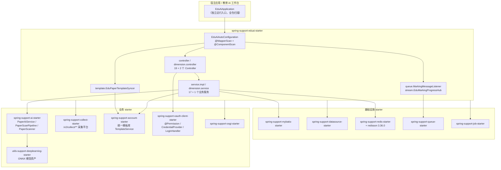
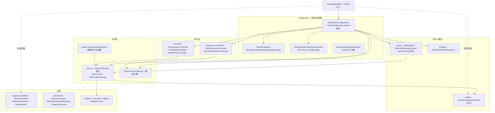
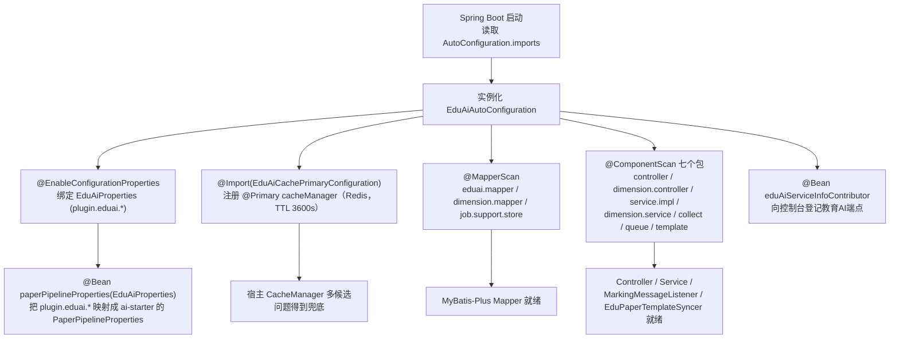
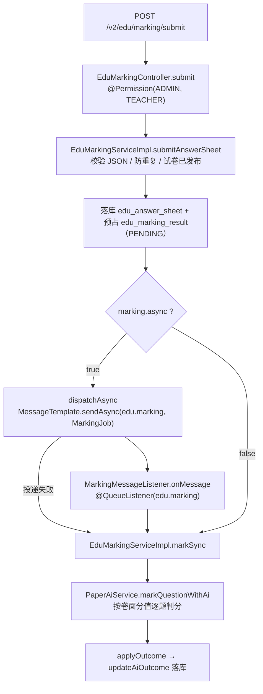

# spring-support-eduai-starter

教育 AI 集成模块：提供题库管理、AI 组卷、AI 阅卷（含扫描识别与 SSE 进度）、知识库语义检索、错题库、考试、以及汉字/成语/古诗/昆虫/词语等语文与自然素质教育语料能力。依赖 MyBatis-Plus、Redis 缓存、消息队列与 AI 聚合管线，是一个功能型业务 starter，不是基础设施开关。

- 自动配置入口：`META-INF/spring/org.springframework.boot.autoconfigure.AutoConfiguration.imports` → `com.chua.starter.eduai.configuration.EduAiAutoConfiguration`（本模块未使用已废弃的 `spring.factories` 机制，资源目录下无该文件）。
- 独立运行入口：`com.chua.starter.eduai.EduAiApplication`（「教育 AI 工作台」后端，`spring-boot-maven-plugin` 的 `mainClass` 指向它，`@SpringBootApplication` + `@Import(EduAiAutoConfiguration.class)` + `@EnableCaching`）。
- 父 POM：`spring-support-parent-starter:4.0.0.51`（`spring-boot-starter-parent:4.1.2`，Java 25）。

## 1. 架构图

### 1.1 模块在体系中的位置



依赖方向：`eduai → ai / collect / account / oauth-client / osgi / common`，`eduai → mybatis / datasource / redis / queue / job / deeplearning`（均来自 `pom.xml` 实际依赖）。eduai 是 ai-starter 的**消费方**（AI 管线），不是渠道管理者；采集管理已收敛到 collect-starter。

### 1.2 内部分层



> 装配差异（重要）：`EduAiAutoConfiguration` 的 `@ComponentScan` 只扫 `controller`、`dimension.controller`、`service.impl`、`dimension.service`、`collect`、`queue`、`template` 七个包。`service` 根包（`PaperComposeSettingService`、`EduAppConfigService`）、`stream`（`EduMarkingProgressHub`）、`support.credential`（`EduCredentialConfiguration`）**不在**该列表中，靠 `EduAiApplication` 的 `@SpringBootApplication` 全包扫描（工作台模式）或宿主显式扫描 `com.chua.starter.eduai` 才会装配。

## 2. 核心流程图

### 2.1 自动装配流程



### 2.2 扫描阅卷流程（`POST /v2/edu/marking/scan` → SSE 进度）

```mermaid
sequenceDiagram
    participant T as 教师/管理员
    participant C as EduMarkingController
    participant S as EduMarkingServiceImpl
    participant R as MarkingScanIntentResolver
    participant DB as EduMarkingTaskMapper
    participant P as PaperScanPipeline/PaperScanner (ai-starter)
    participant A as PaperAiService (ai-starter)
    participant H as EduMarkingProgressHub

    T->>C: POST /v2/edu/marking/scan（多张图片）
    C->>S: scanAndMark(images, mode, paperId, studentId, examId, maxScore)
    S->>R: resolve(...) 解析卷面二维码 PAPER:{paperId}[;STUDENT:学号][;EXAM:考试ID]
    R-->>S: 归回内置卷 / 自动绑定学生 / 替考告警
    S->>DB: saveTaskImages 图片落盘 + 插入 edu_marking_task（排队中）
    S-->>T: 立即返回 taskId（识别在后台虚拟线程执行）
    S->>S: kickTask → 虚拟线程，Semaphore(max-concurrent) 闸门 + runWithTimeout/FutureTask 超时
    S->>P: recognizeAndPrepare：预处理 → 版面/OCR → 结构化 → 落答题卡与结果行
    S->>A: gradePendingOfTask → markQuestionWithAi(...) 逐题判分
    A-->>S: 得分 + 评语
    S->>DB: 更新结果行与任务状态（已完成/失败）
    S->>H: changeStage 广播进度帧
    T->>C: GET /v2/edu/marking/stream/{taskId}（SSE）
    C->>H: 订阅
    H-->>T: progress 帧（15s 心跳，30 分钟超时）
```

### 2.3 手工提交阅卷与异步队列



## 3. 能力清单

| 能力域 | 关键类 | 入口 |
|:-------|:-------|:-----|
| 自动配置 | `EduAiAutoConfiguration` | `@MapperScan` + `@ComponentScan` + `plugin.eduai.*` |
| 配置绑定 | `EduAiProperties` | `plugin.eduai.*` |
| Redis CacheManager `@Primary` | `EduAiCachePrimaryConfiguration` | Redis 源，TTL 3600s |
| 题库管理 | `EduQuestionController`（`IEduQuestionService`） | `/v2/edu/question` |
| 试卷管理 / AI 组卷 | `EduPaperController` | `/v2/edu/paper`（`/generate`、`/{id}/replace`、`/qr/{no}` 题项二维码反查等 16 个端点） |
| 试卷模板 | `EduPaperTemplateController` | `/v2/edu/paper-template` |
| 试卷布置 | `EduPaperAssignController` | `/v2/edu/paper-assign` |
| 阅卷管理 | `EduMarkingController`（`IEduMarkingService`） | `/v2/edu/marking`（`/submit`、`/scan`、`/result/{taskId}`、`/confirm`、`/{taskId}/finish`、`/stream/{taskId}` SSE 等 13 个端点） |
| 阅卷异步队列 | `EduMarkingServiceImpl` / `MarkingMessageListener` / `MarkingJob` | `edu.marking` 队列（queue-starter） |
| 阅卷进度 SSE 推送 | `EduMarkingProgressHub` | `GET /v2/edu/marking/stream/{taskId}` |
| 知识点 / 知识库 | `EduKnowledgePointController` / `EduKnowledgeDocController` | `/v2/edu/knowledge-point`、`/v2/edu/knowledge-doc` |
| 错题库 | `EduWrongQuestionController` | `/v2/edu/wrongbook` |
| 考试管理 | `EduExamController` | `/v2/edu/exam` |
| 学生/教师中心 | `EduStudentCenterController` / `EduTeacherCenterController` | `/v2/edu/student`、`/v2/edu/teacher` |
| 维度字典（学科/年级/班级/学生/教师） | `EduDimensionController` / `EduStudentAvatarController`（`EduDimensionService`） | `/v2/edu/dimension`、`/v2/edu/student-avatar` |
| 语文语料（汉字/成语/古诗/古诗游戏/词语/昆虫） | `EduHanziController` / `EduIdiomController` / `EduPoemController` / `EduPoemChallengeController` / `EduWordController` / `EduInsectController` | `/v2/edu/hanzi`、`/v2/edu/idiom`、`/v2/edu/poem`、`/v2/edu/poem-challenge`、`/v2/edu/word`、`/v2/edu/insect` |
| 应用配置项（管理员） | `EduAppConfigController` / `EduAppConfigService` | `/v2/edu/app-config` |
| 趣味配置开关 | `EduFunConfigController` | `/v2/edu/fun` |
| 组卷运行时设置 | `PaperComposeSettingService` | 读 `sys_ai_global_setting` 的 `compose` 分组，回落 `plugin.eduai.paper.*` |
| 组卷模板 → 统一模板库同步 | `EduPaperTemplateSyncer`（实现 `SourceSyncer`，source=`paper`） | 注册进 account-starter 统一模板库，按其调度周期全量修复（类注释口径：每 5 分钟或页面「同步」按钮） |
| 学生/教师凭据与登录 | `EduCredentialConfiguration` + `StudentCredentialProvider` / `TeacherCredentialProvider` / `StudentLoginHandler` / `TeacherLoginHandler` | `POST /v2/user/login`（oauth-client 扩展点） |
| 服务信息登记 | `EduAiAutoConfiguration#eduAiServiceInfoContributor` | 控制台模块能力（`/v2/edu/debug/**` 仅为登记展示项，本模块当前未提供该 Controller） |
| 数据初始化 | `src/main/resources/db/init` | `V3.1__init_all_eduai.sql`（全量建表）+ `V3.0__initdata_all_eduai.sql`（全量幂等种子） |

实际生效的能力要点：

- **整卷二维码识别**：卷面页脚打印 `PAPER:{paperId}` 二维码（`PaperQrDecoder`，ZXing 解码），阅卷上传时自动归回内置卷，可追加 `;STUDENT:学号` 与 `;EXAM:考试ID`，身份冲突触发「替考告警」（`MarkingScanIntentResolver`）。
- **阅卷异步化**：`marking.async=true` 时手工提交走 `edu.marking` 队列（queue-starter 的 `MessageTemplate`，默认 `LocalMessageTemplate`），投递失败自动回退同步阅卷；扫描链路本身始终异步（先落任务立即返回 taskId，虚拟线程 + `Semaphore(max-concurrent)` 闸门 + `FutureTask` 超时）。重启时 `resumeUnfinishedTasks`（`@EventListener(ApplicationReadyEvent)`）续跑至多 `resume-limit` 个未完成任务。
- **任意卷识别策略**：`extract-strategy` 走 ai-starter `AnyExtractStrategy` SPI，`whole`（`WholeTextAnyExtractStrategy`，整卷一次识别，默认）/ `region`（`RegionAnyExtractStrategy`，按版面区域分块，回退整卷）。
- **归属隔离**：`EduUserContext#ownerScope()` 把「本用户 + 系统预置数据」过滤下推到 Mapper XML；无身份查询 fail-closed（永假值 `__anonymous__`），管理员不过滤。
- **权限注解**：维度管理、应用配置为管理员专属（类级 `@Permission("admin")`）；阅卷写操作仅 ADMIN/TEACHER。
- **组卷模板同步**至统一模板库（`template_info`，来源 `paper`），来源失效行自动清理。

## 4. Bean 能力矩阵

| Bean（方法/类） | 类型 | 装配条件 | 可否覆盖 | 典型注入姿势 |
|:----------------|:-----|:---------|:---------|:-------------|
| `EduAiAutoConfiguration` | 自动配置类 | 无条件（`AutoConfiguration.imports` 注册） | 否（入口类） | — |
| `paperPipelineProperties` | `PaperPipelineProperties`（ai-starter） | 无条件 `@Bean`；ai-starter 侧 `@Autowired(required=false)` 按类型注入，缺省 `new PaperPipelineProperties()` | 可以：宿主再声明同类型 Bean 即按类型接管注入点 | ai-starter 的 `PaperAiService` / `PaperScanPipeline` / `MarkingSettingService` 字段注入 |
| `eduAiServiceInfoContributor` | `ServiceInfoContributor` | 无条件 `@Bean` | 可以（同类型唯一时被引用） | 控制台端点/能力登记 |
| `cacheManager`（`EduAiCachePrimaryConfiguration`，经 `@Import`） | `CacheManager`（Redis 源，TTL 3600s） | 无条件；`@Primary` | 可以（`@Primary` Bean 可被更高优先级候选覆盖） | `@Autowired CacheManager`（解决多候选「required a single bean, but 10 were found」） |
| `studentCredentialProvider` / `teacherCredentialProvider` | `CredentialProvider`（oauth-client） | 无条件 `@Bean` + `ServiceProvider.register("student"/"teacher")` + `AccountTypeLoginHandler.bind` | 不建议覆盖：oauth 侧「自定义同名实现优先、内置 `builtin-*` 其次」 | oauth 登录链路按注册名解析 |
| `studentLoginHandler` / `teacherLoginHandler` | `LoginHandler`（system） | 无条件 `@Bean` + `ServiceProvider.register("STUDENT"/"TEACHER")` + `META-INF/extensions/...LoginHandler` 索引 | 不建议覆盖：登录口按 `loginType-accountType` 反射新建 | `POST /v2/user/login` 分发 |
| `EduAiProperties` | `@ConfigurationProperties("plugin.eduai")` | `@EnableConfigurationProperties` | 属性绑定可被环境覆盖 | 构造注入进服务与 `paperPipelineProperties` |
| 19 个 `@RestController`（controller 包） | `EduQuestionController` 等 | `@ComponentScan("...eduai.controller")` | 可以（同路径 Bean 冲突时启动报错） | MVC 端点 |
| 2 个 `@RestController`（dimension.controller 包） | `EduDimensionController` / `EduStudentAvatarController` | `@ComponentScan("...eduai.dimension.controller")` | 同上 | MVC 端点 |
| 17 个 `@Service`（service.impl 包） | `EduQuestionServiceImpl` / `EduMarkingServiceImpl` 等 | `@ComponentScan("...eduai.service.impl")` | 可以（替换实现类） | 接口注入（`IEduXxxService`） |
| `EduDimensionService` | `@Service` | `@ComponentScan("...eduai.dimension.service")` | 可以 | 维度字典业务 |
| `MarkingMessageListener` | `@Component` + `@QueueListener(EduMarkingServiceImpl.QUEUE_NAME)` | `@ComponentScan("...eduai.queue")` | 不建议 | 队列消费入口 |
| `EduPaperTemplateSyncer` | `@Component implements SourceSyncer` | `@ComponentScan("...eduai.template")`；同时被 account-starter 的同步器注册表发现 | 不建议 | 统一模板库同步 |
| `EduMarkingProgressHub` | `@Component` | **不在** AutoConfiguration 扫描列表；仅工作台模式（`EduAiApplication` 全包扫描）或宿主显式扫描时装配 | 可以 | `EduMarkingController` / `EduMarkingServiceImpl` 注入 |
| `PaperComposeSettingService` / `EduAppConfigService` | `@Service` | **不在** AutoConfiguration 扫描列表（service 根包）；同上 | 可以 | 组卷设置读取 / 应用配置 |
| `EduCredentialConfiguration` | `@Configuration` | **不在** AutoConfiguration 扫描列表（support.credential 包）；同上 | — | oauth SPI 注册入口 |

本模块的自动配置**没有使用任何 `@ConditionalOnXxx`**：引入即全量装配。运行期外部依赖（MySQL、Redis、队列）由宿主提供；`GlobalSettingReader`、`MessageTemplate` 等协作者是可选注入（缺失时回落默认行为，如 `PaperComposeSettingService` 缺 `GlobalSettingReader` 时直接用 YAML 默认值）。

## 5. 完整配置

配置前缀：**`plugin.eduai`**（`EduAiProperties`）。所有字段与默认值逐项来自 `EduAiProperties` 源码；「生效性」列标注该配置项在当前代码中的实际读取点。

### 5.1 阅卷 `plugin.eduai.marking.*`

| key | 类型 | 默认值 | 说明 | 生效性 |
|:----|:-----|:-------|:-----|:-------|
| `marking.async` | boolean | `true` | 手工提交是否异步阅卷（投递 `edu.marking` 队列）；扫描链路始终异步 | 生效（`submitAnswerSheet` 分支） |
| `marking.timeout` | int | `1800` | 单个阅卷任务**总预算**（秒），超时中止并释放并发闸门；下限 30s（`Math.max(30, ...)`） | 生效（`runWithTimeout`） |
| `marking.call-timeout` | int | `90` | 单次模型调用超时（秒）；经 `paperPipelineProperties` 映射给 ai-starter | 生效（映射） |
| `marking.max-score` | int | `5` | 单题最大分（兜底值，仅当卷面分值缺失时使用） | 生效（`markSync` 等多处） |
| `marking.wrong-score-rate` | double | `0.6` | 判错阈值：最终分/满分低于该比例记入错题库；0 = 只有 0 分才算错 | 生效（错题归位） |
| `marking.image-dir` | String | `./data/marking` | 扫描阅卷图片持久化目录（异步任务可重启续跑） | 生效（`saveTaskImages` 等） |
| `marking.resume-limit` | int | `50` | 启动时最多续跑未完成任务数 | 生效（`resumeUnfinishedTasks`） |
| `marking.max-concurrent` | int | `1` | 后台同时处理阅卷任务上限（下限 1，默认串行，防 ONNX 原生内存打满触发内核 OOM） | 生效（`Semaphore` 闸门） |
| `marking.preprocess` | boolean | `true` | 上传图片预处理（照度校正去阴影 + 灰度归一化） | 生效（映射给 ai-starter） |
| `marking.layout-correction` | boolean | `false` | ONNX 卡片/布局矫正（card-correction-detector），未检出自动回退原图 | 生效（映射给 ai-starter） |
| `marking.extract-strategy` | String | `whole` | 任意卷识别策略：`whole`（整卷，`WholeTextAnyExtractStrategy`）/ `region`（分块，`RegionAnyExtractStrategy`，回退整卷） | 生效（映射给 ai-starter） |

### 5.2 组卷 `plugin.eduai.paper.*`

| key | 类型 | 默认值 | 说明 | 生效性 |
|:----|:-----|:-------|:-----|:-------|
| `paper.max-total-score` | int | `100` | 试卷最高总分 | 兜底生效：`PaperComposeSettingService` 先读 `sys_ai_global_setting` 的 `compose` 分组，未配置才回落本值 |
| `paper.default-question-count` | int | `20` | 默认题目数量 | 同上 |
| `paper.default-score-per-question` | int | `5` | 默认每题分值 | 同上 |

### 5.3 知识库 `plugin.eduai.knowledge.*`

| key | 类型 | 默认值 | 说明 | 生效性 |
|:----|:-----|:-------|:-----|:-------|
| `knowledge.vector-dim` | int | `768` | 向量维度 | **未读取**：本模块主代码无读取点，仅声明 |

### 5.4 AI 引擎 `plugin.eduai.ai.*`

| key | 类型 | 默认值 | 说明 | 生效性 |
|:----|:-----|:-------|:-----|:-------|
| `ai.enabled` | boolean | `true` | 是否启用 AI（关闭后回退本地启发式） | 生效（映射给 ai-starter `PaperPipelineProperties.Ai.enabled`） |
| `ai.provider` | String | 无 | AI 服务商 | **未读取**：AI 客户端由 ai-starter 的 `ChatClientRegistry`/聚合 Bean 提供，配置走 AI 控制台 UI（落库 `sys_ai_global_setting`） |
| `ai.model` | String | 无 | 模型名 | **未读取**（同上） |
| `ai.temperature` | Double | `0.3` | 温度参数 | **未读取**（同上） |
| `ai.retry.times` | int | `5` | 最大重试次数（0 = 不重试） | 生效（映射给 ai-starter） |
| `ai.retry.backoff-millis` | long | `1000` | 初始退避毫秒 | 生效（映射） |
| `ai.retry.backoff-multiplier` | double | `2.0` | 退避倍数（<=1 按 2 处理） | 生效（映射） |
| `ai.retry.max-backoff-millis` | long | `20000` | 退避上限毫秒（<=0 按 15000 处理） | 生效（映射） |
| `ai.retry.retry-on-transient` | boolean | `true` | 除限流 429 外，是否重试瞬时故障（超时/502/503/连接异常） | 生效（映射） |

### 5.5 告警 `plugin.eduai.alert.*`

> 注意前缀：`Alert` 是 `EduAiProperties` 的**顶层字段**（与 `marking`/`ai` 平级），实际绑定前缀是 `plugin.eduai.alert.*`，不是 `plugin.eduai.ai.alert.*`。`EduAiProperties.Alert` 类内 Javadoc 示例写的 `ai.alert` 与字段结构不符，以本表为准。

| key | 类型 | 默认值 | 说明 | 生效性 |
|:----|:-----|:-------|:-----|:-------|
| `alert.enabled` | boolean | `false` | 是否启用告警（重试耗尽后 POST Webhook） | 生效（映射给 ai-starter，装配时生效） |
| `alert.webhook-url` | String | 无 | Webhook 地址（钉钉/企微/飞书标准卡片） | 生效（映射；本模块映射链路在启动时构建，改值需重启） |
| `alert.timeout-millis` | int | `5000` | HTTP 请求超时毫秒（<=0 按 5000 处理） | 生效（映射） |

### 5.6 采集 `plugin.eduai.collect.*`

| key | 类型 | 默认值 | 说明 | 生效性 |
|:----|:-----|:-------|:-----|:-------|
| `collect.default-cron` | String | `0 */30 * * * ?` | 采集任务未填 Cron 时的默认调度周期 | **未读取**：采集已收敛到 collect-starter（其调度走 `plugin.collect` 前缀），本项仅为兼容声明 |

### 5.7 框架级前置配置（非本模块定义，宿主需自行提供）

| key | 当前默认 | 说明 |
|:----|:---------|:-----|
| `plugin.oauth.enable` | `true` | oauth 鉴权开关 |
| `plugin.oauth.protocol` | `static` | 鉴权协议必须为 `static`（本地签发 TokenCipher/SM4 校验，`tcp` 会登录成功后列表全空） |
| `plugin.oauth.local-admin-fallback` | `false` | 必须保持 false（开启等价于「鉴权失败即内置 admin」越权漏洞） |
| `plugin.oauth.temp.user` | 空串 | 登录账号口令，部署方显式传入（`--plugin.oauth.temp.user='用户名:口令'`） |
| `plugin.datasource.script.enable` | `true` | 数据源脚本执行（`db/init` 下的 V3.x 脚本） |
| `plugin.datasource.script.scan-mode` | `ALWAYS` | 建表脚本每次启动扫描（按脚本名+版本记录去重执行） |
| `plugin.datasource.script.data-scan-mode` | `ONCE` | 种子数据只跑一次 |
| `plugin.queue.enable` / `plugin.queue.type` | `true` / `local` | 阅卷队列开关与本地实现 |
| `plugin.api.cors.enable` | — | 跨域白名单制（`allowed-origins` 为空不放行任何跨域来源） |

## 6. 使用方式

### 6.1 Maven 坐标

```xml
<dependency>
    <groupId>com.chua</groupId>
    <artifactId>spring-support-eduai-starter</artifactId>
    <version>4.0.0.51</version>
</dependency>
```

版本随父 POM `spring-support-parent-starter:4.0.0.51` 管理（`spring-boot-starter-parent:4.1.2`，Java 25）。例外：模块内显式钉了 `spring-support-account-starter:4.0.0.51`、`redisson-spring-boot-starter:3.36.0`、`com.google.zxing:core/javase:3.5.0`。

### 6.2 最小可运行示例

**第一步：引入依赖并准备中间件**（MySQL 主库 + Redis；`plugin.edu-auth.datasource` 第二数据源跟随主库）。

**第二步：配置 yaml**

```yaml
spring:
  datasource:
    url: jdbc:mysql://127.0.0.1:3306/eduai?useUnicode=true&characterEncoding=UTF-8&useSSL=false
    username: root
    password: ""
  data:
    redis:
      host: 127.0.0.1
      port: 6379
plugin:
  datasource:
    script:
      enable: true
      scan-mode: ALWAYS
      data-scan-mode: ONCE
  edu-auth:
    datasource:
      url: ${spring.datasource.url}
      username: ${spring.datasource.username}
      password: ${spring.datasource.password}
  oauth:
    enable: true
    protocol: static
    local-admin-fallback: false
    temp:
      user: "admin:change-me"
  queue:
    enable: true
    type: local
  eduai:
    marking:
      async: true
```

启动时 `db/init` 下 `V3.1__init_all_eduai.sql`（建表）与 `V3.0__initdata_all_eduai.sql`（种子）自动执行，全部语句幂等（`INSERT IGNORE` / `ON DUPLICATE KEY` / 条件 UPDATE），`data-scan-mode=ONCE` 时空库只灌一次。

**第三步：验证**

- 启动日志出现 `[EduAi]` 相关业务日志；`GET /actuator/health` 返回 UP；
- 登录：`POST /v2/user/login`（static 自签令牌），登录后带 `x-oauth-token` 访问：
  - `GET /v2/edu/question/page`（题库分页）
  - `POST /v2/edu/paper/generate`（AI 组卷，体带 `subject` / `knowledgePointIds` / `difficulty` 等）
  - `POST /v2/edu/marking/scan` 上传图片拿 `taskId`，再 `GET /v2/edu/marking/stream/{taskId}` 订阅 SSE 进度

### 6.3 调用示例

**AI 组卷**：

```bash
curl -X POST http://127.0.0.1:19095/v2/edu/paper/generate \
  -H "Content-Type: application/json" \
  -H "x-oauth-token: <token>" \
  -d '{
    "subject": "数学", "difficulty": 3,
    "knowledgePointIds": [1, 2, 3],
    "typeConfigs": [{"type": "选择题", "count": 10, "score": 5}]
  }'
# 返回 paperId；再 GET /v2/edu/paper/{id} 查看详情
```

**扫描阅卷 + SSE 进度**（多张图片按页顺序，同名 `file` 字段重复出现）：

```bash
curl -X POST http://127.0.0.1:19095/v2/edu/marking/scan \
  -H "x-oauth-token: <token>" \
  -F "mode=SELF" -F "paperId=123" -F "studentId=S001" \
  -F "file=@page1.png" -F "file=@page2.png"
# 返回 taskId
curl -N http://127.0.0.1:19095/v2/edu/marking/stream/<taskId> -H "x-oauth-token: <token>"
# SSE：progress 帧逐阶段推送，终态 done 收流
```

### 6.4 可选依赖说明

| 依赖 | 何时可选 | 说明 |
|:-----|:---------|:-----|
| `spring-support-collect-starter` | 不需要「采集管理」页时可移除 | 提供 `/v2/collect/**` 的 14 个 Controller 与流程图执行引擎；不加时页面能加载但请求 404 |
| `utils-support-deeplearning-starter` | 不用扫描阅卷时可移除 | ONNX 模型资产（paddleocrv6-tiny / ppdoclayoutv3 / doc-orientation，共约 137MB）**不随 maven 分发**，部署时按 `utils-support-models-parent` 约定放入模型目录（`-Ddeeplearning.model.root-dir`，默认 `models/onnx`）或打入应用资源 |
| `spring-support-osgi-starter` | 不需要源码级 SPI 热改时可移除 | 学生凭据校验等 SPI 实现源码化（`./osgi-source` 目录），未放置源码时自动跳过 |
| `redisson-spring-boot-starter` | 宿主已统一管理 Redisson 时可去版本钉死 | Boot 4 下旧 Redisson 自动配置不兼容（工作台在 `application.yml` 中排除），模块显式钉 3.36.0 |
| `spring-support-ai-starter` | 必需（exclusion 了 `spring-boot-starter-web`） | AI 管线；无它则组卷/阅卷判分不可用 |

## 7. 使用场景

**适用**：

- 需要题库、AI 组卷、扫描/手工阅卷、错题库、考试、知识点/知识库、学生教师中心的 K12 教育业务；
- 需要汉字/成语/古诗/词语/昆虫等语文与自然素质教育语料与游戏化学习接口；
- 以「教育 AI 工作台」（`EduAiApplication`）独立部署，或作为能力模块并入更大的 Spring Boot 平台。

**不适用**：

- 通用 AI 网关 / 对话 / 模型与渠道管理 —— 用 `spring-support-ai-starter`（eduai 不管理渠道，也不是 `FreeChatClient` 的提供方）；
- 只做题目采集而不需要教育业务闭环 —— 用 `spring-support-collect-starter`；
- 不需要 AI、只要纯题库 CRUD 的极简场景 —— 引入成本（Redis/队列/模型资产）偏高，可自行裁剪。

**与相邻模块的取舍**：

| 模块 | 方向 | 取舍说明 |
|:-----|:-----|:---------|
| `spring-support-ai-starter` | eduai 依赖它 | ai-starter 是通用 AI 管线基础设施（`/v2/ai` 对话、模型、用量、paper pipeline）；eduai 是面向教育业务的功能模块，聚合 ai-starter 并把 `plugin.eduai.*` 映射给 `PaperPipelineProperties`。二者易混淆：要「AI 能力」找 ai，要「教育业务」找 eduai |
| `spring-support-collect-starter` | eduai 依赖它 | 题库「采集管理」已收敛到采集平台 `/v2/collect/**`；eduai 的 `com.chua.starter.eduai.collect` 包不再提供 Controller（`@ComponentScan` 仍声明该包，但包目录不存在） |
| `spring-support-datasource-hub-starter` | 可组合，无依赖 | 采集平台经其注册数据源；eduai 本身用 `spring-support-datasource-starter` 的单库 |
| `spring-support-oauth-client-starter` | eduai 依赖它 | 鉴权注解 `@Permission` 与登录扩展点（`CredentialProvider` / `LoginHandler`） |
| `spring-support-account-starter` | eduai 依赖它（4.0.0.51） | 统一模板库，`EduPaperTemplateSyncer` 的目标 |
| `spring-support-osgi-starter` | eduai 依赖它 | 学生凭据校验等 SPI 实现源码化（`./osgi-source` 目录热改生效） |
| `spring-support-common-starter` | eduai 依赖它 | `ReturnResult` / `ServiceInfoContributor` / `@Permission` |

## 8. 扩展点

### 8.1 本模块实现并注册的 SPI（对外提供能力）

| 扩展点接口 | 本模块实现 | 注册方式 | 注册名 |
|:-----------|:-----------|:---------|:-------|
| `com.chua.starter.oauth.client.support.credential.CredentialProvider` | `StudentCredentialProvider` / `TeacherCredentialProvider` | `ServiceProvider.register`（代码可见）+ `AccountTypeLoginHandler.bind` 静态表 | `student` / `teacher` |
| `com.chua.starter.system.handler.LoginHandler` | `StudentLoginHandler` / `TeacherLoginHandler` | `ServiceProvider.register`（注册**类**，登录口反射新建，须无参构造）+ `META-INF/extensions/com.chua.starter.system.handler.LoginHandler` 索引 | `STUDENT` / `TEACHER`（SPI 大小写归一命中） |
| `com.chua.starter.account.template.support.service.SourceSyncer` | `EduPaperTemplateSyncer` | Spring Bean 被 account-starter 同步器注册表发现 | source=`paper` |
| `com.chua.starter.common.support.serviceinfo.ServiceInfoContributor` | `EduAiAutoConfiguration#eduAiServiceInfoContributor` | `@Bean` | — |

> 为什么 `LoginHandler` 要「显式注册 + 资源索引」双写：eduai 位于另一个模块/包，框架默认的两个扫描器（`SamePackageServiceResolver` 只扫接口所在包、`ServiceLoaderServiceResolver` 只认 `META-INF/services`）都扫不到它；且 SPI 的 provider 缓存是 SOFT 引用，回收重建后 `register` 的注册会丢，`META-INF/extensions` 索引由 `CustomServiceResolver` 在 provider 构造期读取，每次重建都会重新发现。两类扩展点缺一不可：`POST /v2/user/login` 按 `loginType-accountType` 组合取处理器，取不到直接空指针（对外 500）。

### 8.2 本模块消费、宿主可继续扩展的 SPI

| 扩展点 | 定义处 | 本模块行为 | 扩展方法 |
|:-------|:-------|:-----------|:---------|
| `AnyExtractStrategy` | ai-starter（`com.chua.starter.ai.support.paper.pipeline.strategy`） | 通过 `marking.extract-strategy` 选择内置实现：`whole`（`WholeTextAnyExtractStrategy`，默认）/ `region`（`RegionAnyExtractStrategy`） | 注册自定义 `AnyExtractStrategy` Bean，`PaperScanner` 按 SPI key 匹配；无匹配 key 时抛 `IllegalStateException` |
| `PaperPipelineProperties` | ai-starter | `EduAiAutoConfiguration#paperPipelineProperties` 把 `plugin.eduai.*` 映射成该 Bean | 宿主可声明自己的同类型 Bean 接管 ai-starter 的按类型注入 |
| `MessageTemplate` / `QueueListener` | queue-starter | `MarkingMessageListener` 订阅 `edu.marking` | 更换队列实现（如本地换 MQ）由 queue-starter 配置决定，eduai 不感知 |

### 8.3 可复用的公开方法与工具

- `EduMarkingServiceImpl#markSync(taskId, answers)` / `applyOutcome(...)` / `processTask(taskId)` 为 `public`：同步阅卷、结果落库、任务处理可被队列消费、续跑或宿主代码直接复用；
- `EduPaperTemplateSyncer#register(EduPaperTemplate)`：单条组卷模板注册进统一模板库；
- `EduUserContext`：`ownerScope()` / `requireUserId()` / `checkReadable(owner)` / `checkWritable(owner)` —— 教育域统一的身份与归属校验入口，宿主扩展教育业务时应复用而非自行解析令牌；
- `PaperQrDecoder` / `MarkingScanIntentResolver`：卷面二维码解码与扫描意图解析（内置卷归回、学生/考试自动绑定、替考判定）。

## 9. 常见问题

### 9.1 装配不生效

- **自动配置没进来**：确认使用 Spring Boot 2.7+/3.x/4.x 的 `AutoConfiguration.imports` 机制（本模块文件指向 `EduAiAutoConfiguration`）；本模块没有也不需要 `spring.factories`。
- **部分 Bean 缺失**：`EduMarkingProgressHub`（SSE）、`PaperComposeSettingService`、`EduAppConfigService`、`EduCredentialConfiguration` 不在 `EduAiAutoConfiguration` 的 `@ComponentScan` 七包之内。仅以 starter 依赖接入时，需宿主显式 `@ComponentScan("com.chua.starter.eduai")`（或使用 `EduAiApplication` 工作台模式）。缺 `EduCredentialConfiguration` 时 student/teacher 登录不可用。
- **Mapper 找不到**：`@MapperScan` 固定扫 `com.chua.starter.eduai.mapper`、`com.chua.starter.eduai.dimension.mapper`、`com.chua.starter.job.support.store`（第三个为采集调度依赖的 `MybatisJobRepository`/`JobMapper`）。自行重排包名会导致 Mapper/Bean 丢失。
- **CacheManager 启动报「required a single bean, but 10 were found」**：框架 4.0.0.51 起 `@Primary` 移到了 h2 profile 的 NoOp 实现上，连 MySQL 时无 `@Primary` 候选。本模块 `EduAiCachePrimaryConfiguration#cacheManager`（Redis 源，TTL 3600s）以 `@Primary` 兜底；若宿主另有 `@Primary` CacheManager 会产生两候选冲突，需二选一。
- **组卷参数不生效**：`paper.*` 三项先读 `sys_ai_global_setting` 的 `compose` 分组（AI 配置中心「试卷配置」页），YAML 只是兜底；页面保存后立即生效（直读全局层，不走用户覆盖层缓存）。

### 9.2 端口 / 开关类问题

- **阅卷「点了没反应」**：扫描链路是「立即返回 taskId + 后台处理」，进度请订阅 `GET /v2/edu/marking/stream/{taskId}`（SSE）或轮询 `GET /v2/edu/marking/result/{taskId}`，不要等待 scan 请求本身返回识别结果。
- **`marking.max-concurrent` 不要随意调大**：默认 1（串行）。每个任务都要跑 ONNX 版面 + OCR，原生/直连内存不受 `-Xmx` 约束；实测 5 路并发触发内核 OOM 杀进程（`oom-kill`），重启后续跑同样多任务，形成崩溃循环、任务永久卡在「识别中」。
- **`marking.timeout` 与 `marking.call-timeout` 是两个口径**：前者是单任务总预算（下限 30s），后者是单次模型调用上限。历史上共用 300s 曾导致 18 题卷在 17/18 处被整任务判失败。
- **队列投递失败会自动降级**：`dispatchAsync` 抛异常时回退同步阅卷；消费侧失败由 queue-starter 的重试/死信策略处理，重新提交答题卡即可重试（taskId 兜底）。
- **登录 500**：`POST /v2/user/login` 按 `loginType-accountType` 组合取 `LoginHandler`，取不到直接空指针（对外固定 500）。确认 `EduCredentialConfiguration` 已装配，且两类扩展点（`CredentialProvider` + `LoginHandler`）都在。
- **鉴权开关**：`plugin.oauth.protocol` 必须 `static`；`plugin.oauth.local-admin-fallback` 必须 `false`（开启等于越权漏洞）；`plugin.oauth.temp.user` 需显式传入。
- **数据脚本**：`plugin.datasource.script.enable=true` 时才会执行 `db/init`；建表 `ALWAYS` 扫描（按脚本名+版本去重），种子 `ONCE` 只在空库执行。

### 9.3 与 Spring Boot 4 的兼容性

- 仓库父 POM 已升级到 `spring-boot-starter-parent:4.1.2`，Java 25，`jakarta.*` 命名空间；本模块代码基于该基线编译。
- Boot 4 下自动配置只认 `META-INF/spring/org.springframework.boot.autoconfigure.AutoConfiguration.imports`；`spring.factories` 的 `EnableAutoConfiguration` 键已废弃，本模块未使用。
- Redisson 旧版自动配置与 Boot 4 不兼容（旧 `RedisProperties`）：本模块显式依赖 `redisson-spring-boot-starter:3.36.0`；工作台在 `application.yml` 中排除 Redisson 自动配置、保留 `DataRedisAutoConfiguration` 以注册 `DataRedisProperties`。
- ai-starter 依赖处 exclusion 了 `spring-boot-starter-web`，避免与宿主 Web 栈重复；WebMVC 由宿主（或工作台的 starter）提供。

### 9.4 已知限制

- **`knowledge.vector-dim` / `ai.provider` / `ai.model` / `ai.temperature` / `collect.default-cron` 未读取**：见第 5 节「生效性」列；AI 供应商与模型配置请走 AI 控制台 UI（落库 `sys_ai_global_setting`）。
- **告警前缀易踩坑**：告警配置的实际前缀是 `plugin.eduai.alert.*`（`Alert` 为顶层字段）；若按源码 Javadoc 示例写成 `plugin.eduai.ai.alert.*` 不会绑定。
- **无身份查询 fail-closed**：`EduUserContext.ownerScope()` 无身份返回永假值 `__anonymous__`，不泄漏数据；调度/队列等异步线程取不到身份，必须从父行继承归属。
- **维度管理与应用配置为管理员专属**：`/v2/edu/dimension/**`、`/v2/edu/app-config/**` 类级 `@Permission("admin")`；学生令牌访问会 403。
- **整卷二维码是身份证据**：卷面 `PAPER:{paperId}` 二维码可携带 `STUDENT` / `EXAM`，二维码学生与提交学生不一致时拒绝并告警「替考」。
- **`/v2/edu/debug/**` 仅为服务信息登记项**：控制台展示用，本模块当前没有对应 Controller。
- **ONNX 模型资产不随 maven 分发**：部署需按 `utils-support-models-parent` 约定放入模型目录（`-Ddeeplearning.model.root-dir`，默认 `models/onnx`），否则扫描阅卷模型不可用。
- **事务/幂等边界**：错题归位等写操作有 `@Transactional` 与 taskId 兜底，但「重新提交答题卡即可重试」依赖 queue-starter 的重试/死信策略，不属于本模块保证。
