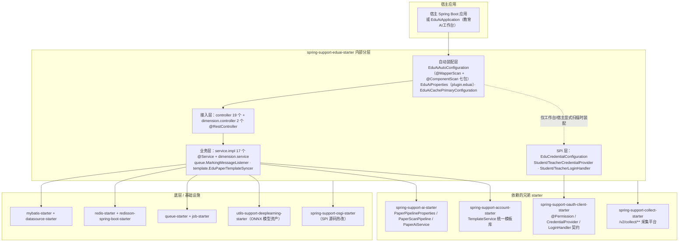

# spring-support-eduai-starter

教育 AI 集成模块：面向 K12 教学场景提供题库管理、AI 组卷、AI 阅卷（扫描识别 + SSE 进度）、知识库语义检索、错题库、考试管理，以及汉字/成语/古诗/词语/昆虫等语文与自然素质教育语料接口。在 spring-support 体系中它是**功能型业务 starter**：向下消费 `spring-support-ai-starter` 的 AI 管线，聚合 account / oauth-client / collect 等兄弟模块能力，向上为宿主应用或独立部署的「教育 AI 工作台」（`EduAiApplication`，默认端口 19095）提供 `/v2/edu/**` 全套 REST API。

- 自动配置入口：`META-INF/spring/org.springframework.boot.autoconfigure.AutoConfiguration.imports` → `com.chua.starter.eduai.configuration.EduAiAutoConfiguration`（本模块未使用已废弃的 `spring.factories` 机制）。
- 独立运行入口：`com.chua.starter.eduai.EduAiApplication`（`@SpringBootApplication` + `@Import(EduAiAutoConfiguration.class)` + `@EnableCaching`，`spring-boot-maven-plugin` 的 `mainClass` 指向它）。

## 1. 架构图



依赖方向（来自 `pom.xml`）：`eduai → ai / collect / account / oauth-client / osgi / common`，`eduai → mybatis / datasource / redis / queue / job / deeplearning`。eduai 是 ai-starter 的**消费方**（组卷/阅卷管线），不管理 AI 渠道；题库「采集管理」已收敛到 collect-starter。

## 2. 核心流程图

以最能代表本模块的「扫描阅卷」链路为例（`POST /v2/edu/marking/scan` → AI 判分 → SSE 进度推送）：

```mermaid
sequenceDiagram
    autonumber
    participant T as 教师/学生端
    participant C as EduMarkingController
    participant S as EduMarkingServiceImpl
    participant P as ai-starter PaperScanPipeline / PaperAiService
    participant H as EduMarkingProgressHub（SSE）
    T->>C: POST /v2/edu/marking/scan（多张答题卡图片）
    C->>S: scanAndMark(images, mode, paperId, studentId, examId, maxScore)
    S->>S: MarkingScanIntentResolver 解析卷面二维码 PAPER:{paperId}[;STUDENT:学号][;EXAM:考试ID]
    S-->>T: 立即返回 taskId（任务落库「排队中」，图片持久化到 marking.image-dir）
    S->>S: 后台虚拟线程：Semaphore(max-concurrent) 闸门 + runWithTimeout(timeout)
    S->>S: recognizeAndPrepare → 调 P 预处理 / 版面 / OCR → 结构化落答题卡与结果行
    S->>S: gradePendingOfTask → 逐题调 P.markQuestionWithAi 判分（retry 退避策略）
    S->>S: applyOutcome 落任务状态；得分率低于 wrong-score-rate 归入错题库
    S->>H: changeStage 广播进度帧
    T->>C: GET /v2/edu/marking/stream/{taskId}（SSE）
    H-->>T: progress 帧（15s 心跳）→ done 终态收流
```

手工提交链路（`POST /v2/edu/marking/submit`）在 `marking.async=true` 时经 `MessageTemplate` 投递 `edu.marking` 队列，由 `MarkingMessageListener` 消费；投递失败自动回退同步判分。启动时 `resumeUnfinishedTasks`（`@EventListener(ApplicationReadyEvent)`）续跑至多 `resume-limit` 个未完成任务。

## 3. 能力清单

| 能力域 | 关键类 | 入口/触发方式 |
|:-------|:-------|:--------------|
| 自动装配 / 配置绑定 | `EduAiAutoConfiguration` / `EduAiProperties` | `AutoConfiguration.imports` 注册；绑定 `plugin.eduai.*` |
| `@Primary` CacheManager | `EduAiCachePrimaryConfiguration` | `@Import` 随自动配置装配（Redis 源，TTL 3600s） |
| 题库管理 | `EduQuestionController` / `IEduQuestionService` | `/v2/edu/question` |
| 试卷管理 / AI 组卷 | `EduPaperController` | `/v2/edu/paper`（`/generate`、`/{id}/replace`、`/qr/{no}` 题项二维码反查等 16 个端点） |
| 试卷模板 / 布置 | `EduPaperTemplateController` / `EduPaperAssignController` | `/v2/edu/paper-template`、`/v2/edu/paper-assign` |
| 阅卷管理 | `EduMarkingController` / `IEduMarkingService` | `/v2/edu/marking`（`/submit`、`/scan`、`/result/{taskId}`、`/confirm`、`/{taskId}/finish`、`/stream/{taskId}` 等 13 个端点） |
| 阅卷异步与进度推送 | `MarkingMessageListener` / `MarkingJob` / `EduMarkingProgressHub` | `@QueueListener("edu.marking")`（queue-starter）；`GET /v2/edu/marking/stream/{taskId}`（SSE） |
| 知识点 / 知识库 | `EduKnowledgePointController` / `EduKnowledgeDocController` | `/v2/edu/knowledge-point`、`/v2/edu/knowledge-doc` |
| 错题库 | `EduWrongQuestionController` | `/v2/edu/wrongbook` |
| 考试管理 | `EduExamController` | `/v2/edu/exam` |
| 学生 / 教师中心 | `EduStudentCenterController` / `EduTeacherCenterController` | `/v2/edu/student`、`/v2/edu/teacher` |
| 维度字典（学科/年级/班级/学生/教师） | `EduDimensionController` / `EduStudentAvatarController` | `/v2/edu/dimension`、`/v2/edu/student-avatar` |
| 语文与自然语料 | `EduHanziController` / `EduIdiomController` / `EduPoemController` / `EduPoemChallengeController` / `EduWordController` / `EduInsectController` | `/v2/edu/hanzi`、`/v2/edu/idiom`、`/v2/edu/poem`、`/v2/edu/poem-challenge`、`/v2/edu/word`、`/v2/edu/insect` |
| 应用配置 / 趣味开关 | `EduAppConfigController` / `EduFunConfigController` | `/v2/edu/app-config`、`/v2/edu/fun` |
| 组卷运行时设置 | `PaperComposeSettingService` | 先读 `sys_ai_global_setting` 的 `compose` 分组，未配置回落 `plugin.eduai.paper.*` |
| 组卷模板同步 | `EduPaperTemplateSyncer`（实现 `SourceSyncer`，source=`paper`） | 注册进 account-starter 统一模板库，按其调度周期全量修复 |
| 学生 / 教师登录 | `EduCredentialConfiguration` + `Student/TeacherCredentialProvider` + `Student/TeacherLoginHandler` | `POST /v2/user/login`（oauth 扩展点，accountType=`student`/`teacher`） |
| 服务信息登记 | `EduAiAutoConfiguration#eduAiServiceInfoContributor` | 向控制台登记 `/v2/edu/**` 端点与 `eduai` 能力旗标 |
| 数据初始化 | `src/main/resources/db/init` 下 `V3.1__init_all_eduai.sql` + `V3.0__initdata_all_eduai.sql` | `plugin.datasource.script.*` 触发，全幂等 |

## 4. Bean 能力矩阵

| Bean（方法/类） | 类型 | 装配条件 | 可否覆盖 | 典型用途 |
|:----------------|:-----|:---------|:---------|:---------|
| `EduAiAutoConfiguration` | 自动配置类 | 无条件（`AutoConfiguration.imports` 注册） | 否（入口类） | `@MapperScan` 三包 + `@ComponentScan` 七包 + `@Import` 缓存配置 |
| `paperPipelineProperties` | `PaperPipelineProperties`（ai-starter） | 无条件 `@Bean`（**无 `@Primary`**） | 仅限：① 声明**同名** Bean 并开启 `spring.main.allow-bean-definition-overriding=true`；② 排除本自动配置。声明同类型异名 Bean 会因双候选无主次抛 `NoUniqueBeanDefinitionException` | 把 `plugin.eduai.*` 映射给 ai-starter 组卷/阅卷管线 |
| `eduAiServiceInfoContributor` | `ServiceInfoContributor` | 无条件 `@Bean` | 可以 | 控制台端点/能力登记 |
| `cacheManager` | `CacheManager`（Redis 源，TTL 3600s） | `@Bean` + `@Primary`（`EduAiCachePrimaryConfiguration`，经 `@Import`） | 可以（可被宿主更高优先级候选取代，但注意双 `@Primary` 冲突） | 兜底「多候选 CacheManager 无法唯一注入」 |
| `EduAiProperties` | `@ConfigurationProperties("plugin.eduai")` | `@EnableConfigurationProperties` | 属性可被环境覆盖 | 配置绑定，构造注入各服务 |
| `student/teacherCredentialProvider` / `student/teacherLoginHandler` | `CredentialProvider`（oauth-client）/ `LoginHandler`（system） | `@Bean`（`EduCredentialConfiguration`，**不在**自动扫描七包内）+ `ServiceProvider.register`（`student`/`teacher` 与 `TEACHER`/`STUDENT`）+ `AccountTypeLoginHandler.bind` + `META-INF/extensions/...LoginHandler` 索引 | 不建议（oauth 自定义同名优先；登录口按类反射新建） | student/teacher 凭据校验；`POST /v2/user/login` 按 `loginType-accountType` 分发 |
| 19 + 2 个 `@RestController` | `EduQuestionController` 等 | `@ComponentScan`（`controller`、`dimension.controller`） | 可以 | `/v2/edu/**` MVC 端点 |
| 17 + 1 个 `@Service` | `EduQuestionServiceImpl` 等 + `EduDimensionService` | `@ComponentScan`（`service.impl`、`dimension.service`） | 可以（替换实现类） | 业务接口实现 |
| `MarkingMessageListener` | `@Component` + `@QueueListener` | `@ComponentScan`（`queue`） | 不建议 | `edu.marking` 队列消费入口 |
| `EduPaperTemplateSyncer` | `@Component implements SourceSyncer` | `@ComponentScan`（`template`）；同时被 account-starter 同步器注册表发现 | 不建议 | 组卷模板 → 统一模板库 |
| `EduMarkingProgressHub` / `PaperComposeSettingService` / `EduAppConfigService` / `EduCredentialConfiguration` | `@Component` / `@Service` / `@Configuration` | **不在**自动扫描七包：仅工作台模式（`EduAiApplication` 全包扫描）或宿主显式扫描 `com.chua.starter.eduai` 时装配 | 可以 | SSE 推送 / 组卷设置 / 应用配置 / SPI 注册入口 |

本模块自动配置**未使用任何 `@ConditionalOnXxx`，各 `@Bean` 也没有 `@ConditionalOnMissingBean`**：引入即全量装配。运行期外部依赖（MySQL、Redis、队列）由宿主提供；`GlobalSettingReader`（组卷设置，缺失时直接用 YAML 兜底值）、`MarkingSettingService`（匹配模式，缺失按宽松处理）、`TransactionTemplate`（自动结案事务，缺失则不开事务）是 `@Autowired(required = false)` 的可选注入；`EduAiProperties`、`MessageTemplate`（queue-starter 默认 `LocalMessageTemplate`）等仍是必需构造依赖，缺失则启动失败。

## 5. 完整配置

配置前缀：**`plugin.eduai`**（`EduAiProperties`）。以下字段与默认值逐项来自该类源码（含嵌套类）。

| 配置路径 | 类型 | 默认值 | 说明 |
|:---------|:-----|:-------|:-----|
| `marking.async` | boolean | `true` | 手工提交是否异步阅卷（投递 `edu.marking` 队列）；扫描链路始终异步 |
| `marking.timeout` | int | `1800` | 单任务**总预算**（秒），超时中止并释放并发闸门；下限 30s |
| `marking.call-timeout` | int | `90` | 单次模型调用超时（秒），经 `paperPipelineProperties` 映射给 ai-starter |
| `marking.max-score` | int | `5` | 单题最大分（卷面分值缺失时的兜底值） |
| `marking.wrong-score-rate` | double | `0.6` | 判错阈值：最终分/满分低于该比例记入错题库；0 = 仅 0 分算错 |
| `marking.image-dir` | String | `./data/marking` | 扫描阅卷图片持久化目录（任务可重启续跑） |
| `marking.resume-limit` | int | `50` | 启动时最多续跑的未完成任务数 |
| `marking.max-concurrent` | int | `1` | 后台并发阅卷任务上限（默认串行，防 ONNX 原生内存打满触发 OOM） |
| `marking.grade-concurrency` | int | `4` | 单任务内逐题判分的模型调用并发数（虚拟线程 + 信号量限流），运行时下限 1；自有卷规则判分不调模型、不并发 |
| `marking.preprocess` | boolean | `true` | 上传图片预处理（照度校正去阴影 + 灰度归一化） |
| `marking.layout-correction` | boolean | `false` | ONNX 卡片/布局矫正，未检出自动回退原图 |
| `marking.extract-strategy` | String | `whole` | 任意卷识别策略（ai-starter `AnyExtractStrategy` SPI key）：`whole` 整卷一次识别 / `region` 按版面分块（回退整卷） |
| `marking.submit-grace-seconds` | int | `30` | 在线交卷宽限秒数：考试到期后仍允许学生提交的宽限；只约束在线提交链路 |
| `paper.max-total-score` | int | `100` | 试卷最高总分（`sys_ai_global_setting` 的 `compose` 分组优先于本值） |
| `paper.default-question-count` | int | `20` | 默认题目数量（同上） |
| `paper.default-score-per-question` | int | `5` | 默认每题分值（同上） |
| `knowledge.vector-dim` | int | `768` | 向量维度（**当前主代码无读取点**，仅声明） |
| `ai.enabled` | boolean | `true` | 是否启用 AI（关闭后回退本地启发式），映射给 ai-starter |
| `ai.provider` / `ai.model` / `ai.temperature` | String / String / Double | 无 / 无 / `0.3` | AI 服务商 / 模型名 / 温度参数（**均未读取**：客户端由 ai-starter 聚合 Bean / 控制台配置提供） |
| `ai.retry.times` | int | `5` | 最大重试次数（0 = 不重试），映射给 ai-starter |
| `ai.retry.backoff-millis` | long | `1000` | 初始退避毫秒 |
| `ai.retry.backoff-multiplier` | double | `2.0` | 退避倍数（<=1 按 2 处理） |
| `ai.retry.max-backoff-millis` | long | `20000` | 退避上限毫秒（<=0 按 15000 处理） |
| `ai.retry.retry-on-transient` | boolean | `true` | 除限流 429 外是否重试瞬时故障（超时/502/503/连接异常） |
| `collect.default-cron` | String | `0 */30 * * * ?` | **未读取**：采集已收敛到 collect-starter（走 `plugin.collect` 前缀），本项仅为兼容声明 |
| `alert.enabled` | boolean | `false` | 是否启用 AI 调用失败告警（重试耗尽后 POST Webhook），映射给 ai-starter |
| `alert.webhook-url` | String | 无 | Webhook 地址（钉钉/企微/飞书标准卡片） |
| `alert.timeout-millis` | int | `5000` | 告警 HTTP 请求超时毫秒（<=0 按 5000 处理） |
> 前缀易踩坑：`alert` 是 `EduAiProperties` 的**顶层字段**（与 `marking`/`ai` 平级），实际绑定前缀是 `plugin.eduai.alert.*`，**不是** `plugin.eduai.ai.alert.*`。

### 5.1 逐项配置示例（按功能分组）

每组给出可直接粘贴的 YAML 片段，行内注释即「含义 + 默认值」；默认值与 `EduAiProperties` 字段初始化一致，带回落语义的项已标注运行时实际生效的下限/兜底值。

**阅卷 `plugin.eduai.marking.*`**（消费方：`EduMarkingServiceImpl`、`MarkingMessageListener`、ai-starter 扫描管线）：

```yaml
plugin:
  eduai:
    marking:
      async: true                # 手工提交是否异步阅卷；默认 true，投递 edu.marking 队列
      timeout: 1800              # 单任务总预算（秒）；默认 1800，运行时下限 30
      call-timeout: 90           # 单次模型调用超时（秒）；默认 90，映射给 ai-starter
      max-score: 5               # 卷面分值缺失时的单题最大分兜底；默认 5
      wrong-score-rate: 0.6      # 判错阈值（最终分/满分）；默认 0.6，0 = 仅 0 分算错
      image-dir: ./data/marking  # 扫描图片持久化目录；默认 ./data/marking
      resume-limit: 50           # 启动时最多续跑的未完成任务数；默认 50
      max-concurrent: 1          # 后台并发任务上限；默认 1（ONNX 原生内存不受 -Xmx 约束，勿盲目调大）
      grade-concurrency: 4       # 单任务内逐题判分的模型调用并发；默认 4，运行时下限 1
      preprocess: true           # 上传图片预处理（照度校正 + 灰度归一化）；默认 true
      layout-correction: false   # ONNX 卡片/布局矫正；默认 false，未检出自动回退原图
      extract-strategy: whole    # 任意卷识别策略；默认 whole，可选 region，未知值回落 whole
      submit-grace-seconds: 30   # 考试到期后的在线交卷宽限秒数；默认 30
```

**组卷 `plugin.eduai.paper.*`**（消费方：`PaperComposeSettingService`；`sys_ai_global_setting` 的 `compose` 分组已配置时优先于本组）：

```yaml
plugin:
  eduai:
    paper:
      max-total-score: 100          # 试卷最高总分；默认 100
      default-question-count: 20    # 默认题目数量；默认 20
      default-score-per-question: 5 # 默认每题分值；默认 5
```

**知识库 `plugin.eduai.knowledge.*`**：

```yaml
plugin:
  eduai:
    knowledge:
      vector-dim: 768            # 向量维度；默认 768（当前主代码无读取点，仅声明）
```

**AI 引擎与重试 `plugin.eduai.ai.*`**（`enabled`/`retry` 经 `EduAiAutoConfiguration` 映射给 ai-starter `PaperPipelineProperties`）：

```yaml
plugin:
  eduai:
    ai:
      enabled: true               # 是否启用 AI；默认 true，关闭后回退本地启发式
      provider: your-provider     # AI 服务商；当前未读取（客户端由 ai-starter 聚合 Bean/控制台配置提供）
      model: your-model           # 模型名；当前未读取
      temperature: 0.3            # 温度参数；默认 0.3，当前未读取
      retry:
        times: 5                  # 最大重试次数；默认 5，0 = 不重试
        backoff-millis: 1000      # 初始退避毫秒；默认 1000
        backoff-multiplier: 2.0   # 退避倍数；默认 2.0，<=1 按 2 处理
        max-backoff-millis: 20000 # 退避上限毫秒；默认 20000，<=0 按 15000 处理
        retry-on-transient: true  # 除限流 429 外是否重试瞬时故障（超时/502/503/连接异常）；默认 true
```

**告警 `plugin.eduai.alert.*`**（注意是顶层字段，不在 `ai` 之下；消费方：ai-starter `PaperAiService` 重试耗尽告警）：

```yaml
plugin:
  eduai:
    alert:
      enabled: true                                             # 是否启用告警；默认 false
      webhook-url: https://your-webhook.example.com/eduai-alert # Webhook 地址；默认空，留空时不发送
      timeout-millis: 5000                                      # 告警 HTTP 超时毫秒；默认 5000，<=0 按 5000 处理
```

**题库采集兼容项 `plugin.eduai.collect.*`**（采集已收敛到 collect-starter 的 `plugin.collect.*`，本组当前无读取点）：

```yaml
plugin:
  eduai:
    collect:
      default-cron: "0 */30 * * * ?"   # 采集任务未填 Cron 时的默认调度周期；仅兼容声明
```

### 5.2 完整 YAML 示例

生产部署参考（地址、账号口令一律用占位符，落盘前替换为本环境真实值并纳入凭据管理）：

```yaml
spring:
  datasource:
    url: jdbc:mysql://127.0.0.1:3306/eduai?useUnicode=true&characterEncoding=UTF-8&useSSL=false
    username: your-username
    password: your-password
  data:
    redis:
      host: 127.0.0.1
      port: 6379
      password: your-password
plugin:
  datasource:
    script:
      enable: true
      scan-mode: ALWAYS        # 建表脚本按「脚本名+版本」去重执行
      data-scan-mode: ONCE     # 种子数据仅空库灌一次
  oauth:
    enable: true
    protocol: static           # 本地签发令牌必须用 static
    local-admin-fallback: false
    temp:
      user: "admin:change-me"  # 启动参数显式传入，勿提交真实口令
  queue:
    enable: true
    type: local                # 阅卷队列；生产建议换 MQ 实现
  eduai:
    marking:
      async: true
      timeout: 1800
      call-timeout: 90
      max-score: 5
      wrong-score-rate: 0.6
      image-dir: /data/eduai/marking
      resume-limit: 50
      max-concurrent: 1
      grade-concurrency: 4
      preprocess: true
      layout-correction: false
      extract-strategy: whole
      submit-grace-seconds: 30
    paper:
      max-total-score: 100
      default-question-count: 20
      default-score-per-question: 5
    knowledge:
      vector-dim: 768
    ai:
      enabled: true
      retry:
        times: 5
        backoff-millis: 1000
        backoff-multiplier: 2.0
        max-backoff-millis: 20000
        retry-on-transient: true
    alert:
      enabled: true
      webhook-url: https://your-webhook.example.com/eduai-alert
      timeout-millis: 5000
```

`ai.provider` / `ai.model` / `ai.temperature` 与 `collect.default-cron` 当前主代码未读取，完整示例中省略；需要占位声明时按 5.1 补充。

## 6. 使用方式

### 6.1 Maven 坐标

```xml
<dependency>
    <groupId>com.chua</groupId>
    <artifactId>spring-support-eduai-starter</artifactId>
    <version>4.0.0.51</version>
</dependency>
```

版本随父 POM `spring-support-parent-starter:4.0.0.51` 管理。模块内显式钉版：`spring-support-account-starter:4.0.0.51`、`redisson-spring-boot-starter:4.8.0`（Boot 4 下旧版自动配置不兼容）、`com.google.zxing:core/javase:3.5.0`（父 POM 未管理）。

### 6.2 最小启用示例

引入依赖并准备 MySQL 主库 + Redis，配置（`plugin.edu-auth.datasource` 第二数据源必须配置，`url`/`username`/`password` 用 `${spring.datasource.*}` 占位跟随主库，缺 url 时 Hikari 启动报错）：

```yaml
spring:
  datasource:
    url: jdbc:mysql://127.0.0.1:3306/eduai?useUnicode=true&characterEncoding=UTF-8&useSSL=false
    username: root
    password: ""
  data:
    redis:
      host: 127.0.0.1
      port: 6379
plugin:
  datasource:
    script:
      enable: true
      scan-mode: ALWAYS        # 建表脚本按「脚本名+版本」去重执行
      data-scan-mode: ONCE     # 种子数据仅空库灌一次
  oauth:
    enable: true
    protocol: static           # 本地签发令牌必须用 static；tcp 会「登录成功后列表全空」
    local-admin-fallback: false
    temp:
      user: "admin:change-me"  # 部署方启动参数显式传入，勿提交真实口令
  queue:
    enable: true
    type: local                # 阅卷队列；生产可换 MQ 实现
  eduai:
    marking:
      async: true
      timeout: 1800
      call-timeout: 90
```

启动时 `db/init` 下建表与种子脚本自动执行（全幂等）。验证：`GET /actuator/health` 返回 UP；`POST /v2/user/login`（static 自签令牌）后带 `x-oauth-token` 访问 `GET /v2/edu/question/page`、`POST /v2/edu/paper/generate`；`POST /v2/edu/marking/scan` 上传图片拿 `taskId`，再订阅 `GET /v2/edu/marking/stream/{taskId}`。

### 6.3 可选依赖说明

| 依赖 | 何时可选 | 缺了会怎样 |
|:-----|:---------|:-----------|
| `spring-support-ai-starter` | 必需（已 exclusion `spring-boot-starter-web`） | 无它则 AI 组卷、阅卷判分、模型调用整条管线不可用；WebMVC 由宿主提供 |
| `spring-support-collect-starter` | 不需要「采集管理」页时可移除 | `/v2/collect/**` 请求 404（页面能加载） |
| `utils-support-deeplearning-starter` | 不用扫描阅卷时可移除 | ONNX 模型资产（paddleocrv6-tiny / ppdoclayoutv3 / doc-orientation，约 137MB）**不随 maven 分发**，需按 `-Ddeeplearning.model.root-dir`（默认 `models/onnx`）部署；缺模型时扫描识别不可用 |
| `spring-support-osgi-starter` | 不需要 SPI 源码热改时可移除 | 未放置 `./osgi-source` 源码时自动跳过，无副作用 |
| `redisson-spring-boot-starter` | 宿主统一管理 Redisson 时可去版本钉死 | 缺失时按 `spring-support-redis-starter` 内部依赖解析；钉版 4.8.0 规避 Boot 4 不兼容 |

### 6.4 生产注意事项

- **并发与内存**：`marking.max-concurrent` 保持默认 `1` 起步。每个扫描阅卷任务都要跑 ONNX 版面 + OCR，原生/直连内存不受 `-Xmx` 约束，实测 5 路并发触发内核 OOM 后进入「崩溃-重启-续跑」循环；调大 `marking.grade-concurrency` 前先确认下游模型网关限流配额（429 会触发重试退避，反而更慢）。
- **两个超时别混用**：`marking.timeout` 是单任务总预算（运行时下限 30 秒，超时中止并释放并发闸门），`marking.call-timeout` 是单次模型调用上限；前者防任务卡死，后者防单次请求无限挂住。
- **图片目录必须持久化**：扫描阅卷任务可重启续跑，`marking.image-dir` 要落到可靠磁盘（容器部署请挂载卷），否则重启后未完成任务无法恢复输入图片。
- **队列实现**：`plugin.queue.type: local` 的本地队列在进程重启时会丢在途消息；手工提交异步链路在投递失败时会自动回退同步判分，但生产环境建议接入 MQ 实现并开启持久化。
- **凭据管理**：`plugin.oauth.temp.user`、Redis 口令、`alert.webhook-url` 中的 token 等一律通过启动参数/环境变量/配置中心注入，仓库与日志中只保留占位符（如 `change-me`、`your-webhook.example.com`），不得出现真实凭据。
- **模型资产部署**：扫描识别依赖的 ONNX 模型（paddleocrv6-tiny / ppdoclayoutv3 / doc-orientation，约 137MB）不随 maven 分发，需按 `-Ddeeplearning.model.root-dir`（默认 `models/onnx`）预先部署；缺模型时扫描识别不可用，手工提交链路不受影响。
- **CacheManager 唯一性**：本模块以 `@Primary` 提供 Redis 源 CacheManager（TTL 3600s）兜底多候选问题；宿主若另有 `@Primary` CacheManager 会双主冲突，需二选一。
- **数据库初始化**：`db/init` 建表与种子脚本幂等、首次启动自动执行；不要手工改动脚本对应的表结构，升级以脚本版本为准。
- **时钟与宽限**：在线交卷超时按服务端「草稿答题卡创建时间 + 考试时长」判定，多实例部署请保证 NTP 对时；`submit-grace-seconds` 只用于吸收网络往返与前端倒计时偏差，不要用它补偿时钟漂移。

## 7. 使用场景

**适用**：

- 需要题库、AI 组卷、扫描/手工阅卷、错题库、考试、知识点/知识库、学生教师中心的 K12 教育业务；
- 需要汉字/成语/古诗/词语/昆虫等语文与自然素质教育语料与游戏化学习接口；
- 以「教育 AI 工作台」（`EduAiApplication`）独立部署，或作为能力模块并入更大的 Spring Boot 平台。

**不适用 / 慎用**：

- 通用 AI 网关、对话、模型与渠道管理 —— 用 `spring-support-ai-starter`（eduai 不管理渠道，也不是 `FreeChatClient` 提供方）；
- 只做题目采集、不需要教育业务闭环 —— 用 `spring-support-collect-starter`；
- 不需要 AI 的纯题库 CRUD 极简场景 —— 本模块引入成本（Redis/队列/模型资产）偏高，可自行裁剪。

**与相邻模块的取舍**：`spring-support-ai-starter` 是通用 AI 管线基础设施，eduai 是面向教育业务的功能模块（把 `plugin.eduai.*` 映射给 `PaperPipelineProperties`），要「AI 能力」找 ai、要「教育业务」找 eduai；`spring-support-collect-starter` 负责采集平台 `/v2/collect/**`；`spring-support-account-starter` 提供统一模板库（`EduPaperTemplateSyncer` 的目标）；`spring-support-oauth-client-starter` 提供 `@Permission` 与登录扩展点；`spring-support-common-starter` 提供 `ReturnResult` / `ServiceInfoContributor` 等公共契约。

## 8. 扩展点

**本模块实现并注册的 SPI（对外提供能力）**：

| 扩展点接口 | 本模块实现 | 注册方式 | 注册名 |
|:-----------|:-----------|:---------|:-------|
| `com.chua.starter.oauth.client.support.credential.CredentialProvider` | `StudentCredentialProvider` / `TeacherCredentialProvider` | `ServiceProvider.register` + `AccountTypeLoginHandler.bind` 静态表 | `student` / `teacher` |
| `com.chua.starter.system.handler.LoginHandler` | `StudentLoginHandler` / `TeacherLoginHandler` | `ServiceProvider.register`（注册类，须无参构造）+ `META-INF/extensions/com.chua.starter.system.handler.LoginHandler` 索引 | `TEACHER` / `STUDENT`（SPI 大小写归一命中） |
| `com.chua.starter.account.template.support.service.SourceSyncer` | `EduPaperTemplateSyncer` | Spring Bean 被 account-starter 同步器注册表发现 | source=`paper` |
| `com.chua.starter.common.support.serviceinfo.ServiceInfoContributor` | `EduAiAutoConfiguration#eduAiServiceInfoContributor` | `@Bean` | — |

> `LoginHandler` 采用「显式注册 + 资源索引」双写：eduai 在另一模块/包，框架默认扫描器（只扫接口所在包、只认 `META-INF/services`）都发现不了它；且 SPI provider 缓存是 SOFT 引用，回收重建后 `register` 会丢，`META-INF/extensions` 索引在 provider 构造期读取、每次重建重新发现。两类扩展点缺一不可：登录口按 `loginType-accountType` 取处理器，取不到直接空指针（对外 500）。

**本模块消费、宿主可继续扩展的 SPI**：

- `AnyExtractStrategy`（ai-starter）：经 `marking.extract-strategy` 选内置实现（`whole` 默认 / `region`）；可注册自定义 Bean，`PaperScanner` 按 SPI key 匹配，未匹配的 key 回落 `whole`（无 `whole` 实现时取第一个候选），一个实现都没有才抛 `IllegalStateException`。
- `PaperPipelineProperties`（ai-starter）：宿主接管须「同名 Bean + `allow-bean-definition-overriding=true`」或「排除 `EduAiAutoConfiguration` 后自行装配」；直接声明同类型异名 Bean 会启动失败（见第 4 节）。
- `MessageTemplate` / `QueueListener`（queue-starter）：更换队列实现由 queue-starter 配置决定，eduai 不感知。

**可复用的公开方法与工具**：`EduMarkingServiceImpl#markSync / applyOutcome / processTask`（同步判分、结果落库、任务处理可被队列消费或宿主复用）；`EduPaperTemplateSyncer#register(EduPaperTemplate)`；`EduUserContext`（`ownerScope()` / `requireUserId()` / `checkReadable` / `checkWritable`，教育域统一身份与归属校验，无身份查询 fail-closed）；`PaperQrDecoder` / `MarkingScanIntentResolver`（卷面二维码解码与扫描意图解析）。

## 9. 常见问题

- **装配不生效**：确认使用 Spring Boot 2.7+ 的 `AutoConfiguration.imports` 机制（本模块无 `spring.factories`）。`EduMarkingProgressHub`（SSE）、`PaperComposeSettingService`、`EduAppConfigService`、`EduCredentialConfiguration` **不在** `@ComponentScan` 七包内，仅 starter 依赖接入时需宿主显式 `@ComponentScan("com.chua.starter.eduai")` 或使用工作台模式；缺 `EduCredentialConfiguration` 时 student/teacher 登录不可用（`POST /v2/user/login` 取不到 `LoginHandler` 直接 500）。`@MapperScan` 固定扫 `com.chua.starter.eduai.mapper`、`com.chua.starter.eduai.dimension.mapper`、`com.chua.starter.job.support.store`，自行重排包名会丢 Mapper。
- **CacheManager 启动报「required a single bean, but 10 were found」**：框架 4.0.0.51 起 `@Primary` 移到了 h2 profile 的 NoOp 实现上，连 MySQL 时无 `@Primary` 候选。本模块 `EduAiCachePrimaryConfiguration#cacheManager`（Redis 源，TTL 3600s）以 `@Primary` 兜底；宿主若另有 `@Primary` CacheManager 会双主冲突，需二选一。
- **阅卷「点了没反应」/参数口径**：扫描链路是「立即返回 taskId + 后台处理」，进度订阅 `GET /v2/edu/marking/stream/{taskId}`（SSE）或轮询 `/result/{taskId}`，不要等 scan 请求本身返回结果。`marking.max-concurrent` 默认 1（每个任务都跑 ONNX 版面 + OCR，原生内存不受 `-Xmx` 约束，实测 5 路并发触发内核 OOM 后崩溃循环）；`marking.timeout` 是单任务总预算、`marking.call-timeout` 是单次模型调用上限，两者不可混用。
- **Spring Boot 4 兼容**：Boot 4 只认 `AutoConfiguration.imports`，`spring.factories` 的 `EnableAutoConfiguration` 键已废弃（本模块未使用）；Redisson 旧版自动配置引用了 Boot 4 已删除的 `RedisProperties`，本模块钉 `redisson-spring-boot-starter:4.8.0`，工作台在 `application.yml` 排除 `RedissonAutoConfigurationV2`；ai-starter 依赖已 exclusion `spring-boot-starter-web`，WebMVC 由宿主（或工作台）提供。
