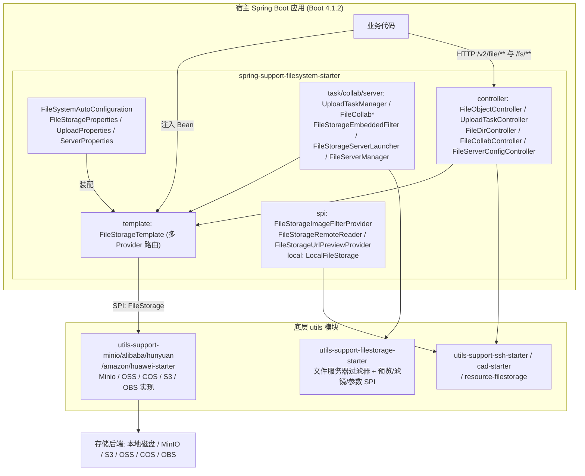
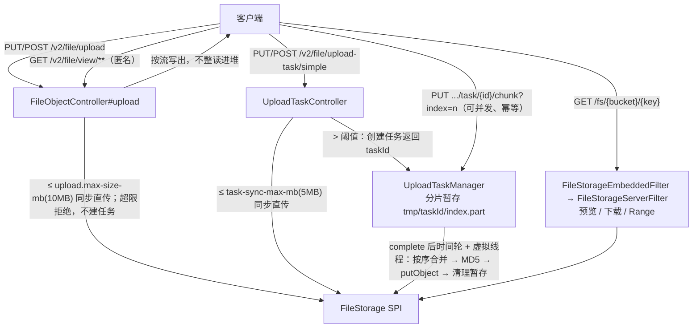

# spring-support-filesystem-starter

统一文件存储 Spring Boot Starter：以 `FileStorageTemplate` 屏蔽本地磁盘 / MinIO / OSS / COS / S3 / OBS 差异，并自带随应用启动的 HTTP 文件服务器（预览、下载、Range、目录管理、任务化分片上传、协同文档）。在 spring-support 体系中属于「被宿主应用依赖的能力 starter」，向下复用 `utils-support-common-starter` 的 `FileStorage` SPI 与 `utils-support-filestorage-starter` 的文件服务器/预览能力（minio/oss/cos/s3/obs 的实现在各自的 `utils-support-*-starter`，需宿主按需引入）；基于 Spring Boot 4.1.2（父 pom `spring-support-parent-starter` 4.0.0.51），自动装配仅经 `META-INF/spring/org.springframework.boot.autoconfigure.AutoConfiguration.imports` 注册（无 `spring.factories`）。

## 1. 架构图



- **依赖方向**：宿主应用 → 本模块 → utils 层；存储写入统一走 `FileStorageTemplate` → `FileStorage` SPI，本模块自带 `LocalFileStorage`（本地磁盘）并经 `META-INF/services` 注册。
- **文件服务器**两种形态（`storage-server.mode`）：`embedded`（默认，`FileStorageEmbeddedFilter` 挂宿主端口 + `/fs` 前缀）与 `standalone`（`FileStorageServerLauncher` 另起端口，默认 18082），共用 `FileStorageServerAssembler` 装配逻辑。

## 2. 核心流程图



任务状态机：`UPLOADING → MERGING → COMPLETED / FAILED`，另有 `CANCELLED`。

## 3. 能力清单

| 能力域 | 关键类 | 入口/触发方式 |
|:-------|:-------|:--------------|
| 统一存储模板（多 Provider 路由、动态增删）/ 本地磁盘实现 | `FileStorageTemplate` / `LocalFileStorage` | 注入 Bean 调用 `putObject/getObject/deleteObject/listObject`；SPI 经 `META-INF/services` + `META-INF/extensions` 注册 |
| 单文件上传 | `FileObjectController#upload` | `PUT/POST /v2/file/upload` |
| 匿名回显（img 直链） | `FileObjectController#view` | `GET /v2/file/view/**` |
| 任务化分片上传（时间轮 + 虚拟线程合并） | `UploadTaskManager` / `UploadTaskController` | `/v2/file/upload-task/**`（含状态 SSE `GET .../events`） |
| 内置文件服务器（默认形态） | `FileStorageEmbeddedFilter` | 应用端口 + `{path-prefix}/{bucket}/{key}`（默认 `/fs/**`） |
| 独立文件服务器 | `FileStorageServerLauncher` | `http://host:18082/{bucket}/{key}` |
| 文件服务器协议（列表/预览/下载/Range/打包/热更新） | `FileStorageServerFilter` | `/{bucket}` 与 `/{bucket}/{key}` |
| 私有桶 OAuth 鉴权 | `FileStorageServerAssembler`（反射装配 oauth 过滤器） | 令牌 `x-oauth-token` → Bearer → 查询参数 → Cookie |
| 本机目录浏览 / 服务器配置下发 | `FileDirController` / `FileServerConfigController` | `GET /v2/file/dir/list`（`dir-list=true` 才开放）/ `GET /v2/file/server-config` |
| 协同文档（快照 + 版本 + SSE） | `FileCollabStore` / `FileCollabHub` / `FileCollabPersistence` / `FileCollabController` | `/v2/file/collab/**` |
| 图片滤镜 / 远程读取 / 三方 URL 预览 SPI | `FileStorageImageFilterProvider` / `FileStorageRemoteReader` / `FileStorageUrlPreviewProvider` | `storage-server.image-filter` / `open-remote-file` / `third-url-preview` |
| 服务信息登记 | `fileSystemServiceInfoContributor` | 控制台模块能力页 |

## 4. Bean 能力矩阵

自动配置类 `FileSystemAutoConfiguration`：类级 `@ConditionalOnProperty(prefix="plugin.filesystem", name="enable", havingValue="true")`，**默认关闭，必须显式开启**。

| Bean 名 | 类型 | 装配条件（含默认值） | 可否覆盖 | 典型用途 |
|:--------|:-----|:---------------------|:---------|:---------|
| `fileStorageTemplate` | `FileStorageTemplate` | 模块开启；创建即 `initialize()` 按 `providers` 建 SPI 实例 | 否（无 `@ConditionalOnMissingBean`；同名覆盖需 `spring.main.allow-bean-definition-overriding=true`） | 统一存储操作入口 |
| `fileObjectController` | `FileObjectController` | 模块开启 + `@ConditionalOnMissingBean` | 可 | HTTP 上传/回显入口 |
| `fileDirController` | `FileDirController` | 同上 | 可 | 本机目录浏览 |
| `fileServerConfigController` | `FileServerConfigController` | 同上 | 可 | 文件服务器配置下发 |
| `fileSystemServiceInfoContributor` | `ServiceInfoContributor` | 模块开启（无附加条件） | 否 | 控制台能力登记 |
| `uploadTaskManager` | `UploadTaskManager` | 模块开启；`destroyMethod="shutdown"` | 否 | 分片任务调度与合并 |
| `uploadTaskController` | `UploadTaskController` | 模块开启 + `@ConditionalOnMissingBean` | 可 | 分片上传 HTTP 入口 |
| `fileCollabStore` | `FileCollabStore` | 同上 | 可 | 协同文档快照/版本 |
| `fileCollabPersistence` | `FileCollabPersistence` | 同上；创建即启动定时落盘 | 可 | 协同文档抗重启落盘 |
| `fileCollabHub` | `FileCollabHub` | 同上 | 可 | 实时协同操作日志 |
| `fileCollabController` | `FileCollabController` | 同上 | 可 | 协同文档 HTTP 入口 |
| `fileServerManager` | `FileServerManager` | 模块开启；创建即 `startAll()`（按历史 `servers` 列表，默认空） | 否 | 旧形态独立服务启动 |
| `fileStorageEmbeddedFilter` | `FilterRegistrationBean<FileStorageEmbeddedFilter>` | `storage-server.enable=true`（缺省视为 true）且 `mode=embedded`（缺省视为 embedded） | 否 | 内置文件服务器挂载 `{path-prefix}/*` |
| `fileStorageServerLauncher` | `FileStorageServerLauncher` | `storage-server.enable=true`（缺省 true）且 `mode=standalone`（显式配置才生效）；`destroyMethod="close"` | 否 | 独立文件服务器启动 |

另有一个**可选宿主侧 Bean**（非本模块注册）：`fileStorageRemotePreviewResolver`（`Function<String, Map<String,Object>>`），持有 SSH 凭据的宿主可注册它把「主机 + 路径」签成短时票据；本模块按 Bean 名读取、不反向依赖宿主，缺失时 `{path-prefix}/rt/**` 返回 403，其余功能不受影响。

## 5. 完整配置

三个 `@ConfigurationProperties` 均经 `@EnableConfigurationProperties` 注册，生效前提均为 `plugin.filesystem.enable=true`。

### 5.1 `plugin.filesystem`（`FileStorageProperties`）

| 配置路径 | 类型 | 默认值 | 说明 |
|:---------|:-----|:-------|:-----|
| `enable` | `boolean` | `false` | 模块总开关，false 时整个自动配置不生效 |
| `default-provider` | `String` | 无 | 默认 Provider 名；为空取第一个注册成功的 |
| `mode` | `AccessMode` 枚举 | `BOTH` | `VIEW` 仅预览 / `DOWNLOAD` 仅下载 / `BOTH` |
| `dir-list` | `boolean` | `false` | 是否开放本机目录浏览接口（安全开关） |
| `url-suffix` | `String` | 无 | 生成访问地址时拼接的后缀 |
| `open-webjars` / `open-remote-file` | `boolean` | `true` / `false` | webjars 静态资源（预览页依赖）/ 允许 http(s)/ssh 开头对象键远程透传 |
| `temp-path` | `String` | 无 | **仅声明、当前未生效**：代码未读取；实际分片暂存目录由 `UploadTaskManager` 在系统临时目录随机创建（前缀 `upload-task-chunks`/`upload-task-merge`） |
| `task-expire-minutes` / `task-sync-max-mb` | `long` | `60` / `5` | 无新分片活动的任务过期回收时间（分钟）/ 小文件同步直传阈值（MB，`0` 表示全部走任务） |
| `providers` | `Map<String, ProviderConfig>` | 空 Map | 多 Provider 配置，key 为 Provider 名（见下） |
| `servers` | `List<ServerConfig>` | 空列表 | 历史 HTTP 文件服务器（旧形态，与 `storage-server` 独立） |
| `operation` | `FileOperationConfig` | 无 | 图片处理与预览参数（见下） |
| `collab` | `CollabPersistConfig` | 见下 | 协同文档落盘配置（见下） |
| `storages`（已弃用） | `List<LegacyStorageConfig>` | 空列表 | 旧版单存储配置，仅保留兼容解析 |

`providers.<name>`（`ProviderConfig`）：

| 配置路径 | 类型 | 默认值 | 说明 |
|:---------|:-----|:-------|:-----|
| `type` | `String` | 无（自动推断） | 推断规则：`endpoint` 空→`local`；含 `oss.aliyuncs`→`oss`；含 `myhuaweicloud`/`obs.`→`obs`；含 `cos.`/`tencentyun`→`cos`；含 `amazonaws`→`s3`；其它非空→`minio` |
| `endpoint` | `String` | 无 | 服务端点（本地可空；minio/s3 例 `http://10.0.0.1:9000`） |
| `bucket` | `String` | 无 | 存储桶名称 |
| `access-key` / `secret-key` | `String` | 无 | 访问密钥标识 / Secret（本地可空） |
| `region` | `String` | 无 | 区域（如 `cn-hangzhou`、`us-east-1`） |
| `base-path` | `String` | 无 | `type=local` 时根目录，落盘到 `base-path/bucket` |
| `connection-timeout` / `read-timeout` / `write-timeout` | `long` | `10000` / `30000` / `30000` | 连接/读/写超时（毫秒） |
| `secure` | `boolean` | `false` | 是否使用 HTTPS |

`operation`（`FileOperationConfig`，均可空，不配置则不做对应处理）：`size`（如 `800x600`）、`format`（`jpg`/`png`/`webp`）、`quality`（1-100）、`crop`（`100,100,200,200`）、`rotate`（0-360）、`flip`（`horizontal`/`vertical`）、`grayscale`、`blur`、`sharpen`、`auto-orient`、`watermark-text`、`watermark-image`、`force-download`、`pdf-page`、`pdf-page-size`、`pdf-orientation`。

`collab`（`CollabPersistConfig`）：`persist-enable`（`boolean`，`true`，关闭则协同文档重启即丢）、`persist-path`（`String`，默认 `data/file-collab/collab-store.json`，快照落盘文件，相对工作目录）、`persist-seconds`（`long`，`30`，落盘间隔秒，只刷有改动的整库）、`hub-path`（`String`，默认 `data/file-collab/hub`，实时操作日志目录；空串表示纯内存）。

`servers`（`ServerConfig`，旧形态）：`name`（`default`）、`enable`（`true`）、`type`（`jdk`）、`host`（`0.0.0.0`）、`port`（`9000`）、`ssl`（`false`）、`provider-names`、`context-path`（`/`）、`max-request-size`（10MB）、`max-connections`（`512`）、`worker-threads`（`8`）等。`storages`（`LegacyStorageConfig`，已弃用）：`name`、`type`（`minio`）、`endpoint`、`access-key-id`、`access-key-secret`、`bucket`、`region`、`default-storage`（`false`）、`base-path`。

### 5.2 `plugin.filesystem.storage-server`（`FileStorageServerProperties`）

| 配置路径 | 类型 | 默认值 | 说明 |
|:---------|:-----|:-------|:-----|
| `enable` | `boolean` | `true` | 是否随应用启动文件服务器 |
| `mode` | `Mode` 枚举 | `EMBEDDED` | `embedded` 挂应用端口 / `standalone` 独立端口 |
| `path-prefix` | `String` | `/fs` | 内置形态路径前缀；`/` 或空串表示占用根路径 |
| `host` / `port` | `String` / `int` | `0.0.0.0` / `18082` | 监听地址 / 监听端口（与前端 DEFAULT_SERVER 对齐；均仅 standalone） |
| `public-host` | `String` | 无（回退 `host`，`0.0.0.0` 归一为 `127.0.0.1`） | 对外可达地址，用于 `/v2/setting/default` 下发 |
| `type` | `String` | `jdk` | 服务器引擎 `jdk`/`nio`/`aio`（仅 standalone） |
| `open-preview` / `open-download` / `open-range` | `boolean` | `true` | 分别允许 `?preview` 内联预览 / `?download` 附件下载 / Range 分段下载 |
| `open-watermark` / `watermark` | `boolean` / `String` | `false` / 无 | 水印响应头开关与水印文本 |
| `open-webjars` | `boolean` | `true` | webjars 静态资源 |
| `open-remote-file` | `boolean` | `false` | 允许远程文件透传 |
| `open-path-guard` | `boolean` | `true` | 路径穿越防护（`..`、反斜杠、NUL 等），勿随意关闭 |
| `third-url-preview` | `String` | `NONE` | 三方 URL 预览 SPI 实现名；内置 `SERVER`（后台拉取） |
| `layout` / `layout-type` | `boolean` / `String` | `true` / `SIMPLE` | 目录列表页开关；`SIMPLE` 简单列表 / `SYSTEM` 资源管理器 |
| `image-filter` / `image-filter-enabled` / `filter-chain` | `String` / `boolean` / `String` | `NONE` / `false` / 无 | 图片滤镜 SPI 名称；全局滤镜链开关与紧凑链 `id:key=value;id2` |
| `file-setting-key` | `String` | `jdk` | URL 参数能力 SPI 实现名（解析 `?size=…&format=…`） |
| `private-buckets` | `String` | 无（回退 `plugin.oauth.file-storage.private-buckets`） | 私有桶 provider 名，逗号分隔，`*` 表示全部；需 classpath 有 oauth 模块 |
| `frame-ancestors` | `String` | `*` | CSP `frame-ancestors`，同时关闭 X-Frame-Options |
| `cors.*` | `Cors` | 见下 | 跨域配置 |

`cors`（`Cors`）：`enable`（`boolean`，`true`）、`allowed-origins`（`String`，`*`，开启凭据后回显实际来源而非字面 `*`）、`allow-credentials`（`boolean`，`true`，预览页跨域 fetch 需要）、`allowed-headers`（`String`，`Content-Type,Authorization,x-oauth-token,X-Requested-With,X-Trace-Id,X-Req-Fingerprint`，必须覆盖前端实际发出的自定义头，否则预检失败）、`expose-headers`（`String`，`Content-Disposition,Content-Range,Accept-Ranges,X-FileStorage-Preview,X-FileStorage-Client-Renderer,X-FileStorage-Convert,X-FileStorage-ImageOp,X-FileStorage-ImageOp-Reason`）、`allowed-methods`（`String`，`GET,HEAD,POST,PUT,DELETE,PATCH,OPTIONS`）。

访问路径：`embedded` → `http://应用host:应用端口/fs/{bucket}/{key}`；`standalone` → `http://host:18082/{bucket}/{key}`（无前缀）。

### 5.3 `plugin.filesystem.upload`（`FileStorageUploadProperties`）

| 配置路径 | 类型 | 默认值 | 说明 |
|:---------|:-----|:-------|:-----|
| `max-size-mb` | `long` | `10` | 单文件大小上限（MB） |
| `allowed-extensions` | `List<String>` | `jpg,jpeg,png,gif,bmp,webp` | 扩展名白名单（小写不含点）；null 不限制。默认仅放行图片，避免存储可执行内容 |
| `chunk-size` | `long` | `5242880`（5MB） | 分片大小（字节） |
| `temp-dir` | `String` | `${java.io.tmpdir}/filesystem-upload` | **仅声明、当前未生效**：代码未读取；实际上传暂存目录由 `UploadTaskManager` 在系统临时目录随机创建 |
| `view-prefix` | `String` | `/v2/file/view/` | 回显地址前缀；宿主有 context-path 时需一并写入（如 `/system/api/v2/file/view/`） |
| `retention-days` | `int` | `30` | 终态任务保留天数，超时清理（含分片/记录级联删除） |
| `merge-interval-ms` / `upload-interval-ms` | `long` | `10000` | 合并 / 对象上传调度间隔（毫秒） |
| `retry-interval-ms` / `cleanup-interval-ms` | `long` | `60000` / `86400000`（24h） | 失败任务重试 / 过期数据清理调度间隔（毫秒） |

### 5.4 逐项配置示例

**总开关与全局行为**（`plugin.filesystem`）：

```yaml
plugin:
  filesystem:
    enable: true                 # 总开关，默认 false，必须显式开启
    dir-list: false              # 本机目录浏览接口，生产建议保持 false
    mode: BOTH                   # VIEW / DOWNLOAD / BOTH
    default-provider: local      # 留空取第一个注册成功的 Provider
    open-webjars: true           # 预览页静态资源
    open-remote-file: false      # http(s)/ssh 对象键远程透传，按需开启
    task-expire-minutes: 60      # 无新分片活动的任务过期回收时间（分钟）
    task-sync-max-mb: 5          # 小文件同步直传阈值（MB），0 表示全部走任务
```

**Provider（存储后端）**（`plugin.filesystem.providers.<name>`）：

```yaml
plugin:
  filesystem:
    providers:
      local:                     # 本地磁盘
        type: local
        bucket: system
        base-path: ./oss         # 落盘到 ./oss/system
      minio-main:                # MinIO（type 可省略，按 endpoint 推断为 minio）
        endpoint: http://10.0.0.1:9000
        bucket: my-bucket
        access-key: your-access-key
        secret-key: your-secret-key
        connection-timeout: 10000
        read-timeout: 30000
        write-timeout: 30000
        secure: false
      oss-backup:                # 阿里云 OSS（显式声明 type）
        type: oss
        endpoint: https://oss-cn-hangzhou.aliyuncs.com
        bucket: my-oss-bucket
        access-key: your-access-key
        secret-key: your-secret-key
        region: cn-hangzhou
```

**上传（分片任务与调度）**（`plugin.filesystem.upload`）：

```yaml
plugin:
  filesystem:
    upload:
      max-size-mb: 10            # 单文件上限（MB）
      allowed-extensions: [jpg, jpeg, png, gif, bmp, webp]   # null 表示不限制
      chunk-size: 5242880        # 分片大小（字节）
      view-prefix: /v2/file/view/   # 宿主有 context-path 时需一并前缀
      retention-days: 30         # 终态任务保留天数
      merge-interval-ms: 10000   # 合并调度间隔（毫秒）
      upload-interval-ms: 10000  # 对象存储转存调度间隔（毫秒）
      retry-interval-ms: 60000   # 失败重试调度间隔（毫秒）
      cleanup-interval-ms: 86400000  # 过期清理调度间隔（毫秒，24h）
```

**文件服务器**（`plugin.filesystem.storage-server`）：

```yaml
plugin:
  filesystem:
    storage-server:
      enable: true
      mode: embedded             # embedded 走应用端口 + path-prefix；standalone 另起 host:port
      path-prefix: /fs           # 仅 embedded 生效
      host: 0.0.0.0              # 仅 standalone
      port: 18082                # 仅 standalone
      type: jdk                  # jdk/nio/aio，仅 standalone
      open-preview: true
      open-download: true
      open-range: true
      open-webjars: true
      open-remote-file: false
      open-path-guard: true      # 路径穿越防护，勿随意关闭
      layout: true
      layout-type: SIMPLE
      third-url-preview: NONE
      image-filter: NONE
      private-buckets: ""        # 留空回落 plugin.oauth.file-storage.private-buckets
      frame-ancestors: "*"
```

**CORS**（`plugin.filesystem.storage-server.cors`）：

```yaml
plugin:
  filesystem:
    storage-server:
      cors:
        enable: true
        allowed-origins: "*"     # 开启凭据后按规范回显实际来源而非字面 *
        allow-credentials: true
        allowed-headers: "Content-Type,Authorization,x-oauth-token,X-Requested-With,X-Trace-Id,X-Req-Fingerprint"
        expose-headers: "Content-Disposition,Content-Range,Accept-Ranges,X-FileStorage-Preview,X-FileStorage-Client-Renderer,X-FileStorage-Convert,X-FileStorage-ImageOp,X-FileStorage-ImageOp-Reason"
        allowed-methods: "GET,HEAD,POST,PUT,DELETE,PATCH,OPTIONS"
```

**协同文档落盘**（`plugin.filesystem.collab`）：

```yaml
plugin:
  filesystem:
    collab:
      persist-enable: true       # 关闭则协同文档重启即丢
      persist-seconds: 30        # 落盘间隔秒，只刷有改动的整库
      persist-path: data/file-collab/collab-store.json
      hub-path: data/file-collab/hub   # 空串表示纯内存
```

## 6. 使用方式

**Maven 坐标**（`groupId com.chua`，版本 `4.0.0.51`）：

```xml
<dependency>
    <groupId>com.chua</groupId>
    <artifactId>spring-support-filesystem-starter</artifactId>
    <version>4.0.0.51</version>
</dependency>
```

**最小启用示例**（必须显式 `enable: true`，默认关闭）：

```yaml
plugin:
  filesystem:
    enable: true               # 必须显式开启，默认 false
    default-provider: local
    providers:
      local:
        type: local
        bucket: system
        base-path: ./oss
```

上传并回显：`curl -X POST http://127.0.0.1:8080/v2/file/upload -F 'file=@./demo.png' -F 'fileBucket=system' -F 'ossType=local'`，返回 `accessUrl` 形如 `/v2/file/view/local/system/<key>`，浏览器可直接打开；文件服务器页面地址为 `http://127.0.0.1:8080/fs`。业务代码注入 `FileStorageTemplate` 调用 `putObject/getObject/deleteObject/listObject`（请求对象用 `PutObjectRequest.builder()` 构造，可指定 provider 名），并可用 `addStorage/removeStorage/setDefaultStorage` 运行期动态增删 Provider、切换默认存储。

**生产级完整配置示例**（MinIO 后端 + 内置文件服务器 + CORS 收紧）：

```yaml
plugin:
  filesystem:
    enable: true
    default-provider: minio-prod
    dir-list: false
    mode: BOTH
    task-expire-minutes: 60
    task-sync-max-mb: 5
    providers:
      minio-prod:
        type: minio
        endpoint: http://minio.internal:9000
        bucket: app-prod
        access-key: your-access-key
        secret-key: your-secret-key
        region: us-east-1
        connection-timeout: 10000
        read-timeout: 30000
        write-timeout: 30000
        secure: false
    upload:
      max-size-mb: 100
      allowed-extensions: [jpg, jpeg, png, gif, bmp, webp, pdf, docx, xlsx, pptx, txt, zip]
      chunk-size: 5242880
      view-prefix: /v2/file/view/
      retention-days: 30
      merge-interval-ms: 10000
      upload-interval-ms: 10000
      retry-interval-ms: 60000
      cleanup-interval-ms: 86400000
    storage-server:
      enable: true
      mode: embedded
      path-prefix: /fs
      open-preview: true
      open-download: true
      open-range: true
      open-webjars: true
      open-path-guard: true
      private-buckets: ""            # 留空回落 plugin.oauth.file-storage.private-buckets
      frame-ancestors: "https://app.example.com"
      cors:
        enable: true
        allowed-origins: "https://app.example.com"
        allow-credentials: true
        allowed-headers: "Content-Type,Authorization,x-oauth-token,X-Requested-With,X-Trace-Id,X-Req-Fingerprint"
        allowed-methods: "GET,HEAD,POST,PUT,DELETE,PATCH,OPTIONS"
    collab:
      persist-enable: true
      persist-seconds: 30
      persist-path: data/file-collab/collab-store.json
      hub-path: data/file-collab/hub
```

**生产注意事项**：

- **安全**：总开关必须显式 `enable: true`（默认 false，漏配则整个模块不装配）；`dir-list` 生产保持 `false`（本机目录浏览接口）；`access-key`/`secret-key` 走配置中心或环境变量注入，不要明文进仓库；`allowed-extensions` 按需放开并自评回显（存储型 XSS）风险；私有桶需 classpath 提供 oauth 模块，并配置 `plugin.oauth.file-storage.private-buckets`（或 `storage-server.private-buckets`）。
- **CORS 头**：`allowed-headers` 必须覆盖前端实际发出的全部自定义头（`X-Trace-Id`、`X-Requested-With`、`X-Req-Fingerprint`、`x-oauth-token` 等），缺一个预检即整体失败；开启 `allow-credentials` 后 `allowed-origins` 应从 `*` 收紧为具体来源白名单。
- **内存任务易失**：分片上传任务保存在 `UploadTaskManager` 的内存 `ConcurrentHashMap`，重启即清空（`temp-path`/`temp-dir` 当前仅声明未生效，分片暂存在系统临时目录）；对强持久化有要求时，需自行落库或接受重启丢任务的窗口。
- **端口**：`storage-server.port=18082` 仅在 `mode=standalone` 时监听；默认 `embedded` 形态走应用端口 + `/fs`。历史 `plugin.filesystem.servers`（`FileServerManager`）与 `storage-server` 相互独立，两套同时开启会各占一套端口，排查冲突时不要只看 `storage-server`。
- **白名单**：默认仅放行图片扩展名；放开时建议保留 `open-path-guard: true`，并评估可执行/可脚本内容被直接回显的风险。

**可选/provided 依赖说明**（缺了会怎样）：

| 依赖 | 作用 | 缺失影响 |
|:-----|:-----|:---------|
| `utils-support-filestorage-starter`（4.0.0.51） | 文件服务器过滤器、预览 provider、`FileStorageFileSetting` / `FileStorageFilterSetting` SPI（`FileStorage` SPI 接口本身在 `utils-support-common-starter`） | 必需，模块无法工作 |
| `utils-support-minio-starter` / `utils-support-alibaba-starter` / `utils-support-hunyuan-starter` / `utils-support-amazon-starter` / `utils-support-huawei-starter` | MinIO / OSS / COS / S3 / OBS 的 `FileStorage` 实现 | 对应 `providers.<name>.type` 创建失败（日志「创建 Provider 失败」），仅 `local` 可用 |
| `utils-support-resource-filestorage`（4.0.0.43） | 文件预览前端资源（file-viewer） | 预览页资源缺失 |
| `utils-support-ssh-starter` / `utils-support-cad-starter`（4.0.0.51） | SFTP 远程读取 / CAD 图纸预览 | 对应预览能力不可用 |
| `commons-compress`（1.28.0） | 压缩包预览与解压 | 压缩包功能不可用 |
| `spring-support-mybatis-starter` / `spring-support-datasource-starter` / `spring-jdbc` | 上传任务 MD5 落库基础设施 | 无 `JdbcTemplate` 时降级不落库，分片与合并仍可工作 |
| `spring-support-swagger-starter`（provided）、`lombok`（provided） | 接口文档注解 / 编译期代码生成 | 不进运行时 JAR，无运行时影响 |

## 7. 使用场景

**适用**：

- 需要统一 API 屏蔽 MinIO/OSS/COS/S3/OBS/本地磁盘差异，并按 bucket/provider 路由到不同存储；
- 需要「随应用启动的文件服务器」做预览、下载、Range、目录管理，不想单独部署网关；
- 大文件、弱网、可观察的分片上传（任务状态 SSE、失败重试）；
- 需要在文件上叠加水印、图片滤镜、CAD 预览、协同编辑等增值能力。

**不适用/慎用**：

- 纯前端直传对象存储（签名 URL 直连云厂商更简单，无需经过本模块）；
- 需要强持久化的上传任务元数据（任务在内存，重启即清空；落库仅在提供 `JdbcTemplate` 时部分生效）；
- 非 Servlet 栈（依赖 `spring-boot-starter-web` 与 Servlet 过滤器）。

**与相邻模块取舍**：只做 API 级对象操作、不需要 HTTP 服务器/任务上传 → 直接用 `utils-support-common-starter` 的 `FileStorage` SPI + 对应云厂商 `utils-support-*-starter` 实现（本模块的 `FileStorageTemplate` 与 `LocalFileStorage` 也可单独使用）；SSH **服务端**能力在 `spring-support-ssh-starter`（本模块的远程读取走 utils 层 SSH 客户端）；私有桶鉴权由 `spring-support-oauth-starter` 反射装配，类缺失时按公共桶运行、不会报错；`spring-support-common-starter` 提供时间轮、模块日志与服务信息登记。

## 8. 扩展点

本模块通过 `@Spi` 注解 + `META-INF/extensions/<接口全名>` 注册文件发现扩展（底层为 common-starter 的 SPI 机制），另有一个可选 Bean 契约：

| 扩展点 | 用途 | 内置实现（本模块自带） | 注册方式 |
|:-------|:-----|:----------------------|:---------|
| `com.chua.common.support.storage.FileStorage` | 新增存储后端（新云厂商、FTP/SFTP 落盘等） | `LocalFileStorage`；minio/oss/cos/s3/obs 在 utils 层 | 实现类登记到 `META-INF/services/` 与 `META-INF/extensions/…FileStorage` |
| `FileStorageImageFilterProvider` | 图片滤镜：`getName/getLabel/getCssFilter/getPathParam/isServerSide` | `NONE`、`GRAYSCALE`、`SEPIA`、`INVERT`、`BLUR`、`SATURATE` | `META-INF/extensions/…spi.FileStorageImageFilterProvider` |
| `FileStorageRemoteReader` | 远程文件读取：`protocol()` 声明协议前缀（如 `ssh://`），`readRemote` 每次新建连接、用完即关 | `SshRemoteFileReader` | `META-INF/extensions/…spi.FileStorageRemoteReader` |
| `FileStorageUrlPreviewProvider` | 三方 URL 预览：`supportsUrlPreview()` 决定 `?url=` 是否放行 | `NONE`（关闭）、`SERVER`（后台拉取） | `META-INF/extensions/…spi.FileStorageUrlPreviewProvider` |
| `fileStorageRemotePreviewResolver` Bean | 宿主侧把「主机 + 路径」签成短时票据，供 `{path-prefix}/rt/**` 解析 SFTP 预览 | 无（宿主可选注册） | 宿主 `@Bean(name="fileStorageRemotePreviewResolver")` |
| 控制器覆盖 | 替换默认 Controller 实现 | — | 宿主注册同类型 `@Bean`（`FileObjectController` 等均有 `@ConditionalOnMissingBean`） |

自定义示例：实现 `FileStorageImageFilterProvider`，类上加 `@Spi("image-filter-pixelate")`，把实现类全名登记到 `src/main/resources/META-INF/extensions/com.chua.starter.filesystem.support.spi.FileStorageImageFilterProvider`，再配置 `plugin.filesystem.storage-server.image-filter=PIXELATE` 生效；管理页滤镜下拉由后台枚举全部实现后下发，`isServerSide()=true` 的滤镜由后端图片管线执行，否则前端按 `getCssFilter()` 兜底。

## 9. 常见问题

**Q1：引入依赖后接口 404、没有任何 Bean？** `plugin.filesystem.enable` 默认 `false`，整个 `FileSystemAutoConfiguration` 不装配，必须显式设 `true`。若 `providers` 为空，`FileStorageTemplate#initialize` 只打印「未配置任何 Provider」，上传时报「未配置文件存储提供者」——至少配置一个 Provider（如 `providers.local`）。

**Q2：standalone 端口 18082 连不上？** `18082` 仅在 `mode=standalone` 时监听；默认 `embedded` 形态走应用自身端口 + `path-prefix`（`/fs`），`host`/`port`/`type` 对 embedded 无意义。历史 `plugin.filesystem.servers`（`FileServerManager`）与 `storage-server` 相互独立，两套都开会各起一套，排查端口占用时不要只看 `storage-server`。

**Q3：Spring Boot 4 兼容性？** 本模块随父 pom 基于 Boot 4.1.2 构建，自动配置只走 `META-INF/spring/...AutoConfiguration.imports`（Boot 4 已不读 `spring.factories` 的自动配置项），Jakarta/Servlet 命名空间；Boot 4.x 可直接依赖，Boot 2.x/3.x 不保证兼容。

**Q4：上传非图片被拒 / 跨域预检失败 / 任务重启丢失？** 默认白名单仅图片，放开需配 `upload.allowed-extensions` 并自评回显（存储型 XSS）风险；预检失败通常是前端新增自定义头未加进 `storage-server.cors.allowed-headers`；上传任务保存在内存（`UploadTaskManager` 的 `ConcurrentHashMap`），重启即清空，协同文档靠 `collab.persist-seconds` 定时刷盘，最多丢一个间隔的改动。
