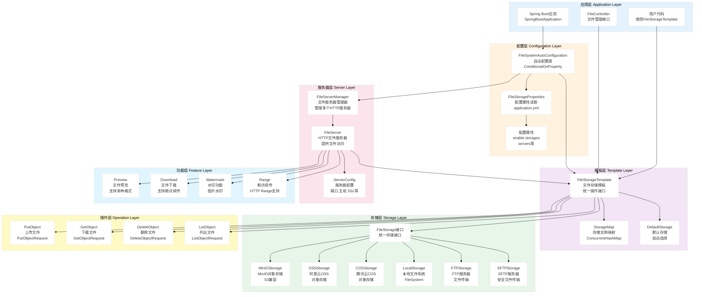
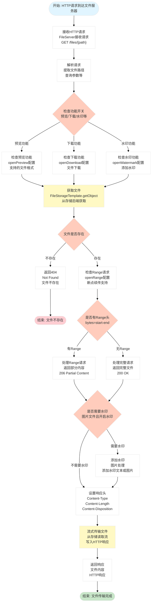

# Spring Support Filesystem Starter

[](https://opensource.org/licenses/Apache-2.0)

## 📖 模块简介

Spring Support Filesystem Starter 是一个统一的文件系统抽象模块，提供统一的文件操作接口，支持本地文件系统、MinIO、阿里云OSS、腾讯云COS等多种存储方式的无缝切换。

### ✨ 主要特性

- 🔌 **统一接口** - 提供统一的文件操作API
- 💾 **多存储支持** - 支持本地、MinIO、OSS、COS等
- 📤 **上传下载** - 支持文件上传下载
- 🗂️ **目录管理** - 支持目录创建、删除、遍历
- 🔗 **URL生成** - 支持访问URL和临时URL生成
- 📊 **元数据管理** - 支持文件元数据读写

## 🚀 快速开始

### Maven 依赖

```xml
<!-- 文件系统抽象模块 -->
<dependency>
    <groupId>com.chua</groupId>
    <artifactId>spring-support-filesystem-starter</artifactId>
    <version>4.0.0.33-SNAPSHOT</version>
</dependency>

<!-- 根据需要选择具体实现 -->
<!-- MinIO实现 -->
<dependency>
    <groupId>com.chua</groupId>
    <artifactId>spring-support-filesystem-minio-starter</artifactId>
    <version>4.0.0.33-SNAPSHOT</version>
</dependency>
```

## ⚙️ 配置说明

> **完整配置项参考**: [`spring-support-filesystem-starter/application-example.yml`](./application-example.yml)

### 1. 启用开关

```yaml
plugin:
  filesystem:
    enable: true        # 必填;false 时所有 FileStorage 自动装配跳过
```

### 2. 多存储后端配置 (`plugin.filesystem.storages[]`)

```yaml
plugin:
  filesystem:
    storages:
      - name: local-default        # 存储实例唯一名, 用于 FileStorageTemplate.getStorage(name)
        type: local                # SPI 类型: local / minio / oss / cos / obs / ftp / sftp 等
        bucket: default            # Bucket (存储桶) 名称
        endpoint: ""               # 服务端点 URL;本地存储可空
        accessKeyId: ""            # 访问密钥 ID;本地存储可空
        accessKeySecret: ""        # 访问密钥 Secret;本地存储可空
        region: ""                 # 区域 (cn-hangzhou / us-east-1);本地存储可空
        defaultStorage: true       # 是否为默认存储;同一 storages 数组内只能有一个 true
```

| 字段 | 类型 | 必填 | 说明 |
|------|------|:---:|------|
| `name` | String | ✅ | 存储实例唯一标识, 用于 `FileStorageTemplate.getStorage(name)` 路由 |
| `type` | String | ✅ | SPI 类型, 通过 `ServiceProvider<FileStorage>.getNewExtension(type, setting)` 加载实现 |
| `bucket` | String | ✅ | Bucket (存储空间) 名称 |
| `endpoint` | String | - | 服务端点;local/ftp 可空; minio 例 `http://10.0.0.1:9000` |
| `accessKeyId` | String | - | 访问密钥 ID;local 可空 |
| `accessKeySecret` | String | - | 访问密钥 Secret;local 可空 |
| `region` | String | - | 区域;local 可空 |
| `defaultStorage` | boolean | - | 是否默认;同一数组只能一个 true |

### 3. HTTP 文件服务器 (`plugin.filesystem.servers[]`)

```yaml
plugin:
  filesystem:
    servers:
      - name: default
        enable: true               # 是否启用此服务器实例
        host: 0.0.0.0
        port: 9000                 # 监听端口
        ssl: false                 # 是否启用 HTTPS
        sslCertPath: ""            # SSL 证书路径 (.pfx / .p12)
        sslCertPassword: ""        # SSL 证书密码
        storageNames: []           # 关联的存储名称列表;空表示关联所有
        contextPath: /             # 上下文路径
        readTimeoutMillis: 30000
        writeTimeoutMillis: 30000
```

### 4. 文件存储功能开关

```yaml
plugin:
  filesystem:
    openWebjars: true              # 启用 webjars 静态资源服务
    openRemoteFile: false          # 启用远程文件代理
    openPreview: true              # 启用预览
    openDownload: true             # 启用下载
    openRange: true                # 启用断点续传 (HTTP Range)
    openWatermark: false           # 启用图片水印
    watermark: ""                  # 水印文本或图片 URL
```

### 5. 分片上传配置 (`plugin.filesystem.upload`)

```yaml
plugin:
  filesystem:
    upload:
      chunkSize: 5242880           # 分片大小 (字节), 默认 5MB
      tempDir: /tmp/filesystem-upload  # 分片临时目录
```

| 字段 | 类型 | 默认值 | 说明 |
|------|------|--------|------|
| `chunkSize` | long | `5242880` (5MB) | 分片大小, < 1 时使用默认值 |
| `tempDir` | String | `${java.io.tmpdir}/filesystem-upload` | 分片暂存目录, `LocalTmpMultipartStorage` 在此暂存分片, complete 时合并为完整文件 |

### 6. 完整配置示例

```yaml
plugin:
  filesystem:
    enable: true
    openWebjars: true
    openPreview: true
    openDownload: true
    openRange: true
    openWatermark: false

    storages:
      - name: local-default
        type: local
        bucket: default
        defaultStorage: true
      - name: minio-backup
        type: minio
        bucket: backup
        endpoint: http://10.0.0.1:9000
        accessKeyId: minioadmin
        accessKeySecret: minioadmin
        region: us-east-1
        defaultStorage: false

    servers:
      - name: default
        host: 0.0.0.0
        port: 9000
        contextPath: /

    upload:
      chunkSize: 5242880
      tempDir: /data/upload-tmp
```

### 7. 本地文件系统配置 (`plugin.filesystem.local.base-path`)

| 参数名 | 类型 | 默认值 | 说明 |
|------|------|--------|------|
| `plugin.filesystem.type` | String | `local` | 文件系统类型 |
| `plugin.filesystem.local.base-path` | String | `/tmp` | 本地存储路径 |

## 📝 使用示例

### 文件分片上传 REST 端点

`FileChunkUploadController` 提供以下端点, 用于大文件分片上传:

| 方法 | 路径 | 用途 |
|------|------|------|
| `POST` | `/chunk/create` | 创建分片上传任务, 返回 uploadId |
| `POST` | `/chunk/{uploadId}/part` | 上传单个分片 |
| `POST` | `/chunk/{uploadId}/complete` | 完成上传, 合并分片 |
| `DELETE` | `/chunk/{uploadId}` | 取消上传, 清理临时分片 |
| `GET` | `/chunk/{uploadId}/progress` | 查询上传进度 |

#### 创建分片上传任务

```bash
curl -X POST "http://localhost:8080/chunk/create" \
  -d "fileName=video.mp4" \
  -d "originalName=MyVideo.mp4" \
  -d "fileSize=104857600" \
  -d "chunkSize=5242880" \
  -d "storageType=local" \
  -d "bucket=default" \
  -d "contentType=video/mp4"
```

响应:
```json
{
  "code": "00000",
  "data": {
    "uploadId": "abc123def456",
    "chunkSize": 5242880,
    "totalChunks": 20,
    "fileSize": 104857600,
    "key": "uploads/abc123def456/video.mp4"
  }
}
```

#### 上传分片

```bash
curl -X POST "http://localhost:8080/chunk/abc123def456/part" \
  -F "file=@chunk-001.bin" \
  -F "partNumber=1"
```

#### 查询进度

```bash
curl "http://localhost:8080/chunk/abc123def456/progress"
```

响应:
```json
{
  "code": "00000",
  "data": {
    "uploadId": "abc123def456",
    "status": 1,
    "statusText": "上传中",
    "uploadedChunks": 10,
    "totalChunks": 20,
    "percent": 50,
    "fileSize": 104857600,
    "chunkSize": 5242880
  }
}
```

#### 完成上传

```bash
curl -X POST "http://localhost:8080/chunk/abc123def456/complete"
```

响应:
```json
{
  "code": "00000",
  "data": {
    "uploadId": "abc123def456",
    "url": "http://localhost:9000/default/uploads/abc123def456/video.mp4",
    "key": "uploads/abc123def456/video.mp4",
    "fileName": "video.mp4"
  }
}
```

### 文件上传

```java
@Service
public class FileService {

    @Autowired
    private FileSystem fileSystem;
    
    public String uploadFile(MultipartFile file) throws IOException {
        // 生成文件路径
        String fileName = UUID.randomUUID().toString() + 
                         getFileExtension(file.getOriginalFilename());
        String path = "uploads/" + LocalDate.now() + "/" + fileName;
        
        // 上传文件
        fileSystem.write(path, file.getInputStream());
        
        return path;
    }
    
    public void uploadWithMetadata(MultipartFile file, Map<String, String> metadata) 
            throws IOException {
        String path = "uploads/" + file.getOriginalFilename();
        
        // 上传文件并设置元数据
        fileSystem.write(path, file.getInputStream(), metadata);
    }
}
```

### 文件下载

```java
@RestController
public class FileController {

    @Autowired
    private FileSystem fileSystem;
    
    @GetMapping("/files/{path}")
    public ResponseEntity<Resource> downloadFile(@PathVariable String path) 
            throws IOException {
        // 读取文件
        InputStream inputStream = fileSystem.read(path);
        InputStreamResource resource = new InputStreamResource(inputStream);
        
        return ResponseEntity.ok()
                .header(HttpHeaders.CONTENT_DISPOSITION, 
                       "attachment; filename=\"" + getFileName(path) + "\"")
                .body(resource);
    }
    
    @GetMapping("/files/{path}/url")
    public String getFileUrl(@PathVariable String path) {
        // 获取文件访问URL（临时URL，24小时有效）
        return fileSystem.getPresignedUrl(path, Duration.ofHours(24));
    }
}
```

### 文件管理

```java
@Service
public class FileManagementService {

    @Autowired
    private FileSystem fileSystem;
    
    public boolean fileExists(String path) {
        return fileSystem.exists(path);
    }
    
    public void deleteFile(String path) throws IOException {
        fileSystem.delete(path);
    }
    
    public List<String> listFiles(String directory) throws IOException {
        return fileSystem.list(directory);
    }
    
    public void createDirectory(String path) throws IOException {
        fileSystem.createDirectory(path);
    }
    
    public FileInfo getFileInfo(String path) throws IOException {
        return fileSystem.getFileInfo(path);
    }
}
```

## 🏗️ 系统架构流程图

### 1. 整体系统架构



### 2. 文件上传流程架构

```mermaid
%%{init: {'theme':'base', 'themeVariables': { 'primaryColor':'#fff'}}}%%
flowchart TD
    Start([开始: 用户上传文件请求]) --> ReceiveRequest["接收请求<br/>FileStorageTemplate.putObject<br/>或指定存储名称"]
    
    ReceiveRequest --> CheckStorage{"检查存储<br/>是否指定存储名称"}
    
    CheckStorage -->|"未指定"| GetDefaultStorage["获取默认存储<br/>FileStorageTemplate.getDefaultStorage<br/>从StorageMap获取"]
    
    CheckStorage -->|"已指定"| GetNamedStorage["获取指定存储<br/>FileStorageTemplate.getStorage<br/>从StorageMap获取"]
    
    GetDefaultStorage --> StorageFound{"存储是否存在"}
    GetNamedStorage --> StorageFound
    
    StorageFound -->|"不存在"| ReturnError["返回错误<br/>PutObjectResult<br/>ResultCode.FAILURE"]
    
    StorageFound -->|"存在"| BuildRequest["构建上传请求<br/>PutObjectRequest<br/>包含文件流 路径 元数据"]
    
    ReturnError --> EndError([结束: 上传失败])
    
    BuildRequest --> CallStorage["调用存储接口<br/>FileStorage.putObject<br/>统一接口调用"]
    
    CallStorage --> StorageType{"存储类型判断<br/>根据配置的type"]
    
    StorageType -->|"minio"| MinIOUpload["MinIO上传<br/>MinIOStorage.putObject<br/>S3协议上传"]
    StorageType -->|"oss"| OSSUpload["OSS上传<br/>OSSStorage.putObject<br/>阿里云SDK上传"]
    StorageType -->|"cos"| COSUpload["COS上传<br/>COSStorage.putObject<br/>腾讯云SDK上传"]
    StorageType -->|"local"| LocalUpload["本地上传<br/>LocalStorage.putObject<br/>FileSystem写入"]
    StorageType -->|"ftp"| FTPUpload["FTP上传<br/>FTPStorage.putObject<br/>FTP协议上传"]
    StorageType -->|"sftp"| SFTPUpload["SFTP上传<br/>SFTPStorage.putObject<br/>SFTP协议上传"]
    
    MinIOUpload --> UploadFile["上传文件<br/>调用具体存储SDK<br/>上传到存储后端"]
    OSSUpload --> UploadFile
    COSUpload --> UploadFile
    LocalUpload --> UploadFile
    FTPUpload --> UploadFile
    SFTPUpload --> UploadFile
    
    UploadFile --> UploadSuccess{"上传是否成功"}
    
    UploadSuccess -->|"失败"| ReturnFailure["返回失败结果<br/>PutObjectResult<br/>包含错误信息"]
    
    UploadSuccess -->|"成功"| BuildResult["构建成功结果<br/>PutObjectResult<br/>包含文件路径 URL等"]
    
    ReturnFailure --> EndFailure([结束: 上传失败])
    
    BuildResult --> ReturnSuccess["返回成功结果<br/>PutObjectResult<br/>ResultCode.SUCCESS"]
    
    ReturnSuccess --> EndSuccess([结束: 上传成功])
    
    style Start fill:#e1f5ff
    style EndSuccess fill:#c8e6c9
    style EndError fill:#ffcdd2
    style EndFailure fill:#ffcdd2
    style CheckStorage fill:#ffccbc
    style StorageFound fill:#ffccbc
    style StorageType fill:#ffccbc
    style UploadSuccess fill:#ffccbc
    style CallStorage fill:#fff9c4
    style UploadFile fill:#fff9c4
```

### 3. 文件下载与HTTP服务器流程架构



### 4. 存储初始化与多存储管理流程架构

```mermaid
%%{init: {'theme':'base', 'themeVariables': { 'primaryColor':'#fff'}}}%%
flowchart TD
    Start([开始: Spring Boot应用启动]) --> AutoConfig["FileSystemAutoConfiguration<br/>自动配置类加载<br/>ConditionalOnProperty检查"]
    
    AutoConfig --> CheckEnabled{"检查<br/>plugin.filesystem.enable配置"}
    
    CheckEnabled -->|"未启用"| EndSkip([结束: 跳过文件系统初始化])
    
    CheckEnabled -->|"已启用"| ReadProperties["读取FileStorageProperties<br/>配置属性<br/>从application.yml读取"]
    
    ReadProperties --> CreateTemplate["创建FileStorageTemplate<br/>文件存储模板<br/>统一操作接口"]
    
    CreateTemplate --> InitializeTemplate["初始化模板<br/>FileStorageTemplate.initialize<br/>创建存储实例"]
    
    InitializeTemplate --> GetStorages["获取存储配置列表<br/>properties.getStorages<br/>多个存储后端配置"]
    
    GetStorages --> HasStorages{"是否有存储配置"}
    
    HasStorages -->|"无配置"| LogWarning["记录警告日志<br/>未配置任何存储后端"]
    
    HasStorages -->|"有配置"| ProcessStorage["处理每个存储配置<br/>循环处理每个StorageConfig"]
    
    ProcessStorage --> BuildBucketSetting["构建BucketSetting<br/>bucket endpoint<br/>accessKeyId accessKeySecret<br/>region等"]
    
    BuildBucketSetting --> CreateStorage["创建存储实例<br/>FileStorage.createStorage<br/>根据type创建对应存储"]
    
    CreateStorage --> StorageType{"存储类型判断<br/>config.getType()"}
    
    StorageType -->|"minio"| CreateMinIO["创建MinIOStorage<br/>MinIO客户端<br/>S3兼容协议"]
    StorageType -->|"oss"| CreateOSS["创建OSSStorage<br/>阿里云OSS客户端<br/>OSS SDK"]
    StorageType -->|"cos"| CreateCOS["创建COSStorage<br/>腾讯云COS客户端<br/>COS SDK"]
    StorageType -->|"local"| CreateLocal["创建LocalStorage<br/>本地文件系统<br/>FileSystem"]
    StorageType -->|"ftp"| CreateFTP["创建FTPStorage<br/>FTP客户端<br/>FTP协议"]
    StorageType -->|"sftp"| CreateSFTP["创建SFTPStorage<br/>SFTP客户端<br/>SFTP协议"]
    
    CreateMinIO --> RegisterStorage
    CreateOSS --> RegisterStorage
    CreateCOS --> RegisterStorage
    CreateLocal --> RegisterStorage
    CreateFTP --> RegisterStorage
    CreateSFTP --> RegisterStorage
    
    RegisterStorage["注册存储实例<br/>storageMap.put<br/>存储到ConcurrentHashMap"] --> CheckDefault{"是否默认存储<br/>config.isDefaultStorage()"}
    
    CheckDefault -->|"是默认存储"| SetDefault["设置默认存储<br/>defaultStorageName<br/>记录默认存储名称"]
    
    CheckDefault -->|"不是默认存储"| MoreStorages{"是否还有更多<br/>存储需要处理"}
    
    SetDefault --> MoreStorages
    
    MoreStorages -->|"是"| ProcessStorage
    MoreStorages -->|"否"| CreateServerManager["创建FileServerManager<br/>文件服务器管理器<br/>管理HTTP文件服务器"]
    
    LogWarning --> CreateServerManager
    
    CreateServerManager --> GetServers["获取服务器配置列表<br/>properties.getServers<br/>多个HTTP服务器配置"]
    
    GetServers --> HasServers{"是否有服务器配置"}
    
    HasServers -->|"无配置"| EndInit([结束: 初始化完成])
    
    HasServers -->|"有配置"| ProcessServer["处理每个服务器配置<br/>循环处理每个ServerConfig"]
    
    ProcessServer --> CreateFileServer["创建FileServer<br/>HTTP文件服务器<br/>Netty/Undertow等"]
    
    CreateFileServer --> ConfigureServer["配置服务器<br/>host port SSL<br/>contextPath等"]
    
    ConfigureServer --> StartServer["启动服务器<br/>FileServer.start<br/>监听端口"]
    
    StartServer --> MoreServers{"是否还有更多<br/>服务器需要处理"}
    
    MoreServers -->|"是"| ProcessServer
    MoreServers -->|"否"| EndInit
    
    style Start fill:#e1f5ff
    style EndSkip fill:#ffcdd2
    style EndInit fill:#c8e6c9
    style CheckEnabled fill:#ffccbc
    style HasStorages fill:#ffccbc
    style StorageType fill:#ffccbc
    style CheckDefault fill:#ffccbc
    style HasServers fill:#ffccbc
    style CreateStorage fill:#fff9c4
    style RegisterStorage fill:#fff9c4
    style StartServer fill:#fff9c4
```



> 💡 **提示**: 架构图支持横向滚动查看，也可以点击图表在新窗口中打开查看大图。

## 🔗 具体实现模块

### MinIO 实现
- [spring-support-filesystem-minio-starter](../spring-support-filesystem-minio-starter/README.md)
- 支持MinIO对象存储
- 支持桶管理和权限控制
- 适用于私有云部署

## 🔗 相关链接

- [返回主文档](../README.md)
- [配置示例文件](../application-example.yml)

## 📄 许可证

本项目采用 [Apache License 2.0](../LICENSE) 许可证。
