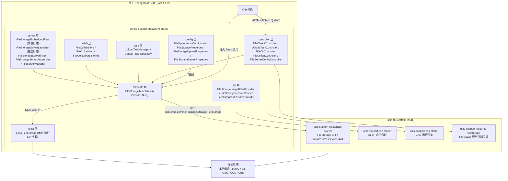
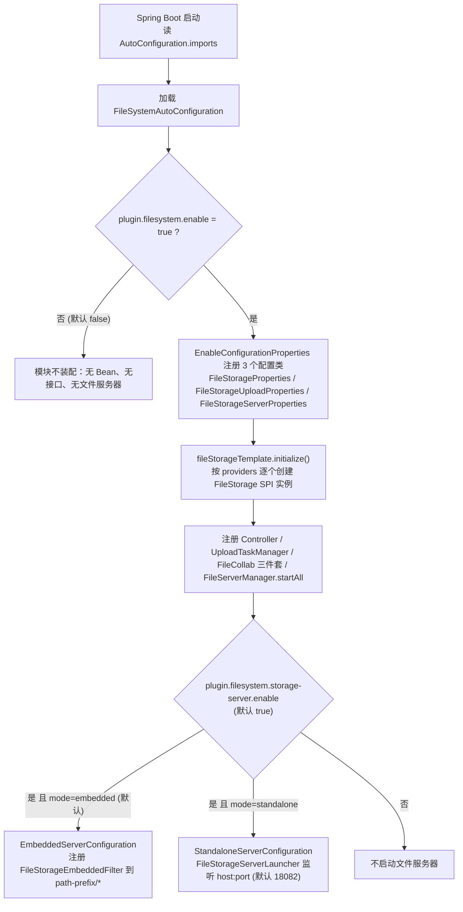
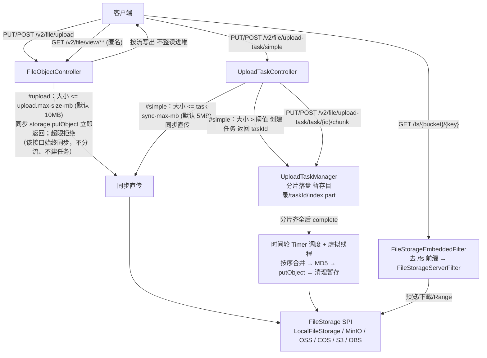

# spring-support-filesystem-starter

文件存储模块（Spring Boot Starter）：提供统一对象存储抽象（多 Provider）与内置 HTTP 文件服务器，
覆盖上传、回显、下载、预览、目录浏览与任务化分片上传。基于 Spring Boot **4.1.2**（父 pom `spring-support-parent-starter` 4.0.0.51），
自动配置仅通过 `META-INF/spring/org.springframework.boot.autoconfigure.AutoConfiguration.imports` 注册（Boot 4 推荐方式，无 `spring.factories`）。

## 1. 架构图

模块在体系中的位置与内部分层：



- **依赖方向**：宿主应用 → `spring-support-filesystem-starter` → `utils-support-filestorage-starter`（SPI 契约与各云厂商实现）。
- **存储写入**统一走 `FileStorageTemplate` → `FileStorage` SPI；本模块自带 `LocalFileStorage`（本地磁盘）实现并经 `META-INF/services` 注册。
- **文件服务器**有两种部署形态（`storage-server.mode`）：`embedded`（默认，`FileStorageEmbeddedFilter` 挂宿主端口 + `/fs` 前缀）与 `standalone`（`FileStorageServerLauncher` 另起端口，默认 18082），两者共用 `FileStorageServerAssembler` 的装配逻辑。

## 2. 核心流程图

### 2.1 自动装配流程



### 2.2 上传与回显请求流程



任务状态机：`UPLOADING → MERGING → COMPLETED / FAILED`，另有 `CANCELLED`。

## 3. 能力清单

| 能力域 | 关键类 | 入口 |
|:-------|:-------|:-----|
| 统一存储模板（多 Provider 路由） | `FileStorageTemplate` | 注入 Bean 调用 |
| Provider 类型推断（local/minio/oss/cos/s3/obs） | `FileStorageTemplate#inferType` | `plugin.filesystem.providers.<name>.type` |
| 本地磁盘存储实现 | `LocalFileStorage` | `META-INF/services/com.chua.common.support.storage.FileStorage` |
| 单文件上传 | `FileObjectController#upload` | `PUT/POST /v2/file/upload` |
| 匿名回显（img 直链） | `FileObjectController#view` | `GET /v2/file/view/**` |
| 任务化分片上传（时间轮 + 虚拟线程合并） | `UploadTaskManager` / `UploadTaskController` | `/v2/file/upload-task/**` |
| 小文件直传（同步返回） | `UploadTaskController` | `PUT/POST /v2/file/upload-task/simple` |
| 任务状态 SSE | `UploadTaskController` | `GET /v2/file/upload-task/events` |
| 内置文件服务器（默认形态） | `FileStorageEmbeddedFilter` | 应用端口 + `{path-prefix}/{bucket}/{key}`（默认 `/fs/**`） |
| 独立文件服务器 | `FileStorageServerLauncher` | `http://host:18082/{bucket}/{key}` |
| 文件服务器协议（列表/预览/下载/Range/打包/热更新） | `FileStorageServerFilter` | `/{bucket}` 与 `/{bucket}/{key}` |
| 私有桶 OAuth 鉴权 | `FileStorageServerAssembler`（反射装配 oauth 模块过滤器） | 请求令牌 `x-oauth-token` 等 |
| 本机目录浏览 | `FileDirController` | `GET /v2/file/dir/list`（`dir-list=true` 才开放） |
| 服务器配置下发 | `FileServerConfigController` | `GET /v2/file/server-config` |
| 协同文档（快照 + 版本 + SSE） | `FileCollabStore` / `FileCollabHub` / `FileCollabPersistence` / `FileCollabController` | `/v2/file/collab/**` |
| 图片滤镜 SPI | `FileStorageImageFilterProvider`（6 个内置实现） | `storage-server.image-filter` / `filter-chain` |
| 远程文件读取 SPI | `FileStorageRemoteReader`（内置 `SshRemoteFileReader`） | `open-remote-file=true` 时按协议路由 |
| 三方 URL 预览 SPI | `FileStorageUrlPreviewProvider`（内置 `NONE`/`SERVER`） | `storage-server.third-url-preview` |
| 服务信息登记 | `fileSystemServiceInfoContributor` | 控制台模块能力页 |
| 预览增强 | `utils-support-cad-starter`（CAD）、`utils-support-resource-filestorage`（前端 file-viewer） | `?format=cad` 等 |

## 4. Bean 能力矩阵

自动配置类：`FileSystemAutoConfiguration`（类级条件 `@ConditionalOnProperty(prefix="plugin.filesystem", name="enable", havingValue="true")`，**默认关闭，必须显式开启**）。

| Bean 名 | 类型 | 装配条件 | 可否覆盖 | 典型注入姿势 |
|:--------|:-----|:---------|:---------|:-------------|
| `fileStorageTemplate` | `FileStorageTemplate` | 模块开启（`plugin.filesystem.enable=true`） | 否（无 `@ConditionalOnMissingBean`；同名覆盖需 `spring.main.allow-bean-definition-overriding=true`） | 构造器注入 `FileStorageTemplate`，调用 `putObject/getObject/deleteObject/listObject` |
| `fileObjectController` | `FileObjectController` | 模块开启 + `@ConditionalOnMissingBean` | 可（自定义同类型 Bean 后自动配置退让） | 一般不注入，作为 HTTP 入口；需要自定义上传逻辑时自行注册 |
| `fileDirController` | `FileDirController` | 模块开启 + `@ConditionalOnMissingBean` | 可 | 同上 |
| `fileServerConfigController` | `FileServerConfigController` | 模块开启 + `@ConditionalOnMissingBean` | 可 | 同上 |
| `fileSystemServiceInfoContributor` | `ServiceInfoContributor` | 模块开启（无条件） | 否（同上，需开启 Bean 覆盖开关） | 不建议覆盖；用于控制台能力登记 |
| `uploadTaskManager` | `UploadTaskManager` | 模块开启；`destroyMethod="shutdown"` | 否（无 `@ConditionalOnMissingBean`） | 一般经 `UploadTaskController` 间接使用 |
| `uploadTaskController` | `UploadTaskController` | 模块开启 + `@ConditionalOnMissingBean` | 可 | HTTP 入口 |
| `fileCollabStore` | `FileCollabStore` | 模块开启 + `@ConditionalOnMissingBean` | 可 | 注入后可查询/修改协同文档快照 |
| `fileCollabPersistence` | `FileCollabPersistence` | 模块开启 + `@ConditionalOnMissingBean`；创建即启动定时落盘 | 可 | HTTP 入口/运维观察，不建议直接依赖 |
| `fileCollabHub` | `FileCollabHub` | 模块开启 + `@ConditionalOnMissingBean` | 可 | 注入后可操作实时协同日志 |
| `fileCollabController` | `FileCollabController` | 模块开启 + `@ConditionalOnMissingBean` | 可 | HTTP 入口 |
| `fileServerManager` | `FileServerManager` | 模块开启；创建即 `startAll()`（按 `plugin.filesystem.servers` 启动历史形态服务，默认空列表） | 否（无 `@ConditionalOnMissingBean`） | 运维排查端口占用时关注 |
| `fileStorageEmbeddedFilter` | `FilterRegistrationBean<FileStorageEmbeddedFilter>` | `storage-server.enable=true`（缺省视为 true）且 `storage-server.mode=embedded`（缺省视为 embedded） | 否（无 `@ConditionalOnMissingBean`） | 不注入；通过 `storage-server.*` 配置调整行为 |
| `fileStorageServerLauncher` | `FileStorageServerLauncher` | `storage-server.enable=true`（缺省视为 true）且 `storage-server.mode=standalone`（显式配置才生效）；`destroyMethod="close"` | 否（无 `@ConditionalOnMissingBean`） | 不注入；通过 `storage-server.*` 配置调整行为 |

另有一个**可选的宿主侧 Bean**（非本模块注册）：`fileStorageRemotePreviewResolver`（`Function<String, Map<String,Object>>`）。持有 SSH 凭据的宿主模块（如 server-starter 的 SFTP 服务）可注册它，把「主机 + 路径」签成短时票据；本模块按 Bean 名读取、不反向依赖宿主，缺失时 `{path-prefix}/rt/**` 返回 403，其余功能不受影响。

## 5. 完整配置

三个 `@ConfigurationProperties` 均由 `@EnableConfigurationProperties` 注册，生效前提均为 `plugin.filesystem.enable=true`。

### 5.1 `plugin.filesystem`（`FileStorageProperties`，总开关与通用配置）

| 路径 | 类型 | 默认值 | 说明 | 生效开关 |
|:-----|:-----|:-------|:-----|:---------|
| `enable` | `boolean` | `false` | 模块总开关，false 时整个自动配置不生效 | —（自身即总开关） |
| `default-provider` | `String` | 无 | 默认 Provider 名称；为空取第一个注册成功的 | `enable=true` |
| `mode` | `AccessMode` 枚举 | `BOTH` | 访问模式：`VIEW` 仅预览 / `DOWNLOAD` 仅下载 / `BOTH` | `enable=true` |
| `dir-list` | `boolean` | `false` | 是否开放本机目录浏览接口（安全开关） | `enable=true` |
| `url-suffix` | `String` | 无 | 生成访问地址时拼接的后缀 | `enable=true` |
| `open-webjars` | `boolean` | `true` | webjars 静态资源（预览页依赖） | `enable=true` |
| `open-remote-file` | `boolean` | `false` | 是否允许远程文件透传（http(s)/ssh 开头对象键） | `enable=true` |
| `temp-path` | `String` | 无 | **仅声明、当前未生效**：代码未读取该配置。实际分片暂存目录由 `UploadTaskManager` 构造时 `Files.createTempDirectory("upload-task-chunks")` 在系统临时目录下随机生成（合并暂存目录同理，前缀 `upload-task-merge`），不能通过该配置指定 | —（未生效） |
| `task-expire-minutes` | `long` | `60` | 无新分片活动的任务过期回收时间（分钟） | `enable=true` |
| `task-sync-max-mb` | `long` | `5` | 小文件同步直传阈值（MB）；`0` 表示全部走任务 | `enable=true` |
| `providers` | `Map<String, ProviderConfig>` | 空 Map | 多 Provider 配置，key 为 Provider 名称 | `enable=true` |
| `servers` | `List<ServerConfig>` | 空列表 | 历史 HTTP 文件服务器列表（旧形态，与 `storage-server` 独立） | `enable=true` 且列表非空 |
| `operation` | `FileOperationConfig` | 无 | 图片处理与预览参数（见下） | `enable=true` |
| `collab` | `CollabPersistConfig` | 见下 | 协同文档落盘配置（见下） | `enable=true` |
| `storages`（已弃用） | `List<LegacyStorageConfig>` | 空列表 | 旧版单存储配置，仅保留兼容解析 | `enable=true` |

`providers.<name>`（`ProviderConfig`）：

| 路径 | 类型 | 默认值 | 说明 |
|:-----|:-----|:-------|:-----|
| `type` | `String` | 无（自动推断） | 显式 SPI 类型；推断规则：`endpoint` 为空→`local`；含 `oss.aliyuncs`→`oss`；含 `myhuaweicloud`/`obs.`→`obs`；含 `cos.`/`tencentyun`→`cos`；含 `amazonaws`→`s3`；其它非空→`minio` |
| `endpoint` | `String` | 无 | 服务端点（本地可空；minio/s3 例 `http://10.0.0.1:9000`） |
| `bucket` | `String` | 无 | 存储桶名称 |
| `access-key` | `String` | 无 | 访问密钥标识（本地可空） |
| `secret-key` | `String` | 无 | 访问密钥 Secret（本地可空） |
| `region` | `String` | 无 | 区域（例 `cn-hangzhou`、`us-east-1`） |
| `base-path` | `String` | 无 | 本地存储根目录（`type=local` 时有效，落盘到 `base-path/bucket`） |
| `connection-timeout` | `long` | `10000` | 连接超时（毫秒） |
| `read-timeout` | `long` | `30000` | 读取超时（毫秒） |
| `write-timeout` | `long` | `30000` | 写入超时（毫秒） |
| `secure` | `boolean` | `false` | 是否使用 HTTPS |

`operation`（`FileOperationConfig`，图片处理与预览）：`size`（如 `800x600`）、`format`（`jpg`/`png`/`webp`）、`quality`（1-100）、`crop`（`100,100,200,200`）、`rotate`（0-360）、`flip`（`horizontal`/`vertical`）、`grayscale`、`blur`、`sharpen`、`auto-orient`、`watermark-text`、`watermark-image`、`force-download`、`pdf-page`、`pdf-page-size`、`pdf-orientation`。均可空，不配置则不做对应处理。

`collab`（`CollabPersistConfig`）：

| 路径 | 类型 | 默认值 | 说明 |
|:-----|:-----|:-------|:-----|
| `persist-enable` | `boolean` | `true` | 是否定时落盘；关闭则协同文档重启即丢 |
| `persist-path` | `String` | `data/file-collab/collab-store.json`（相对工作目录） | 快照落盘文件 |
| `persist-seconds` | `long` | `30` | 落盘间隔（秒）；只刷有改动的整库 |
| `hub-path` | `String` | `data/file-collab/hub`（相对工作目录） | 实时协同操作日志目录；空串表示纯内存 |

`storages`（`LegacyStorageConfig`，已弃用）：`name`、`type`（默认 `minio`）、`endpoint`、`access-key-id`、`access-key-secret`、`bucket`、`region`、`default-storage`（`false`）、`base-path`。

### 5.2 `plugin.filesystem.storage-server`（`FileStorageServerProperties`，文件服务器）

| 路径 | 类型 | 默认值 | 说明 | 生效开关 |
|:-----|:-----|:-------|:-----|:---------|
| `enable` | `boolean` | `true` | 是否随应用启动文件服务器 | 模块开启 |
| `mode` | `Mode` 枚举 | `EMBEDDED` | `embedded` 挂应用端口 / `standalone` 独立端口 | `enable=true` |
| `path-prefix` | `String` | `/fs` | 内置形态路径前缀；`/` 或空串表示占用根路径 | `mode=embedded` |
| `host` | `String` | `0.0.0.0` | 监听地址（仅 standalone） | `mode=standalone` |
| `port` | `int` | `18082` | 监听端口（仅 standalone，与前端 DEFAULT_SERVER 对齐） | `mode=standalone` |
| `public-host` | `String` | 无（回退 `host`，`0.0.0.0` 归一为 `127.0.0.1`） | 对外可达地址，用于 `/v2/setting/default` 下发 | 模块开启 |
| `type` | `String` | `jdk` | 服务器引擎 `jdk`/`nio`/`aio`（仅 standalone） | `mode=standalone` |
| `open-preview` | `boolean` | `true` | 允许 `?preview` 内联预览 | `enable=true` |
| `open-download` | `boolean` | `true` | 允许 `?download` 附件下载 | `enable=true` |
| `open-range` | `boolean` | `true` | 允许 Range 分段下载 | `enable=true` |
| `open-watermark` | `boolean` | `false` | 附加水印响应头 | `enable=true` |
| `watermark` | `String` | 无 | 水印文本 | `open-watermark=true` |
| `open-webjars` | `boolean` | `true` | webjars 静态资源 | `enable=true` |
| `open-remote-file` | `boolean` | `false` | 允许远程文件透传 | `enable=true` |
| `open-path-guard` | `boolean` | `true` | 路径穿越防护（拦截 `..`、反斜杠、NUL 等） | `enable=true` |
| `third-url-preview` | `String` | `NONE` | 三方 URL 预览 SPI 实现名；内置 `SERVER`（后台拉取） | `enable=true` |
| `layout` | `boolean` | `true` | 目录文件列表页面 | `enable=true` |
| `layout-type` | `String` | `SIMPLE` | `SIMPLE` 简单列表 / `SYSTEM` 资源管理器 | `layout=true` |
| `image-filter` | `String` | `NONE` | 图片滤镜 SPI 名称 | `enable=true` |
| `image-filter-enabled` | `boolean` | `false` | 是否启用全局图片滤镜链 | `enable=true` |
| `filter-chain` | `String` | 无 | 紧凑滤镜链 `id:key=value;id2` | `image-filter-enabled=true` |
| `file-setting-key` | `String` | `jdk` | URL 参数能力 SPI 实现名（解析 `?size=…&format=…`） | `enable=true` |
| `private-buckets` | `String` | 无（回退环境配置 `plugin.oauth.file-storage.private-buckets`） | 私有桶（provider 名，逗号分隔；`*` 表示全部） | 需 oauth 模块在classpath |
| `frame-ancestors` | `String` | `*` | CSP `frame-ancestors`，同时关闭 X-Frame-Options | `enable=true` |
| `cors.*` | `Cors` | 见下 | 跨域配置 | `enable=true` |

`cors`（`FileStorageServerProperties.Cors`）：

| 路径 | 类型 | 默认值 | 说明 |
|:-----|:-----|:-------|:-----|
| `enable` | `boolean` | `true` | 跨域开关 |
| `allowed-origins` | `String` | `*` | 允许来源，逗号分隔；`*` 任意来源 |
| `allow-credentials` | `boolean` | `true` | 允许携带凭据（预览页跨域 fetch 需要） |
| `allowed-headers` | `String` | `Content-Type,Authorization,x-oauth-token,X-Requested-With,X-Trace-Id,X-Req-Fingerprint` | 允许请求头，必须覆盖前端实际发出的自定义头 |
| `expose-headers` | `String` | `Content-Disposition,Content-Range,Accept-Ranges,X-FileStorage-Preview,X-FileStorage-Client-Renderer,X-FileStorage-Convert,X-FileStorage-ImageOp,X-FileStorage-ImageOp-Reason` | 允许前端读取的响应头 |
| `allowed-methods` | `String` | `GET,HEAD,POST,PUT,DELETE,PATCH,OPTIONS` | 允许的请求方法 |

访问路径：`embedded` → `http://应用host:应用端口/fs/{bucket}/{key}`；`standalone` → `http://host:18082/{bucket}/{key}`（无前缀）。

### 5.3 `plugin.filesystem.upload`（`FileStorageUploadProperties`，上传）

| 路径 | 类型 | 默认值 | 说明 | 生效开关 |
|:-----|:-----|:-------|:-----|:---------|
| `max-size-mb` | `long` | `10` | 单文件大小上限（MB） | 模块开启 |
| `allowed-extensions` | `List<String>` | `jpg,jpeg,png,gif,bmp,webp` | 扩展名白名单（小写不含点）；null 表示不限制。默认只放行图片，避免存储可执行内容 | 模块开启 |
| `chunk-size` | `long` | `5242880`（5MB） | 分片大小（字节） | 模块开启 |
| `temp-dir` | `String` | `${java.io.tmpdir}/filesystem-upload` | 上传临时目录 | 模块开启 |
| `view-prefix` | `String` | `/v2/file/view/` | 回显地址前缀；宿主有 context-path 时需一并写入（如 `/system/api/v2/file/view/`） | 模块开启 |
| `retention-days` | `int` | `30` | 终态任务保留天数，超时清理（含分片/记录级联删除） | 模块开启 |
| `merge-interval-ms` | `long` | `10000` | 合并调度间隔（毫秒） | 模块开启 |
| `upload-interval-ms` | `long` | `10000` | 对象上传调度间隔（毫秒） | 模块开启 |
| `retry-interval-ms` | `long` | `60000` | 失败任务重试间隔（毫秒） | 模块开启 |
| `cleanup-interval-ms` | `long` | `86400000`（24h） | 过期数据清理间隔（毫秒） | 模块开启 |

## 6. 使用方式

### 6.1 Maven 坐标

```xml
<dependency>
    <groupId>com.chua</groupId>
    <artifactId>spring-support-filesystem-starter</artifactId>
    <version>4.0.0.51</version>
</dependency>
```

### 6.2 最小可运行示例

**第一步**：引入依赖（见上）。

**第二步**：开启模块并配置一个本地 Provider：

```yaml
plugin:
  filesystem:
    enable: true                      # 必须显式开启，默认 false
    default-provider: local
    storage-server:
      enable: true
      mode: embedded                  # 默认 embedded，挂应用端口
      path-prefix: /fs
    providers:
      local:
        bucket: system
        type: local
        base-path: ./oss
```

**第三步**：上传并回显：

```bash
curl -X POST http://127.0.0.1:8080/v2/file/upload \
  -F 'file=@./demo.png' -F 'fileBucket=system' -F 'ossType=local'
```

返回的 `accessUrl` 形如 `/v2/file/view/local/system/<key>`，浏览器可直接打开；文件服务器页面地址为 `http://127.0.0.1:8080/fs`。

**第四步**：业务代码中注入模板（无链式 API，方法直接返回 `*Result`，请求对象用 `PutObjectRequest.builder()` 构造）：

```java
@Service
public class FileDemo {

    private final FileStorageTemplate template;

    public FileDemo(FileStorageTemplate template) {
        this.template = template;
    }

    public void demo(File file, InputStream in) {
        // 默认 Provider
        PutObjectResult put = template.putObject(file);

        // 指定 Provider + 自定义路径
        PutObjectResult custom = template.putObject("minio", PutObjectRequest.builder()
                .filePath("backup")
                .fileName("demo.png")
                .inputStream(in)
                .build());

        // 读取 / 删除 / 列表
        GetObjectResult got = template.getObject("minio", custom.getKey());
        DeleteObjectResult deleted = template.deleteObject("minio", custom.getKey());
        ListObjectResult list = template.listObject(ListObjectRequest.builder().build());

        // 运行期动态增删 Provider
        template.addStorage("extra", storage);
        template.setDefaultStorage("extra");
        template.removeStorage("extra");
    }
}
```

任务化分片上传接口（`/v2/file/upload-task/**`）：

| 接口 | 说明 |
|:-----|:-----|
| `GET /v2/file/upload-task/buckets` | 已开启的 bucket/提供者列表 |
| `POST /v2/file/upload-task/task` | 创建任务：`{fileName,totalSize,chunkSize,provider,bucket}` |
| `PUT/POST /v2/file/upload-task/task/{id}/chunk?index=n` | 上传分片，可并发、幂等 |
| `POST /v2/file/upload-task/task/{id}/complete` | 分片完毕，触发后台合并 |
| `PUT/POST /v2/file/upload-task/simple` | 单文件直传：小于阈值同步返回，大文件转任务 |
| `GET /v2/file/upload-task/tasks` / `.../task/{id}` / `.../task/{id}/chunks` | 任务列表 / 详情 / 分片 |
| `GET /v2/file/upload-task/events` | 任务状态 SSE |
| `DELETE /v2/file/upload-task/task/{id}` | 取消任务并清理分片 |

文件服务器侧动作（embedded 与 standalone 协议一致）：

```text
GET    /{bucket}                       目录列表 / JSON
GET    /{bucket}/{key}                 预览 / 下载（?preview、?download、Range）
PUT|POST /{bucket}/{key}               上传
DELETE /{bucket}/{key}                 删除
POST   /{bucket}?action=mkdir|mkfile|rename|copy|move|unzip
GET    /{bucket}?action=zip            打包下载
POST   /{bucket}?action=setConfig&token=   管理员热更新（重启回到配置默认）
GET    /ot                             一次性链接
```

### 6.3 依赖说明

| 依赖 | 版本 | 作用 |
|:-----|:-----|:-----|
| `utils-support-filestorage-starter` | 4.0.0.51 | `FileStorage` SPI 与 local/minio/oss/cos/s3/obs 实现 |
| `utils-support-resource-filestorage` | 4.0.0.43 | 文件预览前端资源（file-viewer，纯资源制品） |
| `utils-support-ssh-starter` | 4.0.0.51 | 远程文件读取（SFTP 预览） |
| `utils-support-cad-starter` | 4.0.0.51 | CAD 图纸预览（DXF 渲染 / DWG 头信息，`?format=cad`） |
| `commons-compress` | 1.28.0 | 压缩包预览与解压 |
| `spring-boot-starter-web` | 父 pom 管理（Boot 4.1.2） | 控制器与文件服务器过滤器 |
| `spring-support-common-starter` | 父 pom 管理 | 时间轮调度、模块日志、服务信息 |
| `spring-support-mybatis-starter` / `spring-support-datasource-starter` | 父 pom 管理 | 上传任务持久化基础设施（无 `JdbcTemplate` 时降级为不落库） |
| `spring-jdbc` | 父 pom 管理 | 上传任务 MD5 落库（`UploadTaskRepository`） |
| `spring-support-swagger-starter` | provided | 接口文档注解 |
| `lombok` | provided | 编译期，不进运行时 JAR |

存储主体本身不依赖数据库；上传任务在没有 `JdbcTemplate` 时降级为不落库，分片与合并仍可工作。

## 7. 使用场景

**适用**：

- 需要统一 API 屏蔽 MinIO/OSS/COS/S3/OBS/本地磁盘差异的业务系统；
- 需要「随应用启动的文件服务器」做预览、下载、Range、目录管理，而不想单独部署网关；
- 大文件、弱网、可观察的分片上传（任务状态 SSE、断点续传式重传）；
- 需要在文件上叠加水印、图片滤镜、CAD 预览、协同编辑等增值能力；
- 内网多后端并存：同一应用按 bucket/provider 路由到不同存储。

**不适用**：

- 只做纯前端直传对象存储（签名 URL 直连云厂商更简单，无需经过本模块）；
- 需要强持久化的上传任务元数据（任务在内存，重启即清空；落库仅在提供 `JdbcTemplate` 时部分生效）；
- 非 servlet 栈（模块依赖 `spring-boot-starter-web` 与 Servlet 过滤器）。

**与相邻模块的取舍**：

| 模块 | 关系 | 取舍 |
|:-----|:-----|:-----|
| `utils-support-filestorage-starter` | 被依赖 | 底层 SPI 与各云实现；只想做 API 级对象操作、不需要 HTTP 服务器/控制器/任务上传时，直接用它即可 |
| `spring-support-ssh-starter` | 无依赖 | 那是 SSH **服务端**；本模块的远程读取走 utils 层 SSH 客户端 |
| `spring-support-oauth-client-starter` | 可选，反射装配 | 私有桶鉴权；类缺失时按公共桶运行，不会报错 |
| `spring-support-mybatis-starter` / `spring-support-datasource-starter` | 被依赖 | 上传任务基础设施；无数据源时任务仍可跑，仅 MD5 记录不落库 |
| `spring-support-common-starter` | 被依赖 | 时间轮、模块日志、服务信息登记 |

## 8. 扩展点

本模块通过 `@Spi` 注解 + `META-INF/extensions/<接口全名>` 注册文件发现扩展（底层为 common-starter 的 SPI 机制），另有一个可选 Bean 契约：

| 扩展点 | 用途 | 内置实现（本模块自带） | 注册位置 |
|:-------|:-----|:----------------------|:---------|
| `com.chua.common.support.storage.FileStorage` | 新增存储后端（如新云厂商、FTP/SFTP 落盘） | `LocalFileStorage`（本模块）；minio/oss/cos/s3/obs 在 utils 层 | `META-INF/services/` 与 `META-INF/extensions/com.chua.common.support.storage.FileStorage` |
| `FileStorageImageFilterProvider` | 图片滤镜：`getName/getLabel/getCssFilter/getPathParam/isServerSide` | `NONE`、`GRAYSCALE`、`SEPIA`、`INVERT`、`BLUR`、`SATURATE` | `META-INF/extensions/…spi.FileStorageImageFilterProvider` |
| `FileStorageRemoteReader` | 远程文件读取：`protocol()` 声明协议前缀（如 `ssh://`），`readRemote` 每次新建连接、用完即关 | `SshRemoteFileReader` | `META-INF/extensions/…spi.FileStorageRemoteReader` |
| `FileStorageUrlPreviewProvider` | 三方 URL 预览：`supportsUrlPreview()` 决定 `?url=` 是否放行 | `NONE`（关闭）、`SERVER`（后台拉取） | `META-INF/extensions/…spi.FileStorageUrlPreviewProvider` |
| `fileStorageRemotePreviewResolver` Bean | 宿主侧把「主机 + 路径」签成短时票据，供 `{path-prefix}/rt/**` 解析 SFTP 预览 | 无（宿主可选注册 `Function<String, Map<String,Object>>`） | 宿主 `@Bean(name="fileStorageRemotePreviewResolver")` |
| `FileStorageTemplate#addStorage/removeStorage/setDefaultStorage` | 运行期动态增删 Provider、切换默认存储 | — | 代码调用 |
| `@ConditionalOnMissingBean` 控制器 | 覆盖 `FileObjectController` / `FileDirController` / `FileServerConfigController` / `UploadTaskController` / `FileCollabController` 等默认实现 | — | 宿主自定义 `@Bean` |

SPI 扩展示例（图片滤镜）：

```java
@Spi("image-filter-pixelate")
public class PixelateImageFilterProvider implements FileStorageImageFilterProvider {

    @Override
    public String getName() {
        return "PIXELATE";
    }

    @Override
    public String getLabel() {
        return "马赛克";
    }

    @Override
    public String getCssFilter() {
        return "blur(2px)";
    }
}
```

登记到 `src/main/resources/META-INF/extensions/com.chua.starter.filesystem.support.spi.FileStorageImageFilterProvider`：

```text
com.example.PixelateImageFilterProvider
```

生效：`plugin.filesystem.storage-server.image-filter=PIXELATE`；管理页滤镜下拉由 `ServiceProvider` 枚举全部实现后下发，选中后缩略图/预览地址自动携带该滤镜的路径参数（`isServerSide()=true` 的滤镜由后端图片管线执行，否则前端按 `getCssFilter()` 兜底）。

## 9. 常见问题

**Q1：引入依赖后接口 404、没有任何 Bean？**
`plugin.filesystem.enable` 默认 `false`，整个 `FileSystemAutoConfiguration` 不装配。必须在配置中显式设 `plugin.filesystem.enable=true`。

**Q2：上传报「未配置文件存储提供者」？**
`providers` 为空时 `FileStorageTemplate#initialize` 只打印「未配置任何 Provider」，不会创建存储。至少配置一个 Provider（如 `providers.local`）。

**Q3：文件服务器端口 18082 连不上？**
`18082` 只在 `mode=standalone` 时监听；默认 `embedded` 形态走应用自身端口 + `path-prefix`（`/fs`）。`host`、`port`、`type` 对 embedded 无意义。另外历史 `plugin.filesystem.servers`（`FileServerManager`）与 `storage-server` 相互独立，两套都开会各起一套，排查端口占用时不要只看 `storage-server`。

**Q4：Spring Boot 4.1.2 兼容性？**
本模块随父 pom 基于 Boot 4.1.2 构建，自动配置只走 `META-INF/spring/org.springframework.boot.autoconfigure.AutoConfiguration.imports`（Boot 4 已不再读 `spring.factories` 的自动配置项）；Servlet/Jakarta 命名空间。若你的应用是 Boot 4.x，直接依赖即可；Boot 2.x/3.x 不保证兼容。

**Q5：私有桶鉴权不生效？**
鉴权由 `spring-support-oauth-client-starter` 的 `OAuthServerFilter` 反射装配完成，本模块不依赖它。未引入 oauth 模块时 `private-buckets` 配置不会生效（按公共桶运行）。令牌入口：`x-oauth-token` 请求头 → `Authorization: Bearer` → 查询参数 → Cookie。

**Q6：跨域预检失败（Request header field xxx is not allowed）？**
`storage-server.cors.allowed-headers` 默认已含 `X-Trace-Id`、`X-Requested-With`、`X-Req-Fingerprint`、`x-oauth-token`；若前端新增自定义头，必须同步加进该列表，否则预检直接失败。开启 `allow-credentials` 后 `allowed-origins=*` 会回显实际来源而非字面 `*`。

**Q7：上传非图片类型被拒？**
`upload.allowed-extensions` 默认只放行 `jpg/jpeg/png/gif/bmp/webp`。放开其它类型需显式配置白名单，并自行评估回显（存储型 XSS）风险。

**Q8：上传任务重启后丢失？**
任务全部保存在内存（`UploadTaskManager` 的 `ConcurrentHashMap`），进程重启即清空；任务化上传面向「大文件、弱网、可观察」场景。协同文档靠 `collab.persist-seconds` 定时刷盘，最多丢失一个间隔的改动；`hub-path` 置空则重启丢操作日志。

**Q9：想自定义上传/目录接口？**
`FileObjectController` 等控制器均带 `@ConditionalOnMissingBean`，在宿主注册同类型 Bean 即可整体替换；`FileStorageTemplate` 本身无该条件，同名覆盖需开启 `spring.main.allow-bean-definition-overriding=true`，推荐直接注入使用并通过 `addStorage` 动态扩展。

**Q10：安全边界相关的开关？**
`open-preview`、`open-download`、`open-range`、`open-path-guard`、`dir-list` 都是安全开关。尤其不要为省事关掉 `open-path-guard`（路径穿越防护）。`/{bucket}/{key}` 的 key 来自上传时服务端生成的桶内路径；自行拼接 key 时必须做 URL 编码，含空格/中文的键会 404。
