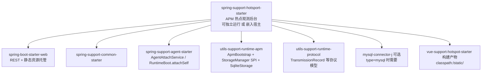
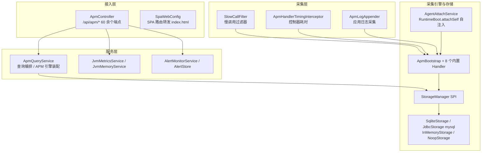
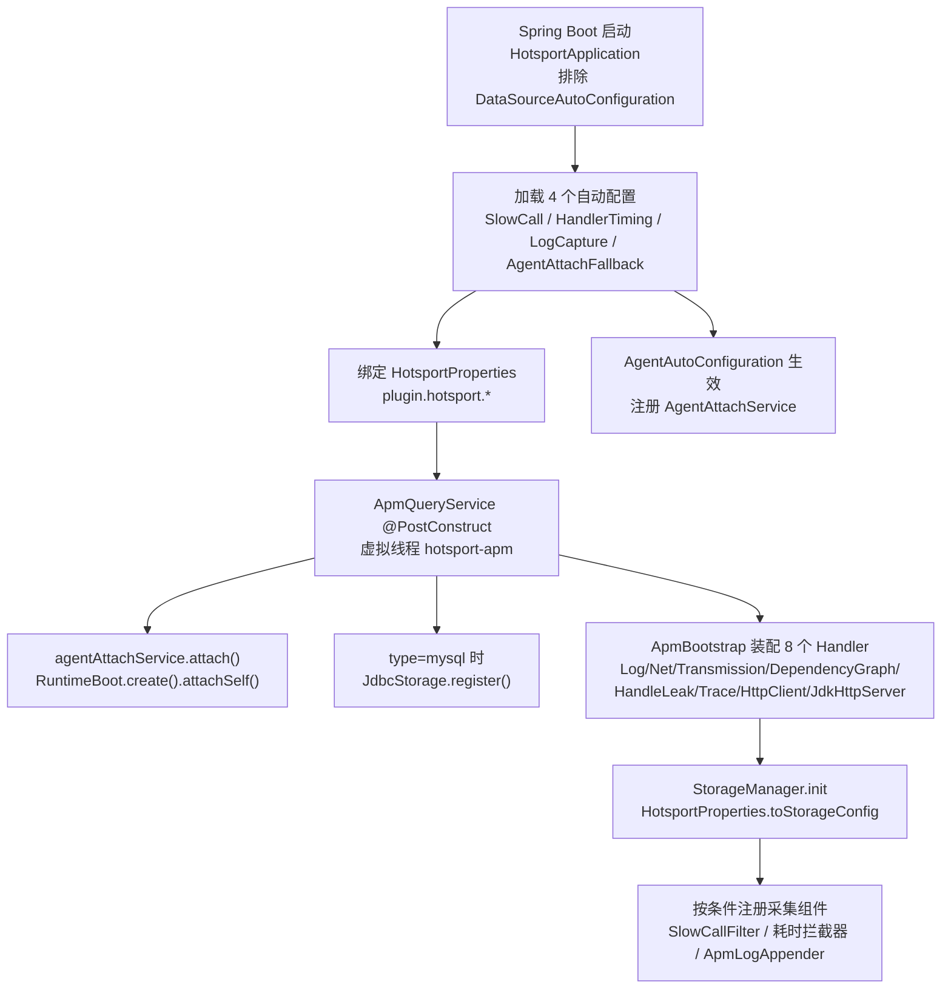
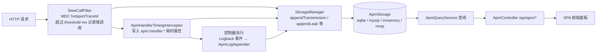

# spring-support-hotsport-starter

APM 热点观测后台：基于 `utils-support-runtime-apm` 的 `StorageManager` SPI 作为数据底座，以 REST API（`/api/apm/*`）暴露传输记录、调用链、依赖图、资源泄漏、日志、JVM、告警等观测数据；启动时通过 `spring-support-agent-starter` 对当前 JVM 自注入 Java Agent 完成字节码采集，并托管 `vue-support-hotspot-starter` 前端构建产物（classpath:/static/），可打包为单个可执行 jar 独立部署。

- 本模块是**可独立运行的观测进程**（`HotsportApplication` + spring-boot-maven-plugin repackage），也可作为依赖嵌入宿主 Servlet Web 应用提供采集能力。
- 不依赖任何外部数据库：`HotsportApplication` 显式排除 `DataSourceAutoConfiguration`；数据落库走 `StorageManager` SPI（默认内嵌 sqlite，可选 mysql / inmemory / noop）。
- 采集能力默认开启：`plugin.hotsport.request-record.enabled`、`plugin.hotsport.log-capture.enabled`、`plugin.agent.enabled` 缺省即生效。

## 一、架构图

### 1.1 生态位置



### 1.2 内部分层



## 二、核心流程图

### 2.1 启动装配流程



### 2.2 请求与数据链路



## 三、能力清单

REST 基础路径 `/api/apm`（`ApmController`），按能力域分组：

| 能力域 | 端点 | 关键类 |
|:-------|:-----|:-------|
| 总览统计 | `GET /stats`、`GET /health`、`GET /trend`、`GET /sla` | `ApmQueryService` |
| 传输记录 | `GET /transmissions`、`GET /export/transmissions` | `StorageManager` |
| 调用链追踪 | `GET /agent/traces`、`GET /agent/traces/tree`、`GET /traces/summary`、`GET /trace/{traceId}`、`GET /trace/{traceId}/waterfall`、`GET /trace/{traceId}/root-cause` | `TraceHandler`（APM 引擎） |
| 依赖拓扑 | `GET /dependencies`、`GET /dependencies/aggregated`、`GET /agent/dependencies`、`GET /system/topology`、`GET /services`、`GET /endpoints` | `DependencyGraphHandler`（APM 引擎） |
| 慢调用 / 慢 SQL | `GET /slow-calls`、`GET /slow-sql`、`GET /error-ranking`、`GET /endpoint-stats`、`GET /protocol-stats` | `SlowCallFilter` |
| 资源泄漏 | `GET /leaks`、`GET /agent/handles`、`GET /handles/growth`、`GET /export/leaks` | `HandleLeakHandler`（APM 引擎） |
| 日志 | `GET /logs`、`GET /log-stats`、`GET /agent/system-out`、`GET /export/logs` | `ApmLogAppender`、`LogHandler` |
| JVM 观测 | `GET /jvm/snapshot`、`GET /jvm/metrics`、`GET /jvm/thread-dump` | `JvmMetricsService`（`@Scheduled` 周期采集） |
| JVM 内存诊断 | `GET /jvm/memory/pools`、`POST /jvm/gc`、`GET /jvm/class-loading` | `JvmMemoryService`（对象占用 / 手动 GC / 类加载统计） |
| 线程池 / 连接池 / 资源 | `GET /thread-pools`、`GET /connection-pools`、`GET /resources` | `ApmQueryService` |
| 告警 | `GET /alerts`、`GET /alerts/history`、`GET /alerts/persistence`、`GET|POST /alerts/rules`、`POST /alerts/rules/toggle`、`DELETE /alerts/rules/{metric}`、`GET|POST /alerts/channels`、`DELETE /alerts/channels/{id}`、`POST /alerts/channels/toggle`、`POST /alerts/{id}/acknowledge|mute|ignore` | `AlertMonitorService`、`AlertStore` |
| Agent 管理 | `GET /agent/status`、`GET|POST /agent/config`、`POST /agent/enabled`、`GET /agent/self`、`GET /agent/trace-hotspots`、`GET /agent/trace-phases`、`GET /agent/skywalking/export` | `AgentAttachService` |
| 存储管理 | `GET /storage/status`、`POST /storage/config`、`POST /storage/reload` | `StorageManager`、`HotsportProperties` |
| 运维 | `POST /cleanup`、`GET /diagnostics/bundle` | `ApmQueryService` |

其它能力：SPA 静态托管（`SpaWebConfig`，页面路由 `/`、`/dashboard`、`/traces`、`/dependencies`、`/leaks`、`/logs`）、Agent 自注入（`RuntimeBoot.attachSelf`）。

## 四、Bean 能力矩阵

自动配置注册表：`META-INF/spring/org.springframework.boot.autoconfigure.AutoConfiguration.imports` 共 4 个条目（无 spring.factories）：
`SlowCallAutoConfiguration`、`ApmHandlerTimingConfiguration`、`AgentAttachFallbackConfiguration`、`ApmLogCaptureAutoConfiguration`。

| Bean / 组件 | 类型 | 注册方式 | 生效条件（源码实证） |
|:------------|:-----|:---------|:---------------------|
| `hotsportProperties` | `HotsportProperties` | `@Component` + `@ConfigurationProperties(prefix="plugin.hotsport")` | 无条件（组件扫描） |
| `apmController` | `ApmController`（`@RestController`，`@RequestMapping("/api/apm")`） | 组件扫描 | 无条件 |
| `apmQueryService` | `ApmQueryService`（`@Service`） | 组件扫描 | 无条件 |
| `jvmMetricsService` | `JvmMetricsService`（`@Service`） | 组件扫描 | 无条件 |
| `jvmMemoryService` | `JvmMemoryService`（`@Service`） | 组件扫描 | 无条件 |
| `alertMonitorService` | `AlertMonitorService`（`@Service`） | 组件扫描 | 无条件 |
| `alertStore` | `AlertStore`（`@Component`） | 组件扫描 | Bean 无条件注册；内部仅 `type=mysql` 且 url 非空时才落库 |
| `slowCallFilter` | `SlowCallFilter` | `@Bean`（`SlowCallAutoConfiguration`），阈值 `@Value("${plugin.hotsport.request-record.threshold-ms:0}")` | `@ConditionalOnWebApplication(type=SERVLET)` + `@ConditionalOnProperty(prefix="plugin.hotsport.request-record", name="enabled", havingValue="true", matchIfMissing=true)` |
| 控制器耗时拦截器 | `ApmHandlerTimingInterceptor` | `@Bean`（`ApmHandlerTimingConfiguration`），`@AutoConfigureAfter(SlowCallAutoConfiguration.class)`，order=`Integer.MAX_VALUE` | 同上（同一 `plugin.hotsport.request-record.enabled` 开关） |
| `apmLogAppender` | `ApmLogAppender`（`destroyMethod="stop"`） | `@Bean`（`ApmLogCaptureAutoConfiguration`） | `@ConditionalOnClass(ch.qos.logback.classic.spi.ILoggingEvent)` + `plugin.hotsport.log-capture.enabled=true`（缺省 true） |
| `agentAttachService` | `AgentAttachService`（来自 spring-support-agent-starter） | `@Bean @ConditionalOnMissingBean`（`AgentAutoConfiguration`） | `@ConditionalOnProperty(prefix="plugin.agent", name="enabled", havingValue="true", matchIfMissing=true)` |
| `disabledAgentAttachService` | `AgentAttachFallbackConfiguration` 内方法 | — | **源码现状**：该类仅 `@EnableConfigurationProperties(AgentAttachProperties.class)`；`disabledAgentAttachService` 方法**未标注 `@Bean`**，其 Javadoc 描述了 `plugin.agent.enabled=false` 时的条件兜底语义，但按当前代码它不是注册的 Bean |
| `spaWebConfig` | `SpaWebConfig`（`@Configuration` implements `WebMvcConfigurer`） | 组件扫描 | 无条件 |
| `hotsportApplication` | `HotsportApplication`（`@SpringBootApplication(exclude=DataSourceAutoConfiguration)` + `@EnableScheduling`） | 主类 | 独立运行入口 |

> 说明：`HotsportProperties` 同时绑定 `plugin.hotsport.agent.*`（enabled/shellPort/options）；`spring-support-agent-starter` 侧的 `AgentAttachProperties` 绑定 `plugin.agent.*`（enabled/shellPort/options/async）并驱动实际自注入行为。

## 五、完整配置

前缀 `plugin.hotsport.*`（`HotsportProperties`，单位如无说明为毫秒）：

| 配置项 | 默认值 | 说明 |
|:-------|:-------|:-----|
| `plugin.hotsport.agent.enabled` | `true` | 是否启用 Agent 自注入（hotsport 侧开关） |
| `plugin.hotsport.agent.shell-port` | `4567` | Agent Shell 端口 |
| `plugin.hotsport.agent.options` | `""` | Agent 启动参数（空串时由 RuntimeBoot 默认） |
| `plugin.hotsport.apm.storage.type` | `sqlite` | 存储后端：`sqlite` / `mysql` / `inmemory` / `noop` |
| `plugin.hotsport.apm.storage.retention-ms` | `604800000` | 数据保留时长（默认 7 天） |
| `plugin.hotsport.apm.storage.capacity` | `100000` | 容量上限 |
| `plugin.hotsport.apm.storage.path` | `""` | sqlite 落盘目录（库文件 `<path>/apm.db`；application.yml 默认 `${user.home}/.hotsport/apm`） |
| `plugin.hotsport.apm.storage.url` | `""` | mysql JDBC URL（type=mysql 时必填） |
| `plugin.hotsport.apm.storage.username` | `""` | mysql 用户名 |
| `plugin.hotsport.apm.storage.password` | `""` | mysql 密码 |
| `plugin.hotsport.apm.storage.pool-size` | `4` | 写入线程池大小 |
| `plugin.hotsport.apm.storage.batch-size` | `200` | 批量写入条数 |
| `plugin.hotsport.apm.storage.async` | `null` | 是否异步写（未设置时由实现决定） |
| `plugin.hotsport.apm.storage.maintenance-interval-ms` | `0` | 自维护线程间隔（0=实现默认） |
| `plugin.hotsport.apm.storage.flush-timeout-ms` | `0` | 刷盘超时（0=实现默认） |
| `plugin.hotsport.request-record.enabled` | `true` | 请求采集开关（SlowCallFilter + 耗时拦截器） |
| `plugin.hotsport.request-record.threshold-ms` | `0` | 慢调用阈值，0=不过滤全部记录 |
| `plugin.hotsport.log-capture.enabled` | `true` | 应用日志采集开关（需 Logback） |
| `plugin.hotsport.log-capture.min-level` | `INFO` | 采集的最低日志级别 |
| `plugin.hotsport.log-capture.caller-data` | `true` | 是否采集调用方信息 |
| `plugin.hotsport.log-capture.max-message-length` | `4096` | 单条日志最大长度 |

`spring-support-agent-starter` 前缀 `plugin.agent.*`（`AgentAttachProperties`）：

| 配置项 | 默认值 | 说明 |
|:-------|:-------|:-----|
| `plugin.agent.enabled` | `true` | 是否自注入（false 时 AgentAutoConfiguration 不生效） |
| `plugin.agent.shell-port` | `4567` | Shell 端口（options 为空时作为默认 options） |
| `plugin.agent.options` | `""` | Agent 参数 |
| `plugin.agent.async` | `true` | 是否异步注入（虚拟线程，不阻塞启动） |

其它运行配置（`application.yml`）：`server.port=8086`、`spring.application.name=hotsport`、`spring.web.resources.static-locations=classpath:/static/`。

> MySQL 凭据传递：`ApmQueryService` 会把 `plugin.hotsport.apm.storage.url/username/password` 写入系统属性 `apm.storage.*`；`ApmBootstrap` 仅从系统属性合并这几个键。JDBC 写入由 `JdbcStorage` 自管连接，不经过 Spring `DataSource`。

## 六、使用方式

### 6.1 独立运行（推荐）

```bash
cd spring-support-parent-starter/spring-support-hotsport-starter
mvn -o package -DskipTests
java -jar target/spring-support-hotsport-starter-4.0.0.51.jar
# 页面: http://127.0.0.1:8086/  （/dashboard、/traces、/dependencies、/leaks、/logs）
# API : http://127.0.0.1:8086/api/apm/stats
```

一键脚本：`bash run.sh`（后端 8086 + 前端 vite dev 8890，`/api/apm` 代理到 8086）、`bash run.sh stop`、`bash run.sh status`。

### 6.2 作为依赖嵌入宿主应用

```xml
<dependency>
    <groupId>com.chua</groupId>
    <artifactId>spring-support-hotsport-starter</artifactId>
    <version>4.0.0.51</version>
</dependency>
```

- Servlet Web 应用引入即自动注册 `SlowCallFilter` 与控制器耗时拦截器（`request-record.enabled` 可关）；classpath 含 Logback 时自动挂载 `ApmLogAppender`（`log-capture.enabled` 可关）。
- 自注入由 `spring-support-agent-starter` 的 `AgentAutoConfiguration` 完成（`plugin.agent.enabled` 可关）。
- 观测页面与 API 随宿主端口暴露：页面 `/`、`/dashboard` 等，API `/api/apm/*`。

### 6.3 切换 MySQL 集中存储

```yaml
plugin:
  hotsport:
    apm:
      storage:
        type: mysql
        url: jdbc:mysql://127.0.0.1:3306/hotsport?useSSL=false
        username: root
        password: "***"
```

`mysql-connector-j` 为 optional 依赖，需自行引入；`JdbcStorage` 启动时校验连通性并建表，失败则降级 `NoopStorage`（仅记日志，不影响应用）。

## 七、使用场景

| 场景 | 做法 | 关键点 |
|:-----|:-----|:-------|
| 单机观测后台 | 独立 jar 启动，默认 sqlite | 无外部 DB 依赖，数据落盘重启不丢；页面 + API 一体交付 |
| 宿主应用探针 | 宿主引入依赖 | 自动采集慢调用、控制器耗时、应用日志、调用链；`plugin.agent.enabled` 开关 |
| 集中观测多实例 | `type=mysql` + JDBC URL | 数据集中落库；告警规则/渠道/事件经 `AlertStore` 同步落库重启回灌 |
| 慢接口定位 | `threshold-ms` 调低 + `/slow-calls`、`/slow-sql`、`/endpoint-stats` | 结合 MDC `hotsportTraceId` 串联日志 |
| 链路根因分析 | `/trace/{id}/waterfall`、`/trace/{id}/root-cause`、`/agent/trace-hotspots` | 依赖 APM 引擎 TraceHandler 字节码数据 |
| 依赖拓扑梳理 | `/dependencies/aggregated`、`/system/topology` | 服务/端点维度聚合 |
| 资源泄漏排查 | `/leaks`、`/agent/handles`、`/handles/growth` | 句柄增长趋势 |
| JVM 内存诊断 | `/jvm/memory/pools`、`POST /jvm/gc`、`/jvm/class-loading`、`/jvm/thread-dump` | 类加载器统计辅助定位 classloader 泄漏 |
| 告警运维 | `/alerts/rules`、`/alerts/channels`、`/alerts/history` | 阈值规则 + 通知渠道（webhook），支持确认/静默/忽略 |
| 对接已有体系 | `/agent/skywalking/export` | 导出 SkyWalking 兼容数据 |

## 八、扩展点

| 扩展点 | 位置 | 说明 |
|:-------|:-----|:-----|
| 存储后端 SPI | `com.chua.runtime.apm.storage.ApmStorage`（utils-support-runtime-apm） | 实现接口后通过 `StorageManager.register(impl)` 注册（参考 `JdbcStorage.register()`），或放进 `META-INF/services` 由 ServiceLoader 发现。选择策略：SPI 第一个有效实现为默认 → `apm.storage.type` 同名实现 → 找不到则 `NoopStorage` 兜底 |
| 存储参数 | `HotsportProperties#toStorageConfig()` | 生成 `StorageConfig`；运行期可 `POST /api/apm/storage/config`、`POST /api/apm/storage/reload` 调整 |
| Agent 参数 | `plugin.agent.options` / `plugin.agent.shell-port` | 透传给 `RuntimeBoot.create()....attachSelf()` |
| 采集开关 | `plugin.hotsport.request-record.enabled`、`plugin.hotsport.log-capture.enabled`、`plugin.agent.enabled` | 按条件装配/关闭对应 Bean |
| 告警规则与通知 | `AlertMonitorService` + `AlertStore` | 规则/渠道内存态 + mysql 写穿；webhook 通知 |
| 前端替换 | `src/main/resources/static/` | pom 从 `apps/vue-support-hotspot-starter` 拷贝构建产物；替换该目录即可换前端实现 |
| 采集数据面 | `ApmBootstrap` 内置 8 个 Handler（Log/Net/Transmission/DependencyGraph/HandleLeak/Trace/HttpClient/JdkHttpServer） | 由 `ApmQueryService` 固定装配；新增数据面需扩展 utils-support-runtime-apm 层 |

## 九、常见问题

**Q1：为什么启动不依赖数据库？**
`HotsportApplication` 显式排除 `DataSourceAutoConfiguration`；观测数据走 `StorageManager` SPI，默认 sqlite 内嵌落盘。mysql 模式由 `JdbcStorage` 自管 JDBC 连接，也不经过 Spring `DataSource`。

**Q2：存储类型怎么选？**
`sqlite`（默认）：本地文件 `<path>/apm.db`，重启不丢；`inmemory`：重启归零，仅临时调试；`mysql`：集中存储，需驱动 + URL；`noop`：不持久化。

**Q3：页面刷新 404？**
SPA 路由由 `SpaWebConfig` 转发到 `index.html`，仅覆盖 `/`、`/dashboard`、`/traces`、`/dependencies`、`/leaks`、`/logs`；其余未知路径不会兜底。

**Q4：应用日志没被采集？**
`ApmLogCaptureAutoConfiguration` 要求 classpath 存在 Logback（`@ConditionalOnClass(ILoggingEvent)`）且 `plugin.hotsport.log-capture.enabled=true`。采集器名 `HOTSPORT_APM_LOG`，默认 `min-level=INFO`、`caller-data=true`、`max-message-length=4096`。

**Q5：慢调用没记录？**
确认 `plugin.hotsport.request-record.enabled=true`；`threshold-ms=0` 表示全部记录，调大后仅记录超阈值请求。`/api/apm/*`、`/actuator/*`、`/assets/*`、`/health`、`/favicon.ico` 被 `SlowCallFilter` 排除。

**Q6：Agent 自注入失败或想关闭？**
`attach()` 在虚拟线程异步执行，不阻塞启动；状态看 `GET /api/apm/agent/status`。关闭：`plugin.agent.enabled=false`（同时 `plugin.hotsport.agent.enabled=false`）。注意：`AgentAttachFallbackConfiguration#disabledAgentAttachService` 当前源码未标注 `@Bean`，关闭后不会有兜底 Bean 注册（以代码为准）。

**Q7：MySQL 建表 / 连接失败会怎样？**
`JdbcStorage.start()` 失败会降级为 `NoopStorage` 并仅记录日志，不影响宿主运行；请核对 `url/username/password` 与 `mysql-connector-j` 依赖（optional，需自行引入）。

**Q8：告警历史重启后丢失？**
内存态规则/渠道/事件重启即失；仅当 `type=mysql` 且 url 非空时 `AlertStore` 才落库并回灌。

**Q9：端口冲突？**
后端 HTTP 端口 `server.port=8086`；Agent Shell 端口 `plugin.agent.shell-port=4567`（`options` 非空时以 options 为准）。前端 dev 模式 8890（见 run.sh）。
