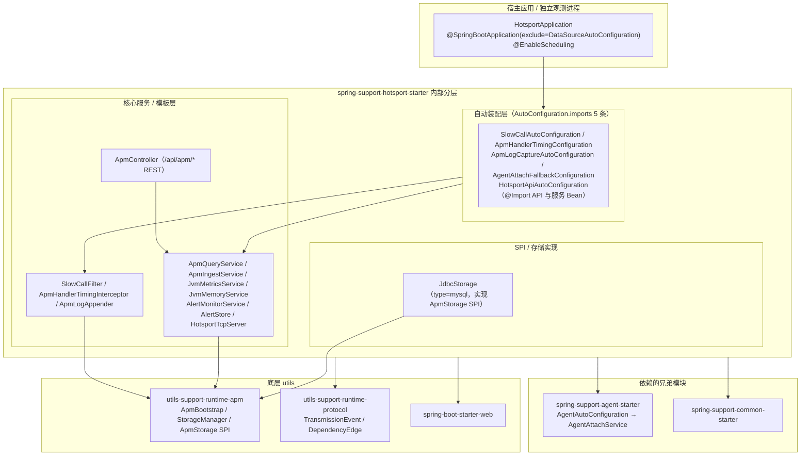
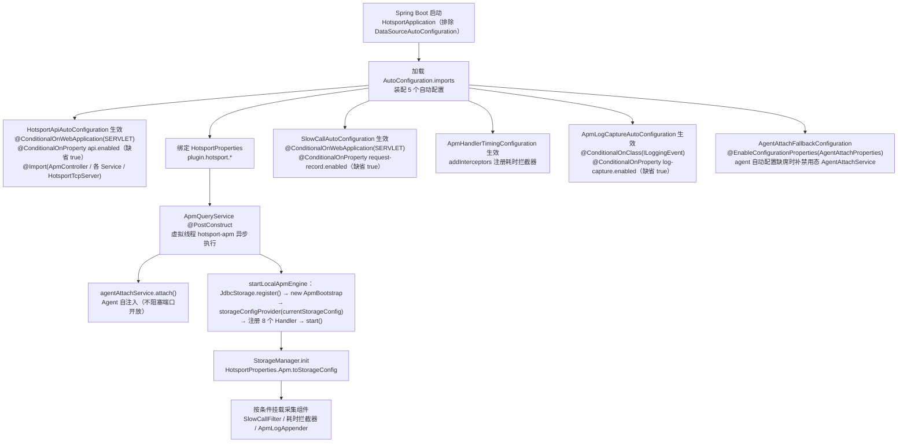

# spring-support-hotsport-starter

APM 热点观测后台：以 `utils-support-runtime-apm` 的 `StorageManager` SPI 为数据底座，通过 REST API（`/api/apm/*`，近 70 个端点）暴露传输记录、调用链、依赖拓扑、资源泄漏、日志、JVM、告警等观测数据；启动时经 `spring-support-agent-starter` 对当前 JVM 自注入 Java Agent 完成字节码采集，并托管 `vue-support-hotspot-starter` 前端构建产物（`classpath:/static/`）。在 spring-support 体系中，它是「可独立运行的观测进程」（`HotsportApplication` + spring-boot-maven-plugin repackage），也可作为依赖嵌入宿主 Servlet Web 应用；不依赖任何外部数据库（`HotsportApplication` 显式排除 `DataSourceAutoConfiguration`），数据落库走 `StorageManager` SPI。

## 1. 架构图



## 2. 核心流程图

启动自动装配 + 本进程 APM 引擎装配流程：



## 3. 能力清单

REST 基础路径 `/api/apm`（`ApmController`），按能力域分组：

| 能力域 | 关键类 | 入口 / 触发方式 |
|:-------|:-------|:----------------|
| 总览统计 / 趋势 / SLA | `ApmQueryService` | `GET /api/apm/stats`、`/health`、`/trend`、`/sla` |
| 传输记录 | `StorageManager`（APM SPI） | `GET /transmissions`、`GET /export/transmissions` |
| 调用链追踪 | `TraceHandler`（APM 引擎） | `GET /agent/traces`、`/agent/traces/tree`、`/traces/summary`、`/trace/{traceId}`、`/trace/{traceId}/waterfall`、`/trace/{traceId}/root-cause` |
| 依赖拓扑 | `DependencyGraphHandler`（APM 引擎） | `GET /dependencies`、`/dependencies/aggregated`、`/agent/dependencies`、`/system/topology`、`/services`、`/endpoints` |
| 慢调用 / 慢 SQL / 错误榜 | `SlowCallFilter` | `GET /slow-calls`、`/slow-sql`、`/error-ranking`、`/endpoint-stats`、`/protocol-stats` |
| 资源泄漏 / 句柄 | `HandleLeakHandler`（APM 引擎） | `GET /leaks`、`/agent/handles`、`/handles/growth`、`/export/leaks` |
| 应用日志采集 | `ApmLogAppender`（Logback Appender）、`LogHandler` | `GET /logs`、`/log-stats`、`/agent/system-out`、`/export/logs`；实时推送 `GET /stream/logs`（SSE） |
| JVM 指标 | `JvmMetricsService`（`@Scheduled` 周期采样） | `GET /jvm/snapshot`、`/jvm/metrics`、`/jvm/thread-dump` |
| JVM 内存诊断 | `JvmMemoryService` | `GET /jvm/memory/pools`、`POST /jvm/gc`、`GET /jvm/class-loading` |
| 线程池 / 连接池 / 资源 | `ApmQueryService` | `GET /thread-pools`、`/connection-pools`、`/resources` |
| 告警（规则 / 渠道 / 事件） | `AlertMonitorService`、`AlertStore` | `GET|POST /alerts/rules`、`POST /alerts/rules/toggle`、`DELETE /alerts/rules/{metric}`、`GET|POST /alerts/channels`、`POST /alerts/channels/toggle`、`DELETE /alerts/channels/{id}`、`GET /alerts`、`/alerts/history`、`/alerts/persistence`、`POST /alerts/{id}/acknowledge|mute|ignore` |
| 数据上报接入（HTTP / TCP） | `ApmIngestService`、`HotsportTcpServer` | `POST /api/apm/ingest`（JSON 数组 / 单条 / 混合对象，可选 `x-hotsport-token` 鉴权）；TCP 接收端 `plugin.hotsport.apm.tcp.*`（默认关闭） |
| Agent 管理 | `AgentAttachService`（agent-starter） | `GET /agent/status`、`GET|POST /agent/config`、`POST /agent/enabled`、`GET /agent/self`、`/agent/trace-hotspots`、`/agent/trace-phases`、`GET /agent/skywalking/export` |
| 存储管理 | `StorageManager`、`HotsportProperties` | `GET /storage/status`、`POST /storage/config`、`POST /storage/reload` |
| 实时数据流 | `ApmQueryService`（SSE） | `GET /stream`、`GET /stream/logs`（`text/event-stream`） |
| 运维 | `ApmQueryService` | `POST /cleanup`、`GET /diagnostics/bundle` |
| SPA 前端托管 | `SpaWebConfig` | 页面路由 `/`、`/dashboard`、`/traces`、`/dependencies`、`/leaks`、`/logs` 转发 `index.html` |

## 4. Bean 能力矩阵

自动装配入口：`META-INF/spring/org.springframework.boot.autoconfigure.AutoConfiguration.imports` 共 5 个条目（无 spring.factories）：`HotsportApiAutoConfiguration`、`SlowCallAutoConfiguration`、`ApmHandlerTimingConfiguration`、`ApmLogCaptureAutoConfiguration`、`AgentAttachFallbackConfiguration`。

| Bean 名 | 类型 | 装配条件（含默认值） | 可否覆盖 | 典型用途 |
|:--------|:-----|:---------------------|:---------|:---------|
| `hotsportApiAutoConfiguration` | `HotsportApiAutoConfiguration`（`@AutoConfiguration`） | `AutoConfiguration.imports` 装配；`@ConditionalOnWebApplication(SERVLET)` + `@ConditionalOnProperty(prefix="plugin.hotsport.api", name="enabled", havingValue="true", matchIfMissing=true)`；`@Import(ApmController / ApmQueryService / ApmIngestService / JvmMetricsService / JvmMemoryService / AlertMonitorService / AlertStore / HotsportProperties / HotsportTcpServer)`，`@EnableScheduling` 驱动 JVM 周期采样 | 用 `plugin.hotsport.api.enabled=false` 整体关闭 | 嵌入宿主时注册 `/api/apm/*` 全部 REST/服务 Bean（不依赖宿主包扫描） |
| `hotsportProperties` | `HotsportProperties` | `@Component` + `@ConfigurationProperties(prefix="plugin.hotsport")`，组件扫描；同时被 `hotsportApiAutoConfiguration` `@Import` | 可用同类型 `@Bean` + `@Primary` 替换 | 全模块配置入口；存储参数由 `getApm().toStorageConfig()` 展开 |
| `apmController` | `ApmController`（`@RestController`，`@RequestMapping("/api/apm")`） | 组件扫描；同时被 `hotsportApiAutoConfiguration` `@Import`（见上行条件） | 同上 | 观测 REST API |
| `apmQueryService` | `ApmQueryService`（`@Service`） | 组件扫描；同时被 `hotsportApiAutoConfiguration` `@Import` | 同上 | 查询编排、本进程 APM 引擎装配 |
| `jvmMetricsService` | `JvmMetricsService`（`@Service`） | 组件扫描；同时被 `hotsportApiAutoConfiguration` `@Import` | 同上 | JVM 指标定时采样 |
| `jvmMemoryService` | `JvmMemoryService`（`@Service`） | 组件扫描；同时被 `hotsportApiAutoConfiguration` `@Import` | 同上 | JVM 内存诊断 |
| `alertMonitorService` | `AlertMonitorService`（`@Service`） | 组件扫描；同时被 `hotsportApiAutoConfiguration` `@Import` | 同上 | 告警监控与通知 |
| `alertStore` | `AlertStore`（`@Component`） | 组件扫描（亦被 `@Import`）；内部仅 `type=mysql` 且 url 非空时激活落库 | 同上 | 告警规则/渠道/事件持久化 |
| `spaWebConfig` | `SpaWebConfig`（`@Configuration` implements `WebMvcConfigurer`） | 组件扫描，无条件 | 同上 | SPA 路由回退到 `index.html` |
| `slowCallFilter` | `FilterRegistrationBean<SlowCallFilter>` | `@ConditionalOnWebApplication(type=SERVLET)` + `@ConditionalOnProperty(prefix="plugin.hotsport.request-record", name="enabled", havingValue="true", matchIfMissing=true)`；阈值 `@Value("${plugin.hotsport.request-record.threshold-ms:0}")` | 无 `@ConditionalOnMissingBean`；同名覆盖需 `allow-bean-definition-overriding`，常规用开关关闭 | 记录真实 HTTP 请求 |
| （非 Bean）`ApmHandlerTimingInterceptor` | `WebMvcConfigurer#addInterceptors` 注册，`order(Integer.MAX_VALUE)` | `@AutoConfiguration(after = SlowCallAutoConfiguration.class)` + 同一 `request-record.enabled` 开关 | 通过 `request-record.enabled=false` 整体关闭 | 还原「HTTP → class.method」层级 |
| `apmLogAppender` | `ApmLogAppender`（`@Bean(destroyMethod="stop")`） | `@ConditionalOnClass(name="ch.qos.logback.classic.spi.ILoggingEvent")` + `@ConditionalOnProperty(prefix="plugin.hotsport.log-capture", name="enabled", havingValue="true", matchIfMissing=true)` | 无 `@ConditionalOnMissingBean`；用 `log-capture.enabled=false` 关闭 | 宿主真实日志入 APM 存储 |
| `agentAttachService` | `AgentAttachService`（来自 spring-support-agent-starter 的 `AgentAutoConfiguration`，见该模块） | `@ConditionalOnProperty(prefix="plugin.agent", name="enabled", havingValue="true", matchIfMissing=true)` | 有 `@ConditionalOnMissingBean`（见 agent-starter 源码），宿主可自定义实现覆盖 | 对当前 JVM 自注入 Runtime Agent |
| `disabledAgentAttachService` | `AgentAttachService` | **源码现状**：`AgentAttachFallbackConfiguration#disabledAgentAttachService` 方法未标注 `@Bean`（也无 `@ConditionalOnMissingBean`），Javadoc 描述的「`plugin.agent.enabled=false` 时兜底」语义**当前不生效**，不会注册 Bean | — | 设计意图：关闭 agent 时提供禁用态占位，避免 `ApmQueryService` 依赖缺失导致启动失败 |
| `hotsportApplication` | `HotsportApplication`（主类） | 独立运行入口 | — | 打包为可执行 jar |

> 注意：上表带 `@Component`/`@Service`/`@RestController` 的 Bean 有两条注册路径：独立运行（`HotsportApplication`）靠包扫描；嵌入宿主时由 `hotsportApiAutoConfiguration` 的 `@Import` 显式注册（开关 `plugin.hotsport.api.enabled`，缺省 true），**不依赖宿主包扫描**。唯一例外是 `SpaWebConfig`：它只走组件扫描、刻意不进 `@Import`，避免 SPA 路由回退劫持宿主页面路由，详见第 7 节。

## 5. 完整配置

`HotsportProperties` 绑定前缀 `plugin.hotsport`，含 `Agent`、`Apm` 两个一级嵌套类（`Apm` 内再分 `Storage`、`Ingest`、`Tcp` 三个子配置；单位如无说明为毫秒）：

| 配置路径 | 类型 | 默认值 | 说明 |
|:---------|:-----|:-------|:-----|
| `plugin.hotsport.agent.enabled` | boolean | `true` | hotsport 侧 Agent 自注入开关 |
| `plugin.hotsport.agent.shell-port` | int | `4567` | Agent Shell 端口 |
| `plugin.hotsport.agent.options` | String | `""` | 额外 Agent 参数（逗号分隔 Key=值，空串走默认） |
| `plugin.hotsport.apm.storage.type` | String | `sqlite` | 存储后端：`sqlite` / `mysql` / `inmemory` / `noop` |
| `plugin.hotsport.apm.storage.retention-ms` | long | `604800000` | 数据保留时长（7 天） |
| `plugin.hotsport.apm.storage.capacity` | int | `100000` | 单表容量上限（超出按最旧淘汰） |
| `plugin.hotsport.apm.storage.path` | String | `""` | sqlite 落盘目录（库文件 `<path>/apm.db`；application.yml 默认 `${user.home}/.hotsport/apm`） |
| `plugin.hotsport.apm.storage.url` | String | `""` | mysql JDBC URL（type=mysql 时必填） |
| `plugin.hotsport.apm.storage.username` | String | `""` | mysql 用户名 |
| `plugin.hotsport.apm.storage.password` | String | `""` | mysql 密码 |
| `plugin.hotsport.apm.storage.pool-size` | int | `4` | 写入线程池大小 |
| `plugin.hotsport.apm.storage.batch-size` | int | `200` | 单批写入条数 |
| `plugin.hotsport.apm.storage.async` | Boolean | `null` | 写入模式；`null`（未配置）沿用 APM 侧默认异步 |
| `plugin.hotsport.apm.storage.maintenance-interval-ms` | long | `0` | 自维护周期（0=实现默认 60 秒，下限 5 秒） |
| `plugin.hotsport.apm.storage.flush-timeout-ms` | long | `0` | 关闭时等待异步队列落盘时长（0=实现默认） |
| `plugin.hotsport.apm.ingest.token` | String | `""` | HTTP 上报共享密钥；非空时校验请求头 `x-hotsport-token`（不匹配 401），空=不校验 |
| `plugin.hotsport.apm.ingest.max-batch` | int | `1000` | `POST /api/apm/ingest` 单批每种类型最大条数（超出截断丢弃；≤0 走兜底 1000） |
| `plugin.hotsport.apm.tcp.enabled` | boolean | `false` | TCP 接收端开关（HTTP `/ingest` 始终可用；`HotsportTcpServer` 以 `havingValue="true"` 判定，缺省关闭） |
| `plugin.hotsport.apm.tcp.host` | String | `0.0.0.0` | TCP 监听地址（空/空白回退 `0.0.0.0`） |
| `plugin.hotsport.apm.tcp.port` | int | `19392` | TCP 监听端口（≤0 回退 19392） |
| `plugin.hotsport.apm.tcp.topic` | String | `hotsport-events` | 订阅主题名，采集端按主题投递（空白回退 `hotsport-events`） |

以下配置不在 `HotsportProperties` 中，由各自动配置 / 服务以 `@ConditionalOnProperty`、`@Value`、`@Scheduled` 占位符直接绑定：

| 配置路径 | 类型 | 默认值 | 说明 | 绑定位置 |
|:---------|:-----|:-------|:-----|:---------|
| `plugin.hotsport.api.enabled` | boolean | `true`（matchIfMissing） | REST API 与服务 Bean 总开关（`HotsportApiAutoConfiguration` 的 `@Import` 整体生效/关闭） | `HotsportApiAutoConfiguration` 的 `@ConditionalOnProperty` |
| `plugin.hotsport.request-record.enabled` | boolean | `true`（matchIfMissing） | 请求采集开关（SlowCallFilter + 耗时拦截器） | 两个自动配置的 `@ConditionalOnProperty` |
| `plugin.hotsport.request-record.threshold-ms` | long | `0` | 慢调用记录阈值，0=记录全部 | `SlowCallAutoConfiguration#slowCallFilter` 的 `@Value` |
| `plugin.hotsport.log-capture.enabled` | boolean | `true`（matchIfMissing） | 应用日志采集开关（需 Logback） | `ApmLogCaptureAutoConfiguration` 的 `@ConditionalOnProperty` |
| `plugin.hotsport.log-capture.min-level` | String | `INFO` | 采集的最低日志级别 | `apmLogAppender` 的 `@Value` |
| `plugin.hotsport.log-capture.caller-data` | boolean | `true` | 是否采集调用方类名/方法名 | 同上 |
| `plugin.hotsport.log-capture.max-message-length` | int | `4096` | 单条日志最大长度（截断） | 同上 |
| `plugin.hotsport.jvm.sample-interval-ms` | long | `5000` | JVM 指标采样间隔 | `JvmMetricsService#recordSample` 的 `@Scheduled(fixedDelayString)` |

兄弟模块 `spring-support-agent-starter` 的 `AgentAttachProperties`（前缀 `plugin.agent`，驱动实际自注入行为）：`plugin.agent.enabled=true`、`plugin.agent.shell-port=4567`、`plugin.agent.options=""`、`plugin.agent.async=true`（详见该模块 README）。

其它运行配置（本模块 `application.yml`，独立运行时生效）：`server.port=8086`、`spring.application.name=hotsport`、`spring.web.resources.static-locations=classpath:/static/`。

> MySQL 凭据传递链：`ApmQueryService#currentStorageConfig` 把 `plugin.hotsport.apm.storage.url/username/password` 从 provider 中剔除并写入系统属性 `apm.storage.url/username/password`；`ApmBootstrap.resolveStorageConfig` 仅合并系统属性里的 `apm.storage.*` 键。JDBC 连接由 `JdbcStorage` 自管 `DriverManager`，不经 Spring `DataSource`。

## 6. 逐项配置示例

按功能分组给出「含义 + 默认值 + YAML 示例」；所有键均可省略，省略即用默认值。时间单位如无说明为毫秒。

### 6.1 Agent 自注入（`plugin.hotsport.agent.*`）

| 配置项 | 含义 | 默认值 |
|:-------|:-----|:-------|
| `agent.enabled` | 是否对当前 JVM 自注入 Runtime Agent 做字节码采集；JDK 25 等存在 retransform 风险的环境建议 `false` | `true` |
| `agent.shell-port` | Agent Shell 监听端口 | `4567` |
| `agent.options` | 附加 Agent 参数（逗号分隔 `Key=值`），空串走 agent 侧默认 | `""` |

```yaml
plugin:
  hotsport:
    agent:
      enabled: true
      shell-port: 4567
      options: ""
```

### 6.2 APM 存储（`plugin.hotsport.apm.storage.*`）

| 配置项 | 含义 | 默认值 |
|:-------|:-----|:-------|
| `storage.type` | 存储后端：`sqlite` / `mysql` / `inmemory` / `noop` | `sqlite` |
| `storage.retention-ms` | 数据保留时长，过期由自维护任务清理 | `604800000`（7 天） |
| `storage.capacity` | 单表容量上限，超出按最旧淘汰 | `100000` |
| `storage.path` | sqlite 落盘目录（库文件 `<path>/apm.db`）；空走 APM 侧默认 | `""`（application.yml 预置 `${user.home}/.hotsport/apm`） |
| `storage.url` | mysql JDBC URL，`type=mysql` 时必填 | `""` |
| `storage.username` | mysql 用户名 | `""` |
| `storage.password` | mysql 密码（示例用占位符，勿提交真实口令） | `""` |
| `storage.pool-size` | mysql 写入连接池大小（≤0 走 APM 侧默认） | `4` |
| `storage.batch-size` | mysql 单批写入条数（≤0 走 APM 侧默认） | `200` |
| `storage.async` | 写入模式：`true` 异步批量（业务线程不阻塞）/ `false` 同步逐条；不配置沿用 APM 默认异步 | `null` |
| `storage.maintenance-interval-ms` | 自维护（清理过期 / 容量淘汰）周期；`0` = APM 默认 60 秒，下限 5 秒 | `0` |
| `storage.flush-timeout-ms` | 停机时等待异步队列落盘的最长时间；`0` = APM 默认 | `0` |

单机默认（sqlite，零外部依赖）：

```yaml
plugin:
  hotsport:
    apm:
      storage:
        type: sqlite
        path: ${user.home}/.hotsport/apm
        retention-ms: 604800000
        capacity: 100000
        async: true
        maintenance-interval-ms: 0
        flush-timeout-ms: 0
```

多实例集中存储（mysql）：

```yaml
plugin:
  hotsport:
    apm:
      storage:
        type: mysql
        url: jdbc:mysql://127.0.0.1:3306/hotsport
        username: your-username
        password: your-password
        pool-size: 4
        batch-size: 200
```

### 6.3 HTTP 上报接收（`plugin.hotsport.apm.ingest.*`）

采集端通过 `POST /api/apm/ingest` 推送数据（JSON 数组 / 单条对象 / 混合载荷）。

| 配置项 | 含义 | 默认值 |
|:-------|:-----|:-------|
| `ingest.token` | 共享密钥；非空时校验请求头 `x-hotsport-token`（不匹配返回 401），空 = 不校验 | `""` |
| `ingest.max-batch` | 单批每种类型最大条数，超出截断丢弃（≤0 或未配置走兜底 1000） | `1000` |

```yaml
plugin:
  hotsport:
    apm:
      ingest:
        token: ""          # 跨网络上报务必改为强随机密钥
        max-batch: 1000
```

### 6.4 TCP 接收端（`plugin.hotsport.apm.tcp.*`）

供无法直连 HTTP 的采集端经 TCP 通道按主题推送 APM 数据；默认关闭。

| 配置项 | 含义 | 默认值 |
|:-------|:-----|:-------|
| `tcp.enabled` | TCP 接收端开关（HTTP `/ingest` 不受影响、始终可用） | `false` |
| `tcp.host` | 监听地址；仅本机采集建议收紧为 `127.0.0.1`（空白回退 `0.0.0.0`） | `0.0.0.0` |
| `tcp.port` | 监听端口（≤0 回退 19392；注意防火墙与端口管控） | `19392` |
| `tcp.topic` | 订阅主题名，采集端与接收端必须一致（空白回退默认值） | `hotsport-events` |

```yaml
plugin:
  hotsport:
    apm:
      tcp:
        enabled: false
        host: 0.0.0.0
        port: 19392
        topic: hotsport-events
```

### 6.5 采集与 API 开关（由自动配置 / 服务直接绑定，不在 `HotsportProperties` 中）

| 配置项 | 含义 | 默认值 |
|:-------|:-----|:-------|
| `api.enabled` | `HotsportApiAutoConfiguration` 总开关：关闭后 `/api/apm/*` 端点与服务 Bean（含 TCP 接收端）整体不装配 | `true`（matchIfMissing） |
| `request-record.enabled` | 请求采集开关（SlowCallFilter + 控制器耗时拦截器，一套采集链） | `true`（matchIfMissing） |
| `request-record.threshold-ms` | 慢调用记录阈值；`0` = 记录全部真实请求 | `0` |
| `log-capture.enabled` | Logback 应用日志采集开关（宿主无 Logback 时该配置整体不加载） | `true`（matchIfMissing） |
| `log-capture.min-level` | 采集的最低日志级别 | `INFO` |
| `log-capture.caller-data` | 是否采集调用方类名/方法名 | `true` |
| `log-capture.max-message-length` | 单条日志最大长度（超长截断） | `4096` |
| `jvm.sample-interval-ms` | JVM 指标采样间隔（`@Scheduled` fixedDelay） | `5000` |

```yaml
plugin:
  hotsport:
    api:
      enabled: true
    request-record:
      enabled: true
      threshold-ms: 0
    log-capture:
      enabled: true
      min-level: INFO
      caller-data: true
      max-message-length: 4096
    jvm:
      sample-interval-ms: 5000
```

### 6.6 完整配置示例（多实例集中观测）

```yaml
server:
  port: 8086                    # 独立运行时的 HTTP 端口（页面与 /api/apm/* 同端口）

plugin:
  hotsport:
    api:
      enabled: true
    agent:
      enabled: true             # JDK 25 等环境先评估 retransform 风险
      shell-port: 4567
      options: ""
    request-record:
      enabled: true
      threshold-ms: 0
    log-capture:
      enabled: true
      min-level: INFO
      caller-data: true
      max-message-length: 4096
    jvm:
      sample-interval-ms: 5000
    apm:
      storage:
        type: mysql             # 多实例集中存储；单机改 sqlite + path
        url: jdbc:mysql://127.0.0.1:3306/hotsport
        username: your-username
        password: your-password # 占位符，部署时替换
        pool-size: 4
        batch-size: 200
        async: true
        retention-ms: 604800000
        capacity: 100000
        maintenance-interval-ms: 60000
        flush-timeout-ms: 10000
      ingest:
        token: change-me        # 采集端请求头 x-hotsport-token 与此一致
        max-batch: 1000
      tcp:
        enabled: false          # 仅当采集端无法直连 HTTP 时打开
        host: 127.0.0.1
        port: 19392
        topic: hotsport-events
```

生产注意事项：

- **驱动与降级**：`mysql-connector-j` 是 optional 依赖，`type=mysql` 时必须显式引入；连库失败时 `StorageManager` 降级 `NoopStorage`（宿主不受影响，但数据不落库），上线前先验证连通性。
- **Agent 风险**：自注入会对已加载类 retransform，部分新 JDK（如 JDK 25）存在 JVM 退出风险；强隔离环境建议 `agent.enabled=false`，升级 JDK 前先在隔离环境验证。
- **密钥管理**：`ingest.token`、`storage.password` 经配置中心/环境变量注入，勿把真实口令写入仓库。
- **容量规划**：`capacity` 默认 10 万条按最旧淘汰、`retention-ms` 默认 7 天；高流量场景按写入速率调大容量或缩短保留期。
- **网络与端口**：独立运行默认 8086；开启 `tcp` 后额外监听 `tcp.port`（默认 19392），只做本机采集时把 `tcp.host` 收紧为 `127.0.0.1`。
- **优雅停机**：`async=true` 时依赖 `flush-timeout-ms` 在停机时排空写入队列，不要设得过小以免丢尾部数据。

## 7. 使用方式

Maven 坐标：

```xml
<dependency>
    <groupId>com.chua</groupId>
    <artifactId>spring-support-hotsport-starter</artifactId>
    <version>4.0.0.51</version>
</dependency>
```

独立运行（推荐，打成单个可执行 jar）：

```bash
cd spring-support-parent-starter/spring-support-hotsport-starter
mvn -o package -DskipTests
java -jar target/spring-support-hotsport-starter-4.0.0.51.jar
# 页面: http://127.0.0.1:8086/（/dashboard、/traces、/dependencies、/leaks、/logs）
# API : http://127.0.0.1:8086/api/apm/stats
```

一键脚本：`bash run.sh`（后端 8086 + 前端 vite dev 8890，`/api/apm` 代理到 8086）、`bash run.sh stop`、`bash run.sh status`。

嵌入宿主 Servlet Web 应用（最小启用示例，零配置即默认开启三项采集）：

```yaml
plugin:
  hotsport:
    request-record:
      enabled: true        # SlowCallFilter + 控制器耗时拦截器
      threshold-ms: 0      # 0=记录全部请求
    log-capture:
      enabled: true        # Logback 日志采集
    apm:
      storage:
        type: sqlite       # 默认，无需外部数据库
  agent:
    enabled: true          # Agent 自注入（plugin.agent.* 由 agent-starter 绑定）
```

嵌入形态的关键前提：5 个自动配置类**必然**随依赖装配。其中 `HotsportApiAutoConfiguration`（开关 `plugin.hotsport.api.enabled`，缺省 true）通过 `@Import` 直接注册 `ApmController`、`ApmQueryService`、`ApmIngestService`、`JvmMetricsService`、`JvmMemoryService`、`AlertMonitorService`、`AlertStore`、`HotsportTcpServer` 等 Bean——**不依赖宿主包扫描**，宿主启动类不在 `com.chua` 包下也有完整 `/api/apm/*` 端点；请求采集、日志采集两个自动配置同样缺省生效。唯一不经 `@Import` 的是 `SpaWebConfig`（SPA 路由回退）：它只走组件扫描，嵌入宿主时默认不注册，正好避免 SPA 回退劫持宿主自己的页面路由；确需在宿主内托管本模块前端时，再显式 `@ComponentScan` 引入。

可选依赖说明：

- `mysql-connector-j`（optional）：仅 `apm.storage.type=mysql` 时需要，由使用方显式引入；缺驱动或连库失败时 `JdbcStorage.start()` 抛错，`StorageManager.init` 降级为 `NoopStorage`（仅记日志，不影响宿主）。
- `lombok`（provided）：仅编译期需要，运行期不传递。
- `spring-support-agent-starter`：传递带入 `utils-support-runtime-starter` / `utils-support-runtime-agent`，提供 `AgentAttachService` 与 `plugin.agent.*` 绑定。

## 8. 使用场景

适用：

- **单机观测后台**：独立 jar 启动，默认 sqlite 落盘（`<path>/apm.db`，重启不丢），页面 + API 一体交付，无外部 DB 依赖。
- **宿主应用探针**：宿主引入依赖即自动采集真实 HTTP 请求、控制器耗时、应用日志与调用链，MDC `hotsportTraceId` 串联日志与链路。
- **多实例集中观测**：`type=mysql` + JDBC URL 集中落库；告警规则/渠道/事件经 `AlertStore` 同步落库、重启回灌。
- **性能定位与根因分析**：`threshold-ms` 调低配合 `/slow-calls`、`/slow-sql`、`/trace/{id}/waterfall`、`/trace/{id}/root-cause`、`/agent/trace-hotspots` 定位慢接口与调用层级。

不适用 / 慎用：

- **强隔离生产环境的常驻探针**：Agent 自注入会对已加载类做 retransform，在部分 JDK（如 JDK 25）上存在 JVM 退出的风险（`AgentAttachFallbackConfiguration` Javadoc 记录了该事故）；此类环境建议 `plugin.agent.enabled=false`，仅保留 Servlet/日志层采集。
- **海量长周期数据**：单表 `capacity` 默认 10 万条、按最旧淘汰，不适合替代专业 APM 的长期数据仓库；大数据量请接 mysql 并自行规划容量与清理。

与相邻模块的取舍：本模块是 `utils-support-runtime-apm` 的**展示与查询后台**（Controller/Service/前端托管/采集过滤器），不是采集引擎本身；字节码插桩能力全部来自 `spring-support-agent-starter` 与 utils 层，本模块只做装配与消费。需要纯嵌入式采集（无页面/无 REST）时直接依赖 agent-starter + utils-support-runtime-apm 即可，不必引入本模块。

## 9. 扩展点

| 扩展点 | 位置 | 注册 / 自定义方式 |
|:-------|:-----|:------------------|
| 存储后端 SPI | `com.chua.runtime.apm.storage.ApmStorage`（utils-support-runtime-apm） | 实现接口后在初始化前调用 `StorageManager.register(impl)`（参考本模块 `JdbcStorage.register()`）；选择策略：内置类型 → 注册表 → `apm.storage.type` 同名实现 → 找不到则 `NoopStorage` 兜底 |
| 存储参数热更新 | `HotsportProperties.Apm#toStorageConfig()` → `StorageConfig` | 运行期 `POST /api/apm/storage/config`、`POST /api/apm/storage/reload` 无需重启调整 |
| Agent 注入参数 | `plugin.agent.options` / `plugin.agent.shell-port` | 透传给 `RuntimeBoot.create()...attachSelf()`；`AgentAttachService` 本身支持 `@ConditionalOnMissingBean` 覆盖（见 agent-starter） |
| 采集开关 | `plugin.hotsport.request-record.enabled`、`plugin.hotsport.log-capture.enabled`、`plugin.agent.enabled` | 按条件装配/关闭对应 Bean |
| 告警规则与通知 | `AlertMonitorService` + `AlertStore` | 规则/渠道内存态 + mysql 写穿，webhook 通知渠道经 `/api/apm/alerts/channels` 维护 |
| 前端替换 | `src/main/resources/static/` | `apps/vue-support-hotspot-starter` 构建产物置于该目录（pom 仅有 repackage，无前端资源拷贝插件）；替换目录即可换前端实现 |
| 采集数据面 | `ApmBootstrap` 内置 8 个 Handler（Log / Net / Transmission / DependencyGraph / HandleLeak / Trace / HttpClient / JdkHttpServer） | 由 `ApmQueryService#startLocalApmEngine` 固定装配；新增数据面需扩展 utils-support-runtime-apm 层，本模块不重复实现 |

## 10. 常见问题

**Q1：引入依赖后为什么没有 `/api/apm/*` 端点？**
按顺序排查：① 总开关 `plugin.hotsport.api.enabled` 是否被显式设为 `false`（缺省 true）；② 宿主是否为 Servlet Web 应用——`HotsportApiAutoConfiguration` 带 `@ConditionalOnWebApplication(SERVLET)`，非 Web 宿主不装配。排除以上两点后，`ApmController`、`ApmQueryService` 等由该自动配置 `@Import` 注册，**不依赖宿主包扫描**，正常应有端点；若仍缺失，可改用独立运行形态（`java -jar`）对照验证。

**Q2：如何彻底关闭采集，让宿主零开销？**
依次设 `plugin.hotsport.request-record.enabled=false`（关请求+耗时拦截器）、`plugin.hotsport.log-capture.enabled=false`（关日志采集）、`plugin.agent.enabled=false`（关字节码自注入）。注意：当前源码中 `AgentAttachFallbackConfiguration#disabledAgentAttachService` 未标注 `@Bean`，关闭 agent 后没有兜底 Bean；`ApmQueryService` 强依赖 `AgentAttachService` 时若上下文启动失败，以实际代码为准排查。

**Q3：切换 MySQL 后建表/连接失败会怎样？**
`JdbcStorage.start()` 抛出的异常会被 `StorageManager.init` 捕获并降级为 `NoopStorage`，宿主照常运行但观测数据不再落库。请核对 `url/username/password` 与 optional 的 `mysql-connector-j` 是否已显式引入；告警持久化（`AlertStore`）同样只在 `type=mysql` 且 url 非空时激活。

**Q4：升级到 Boot 4 / 新版 JDK 需要注意什么？**
自动装配走 `META-INF/spring/...AutoConfiguration.imports`（无 spring.factories），Boot 4 兼容；`HotsportApplication` 排除了 `DataSourceAutoConfiguration`，嵌入时若宿主自己有 DataSource 不受影响。JDK 25 上 agent retransform 存在 JVM 退出风险（见第 7 节），升级 JDK 前先在隔离环境验证 `plugin.agent.enabled=true` 的行为，必要时保持关闭。
