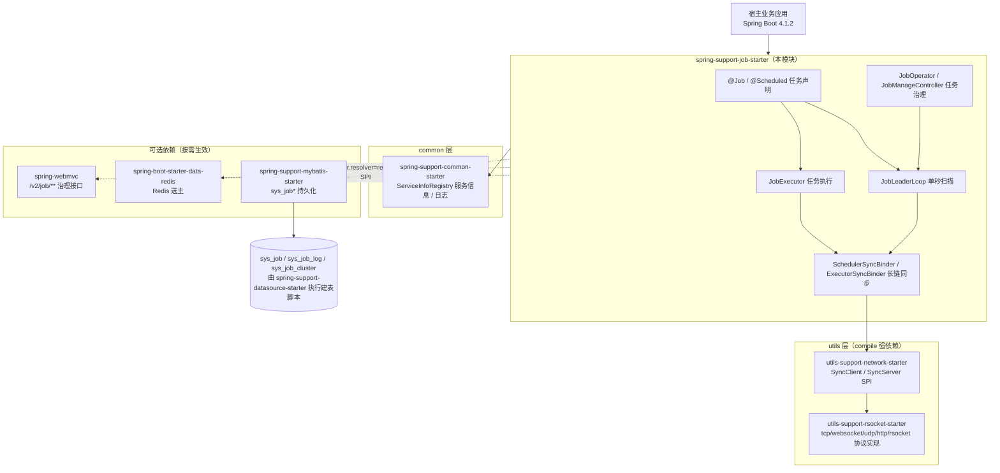
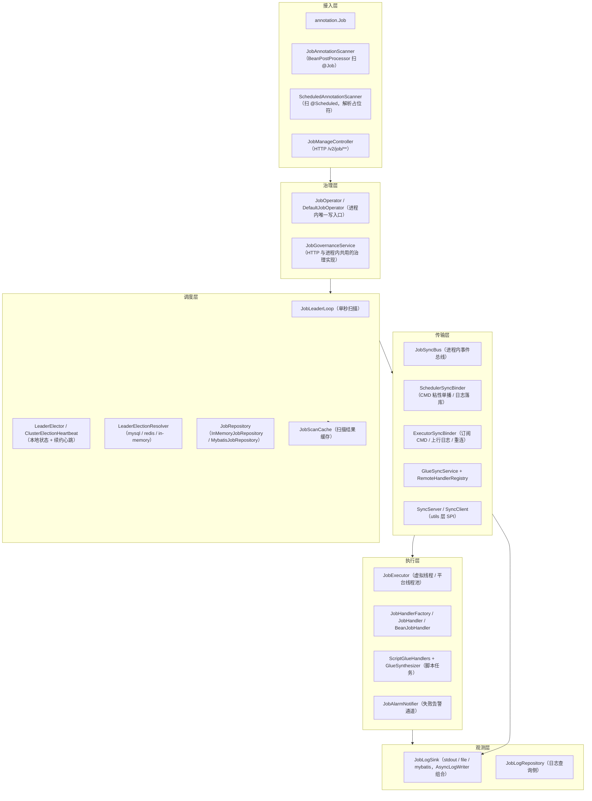
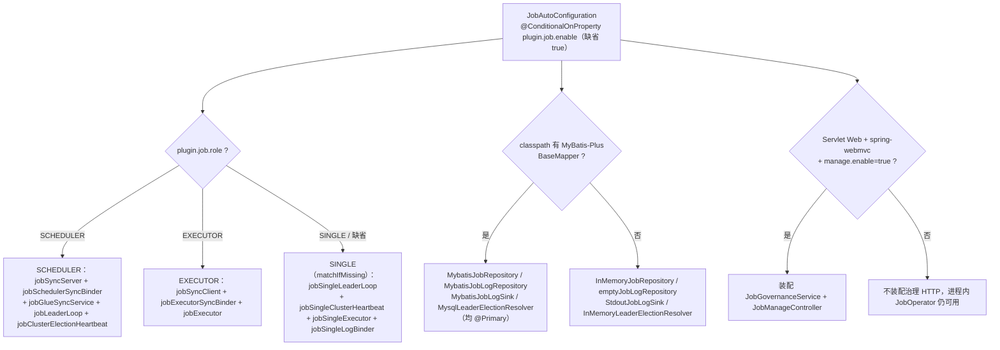

# spring-support-job-starter

自研分布式任务调度模块：`@Job` 注解 + Spring `@Scheduled` 双扫描入口，按 `SCHEDULER` / `EXECUTOR` / `SINGLE` 三种角色装配；单机开箱即用（默认 `SINGLE`），集群模式通过仓库公共 `SyncClient` / `SyncServer` 长链同步拆分调度中心与执行器。

- 自动配置入口：`com.chua.starter.job.support.JobAutoConfiguration`（注册于 `META-INF/spring/org.springframework.boot.autoconfigure.AutoConfiguration.imports`，无 `spring.factories`）
- 配置前缀：`plugin.job`（`JobProperties.PRE`），`enable` 缺省即启用
- 数据表：`sys_job`（任务主表）、`sys_job_log`（执行日志）、`sys_job_cluster`（选主租约），由 `db/init/V2.0__init_all_job.sql` 建表（三库自兼容：MySQL 8 / PostgreSQL 12 / Oracle 12c）
- 当前基线：模块版本 `4.0.0.51`，父级 `spring-support-parent-starter 4.0.0.51`，Spring Boot `4.1.2`

---

## 1. 架构图

### 1.1 模块在体系中的位置



### 1.2 内部分层



---

## 2. 核心流程图

### 2.1 SINGLE 单机模式：扫描 → 执行 → 日志 数据流

```mermaid
sequenceDiagram
    autonumber
    participant Scan as JobAnnotationScanner
    participant Repo as InMemoryJobRepository / MybatisJobRepository
    participant Loop as JobLeaderLoop
    participant Bus as JobSyncBus
    participant Exe as JobExecutor
    participant Binder as LocalJobLogBinder
    participant Sink as JobLogSink

    Note over Scan: 启动期 afterSingletonsInstantiated()
    Scan->>Repo: upsert(JobDefinition)
    Note over Loop: @PostConstruct 启动守护线程
    loop 每 scan-interval-ms（默认 1000ms）
        Loop->>Loop: leaderElector.isLeader() 校验
        Loop->>Repo: findDue(now, preReadMs, 200, group)
        Repo-->>Loop: 到期任务列表
        Loop->>Bus: publish("job-cmd", 派发负载)
        Bus->>Exe: 订阅 job-cmd 触发
        Exe->>Exe: JobHandlerFactory 取处理器，提交执行池
        Exe->>Bus: publish("job-log", JobLogEvent)
        Bus->>Binder: 订阅 job-log 触发
        Binder->>Sink: write(JobLogEvent)
    end
```

### 2.2 SCHEDULER / EXECUTOR 集群模式：派发与回传

```mermaid
sequenceDiagram
    autonumber
    participant Loop as JobLeaderLoop（调度中心）
    participant Bus as JobSyncBus
    participant SB as SchedulerSyncBinder
    participant SS as SyncServer（长链服务端）
    participant SC as SyncClient（执行器长链）
    participant EB as ExecutorSyncBinder
    participant Exe as JobExecutor（执行器）

    EB->>SC: 启动时 send("job-reg", 注册负载)
    SC->>SS: 建链 + 上报 nodeId/role/handlers
    SS->>SB: onMessage 收注册，登记 RemoteHandlerRegistry
    loop 每 scan-interval-ms
        Loop->>Bus: publish("job-cmd", 派发负载)
        Bus->>SB: 订阅 job-cmd 触发
        SB->>SS: syncServer.send(clientId, "job-cmd", 负载) 粘性单播
        SS->>SC: 下发到在线执行器
        SC->>EB: onMessage 收 CMD
        EB->>Bus: publish 到本地总线
        Bus->>Exe: 订阅 job-cmd 触发执行
        Exe->>Bus: publish("job-log", JobLogEvent)
        EB->>SC: 本地 job-log 上行 send
        SC->>SS: 回传日志
        SB->>SB: 订阅 job-log → JobLogSink 落库
    end
```

### 2.3 装配决策流程



---

## 3. 能力清单

| 能力域 | 关键类 | 入口 |
|---|---|---|
| 任务声明 | `annotation.Job`、`JobAnnotationScanner`、`JobHandlerFactory` | 方法上标注 `@Job("xxx")`（无参方法） |
| Spring 原生调度 | `ScheduledAnnotationScanner`、`TaskScheduler` | `@Scheduled(cron = "${...}")`，占位符由 `Environment` 解析 |
| 三模式装配 | `JobAutoConfiguration`、`JobProperties.Role` | `plugin.job.role = SCHEDULER / EXECUTOR / SINGLE` |
| 扫表与派发 | `JobLeaderLoop`、`JobRepository`、`InMemoryJobRepository`、`MybatisJobRepository` | 每秒扫描（`cluster.scan-interval-ms`），预读窗 `cluster.pre-read-ms` |
| Leader 选举 | `LeaderElectionResolver`、`LeaderElector`、`ClusterElectionHeartbeat`、`MysqlLeaderElectionResolver`、`RedisLeaderElectionResolver` | `cluster.resolver` / `cluster.election-namespace` / `cluster.lease-seconds` |
| 任务执行 | `JobExecutor`、`JobSpec`、`JobSyncTopics` | 虚拟线程（`pool.virtual=true`）或平台线程池 |
| 长链同步 | `JobSyncBus`、`SchedulerSyncBinder`、`ExecutorSyncBinder`、`JobSyncTopics`、`GlueSyncService` | `sync.scheduler.*` / `sync.executor.*` |
| 执行日志 | `JobLogSink`、`StdoutJobLogSink`、`FileJobLogSink`、`MybatisJobLogSink`、`AsyncLogWriter`、`LocalJobLogBinder` | `log.*` |
| 脚本任务（Glue） | `GlueSyncService`、`GlueSynthesizer`、`JavaGlueSynthesizer`、`PassThroughGlueSynthesizer`、`ScriptGlueHandlers` | 台账 `glueType` / `glueSource`，正文按版本号同步 |
| 任务治理（进程内） | `JobOperator`、`DefaultJobOperator` | 业务代码注入 `JobOperator` |
| 任务治理（HTTP） | `JobManageController`、`JobGovernanceService` | `plugin.job.manage.enable=true` + Servlet Web + `/v2/job/**` |
| 告警 | `JobAlarmNotifier`、`CompositeJobAlarmNotifier` | 宿主注册通道 Bean，执行器聚合后按台账告警类型投递 |
| 查询缓存 | `JobScanCache`、`NoopScanCache`、`ScanCache` | `plugin.job.cache.enabled` / `cache.ttl-ms` |
| 服务信息 | `JobAutoConfiguration#describeOnStart` | 向 `ServiceInfoRegistry` 注册 `job`（分布式任务）标志 |

### 三模式分工

| Role | 起 `JobLeaderLoop` | 消费 cmd | 日志落地 |
|---|---|---|---|
| `SCHEDULER` | 是（每秒扫表） | 否，经 `SchedulerSyncBinder` 粘性单播给执行器 | 服务端 `JobLogSink` |
| `EXECUTOR` | 否 | 是（`JobExecutor` 本地执行池） | 上行 `job-log`，由调度端落库 |
| `SINGLE`（默认） | 是 | 是（同进程） | `LocalJobLogBinder` → 本地 `JobLogSink` |

`SINGLE` 是 `@ConditionalOnProperty(matchIfMissing = true)` 的默认分支，不配置 `role` 即单机自闭环。

---

## 4. Bean 能力矩阵

所有 Bean 均带 `@ConditionalOnMissingBean`：宿主声明同类型（或同名）Bean 即可令默认实现退位。MyBatis 分支的默认实现额外标 `@Primary`，仅用于同类型二选一，不影响宿主覆盖（自动配置在用户 Bean 之后评估，宿主 Bean 存在时自动配置退让）。

### 4.1 全角色公共 Bean

| Bean 名 | 类型 | 装配条件 | 可否覆盖 | 典型注入姿势 |
|---|---|---|---|---|
| `jobNodeId` | `String` | `@ConditionalOnMissingBean(name="jobNodeId")`；取 `plugin.job.node-id`，缺省按「运行时名称-随机后缀」生成 | 可（声明同名 Bean） | 构造器注入 `String jobNodeId` |
| `jobTaskScheduler` | `TaskScheduler`（`ThreadPoolTaskScheduler`） | `@ConditionalOnMissingBean`；池大小取 `pool.core-size`，前缀 `job-spring-scheduler-` | 可 | 注入 `TaskScheduler` 供 `@Scheduled` |
| `jobScheduledAnnotationScanner` | `ScheduledAnnotationScanner` | `@ConditionalOnMissingBean`；注入 `Environment` 解析 `${...}` 占位符 | 可 | 一般不直接注入 |
| `jobHandlerFactory` | `JobHandlerFactory` | `@ConditionalOnMissingBean`（底层单例 `getInstance()`） | 可 | 注入后 `register` / `deregister` 处理器 |
| `jobAnnotationScanner` | `JobAnnotationScanner` | `@ConditionalOnMissingBean`（`BeanPostProcessor` + `SmartInitializingSingleton`） | 可 | 一般不直接注入 |
| `jobSyncBus` | `JobSyncBus` | `@ConditionalOnMissingBean` | 可 | 注入后 `subscribe` / `publish` / `unsubscribe` |
| `jobOperator` | `JobOperator`（`DefaultJobOperator`） | `@ConditionalOnMissingBean` | 可 | 构造器注入 `JobOperator`，业务治理入口 |
| `jobLeaderElector` | `LeaderElector` | `@ConditionalOnMissingBean`（本地 CAS 占位状态） | 可 | 一般不直接注入 |
| `remoteHandlerRegistry` | `RemoteHandlerRegistry` | `@ConditionalOnMissingBean`（单机/执行器角色恒为空） | 可 | 一般不直接注入 |
| `jobSampleSeeder` | `JobSampleSeeder`（`JobAutoConfiguration` 内部类） | `@ConditionalOnMissingBean`；`ContextRefreshedEvent` 时仅对 `InMemoryJobRepository` 补种 cron=`* * * * * *` 任务 | 可 | 一般不直接注入 |

### 4.2 仓库 / 日志 / 选主（按 MyBatis-Plus 条件二选一）

| Bean 名 | 类型 | 装配条件 | 可否覆盖 | 典型注入姿势 |
|---|---|---|---|---|
| `inMemoryJobRepository` | `JobRepository`（`InMemoryJobRepository`） | `@ConditionalOnMissingBean` + `@ConditionalOnMissingClass("com.baomidou.mybatisplus.core.mapper.BaseMapper")` | 可 | 注入 `JobRepository` |
| `mybatisJobRepository` | `JobRepository`（`MybatisJobRepository`，`@Primary`） | `@ConditionalOnMissingBean` + `@ConditionalOnClass(BaseMapper)`；构造时落入 `cluster.group` | 可 | 注入 `JobRepository` |
| `emptyJobLogRepository` | `JobLogRepository`（匿名空实现） | `@ConditionalOnMissingBean` + `@ConditionalOnMissingClass(BaseMapper)` | 可 | 注入 `JobLogRepository` |
| `mybatisJobLogRepository` | `JobLogRepository`（`MybatisJobLogRepository`，`@Primary`） | `@ConditionalOnMissingBean` + `@ConditionalOnClass(BaseMapper)` | 可 | 注入 `JobLogRepository` |
| `stdoutJobLogSink` | `JobLogSink`（`StdoutJobLogSink`） | `@ConditionalOnMissingBean` + `@ConditionalOnMissingClass(BaseMapper)` | 可 | 注入 `JobLogSink` |
| `mybatisJobLogSink` | `JobLogSink`（`MybatisJobLogSink` [+ `FileJobLogSink`]，外层 `AsyncLogWriter`，`@Primary`） | `@ConditionalOnMissingBean` + `@ConditionalOnClass(BaseMapper)`；`log.enabled=true` 追加文件 sink，`log.async=true` 包异步写 | 可 | 注入 `JobLogSink` |
| `inMemoryLeaderElectionResolver` | `LeaderElectionResolver`（`InMemoryLeaderElectionResolver`） | `@ConditionalOnMissingBean` + `@ConditionalOnMissingClass(BaseMapper)` | 可 | 注入 `LeaderElectionResolver` |
| `mysqlLeaderElectionResolver` | `LeaderElectionResolver`（默认 `MysqlLeaderElectionResolver`，`@Primary`） | `@ConditionalOnMissingBean` + `@ConditionalOnClass(BaseMapper)`；`cluster.resolver` 非 `mysql` 时经 SPI 取实现，取不到告警回落数据库实现 | 可 | 注入 `LeaderElectionResolver` |

### 4.3 治理 HTTP（可选）

| Bean 名 | 类型 | 装配条件 | 可否覆盖 | 典型注入姿势 |
|---|---|---|---|---|
| `jobGovernanceService` | `JobGovernanceService` | `@ConditionalOnMissingBean` + `@ConditionalOnWebApplication(SERVLET)` + `@ConditionalOnClass(DispatcherServlet)` + `plugin.job.manage.enable=true` | 可 | 注入 `JobGovernanceService` 挂自有出口 |
| `jobManageController` | `JobManageController`（`/v2/job/**`，`@Permission("admin")`） | 同上 | 可 | 一般不直接注入 |

### 4.4 SCHEDULER 角色（`plugin.job.role=SCHEDULER`）

| Bean 名 | 类型 | 装配条件 | 可否覆盖 | 典型注入姿势 |
|---|---|---|---|---|
| `jobSyncServer` | `SyncServer` | `role=SCHEDULER`；经 SPI 按协议候选实例化；`sync.in-memory=true` 抛 `UnsupportedOperationException`；取不到实现抛 `IllegalStateException` | 可 | 一般不直接注入 |
| `jobSchedulerSyncBinder` | `SchedulerSyncBinder` | `role=SCHEDULER` | 可 | 一般不直接注入 |
| `jobGlueSyncService` | `GlueSyncService` | `role=SCHEDULER`；脚本正文在保存/执行器上线时推送 | 可 | 一般不直接注入 |
| `jobLeaderLoop` | `JobLeaderLoop` | `role=SCHEDULER`；装配前先 `tryAcquire` 选主，成功则 `markLeader` | 可 | 一般不直接注入 |
| `jobClusterElectionHeartbeat` | `ClusterElectionHeartbeat` | `role=SCHEDULER`；`start()` 后按 `lease/3` 续约 | 可 | 一般不直接注入 |

### 4.5 EXECUTOR 角色（`plugin.job.role=EXECUTOR`）

| Bean 名 | 类型 | 装配条件 | 可否覆盖 | 典型注入姿势 |
|---|---|---|---|---|
| `jobSyncClient` | `SyncClient` | `role=EXECUTOR`；按 `server-url` scheme 优先选 SPI，兜底顺序 `rsocket → tcp → udp → websocket → http → socketio`；无实现抛 `IllegalStateException` | 可 | 一般不直接注入 |
| `jobExecutorSyncBinder` | `ExecutorSyncBinder` | `role=EXECUTOR` | 可 | 一般不直接注入 |
| `jobExecutor` | `JobExecutor`（`destroyMethod="shutdown"`） | `role=EXECUTOR`；执行池由 `pool.virtual` 决定；聚合宿主全部 `JobAlarmNotifier` | 可 | 一般不直接注入 |

### 4.6 SINGLE 角色（`plugin.job.role=SINGLE`，`matchIfMissing=true`）

| Bean 名 | 类型 | 装配条件 | 可否覆盖 | 典型注入姿势 |
|---|---|---|---|---|
| `jobSingleLeaderLoop` | `JobLeaderLoop` | `role=SINGLE`；本机自认 Leader（先 `tryAcquire`） | 可 | 一般不直接注入 |
| `jobSingleClusterHeartbeat` | `ClusterElectionHeartbeat` | `role=SINGLE`；与调度器共享实现 | 可 | 一般不直接注入 |
| `jobSingleExecutor` | `JobExecutor`（`destroyMethod="shutdown"`） | `role=SINGLE`；消费本地 bus 的 CMD | 可 | 一般不直接注入 |
| `jobSingleLogBinder` | `LocalJobLogBinder` | `role=SINGLE`；把本地 `job-log` 事件接到 `JobLogSink`，否则单机日志进不了 `sys_job_log` | 可 | 一般不直接注入 |

---

## 5. 完整配置

前缀 `plugin.job`（`JobProperties.PRE`），通过 `@EnableConfigurationProperties(JobProperties.class)` 绑定。

| 配置路径 | 类型 | 默认值 | 说明 | 生效条件 |
|---|---|---|---|---|
| `plugin.job.enable` | `boolean` | `true` | 模块总开关（`matchIfMissing = true`，引入即启用） | 总控 |
| `plugin.job.role` | `Role` 枚举 | `SINGLE` | 进程角色：`SCHEDULER` / `EXECUTOR` / `SINGLE` | 决定 4.4~4.6 三组 Bean |
| `plugin.job.node-id` | `String` | 无（自动推导） | 节点唯一标识，留空按「运行时名称-随机后缀」生成 | 全角色 |
| `plugin.job.cluster.group` | `String` | `default` | 作业归属分组，对应 `sys_job.sys_job_group`；Leader 只扫本分组 | 全角色 |
| `plugin.job.cluster.resolver` | `String` | `mysql` | 选主实现键（大小写不敏感）；非 `mysql` 走 SPI，取不到回落数据库实现 | 有 MyBatis-Plus 时 |
| `plugin.job.cluster.election-namespace` | `String` | 无（推导） | 选主租约命名空间；留空按 `spring.application.name` → `group` 推导 | 选主/续约 |
| `plugin.job.cluster.scan-interval-ms` | `long` | `1000` | 扫描间隔（下限 100ms，见 `JobLeaderLoop`） | `SCHEDULER` / `SINGLE` |
| `plugin.job.cluster.pre-read-ms` | `long` | `5000` | 预读时间窗 | `SCHEDULER` / `SINGLE` |
| `plugin.job.cluster.lease-seconds` | `int` | `15` | Leader 租约时长，心跳按 `lease/3` 续约 | `SCHEDULER` / `SINGLE` |
| `plugin.job.sync.in-memory` | `boolean` | `false` | 兼容字段；设 `true` 直接抛 `UnsupportedOperationException` 拒绝启动 | `SCHEDULER` / `EXECUTOR` |
| `plugin.job.sync.scheduler.listen-host` | `String` | `0.0.0.0` | 长链监听主机 | `SCHEDULER` 真实监听；`SINGLE` 仅占位 |
| `plugin.job.sync.scheduler.listen-port` | `int` | `8081` | 长链监听端口 | 同上 |
| `plugin.job.sync.scheduler.protocol` | `String` | `tcp` | 长链协议（tcp/websocket/udp/http/rsocket），须与执行器 URL scheme 一致 | `SCHEDULER` |
| `plugin.job.sync.executor.server-url` | `String` | 无 | 调度中心长链地址，如 `tcp://10.0.0.11:8081` | `EXECUTOR` |
| `plugin.job.sync.executor.reconnect-base-ms` | `int` | `500` | 重连退避起点 | `EXECUTOR` |
| `plugin.job.sync.executor.reconnect-max-ms` | `int` | `30000` | 重连退避上限 | `EXECUTOR` |
| `plugin.job.pool.virtual` | `boolean` | `true` | `true` 用虚拟线程执行器（JDK 21+ `newVirtualThreadPerTaskExecutor`）；`false` 回退平台线程池 | `EXECUTOR` / `SINGLE` |
| `plugin.job.pool.core-size` | `int` | `16` | 核心线程数（同时用于 `jobTaskScheduler` 池大小） | `virtual=false` 时用于平台池 |
| `plugin.job.pool.max-size` | `int` | `64` | 最大线程数 | 同上 |
| `plugin.job.pool.queue-size` | `int` | `128` | 任务队列容量 | 同上 |
| `plugin.job.log.enabled` | `boolean` | `false` | 是否启用文件日志 sink | 仅有 MyBatis-Plus 时生效（见 FAQ） |
| `plugin.job.log.base-path` | `String` | `./logs/job` | 文件日志根目录 | `log.enabled=true` |
| `plugin.job.log.async` | `boolean` | `true` | 是否异步写入 | `mybatisJobLogSink` 分支 |
| `plugin.job.log.queue-size` | `int` | `4096` | 异步队列容量 | 同上 |
| `plugin.job.log.cleanup-enabled` | `boolean` | `false` | 是否启用日志自动清理 | 清理任务 |
| `plugin.job.log.cleanup-retention-days` | `int` | `30` | 日志保留天数 | `cleanup-enabled=true` |
| `plugin.job.log.cleanup-cron` | `String` | `0 0 0 * * ?` | 清理定时 cron | 同上 |
| `plugin.job.manage.enable` | `boolean` | `false` | 是否暴露 `/v2/job/**` 治理接口 | Servlet Web + spring-webmvc + 显式 `true` |
| `plugin.job.cache.enabled` | `boolean` | `false` | 是否启用扫描结果缓存 | `SCHEDULER` / `SINGLE` |
| `plugin.job.cache.ttl-ms` | `long` | `5000` | 扫描结果缓存 TTL；开启后扫描相位最多滞后 TTL | `cache.enabled=true` |

完整示例：

```yaml
plugin:
  job:
    enable: true
    role: SCHEDULER
    node-id: ""
    cluster:
      group: payment
      resolver: mysql
      election-namespace: ""
      scan-interval-ms: 1000
      pre-read-ms: 5000
      lease-seconds: 15
    sync:
      in-memory: false
      scheduler:
        listen-host: 0.0.0.0
        listen-port: 8081
        protocol: tcp
      executor:
        server-url: tcp://127.0.0.1:8081
        reconnect-base-ms: 500
        reconnect-max-ms: 30000
    pool:
      virtual: true
      core-size: 16
      max-size: 64
      queue-size: 128
    log:
      enabled: false
      base-path: ./logs/job
      async: true
      queue-size: 4096
      cleanup-enabled: false
      cleanup-retention-days: 30
      cleanup-cron: 0 0 0 * * ?
    manage:
      enable: false
    cache:
      enabled: false
      ttl-ms: 5000
```

---

## 6. 使用方式

### 6.1 Maven 坐标

```xml
<dependency>
    <groupId>com.chua</groupId>
    <artifactId>spring-support-job-starter</artifactId>
    <version>4.0.0.51</version>
</dependency>
```

### 6.2 依赖说明

| 依赖 | 作用域 | 说明 |
|---|---|---|
| `spring-boot-starter` | compile | Spring Boot 基础 |
| `spring-support-common-starter` | compile | 服务信息（`ServiceInfoRegistry`）、日志 |
| `utils-support-rsocket-starter` / `utils-support-network-starter` | compile | 长链同步 `SyncServer` / `SyncClient` 的协议实现来源 |
| `spring-boot-starter-data-redis` | optional | 引入后才可能用 Redis 选主（`RedisLeaderElectionResolver`），缺失时回落数据库实现 |
| `spring-support-mybatis-starter` | optional | classpath 存在 `BaseMapper` 时启用 MyBatis 版仓库/日志/选主 |
| `spring-webmvc` | optional | `/v2/job/**` 治理接口；非 Web 应用不引入也不会装配 |
| `swagger-annotations` | provided | 接口文档标记 |
| `lombok` | provided | 编译期 |

### 6.3 最小可运行示例（SINGLE 单机，零中间件）

```java
@SpringBootApplication
public class App {
    public static void main(String[] args) {
        SpringApplication.run(App.class, args);
    }
}
```

```java
@Component
public class DemoJobHandler {

    @Job(value = "demo", desc = "演示任务", cron = "0/5 * * * * ?", group = "default")
    public void run() {
        System.out.println("hello demo");
    }
}
```

启动后：`JobAnnotationScanner` 注册处理器并把 `JobDefinition` upsert 到仓库；`JobSampleSeeder`（仅内存仓库）再补种 cron=`* * * * * *` 的兜底任务；`JobLeaderLoop` 每秒扫描，到期即经 `JobSyncBus` 交给 `JobExecutor` 执行，日志经 `LocalJobLogBinder` 落 `JobLogSink`。

### 6.4 集群模式（SCHEDULER + EXECUTOR）

```yaml
# 调度中心
plugin:
  job:
    role: SCHEDULER
    cluster:
      group: payment
    sync:
      scheduler:
        listen-port: 8081
        protocol: tcp
```

```yaml
# 执行器
plugin:
  job:
    role: EXECUTOR
    cluster:
      group: payment
    sync:
      executor:
        server-url: tcp://10.0.0.11:8081
```

调度中心与执行器需与 `JobSingleApplication` / `JobSchedulerApplication` / `JobExecutorApplication` 一样，在主启动类上补：

```java
@MapperScan(JobAutoConfiguration.MAPPER_PACKAGE)   // com.chua.starter.job.support.store
```

模块内的 Mapper 接口不会自动扫描；接 MyBatis-Plus 后必须由宿主显式 `@MapperScan`，否则 `JobMapper` / `JobLogMapper` / `ClusterMapper` 缺失导致装配失败。

### 6.5 运行期治理（进程内 JobOperator）

```java
@Service
public class ReportJobAdmin {

    private final JobOperator jobOperator;

    public ReportJobAdmin(JobOperator jobOperator) {
        this.jobOperator = jobOperator;
    }

    public void reschedule() {
        JobSpec spec = new JobSpec();
        spec.setJobKey("report-daily");
        spec.setJobName("日报汇总");
        spec.setScheduleType(JobSpec.TYPE_CRON);   // CRON / FIXED / DELAY / NONE
        spec.setScheduleTime("0 30 2 * * ?");
        spec.setEnabled(Boolean.TRUE);
        jobOperator.declare(spec);                                  // 登记/更新
        jobOperator.updateSchedule("report-daily", JobSpec.TYPE_CRON, "0 0 3 * * ?");
        jobOperator.trigger("report-daily");                        // 立即执行一次
        jobOperator.changeStatus("report-daily", false);            // 停用
        jobOperator.remove("report-daily");                         // 逻辑删除
        JobRuntime runtime = jobOperator.runtime("report-daily");   // 运行态快照
    }
}
```

开启 `plugin.job.manage.enable=true` 后可用 HTTP 等价操作（`JobManageController`，整组 `@Permission("admin")`）：

```text
GET  /v2/job/page | /v2/job/list | /v2/job/detail/{jobKey} | /v2/job/summary
POST /v2/job/save | /v2/job/trigger | /v2/job/log/cleanup
PUT  /v2/job/schedule | /v2/job/status
GET  /v2/job/executors | /v2/job/nodes | /v2/job/log/page | /v2/job/log/content
GET  /v2/job/glue/engines
DEL  /v2/job/{jobKey}
```

---

## 7. 使用场景

| 场景 | 是否适用 | 说明 |
|---|---|---|
| 单体应用的进程内定时任务 | 适用 | 默认 `SINGLE`，零中间件，`@Job` / `@Scheduled` 双入口 |
| 多实例部署、任务不重复执行 | 适用 | `SCHEDULER` + `EXECUTOR` 拆分，Leader 单点扫描 + 粘性单播，天然去重 |
| 调度与业务执行分离（执行器弹性扩缩） | 适用 | 执行器只连调度中心，注册/心跳/断线重连内置 |
| 需要运行期改 cron、启停、手动触发 | 适用 | `JobOperator` 进程内入口；HTTP 出口按管理员权限开启 |
| 脚本化临时任务（Java 片段 / Groovy 等） | 适用 | Glue 体系：片段合成 + 正文按版本同步，执行器无正文缓存时由调度端补推 |
| 失败重试、执行超时、失败告警 | 适用 | 台账字段 `fail_retry` / `retry_interval` / `execute_timeout` / `alarm_*`，命令负载随拍下发 |
| 海量任务分片（broadcast / shard） | 不适用 | 当前派发是粘性单播去重模型，无分片广播语义 |
| 与 XXL-JOB 等外部调度平台互通 | 不适用 | 本模块自建台账（`sys_job`）与协议，不做外部平台适配 |
| 强实时（秒级以内）触发 | 不适用 | 扫描粒度秒级（`scan-interval-ms` 下限 100ms），且开缓存后有 TTL 相位滞后 |

### 与相邻模块的取舍

| 模块 | 关系 | 取舍 |
|---|---|---|
| `spring-support-common-starter` | 必需依赖 | 服务信息注册与日志；无替代 |
| `utils-support-rsocket-starter` / `utils-support-network-starter` | 必需依赖 | 提供 `SyncServer` / `SyncClient` 协议实现；集群模式依赖它们建链 |
| `spring-support-mybatis-starter`（optional） | 条件装配 | 存在 `BaseMapper` 时切换 `MybatisJobRepository` / `MybatisJobLogRepository` / `MybatisJobLogSink` / `MysqlLeaderElectionResolver` |
| `spring-support-datasource-starter` | 建表通道 | 执行 `db/init/V2.0__init_all_job.sql` 建 `sys_job` / `sys_job_log` / `sys_job_cluster` |
| `spring-support-sync-starter` | 不依赖 | 本模块直接用 utils 层 `SyncClient` / `SyncServer`，不接该 starter 的自动配置 |
| `spring-support-queue-starter` | 无关 | `JobSyncBus` 是进程内事件总线，不是消息队列 |
| `spring-support-rpc-starter` | 无装配关系 | 任务派发走长链同步，不走 RPC 代理 |

---

## 8. 扩展点

### 8.1 SPI 一览（`META-INF/extensions/<接口全限定名>`，内容格式 `alias=实现类全限定名`）

| SPI 接口 | 已注册 alias → 实现 | 说明 |
|---|---|---|
| `JobRepository` | `in-memory` / `memory` → `InMemoryJobRepository` | 任务仓库；MyBatis 版走显式装配不占 SPI 键 |
| `JobLogSink` | `stdout` / `console` → `StdoutJobLogSink`；`file` → `FileJobLogSink`（带参 `getNewExtension("file", basePath)`） | 日志落点；`MybatisJobLogSink` 由装配侧组合 |
| `JobLogRepository` | `none` / `noop` → `NoopJobLogRepository` | 日志查询侧；MyBatis 版走显式装配 |
| `JobScanCache` | `none` / `noop` / `off` → `NoopScanCache`；`memory` / `ttl` → `ScanCache` | 扫描结果缓存，对应 `cache.enabled` 开关 |
| `GlueSynthesizer` | `java` → `JavaGlueSynthesizer`；`default` / `plain` / `passthrough` → `PassThroughGlueSynthesizer` | 片段合成；键取不到时回落透传 |
| `LeaderElectionResolver` | 文件登记 `mysql` / `in-memory` / `redis`，但**该文件实测不生效** | 见 8.3 |
| `SyncServer` / `SyncClient` | 由 utils 层提供（tcp / websocket / udp / http / rsocket / socketio） | 协议候选顺序见 FAQ |

### 8.2 自定义 SPI 实现（以任务仓库为例）

```java
// 1) 实现：提供无参构造（SPI 带参实例化按实参运行时类型匹配构造器，
//    JDK 动态代理的 Mapper 匹配不到声明类型，因此依赖注入型实现请用无参构造 + 自取依赖）
public class RedisJobRepository implements JobRepository {

    @Override
    public List<JobDefinition> findDue(long now, long preReadMs, int preReadCount) {
        // 从外部存储取到期任务
        return List.of();
    }
}
```

```text
# 2) 登记：src/main/resources/META-INF/extensions/com.chua.starter.job.support.dispatch.JobRepository
redis=com.example.RedisJobRepository
```

```java
// 3) 生效：ServiceProvider 按 alias 实例化。
//    注意：classpath 同时存在 MyBatis-Plus 时，@Primary 的 MybatisJobRepository 优先，
//    自定义仓库请改用 Spring Bean 覆盖（见 8.4）。
```

`LeaderElectionResolver` 的自定义实现必须使用 `@Spi("your-key")` 注解并与接口同包（参考 `RedisLeaderElectionResolver`），仅写注册文件不生效。

### 8.3 Spring Bean 覆盖

所有默认实现都带 `@ConditionalOnMissingBean`，直接声明同类型 Bean 即可替换，无需改注册文件：

```java
@Configuration
public class JobExtConfig {

    @Bean
    public JobLogSink jobLogSink() {
        return event -> kafkaTemplate.send("job-log", event.toString());  // 示例：日志进 Kafka
    }

    @Bean
    public LeaderElectionResolver leaderElectionResolver() {
        return new EtcdLeaderElectionResolver();   // 自研选主
    }
}
```

### 8.4 其它扩展口

| 扩展口 | 方式 |
|---|---|
| 失败告警 | 宿主注册一个或多个 `JobAlarmNotifier` Bean；`jobExecutor` / `jobSingleExecutor` 会聚合为 `CompositeJobAlarmNotifier`，按台账 `alarmType`（EMAIL/WEBHOOK）路由 |
| 脚本引擎 | 实现 `GlueSynthesizer`，`engine()` 返回新引擎名并登记 SPI；`supports()` 认得该引擎即可 |
| 脚本回调 | 台账 `retryCallbackBean` / `exceptionCallbackBean` 指向已注册的 `@Job` 处理器名，失败重试前 / 异常时回调 |
| 执行日志查询 | 实现 `JobLogRepository` 并声明为 Bean，替换 `NoopJobLogRepository` / `MybatisJobLogRepository` |
| 治理出口 | 复用 `JobGovernanceService` Bean，自带带鉴权的 Controller，不必放开 `/v2/job/**` |

---

## 9. 常见问题

### 9.1 装配不生效 / 启动失败

**Q：引入后启动失败，报 `JobMapper` / `ClusterMapper` / `JobLogMapper` 找不到？**
A：模块 Mapper 不会自动扫描。classpath 有 MyBatis-Plus 时，必须在主启动类加 `@MapperScan(JobAutoConfiguration.MAPPER_PACKAGE)`（即 `com.chua.starter.job.support.store`）。

**Q：`plugin.job.manage.enable=true` 但 `/v2/job/**` 404？**
A：治理接口需同时满足：Servlet Web 应用 + classpath 有 `spring-webmvc`（`DispatcherServlet`）+ 显式 `enable=true`。三者缺一，`jobGovernanceService` / `jobManageController` 均不装配；进程内 `JobOperator` 不受影响。

**Q：任务登记成功了，但永远不被派发？**
A：检查两个分组概念：`@Job(group=...)` / `sys_job.sys_job_group` 必须等于 `plugin.job.cluster.group`（Leader 只扫同组任务）；选主租约键 `cluster.election-namespace` 是另一个概念，同集群所有节点取值必须一致（通常留空用 `spring.application.name` 推导），否则会分裂成多个各自当 Leader 的集群。

**Q：`@Job` 方法有什么硬约束？**
A：必须无参（否则启动抛 `IllegalStateException`）；`value` 必填且全局唯一（重名抛异常）；`init` / `destroy` 指向的方法也必须无参。触发方式优先级 cron > fixedDelay > fixedRate。

### 9.2 端口 / 开关

**Q：`sync.scheduler.listen-port=8081` 会被 Web 端口占用吗？**
A：8081 是独立的长链监听端口（`SyncServer`），与 Web 的 8080 互不相干；但两个调度中心实例不能共用同一 `listen-host:port`。

**Q：`SINGLE` 角色下 `sync.scheduler.*` 生效吗？**
A：仅占位，不真实监听。跨进程调度必须显式配置 `SCHEDULER` + `EXECUTOR` 两端。

**Q：`plugin.job.sync.in-memory=true` 会怎样？**
A：`jobSyncServer` / `jobSyncClient` 直接抛 `UnsupportedOperationException` 拒绝启动——模块不提供内存伪同步实现。

**Q：SCHEDULER / EXECUTOR 启动报 `IllegalStateException`「未找到真实 SyncServer/SyncClient SPI 实现」？**
A：协议候选顺序内没有任何可用实现。服务端候选：配置的 `sync.scheduler.protocol` 优先，兜底 `tcp → websocket → udp → http → rsocket`（rsocket 服务端只做出站，排最后）；客户端候选：`server-url` 的 scheme 优先，兜底 `rsocket → tcp → udp → websocket → http → socketio`。确认对应协议的 utils 实现已在 classpath。

### 9.3 行为细节

**Q：为什么接了 MyBatis 后 `log.enabled=true` 也没有文件日志？**
A：`FileJobLogSink` 只在 `mybatisJobLogSink` 分支（classpath 有 `BaseMapper`）被追加；无 MyBatis 时走 `stdoutJobLogSink` 兜底，忽略日志配置。

**Q：`cache.enabled=true` 后任务触发时间不准？**
A：缓存命中时扫描相位（数据库时钟）最多滞后 `cache.ttl-ms`，misfire 判定可能少触发一次。要求严格相位精度请保持关闭（默认）。

**Q：MySQL 和 Redis 选主能混用吗？**
A：不能。两者的租约存在不同存储里彼此不可见，同一集群必须统一 `cluster.resolver`，否则双 Leader。另注意 `LeaderElectionResolver` 的 `META-INF/extensions` 注册文件实测不生效，Redis 实现靠 `@Spi("redis")` + 接口同包扫描被发现；取不到时一律回落数据库实现。

**Q：`SyncServer.send` 的参数顺序？**
A：固定为 `(clientId, topic, message)`，与 `JobSyncBus.publish(topic, source, payload)` 不同；自定义传输逻辑时传错顺序会让粘性单播全部落空。

**Q：`sys_job` 接口有鉴权吗？**
A：模块只在 `JobManageController` 上标 `@Permission("admin")`，鉴权执行依赖宿主的统一认证体系；`sys_job` 是全局资源（无归属列），宿主必须自行挂管理员权限，或自带控制台出口复用 `JobGovernanceService`。

### 9.4 Spring Boot 4 兼容性

- **自动配置注册**：仅通过 `META-INF/spring/org.springframework.boot.autoconfigure.AutoConfiguration.imports` 注册 `JobAutoConfiguration`，未提供 `spring.factories`（Boot 4 已不再读取旧的自动配置清单）。
- **注解基线**：生命周期钩子使用 `jakarta.annotation.PostConstruct` / `PreDestroy`，符合 Boot 3+/4 的 jakarta 命名空间。
- **自动配置类形态**：`JobAutoConfiguration` 是 `@Configuration` + `@EnableConfigurationProperties` 组合，经 imports 文件加载，在 Boot 4.1.2 下与 `@AutoConfiguration` 等效可用。
- **Web 依赖**：治理接口直接依赖 `org.springframework:spring-webmvc`（optional）；Boot 4 中 webmvc 相关 artifact 已由父 POM 显式托管版本，宿主无需额外对齐。
- **MyBatis-Plus**：装配条件只看 `com.baomidou.mybatisplus.core.mapper.BaseMapper` 是否在 classpath；父 POM 同时管理 `mybatis-plus-spring-boot3-starter` 与 `mybatis-plus-spring-boot4-starter`，宿主按 Boot 大版本选择对应 starter 即可。
- **虚拟线程**：`pool.virtual=true`（默认）使用 `Executors.newVirtualThreadPerTaskExecutor()`（JDK 21+ 标准 API）；低版本 JDK 或需要限流时设 `pool.virtual=false` 回退平台线程池（core/max/queue + AbortPolicy）。
- **Redis**：`spring-boot-starter-data-redis` 为 optional，仅 `cluster.resolver=redis` 时经 `SpringBeanUtils` 惰性取 `StringRedisTemplate`；不引入 Redis 依赖的使用方不受牵连。
