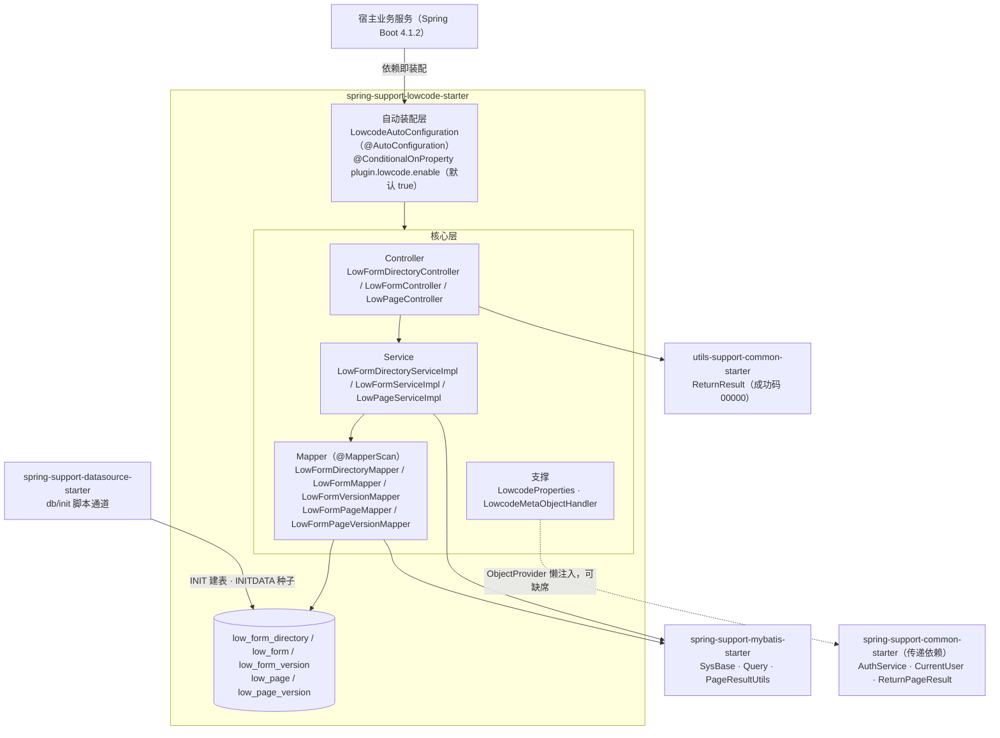
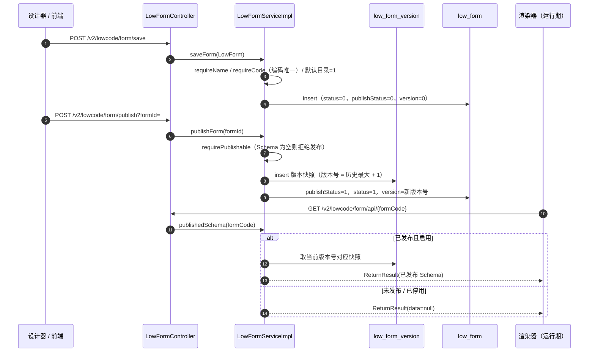

# spring-support-lowcode-starter

低代码表单管理模块：把「目录 → 表单 / 页面 → 版本发布」这套设计器资产做成**加依赖即生效**的独立 starter，自带数据模型（5 张 `low_*` 表）、Service、Mapper、REST 接口与建表/种子脚本。在 spring-support 体系中是具体业务能力模块：向下复用 `spring-support-mybatis-starter`（`SysBase` / `Query` / 分页工具）与 `spring-support-datasource-starter`（`db/init` 脚本通道），经 `AutoConfiguration.imports` 装配，宿主引依赖即获得 `/v2/lowcode/**` 全套接口。

## 1. 架构图



## 2. 核心流程图

以表单「保存 → 发布 → 运行期取数」为主线（页面 `low_page` / `low_page_version` 流程完全同构，仅标识参数 `formId`/`pageId` 与发布方法名 `publishForm`/`publishPage` 不同）：



## 3. 能力清单

| 能力域 | 关键类 | 入口/触发方式 |
| --- | --- | --- |
| 自动装配 | `com.chua.starter.lowcode.configuration.LowcodeAutoConfiguration` | `META-INF/spring/org.springframework.boot.autoconfigure.AutoConfiguration.imports` |
| 配置 | `com.chua.starter.lowcode.properties.LowcodeProperties` | `plugin.lowcode.enable`（唯一配置项） |
| 目录接口 | `LowFormDirectoryController` → `LowFormDirectoryService` | `/v2/lowcode/directory/**`（`/tree`、`/options`、`/save`、`/update`、`/delete`） |
| 表单接口 | `LowFormController` → `LowFormService` | `/v2/lowcode/form/**`（`/page`、`/detail`、`/code/{formCode}`、`/save`、`/update`、`/delete`、`/publish`、`/rollback`、`/status`、`/unpublish`、`/versions`、`/api/{formCode}`） |
| 页面接口 | `LowPageController` → `LowPageService` | `/v2/lowcode/page/**`（与表单同构，参数为 `pageId` / `pageCode`） |
| 发布链（表单/页面同构） | `#publishForm` / `#publishPage`、`#rollbackToVersion`、`#changeStatus`、`#unpublish`、`#versions` | `POST /publish` `/rollback` `/status` `/unpublish`，`GET /versions` |
| 运行期 Schema | `LowFormService#publishedSchema(String)`、`LowPageService#publishedSchema(String)` | `GET /api/{formCode}`、`GET /api/{pageCode}`，未发布/停用返回 `null` |
| 审计字段填充 | `com.chua.starter.lowcode.support.LowcodeMetaObjectHandler` | 自动装配 `@Bean`，MyBatis-Plus insert/update 时回调 |
| 数据模型 | `LowFormDirectory` / `LowForm` / `LowFormVersion` / `LowFormPage` / `LowFormPageVersion` | 表 `low_form_directory` / `low_form` / `low_form_version` / `low_page` / `low_page_version` |
| 建表与种子 | `db/init/V1.0__init_lowcode.sql`、`db/init/V1.0__initdata_lowcode.sql` | 由 `spring-support-datasource-starter` 脚本通道执行 |

业务规则要点（来自 `service/impl` 实现）：编码唯一是强约束（唯一索引 `low_form_uk_code` / `low_page_uk_code` + Service 查重）；发布前 Schema 判空；运行期取数需 `publishStatus=1` + `status=1` 并优先取当前版本快照；删除表单/页面连带删版本；目录删除前校验子目录与挂载的表单/页面；目录搬迁做回环校验并级联刷新 `tree_id`；版本号按历史最大值 +1，只增不减。

## 4. Bean 能力矩阵

装配总条件：下表所有 Bean 只在 `plugin.lowcode.enable=true`（默认，`matchIfMissing=true`）时注册。

| Bean 名 | 类型 | 装配条件（含默认值） | 可否覆盖 | 典型用途 |
| --- | --- | --- | --- | --- |
| `lowcodeMetaObjectHandler` | `MetaObjectHandler`（实现 `LowcodeMetaObjectHandler`） | 自动配置 `@Bean` + `@ConditionalOnMissingBean(MetaObjectHandler.class)` | **可覆盖**：宿主注册任意 `MetaObjectHandler` 即自动让位 | insert/update 自动填 `createTime` / `updateTime` / `createName` / `createBy` / `updateName` / `updateBy` |
| `plugin.lowcode-com.chua.starter.lowcode.properties.LowcodeProperties` | `LowcodeProperties` | `@EnableConfigurationProperties` 随自动装配 | Bean 不建议替换；属性值可在 yml 覆盖 | 读取 `plugin.lowcode.enable` 开关 |
| `lowFormDirectoryController` / `lowFormController` / `lowPageController` | `@RestController` | 组件扫描 + 各自 `@ConditionalOnProperty(prefix="plugin.lowcode", name="enable", havingValue="true", matchIfMissing=true)` | 否（重复扫描会 Bean 冲突） | HTTP 接口 `/v2/lowcode/**` |
| `lowFormDirectoryServiceImpl` / `lowFormServiceImpl` / `lowPageServiceImpl` | `LowFormDirectoryService` / `LowFormService` / `LowPageService` 实现 | 组件扫描 `@Service`（随总开关） | 否（业务由本模块完整实现） | 构造注入接口，在宿主业务里组合调用 |
| `lowFormDirectoryMapper` 等 5 个 | MyBatis-Plus `BaseMapper` | `@MapperScan("com.chua.starter.lowcode.mapper")` | 否 | 由 `ServiceImpl` 内部使用 |

说明：`LowcodeAutoConfiguration` 通过 `excludeFilters`（`ASSIGNABLE_TYPE`）把自身排除在组件扫描外，避免重复注册；模块**没有** `spring.factories`（Boot 3/4 已移除），只有 `AutoConfiguration.imports` 一行。

## 5. 完整配置

本模块自有配置类只有 `LowcodeProperties`（前缀 `plugin.lowcode`），无嵌套类，仅 1 个字段：

| 配置路径 | 类型 | 默认值 | 说明 |
| --- | --- | --- | --- |
| `plugin.lowcode.enable` | `boolean` | `true` | 功能总开关。关闭后本模块任何能力（自动配置、Controller、Service、Mapper）都不装配，已保存的 Schema 保留在库里不动 |

### 5.1 逐项配置示例

#### 功能开关：`plugin.lowcode.enable`

- **含义**：低代码模块装配总开关。`true`（或缺省）时 `LowcodeAutoConfiguration` 生效，宿主获得 `/v2/lowcode/**` 全套接口；`false` 时自动配置整体不生效，Controller / Service / Mapper 一律不注册，已保存的 Schema 保留在库里不动。
- **类型**：`boolean`
- **默认值**：`true`（字段初始化值；`@ConditionalOnProperty` 为 `matchIfMissing = true`，不配置该键也视为开启）
- **YAML 示例**：

```yaml
plugin:
  lowcode:
    enable: true
```

### 5.2 完整 YAML 使用示例

```yaml
plugin:
  lowcode:
    enable: true

spring:
  datasource:
    url: jdbc:mysql://your-mysql-host:3306/your-database?useUnicode=true&characterEncoding=utf8&serverTimezone=Asia/Shanghai
    driver-class-name: com.mysql.cj.jdbc.Driver
    username: your-username
    password: your-password
```

生产注意事项：

- **凭据不落代码库**：`username` / `password` 只应出现占位符或环境变量引用（如 `password: ${MYSQL_PASSWORD}`），真实值经环境变量、启动参数或配置中心注入。
- **数据库方言**：`db/init` DDL 使用 MySQL 8 语法（`COMMENT` / `ENGINE` / `ON DUPLICATE KEY UPDATE`）；H2 需开 MySQL 模式（`MODE=MySQL`），仅建议评估环境使用，生产用 MySQL 8。
- **建表与种子**：`V1.0__init_lowcode.sql`（建表）与 `V1.0__initdata_lowcode.sql`（种子，异步幂等写入默认目录 `id=1`）由 `spring-support-datasource-starter` 的脚本通道执行；种子未完成前新增的表单/页面可能短暂落成「孤儿目录引用」。
- **接口前缀**：所有接口随宿主 Web 端口暴露在 `/v2/lowcode/**`；若设置 `server.servlet.context-path`，外部访问需把它拼在最前。
- **不要重复扫描**：宿主不要再对 `com.chua.starter.lowcode` 做 `@ComponentScan` / `@MapperScan`，否则同名 Bean 冲突；确需手工装配先设 `plugin.lowcode.enable=false`，再用 `LowcodeAutoConfiguration.BASE_PACKAGE` / `MAPPER_PACKAGE` 常量。
- **审计填充**：`createBy` / `updateBy` 等人名字段依赖容器中存在 `AuthService` Bean；缺席时只填时间字段，不填人名（见第 8 节）。
- **关闭需重启生效**：`enable=false` 是装配级开关，在启动期判定；改配置后需重启才能摘除/恢复能力。

没有其它本模块配置项。`db/init` 脚本是否执行、以何种模式执行，由 `spring-support-datasource-starter` 的脚本通道决定，见该模块文档；审计人名是否可填充取决于容器中是否存在 `AuthService` Bean（见第 8 节）。

## 6. 使用方式

Maven 坐标（跟随父 POM `spring-support-parent-starter`，当前 `4.0.0.51`）：

```xml
<dependency>
    <groupId>com.chua</groupId>
    <artifactId>spring-support-lowcode-starter</artifactId>
    <version>4.0.0.51</version>
</dependency>
```

最小启用示例（启动类保持默认，自动装配接管扫描；数据源按需配置，本模块自带 H2/MySQL 驱动，H2 内存库可免外部数据库启动）：

```yaml
spring:
  datasource:
    url: jdbc:h2:mem:lowcode;DB_CLOSE_DELAY=-1;MODE=MySQL;DATABASE_TO_LOWER=TRUE
    driver-class-name: org.h2.Driver
    username: sa
    password: ""
```

```java
LowForm form = new LowForm();
form.setLowFormCode("order_form");        // 编码唯一
form.setLowFormName("订单表单");
form.setLowFormSchema("{\"fields\":[]}"); // Schema 是 JSON 字符串
form.setLowFormDirectoryId(1);            // 缺省落默认目录 id=1
LowForm saved = formService.saveForm(form);
formService.publishForm(saved.getLowFormId());             // 发布：快照 + 版本号 +1 + 启用
String schema = formService.publishedSchema("order_form"); // 运行期取数，未发布/停用返回 null
```

依赖说明（见 `pom.xml`，**没有 optional / provided 依赖**，全部随依赖强制带入）：

| 依赖 | 作用域 | 缺失影响 |
| --- | --- | --- |
| `spring-support-mybatis-starter` | compile | 编译失败；`SysBase` / `Query` / `PageResultUtils` 不可用 |
| `spring-support-datasource-starter` | compile | 编译失败；`db/init` 建表脚本通道缺失，5 张表不会自动创建 |
| `spring-boot-starter-web` | compile | 编译失败；REST 层不可用 |
| `utils-support-common-starter` | compile | 编译失败；`ReturnResult` 不可用 |
| `swagger-annotations` | compile | 编译失败；接口注解（`@Tag` / `@Operation`）不可用 |
| `mysql-connector-j` / `h2` | runtime | 编译不受影响；运行期缺对应驱动则连不上库（换其它数据库需自行补驱动） |

`AuthService` / `CurrentUser` / `ReturnPageResult` 来自 `spring-support-common-starter`，经 `spring-support-mybatis-starter` 传递；`AuthService` 在运行期可缺席（`ObjectProvider` 懒注入）。

## 7. 使用场景

适用：

- 业务系统需要**内嵌**「表单 / 页面」设计器资产的后端管理：Schema 存储、编码检索、版本快照、发布/回滚/撤销、运行期分发。
- 想要「加依赖即得」的目录树 + 表单 + 页面 REST API，不想自己建 5 张表和 20 多个接口。
- 技术栈为 Spring Boot 4.x + MySQL 8（或 H2 MySQL 模式）+ MyBatis-Plus 的服务。

不适用/慎用：

- 本模块**不含前端设计器/渲染器 UI**，只负责 Schema 后端管理与运行期取数；`lowFormSchema` 是 `longtext` JSON 字符串，后端只判空，不做结构校验/版本 diff。
- 非 MySQL 语法数据库慎用：DDL 使用 MySQL 8 语法（`COMMENT` / `ENGINE` / `ON DUPLICATE KEY UPDATE`）。

与相邻模块的取舍：`spring-support-mybatis-starter` 的 `AbstractSwaggerController` 适合把一张现成业务表直接暴露成通用 CRUD，而本模块是**具体业务模块**（表单/页面资产管理，含发布链），二者不是替代关系；`spring-support-datasource-starter` 是建表脚本的执行载体；API 文档页面需宿主另行引入 swagger/swagger2 starter（本模块只带 `swagger-annotations` 注解元数据）。

## 8. 扩展点

**Java SPI：本模块不提供。** 没有 `META-INF/services/*`、`META-INF/extensions/*`，也没有自定义 SPI 接口。

Spring Bean 级接缝（推荐的扩展方式）：

| 接缝 | 机制 | 自定义方式 |
| --- | --- | --- |
| 审计字段填充 | `LowcodeAutoConfiguration#lowcodeMetaObjectHandler` 上的 `@ConditionalOnMissingBean(MetaObjectHandler.class)` | 宿主注册自己的 `MetaObjectHandler` Bean，本模块实现自动让位 |
| 当前登录用户 | `LowcodeMetaObjectHandler` 构造参数是 `ObjectProvider<AuthService>` | 提供自己的 `AuthService` 实现；取不到用户时只填 `createTime` / `updateTime`，不填人名 |
| 手工装配 | 常量 `LowcodeAutoConfiguration.BASE_PACKAGE` / `MAPPER_PACKAGE` | 先设 `plugin.lowcode.enable=false`，再用这两个常量自行 `@ComponentScan` + `@MapperScan` |
| 表结构演进 | `db/init` 脚本通道的增量脚本约定 | 新增 `V1.0__add_xxx.sql` 增量脚本，不要改已发布的 INIT 脚本 |

三个 Service 接口（`LowFormService` / `LowPageService` / `LowFormDirectoryService`）均为 public，可直接注入宿主业务组合使用（如在业务流程里发布表单、查询目录树）。

## 9. 常见问题

- **装配不生效 / 接口 404**：检查 `plugin.lowcode.enable` 是否被显式设为 `false`（默认 `true`，不配置即开启）；确认依赖已引入。不要在宿主上再对 `com.chua.starter.lowcode` 做一次 `@ComponentScan` / `@MapperScan`——自动装配已扫描过，重复扫描会产生同名 Bean 冲突；确需自行装配先关总开关，再用 `BASE_PACKAGE` / `MAPPER_PACKAGE` 常量。另注意宿主 `server.servlet.context-path` 需拼在 `/v2/lowcode/**` 之前。
- **建表脚本没执行 / 默认目录不存在**：脚本由 datasource-starter 通道执行，`INITDATA`（`V1.0__initdata_lowcode.sql`）是异步幂等写入根目录 `id=1`「默认目录」；代码里默认目录硬编码 `ROOT_DIRECTORY_ID = 1`（`low_form` / `low_page` 均无外键约束），根目录缺失时新增表单/页面**不会报错**，但归属会落成孤儿引用：目录树与下拉里看不到它，列表回显目录名为空。可等种子完成或手工补插根目录后再把这些记录迁回。
- **运行期 `/api/{code}` 返回 null**：两个硬条件缺一即 null——`publishStatus=1`（已发布）与 `status=1`（启用）；两者都满足时优先取当前版本号对应的 `*_version` 快照，快照缺失才回落到当前记录的 Schema。设计器改了已发布表单但未重新 `/publish` 时，草稿不会透给运行期。
- **Spring Boot 4 兼容**：本模块随父 POM 基于 Spring Boot 4.1.2，用 `@AutoConfiguration` + `AutoConfiguration.imports` 注册，**没有** `spring.factories`；实体/分页依赖 MyBatis-Plus 新包结构（`com.baomidou.mybatisplus.spring.service.IService`），从旧版 `extension.service.IService` 升级时注意 import。与兄弟模块无端口/路径冲突：所有接口随宿主 Web 端口暴露，前缀 `/v2/lowcode/directory|form|page`。
