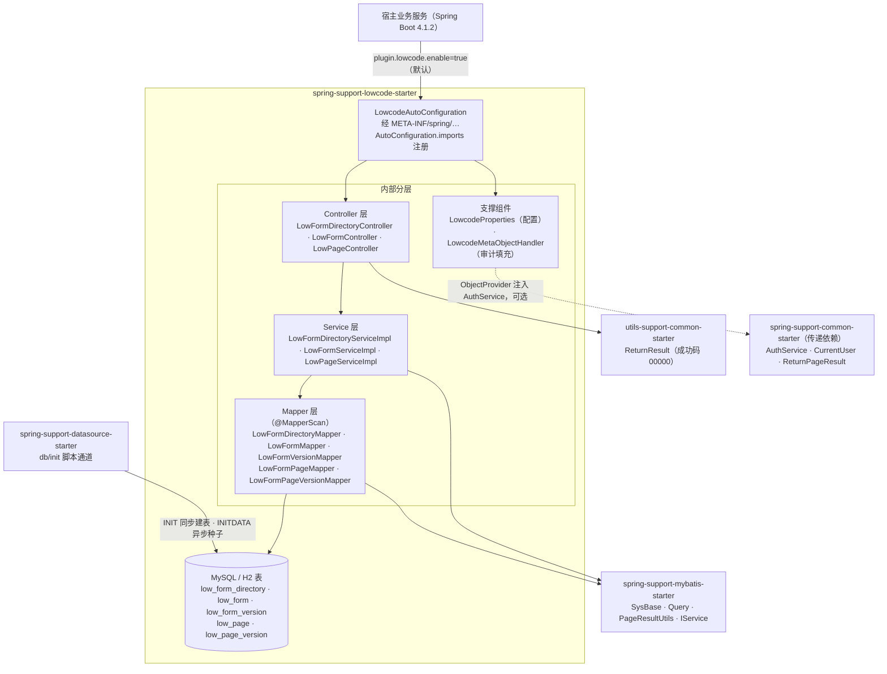
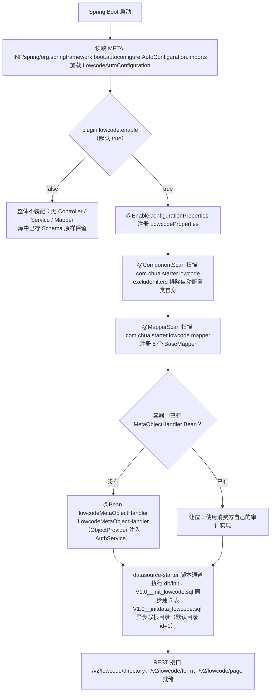
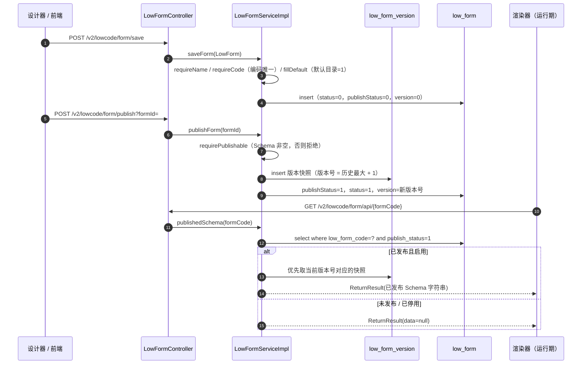

# spring-support-lowcode-starter

低代码表单管理模块：把「目录 → 表单 / 页面 → 版本发布」这套设计器资产做成**加依赖即生效**的独立 starter，自带数据模型、服务、Mapper、REST 接口与建表脚本。

- 三类资产：目录（树形，`low_form_directory`）、表单（`low_form`）、页面（`low_page`）；后两者各自拥有版本快照表（`low_form_version` / `low_page_version`）。
- 对外标识用**编码**（`lowFormCode` / `lowPageCode`，库上有唯一索引），主键只做内部关联；运行期渲染只认**已发布快照**。
- 所有接口统一返回 `ReturnResult`（成功码 `00000`），分页接口返回 `ReturnPageResult`（`code=0`）。
- 当前版本：`4.0.0.51`（跟随父 POM `spring-support-parent-starter`），Spring Boot 基线 **4.1.2**。

---

## 1. 架构图

### 1.1 模块在体系中的位置 + 内部分层



分层说明：

| 层 | 职责 | 关键类 |
| --- | --- | --- |
| 自动装配 | 注册配置、组件扫描、Mapper 扫描、审计 Bean | `LowcodeAutoConfiguration` |
| Controller | REST 接口（`/v2/lowcode/**`），参数校验入口 | `LowFormDirectoryController` / `LowFormController` / `LowPageController` |
| Service | 业务规则：编码判重、发布/回滚/撤销、目录树与回环校验、事务边界 | `LowFormDirectoryServiceImpl` / `LowFormServiceImpl` / `LowPageServiceImpl` |
| Mapper | MyBatis-Plus `BaseMapper`，无自定义 SQL | 5 个 Mapper |
| 实体 / 出参 | `SysBase` 子类（含审计列）；分页/详情 VO（`LowFormVO` / `LowFormPageVO`）不回传 Schema 正文，版本 VO（`LowFormVersionVO` / `LowFormPageVersionVO`）回传版本快照正文（`GET /versions` 会返回） | `LowFormDirectory` / `LowForm` / `LowFormVersion` / `LowFormPage` / `LowFormPageVersion` + 7 个 VO（其中 1 个暂无 Controller 引用） |
| 支撑 | 审计字段自动填充（MyBatis-Plus `MetaObjectHandler`） | `LowcodeMetaObjectHandler` |

---

## 2. 核心流程图

### 2.1 自动装配流程（启动期）



### 2.2 表单「保存 → 发布 → 运行期取数」数据流



页面（`LowPageController` / `LowPageServiceImpl` / `low_page` / `low_page_version`）与上述流程完全同构，仅参数名不同。

---

## 3. 能力清单

| 能力域 | 关键类 | 入口 |
| --- | --- | --- |
| 自动装配 | `com.chua.starter.lowcode.configuration.LowcodeAutoConfiguration` | `META-INF/spring/org.springframework.boot.autoconfigure.AutoConfiguration.imports` |
| 配置 | `com.chua.starter.lowcode.properties.LowcodeProperties` | `plugin.lowcode.enable`（唯一配置项） |
| 目录接口 | `LowFormDirectoryController` → `LowFormDirectoryService` | `/v2/lowcode/directory/**` |
| 表单接口 | `LowFormController` → `LowFormService` | `/v2/lowcode/form/**` |
| 页面接口 | `LowPageController` → `LowPageService` | `/v2/lowcode/page/**` |
| 目录树 / 下拉 | `LowFormDirectoryService#tree()` / `#options()` | `GET /v2/lowcode/directory/tree`、`/options` |
| 表单 / 页面 CRUD | `#saveForm` `#updateForm` `#deleteForm`（页面为 `savePage` 等） | `POST /save`、`PUT /update`、`DELETE /delete` |
| 发布链（表单/页面同构） | `#publishForm` `#rollbackToVersion` `#changeStatus` `#unpublish` `#versions` | `POST /publish` `/rollback` `/status` `/unpublish`，`GET /versions` |
| 运行期 Schema（表单） | `LowFormService#publishedSchema(String)` | `GET /v2/lowcode/form/api/{formCode}` |
| 运行期 Schema（页面） | `LowPageService#publishedSchema(String)` | `GET /v2/lowcode/page/api/{pageCode}` |
| 设计器回读 | `#detailByCode(String)` | `GET /v2/lowcode/form/code/{formCode}`、`GET /v2/lowcode/page/code/{pageCode}` |
| 审计字段填充 | `com.chua.starter.lowcode.support.LowcodeMetaObjectHandler` | `LowcodeAutoConfiguration#lowcodeMetaObjectHandler`（`MetaObjectHandler` Bean） |
| 数据模型 | `LowFormDirectory` / `LowForm` / `LowFormVersion` / `LowFormPage` / `LowFormPageVersion` | 表 `low_form_directory` / `low_form` / `low_form_version` / `low_page` / `low_page_version` |
| 出参模型 | `LowFormVO` / `LowFormVersionVO` / `LowFormPageVO` / `LowFormPageVersionVO` / `LowFormDirectoryVO` / `LowFormOptionVO` / `LowFormPageOptionVO`（共 7 个，其中 `LowFormPageOptionVO` 暂无 Controller 引用） | Controller 返回值 |
| 建表与种子 | `db/init/V1.0__init_lowcode.sql`、`db/init/V1.0__initdata_lowcode.sql` | 由 `spring-support-datasource-starter` 的脚本通道执行（见第 5 节） |

业务规则要点（全部来自 `service/impl` 实现）：

1. **编码唯一是强约束**：库上 `low_form_uk_code` / `low_page_uk_code` 唯一索引 + Service `requireCode` 查重（撞了报 `该表单编码已存在`）；新增时传入的主键会被强制置空。
2. **发布必须有 Schema**：`requirePublishable` 判空，表单抛 `没有表单 Schema 不能发布`，页面同理。
3. **运行期取数三重条件**：`publishStatus=1` + `status=1` + 优先取「当前版本号对应的快照」；设计器改了已发布表单但未重新发布时，草稿不会透给运行期。
4. **删除表单/页面连带删版本**：先删 `*_version` 再删主记录，历史快照不保留。
5. **目录删除有前置条件**：有子目录报 `请先删除子目录`；有表单/页面报 `该目录下还有 N 个表单/页面，请先移走或删除`。
6. **目录搬迁级联刷新路径链**：`editDirectory` 改父级后 `cascadeTreeId` 用 `likeRight` 批量改子孙 `low_form_directory_tree_id`，并做回环校验（`父目录不能是自己` / `父目录在自己的子树里，会造成回环`）。
7. **版本号只增不减**：发布取历史最大版本号 +1（不用当前记录 +1），回滚后重发不会复用旧号。

---

## 4. Bean 能力矩阵

装配总条件：整个自动装配（含下表所有 Bean）只在 `plugin.lowcode.enable=true`（默认，`matchIfMissing=true`）时生效。

| Bean 名 | 类型 | 装配条件 | 可否覆盖 | 典型注入姿势 |
| --- | --- | --- | --- | --- |
| `lowcodeMetaObjectHandler` | `MetaObjectHandler`（实现类 `LowcodeMetaObjectHandler`） | 自动配置 `@Bean` + `@ConditionalOnMissingBean(MetaObjectHandler.class)` | **可覆盖**：宿主注册任意 `MetaObjectHandler` Bean 即自动让位（这是设计好的接缝） | 一般无需注入，由 MyBatis-Plus 在 insert/update 时回调；内部用 `ObjectProvider<AuthService>` 懒取当前用户 |
| `plugin.lowcode-com.chua.starter.lowcode.properties.LowcodeProperties` | `LowcodeProperties`（`@ConfigurationProperties(prefix="plugin.lowcode")`） | `@EnableConfigurationProperties` 随自动装配 | Bean 本身不建议替换；属性值可在 `application.yml` 覆盖 | 构造注入 `LowcodeProperties`（本模块 Controller 用的是 `@ConditionalOnProperty`，不直接注入） |
| `lowFormDirectoryController` | `LowFormDirectoryController`（`@RestController`） | 组件扫描 + 自身 `@ConditionalOnProperty(plugin.lowcode.enable)` | 否（同包重复扫描会 Bean 冲突） | HTTP 调用；一般不注入 |
| `lowFormController` | `LowFormController`（`@RestController`） | 同上 | 否 | HTTP 调用 |
| `lowPageController` | `LowPageController`（`@RestController`） | 同上 | 否 | HTTP 调用 |
| `lowFormDirectoryServiceImpl` | `LowFormDirectoryService`（实现 `LowFormDirectoryServiceImpl`） | 组件扫描 `@Service` | 否（业务由本模块完整实现） | 构造注入接口 `LowFormDirectoryService` |
| `lowFormServiceImpl` | `LowFormService`（实现 `LowFormServiceImpl`） | 组件扫描 `@Service` | 否 | 构造注入接口 `LowFormService` |
| `lowPageServiceImpl` | `LowPageService`（实现 `LowPageServiceImpl`） | 组件扫描 `@Service` | 否 | 构造注入接口 `LowPageService` |
| `lowFormDirectoryMapper` / `lowFormMapper` / `lowFormVersionMapper` / `lowFormPageMapper` / `lowFormPageVersionMapper` | MyBatis-Plus `BaseMapper`（`@MapperScan` 注册 MapperFactoryBean） | `@MapperScan("com.chua.starter.lowcode.mapper")` | 否 | 由 `ServiceImpl` 内部使用；消费方一般不直接注入 |

说明：

- `LowcodeAutoConfiguration` 自身通过 `excludeFilters`（`ASSIGNABLE_TYPE`）排除在组件扫描之外，避免重复注册。
- 本模块**没有** `spring.factories`（Boot 3/4 已移除该机制），只有 `AutoConfiguration.imports` 一行：`com.chua.starter.lowcode.configuration.LowcodeAutoConfiguration`。
- 三个 Controller 上还各自挂了一份 `@ConditionalOnProperty`，与总开关双保险。

---

## 5. 完整配置

### 5.1 本模块自有配置（`LowcodeProperties`，前缀 `plugin.lowcode`）

只有 **1 个** 配置项（源码注释明确「每一项都在业务服务中被真实读取，不接受只写不读的参数」）：

| 路径 | 类型 | 默认值 | 说明 | 生效开关 |
| --- | --- | --- | --- | --- |
| `plugin.lowcode.enable` | `boolean` | `true` | 功能总开关。关闭后不装配本模块任何能力（自动配置、Controller、Service、Mapper 全部失效），已保存的 Schema 保留在库里不动 | 即开关本身（`matchIfMissing=true`，不配置视为开） |

### 5.2 与本模块运行直接相关的宿主侧配置（非本模块定义，来自所依赖的 starter）

| 路径 | 类型 | 默认值 | 来源 | 与本模块的关系 |
| --- | --- | --- | --- | --- |
| `plugin.datasource.script.enable` | `boolean` | `true` | `spring-support-datasource-starter`（`DataSourceScriptProperties`） | 决定 `db/init/*.sql` 是否被执行 |
| `plugin.datasource.script.script-path` | `String` | `classpath*:db/init/*.sql,classpath*:db/migration/*.sql,classpath*:db/sync/*.sql` | 同上 | 脚本扫描路径；本模块两个脚本都在 `db/init` 下 |
| `plugin.datasource.script.scan-mode` | 枚举 `NONE/ONCE/ALWAYS` | `ONCE` | 同上 | `ONCE` 表示仅当库里没有业务表时执行建表脚本 |
| `plugin.mybatis.data.scope.enable` | `boolean` | 以 mybatis-starter 为准 | `spring-support-mybatis-starter`（`MybatisPlusDataScopeProperties.PRE = "plugin.mybatis.data.scope"`） | 数据权限切面开关；不需要数据权限语义时可关闭 |
| `plugin.oauth.enable` | `boolean` | 以 oauth-client-starter 为准 | `spring-support-oauth-client-starter`（`AuthClientProperties.PRE = "plugin.oauth"`） | 决定 `AuthService` 是否由 OAuth 模块提供；关闭时可自备 `AuthService` Bean，审计填充退化为只填时间 |

### 5.3 建表脚本命名约定（由 `DataSourceScriptConfiguration#getScriptType` 解析）

| 文件名模式 | 类型 | 执行方式 |
| --- | --- | --- |
| `V1.0__init_lowcode.sql` | `INIT` | 同步建表（本模块 5 张表） |
| `V1.0__initdata_lowcode.sql` | `INITDATA` | 异步执行（虚拟线程），幂等写入根目录 `id=1`「默认目录」 |
| `V1.0__add_xxx.sql` | `ADD` | 同步增量 |
| `V1.0__xxx.sql`（其它非下划线开头） | `NORMAL` | 同步普通脚本 |
| 不含 `__` 分隔符 | — | 不执行 |

---

## 6. 使用方式

### 6.1 Maven 坐标

```xml
<dependency>
    <groupId>com.chua</groupId>
    <artifactId>spring-support-lowcode-starter</artifactId>
    <version>4.0.0.51</version>
</dependency>
```

### 6.2 依赖说明

| 依赖 | 版本 | 作用 |
| --- | --- | --- |
| `spring-support-mybatis-starter` | `4.0.0.51` | MyBatis-Plus 集成；提供 `SysBase`（审计列基类）、`Query`、`PageResultUtils`、`IService` |
| `spring-support-datasource-starter` | `4.0.0.51` | 数据源与 `db/init` 脚本通道 |
| `spring-boot-starter-web` | 父 POM 管理（`4.1.2`） | REST 层 |
| `utils-support-common-starter` | `${utils.version}` = `4.0.0.51` | `ReturnResult`（成功码 `00000`） |
| `swagger-annotations` | 父 POM 管理 | `@Tag` / `@Operation` / `@Schema` |
| `mysql-connector-j` | 父 POM 管理，`runtime` | 生产库驱动（随本模块传递带入） |
| `h2` | 父 POM 管理，`runtime` | 嵌入式库，默认配置可免外部数据库启动（随本模块传递带入） |

传递依赖：`AuthService` / `CurrentUser` / `ReturnPageResult` 来自 `spring-support-common-starter`，本模块 pom 未直接声明，经 `spring-support-mybatis-starter` 传递进来。

### 6.3 最小可运行示例

第 1 步：引入依赖（见上）。

第 2 步：启动类保持默认即可，自动装配会接管扫描：

```java
@SpringBootApplication
public class LowcodeDemoApplication {
    public static void main(String[] args) {
        SpringApplication.run(LowcodeDemoApplication.class, args);
    }
}
```

第 3 步：配置数据源（示例用 H2 内存库，MySQL 模式回放本模块 DDL；生产换 MySQL 连接串）：

```yaml
spring:
  datasource:
    url: jdbc:h2:mem:lowcode;DB_CLOSE_DELAY=-1;MODE=MySQL;DATABASE_TO_LOWER=TRUE
    driver-class-name: org.h2.Driver
    username: sa
    password: ""
```

无需额外配置：`datasource-starter` 默认扫描 `classpath*:db/init/*.sql`，自动同步执行 `V1.0__init_lowcode.sql` 建 5 张表，并异步执行 `V1.0__initdata_lowcode.sql` 写入默认根目录（`id=1`）。

第 4 步：验证装配与最小调用：

```bash
# 目录树（同时验证装配成功与种子数据就绪）
curl http://127.0.0.1:8080/v2/lowcode/directory/tree
# {"code":"00000","ok":true,"data":[{"lowFormDirectoryId":1,"lowFormDirectoryName":"默认目录",...}]}

# 新增表单
curl -X POST http://127.0.0.1:8080/v2/lowcode/form/save \
     -H "Content-Type: application/json" \
     -d '{"lowFormCode":"order_form","lowFormName":"订单表单","lowFormSchema":"{\"fields\":[]}"}'

# 发布（formId 取新增返回值）
curl -X POST "http://127.0.0.1:8080/v2/lowcode/form/publish?formId=1"

# 运行期取已发布 Schema
curl "http://127.0.0.1:8080/v2/lowcode/form/api/order_form"
```

Service 层等价写法（本模块无链式 API，实体是 lombok `@Data`）：

```java
LowForm form = new LowForm();
form.setLowFormCode("order_form");        // 编码唯一，人工录入
form.setLowFormName("订单表单");
form.setLowFormSchema("{\"fields\":[]}"); // Schema 是 JSON 字符串
form.setLowFormDirectoryId(1);
LowForm saved = formService.saveForm(form);

formService.publishForm(saved.getLowFormId());       // 发布：快照 + 版本号 +1 + 启用
String schema = formService.publishedSchema("order_form"); // 运行期取数，未发布/停用返回 null
```

### 6.4 接口清单：目录（`/v2/lowcode/directory`）

| 方法 | 路径 | 参数 | 说明 |
| --- | --- | --- | --- |
| GET | `/tree` | 无 | 树形目录，含 `children` / `formCount` / `pageCount`（子孙汇总） |
| GET | `/options` | 无 | `LowFormOptionVO`（`value` / `label`）列表 |
| POST | `/save` | Body `LowFormDirectory` | 新增，返回保存后的目录（含 `lowFormDirectoryTreeId`） |
| PUT | `/update` | Body `LowFormDirectory` | 修改；`lowFormDirectoryPid` 不传表示沿用原父级 |
| DELETE | `/delete` | `directoryId` | 有子目录 / 表单 / 页面时拒绝 |

### 6.5 接口清单：表单（`/v2/lowcode/form`）

| 方法 | 路径 | 参数 | 说明 |
| --- | --- | --- | --- |
| GET | `/page` | `Query<LowForm>`（`page` / `pageSize`）+ `LowForm` 条件 | 分页，出参 `LowFormVO`（不含 Schema 正文） |
| GET | `/detail` | `formId` | 详情 |
| GET | `/code/{formCode}` | 路径 `formCode` | 按编码回读（设计器用） |
| POST | `/save` | Body `LowForm` | 新增；主键由数据库生成，新增后默认 `status=0` / `publishStatus=0` / `version=0` |
| PUT | `/update` | Body `LowForm` | 修改；`lowFormCode` / `lowFormName` 缺失时沿用库中原值 |
| DELETE | `/delete` | `formId` | 删除表单并连带清理版本快照 |
| POST | `/publish` | `formId` | 生成版本快照、版本号按历史最大值 +1、置为已发布且启用 |
| POST | `/rollback` | `versionId` | 用指定版本快照恢复 Schema / 版本号 / 发布状态 |
| POST | `/status` | `formId`、`status`（`0` 停用 / `1` 启用） | 停用后运行期接口不再返回 Schema |
| POST | `/unpublish` | `formId` | 撤销发布；版本历史保留 |
| GET | `/versions` | `formId` | 版本列表，按版本号倒序（出参含版本快照正文） |
| GET | `/api/{formCode}` | 路径 `formCode` | 运行期取已发布 Schema（字符串），未发布/已停用返回 `null` |

### 6.6 接口清单：页面（`/v2/lowcode/page`）

与表单完全同构，仅参数名不同（`pageId` / `pageCode`，实体 `LowFormPage`）：`/page`、`/detail`、`/code/{pageCode}`、`/save`、`/update`、`/delete`、`/publish`、`/rollback`、`/status`、`/unpublish`、`/versions`、`/api/{pageCode}`。

### 6.7 可选依赖说明

- **数据库驱动**：本模块已以 `runtime` 作用域自带 `mysql-connector-j` 与 `h2`，消费方通常无需再声明驱动；默认配置（H2 内存库）即可启动，生产环境把数据源换成 MySQL 连接串即可。
- **OAuth / 认证**：不引 `spring-support-oauth-client-starter` 也能跑——审计填充里的 `AuthService` 是 `ObjectProvider` 懒注入，取不到用户时只填 `createTime` / `updateTime`，不填人名。
- **Swagger 文档**：本模块只依赖 `swagger-annotations` 提供注解元数据；要出 API 文档页面需宿主另行引入 swagger/swagger2 starter。

---

## 7. 使用场景

### 7.1 适用

- 业务系统需要**内嵌**「表单 / 页面」设计器资产的后端管理：Schema 存储、编码检索、版本快照、发布/回滚/撤销、运行期分发。
- 想要「加依赖即得」的目录树 + 表单 + 页面 REST API，而不想自己建 5 张表和 12 个接口。
- 技术栈为 Spring Boot 4.x + MySQL 8（或 H2 MySQL 模式）+ MyBatis-Plus 的服务。

### 7.2 不适用

- 本模块**不含前端设计器/渲染器 UI**：只负责 Schema 的后端管理与运行期取数，可视化编辑需要自配前端。
- 需要对 Schema 做**结构校验/版本 diff** 的场景：`lowFormSchema` / `lowPageSchema` 是 `longtext` JSON 字符串，后端只判空，不校验合法性。
- 非 MySQL 语法的数据库：DDL 使用 MySQL 8 语法（`COMMENT` / `ENGINE` / `ON DUPLICATE KEY UPDATE`），其它数据库不保证可回放。
- 需要开箱即用的多租户/细粒度权限：本模块自身不实现，数据权限取决于 mybatis-starter 的可插拔切面。

### 7.3 与相邻模块的取舍

| 相邻模块 | 取舍 |
| --- | --- |
| `spring-support-mybatis-starter` | mybatis-starter 的 `AbstractSwaggerController` / `AbstractSwaggerQueryController` 适合「把一张现成业务表直接暴露成 CRUD」；lowcode-starter 是**具体业务模块**（表单/页面资产管理），二者不是替代关系。本模块自身也建立在 mybatis-starter 之上。 |
| `spring-support-datasource-starter` | 提供数据源与 `db/init` 脚本通道，是本模块建表脚本的执行载体；任何带 `db/init` 脚本的模块都可复用该通道。 |
| `spring-support-common-starter` | 只经传递依赖使用其 `AuthService` / `ReturnPageResult`；本模块不依赖 OAuth 的具体实现。 |
| `utils-support-common-starter` | 只取 `ReturnResult` 统一响应封装。 |

---

## 8. 扩展点

### 8.1 Java SPI

**本模块不提供 Java SPI 扩展点**：没有 `META-INF/services/*`、没有 `META-INF/extensions/*`，也没有自定义 SPI 接口。

### 8.2 Spring Bean 级接缝（推荐的扩展方式）

| 接缝 | 机制 | 替换方式 |
| --- | --- | --- |
| 审计字段填充 | `LowcodeAutoConfiguration#lowcodeMetaObjectHandler` 上的 `@ConditionalOnMissingBean(MetaObjectHandler.class)` | 宿主注册自己的 `MetaObjectHandler` Bean，本模块的 `LowcodeMetaObjectHandler` 自动让位 |
| 当前登录用户 | `LowcodeMetaObjectHandler` 构造参数是 `ObjectProvider<AuthService>` | 提供自己的 `AuthService` 实现；取不到用户时只填 `createTime` / `updateTime`，不填人名 |
| 手工装配 | `LowcodeAutoConfiguration.BASE_PACKAGE` / `MAPPER_PACKAGE` 常量 | 关闭 `plugin.lowcode.enable` 后，用这两个常量自行 `@ComponentScan` + `@MapperScan` |
| 表结构演进 | `db/init` 的 `ADD` 脚本通道 | 新增 `V1.0__add_xxx.sql` 增量脚本（同步执行），不要改动已发布的 INIT 脚本 |

替换审计填充的示例：

```java
// 宿主的自定义审计填充（注册后本模块的 LowcodeMetaObjectHandler 不再装配）
@Bean
public MetaObjectHandler metaObjectHandler() {
    return new MetaObjectHandler() {
        @Override
        public void insertFill(org.apache.ibatis.reflection.MetaObject metaObject) {
            strictInsertFill(metaObject, "createTime", java.time.LocalDateTime.class,
                    java.time.LocalDateTime.now());
        }

        @Override
        public void updateFill(org.apache.ibatis.reflection.MetaObject metaObject) {
            strictUpdateFill(metaObject, "updateTime", java.time.LocalDateTime.class,
                    java.time.LocalDateTime.now());
        }
    };
}
```

`LowcodeMetaObjectHandler` 默认会填的字段（取决于实体是否有对应 setter）：`createTime` / `updateTime` / `createName` / `createBy` / `updateName` / `updateBy`；其中 `createBy` / `updateBy` 只在 `CurrentUser#getUserId()` 能解析为整数时填，否则留空。

### 8.3 Service 层复用

三个 Service 接口（`LowFormService` / `LowPageService` / `LowFormDirectoryService`）均为 public，可直接注入到宿主业务里组合使用（例如在自己的业务流程里发布表单、查询目录树）。

---

## 9. 常见问题

### 9.1 装配不生效 / 接口 404

- 检查 `plugin.lowcode.enable` 是否被显式设为 `false`（默认 `true`，不配置即开启）。
- 确认依赖已引入且版本 ≥ `4.0.0.51`（该版本起本模块以 `AutoConfiguration.imports` 注册）。
- **不要**在宿主上再对 `com.chua.starter.lowcode` 做一次 `@ComponentScan` / `@MapperScan`：自动装配已经扫描过，重复扫描会产生同名 Bean 定义冲突。确需自行装配时，先设 `plugin.lowcode.enable=false`，再用 `LowcodeAutoConfiguration.BASE_PACKAGE` / `MAPPER_PACKAGE` 常量。
- 检查宿主 `server.servlet.context-path`：接口前缀是 `/v2/lowcode/**`，若配了 context-path 需要拼接。

### 9.2 端口与开关

- 本模块**不监听独立端口**，所有接口随宿主 Web 端口（如 `8080`）暴露，前缀 `/v2/lowcode/directory|form|page`。
- 唯一开关是 `plugin.lowcode.enable`；没有按接口粒度的开关。关闭后 Controller 不注册，表与数据保留。

### 9.3 与 Spring Boot 4 的兼容性

- 本模块随父 POM `spring-support-parent-starter` 基于 **Spring Boot 4.1.2** 构建，自动装配使用 `@AutoConfiguration` + `META-INF/spring/...AutoConfiguration.imports`（Boot 3 起的标准机制），**没有** `spring.factories`。
- 仓库提示：Boot 4 起 MockMvc 自动配置从 `spring-boot-test-autoconfigure` 拆到 `spring-boot-webmvc-test`；给本模块写 Web 层集成测试时需引入对应测试 artifact，而不是旧的 test-autoconfigure。
- 实体/分页依赖的是 MyBatis-Plus 新包结构（`com.baomidou.mybatisplus.spring.service.IService`），与旧版 `extension.service.IService` 不兼容，升级时注意 import。

### 9.4 建表脚本没有执行 / 默认目录不存在

- 脚本由 `datasource-starter` 的 `plugin.datasource.script.*` 通道执行：确认 `plugin.datasource.script.enable=true`（默认）；`scan-mode` 默认 `ONCE`，**仅当库里没有业务表时**才扫描，已有业务表的库上需要 `ALWAYS` 或手工执行。
- 种子脚本 `V1.0__initdata_lowcode.sql` 是 `INITDATA` 通道（虚拟线程**异步**执行），极端情况下第一个请求可能早于根目录写入；而代码里默认目录硬编码 `ROOT_DIRECTORY_ID = 1`，若根目录缺失，新增表单会因外键语义缺失而异常。可等待种子完成或手工插入 `id=1` 的根目录。

### 9.5 保存/发布报错

- `该表单编码已存在`：编码撞了唯一索引（`low_form_uk_code` / `low_page_uk_code`）或 `requireCode` 查重；换编码或走 `update`。
- `没有表单 Schema 不能发布`：发布前必须先保存非空 `lowFormSchema` / `lowPageSchema`。
- `状态只能是 0(停用) 或 1(启用)`：`/status` 接口只接受 0/1。
- 目录类报错：`目录名称不能为空` / `父目录不能是自己` / `父目录在自己的子树里，会造成回环` / `请先删除子目录` / `该目录下还有 N 个表单/页面，请先移走或删除`。

### 9.6 运行期 `/api/{code}` 返回 null

按 `publishedSchema` 实现，三重条件缺一即返回 null：

1. 该编码的记录 `publishStatus=1`（已发布）；
2. `status=1`（启用，停用的表单对外不可见）;
3. 优先返回「当前版本号对应的 `*_version` 快照」；无快照时回退主表 Schema。

设计器改了已发布表单的 Schema 但未重新发布时，草稿不会透给运行期——重新 `/publish` 即可。

### 9.7 审计人名字段为空

`createName` / `createBy` / `updateName` / `updateBy` 依赖容器中的 `AuthService`：OAuth 模块未装配且宿主未提供自定义 `AuthService` Bean、或 `userId` 不是可解析整数时，这些列不填，只有 `createTime` / `updateTime` 有值。需要人名时提供自己的 `AuthService` 实现（见第 8 节）。

### 9.8 两种响应结构并存

- 普通接口返回 `ReturnResult`：`code` 是字符串 `"00000"`（`utils-support-common-starter` 的 `ReturnCode.SUCCESS`），另有 `ok` / `success` 布尔字段（`isOk()` 序列化而来）。
- 分页接口返回 `ReturnPageResult`：`code` 是数值 `0`，分页数据在 `data.data`（`PageResult`）。
- 前端/网关需要分别处理这两种成功码。

### 9.9 关闭开关会删数据吗

不会。`plugin.lowcode.enable=false` 只是不装配能力（接口随之失效），`low_*` 五张表与已存 Schema 原样保留；重新开启即恢复服务。
