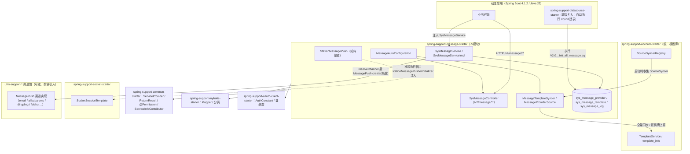
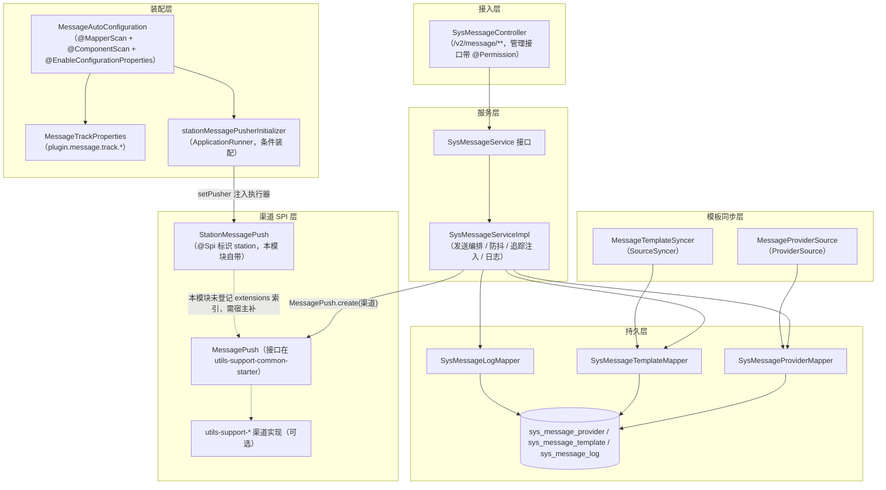
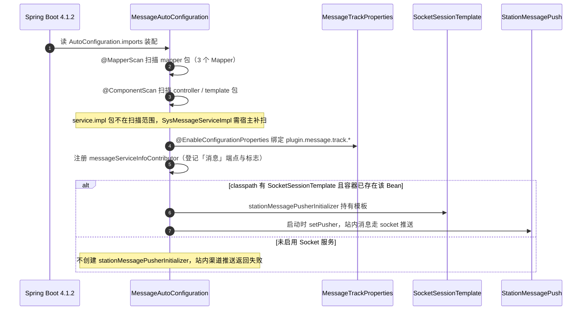
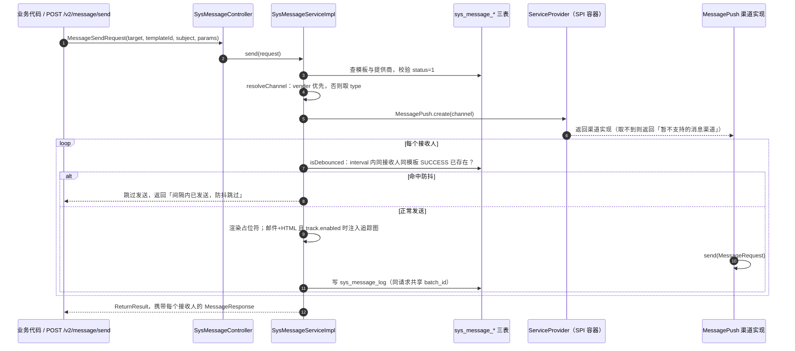

# spring-support-message-starter

统一消息推送 Starter：用「提供商表 + 模板表 + 推送日志表」三张表驱动多渠道发送，发送动作收敛到 utils 侧的 `MessagePush` SPI，业务侧只调 `/v2/message/send` 或注入 `SysMessageService`，不直接对接各渠道 SDK。

- 包名：`com.chua.starter.message.support`
- 版本：`4.0.0.51`（模块不写 `<version>`，继承父 POM `spring-support-parent-starter:4.0.0.51` → `spring-boot-starter-parent:4.1.2`，Spring Boot 4.1.2 / Java 25）
- 范围：**只管「配置 + 模板渲染 + 渠道路由 + 日志 + 追踪」**，具体渠道由宿主按需引入 `utils-support-*` 渠道包（邮件 / 短信 / 钉钉 / 飞书 / 企微 / 站内 …）。

## 1. 架构图

### 1.1 模块在体系中的位置



依赖方向：本模块依赖 common / mybatis / account / socket / oauth-client 五个 spring 侧模块；渠道 `utils-support-*` 是**可选实现**，由 SPI 容器在运行期发现，本模块不直接依赖任何渠道包。

### 1.2 内部分层



## 2. 核心流程图

### 2.1 自动装配流程



### 2.2 消息发送数据流



## 3. 能力清单

| 能力域 | 关键类 | 入口 |
|---|---|---|
| 自动装配 | `MessageAutoConfiguration` | `META-INF/spring/org.springframework.boot.autoconfigure.AutoConfiguration.imports` |
| 提供商管理 | `SysMessageProvider`、`SysMessageProviderMapper`、`SysMessageService#saveProvider` | `/v2/message/provider/**` |
| 模板管理 | `SysMessageTemplate`、`SysMessageTemplateMapper`、`SysMessageService#saveTemplate` | `/v2/message/template/**` |
| 模板渲染预览 | `TemplatePreviewRequest`、`TemplatePreviewResponse`、`SysMessageService#previewTemplate` | `/v2/message/template/preview` |
| 按模板发送 | `MessageSendRequest`、`SysMessageService#send` | `/v2/message/send` |
| 按内容发送 | `MessageContentSendRequest`、`SysMessageService#sendContent` | `/v2/message/send/content` |
| 渠道发现 | `ChannelInfo`、`SysMessageService#listChannels`（遍历 `MessagePush` SPI 定义） | `/v2/message/channel/list` |
| 远端模板同步 | `SysMessageService#syncTemplate`（走 `MessagePush#listTemplates`，按 code upsert） | `/v2/message/template/sync` |
| 推送日志 | `SysMessageLog`、`SysMessageLogMapper`、`SysMessageService#pageForLog`、`#cleanLog` | `/v2/message/log/page`、`/v2/message/log/clean` |
| 邮件阅读追踪 | `MessageTrackProperties`、`SysMessageService#markLogRead` | `/v2/message/track/{token}` |
| 重复消息防抖 | `SysMessageServiceImpl#isDebounced`（按提供商行 `sys_message_provider_interval`） | 发送链路内自动生效 |
| 站内消息渠道 | `StationMessagePush`（`@Spi("station")`）、`StationMessagePush.StationPusher` | 渠道标识 `station`；执行器由 `MessageAutoConfiguration#stationMessagePusherInitializer` 注入 |
| 我的站内消息 | `SysMessageStationItem`、`SysMessageService#pageForStationMessage`、`#countStationMessageUnread`、`#markStationMessageRead` | `/v2/message/sys-message/**` |
| 统一模板库同步 | `MessageTemplateSyncer`（`SourceSyncer`，来源 `message`）、`MessageProviderSource`（`ProviderSource`） | 由 `spring-support-account-starter` 的 `SourceSyncerRegistry` 启动时拉起 |
| 服务信息 | `messageServiceInfoContributor` | 启动横幅 `message` 标志 + `/v2/message/**` endpoint 登记 |

### 3.1 三张表

建表脚本 `src/main/resources/db/init/V2.0__init_all_message.sql`（`spring-support-datasource-starter` 默认扫描 `classpath*:db/init/*.sql` 自动执行）；同目录 `V2.0__initdata_all_message.sql` 只有注释，**本模块无种子数据**。

| 表名 | 说明 | 关键列 |
|---|---|---|
| `sys_message_provider` | 消息提供商（渠道凭据） | `code`（唯一）、`type`、`vender`、`app_id`/`app_secret`、`smtp_*`、`webhook_url`、`interval`、`status` |
| `sys_message_template` | 消息模板 | `provider_id`、`code`、`name`、`type`、`content`、`status`、`sort` |
| `sys_message_log` | 推送日志 | `target`、`channel`、`content`、`code`（SUCCESS/FAILURE）、`subject`、`message_id`、`batch_id`、`track_token`、`read_status`、`read_time` |

> `sys_message_template` 的 DDL 里有 `sys_message_template_title`，但 `SysMessageTemplate` 实体没有该字段，发送时的标题取请求级 `subject`。

### 3.2 渠道解析规则

`SysMessageServiceImpl#resolveChannel`：**先取 `sys_message_provider_vender`，为空才取 `sys_message_provider_type`**，再交给 `MessagePush.create(channel)` 找 SPI 实现。所以「用哪个渠道实现」由提供商行决定，不看模板。

## 4. Bean 能力矩阵

注册方式：仅 `META-INF/spring/org.springframework.boot.autoconfigure.AutoConfiguration.imports`（**无 `spring.factories`**）。`MessageAutoConfiguration` 上有 `@MapperScan("com.chua.starter.message.support.mapper")` 与 `@ComponentScan({"...support.controller", "...support.template"})`，并用 `@EnableConfigurationProperties(MessageTrackProperties.class)` 启用配置绑定。

| Bean 名 | 类型 | 装配条件 | 可否覆盖 | 典型注入姿势 |
|---|---|---|---|---|
| `messageServiceInfoContributor` | `ServiceInfoContributor` | 无条件（自动装配激活即注册） | 可：收集型接口，可另注册贡献者并存 | 一般不注入；向服务信息面板登记「消息」端点与 `message` 标志 |
| `stationMessagePusherInitializer` | `ApplicationRunner` | `@ConditionalOnClass(name="com.chua.socket.support.session.SocketSessionTemplate")` 且 `@ConditionalOnBean(SocketSessionTemplate.class)` | 可：同名 Bean 覆盖，或绕开它直接调 `StationMessagePush.setPusher` | 一般不注入；启动时把 Socket 推送执行器注入 `StationMessagePush` |
| `plugin.message.track-com.chua.starter.message.support.configuration.MessageTrackProperties` | `MessageTrackProperties` | `@EnableConfigurationProperties` 随自动装配注册 | 可：同类型 Bean 优先 | 构造器注入，读取 `plugin.message.track.*`（`SysMessageServiceImpl` 用它判定是否注入追踪图） |
| `sysMessageController`（组件扫描） | `SysMessageController`（`@RestController`，`/v2/message/**`） | 组件扫描覆盖 `...support.controller` 包 | 可（常规组件规则） | 前端 HTTP 调用；业务侧通常不注入 |
| `messageTemplateSyncer`（组件扫描） | `MessageTemplateSyncer`（实现 account 侧 `SourceSyncer`） | 组件扫描覆盖 `...support.template` 包 | 可（常规组件规则） | 不直接注入；由 `SourceSyncerRegistry` 按 `source="message"` 收集并全量同步 |
| `messageProviderSource`（组件扫描） | `MessageProviderSource`（实现 account 侧 `ProviderSource`） | 组件扫描覆盖 `...support.template` 包 | 可（常规组件规则） | 不直接注入；由 account 侧收集，向模板库左栏上报提供商（凭据 `ak`/`sk` 上报时置空） |
| `sysMessageProviderMapper` / `sysMessageTemplateMapper` / `sysMessageLogMapper` | MyBatis-Plus `BaseMapper` 代理（`MapperFactoryBean`） | `@MapperScan("com.chua.starter.message.support.mapper")` | 可（MapperScan 常规规则） | 构造器注入到 `SysMessageServiceImpl` 与两个同步器 |
| `sysMessageServiceImpl` | `SysMessageServiceImpl`（`@Service`） | **不在本模块装配范围**：`@ComponentScan` 只扫 controller/template 包，`service.impl` 包未被覆盖 | 可（见第 9 节第 1 条） | 宿主补扫 `com.chua.starter.message.support.service` 或显式 `@Import`/`@Bean` 注册后，按接口 `SysMessageService` 注入 |

## 5. 完整配置

本模块**唯一的 `@ConfigurationProperties`** 是 `MessageTrackProperties`，前缀 `plugin.message.track`（常量 `MessageTrackProperties.PRE`）。没有 enable 总开关、没有端口配置；渠道启停靠提供商行 `status` 与依赖取舍。

| 配置路径 | 类型 | 默认值 | 说明 | 生效开关 |
|---|---|---|---|---|
| `plugin.message.track.enabled` | `boolean` | `false` | 是否开启邮件阅读追踪。为 `false` 时不生成 `track_token`、不注入追踪图 | 总开关本身 |
| `plugin.message.track.base-url` | `String` | 空（null） | 追踪图基础地址，拼接成 `{base-url}/v2/message/track/{token}`。**为空时 `buildContentWithTrack` 直接返回原文**，即开了追踪也注入不了图（不会回退当前服务地址） | `enabled=true` 且本项非空才注入追踪图 |

```yaml
plugin:
  message:
    track:
      enabled: true
      base-url: "http://your-host:8080"
```

其余运行参数都不在 yaml：

- **防抖间隔**落在提供商行 `sys_message_provider_interval`（分钟）：**未配置时默认 1**，显式 `0` 表示不限制；只有 `sys_message_code='SUCCESS'` 的记录参与判定，失败记录允许重试。
- **SMTP / AK/SK / Webhook** 等渠道凭据全部在 `sys_message_provider` 行内，由各渠道 `MessagePush` 实现自行读取，本模块不解析。
- 日志写入方法声明了 `@Async(Constant.DEFAULT_EXECUTOR_TASK)`（`taskExecutor`，由 `spring-support-common-starter` 提供），但因同类自调用实际未走异步代理（见第 9 节第 7 条）。

## 6. 使用方式

### 6.1 Maven 坐标

```xml
<dependency>
    <groupId>com.chua</groupId>
    <artifactId>spring-support-message-starter</artifactId>
    <version>4.0.0.51</version>
</dependency>
```

### 6.2 依赖说明

| 依赖 | 作用 | 是否可选 |
|---|---|---|
| `com.chua:spring-support-common-starter` | `ReturnResult`、`@Permission`、`AuthService`、`ServiceInfoContributor`、`taskExecutor`；并传递 `MessagePush` SPI 所在的 `utils-support-common-starter` | 否 |
| `com.chua:spring-support-mybatis-starter` | `SysBase`、`PageResultUtils`、MyBatis-Plus Mapper/分页 | 否 |
| `com.chua:spring-support-account-starter:4.0.0.51` | 统一模板库 `TemplateService`、`SourceSyncer`/`ProviderSource` 契约 | 否 |
| `com.chua:spring-support-socket-starter` | `SocketSessionTemplate`，站内消息推送执行器 | pom 直接依赖；`SocketSessionTemplate` Bean 缺失时站内渠道推送返回失败 |
| `com.chua:spring-support-oauth-client-starter` | `AuthConstant`（ADMIN / SUPER_ADMIN）、登录态 | 否 |
| `io.swagger.core.v3:swagger-annotations` | `@Operation`、`@Schema`、`@ParameterObject` | 否 |
| `com.chua:spring-support-datasource-starter` | 自动执行 `db/init/*.sql` 建表 | 建议；不引入则需手工执行建表脚本 |
| `utils-support-*` 渠道包 | 见 6.4 渠道表 | **可选，按需引入** |

### 6.3 最小可运行示例

**第一步**：引入本模块 + 至少一个渠道包（以邮件为例，版本随 utils 侧父 POM）：

```xml
<dependency>
    <groupId>com.chua</groupId>
    <artifactId>utils-support-email-starter</artifactId>
</dependency>
```

**第二步**：让宿主扫到服务实现（本模块自动装配不扫 `service.impl` 包），并确保数据源就绪：

```java
@SpringBootApplication
@ComponentScan("com.chua.starter.message.support.service")   // 关键：注册 SysMessageServiceImpl
public class App {
    public static void main(String[] args) {
        SpringApplication.run(App.class, args);
    }
}
```

引入 `spring-support-datasource-starter` 时三张表自动创建；否则手工执行 `V2.0__init_all_message.sql`。

**第三步**：录一条提供商 + 一条模板，然后发送：

```text
POST /v2/message/provider/save   {"sysMessageProviderCode":"smtp-main","sysMessageProviderName":"主邮件",
                                  "sysMessageProviderType":"EMAIL","sysMessageProviderVender":"email",
                                  "sysMessageProviderSmtpHost":"smtp.example.com","sysMessageProviderSmtpPort":465,
                                  "sysMessageProviderSmtpFrom":"noreply@example.com"}
POST /v2/message/template/save   {"sysMessageProviderId":1,"sysMessageTemplateCode":"SMS_CODE",
                                  "sysMessageTemplateName":"验证码","sysMessageTemplateType":"SMS",
                                  "sysMessageTemplateContent":"您的验证码是 ${code}，5 分钟内有效"}
POST /v2/message/send            {"target":["13800138000"],"sysMessageTemplateId":1,"params":{"code":"123456"}}
```

模板占位符**只允许 `${var}` 与 `{{var}}`**：保存时 `findIllegalPlaceholder` 会拒绝其它形态；混用可以，预览时未填充的键会进 `unresolvedParams`。

也可以注入服务直接调用（请求对象均为 `record`，按构造参数传值）：

```java
@Service
public class NoticeService {

    private final SysMessageService sysMessageService;

    public NoticeService(SysMessageService sysMessageService) {
        this.sysMessageService = sysMessageService;
    }

    public void sendCode(String phone, String code) {
        ReturnResult<List<MessageResponse>> result = sysMessageService.send(
                new MessageSendRequest(new String[]{phone}, 1, "验证码", Map.of("code", code)));
        for (MessageResponse resp : result.getData()) {
            if (!resp.isSuccess()) {
                // 单个接收人失败也在列表里，不会整体抛异常
                log.warn("发送失败: {}", resp.getErrorMessage());
            }
        }
    }
}
```

行为要点：

- 同一次请求的所有接收人共享一个 `batch_id`；日志写入因自调用实际同步执行。
- 模板 / 提供商 `status = 0` 时直接拒绝（"模板已停用" / "消息提供商已停用"）。
- `cleanLog` 的 `beforeTime` 必填（ISO 时间串），缺参返回参数错误而不是「全量清理」。
- 站内消息三个接口只查当前登录用户（`AuthService#getCurrentUser`）：未接入认证时分页返回空、未读数返回 `0`、标记已读返回参数错误。

### 6.4 渠道包（可选依赖）

渠道能力来自 `com.chua.common.support.task.message.MessagePush` SPI。下表别名取自各渠道包实际的
`META-INF/extensions/com.chua.common.support.task.message.MessagePush` 登记文件（均已核对）：

| 渠道（SPI 扩展名） | 依赖 artifactId | SPI 实现类 |
|---|---|---|
| `email` | `utils-support-email-starter` | `com.chua.email.support.EmailPush` |
| `alibaba-sms` | `utils-support-alibaba-starter` | `com.chua.alibaba.support.sms.AlibabaSmsMessagePush` |
| `tencent-sms` | `utils-support-tencentcloud-starter` | `com.chua.tencentcloud.support.sms.TencentSmsMessagePush` |
| `baidu-sms` | `utils-support-baidu-starter` | `com.chua.baidu.support.sms.BaiduSmsMessagePush` |
| `dingding` | `utils-support-dingding-starter` | `com.chua.dingding.support.message.DingdingMessagePush` |
| `feishu` | `utils-support-hunyuan-starter` | `com.chua.hunyuan.support.message.FeishuMessagePush` |
| `wechat` | `utils-support-wechat-starter` | `com.chua.wechat.support.message.WechatMessagePush` |
| `webhook` | `utils-support-webhook-starter` | `com.chua.webhook.support.message.WebhookMessagePush` |
| `desktop` | `utils-support-desktop-starter` | `com.chua.desktop.support.DesktopMessagePush` |
| `opt` | `utils-support-otp-starter` | `com.chua.otp.support.OptClient` |
| `station` | 本模块自带 `StationMessagePush`，但**未带 extensions 索引**（见第 9 节第 3 条） | `com.chua.starter.message.support.push.StationMessagePush` |

注意：pom 注释里写的 `utils-support-feishu-starter` / `utils-support-tencent-starter` 只是早期提示；飞书实现实际登记在 `utils-support-hunyuan-starter`（扩展名 `feishu`），按扩展名排查即可。至少引入一个渠道包，否则 `/v2/message/channel/list` 为空、发送返回「暂不支持的消息渠道」。

## 7. 使用场景

### 7.1 适用

- 多渠道通知触达：验证码短信、邮件通知、钉钉/飞书机器人告警、微信通知、桌面弹窗、Webhook。
- 需要「渠道配置 + 模板中心 + 发送日志 + 邮件已读追踪」一体的管理后台能力（前端页面直接对接 `/v2/message/**`）。
- 已使用 `spring-support-socket-starter`，需要站内消息（未读数、已读标记、实时推送到在线用户）。
- 需要把短信/邮件模板汇入统一模板库（`pages/template` 集中展示），本模块自动完成同步。

### 7.2 不适用

- 双向 IM / 会话聊天：本模块是单向推送 + 流水日志，没有会话、回复、收件箱交互。
- 大规模异步群发、需要重试队列 / 状态回执对账的场景：发送在请求线程内同步循环，无队列、无限流、无重发（防抖只有分钟粒度）。
- 需要渠道凭据加密存储、多租户隔离等高级安全特性的场景：凭据为 `sys_message_provider` 明文列。

### 7.3 与相邻模块的取舍

| 模块 | 关系 | 取舍 |
|---|---|---|
| `spring-support-account-starter` | 必需依赖 | 提供统一模板库 `template_info`；本模块是来源端之一（增删改在消息模块，模板库只读展示） |
| `spring-support-socket-starter` | 必需依赖 | 只为站内渠道服务；不用站内消息时它不产生副作用（条件装配不命中） |
| `spring-api-support-common-system-starter` | **冲突** | system 侧自带 `SysMessageController`（`/v2/message/sys-message`）等同名 Bean，**同一上下文无法共存**（扫描期 `ConflictingBeanDefinitionException`），必须二选一或先合并 |
| `spring-support-queue-starter` | 无集成 | 本模块没有队列化发送；要削峰/重试需自行改造 |
| `utils-support-*` 渠道包 | 可选 | 想用哪个渠道引哪个包；都不引则模块只剩管理接口与「暂不支持的消息渠道」 |

## 8. 扩展点

### 8.1 SPI：`MessagePush` 渠道实现

渠道能力来自 utils 侧 `com.chua.common.support.task.message.MessagePush`（接口在 `utils-support-common-starter`，含 `getProvider` / `send` / `listTemplates` / `getTemplate` 与 `sendTemplate` default 方法）。按「实现 → 登记 → 生效」三步加渠道：

**① 实现**：`getProvider()` 返回渠道标识，`send` 收到的是已渲染好的内容：

```java
@Spi("acme-im")
@SpiDescribe(value = "Acme 即时消息", type = "IM", desc = "内部 IM 网关")
public class AcmeMessagePush implements MessagePush {

    @Override
    public String getProvider() {
        return "acme-im";
    }

    @Override
    public MessageResponse send(MessageRequest request) {
        long start = System.currentTimeMillis();
        acmeClient.push(request.getTo(), request.getSubject(), request.getContent());
        return MessageResponse.builder()
                .success(true)
                .durationMillis(System.currentTimeMillis() - start)
                .build();
    }

    @Override
    public List<TemplateInfo> listTemplates() {
        return Collections.emptyList();     // 返回空即"该渠道不支持远端模板同步"
    }

    @Override
    public TemplateInfo getTemplate(String templateId) {
        return null;
    }
}
```

**② 登记**：在实现所在的 jar 的 `src/main/resources/META-INF/extensions/` 下建文件 `com.chua.common.support.task.message.MessagePush`，一行一个 `别名=实现类全名`：

```text
acme-im=com.acme.support.message.AcmeMessagePush
```

> `@Spi` 只是别名声明；**没有这个文件就不会被收集**。`ServiceProvider` 的静态解析器只认 `META-INF/services`、`META-INF/extensions`，以及「与接口同包」的扫描；实现类放在 `com.chua.starter.message.support.push` 不满足同包条件。

**③ 生效**：提供商行填 `sys_message_provider_vender = acme-im`（或 `type = acme-im`），`/v2/message/channel/list` 出现该渠道，`/v2/message/send` 即路由到它。`MessagePush` 实例由 `MessagePush.create(channel)` → `getNewExtension` 每次新建，无状态实现最省心。

### 8.2 站内推送执行器：`StationMessagePush.setPusher`

`StationMessagePush` 通过静态 `StationPusher` 函数式接口（`push(userId, payload)`）出站。默认由 `stationMessagePusherInitializer` 接 `SocketSessionTemplate#sendToUser(userId, "message", payload)`；不使用 socket-starter 时，宿主可在启动早期自行调用 `StationMessagePush.setPusher(...)` 接入任意推送通道。

### 8.3 统一模板库来源：`SourceSyncer` / `ProviderSource`

`MessageTemplateSyncer`（`source="message"`，全量 upsert + 清理来源已删行）与 `MessageProviderSource`（上报提供商轨，凭据置空）实现了 account-starter 的两个同步契约。宿主若有其它资产要进模板库，按同样契约再实现一个 `SourceSyncer`/`ProviderSource` Bean 即可，`SourceSyncerRegistry` 会自动收集。

### 8.4 服务层替换：`SysMessageService`

`SysMessageController` 只依赖 `SysMessageService` 接口。宿主可提供自定义实现 Bean（如增加审计、改写防抖策略、对接内部审批流），注入类型匹配即可接管全部 `/v2/message/**` 行为；注意同时要让自己的实现进入容器（见第 9 节第 1 条）。

## 9. 常见问题

1. **注入 `SysMessageService` 失败 / `/v2/message/**` 报 500**：`MessageAutoConfiguration` 的 `@ComponentScan` 只覆盖 `...support.controller` 与 `...support.template`，`SysMessageServiceImpl`（在 `...support.service.impl`，`@Service`）不在扫描范围。宿主需补 `@ComponentScan("com.chua.starter.message.support.service")`、`@Import(SysMessageServiceImpl.class)` 或等价 `@Bean`。Mapper 侧由 `@MapperScan` 覆盖，不受影响。
2. **发送返回「暂不支持的消息渠道: xxx」**：classpath 上没有对应渠道包，或提供商行的 `vender`/`type` 与 SPI 扩展名不一致。先 `GET /v2/message/channel/list` 看已注册渠道，再按 6.4 表核对依赖。
3. **站内消息发不出去（「站内消息推送器未初始化」）**：两种原因——① 未启用 Socket 服务（容器里没有 `SocketSessionTemplate` Bean），`stationMessagePusherInitializer` 未创建；② 本模块虽自带 `StationMessagePush`（`@Spi("station")`），但**没有** `META-INF/extensions/com.chua.common.support.task.message.MessagePush` 索引，实现类也不在接口同包内，`MessagePush.create("station")` 取不到实现。要在发送链路里真正用站内渠道，宿主需在自身 resources 补该索引文件：`station=com.chua.starter.message.support.push.StationMessagePush`。
4. **阅读追踪开了但收不到已读回执**：`plugin.message.track.base-url` 为空时不会注入追踪图（也不会回退当前服务地址）；或 `base-url` 对收件人的邮件客户端不可达。追踪只覆盖 `email`/`smtp` 渠道 + `html`/`text/html`/`EMAIL` 内容类型；`track_token` 仍会写入日志，`read_status` 停在 0。
5. **正常发送被跳过（「间隔内已发送，防抖跳过」）**：提供商行 `sys_message_provider_interval` 未配置时默认 1 分钟；联调时显式置 `0` 关闭防抖。只有 `SUCCESS` 日志参与判定，失败可立即重试。
6. **与 system 模块同时引入启动失败**：`spring-api-support-common-system-starter` 自带同名 `SysMessageController`、4 个 `SysMessage*Mapper` 与 4 组 Service/Impl，扫描期抛 `ConflictingBeanDefinitionException`；`allow-bean-definition-overriding` 只放行已注册定义被覆盖，不救扫描期冲突。二者必须先做取舍（合并或退役其一）。
7. **日志没有异步落库**：`saveLogAsync` / `saveContentLogAsync` 虽标了 `@Async(Constant.DEFAULT_EXECUTOR_TASK)`，但调用点都在 `SysMessageServiceImpl` 内部（`this` 自调用不过 Spring AOP 代理），实际同步执行；写库异常只记 log，不影响发送结果。
8. **端口**：本模块不开任何端口（无 Socket/Server 组件）。追踪图走宿主 HTTP 端口的 `/v2/message/track/{token}`；站内消息实时推送走 `spring-support-socket-starter` 的端口体系。
9. **与 Spring Boot 4 的兼容性**：本模块通过 `META-INF/spring/org.springframework.boot.autoconfigure.AutoConfiguration.imports` 注册（未使用 Boot 3 起已移除的 `spring.factories` 自动配置），在 Spring Boot 4.1.2 + Java 25 下按标准机制装配；请求 DTO 为 `record`，JSON 反序列化无兼容问题。
10. **表没建 / 启动报表不存在**：引入 `spring-support-datasource-starter` 时 `db/init/*.sql` 自动执行；否则手工执行 `V2.0__init_all_message.sql`。`V2.0__initdata_all_message.sql` 只有注释、无种子数据，执行与否都不影响。
11. **`/v2/message/log/clean` 不生效**：`beforeTime` 为必填的 ISO 时间串（如 `2026-01-01T00:00:00`），缺参返回参数错误而不是「全量清理」；删除按 `create_time <= beforeTime` 物理删除。
