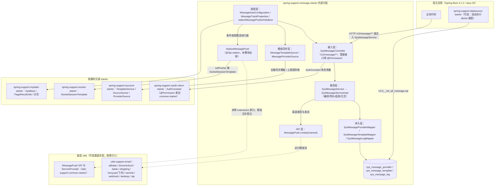
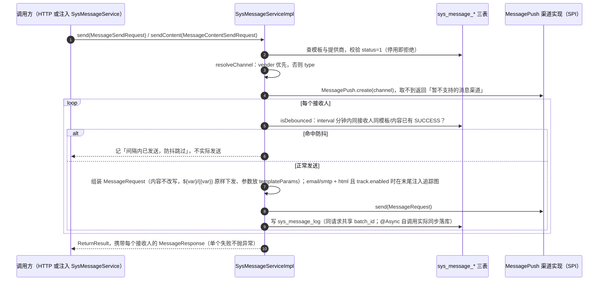

# spring-support-message-starter

统一消息推送 Starter：以「提供商表 + 模板表 + 推送日志表」三张表驱动多渠道消息发送，渠道能力经 utils 侧 `MessagePush` SPI 在运行期发现；业务侧只调 `/v2/message/**` 或注入 `SysMessageService`，不直接对接各渠道 SDK。在 spring-support 体系中，本模块承担「渠道配置管理 + 模板管理/预览 + 发送编排 + 日志与已读追踪」；具体渠道实现归 `utils-support-*` 渠道包，模板集中展示归 `spring-support-account-starter` 统一模板库。

- 包名：`com.chua.starter.message.support`；版本 `4.0.0.51`（模块不写 `<version>`，继承父 POM `spring-support-parent-starter:4.0.0.51` → `spring-boot-starter-parent:4.1.2`，Java 25）
- 自动装配入口：`META-INF/spring/org.springframework.boot.autoconfigure.AutoConfiguration.imports` → `MessageAutoConfiguration`（**无 `spring.factories`**）

## 1. 架构图



依赖方向：本模块依赖 common / mybatis / account / socket / oauth-client 五个 spring 侧 starter；渠道 `utils-support-*` 是可选实现，由 SPI 容器运行期发现，本模块不直接依赖任何渠道包（`email` 例外，经 `spring-support-account-starter` 的邮件编排依赖传递带入）。`spring-support-common-starter` 提供 `ReturnResult`、`@Permission`、`ServiceInfoContributor`、`Constant` 等基础契约。

## 2. 核心流程图



## 3. 能力清单

| 能力域 | 关键类 | 入口/触发方式 |
|---|---|---|
| 自动装配 | `MessageAutoConfiguration` | `AutoConfiguration.imports` |
| 提供商管理（判重/逻辑删除） | `SysMessageProvider`、`SysMessageProviderMapper`、`SysMessageService#saveProvider` 等 | `/v2/message/provider/**` |
| 模板管理与预览 | `SysMessageTemplate`、`TemplatePreviewRequest/Response`、`#saveTemplate`、`#previewTemplate` | `/v2/message/template/**`、`POST /v2/message/template/preview` |
| 按模板发送 | `MessageSendRequest`、`SysMessageService#send` | `POST /v2/message/send` |
| 按内容发送 | `MessageContentSendRequest`、`SysMessageService#sendContent` | `POST /v2/message/send/content` |
| 渠道发现 | `ChannelInfo`、`#listChannels`（遍历 `MessagePush` SPI 定义） | `GET /v2/message/channel/list` |
| 远端模板同步 | `#syncTemplate`（走 `MessagePush#listTemplates`，按 code upsert） | `POST /v2/message/template/sync?providerId=` |
| 推送日志与清理 | `SysMessageLog`、`SysMessageLogMapper`、`#pageForLog`、`#cleanLog` | `/v2/message/log/page`、`POST /v2/message/log/clean` |
| 邮件阅读追踪 | `MessageTrackProperties`、`#markLogRead`、日志行 `sysMessageTrackToken` | `GET /v2/message/track/{token}`（返回 1x1 透明 GIF） |
| 重复消息防抖 | `SysMessageServiceImpl#isDebounced`（提供商行 `sys_message_provider_interval`） | 发送链路内自动生效 |
| 站内消息渠道 | `StationMessagePush`（`@Spi("station")`）、`SysMessageStationItem`、`#pageForStationMessage`、`#countStationMessageUnread`、`#markStationMessageRead` | 渠道标识 `station`；`/v2/message/sys-message/**` |
| 统一模板库同步 | `MessageTemplateSyncer`（`SourceSyncer`，source=`message`）、`MessageProviderSource`（`ProviderSource`） | 由 account 侧 `SourceSyncerRegistry` 启动拉起 / 页面手动同步 |
| 服务信息登记 | `messageServiceInfoContributor` | 启动横幅 `message` 标志 + `/v2/message/**` 端点登记 |

### 3.1 数据表与渠道解析

- 建表脚本 `src/main/resources/db/init/V2.0__init_all_message.sql`（引入 `spring-support-datasource-starter` 时自动执行）；`V2.0__initdata_all_message.sql` 仅含注释，本模块无种子数据。
- `sys_message_provider`：渠道凭据（code 唯一、type、vender、app_id/app_secret、smtp_*、webhook_url、endpoint、interval、status、sort）；`sys_message_template`：provider_id、code、name、type、content、status、sort；`sys_message_log`：target、channel、content、code（SUCCESS/FAILURE）、subject、message_id、batch_id、track_token、read_status、read_time。
- 渠道解析 `SysMessageServiceImpl#resolveChannel`：**先取 `sys_message_provider_vender`，为空才取 `sys_message_provider_type`**，再交给 `MessagePush.create(channel)` 找 SPI 实现——用哪个渠道由提供商行决定，与模板无关。

## 4. Bean 能力矩阵

注册方式：仅 `AutoConfiguration.imports`。`MessageAutoConfiguration` 上有 `@MapperScan("com.chua.starter.message.support.mapper")`、`@ComponentScan({"...controller", "...template"})`、`@EnableConfigurationProperties(MessageTrackProperties.class)`；**本模块未使用任何 `@ConditionalOnMissingBean`**。

| Bean 名 | 类型 | 装配条件 | 可否覆盖 | 典型用途 |
|---|---|---|---|---|
| `messageServiceInfoContributor` | `ServiceInfoContributor` | 无条件（自动装配激活即注册） | 同类型 Bean 会并存，注入需指定名称或 `@Primary` | 登记「消息」端点与 `message` 标志 |
| `stationMessagePusherInitializer` | `ApplicationRunner` | `@ConditionalOnClass(name="com.chua.socket.support.session.SocketSessionTemplate")` 且 `@ConditionalOnBean(SocketSessionTemplate.class)`（socket-starter 必在 classpath，实际取决于容器是否已有该 Bean） | 可：同名 Bean 覆盖，或绕开它直接调 `StationMessagePush.setPusher` | 启动时把 Socket 推送执行器注入 `StationMessagePush` |
| `plugin.message.track-com.chua.starter.message.support.configuration.MessageTrackProperties` | `MessageTrackProperties` | `@EnableConfigurationProperties` 随自动装配注册 | 同类型 Bean 优先 | 读取 `plugin.message.track.*`，控制邮件追踪 |
| `sysMessageController` | `SysMessageController`（`@RestController`） | `@ComponentScan` 覆盖 `...support.controller` | 同简名 Bean 扫描期冲突（见第 9 节第 4 条） | `/v2/message/**` HTTP 入口 |
| `messageTemplateSyncer` | `MessageTemplateSyncer`（实现 `SourceSyncer`） | `@ComponentScan` 覆盖 `...support.template` | 同上 | 向统一模板库全量同步/清理消息模板 |
| `messageProviderSource` | `MessageProviderSource`（实现 `ProviderSource`） | `@ComponentScan` 覆盖 `...support.template` | 同上 | 向模板库左栏上报提供商（凭据 ak/sk 置空） |
| `sysMessageProviderMapper` / `sysMessageTemplateMapper` / `sysMessageLogMapper` | MyBatis-Plus `BaseMapper` 代理 | `@MapperScan` | MapperScan 常规规则 | 三张表持久层，注入 `SysMessageServiceImpl` 与两个同步器 |
| （不注册）`sysMessageServiceImpl` | `SysMessageServiceImpl`（`@Service`） | **不在本模块装配范围**：`@ComponentScan` 只扫 controller/template，`service.impl` 未覆盖 | 宿主补 `@ComponentScan("...service")` / `@Import` / `@Bean` 后可替换 | 发送编排核心；按接口 `SysMessageService` 注入 |

## 5. 完整配置

本模块唯一的 `@ConfigurationProperties` 是 `MessageTrackProperties`，前缀 `plugin.message.track`（常量 `MessageTrackProperties.PRE`）。没有 enable 总开关、端口等其它配置；渠道启停由提供商行 `status` 决定。

| 配置路径 | 类型 | 默认值 | 说明 |
|---|---|---|---|
| `plugin.message.track.enabled` | `boolean` | `false` | 邮件阅读追踪总开关；`false` 时不生成 `track_token`、不注入追踪图 |
| `plugin.message.track.base-url` | `String` | 空（null） | 追踪图基础地址，拼成 `{base-url}/v2/message/track/{token}`。**为空时 `buildContentWithTrack` 直接返回原文**——代码不回退当前服务地址（类 Javadoc 的「缺省回退」描述与实现不符，以代码为准） |

```yaml
plugin:
  message:
    track:
      enabled: true
      base-url: "http://your-host:8080"
```

其余运行参数不在 yaml：防抖间隔在提供商行 `sys_message_provider_interval`（分钟，实体默认 1，`0` 表示不限制，仅 `SUCCESS` 日志参与判定）；SMTP/AK/SK/Webhook 等凭据全部在 `sys_message_provider` 行内，由各渠道 `MessagePush` 实现自行读取。日志写入标了 `@Async(Constant.DEFAULT_EXECUTOR_TASK)`（限定符即 `taskExecutor`）：该执行器 Bean 不由本模块或 common-starter 提供，且调用点为同类自调用（不过 AOP 代理），故当前日志实际在调用线程同步落库；宿主若要真异步，需自行注册名为 `taskExecutor` 的执行器并改为跨 Bean 调用。

### 5.1 逐项配置示例

#### 邮件阅读追踪（`plugin.message.track.*`，唯一一组 YAML 配置）

| 配置项 | 含义 | 默认值 | 为空/未配置时的行为 |
|---|---|---|---|
| `plugin.message.track.enabled` | 邮件阅读追踪总开关：`true` 时对 `email`/`smtp` 渠道、内容类型为 `html`/`text/html`/`EMAIL` 的消息在末尾注入 1x1 透明追踪图，并生成 `track_token` | `false` | 关闭：不生成 `track_token`、不注入追踪图，日志 `read_status` 恒为空 |
| `plugin.message.track.base-url` | 追踪图基础地址，拼成 `{base-url}/v2/message/track/{token}`（末尾多余 `/` 会被去除） | 空（null） | **不注入追踪图，邮件内容原样发送**（代码不回退当前服务地址，见 `SysMessageServiceImpl#buildContentWithTrack`） |

```yaml
# 开启追踪（两个键通常成对配置）
plugin:
  message:
    track:
      enabled: true
      base-url: "https://msg.example.com"
```

```yaml
# 明确关闭追踪（与直接省略该段等价）
plugin:
  message:
    track:
      enabled: false
```

#### 数据库行运行参数（不在 YAML）

以下参数存放在 `sys_message_provider` 提供商行内，经 `/v2/message/provider/save|update` 维护，不走 YAML：

| 行字段 | 含义 | 默认/回落 |
|---|---|---|
| `sys_message_provider_interval` | 防抖间隔（分钟）：间隔内同一接收人同模板/同内容已有 `SUCCESS` 日志则跳过发送 | 行内未配置按 `1` 分钟；显式 `0`（或负数）表示不防抖 |
| `sys_message_provider_status` | 渠道启停：`1` 启用、`0` 停用（停用后发送/模板同步直接拒绝） | 新增时未填默认 `1` |
| `sys_message_provider_vender` / `sys_message_provider_type` | 渠道路由：优先取 `vender`，为空取 `type`，交给 `MessagePush.create(channel)` | 无默认；两者皆空解析不出有效渠道，发送报「暂不支持的消息渠道」 |
| `sys_message_provider_smtp_*` / `app_id` / `app_secret` / `webhook_url` / `endpoint` 等 | 渠道凭据与端点，由对应渠道 `MessagePush` 实现自行读取 | 无模块级默认 |

### 5.2 完整 YAML 示例

```yaml
# application.yml —— spring-support-message-starter 完整 YAML 配置
# 本模块可用的 YAML 配置只有 plugin.message.track 一组键；
# 渠道凭据与防抖间隔在 sys_message_provider 表行内维护（见 5.1），
# 数据源等宿主公共配置由 mybatis-starter 侧既有体系提供，不在此展开。

plugin:
  message:
    track:
      # 邮件阅读追踪总开关（默认 false）
      enabled: true
      # 追踪图基础地址：{base-url}/v2/message/track/{token}
      # 必须是收件人邮件客户端可访问的地址；留空则不注入追踪图
      base-url: "https://msg.example.com"
```

### 5.3 生产注意事项

1. **追踪地址必须外网可达**：`base-url` 要写成收件人邮件客户端能访问到的地址；写内网地址或留空，追踪图不会加载，`read_status` 永远停在 0（`track_token` 仍会写日志，仅影响已读回执）。
2. **防抖按提供商行配置**：`interval` 未配置默认 1 分钟；验证码等高频消息建议显式置 `0` 或按需调大，避免联调/重试被「间隔内已发送，防抖跳过」吞掉。只有 `SUCCESS` 日志参与判定，失败可立即重发。
3. **日志表增长与落库时延**：每次发送每个接收人写一条 `sys_message_log`，需定期调 `POST /v2/message/log/clean`（传 `beforeTime`）清理；当前日志为同步落库（见本节开头 `@Async` 说明），数据库抖动会直接拖慢发送接口，建议日志表单独规划容量与归档。
4. **凭据安全**：SMTP 口令、AK/SK、Webhook 地址等全部存于 `sys_message_provider` 表，注意库表访问权限；向统一模板库上报提供商时（`MessageProviderSource`）ak/sk 会被置空，但提供商管理接口的返回体仍含凭据字段，前端展示需脱敏。代码、配置、文档中一律使用占位符（如 `your-password`），禁止写入真实凭据。
5. **启动前提**：宿主需补 `@ComponentScan("com.chua.starter.message.support.service")`（或等价 `@Import`/`@Bean`），否则容器缺 `SysMessageService` Bean、启动即失败；不要与 `spring-api-support-common-system-starter` 同时引入（同名 Bean 扫描冲突）。
6. **渠道包按需引入**：classpath 缺渠道包时该渠道发送报「暂不支持的消息渠道」，不影响其它渠道与管理接口；上线前用 `GET /v2/message/channel/list` 核对实际可用渠道清单。

## 6. 使用方式

### 6.1 Maven 坐标

```xml
<dependency>
    <groupId>com.chua</groupId>
    <artifactId>spring-support-message-starter</artifactId>
    <version>4.0.0.51</version>
</dependency>
```

pom 内依赖（common / mybatis / account / socket / oauth-client / swagger-annotations）均为必选传递；**渠道实现包未在本模块 pom 声明**，由宿主按需引入（相当于可选依赖）。注意 `spring-support-account-starter` 自身依赖 `utils-support-email-starter`（账号侧邮件收发复用同一个 `MessagePush`），因此 `email` 渠道会随账号模块传递进 classpath、开箱即用；除它之外一个渠道包都不引时，`/v2/message/channel/list` 只有 `email`、其它渠道发送返回「暂不支持的消息渠道」，但管理接口与模板同步仍可用。`spring-support-datasource-starter` 同样未声明（mybatis-starter 对它是 `<optional>`）：不引入则需手工执行 `V2.0__init_all_message.sql` 建表。socket-starter 虽是必选依赖，但只有容器里存在 `SocketSessionTemplate` Bean 时站内推送执行器才装配。

### 6.2 渠道包（按需引入，SPI 扩展名已逐包核对；`email` 由 account-starter 传递带入，无需重复声明）

| 渠道（SPI 扩展名） | 依赖 artifactId | SPI 实现类 |
|---|---|---|
| `email` | `utils-support-email-starter` | `com.chua.email.support.EmailPush` |
| `alibaba-sms` | `utils-support-alibaba-starter` | `com.chua.alibaba.support.sms.AlibabaSmsMessagePush` |
| `tencent-sms` | `utils-support-tencentcloud-starter` | `com.chua.tencentcloud.support.sms.TencentSmsMessagePush` |
| `baidu-sms` | `utils-support-baidu-starter` | `com.chua.baidu.support.sms.BaiduSmsMessagePush` |
| `dingding` | `utils-support-dingding-starter` | `com.chua.dingding.support.message.DingdingMessagePush` |
| `feishu` | `utils-support-hunyuan-starter` | `com.chua.hunyuan.support.message.FeishuMessagePush` |
| `wechat` | `utils-support-wechat-starter` | `com.chua.wechat.support.message.WechatMessagePush` |
| `webhook` | `utils-support-webhook-starter` | `com.chua.webhook.support.message.WebhookMessagePush` |
| `desktop` | `utils-support-desktop-starter` | `com.chua.desktop.support.DesktopMessagePush` |
| `opt` | `utils-support-otp-starter` | `com.chua.otp.support.OptClient` |
| `station` | 本模块自带 `StationMessagePush`，未带 SPI 索引，需宿主补（见第 9 节第 2 条） | `com.chua.starter.message.support.push.StationMessagePush` |

### 6.3 最小启用示例

```java
@SpringBootApplication
@ComponentScan("com.chua.starter.message.support.service")   // 关键：本模块自动装配不扫 service.impl
public class App {
    public static void main(String[] args) {
        SpringApplication.run(App.class, args);
    }
}
```

```yaml
plugin:
  message:
    track:
      enabled: false        # 需要邮件已读追踪时改 true 并配 base-url
```

录一条提供商 + 一条模板后发送：

```text
POST /v2/message/provider/save   {"sysMessageProviderCode":"smtp-main","sysMessageProviderName":"主邮件",
                                  "sysMessageProviderType":"EMAIL","sysMessageProviderVender":"email",
                                  "sysMessageProviderSmtpHost":"smtp.example.com","sysMessageProviderSmtpPort":465,
                                  "sysMessageProviderSmtpFrom":"noreply@example.com"}
POST /v2/message/template/save   {"sysMessageProviderId":1,"sysMessageTemplateCode":"EMAIL_CODE",
                                  "sysMessageTemplateName":"邮箱验证码","sysMessageTemplateType":"html",
                                  "sysMessageTemplateContent":"您的验证码是 ${code}，5 分钟内有效"}
POST /v2/message/send            {"target":["user@example.com"],"sysMessageTemplateId":1,"subject":"验证码","params":{"code":"123456"}}
```

占位符只允许 `${var}` 与 `{{var}}`（保存时 `findIllegalPlaceholder` 校验）；**发送链路不做占位符替换**——模板内容原样写入 `MessageRequest.content`，`params` 只作为 `templateParams` 下发给渠道，`${var}`/`{{var}}` 的替换仅发生在 `#previewTemplate` 预览接口。`sysMessageTemplateType` 会原样作为 `contentType` 传给渠道实现并参与追踪判定（`html`/`text/html`/`EMAIL` 才可能被追踪）。也可注入 `SysMessageService` 直接调用，请求对象均为 `record`，按构造参数传值。

## 7. 使用场景

**适用**：

1. 多渠道通知触达：验证码短信、邮件通知、钉钉/飞书机器人、微信、Webhook、桌面弹窗、站内消息，一套管理界面配齐。
2. 需要「渠道配置 + 模板中心 + 发送日志 + 邮件已读追踪」一体的管理后台（前端直接对接 `/v2/message/**`）。
3. 已使用 `spring-support-socket-starter`，需要站内消息（未读数、已读标记、在线用户实时推送）。
4. 短信/邮件模板要汇入统一模板库（`pages/template` 集中展示），本模块自动同步。

**不适用/慎用**：

1. 双向 IM / 会话聊天：本模块是单向推送 + 流水日志，无会话、回复、收件箱交互。
2. 大规模异步群发、重试队列、状态回执对账：发送在请求线程内同步循环，无队列/限流/重发（防抖仅分钟粒度）。

**与相邻模块的取舍**：`spring-support-account-starter` 提供统一模板库展示（增删改在消息侧，模板库只读）；`spring-support-socket-starter` 仅为站内渠道服务，不用站内消息时条件装配不命中、无副作用；`spring-api-support-common-system-starter` 自带同名 `SysMessageController` 等 Bean，与本模块**无法共存**（扫描期冲突，必须二选一）；`utils-support-*` 渠道包按需取用。

## 8. 扩展点

1. **渠道 SPI `MessagePush`**（接口在 `utils-support-common-starter`）：新增渠道三步走——① 实现 `getProvider()` / `send()`（按需覆写 `listTemplates()` / `getTemplate()`），类上标 `@Spi("别名")` + `@SpiDescribe`；② 在实现所在 jar 的 `src/main/resources/META-INF/extensions/com.chua.common.support.task.message.MessagePush` 登记 `别名=实现类全名`（`@Spi` 只是别名声明，**没有索引文件不会被收集**）；③ 提供商行填 `sys_message_provider_vender=别名`（或 `type=别名`）即可路由。
2. **站内推送执行器**：`StationMessagePush.setPusher(StationPusher)`（函数式接口 `push(userId, payload)`）。默认由 `stationMessagePusherInitializer` 接 `SocketSessionTemplate#sendToUser(userId, "message", payload)`；不用 socket 时宿主可在启动早期自行 `setPusher` 接任意推送通道。
3. **统一模板库来源**：`MessageTemplateSyncer`（`SourceSyncer`）与 `MessageProviderSource`（`ProviderSource`）实现 account 侧同步契约；宿主若有其它资产要进模板库，按同契约再实现一个 Bean，`SourceSyncerRegistry` 自动收集。
4. **服务层替换**：`SysMessageController` 只依赖 `SysMessageService` 接口，宿主提供自定义实现 Bean（补扫 / `@Import` / `@Bean` 注册）即可接管全部 `/v2/message/**` 行为（如改防抖策略、加审计）。

## 9. 常见问题

1. **启动失败：容器里没有 `SysMessageService` Bean（`/v2/message/**` 全部不可用）**：`@ComponentScan` 只覆盖 controller/template 包，`SysMessageServiceImpl` 不在扫描范围，而 `SysMessageController` 是构造器注入该接口，缺失即启动期 `UnsatisfiedDependencyException`。宿主需补 `@ComponentScan("com.chua.starter.message.support.service")`、`@Import(SysMessageServiceImpl.class)` 或等价 `@Bean`；Mapper 已由 `@MapperScan` 覆盖，不受影响。
2. **发送返回「暂不支持的消息渠道: xxx」**：classpath 缺对应渠道包，或提供商行 `vender`/`type` 与 SPI 扩展名不一致。先 `GET /v2/message/channel/list` 看已注册渠道，再按 6.2 表核对依赖；`station` 渠道需宿主在自身 resources 补 `META-INF/extensions/com.chua.common.support.task.message.MessagePush`，内容 `station=com.chua.starter.message.support.push.StationMessagePush`，否则报「站内消息推送器未初始化」或取不到实现。
3. **联调消息被吞（「间隔内已发送，防抖跳过」）**：提供商行 `sys_message_provider_interval` 未配置时默认 1 分钟，联调显式置 `0`；仅 `SUCCESS` 日志参与判定，失败可立即重试。
4. **与 system 模块同时引入启动失败**：`spring-api-support-common-system-starter` 自带同名 `SysMessageController`、4 个 `SysMessage*Mapper` 与多组 Service/Impl，扫描期抛 `ConflictingBeanDefinitionException`；`allow-bean-definition-overriding` 不救扫描期冲突，必须合并或退役其一。
5. **Spring Boot 4 兼容性**：本模块经 `AutoConfiguration.imports` 注册（未使用 Boot 3 起已移除的 `spring.factories` 自动配置），在 Spring Boot 4.1.2 + Java 25 按标准机制装配；请求 DTO 为 `record`，JSON 反序列化无兼容问题。
6. **追踪开了收不到已读回执**：`base-url` 为空时不注入追踪图（不回退当前地址），或 `base-url` 对收件人邮件客户端不可达。追踪仅覆盖 `email`/`smtp` 渠道且内容类型为 `html`/`text/html`/`EMAIL`；`track_token` 仍会写日志，`read_status` 停在 0。
