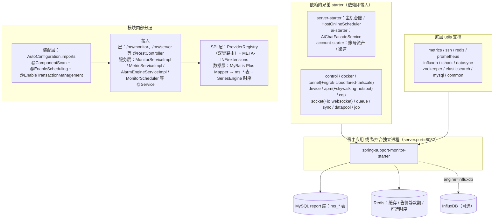
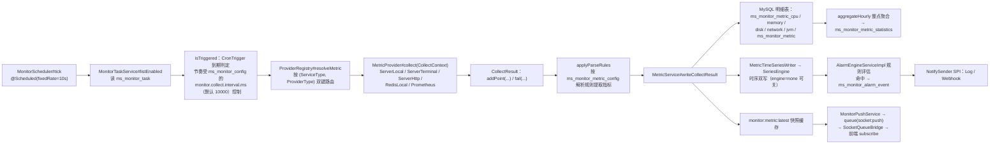

# spring-support-monitor-starter

服务器与中间件监控的一站式 starter：资产台账 + 采集任务 + 指标时序 + 小时聚合 + 告警 + 运维操作 + 网络抓包 + AI 诊断。在 spring-support 体系中定位为「运维观测域」聚合模块：既作为库被宿主应用引入（依赖即带入全部能力），也可打成 `*-exec.jar` 独立启动为监控台（默认端口 8082）。

> 版本 `4.0.0.51` ｜ 父模块 `spring-support-parent-starter` ｜ Spring Boot 4.1.2 / Java 25

## 1. 架构图



## 2. 核心流程图（采集数据流）



> 手动触发走同一链路：`POST /ms/monitor/task/{id}/trigger` → `MonitorScheduler#triggerNow`，忽略 cron 与启用状态异步执行一次。

## 3. 能力清单

| 能力域 | 关键类 | 入口/触发方式 |
|---|---|---|
| 自动装配 | `MonitorAutoConfiguration`（`@ComponentScan com.chua.starter.monitor.support`、`@EnableScheduling`、`@EnableTransactionManagement`） | `META-INF/spring/...AutoConfiguration.imports` |
| 远控装配 | `ControlRestConfiguration`（`@Import(ControlController)`，WebRTC `/control` + `/webrtc`） | 同上，`control.webrtc.enabled`（缺省开） |
| 资产主数据 | `MonitorService` / `MonitorServiceImpl` | `ms_monitor`，`/ms/monitor` |
| 采集任务 | `MonitorTaskService`、`MonitorScheduler` | `ms_monitor_task`，`/ms/monitor/task` |
| 采集路由 | `MetricProvider` + `ProviderRegistry`（ServiceType × ProviderType 双键） | SPI `META-INF/extensions/...MetricProvider` |
| 指标时序 | `MetricService` / `MetricServiceImpl`、`MetricTimeSeriesWriter` | `/ms/monitor/metric`；5 张明细表 + SeriesEngine |
| 时序引擎 | `SeriesEngineConfiguration#seriesEngine` | `plugin.monitor.timeseries.engine` |
| 聚合/清理 | `MonitorScheduler#aggregateHourly` / `#cleanupOldData` | `@Scheduled(cron="0 0 * * * ?")` / `monitor.cleanup.cron` |
| 告警 | `AlarmController`、`AlarmEngineServiceImpl`、`NotifySender` SPI | `/ms/monitor/alarm` |
| Redis 运维 | `RedisManageService`、`SystemRedisKvService` | `/ms/monitor/redis-manage`、`/ms/monitor/system/redis/kv` |
| 主机运维 | `HostOperations` + `HostOperationsProvider` SPI（Posix/Windows/Mac） | `/ms/server/host/**` |
| 网络抓包 | `TsharkCaptureController`、`TsharkCaptureService`、`TsharkRuntime` | `/ms/monitor/tshark` |
| 数据同步 | `SyncTaskService`、`JdbcCsvLoader` SPI（mysql/postgresql） | `ms_sync_task`，`/ms/monitor/datasync` |
| Agent 接入 | `AgentEndpointController`、`AgentTcpServerConfiguration`、`AgentHttpClient`、`AgentOfflineChecker` | agent 侧上报端点 `/ms/monitor/agent`；TCP 上报端口 `plugin.monitor.agent.tcp-port`（默认 `19390`） |
| 数据库备份 | `DatabaseBackupController`、`DatabaseBackupService`、`DatabaseBackupProperties` | `/ms/monitor/database-backup`，`plugin.monitor.database-backup.enabled`（缺省开） |
| AI 诊断 / 大屏 | `MonitorController` 注入 `ObjectProvider<AiChatFacadeService>`；`#dashboardOverview` | `/ms/monitor/ai/status`、`/ai/analyze`、`/ai/host/{id}/analyze`、`/ms/monitor/dashboard/overview` |
| 端口映射 | tunnel-starter 统一编排（ngrok/cloudflared/tailscale 为 SPI 实现） | `/ms/tunnel` |
| 服务发现查询 | `ServerDiscoveryController`（`@ConditionalOnClass DiscoveryService`）/ `DiscoveryFallbackController`（`@ConditionalOnMissingClass`） | `/ms/monitor/discovery` |
| 文件资产/网关 | `FileAssetServiceImpl`、`MonitorFileStorageConfig`、`MonitorFileStorageGatewayConfig` | `/ms/monitor/file-assets`、`/fs/default` |
| 实时推送 | `MonitorPushService` → `SocketQueueBridge` | socket.io `29181`，`subscribe("monitor", ...)` |

核心数据表 14 张：`ms_monitor` / `_config` / `_task` / `_metric_config` / `_gateway` / `_metric` / `_metric_statistics` / `_metric_cpu|memory|disk|network|jvm` / `_redis_metric` / `_redis_metric_statistics`；DDL 见 `src/main/resources/db/init/V5.2__init_all_monitor.sql`，另含告警、抓包、同步任务、维护计划、节点与操作日志、数据库备份历史表。

## 4. Bean 能力矩阵

均来自真实源码；除标注外由 `MonitorAutoConfiguration` 的 `@ComponentScan` 或模块内 `@Configuration` 注册。

| Bean 名 | 类型 | 装配条件（含默认值） | 可否覆盖 | 典型用途 |
|---|---|---|---|---|
| `datasearchConflictResolve` | `DatasearchConflictResolve` | 无条件 | 可 | 移除与 datasearch 冲突的旧 `/v2/**` 映射 |
| `monitorSchemaInitializer` | `ApplicationDataSourceScriptDatabaseInitializer` | 无条件（需容器存在 `DataSource`） | 可 | 让 `spring.sql.init` 脚本真正执行 |
| `monitorServiceInfoContributor` | `ServiceInfoContributor` | 无条件 | 可 | 服务信息面板展示「监控 [Influx: 开/关]」 |
| `seriesEngine` | `SeriesEngine` | 按 `plugin.monitor.timeseries.engine`（属性默认 `influxdb`，样例 yml 用 `datasource`）；`none`/扩展缺失 → `NoopSeriesEngine`，永不为 null | 可（无 `@ConditionalOnMissingBean`，覆盖需开 `spring.main.allow-bean-definition-overriding`） | 时序读写唯一出口 |
| `agentTcpSyncServer` | `SyncServer`（`TcpSyncServer`） | 无条件；端口 `plugin.monitor.agent.tcp-port`（默认 19390），`initMethod=start` | 可（同上） | Agent TCP 长连接上报 |
| `httpExchangeRepository` | `HttpExchangeRepository` | `@ConditionalOnClass(HttpExchangeRepository)` + `@ConditionalOnMissingBean` | 可（宿主仓库优先） | `/actuator/httpexchanges` 数据源（容量 200） |
| `sseSocketSessionTemplate` | `SseSocketSessionTemplate` | `@ConditionalOnClass` + `plugin.socket.enable=true`（无 matchIfMissing，须显式开） | 可 | socketio 单协议下兜底空实现，保 mailbox SSE 构造注入 |
| `monitorLocalStorage` | 反射构造的 `LocalFileStorage` | `@ConditionalOnClass(name="...filesystem.support.local.LocalFileStorage")` | 可 | 文件资产本地后端（对外桶名 `default`） |
| `fileStorageTemplate` / `fileServerConfigController` / `uploadTaskManager` / `uploadTaskController` / `fileCollabStore` / `fileCollabPersistence` / `fileCollabHub` / `fileCollabController` | 对应 filesystem-starter 类 | `@ConditionalOnClass(FileStorageServerLauncher, FileStorageTemplate)` + 均带 `@ConditionalOnMissingBean` | 可 | 补回被 exclude 的 `FileSystemAutoConfiguration` 能力 |
| `fileStorageEmbeddedFilter` / `fileStorageServerLauncher` | `FilterRegistrationBean<FileStorageEmbeddedFilter>` / `FileStorageServerLauncher` | `plugin.filesystem.storage-server.enable`（缺省开）+ `mode=embedded`（缺省）/ `mode=standalone`（须显式配） | 可 | 内置形态挂应用端口 `{path-prefix}/*`；独立端口（默认 18082）文件服务 |
| `hostRealtimePushBinder` | `ApplicationRunner` | 无条件；`HostOnlineScheduler` 缺失时运行期跳过 | 可 | 向 server-starter 调度器注册延迟/在线/采集钩子 |
| `monitorSocketQueueBridge` | `SocketQueueBridge` | `@ConditionalOnProperty plugin.queue.enable=true`（matchIfMissing=true，缺省开） | 可 | 消费 `socket:push` topic 广播到 socket.io |
| `productionAuthGuard` | `ProductionAuthGuard` | `@ConditionalOnProperty plugin.oauth.require-auth=true` | 可 | 生产启动期鉴权校验 |
| `debugBeanTrace` | `DebugBeanTrace`（`BeanPostProcessor`） | 无条件 | 可 | Bean 装配追踪（排障） |
| `monitorScheduler` / `providerRegistry` | `MonitorScheduler` / `ProviderRegistry` | `@Component`，无条件 | 可 | 调度入口 / SPI 双键索引 |
| `alarmEngineService` 等业务服务 | `AlarmEngineServiceImpl`、`MetricServiceImpl`、`MonitorServiceImpl`、`MonitorTaskServiceImpl`、`MonitorConfigServiceImpl`、`MonitorMetricConfigServiceImpl`、`MonitorGatewayServiceImpl`、`RedisManageServiceImpl`、`SystemRedisKvServiceImpl`、`SyncTaskServiceImpl`、`DatabaseBackupService`、`HostProfileServiceImpl`、`HostMetricHistoryServiceImpl`、`FileAssetServiceImpl`、`ServerManageServiceImpl`、`TsharkCaptureService`、`LocalSystemInfoServiceImpl`、`MaintenancePlanService` | `@Service`，无条件 | 可（按接口注入覆盖） | 各自接口的构造注入 |

> 本模块没有 `spring.factories`，自动配置只经 `AutoConfiguration.imports` 注册（Spring Boot 4 口径）。

## 5. 完整配置

### 5.1 `plugin.monitor.influx` / `plugin.monitor.timeseries`（`MonitorInfluxProperties` / `MonitorTimeseriesProperties`，前者经 `@EnableConfigurationProperties` 注册）

| 配置路径 | 类型 | 默认值 | 说明 |
|---|---|---|---|
| `plugin.monitor.influx.enabled` | `boolean` | `false` | 是否启用 InfluxDB 写入/查询 |
| `plugin.monitor.influx.url` | `String` | `http://127.0.0.1:8086` | InfluxDB v1 兼容端点 |
| `plugin.monitor.influx.database` | `String` | `monitor` | 库名 |

| 配置路径 | 类型 | 默认值 | 说明 |
|---|---|---|---|
| `plugin.monitor.timeseries.engine` | `String` | `influxdb` | `influxdb` / `redis` / `datasource` / `none` |
| `plugin.monitor.timeseries.url` | `String` | `http://127.0.0.1:8086` | redis 引擎下配成 `redis://`（或 `host:port`）时覆盖 `spring.data.redis.*` |
| `plugin.monitor.timeseries.database` | `String` | `monitor` | 库名（redis 引擎下为逻辑库下标） |

逐项 YAML 示例（值均为默认值，按需修改）：

```yaml
plugin:
  monitor:
    influx:                     # 是否启用 InfluxDB 写入/查询（默认 false）
      enabled: false
      url: http://127.0.0.1:8086        # InfluxDB v1 兼容端点
      database: monitor                 # 库名
    timeseries:                 # 时序双写引擎选择
      engine: influxdb          # influxdb / redis / datasource / none
      url: http://127.0.0.1:8086        # redis 引擎时可写 redis://host:port
      database: monitor                 # redis 引擎下为逻辑库下标
```

### 5.2 `plugin.monitor.ssh`（`MonitorSshProperties`，`@Component` 注册）

| 配置路径 | 类型 | 默认值 | 说明 |
|---|---|---|---|
| `plugin.monitor.ssh.connect-timeout-seconds` | `int` | `15` | SSH 建连 + 握手超时 |
| `plugin.monitor.ssh.session-timeout-seconds` | `int` | `30` | 认证（session.auth）超时 |
| `plugin.monitor.ssh.exec-timeout-seconds` | `int` | `60` | 命令执行/读取超时 |

### 5.3 `plugin.monitor.agent`（`AgentDeployProperties`，`@Component` 注册；末行 `tcp-port` 例外为 `@Value`）

> Agent 安装/卸载/升级等部署能力已下线（监控采集由 monitor 通道承担），历史版本中的 `jar-path`、`jar-url`、`*-service-name`、`remote-dir-name`、`health-wait-seconds`、`java-command`、`report-url`、`apm-*` 等配置项已从 `AgentDeployProperties` 移除，配置它们不再生效；本表仅保留平台访问已部署 Agent 所需的运行时参数。

| 配置路径 | 类型 | 默认值 | 说明 |
|---|---|---|---|
| `plugin.monitor.agent.port` | `int` | `19876` | agent 默认 HTTP 端口（主机未单独配置时使用） |
| `plugin.monitor.agent.token` | `String` | `""` | 访问 agent /exec 等端点的接口令牌；空=不启用令牌校验，平台侧访问时自动带上同值 |
| `plugin.monitor.agent.request-timeout-seconds` | `int` | `8` | 单次 agent HTTP 请求超时 |
| `plugin.monitor.agent.tcp-port` | `int` | `19390` | Agent TCP 上报端口（`@Value` 注入 `AgentTcpServerConfiguration`） |

逐项 YAML 示例（值均为默认值，token 建议改为长随机串）：

```yaml
plugin:
  monitor:
    agent:
      port: 19876                  # agent 默认 HTTP 端口
      token: change-me             # 访问 agent 端点的接口令牌；留空则不启用校验
      request-timeout-seconds: 8   # 单次 agent HTTP 请求超时
      tcp-port: 19390              # Agent TCP 上报端口（@Value 注入）
```

### 5.4 `plugin.monitor.tshark`（`TsharkInstallProperties`，`@Component` 注册）

| 配置路径 | 类型 | 默认值 | 说明 |
|---|---|---|---|
| `plugin.monitor.tshark.bin` | `String` | `""` | 显式指定 tshark；空按 `TSHARK_BIN` → 本项 → 自动安装目录 → 系统路径 → PATH 探测 |
| `plugin.monitor.tshark.auto-install` | `boolean` | `true` | 探测不到时下载便携包（不装 Npcap 驱动） |
| `plugin.monitor.tshark.install-dir` | `String` | `""`（回退 `~/spring-support/tshark`） | 便携版解压目录 |
| `plugin.monitor.tshark.package-url`（`-windows` / `-linux` 后缀优先） | `String` | `""` | 便携包下载地址（zip；Linux 为 tar.gz/tar.xz/deb） |
| `plugin.monitor.tshark.package-path`（`-windows` / `-linux` 后缀优先） | `String` | `""` | 本地便携包路径（离线部署） |
| `plugin.monitor.tshark.timeout-seconds` | `int` | `600` | 下载 + 解压 + 自检总超时 |
| `plugin.monitor.tshark.tls-keylog-file` | `String` | `""` | TLS keylog 文件，配置后带 `-o tls.keylog_file:` 解密 |
| `plugin.monitor.tshark.json-restore` | `boolean` | `true` | 解析 pcap 时回填 `rawData` / `restoredText`（协议还原） |

逐项 YAML 示例（值均为默认值，内网离线部署用 `package-path`，有内网文件服务用 `package-url`）：

```yaml
plugin:
  monitor:
    tshark:
      bin: ""                        # 显式指定 tshark 路径；空则按 TSHARK_BIN → 本项 → 自动安装目录 → 系统路径 → PATH 探测
      auto-install: true             # 探测不到时自动下载便携包（不装 Npcap 驱动）
      install-dir: ""                # 便携版解压目录；空回退 ~/spring-support/tshark
      package-url: ""                # 便携包下载地址（zip；Linux 支持 tar.gz/tar.xz/deb）
      package-url-windows: ""        # Windows 专用地址，优先于 package-url
      package-url-linux: ""          # Linux 专用地址，优先于 package-url
      package-path: ""               # 本地便携包路径（离线部署），优先于 package-url
      package-path-windows: ""       # Windows 专用本地包路径
      package-path-linux: ""         # Linux 专用本地包路径
      timeout-seconds: 600           # 下载 + 解压 + 自检总超时
      tls-keylog-file: ""            # TLS keylog 文件；仅自有环境排障短期使用，勿与抓包文件同放
      json-restore: true             # 解析 pcap 时回填 rawData / restoredText（协议还原）
```

### 5.5 `plugin.monitor.tshark.retention`（`TsharkRetentionProperties`，`@Component` 注册）

| 配置路径 | 类型 | 默认值 | 说明 |
|---|---|---|---|
| `plugin.monitor.tshark.retention.days` | `int` | `7` | 抓包文件保留天数上限 |
| `plugin.monitor.tshark.retention.size-mb` | `int` | `512` | 抓包目录空间上限（MB），任一规则满足即清理 |
| `plugin.monitor.tshark.retention.enabled` | `boolean` | `true` | 是否自动清理（关闭只统计不删） |

逐项 YAML 示例（值均为默认值；过期清理与空间清理各成一条独立规则，任一满足即删）：

```yaml
plugin:
  monitor:
    tshark:
      retention:
        days: 7        # 抓包文件保留天数上限
        size-mb: 512   # 抓包目录空间上限（MB）
        enabled: true  # 关闭后只统计空间、不删文件
```

### 5.6 `plugin.monitor.database-backup`（`DatabaseBackupProperties`，`@Component` 注册）

数据库备份中心配置；数据库连接信息不从这里配置，而是从宿主当前 Spring `DataSource` 解析，保证备份的「当前库」与业务库一致。

| 配置路径 | 类型 | 默认值 | 说明 |
|---|---|---|---|
| `plugin.monitor.database-backup.enabled` | `boolean` | `true` | 是否启用备份中心（关闭后 Controller 返回 HTTP 200 与业务错误码「备份中心未启用」，由前端提示未装配） |
| `plugin.monitor.database-backup.backup-dir` | `String` | 空（回退 `{user.home}/monitor-backup/database`） | 备份根目录 |
| `plugin.monitor.database-backup.retention-days` | `int` | `30` | 备份保留天数，超过则清理历史备份 |
| `plugin.monitor.database-backup.max-backup-count` | `int` | `0` | 最大备份份数（按 `database-*` 脚本计数，超出从最旧清理）；`0`=不按份数清理 |
| `plugin.monitor.database-backup.consistent-snapshot` | `boolean` | `true` | 备份期间用单连接事务包住全表导出，保证多表数据取自同一快照 |
| `plugin.monitor.database-backup.write-manifest` | `boolean` | `true` | 在备份目录写入 `manifest.json`（每脚本字节数与 SHA-256 校验和），供恢复前校验 |

逐项 YAML 示例（值均为默认值）：

```yaml
plugin:
  monitor:
    database-backup:
      enabled: true                  # 关闭后备份接口返回「备份中心未启用」业务错误码
      backup-dir: ""                 # 备份根目录；空回退 {user.home}/monitor-backup/database
      retention-days: 30             # 备份保留天数
      max-backup-count: 0            # 最大份数；0 表示不按份数清理
      consistent-snapshot: true      # 单连接事务一致性快照导出
      write-manifest: true           # 写 manifest.json（字节数 + SHA-256）
```

### 5.7 其它键（`@Value` / 运行时表）

| 配置路径 | 类型 | 默认值 | 说明 |
|---|---|---|---|
| `monitor.file-storage.local-path` | `String` | `${user.dir}/.data/filesystem-local` | 文件资产落地目录（`MonitorFileStorageConfig` 的 `@Value`，同步注入 `filesystem.temp.path`） |
| `monitor.cleanup.cron` | `String` | `0 0 * * * ?` | 指标保留清理调度（`@Scheduled(cron="${monitor.cleanup.cron:0 0 * * * ?}")`） |
| `monitor.collect.interval.ms` / `monitor.data.retention.days` | `long` / `int` | `10000` / `30` | **运行时配置**，存 `ms_monitor_config` 表（页面可改）：采集节奏 / 指标保留天数 |
| `monitor.history.retention-days` | `int` | `7` | 主机历史指标时序保留天数（`HostMetricHistoryServiceImpl` 的 `@Value`，写入/清理走 SeriesEngine） |
| `spring.sql.init.*` | — | — | `SqlInitializationProperties` 随自动配置启用；本模块自带 `application.yml` 里 `mode: never`，建表统一走 `plugin.datasource.script`（FlywayLike） |
| `plugin.filesystem.*` | — | — | 文件网关启用 filesystem-starter 的 `FileStorageProperties` / `FileStorageServerProperties`，字段定义属该模块，此处不罗列 |

### 5.8 完整配置示例（可直接粘贴后按需裁剪）

```yaml
spring:
  datasource:
    url: jdbc:mysql://127.0.0.1:3306/monitor?useUnicode=true&characterEncoding=utf8
    username: root
    password: your-password        # 占位符，请替换为真实口令
  sql:
    init:
      mode: never                  # 建表统一走 plugin.datasource.script（FlywayLike），勿重复执行脚本

plugin:
  monitor:
    influx:                        # InfluxDB 双写（可整体省略 = 全默认关闭）
      enabled: false
      url: http://127.0.0.1:8086
      database: monitor
    timeseries:                    # 时序引擎：先用 datasource 零外部组件跑通
      engine: datasource           # influxdb / redis / datasource / none
      url: http://127.0.0.1:8086
      database: monitor
    ssh:                           # SSH/终端采集通道超时（慢链路调大）
      connect-timeout-seconds: 15
      session-timeout-seconds: 30
      exec-timeout-seconds: 60
    agent:                         # 已部署 Agent 的运行时接入参数
      port: 19876
      token: change-me             # 留空则不启用令牌校验
      request-timeout-seconds: 8
      tcp-port: 19390              # Agent TCP 上报端口
    tshark:                        # 网络抓包：tshark 自动补齐与解析
      auto-install: true
      install-dir: ""              # 空回退 ~/spring-support/tshark
      package-url: ""              # 内网文件服务地址；离线用 package-path
      timeout-seconds: 600
      json-restore: true
      retention:                   # 抓包数据保留策略
        days: 7
        size-mb: 512
        enabled: true
    database-backup:               # 数据库备份中心
      enabled: true
      backup-dir: ""               # 空回退 {user.home}/monitor-backup/database
      retention-days: 30
      max-backup-count: 0
      consistent-snapshot: true
      write-manifest: true

monitor:                           # 模块内 @Value / 运行时键
  cleanup:
    cron: "0 0 * * * ?"            # 指标保留清理调度
  history:
    retention-days: 7              # 主机历史指标时序保留天数
  # collect.interval.ms / data.retention.days 存 ms_monitor_config 表，页面可改，无需写死在 yml
```

生产注意事项：

1. **数据库与缓存先就位**：MySQL（`ms_*` 表由 `plugin.datasource.script` 启动建表）必备；Redis 用于缓存 / 告警静默期 / 可选时序引擎。`@Cacheable` 缓存名（`monitorTask` 等）依赖 cache-starter 多级缓存管理器，保持 `plugin.cache.enabled=true` 且 `levels` 含 `caffeine`。
2. **时序引擎选型**：默认 `influxdb` 需要外部 InfluxDB 且要同时开 `plugin.monitor.influx.enabled=true`；只装了 MySQL 用 `datasource`；小规模可用 `redis`；只要明细表不要时序用 `none`。`none`/引擎类缺失时回落 `NoopSeriesEngine`，不会启动失败。
3. **Agent 通道**：`token` 生产环境务必配置为长随机串并同步到 agent 侧；`tcp-port`（默认 19390）需在防火墙放行 agent → 平台方向的上报连接。
4. **抓包能力边界**：tshark 自动补齐只装本体、不装 Npcap 驱动，实时抓包需目标机自行装驱动；`tls-keylog-file` 是解密钥匙，仅限自有环境短期排障，勿长期开启、勿与抓包文件同放。
5. **备份目录**：`database-backup.backup-dir` 指到有足够磁盘空间的盘，并配合 `retention-days` / `max-backup-count` 防止写满；`write-manifest` 生成的 `manifest.json` 在恢复前先校验 SHA-256。
6. **覆盖模块 Bean 需开开关**：`seriesEngine`、`agentTcpSyncServer` 等没有 `@ConditionalOnMissingBean`，Boot 4 默认禁止覆盖，替换需 `spring.main.allow-bean-definition-overriding=true`。
7. **独立监控台**：打成 `*-exec.jar` 后 `java -jar` 启动（默认端口 8082）；自动配置经 antrun 复制到 `BOOT-INF/classes`，薄 jar 不要直接 `java -jar`。

## 6. 使用方式

```xml
<dependency>
    <groupId>com.chua</groupId>
    <artifactId>spring-support-monitor-starter</artifactId>
    <version>4.0.0.51</version>
</dependency>
```

最小启用（数据库必备，时序引擎先用 datasource，零外部组件跑通）：

```yaml
spring:
  datasource:
    url: jdbc:mysql://127.0.0.1:3306/monitor?useUnicode=true&characterEncoding=utf8
    username: root
    password: root
plugin:
  monitor:
    influx.enabled: false
    timeseries.engine: datasource   # 也支持 redis / influxdb / none
```

启动后：`POST /ms/monitor` 建资产 → `POST /ms/monitor/task` 建任务（`provider` 取 `LOCAL`/`TERMINAL`/`HTTP`/`PROMETHEUS`）→ `POST /ms/monitor/task/{id}/trigger` 手动触发验证 `points > 0` → `GET /ms/monitor/metric/cpu/{id}`、`/ms/monitor/dashboard/overview` 读数。

可选依赖说明：

- `spring-support-discovery-starter`：pom 中 `optional=true`。缺失时 `ServerDiscoveryController` 不装配，`DiscoveryFallbackController`（`@ConditionalOnMissingClass`）降级返回「未启用发现服务」，其余功能不受影响。
- `utils-support-webrtc-starter`：在 control-starter 内是 optional（原生能力包不传递），本模块已显式引入，宿主经 monitor 传递即可；若剔除 control-starter，`ControlRestConfiguration` 因 `@ConditionalOnClass(ControlController)` 整体不装配，远控关闭。
- `spring-support-filesystem-starter`：类缺失时 `MonitorFileStorageConfig` / `MonitorFileStorageGatewayConfig` 因 `@ConditionalOnClass` 自动失效（反射解耦），不拖垮启动。
- 短信通道（`utils-support-alibaba/tencentcloud/baidu-starter`）：不引则发送时明确报「未安装短信通道」。
- 打包：默认 `spring-boot.repackage.skip=false` 产出 `*-exec.jar`（`exec` 分类符，不替换主构件）；repackage 后由 antrun 把 `META-INF/spring`、`META-INF/extensions` 复制进 `BOOT-INF/classes`，`java -jar` 才能读到自动配置。

## 7. 使用场景

适用：

- 要「资产台账 + 定时采集 + 时序存储 + 告警 + 运维操作」一体化监控台，且希望只靠 MySQL 跑通（InfluxDB/Redis 可选）。
- 要采集异构目标：本机（OSHI）、SSH 终端、HTTP exporter、Prometheus，以及 Redis / MySQL / PostgreSQL / Oracle / SQL Server / MQ 七类服务。
- 要附带能力：WebRTC 远控、端口映射、网络抓包、数据同步、AI 诊断、文件资产。

不适用 / 慎用：

- 只想要轻量指标埋点：本模块偏平台型，依赖面大（20+ starter）；埋点场景用 APM / Micrometer。
- `LOCAL` 采集只在服务器本机可用（走 metrics-starter / OSHI），非 SERVER 类型不适用，macOS 跳过；`TERMINAL`/`HTTP`/`PROMETHEUS` 依赖外部环境可达，失败表现为 `CollectResult.fail(...)`（日志 `reason=`），不是异常。

与相邻模块的取舍：

- vs `spring-support-apm-*`：APM 面向「接入该体系的应用」的调用链/指标（`/api/apm/v1`）；monitor 面向「主机与中间件」的资产化运维。
- vs `spring-support-server-starter`：server 管主机台账与探活调度；monitor 消费其 `HostOnlineScheduler` 钩子做实时推送与告警评估（`HostPushBridgeConfiguration` / `HostRealtimePushConfiguration`），并实现其 `HostCollectProvider` / `HostDetectProvider` / `HostAgentHistoryWriter` 三个 SPI。
- vs `spring-support-ai-starter`：monitor 是 AI 能力的消费方（智能分析），不是提供方。
- vs `spring-support-datasearch-starter`：宿主同时装有旧版 `/v2/**` 控制器与 datasearch 新控制器时，`DatasearchConflictResolve` 在注册中心级别移走旧的，避免 `Ambiguous handler methods mapped`。

## 8. 扩展点

扩展点登记在 `META-INF/extensions/`（实现类全限定名一行一个；`JdbcCsvLoader` 为 `键=类名`），运行时由 `ServiceProvider.of(Xxx.class)` 发现，`ProviderRegistry` / `AlarmEngineServiceImpl` 首次解析时建索引（延迟构建，避免容器就绪前拿到半初始化实例）。

| 扩展点接口 | 已内置实现 | 用途 |
|---|---|---|
| `...monitor.support.spi.MetricProvider` | `ServerLocalProvider`、`ServerTerminalProvider`、`ServerHttpProvider`、`RedisLocalProvider`、`PrometheusProvider` | 新增采集方式/服务类型 |
| `...monitor.support.spi.OperationProvider` | `RedisOperationProvider` | 中间件运维操作 |
| `...monitor.support.spi.SystemInfoProvider` | `LocalOshiProvider`、`AgentProvider`、`SshProvider`、`WindowsWinrmProvider` | 系统信息分区采集 |
| `...monitor.support.spi.HostOperationsProvider` | `PosixHostOperationsProvider`、`WindowsHostOperationsProvider`、`MacHostOperationsProvider` | 主机运维动作 |
| `...monitor.support.service.alarm.NotifySender` | `LogNotifySender`、`WebhookNotifySender` | 告警通知渠道 |
| `...datapool.support.nginx.spi.NginxExecutor`（属 datapool-starter，`@Spi("nginx-ssh")` / `@Spi("nginx-local")` 自动注册） | `SshNginxExecutor`、`LocalNginxExecutor` | Nginx 配置执行通道 |
| `...datapool.support.nginx.spi.NginxCommandProvider`（同上，`@Spi("nginx-posix")` / `@Spi("nginx-windows")`） | `PosixNginxCommandProvider`、`WindowsNginxCommandProvider` | Nginx 管理命令集 |
| `...monitor.support.datasync.loader.JdbcCsvLoader` | `mysql=MysqlCsvLoader`、`postgresql=PostgresqlCsvLoader` | CSV 批量导入方言 |

> 注：本模块 `META-INF/extensions/` 下另有 `…monitor.support.nginx.spi.NginxExecutor` / `…NginxCommandProvider` 两个文件，是 Nginx 能力迁往 datapool 后的历史残留（登记的类不在本模块源码内）；Nginx 执行通道以上表 datapool-starter 的 `@Spi` 实现为准。

本模块另实现了 server-starter 的三个 SPI（对外提供的实现）：`HostCollectProvider`（`LocalHostCollectProvider`）、`HostDetectProvider`（`AgentHostDetectProvider`）、`HostAgentHistoryWriter`（`AgentHostHistoryWriter`）。

自定义示例（新增「HTTP exporter 采集 MQ」）：实现 `MetricProvider` 的两个键方法 `providerType()` 与 `supportServiceTypes()`，再在自有 jar 下新建 `META-INF/extensions/com.chua.starter.monitor.support.spi.MetricProvider` 追加一行实现类名即可被路由，无需改本模块代码。失败时用 `CollectResult#fail("原因")` 而不是抛异常，否则页面只能看到「采集异常」。

## 9. 常见问题

1. **`java -jar` 后自动配置没生效**：`*-exec.jar` 必须经 antrun 把 `META-INF/spring` 与 `META-INF/extensions` 复制到 `BOOT-INF/classes`（构建时默认执行）；薄 jar 没有 `BOOT-INF/classes` 结构，不要直接 `java -jar`。
2. **`@Scheduled` 不跑 / 报 `Cannot find cache named 'monitorTask'`**：本模块已带 `@EnableScheduling`；但 `@Cacheable` 的缓存名（`monitorTask` 等）需由 cache-starter 的多级缓存管理器按需创建——若被换成 `setDynamic=false` 的 CaffeineCacheManager，每次调用抛错、调度全部失败。保持 `plugin.cache.enabled=true` 且 `levels` 含 `caffeine`。
3. **Boot 4 兼容**：自动配置只走 `AutoConfiguration.imports`（无 `spring.factories`）；Boot 4.1 把 health / micrometer 拆成独立模块，缺模块时 `/actuator/health` 落到静态资源处理器（`No static resource actuator/health`），本模块已显式引入 `spring-boot-starter-actuator`；Spring 7 严格依赖校验下 socketio 单协议模式缺 `SseSocketSessionTemplate` 会启动失败，`MonitorSseCompatibilityConfiguration` 已补兜底 Bean；Boot 4 默认禁止 Bean 覆盖，替换本模块无 `@ConditionalOnMissingBean` 的 Bean（如 `seriesEngine`、`agentTcpSyncServer`）需开 `spring.main.allow-bean-definition-overriding=true`。
4. **端口与开关速查**：应用端口 `8082`（`server.port`）；socket.io `29181`（`plugin.socket.enable=true`）；Agent TCP `19390`（`plugin.monitor.agent.tcp-port`）；report 注册服务端 `19380`（`MONITOR_SYNC_PORT` 可覆盖，`plugin.sync.server.enable`）；CDP `9222`/`9223`（`spring.cdp.enabled`）；文件服务独立端口 `18082`（仅 `plugin.filesystem.storage-server.mode=standalone`）；远控 `control.webrtc.enabled`（缺省 true）；InfluxDB 双写 `plugin.monitor.influx.enabled` + `plugin.monitor.timeseries.engine`；端口映射默认 `auto-start=false`，由页面按需启停。
