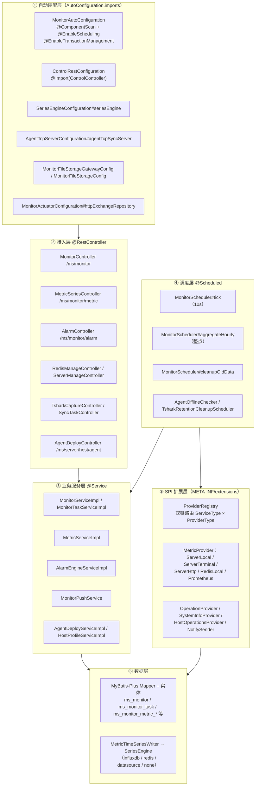
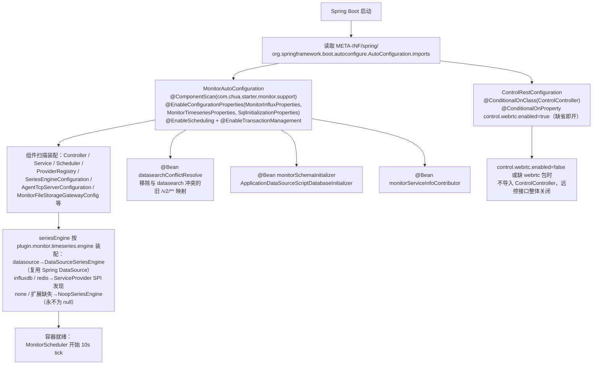
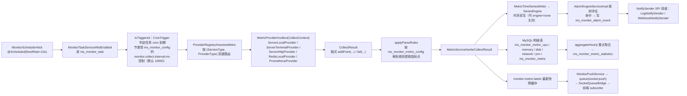

# spring-support-monitor-starter

服务器与中间件监控的一站式模块：资产台账 + 采集任务 + 指标时序 + 小时聚合 + 告警 + 运维操作 + 网络抓包 + AI 诊断。既可作为 starter 被宿主引入，也可打成可执行包（`*-exec.jar`）独立启动成监控台。

> 当前版本：`4.0.0.51` ｜ 父模块：`spring-support-parent-starter` ｜ Spring Boot `4.1.2` ｜ Java `25` ｜ 作者：CH

---

## 1. 架构图（模块在体系中的位置 + 内部分层）

### 1.1 模块在体系中的位置

```mermaid
graph TB
    subgraph HOST["宿主应用 或 监控台独立进程（server.port=8082）"]
        MON["spring-support-monitor-starter<br/>MonitorAutoConfiguration + ControlRestConfiguration"]
    end

    subgraph BASE["父级与基础层"]
        PARENT["spring-support-parent-starter 4.0.0.51<br/>Spring Boot 4.1.2 / Java 25"]
        COMMON["spring-support-common-starter<br/>ServiceInfoContributor / 通用基础设施"]
    end

    subgraph BIZ["同级业务 starter（依赖即带入，R5 评估过副作用）"]
        SERVER["spring-support-server-starter<br/>主机台账 / HostOnlineScheduler"]
        AI["spring-support-ai-starter<br/>AiChatFacadeService / ChatClient"]
        ACCOUNT["spring-support-account-starter<br/>账号资产 / AppKey / 渠道管理"]
        CTRL["spring-support-control-starter<br/>WebRTC 远控 /control + /webrtc"]
        DOCKER["spring-support-docker-starter<br/>/ms/server/docker"]
        TUNNEL["spring-support-tunnel-starter<br/>+ ngrok / cloudflared / tailscale"]
        DEVICE["spring-support-device-starter<br/>/api/device/**"]
        APM["spring-support-apm-starter<br/>+ skywalking / hotspot"]
        CDP["spring-support-cdp-starter<br/>/ms/cdp + /ws/cdp"]
        SOCKETQ["spring-support-socket-starter<br/>+ socket-io / socket-websocket / queue"]
        SYNCC["spring-support-sync-starter<br/>report 注册服务端 19380"]
        DSHUB["spring-support-datasource-hub-starter<br/>数据源中心"]
    end

    subgraph UTILS["utils 支撑层"]
        U1["utils-support-metrics / ssh /<br/>redis / prometheus"]
        U2["utils-support-influxdb / tshark / datasync"]
        U3["utils-support-zookeeper /<br/>elasticsearch / mysql / common"]
    end

    subgraph INFRA["外部设施"]
        MYSQL[("MySQL / H2<br/>report 库：ms_* 表")]
        REDIS[("Redis<br/>缓存 / 告警静默期 / 可选时序")]
        INFLUX[("InfluxDB（可选时序引擎）")]
    end

    PARENT --> MON
    COMMON --> MON
    SERVER --> MON
    AI --> MON
    ACCOUNT --> MON
    CTRL --> MON
    DOCKER --> MON
    TUNNEL --> MON
    DEVICE --> MON
    APM --> MON
    CDP --> MON
    SOCKETQ --> MON
    SYNCC --> MON
    DSHUB --> MON
    U1 --> MON
    U2 --> MON
    U3 --> MON
    MON --> MYSQL
    MON --> REDIS
    MON -.->|"plugin.monitor.timeseries.engine=influxdb 时"| INFLUX
```



### 1.2 内部分层



---

## 2. 核心流程图

### 2.1 自动装配流程



### 2.2 采集数据流（核心数据流）



> 手动触发走同一链路：`POST /ms/monitor/task/{id}/trigger` → `MonitorScheduler#triggerNow`，忽略 cron 与启用状态异步执行一次。

---

## 3. 能力清单（能力域 × 关键类 × 入口）

| 能力域 | 关键类 | 入口 |
|---|---|---|
| 自动装配 | `MonitorAutoConfiguration`（`@ComponentScan com.chua.starter.monitor.support`、`@EnableScheduling`、`@EnableTransactionManagement`） | `META-INF/spring/...AutoConfiguration.imports` |
| 远程控制装配 | `ControlRestConfiguration`（WebRTC 远程桌面 / `/control` REST、`/webrtc` 信令） | 同上 |
| 资产主数据 | `MonitorService` / `MonitorServiceImpl`（`create` / `update` / `delete` / `findById` / `listAll` / `page`） | `ms_monitor`，`/ms/monitor` |
| 采集任务 | `MonitorTaskService` / `MonitorTaskServiceImpl`、`MonitorScheduler` | `ms_monitor_task`，`/ms/monitor/task` |
| 采集 Provider 路由 | `MetricProvider` + `ProviderRegistry`（`ServiceType` × `ProviderType` 双键） | SPI `META-INF/extensions/...MetricProvider` |
| 指标时序 | `MetricService` / `MetricServiceImpl`（`writePoints` / `getLatestCpu` / `getCpuHistory` / `getMetricStatistics` / `exportMetricHistory`…） | 5 张明细表 + 通用时序 |
| 时序引擎 | `SeriesEngineConfiguration#seriesEngine`、`MetricTimeSeriesWriter` | `plugin.monitor.timeseries.engine` |
| 小时聚合 | `MonitorScheduler#aggregateHourly` → `MetricService#aggregateHourly` | `@Scheduled(cron = "0 0 * * * ?")` |
| 过期清理 | `MonitorScheduler#cleanupOldData` → `MetricService#cleanupOldData` | `monitor.cleanup.cron`（默认每小时） |
| 告警 | `AlarmController` + `AlarmEngineServiceImpl` + `NotifySender` SPI | `ms_monitor_alarm_*`，`/ms/monitor/alarm` |
| Redis 运维 | `RedisManageService`、`SystemRedisKvService` | `/ms/monitor/redis-manage`、`/ms/monitor/system/redis/kv` |
| 主机运维 | `HostOperations` + `HostOperationsProvider` SPI（Posix / Windows / Mac / Agent） | `/ms/server/host/**` |
| 网络抓包 | `TsharkCaptureController`、`TsharkCaptureService`、`TsharkRuntime` | `/ms/monitor/tshark` |
| 数据同步 | `SyncTaskService` / `SyncTaskServiceImpl`、`JdbcCsvLoader` SPI | `ms_sync_task`，`/ms/monitor/datasync` |
| Agent 部署 | `AgentDeployController`、`AgentDeployServiceImpl`、`AgentTcpServerConfiguration` | `/ms/server/host/agent`、`/ms/monitor/agent`、TCP `19390` |
| AI 诊断 | `MonitorController` 注入 `ObjectProvider<AiChatFacadeService>`（来自 `spring-support-ai-starter`） | `/ms/monitor/ai/status`、`/ai/analyze`、`/ai/host/{id}/analyze` |
| 大屏 | `MonitorController#dashboardOverview` | `/ms/monitor/dashboard/overview` |
| 端口映射 | `spring-support-tunnel-starter` 统一入口 | `/ms/tunnel`（ngrok / cloudflared / tailscale 为 SPI 实现） |
| 服务发现查询 | `ServerDiscoveryController`（`@ConditionalOnClass DiscoveryService`）/ `DiscoveryFallbackController`（`@ConditionalOnMissingClass`） | `/ms/monitor/discovery` |
| 文件资产 / 网关 | `FileAssetServiceImpl`、`MonitorFileStorageConfig`、`MonitorFileStorageGatewayConfig` | `/ms/monitor/file-assets`、`/fs/default` |
| 实时推送 | `MonitorPushService` → `SocketQueueBridge`（`monitorSocketQueueBridge`） | socket.io `29181`，前端 `subscribe("monitor", ...)` |
| 缓存 | `monitor` / `monitorTask` / `monitorConfig` / `monitorMetricConfig` / `monitorGateway` / `monitor:metric:latest` / `monitor:alarm:*` | `@Cacheable` / `@CacheEvict` |

**核心数据表（14 张，实体位于 `entity/`，DDL 见 `src/main/resources/db/init/V5.1__init_all_monitor.sql`，种子数据 `V5.0__initdata_all_monitor.sql`）**：

| # | 表名 | 用途 |
|---|---|---|
| 1 | `ms_monitor` | 资产主表（`MsMonitor`） |
| 2 | `ms_monitor_config` | 全局配置（含 `monitor.collect.interval.ms`，页面可改） |
| 3 | `ms_monitor_task` | 采集任务（`MsMonitorTask`） |
| 4 | `ms_monitor_metric_config` | 解析规则（`MsMonitorMetricConfig`） |
| 5 | `ms_monitor_gateway` | Guacamole 网关（`MsMonitorGateway`） |
| 6 | `ms_monitor_metric` | 通用时序（`MsMonitorMetric`） |
| 7 | `ms_monitor_metric_statistics` | 通用小时聚合 |
| 8 | `ms_monitor_metric_cpu` | CPU 明细（`MsMonitorMetricCpu`） |
| 9 | `ms_monitor_metric_memory` | 内存明细 |
| 10 | `ms_monitor_metric_disk` | 磁盘明细 |
| 11 | `ms_monitor_metric_network` | 网络明细 |
| 12 | `ms_monitor_metric_jvm` | JVM 明细 |
| 13 | `ms_monitor_redis_metric` | Redis 时序 |
| 14 | `ms_monitor_redis_metric_statistics` | Redis 小时聚合 |

同一批 DDL 还建了告警（`ms_monitor_alarm_policy` / `_rule` / `_event` / `_maintenance_window`）、抓包（`ms_tshark_session` / `ms_tshark_packet`）、同步任务（`ms_sync_task` / `ms_sync_task_run_log`）、维护计划（`ms_maintenance_plan`）、节点（`ms_server_node`）与操作日志（`ms_server_oper_log` / `ms_apm_oper_log`）。

**采集 Provider 矩阵**（`ProviderRegistry` 按 `(ServiceType, ProviderType)` 双键路由，索引首次解析时构建）：

| Provider | Service Type | 适用 |
|---|---|---|
| `LOCAL` | SERVER（`ServerLocalProvider`）、REDIS（`RedisLocalProvider`） | metrics-starter / OSHI 直采本机（macOS 跳过） |
| `TERMINAL` | 全部 7 种（SERVER / REDIS / MYSQL / PG / ORACLE / MSSQL / MQ） | SSH 执行自定义命令（`utils-support-ssh-starter`） |
| `HTTP` | SERVER | 拉取 actuator / exporter 接口（`ServerHttpProvider`） |
| `PROMETHEUS` | 全部 7 种 | 统一 Prometheus（`PrometheusProvider`） |

采集节奏（源码事实）：`MonitorScheduler#tick` 每 **10 秒**扫一次任务表，实际采集间隔取 `ms_monitor_config` 的 `monitor.collect.interval.ms`（缺省 `10000`），Reactor `flatMap` 并发上限 50、背压缓冲 10000；小时聚合整点执行；数据保留清理默认每小时一次（滚动窗口，避免「保留 1 天却存 2 天」）。

**缓存**（`CacheManager` 名 → 典型 key，时序明细表不缓存、直接落库）：

| Cache 名 | 典型 key | 对应数据 |
|---|---|---|
| `monitor` | `monitor:id:<id>`、`monitor:list:all` | `ms_monitor` |
| `monitorTask` | `monitor.task:id:<id>`、`monitor.task:enabled` | `ms_monitor_task` |
| `monitorMetricConfig` | `monitor.metricConfig:task:<taskId>` | `ms_monitor_metric_config` |
| `monitorConfig` | `monitor.config:key:<key>`、`monitor.config:all` | `ms_monitor_config` |
| `monitorGateway` | `monitor.gateway:monitor:<monitorId>` | `ms_monitor_gateway` |
| `monitor:metric:latest` | `cpu:` / `memory:` / `network:` / `jvm:` + monitorId | 最新快照 |
| `monitor:alarm:policies` / `monitor:alarm:rules` | `policies[:hostId]`、`rules[:policyId]` | 告警策略/规则 |

---

## 4. Bean 能力矩阵

以下均为源码中真实存在的 Bean 定义。除标注外，均由 `MonitorAutoConfiguration` 的 `@ComponentScan("com.chua.starter.monitor.support")` 或模块内 `@Configuration` 注册。

| Bean 名 | 类型 | 来源 | 装配条件 | 可否覆盖 | 典型注入姿势 |
|---|---|---|---|---|---|
| `datasearchConflictResolve` | `DatasearchConflictResolve` | `MonitorAutoConfiguration#datasearchConflictResolve` | 无条件 | 可（同类型替换需宿主处理注册冲突） | 一般无需注入，容器后处理自动生效 |
| `monitorSchemaInitializer` | `ApplicationDataSourceScriptDatabaseInitializer` | `MonitorAutoConfiguration#monitorSchemaInitializer` | 无条件（需容器存在 `DataSource`） | 可 | 一般无需注入；让 `spring.sql.init` 脚本真正执行 |
| `monitorServiceInfoContributor` | `ServiceInfoContributor` | `MonitorAutoConfiguration#monitorServiceInfoContributor` | 无条件 | 可 | 服务信息面板展示「监控 [Influx: 开/关]」 |
| `seriesEngine` | `SeriesEngine` | `SeriesEngineConfiguration#seriesEngine` | 按 `plugin.monitor.timeseries.engine`；`influxdb`/`redis` 走 SPI，需对应 starter 在 classpath | 可（覆盖即更换时序引擎） | 构造注入 `MetricTimeSeriesWriter` |
| `agentTcpSyncServer` | `SyncServer`（`TcpSyncServer`） | `AgentTcpServerConfiguration#agentTcpSyncServer` | 无条件；端口 `plugin.monitor.agent.tcp-port`（默认 19390） | 可 | Agent 长连接上报通道（`initMethod=start`） |
| `httpExchangeRepository` | `HttpExchangeRepository` | `MonitorActuatorConfiguration#httpExchangeRepository` | `@ConditionalOnClass(HttpExchangeRepository)` + `@ConditionalOnMissingBean` | 可（宿主仓库优先） | Actuator `/actuator/httpexchanges` 端点数据源 |
| `sseSocketSessionTemplate` | `SseSocketSessionTemplate` | `MonitorSseCompatibilityConfiguration#sseSocketSessionTemplate` | `@ConditionalOnClass(SseSocketSessionTemplate)` + `plugin.socket.enable=true` | 可 | 兜底空实现，供 mailbox SSE 构造注入，保启动 |
| `monitorLocalStorage` | `Object`（反射构造的 `LocalFileStorage`） | `MonitorFileStorageConfig#localFileStorage` | `@ConditionalOnClass(name="...filesystem.support.local.LocalFileStorage")` | 可 | 由 `MonitorFileStorageGatewayConfig` 以桶名 `default` 挂入网关 |
| `fileStorageTemplate` | `FileStorageTemplate` | `MonitorFileStorageGatewayConfig#fileStorageTemplate` | `@ConditionalOnClass(FileStorageServerLauncher/FileStorageTemplate)` + `@ConditionalOnMissingBean` | 可 | 文件上传/下载/协同的统一门面 |
| `fileServerConfigController` / `uploadTaskManager` / `uploadTaskController` / `fileCollabStore` / `fileCollabPersistence` / `fileCollabHub` / `fileCollabController` | 对应 filesystem-starter 类 | `MonitorFileStorageGatewayConfig` | 同上 + `@ConditionalOnMissingBean` | 可 | 补回被 exclude 的 `FileSystemAutoConfiguration` 能力 |
| `fileStorageEmbeddedFilter` | `FilterRegistrationBean<FileStorageEmbeddedFilter>` | `MonitorFileStorageGatewayConfig#fileStorageEmbeddedFilter` | `plugin.filesystem.storage-server.enable=true`（缺省开）且 `mode=embedded`（缺省） | 可 | 内置形态，挂应用端口 `{path-prefix:/*}` |
| `fileStorageServerLauncher` | `FileStorageServerLauncher` | `MonitorFileStorageGatewayConfig#fileStorageServerLauncher` | `enable=true` 且 `mode=standalone`（显式配置） | 可 | 独立端口（默认 18082）另起文件服务 |
| `hostRealtimePushBinder` | `ApplicationRunner` | `HostRealtimePushConfiguration#hostRealtimePushBinder` | 无条件；`HostOnlineScheduler` 缺失时运行期跳过 | 可 | 启动时向 server-starter 调度器注册延迟/在线/采集钩子 |
| `monitorSocketQueueBridge` | `SocketQueueBridge` | `@Component("monitorSocketQueueBridge")` | `@ConditionalOnProperty plugin.queue.enable=true`（缺省开） | 可 | 消费 `socket:push` topic 广播到 socket.io |
| `productionAuthGuard` | `ProductionAuthGuard` | `@Component` | `@ConditionalOnProperty plugin.oauth.require-auth=true` | 可 | 生产环境启动期鉴权校验 |
| `debugBeanTrace` | `DebugBeanTrace`（`BeanPostProcessor`） | `@Component` | 无条件 | 可 | Bean 装配追踪（排障用） |
| `monitorScheduler` | `MonitorScheduler` | `@Component` | 无条件 | 可 | `@Scheduled` 采集/聚合/清理入口 |
| `providerRegistry` | `ProviderRegistry` | `@Component` | 无条件 | 可 | 构造注入到调度器与控制器 |
| `alarmEngineService` | `AlarmEngineServiceImpl` | `@Service` | 无条件 | 可（实现 `AlarmEngineService` 接口） | 注入接口 `AlarmEngineService` |
| `metricService` 等业务服务 | `MetricServiceImpl` / `MonitorServiceImpl` / `MonitorTaskServiceImpl` / `MonitorConfigServiceImpl` / `MonitorMetricConfigServiceImpl` / `MonitorGatewayServiceImpl` / `RedisManageServiceImpl` / `SystemRedisKvServiceImpl` / `SyncTaskServiceImpl` / `AgentDeployServiceImpl` / `HostProfileServiceImpl` / `HostMetricHistoryServiceImpl` / `FileAssetServiceImpl` / `ServerManageServiceImpl` / `TsharkCaptureService` / `LocalSystemInfoServiceImpl` / `MaintenancePlanService` | `@Service` | 无条件 | 可（标准 Spring 覆盖规则） | 各自接口的构造注入 |

> 本模块没有 `spring.factories`，自动配置只经 `AutoConfiguration.imports` 注册（Spring Boot 4 口径）。业务服务按接口注入即可被宿主同类型 Bean 覆盖；显式 `@Bean` 方法未加 `@ConditionalOnMissingBean` 的（如 `seriesEngine`、`agentTcpSyncServer`）重复定义会触发覆盖语义，需宿主开启 `spring.main.allow-bean-definition-overriding`。

---

## 5. 完整配置（@ConfigurationProperties 全字段）

### 5.1 `plugin.monitor.influx`（`MonitorInfluxProperties`，经 `@EnableConfigurationProperties` 注册）

| 路径 | 类型 | 默认值 | 说明 | 生效开关 |
|---|---|---|---|---|
| `plugin.monitor.influx.enabled` | `boolean` | `false` | 是否启用 InfluxDB 写入/查询 | 自身即开关 |
| `plugin.monitor.influx.url` | `String` | `http://127.0.0.1:8086` | InfluxDB v1 兼容端点 | `enabled=true` |
| `plugin.monitor.influx.database` | `String` | `monitor` | 库名 | `enabled=true` |

### 5.2 `plugin.monitor.timeseries`（`MonitorTimeseriesProperties`）

| 路径 | 类型 | 默认值 | 说明 | 生效开关 |
|---|---|---|---|---|
| `plugin.monitor.timeseries.engine` | `String` | `influxdb` | 时序引擎：`influxdb` / `redis` / `datasource` / `none` | `none` 关闭时序双写 |
| `plugin.monitor.timeseries.url` | `String` | `http://127.0.0.1:8086` | 时序存储地址；`redis://` / `host:port` 形式时覆盖 `spring.data.redis.*` | 随 engine |
| `plugin.monitor.timeseries.database` | `String` | `monitor` | 库名（redis 引擎下是逻辑库下标） | 随 engine |

### 5.3 `plugin.monitor.ssh`（`MonitorSshProperties`，`@Component` 注册）

| 路径 | 类型 | 默认值 | 说明 | 生效开关 |
|---|---|---|---|---|
| `plugin.monitor.ssh.connect-timeout-seconds` | `int` | `15` | SSH 建连 + 握手超时（慢链路调大） | 始终生效 |
| `plugin.monitor.ssh.session-timeout-seconds` | `int` | `30` | SSH 认证（session.auth）超时 | 始终生效 |
| `plugin.monitor.ssh.exec-timeout-seconds` | `int` | `60` | 命令执行/读取超时 | 始终生效 |

### 5.4 `plugin.monitor.agent`（`AgentDeployProperties`，`@Component` 注册）

| 路径 | 类型 | 默认值 | 说明 | 生效开关 |
|---|---|---|---|---|
| `plugin.monitor.agent.jar-path` | `String` | 空（`null`） | agent.jar 路径；为空按候选路径探测，全落空则明确报错终止部署 | 部署时 |
| `plugin.monitor.agent.jar-url` | `String` | `""` | 平台包下载地址；非空时目标机自行 HTTP 拉取（WinRM 有单命令长度上限，大文件必须走这条） | 部署时 |
| `plugin.monitor.agent.linux-service-name` | `String` | `monitor-agent` | Linux systemd 服务名 | 部署时 |
| `plugin.monitor.agent.windows-service-name` | `String` | `MonitorAgent` | Windows nssm 服务名 | 部署时 |
| `plugin.monitor.agent.remote-dir-name` | `String` | `monitor-agent` | 远端安装目录名 | 部署时 |
| `plugin.monitor.agent.port` | `int` | `19876`（`DEFAULT_PORT`） | agent 默认 HTTP 端口 | 部署时 |
| `plugin.monitor.agent.token` | `String` | `""` | 写入远端 agent.yml 的接口令牌；空表示不启用 /exec 令牌校验 | 部署时 |
| `plugin.monitor.agent.health-wait-seconds` | `int` | `30` | 启动后等待 /health 就绪秒数 | 部署时 |
| `plugin.monitor.agent.request-timeout-seconds` | `int` | `8` | 单次 agent HTTP 请求超时（秒） | 部署时 |
| `plugin.monitor.agent.java-command` | `String` | `""` | 远端 java 可执行文件；空则自动探测（command -v java / where java） | 部署时 |
| `plugin.monitor.agent.report-url` | `String` | `""` | 平台回写地址（写入 agent.yml 预留） | 部署时 |
| `plugin.monitor.agent.apm-jar-url` | `String` | `""` | APM RuntimeAgent jar 下载地址 | APM 注入时 |
| `plugin.monitor.agent.apm-jar-path` | `String` | `""` | 本地 APM RuntimeAgent jar 路径（优先于探测） | APM 注入时 |
| `plugin.monitor.agent.apm-remote-name` | `String` | `apm-agent.jar` | 远端存放的 APM jar 文件名 | APM 注入时 |
| `plugin.monitor.agent.apm-options` | `String` | `port=4567` | 注入的 javaagent options（不含 `-javaagent:jar=` 前缀） | APM 注入时 |
| `plugin.monitor.agent.apm-linux-profile` | `String` | `/etc/profile.d/apm-javaagent.sh` | APM 注入状态探针文件（Linux profile.d） | APM 注入时 |
| `plugin.monitor.agent.apm-windows-env-name` | `String` | `JAVA_TOOL_OPTIONS` | APM 注入状态探针（Windows 用户环境变量） | APM 注入时 |
| `plugin.monitor.agent.tcp-port` | `int` | `19390` | Agent TCP 长连接上报端口（`@Value` 注入 `AgentTcpServerConfiguration`） | 始终生效 |

### 5.5 `plugin.monitor.tshark`（`TsharkInstallProperties`，`@Component` 注册）

| 路径 | 类型 | 默认值 | 说明 | 生效开关 |
|---|---|---|---|---|
| `plugin.monitor.tshark.bin` | `String` | `""` | tshark 可执行文件；为空按「环境变量 `TSHARK_BIN` → 本项 → 自动安装目录 → 系统路径 → PATH」探测 | 始终生效 |
| `plugin.monitor.tshark.auto-install` | `boolean` | `true` | 探测不到时是否下载便携包（不装 Npcap 驱动） | 自身即开关 |
| `plugin.monitor.tshark.install-dir` | `String` | `""`（回退 `~/spring-support/tshark`） | 便携版解压目录 | auto-install=true |
| `plugin.monitor.tshark.package-url` | `String` | `""` | 便携包下载地址（zip） | auto-install=true |
| `plugin.monitor.tshark.package-url-windows` | `String` | `""` | Windows 专用包地址，优先于 `package-url` | auto-install=true |
| `plugin.monitor.tshark.package-url-linux` | `String` | `""` | Linux 专用包地址（tar.gz / tar.xz / deb），优先于 `package-url` | auto-install=true |
| `plugin.monitor.tshark.package-path` | `String` | `""` | 本地便携包路径（离线部署），优先于 `package-url` | auto-install=true |
| `plugin.monitor.tshark.package-path-windows` | `String` | `""` | Windows 专用本地包路径 | auto-install=true |
| `plugin.monitor.tshark.package-path-linux` | `String` | `""` | Linux 专用本地包路径 | auto-install=true |
| `plugin.monitor.tshark.timeout-seconds` | `int` | `600` | 下载 + 解压 + 自检总超时（秒） | auto-install=true |
| `plugin.monitor.tshark.tls-keylog-file` | `String` | `""` | TLS 会话密钥日志（NSS keylog），配置后带 `-o tls.keylog_file:` 解密 | 抓包解析时 |
| `plugin.monitor.tshark.json-restore` | `boolean` | `true` | 解析 pcap 时是否再跑 `tshark -T json -x` 回填 `rawData` / `restoredText`（协议还原） | 自身即开关 |

### 5.6 `plugin.monitor.tshark.retention`（`TsharkRetentionProperties`，`@Component` 注册）

| 路径 | 类型 | 默认值 | 说明 | 生效开关 |
|---|---|---|---|---|
| `plugin.monitor.tshark.retention.days` | `int` | `7` | 抓包文件保留天数上限 | `enabled=true` |
| `plugin.monitor.tshark.retention.size-mb` | `int` | `512` | 抓包目录空间上限（MB），任一规则满足即清理 | `enabled=true` |
| `plugin.monitor.tshark.retention.enabled` | `boolean` | `true` | 是否自动清理（关闭时只统计不删） | 自身即开关 |

### 5.7 其它键值（`@Value` / 占位符 / 运行时表）

| 路径 | 类型 | 默认值 | 说明 | 生效开关 |
|---|---|---|---|---|
| `monitor.file-storage.local-path` | `String` | `${user.dir}/.data/filesystem-local` | 文件资产管理落地目录（`MonitorFileStorageConfig` 的 `@Value`，同步注入 `filesystem.temp.path`） | 始终生效 |
| `monitor.cleanup.cron` | `String` | `0 0 * * * ?` | 指标保留清理调度（`@Scheduled(cron="${monitor.cleanup.cron:0 0 * * * ?}")`） | 始终生效 |
| `monitor.collect.interval.ms` | `long` | `10000` | **运行时配置，存 `ms_monitor_config` 表**（页面可改），`MonitorScheduler#tick` 读取；不在 YAML | 始终生效 |
| `monitor.data.retention.days` | `int` | `30` | **运行时配置，存 `ms_monitor_config` 表**，指标保留天数 | 始终生效 |
| `spring.sql.init.*` | — | — | `SqlInitializationProperties` 随 `MonitorAutoConfiguration` 启用，喂给 `monitorSchemaInitializer`；本模块自带 `application.yml` 里 `spring.sql.init.mode: never`（建表统一走 `plugin.datasource.script` 的 FlywayLike 机制） | `spring.sql.init.mode` |

> 文件存储网关还会启用 filesystem-starter 的 `FileStorageProperties` / `FileStorageServerProperties`（`@EnableConfigurationProperties`，前缀 `plugin.filesystem.*`），字段定义属该模块，此处不重复罗列。

---

## 6. 使用方式（Maven 坐标 + 最小可运行示例 + 可选依赖）

### 6.1 Maven 坐标

```xml
<dependency>
    <groupId>com.chua</groupId>
    <artifactId>spring-support-monitor-starter</artifactId>
    <version>4.0.0.51</version>
</dependency>
```

打包说明：本模块既当库也当应用。默认 `spring-boot.repackage.skip=false` 产出 `*-exec.jar`（带 `exec` 分类符，**不替换主构件**），薄 jar 保持标准结构；`repackage` 后由 `maven-antrun-plugin` 把 `META-INF/spring` 与 `META-INF/extensions` 复制到 `BOOT-INF/classes`，否则 `java -jar` 启动时自动配置不生效。编译目标 Java 25。

### 6.2 最小可运行示例

**第一步**：引入依赖并准备数据库。核心表由 `src/main/resources/db/init/V5.1__init_all_monitor.sql` 建（种子在 `V5.0__initdata_all_monitor.sql`）。

**第二步**：配置数据源与（可选的）时序引擎：

```yaml
spring:
  datasource:
    url: jdbc:mysql://127.0.0.1:3306/monitor?useUnicode=true&characterEncoding=utf8
    username: root
    password: root
plugin:
  monitor:
    influx:
      enabled: false          # 不接 InfluxDB 时用 datasource 引擎
    timeseries:
      engine: datasource      # 写 MySQL 明细表（也支持 redis / influxdb / none）
```

**第三步**：启动后先建资产（`POST /ms/monitor`），再建采集任务（`POST /ms/monitor/task`），最后手动触发一次（`POST /ms/monitor/task/{id}/trigger`）验证 `points > 0`：

```bash
# 1. 建资产（SERVER 类型）
curl -s -X POST http://localhost:8080/ms/monitor \
  -H 'Content-Type: application/json' \
  -d '{"monitorName":"本机","serviceType":"SERVER","monitorHost":"127.0.0.1","monitorPort":8080,"monitorEnabled":1}'

# 2. 建采集任务（provider 取值 LOCAL/TERMINAL/HTTP/PROMETHEUS；每个任务自带 cron）
curl -s -X POST http://localhost:8080/ms/monitor/task \
  -H 'Content-Type: application/json' \
  -d '{"monitorId":1,"monitorTaskName":"本机采集","serviceType":"SERVER","provider":"LOCAL","monitorTaskEnabled":1,"monitorTaskCron":"0 */1 * * * ?"}'

# 3. 手动触发一次采集（忽略 cron 与启用状态，异步执行）
curl -s -X POST http://localhost:8080/ms/monitor/task/1/trigger

# 4. 读最新指标与历史（历史接口用 hours 表示「最近 N 小时」）
curl -s http://localhost:8080/ms/monitor/metric/cpu/1
curl -s "http://localhost:8080/ms/monitor/metric/cpu/history/1?hours=24"
curl -s http://localhost:8080/ms/monitor/dashboard/overview
```

**服务端直接调用**（服务层返回统一的 `ReturnResult<T>`，按步骤调用）：

```java
@Service
@RequiredArgsConstructor
public class ReportService {

    private final MonitorService monitorService;
    private final MetricService metricService;

    public MsMonitor asset(Long id) {
        return monitorService.findById(id).getData();
    }

    public List<MsMonitorMetricCpu> cpuTrend(Long monitorId, LocalDateTime from, LocalDateTime to) {
        return metricService.getCpuHistory(monitorId, from, to).getData();
    }

    /** 手工补一次小时聚合（正常情况下由调度器整点执行） */
    public void aggregateNow() {
        metricService.aggregateHourly();
    }
}
```

### 6.3 依赖与可选依赖说明

| 依赖 | 作用 | 是否可选 |
|---|---|---|
| `spring-support-common-starter` | `ServiceInfoContributor`、通用基础设施 | 必选 |
| `spring-support-server-starter` | 服务器台账（资产联动 `server-hosts` 查询、`HostOnlineScheduler`） | 必选 |
| `spring-support-datasource-starter` / `spring-support-mybatis-starter` | JDBC + MyBatis-Plus | 必选 |
| `spring-support-cache-starter` | 多级缓存（`monitor*` 缓存名按需创建） | 必选 |
| `spring-support-swagger-starter` | OpenAPI 3 + knife4j | 必选 |
| `spring-support-ai-starter` | `ChatClient` / `AiChatFacadeService`（AI 诊断）；缺 AI 配置时接口报「未配置」而非启动失败 | 必选（能力可降级） |
| `spring-support-job-starter` | 定时发布 / Git 轮询所需调度 | 必选 |
| `spring-support-tunnel-starter` + `-ngrok` + `-cloudflared` + `-tailscale` | 端口映射编排与三种 SPI 实现（编排层必须显式声明，不能靠传递依赖） | 必选 |
| `spring-support-docker-starter` | 容器 / 镜像 / 网络 / 卷（`/ms/server/docker`） | 必选 |
| `spring-support-control-starter` + `utils-support-webrtc-starter` | WebRTC 远程控制；webrtc 原生包在 control-starter 中是 optional、不传递，本模块已显式引入，宿主经 monitor 传递即可 | 必选 |
| `spring-support-cdp-starter` | CDP 调试中心（`/ms/cdp` + `/ws/cdp`） | 必选 |
| `spring-support-device-starter` | `/api/device/**` 的唯一实现方 | 必选 |
| `spring-support-apm-starter` + `-skywalking` + `-hotspot` | APM 观测 `/api/apm/v1`（两个引擎必须同时引入） | 必选 |
| `spring-support-sync-starter` | 接收 `sync/client/register`、`monitor/app/report`（TCP 端口默认 19380） | 必选 |
| `spring-support-account-starter` | 账号资产 / AppKey / 渠道管理 | 必选 |
| `spring-support-queue-starter` + `spring-support-socket-starter` + `-socket-io` + `-socket-websocket` | 采集结果推送（push → queue → bridge → 前端） | 必选 |
| `spring-support-filesystem-starter` | 文件服务器 `ServerFilter` 与本地存储后端（反射解耦，类缺失时相关配置自动失效） | 必选（能力可降级） |
| `spring-support-discovery-starter` | `optional=true`：只为 `/ms/monitor/discovery` 供数；缺失时降级为 `DiscoveryFallbackController` 的「未启用发现服务」 | **可选** |
| `utils-support-metrics-starter` / `-ssh-starter` / `-redis-starter` / `-prometheus-starter` | 本地 OS 指标、SSH 终端、Lettuce、Prometheus | 必选 |
| `utils-support-influxdb-starter` / `-tshark-starter` / `-datasync-starter` | 时序引擎、抓包、数据同步引擎 | 必选 |
| `utils-support-zookeeper-starter` / `-elasticsearch-starter` / `-mysql-starter` | 中间件管理页与数据源中心 SPI | 必选 |
| `oshi-core` + `jna` / `jna-platform`（钉到 `5.19.1`） | 本地硬件信息；JNA 过旧会导致 OSHI 静默降级 | 必选 |
| `spring-api-support-common-system-starter` / `spring-api-support-monitor-starter` | pages/system 接口与 ACME 证书管理 | 必选 |

---

## 7. 使用场景（适用 / 不适用 / 与相邻模块的取舍）

**适用**：

- 需要一个「资产台账 + 定时采集 + 时序存储 + 告警 + 运维操作」一体化的监控台，且希望尽量少接外部组件（MySQL 即可跑通，InfluxDB/Redis 可选）。
- 需要采集异构目标：本机（OSHI）、SSH 终端、HTTP exporter、Prometheus，以及 Redis / MySQL / PostgreSQL / Oracle / SQL Server / MQ 七类服务。
- 需要附带能力：WebRTC 远控、端口映射、网络抓包、Agent 部署、数据同步、AI 诊断、文件资产。

**不适用 / 慎用**：

- 只想要轻量指标埋点：本模块偏「平台型」，依赖面大（20+ starter），埋点场景请用 APM / Micrometer。
- `LOCAL` 采集只在服务器本机可用（走 metrics-starter / OSHI），非 SERVER 类型不适用，且 macOS 跳过。
- `TERMINAL` / `HTTP` / `PROMETHEUS` 依赖外部环境（SSH 账号可达、exporter 已暴露、Prometheus 可达）；失败表现为 `CollectResult.fail(...)`（日志有 `reason=`），不是异常。
- 告警通知内置只有日志与 Webhook 两种 `NotifySender`；短信通道来自 `utils-support-alibaba-starter` / `-tencentcloud-starter` / `-baidu-starter`，不引则明确报「未安装短信通道」。
- 抓包默认只补 tshark 便携版；实时抓包还需要抓包驱动（Windows: Npcap / Linux: libpcap），框架不会静默装驱动。

**与相邻模块的取舍**：

- **vs `spring-support-apm-*`**：APM 面向「接入该体系的应用」的调用链/指标（`/api/apm/v1`）；monitor 面向「主机与中间件」的资产化运维。发布管理的链路追踪会回退读目标项目 Actuator 的 `httpexchanges`（本模块补了 `httpExchangeRepository`）。
- **vs `spring-support-server-starter`**：server 管主机台账与探活调度；monitor 消费其 `HostOnlineScheduler` 钩子做实时推送与告警评估（`HostPushBridgeConfiguration` / `HostRealtimePushConfiguration`），并提供 `HostCollectProvider` / `HostDetectProvider` / `HostAgentHistoryWriter` 三个 SPI 的实现。
- **vs `spring-support-ai-starter`**：monitor 是 AI 能力的消费方（智能分析），不是提供方。
- **vs `spring-support-datasearch-starter`**：宿主同时装有旧版 `/v2/holiday/get`、`/v2/ip/lookup` 控制器与 datasearch 新控制器时，`DatasearchConflictResolve` 会在注册中心级别移走旧的，避免 `Ambiguous handler methods mapped`。

---

## 8. 扩展点（本模块暴露的 SPI 与自定义方法）

本模块的扩展点都在 `META-INF/extensions/` 下，登记格式为「实现类全限定名，一行一个」（`JdbcCsvLoader` 为 `键=类名` 格式）。运行时由 `ServiceProvider.of(Xxx.class)` 发现，`ProviderRegistry` / `AlarmEngineServiceImpl` 首次解析时建索引（延迟构建，避免容器就绪前拿到半初始化实例）。

| 扩展点接口 | 注册文件 | 已内置实现 | 用途 |
|---|---|---|---|
| `com.chua.starter.monitor.support.spi.MetricProvider` | `...spi.MetricProvider` | `ServerLocalProvider`、`ServerTerminalProvider`、`ServerHttpProvider`、`RedisLocalProvider`、`PrometheusProvider` | 新增采集方式 / 服务类型 |
| `com.chua.starter.monitor.support.spi.OperationProvider` | `...spi.OperationProvider` | `RedisOperationProvider` | 中间件运维操作（键值/慢查询/进程等） |
| `com.chua.starter.monitor.support.spi.SystemInfoProvider` | `...spi.SystemInfoProvider` | `LocalOshiProvider`、`AgentProvider`、`SshProvider`、`WindowsWinrmProvider` | 系统信息分区采集 |
| `com.chua.starter.monitor.support.spi.HostOperationsProvider` | `...spi.HostOperationsProvider` | `PosixHostOperationsProvider`、`WindowsHostOperationsProvider`、`MacHostOperationsProvider` | 主机运维动作（文件/网络/进程/服务） |
| `com.chua.starter.monitor.support.service.alarm.NotifySender` | `...service.alarm.NotifySender` | `LogNotifySender`、`WebhookNotifySender` | 告警通知渠道 |
| `com.chua.starter.monitor.support.nginx.spi.NginxExecutor` | `...nginx.spi.NginxExecutor` | `SshNginxExecutor`、`LocalNginxExecutor` | Nginx 配置执行通道 |
| `com.chua.starter.monitor.support.nginx.spi.NginxCommandProvider` | `...nginx.spi.NginxCommandProvider` | `PosixNginxCommandProvider`、`WindowsNginxCommandProvider` | Nginx 管理命令集 |
| `com.chua.starter.monitor.support.datasync.loader.JdbcCsvLoader` | `...datasync.loader.JdbcCsvLoader`（键值格式） | `mysql=MysqlCsvLoader`、`postgresql=PostgresqlCsvLoader` | CSV / 批量导入方言 |

此外，本模块还实现了 server-starter 的三个 SPI（对 monitor 而言是「向外提供的实现」）：`HostCollectProvider`（`LocalHostCollectProvider`）、`HostDetectProvider`（`AgentHostDetectProvider`）、`HostAgentHistoryWriter`（`AgentHostHistoryWriter`）。

**自定义示例**（以「按 HTTP exporter 文本采集 MQ 指标」为例，关键是两个键方法）：

```java
public class MyMqHttpProvider implements MetricProvider {

    @Override
    public ProviderType providerType() {
        return ProviderType.HTTP;
    }

    @Override
    public Set<ServiceType> supportServiceTypes() {
        return Set.of(ServiceType.MQ);
    }

    @Override
    public Mono<CollectResult> collect(CollectContext context) {
        // context.getTask() 提供任务配置；失败时用 fail("原因") 而不是抛异常，
        // 否则调度器只会记一条「采集异常」，页面上看不出原因。
        CollectResult result = new CollectResult();
        result.setTask(context.getTask());
        result.addPoint(MetricPoint.builder().metricName("mq.queue.depth").value(12d).unit("条").build())
                .addPoint(MetricPoint.builder().metricName("mq.consumer.lag").value(0d).unit("条").build());
        return Mono.just(result);
    }
}
```

> `CollectResult#addPoint` / `#fail` 返回 `this`，可链式串接（`setTask` 是 Lombok 生成的 `void` setter，不能串）；`MetricPoint` 是 `@Builder`。`points` 为空或 `success=false` 时调度器会打印 `reason=`，表现为「成功但没取到指标」。

**登记**：在自有 jar 下新建 `META-INF/extensions/com.chua.starter.monitor.support.spi.MetricProvider`，追加一行实现类名：

```text
com.example.monitor.MyMqHttpProvider
```

**生效**：`ProviderRegistry` 首次解析时用 `ServiceProvider.of(MetricProvider.class)` 收集全部实现并建双键索引。之后新建任务时 `serviceType=MQ` + `provider=HTTP` 即可路由到该实现，无需改本模块代码。

---

## 9. 常见问题（装配不生效 / 端口与开关 / Boot 4 兼容性）

### 9.1 装配不生效

1. **`java -jar` 启动后自动配置没生效**：`*-exec.jar` 必须经 antrun 把 `META-INF/spring` 与 `META-INF/extensions` 复制到 `BOOT-INF/classes`（构建时默认执行）；薄 jar 没有 `BOOT-INF/classes` 结构，不要直接 `java -jar`。
2. **全新库启动后一张表都没有**：框架会注册多个 `DataSource`，Spring Boot 的 `DataSourceInitializationAutoConfiguration` 因 `@ConditionalOnSingleCandidate(DataSource)` 静默退避，`spring.sql.init.schema-locations` 从未执行。本模块已显式装配 `monitorSchemaInitializer`；若宿主走 `spring.sql.init`，请确认 `spring.sql.init.mode` 与 schema-locations 配置。本模块自带 `application.yml` 则统一走 `plugin.datasource.script`（FlywayLike，扫 `classpath*:db/init/*.sql`，按「脚本名+版本」记账只跑一次）。
3. **`@Scheduled` 定时任务不跑**：确认宿主开启了调度（本模块 `MonitorAutoConfiguration` 已带 `@EnableScheduling`）；另注意多级缓存必须可用——`@Cacheable` 的缓存名（如 `monitorTask`）由 cache-starter 的多级缓存管理器按需创建，若该管理器被覆盖成 `setDynamic=false` 的 CaffeineCacheManager，每次调用会抛 `Cannot find cache named 'monitorTask'`。
4. **建表不会自动补列**：`V5.1__init_all_monitor.sql` 面向新库一次建全；存量库缺列请按第 3 节表结构手工补列，或依赖 `plugin.datasource.script` 的版本递进补列机制。
5. **同名 Bean 冲突**：模块自带 `application.yml` 开了 `spring.main.allow-bean-definition-overriding: true` 并显式 `spring.autoconfigure.exclude` 了 filesystem 的 `FileSystemAutoConfiguration`、redis-starter 的 `RedisConfiguration`、crypto 的 `CryptoAutoConfiguration`；宿主引入时注意这些示例配置不要覆盖自己的配置。

### 9.2 端口与开关

| 项 | 默认 | 开关 |
|---|---|---|
| 应用端口（独立启动） | `8082` | `server.port` |
| socket.io 推送 | `29181` | `plugin.socket.enable`（true） |
| Agent TCP 上报 | `19390` | `plugin.monitor.agent.tcp-port` |
| report 注册服务端 | `19380`（`MONITOR_SYNC_PORT` 可覆盖） | `plugin.sync.server.enable` |
| CDP Chromium / 反向代理 | `9222` / `9223` | `spring.cdp.enabled` |
| 文件服务独立端口 | `18082` | `plugin.filesystem.storage-server.mode=standalone` 时启用；默认 `embedded` 不占端口 |
| 远控 WebRTC | 随应用端口 | `control.webrtc.enabled`（缺省 true；关掉则 `/control`、`/webrtc` 整体不装配） |
| InfluxDB 双写 | 关 | `plugin.monitor.influx.enabled` + `plugin.monitor.timeseries.engine` |
| 端口映射 | 不自启 | `plugin.tunnel.*.auto-start=false`，由页面按需启停，避免监控进程一启动就暴露公网端口 |

### 9.3 与 Spring Boot 4 兼容性

1. **自动配置注册**：本模块只提供 `META-INF/spring/org.springframework.boot.autoconfigure.AutoConfiguration.imports`（`MonitorAutoConfiguration` + `ControlRestConfiguration`），没有也不需要 `spring.factories`。
2. **Actuator 模块拆分**：Boot 4.1 把 health / micrometer-metrics / micrometer-observation 拆成独立模块。缺这些模块时 `HealthEndpoint` 不注册，`/actuator/health`、`/actuator/metrics` 会落到静态资源处理器（报 `No static resource actuator/health`）。本模块已显式引入 `spring-boot-starter-actuator` 完整模块。
3. **Spring Framework 7 严格依赖校验**：socketio 单协议模式下 `SseSocketSessionTemplate` 无容器 Bean，严格校验会让构造注入它的服务启动失败；`MonitorSseCompatibilityConfiguration` 在 `plugin.socket.enable=true` 时补一个空实现兜底。
4. **MyBatis-Plus / Druid**：仓库按 Boot 4 使用 `mybatis-plus-spring-boot4-starter` 与 `druid-spring-boot-4-starter`，不要混用 boot3 版 starter。
5. **Bean 覆盖语义**：Boot 4 默认禁止 Bean 覆盖；需要替换本模块 Bean（见第 4 节「可否覆盖」）时，宿主要么用 `@ConditionalOnMissingBean` 语义的优先装配，要么显式开启 `spring.main.allow-bean-definition-overriding=true`。

---

- 父模块：`spring-support-parent-starter`
- 更多接口清单：见 [`任务计划.md`](./任务计划.md) 末节；历史架构图：见 [`架构图.md`](./架构图.md)
- 作者：CH
