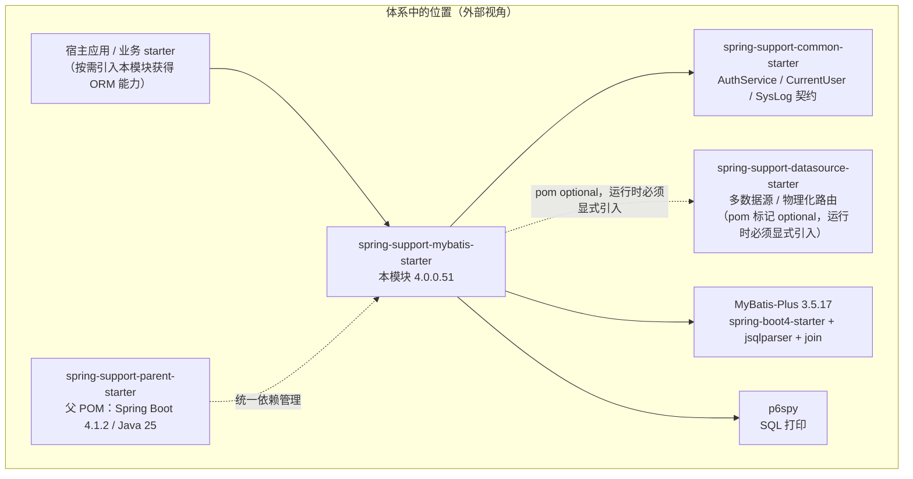
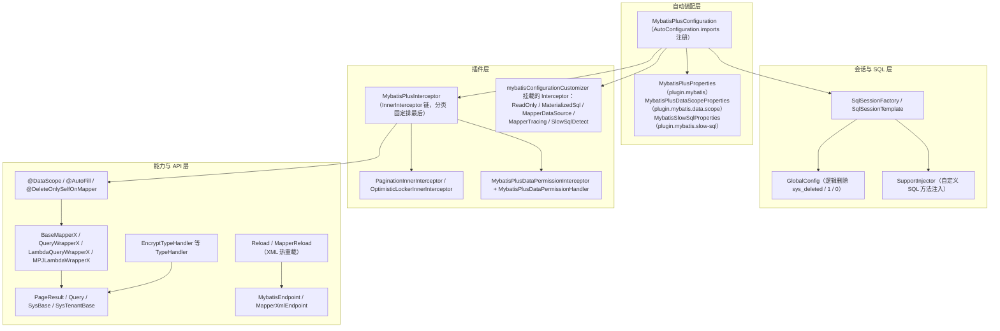
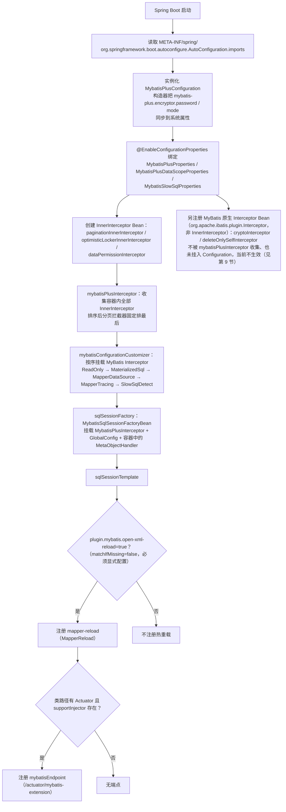
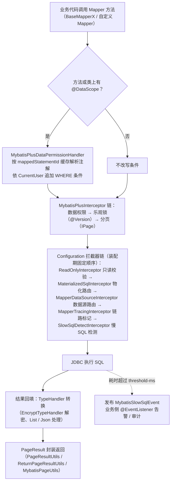

# spring-support-mybatis-starter

MyBatis-Plus 增强装配模块：分页 / 乐观锁 / 逻辑删除、`@DataScope` 数据权限、只读模式、慢 SQL 事件、XML 热重载、字段加解密与自定义 SQL 注入。本文档基于源码（模块版本 4.0.0.51）整理。

## 1. 架构图

### 1.1 模块在体系中的位置



### 1.2 模块内部分层



## 2. 核心流程图

### 2.1 自动装配流程（启动期）



### 2.2 请求处理 / 数据流（运行期，示意）



## 3. 能力清单

| 能力域 | 关键类 | 入口 |
|---|---|---|
| MyBatis-Plus 装配 | `MybatisPlusConfiguration`（`SqlSessionFactory`、`SqlSessionTemplate`、`GlobalConfig`） | 自动配置（`AutoConfiguration.imports`） |
| 分页 | `PaginationInnerInterceptor` | 自动注册，`IPage` / `PageResult` 返回 |
| 乐观锁 | `OptimisticLockerInnerInterceptor` | 实体字段 `@Version` |
| 逻辑删除 | `GlobalConfig`（固定 `sys_deleted` / `1` / `0`） | `@TableLogic` |
| 自动填充 | 容器中的 `MetaObjectHandler` | `@TableField(fill = ...)`、`@AutoFill` |
| 数据权限 | `@DataScope`、`MybatisPlusDataPermissionInterceptor`、`MybatisPlusDataPermissionHandler` | `plugin.mybatis.data.scope.enable=true` + `AuthService` |
| 只读模式 | `ReadOnlyInterceptor`、`ReadOnlyException` | `plugin.mybatis.read-only=true` |
| 删除保护 | `DeleteOnlySelfInterceptor`、`@DeleteOnlySelfOnMapper` | Bean 已注册但未挂入拦截链，当前不生效（见第 9 节） |
| 字段加解密 | `EncryptTypeHandler`、`CryptoInterceptor` | `@TableField(typeHandler = EncryptTypeHandler.class)` + `mybatis-plus.encryptor.*` |
| 慢 SQL 检测 | `SlowSqlDetectInterceptor`、`MybatisSlowSqlEvent`、`MybatisSlowSqlProperties` | `plugin.mybatis.slow-sql.*`（默认开启） |
| SQL 监控 | `MybatisP6SpyLogger`（p6spy `MessageFormattingStrategy`） | p6spy 配置 `modulelist` / `logMessageFormat` |
| 多数据源路由 | `MapperDataSourceInterceptor` | 与 `spring-support-datasource-starter` 协作 |
| SQL 物理化 | `MaterializedSqlInterceptor` | `plugin.datasource.materialized.enabled=true`（datasource-starter） |
| XML 热重载 | `Reload`、`MapperReload`、`MybatisEndpoint`、`MapperXmlEndpoint` | `plugin.mybatis.open-xml-reload=true` |
| 自定义 SQL 注入 | `SupportInjector`、`SqlMethodProperties`、`FindAllSqlMethod`、`DynamicSqlMethod` | `plugin.mybatis.sql-method[...]` |
| 关联查询 | `BaseMapperX`、`MPJLambdaWrapperX`、`mybatis-plus-join` | 代码调用 |
| 查询构造 | `QueryWrapperX`、`LambdaQueryWrapperX` | 代码调用 |
| 类型处理器 | `IntegerListTypeHandler`、`LongListTypeHandler`、`StringListTypeHandler`、`JsonLongSetTypeHandler`、`EncryptTypeHandler` | 实体字段 `@TableField(typeHandler=...)` |
| 分页结果转换 | `PageResult`、`PageResultUtils`、`ReturnPageResultUtils`、`MybatisPageUtils`、`MybatisUtils` | 代码调用 |
| 操作日志切面 | `SysLoggerPointcutAdvisor` | `@SysLog`（事件 `SysLoggerInfo` 由日志服务落库） |
| 服务信息暴露 | `MybatisPlusConfiguration#mybatisPlusServiceInfoContributor` | `ServiceInfoRegistry` 注册 mybatis / read-only / data-scope 标志 |
| Actuator 端点 | `MybatisEndpoint`（`mybatis-extension`）、`MapperXmlEndpoint`（`mybatis-xml`，自动配置未注册，需自行声明 Bean） | 需 Actuator + `mapper-reload` |

## 4. Bean 能力矩阵

以下 Bean 全部来自 `MybatisPlusConfiguration`（`AutoConfiguration.imports` 唯一注册类，本模块无 `spring.factories`）。除特别说明外，Bean 名即方法名。

| Bean 名 | 类型 | 装配条件 | 可否覆盖 | 典型注入姿势 |
|---|---|---|---|---|
| `sqlSessionFactory` | `SqlSessionFactory` | `@ConditionalOnMissingBean` | 可；覆盖后本模块的全局配置、拦截器、`SupportInjector` 均不再装配 | 宿主一般不注入，交给 Mapper 体系 |
| `sqlSessionTemplate` | `SqlSessionTemplate` | `@ConditionalOnMissingBean` | 可 | DAO / Mapper 底层使用 |
| `globalConfig` | `GlobalConfig` | 无条件创建 | 不可直接覆盖：无 `@ConditionalOnMissingBean`，同名覆盖默认抛 `BeanDefinitionOverrideException`；异名同类型 Bean 不会替换本 Bean，需 `@Primary` 异名 Bean 才能接管注入点 | 注入后调整 `DbConfig` / `MetaObjectHandler` |
| `mybatisPlusInterceptor` | `MybatisPlusInterceptor` | `@ConditionalOnMissingBean` | 可 | 一般不直接注入；收集全部 `InnerInterceptor` Bean，分页排最后 |
| `paginationInnerInterceptor` | `PaginationInnerInterceptor` | `@ConditionalOnMissingBean` | 可（自定义分页参数） | 作为 `InnerInterceptor` 被收集 |
| `optimisticLockerInnerInterceptor` | `OptimisticLockerInnerInterceptor` | `@ConditionalOnMissingBean` | 可 | 作为 `InnerInterceptor` 被收集 |
| `dataPermissionInterceptor` | `DataPermissionInterceptor`（实际 `MybatisPlusDataPermissionInterceptor`） | `@ConditionalOnMissingBean` | 可 | 作为 `InnerInterceptor` 被收集；处理器参数可被同名 Bean 替换 |
| `cryptoInterceptor` | `CryptoInterceptor` | `@ConditionalOnMissingBean` | 可 | ⚠️ 仅注册为 Bean，未挂入 `Configuration`，实际不拦截 |
| `deleteOnlySelfInterceptor` | `DeleteOnlySelfInterceptor` | `@ConditionalOnMissingBean` | 可 | ⚠️ 仅注册为 Bean，未挂入 `Configuration`，实际不拦截 |
| `mybatisConfigurationCustomizer` | `ConfigurationCustomizer` | `@ConditionalOnMissingBean` | 可 | 由 MyBatis-Plus 自动配置消费，挂载 MyBatis 原生 `Interceptor` |
| `slowSqlDetectInterceptor` | `SlowSqlDetectInterceptor` | `@ConditionalOnProperty(prefix="plugin.mybatis.slow-sql", name="enabled", havingValue="true", matchIfMissing=true)` | 可 | 由 customizer 挂入 `Configuration` |
| `mapper-reload` | `MapperReload`（实现 `Reload` 接口） | `@ConditionalOnMissingBean` + `@ConditionalOnProperty(prefix="plugin.mybatis", name="open-xml-reload", havingValue="true", matchIfMissing=false)` | 可（声明名为 `mapper-reload` 的 `Reload` Bean） | 被两个端点消费 |
| `supportInjector` | `SupportInjector`（继承 `DefaultSqlInjector`） | `@ConditionalOnMissingBean(name="supportInjector")` | 可（同名或类型覆盖） | 参与 Mapper 方法注入 |
| `mybatisEndpoint` | `MybatisEndpoint` | `@ConditionalOnMissingBean` + `@ConditionalOnBean(name={"mapper-reload","supportInjector"})` | 可 | Actuator 暴露 `/actuator/mybatis-extension` |
| `mybatisPlusServiceInfoContributor` | `ServiceInfoContributor` | 无条件创建 | 不可直接覆盖：无 `@ConditionalOnMissingBean`，同名覆盖默认抛 `BeanDefinitionOverrideException`；`ServiceInfoContributor` 由 `getBeansOfType` 全量收集，异名 Bean 只会并存、无法替换本 Bean | 服务信息面板展示 mybatis / read-only / data-scope |
| `sysLoggerPointcutAdvisor` | `SysLoggerPointcutAdvisor` | `@ConditionalOnMissingBean` | 可 | AOP 拦截 `@SysLog` 方法 |

可选注入协作者（非本模块 Bean，但被本模块消费）：

| 类型 | 来源 | 说明 |
|---|---|---|
| `MybatisPlusDataPermissionHandler` | 宿主声明即替换默认实现 | 数据权限处理器（`MultiDataPermissionHandler`） |
| `MetaObjectHandler` | 宿主声明 | 公共字段自动填充，装配进 `GlobalConfig`（容器内取第一个） |
| `InnerInterceptor` | 宿主声明任意多个 | 全部收集进 `MybatisPlusInterceptor` |
| `AuthService`（Bean 名 `authService` 或 `defaultAuthService`） | common-starter 契约 | 数据权限取当前用户 |
| `MaterializedSqlDataSourceRouter` / `MaterializedRouteProperties` | datasource-starter（jar 运行时必引，这两个 Bean 可选注入） | 启用后挂载 `MaterializedSqlInterceptor` |

## 5. 完整配置

### 5.1 `plugin.mybatis`（`MybatisPlusProperties`）

| 路径 | 类型 | 默认值 | 说明 | 生效开关 |
|---|---|---|---|---|
| `plugin.mybatis.enable` | `boolean` | `true` | 预留开关；**当前代码无任何消费方**，写 `false` 不会关闭模块 | 无 |
| `plugin.mybatis.read-only` | `boolean` | `false` | 只读模式；开启后 `INSERT` / `UPDATE` / `DELETE` 抛 `ReadOnlyException` | `true` 时 customizer 挂载 `ReadOnlyInterceptor` |
| `plugin.mybatis.open-xml-reload` | `boolean` | `true`（字段默认值） | XML 热重载。⚠️ Bean 条件 `matchIfMissing=false`，**不显式写 `true` 就不会注册 `mapper-reload`** | 控制 `mapper-reload`、`mybatisEndpoint` |
| `plugin.mybatis.reload-type` | 枚举 `ReloadType`（`NONE` / `AUTO`） | `AUTO` | 热重载方式；没有 `MANUAL`，手动重载走端点写操作 | `open-xml-reload=true` |
| `plugin.mybatis.reload-time` | `int` | `3000` | 热重载轮询间隔（毫秒） | `open-xml-reload=true` |
| `plugin.mybatis.reload-directories[].path` | `String` | 无 | 监听目录；支持本地路径（`D:/mapper`）与 `classpath:` 前缀 | `open-xml-reload=true` |
| `plugin.mybatis.reload-directories[].pattern` | `String` | `**/*Mapper.xml` | 文件匹配模式 | 同上 |
| `plugin.mybatis.reload-directories[].watch-enabled` | `boolean` | `true` | 是否启用监听；jar 包内 `classpath:` 资源无法监听 | 同上 |
| `plugin.mybatis.sql-method[].type` | 枚举 `SqlMethodType`（`FILE` / `MYSQL`） | 无 | SQL 来源类型：文件 / MySQL 数据源 Bean | 配置了 `sql-method` 即生效 |
| `plugin.mybatis.sql-method[].source` | `String` | 无 | 文件路径或数据源 Bean 名 | 同上 |
| `plugin.mybatis.sql-method[].timeout` | `int` | `3000` | watchdog 超时（毫秒） | `watchdog=true` |
| `plugin.mybatis.sql-method[].watchdog` | `boolean` | `false` | 是否开启变更检测 | — |

### 5.2 `plugin.mybatis.data.scope`（`MybatisPlusDataScopeProperties`）

⚠️ 前缀是 `plugin.mybatis.data.scope`，**不是** `plugin.mybatis-plus.data-scope`。

| 路径 | 类型 | 默认值 | 说明 | 生效开关 |
|---|---|---|---|---|
| `plugin.mybatis.data.scope.enable` | `boolean` | `false` | 是否启用数据权限拦截 | `true` 且容器有 `authService` / `defaultAuthService` |
| `plugin.mybatis.data.scope.table-name` | `String` | `sys_dept` | 部门表名 | `enable=true` |
| `plugin.mybatis.data.scope.dept-id-column` | `String` | `sys_dept_id` | 部门 ID 列名 | 同上 |
| `plugin.mybatis.data.scope.dept-tree-id-column` | `String` | `sys_dept_tree_id` | 部门树 ID 列名（用于 `DEPT_AND_SUB` 前缀匹配） | 同上 |
| `plugin.mybatis.data.scope.current-user-id-column` | `String` | `create_by` | 当前用户 ID 列名（用于 `SELF`） | 同上 |

### 5.3 `plugin.mybatis.slow-sql`（`MybatisSlowSqlProperties`）

| 路径 | 类型 | 默认值 | 说明 | 生效开关 |
|---|---|---|---|---|
| `plugin.mybatis.slow-sql.enabled` | `boolean` | `true` | 是否启用慢 SQL 检测 | `matchIfMissing=true`，不配置默认开启 |
| `plugin.mybatis.slow-sql.threshold-ms` | `long` | `500` | 慢 SQL 阈值（毫秒） | `enabled=true` |
| `plugin.mybatis.slow-sql.print` | `boolean` | `true` | 是否打印慢 SQL WARN 日志 | 同上 |
| `plugin.mybatis.slow-sql.include-sql` | `boolean` | `true` | 事件中是否携带 SQL 文本（可能含敏感信息） | 同上 |
| `plugin.mybatis.slow-sql.include-parameters` | `boolean` | `false` | 事件中是否携带参数映射（可能含敏感信息） | 同上 |
| `plugin.mybatis.slow-sql.max-sql-length` | `int` | `2000` | SQL 最大长度，超出截断 | 同上 |

### 5.4 相关联的原生 / 跨模块配置

| 路径 | 来源 | 说明 |
|---|---|---|
| `mybatis-plus.encryptor.password` / `mybatis-plus.encryptor.mode` | MyBatis-Plus 字段加密 | 本模块构造时同步到系统属性，供 `EncryptTypeHandler` 使用；改密码需重启 |
| `mybatis-plus.mapper-locations`、`mybatis-plus.configuration.*`、`mybatis-plus.global-config.*` | MyBatis-Plus 原生 | 由宿主按 MP 文档配置；本模块不重复封装 |
| `plugin.datasource.materialized.enabled` | `MaterializedRouteProperties`（datasource-starter） | 启用后本模块挂载 `MaterializedSqlInterceptor` |

## 6. 使用方式

### 6.1 Maven 坐标

```xml
<dependency>
    <groupId>com.chua</groupId>
    <artifactId>spring-support-mybatis-starter</artifactId>
    <version>4.0.0.51</version>
</dependency>
```

### 6.2 依赖说明

| 依赖 | 作用 | 引入方式 |
|---|---|---|
| `mybatis-plus-spring-boot4-starter` | MyBatis-Plus 核心（Boot 4 专用坐标，版本随父 POM 3.5.17） | 必带 |
| `mybatis-plus-jsqlparser` | SQL 解析（分页 / 数据权限 / 物理化） | 必带 |
| `mybatis-plus-join-boot-starter`（1.5.9） | 多表关联查询 | 必带 |
| `spring-support-common-starter` | `AuthService`、`CurrentUser`、`DataFilterTypeEnum`、`SysLoggerInfo` | 必带 |
| `p6spy` | SQL 打印 | 必带 |
| `commons-dbutils` / `commons-lang3` | 工具类 | 必带 |
| `spring-support-datasource-starter` | 多数据源 / 物理化路由 | pom 标记 `optional`（不随本模块传递），但 `MybatisPlusConfiguration` 直接依赖其 `MultiDataSourceSettingProperties` 配置类（`mybatisConfigurationCustomizer` 的必填 Bean 参数），缺 jar 时本模块自动配置无法装配，**运行时必须显式引入** |
| `mybatis-plus-generator` + `spring-boot-starter-freemarker` | 代码生成 | `provided`，需要生成器时宿主自行引入 |
| `spring-support-swagger-starter` | `AbstractSwagger*Controller` 文档注解 | `provided` |

### 6.3 最小可运行示例

**第一步**：引入依赖，保留宿主的 `spring.datasource` 与 `mybatis-plus.mapper-locations`。本模块自动提供 `SqlSessionFactory` / `SqlSessionTemplate`，无需手写配置类。

**第二步**：启动类扫描 Mapper：

```java
@SpringBootApplication
@MapperScan("com.example.**.mapper")
public class Application {
    public static void main(String[] args) {
        SpringApplication.run(Application.class, args);
    }
}
```

**第三步**：按需开启数据权限与慢 SQL：

```yaml
plugin:
  mybatis:
    read-only: false
    open-xml-reload: true          # 必须显式写 true 才会注册 mapper-reload
    data:
      scope:
        enable: true
        table-name: sys_dept
        dept-id-column: sys_dept_id
        dept-tree-id-column: sys_dept_tree_id
        current-user-id-column: create_by
    slow-sql:
      enabled: true
      threshold-ms: 500
```

**第四步**：实体继承 `SysBase` / `SysTenantBase`，Mapper 继承 `BaseMapperX<T>`：

```java
@Data
@TableName("sys_user")
public class User extends SysBase {          // SysBase 已带 create_name/create_by/create_time/update_*（INSERT/UPDATE 自动填充）

    @TableId(type = IdType.AUTO)
    private Long id;

    private String username;

    @TableLogic
    private Integer sysDeleted;              // 与 GlobalConfig 的 sys_deleted 对应

    @Version
    private Integer version;
}

@Mapper
public interface UserMapper extends BaseMapperX<User> {

    @DataScope                                   // 按当前登录用户的数据权限过滤
    List<User> selectUserList();

    @DataScope(value = DataFilterTypeEnum.DEPT, useUserPermission = false)
    List<User> selectDeptUserList();

    @DataScope(enabled = false)                  // 管理员旁路 / 关闭
    List<User> selectAllUserList();
}
```

**第五步**：分页查询（直接返回 `PageResult`）：

```java
public PageResult<User> page(Query<User> query) {
    return userMapper.selectPage(query, Wrappers.<User>lambdaQuery().eq(User::getUsername, "admin"));
}

public PageResult<UserVO> joinPage(Query<User> query) {
    return userMapper.selectJoinPage(query, UserVO.class,
            new MPJLambdaWrapperX<User>().selectAll(User.class).selectAs(Dept::getDeptName, UserVO::getDeptName));
}
```

**数据权限上下文**：提供名为 `authService`（或 `defaultAuthService`）的 `AuthService` Bean：

```java
@Component("authService")
public class OauthAuthService implements AuthService {
    @Override
    public CurrentUser getCurrentUser() {
        // 从会话/令牌解析；CurrentUser 需带 userId、deptId、dataPermission(、roles)
        return requestContext.getCurrentUser();
    }
}
```

`MybatisPlusDataPermissionHandler` 对 `SUPER_ADMIN` / `ADMIN` 角色直接旁路，不拼条件。

**多表别名**：

```java
@DataScope(value = DataFilterTypeEnum.DEPT_AND_SUB, deptAlias = "d", userAlias = "u")
@Select("SELECT u.*, d.dept_name FROM sys_user u LEFT JOIN sys_dept d ON u.sys_dept_id = d.sys_dept_id")
List<UserVO> selectUserWithDept();
```

**慢 SQL 订阅**：

```java
@Component
public class SlowSqlAlert {
    @EventListener
    public void onSlow(MybatisSlowSqlEvent event) {
        log.warn("慢 SQL {}ms, statement={}: {}", event.getElapsedMs(), event.getStatementId(), event.getSql());
    }
}
```

**XML 热重载（开发环境）**：

```yaml
plugin:
  mybatis:
    open-xml-reload: true
    reload-type: AUTO          # 仅 NONE / AUTO
    reload-time: 3000
    reload-directories:
      - path: "classpath:mapper"
        pattern: "*.xml"
        watch-enabled: true
      - path: "D:/work/mapper"
        pattern: "**/*Mapper.xml"
        watch-enabled: true
```

注册 `mapper-reload` 后，`MybatisEndpoint`（`/actuator/mybatis-extension`）提供按文件名 / 方法名触发重载与信息查询；`MapperXmlEndpoint`（`mybatis-xml`，含 `/mybatis/xml/editor` 编辑页）只有类级 `@ConditionalOnBean(name="mapper-reload")`，**自动配置未登记该 Bean**，需要时自行声明。

**自定义 SQL 方法注入**：

```yaml
plugin:
  mybatis:
    sql-method:
      - type: FILE
        source: classpath:sql/find-all.sql
        watchdog: false
        timeout: 3000
```

`SupportInjector` 会把配置的方法注入到每个 Mapper（`FindAllSqlMethod` / `DynamicSqlMethod`）。

## 7. 使用场景

**适用**：

- Spring Boot 4 宿主需要关系型数据库 ORM，且希望开箱获得分页、乐观锁、逻辑删除、公共字段填充；
- 需要声明式数据权限（`@DataScope` + 部门/本人/自定义规则）与操作日志切面（`@SysLog`）；
- 需要慢 SQL 告警事件、SQL 监控（p6spy）、链路标记（`MapperTracingInterceptor`）；
- 开发期需要 Mapper XML 热重载、Actuator 端点查看/触发重载；
- 需要与 `spring-support-datasource-starter` 的多数据源、SQL 物理化协同。

**不适用**：

- 非 Spring Boot 宿主、或仍使用 Spring Boot 2.x（本模块只提供 `AutoConfiguration.imports`，无 `spring.factories`）；
- 响应式栈（R2DBC / Spring Data Reactive）——本模块是同步 JDBC / MyBatis 体系；
- 团队规范强制 JPA / Hibernate；
- 只想用原生 MyBatis（无 MyBatis-Plus）的项目——本模块强依赖 MyBatis-Plus 3.5.17 的 Boot 4 坐标。

**与相邻模块的取舍**：

- **`spring-support-common-starter`**：只提供契约（`AuthService` / `CurrentUser` / `DataFilterTypeEnum` / `SysLoggerInfo`），不含数据库能力；本模块消费这些契约实现数据权限与日志。`CurrentUser` 的 `userId`、`deptId`、`dataPermission`、`roles` 为空时数据权限无法生效。
- **`spring-support-datasource-starter`**：多数据源定义、`@DS` 切换、`@MaterializedRoute` 物理化属于它；本模块只负责把 `MapperDataSourceInterceptor` / `MaterializedSqlInterceptor` 挂进 MyBatis 执行链。两者共存时方法级 `@DS` 先切换数据源，再由 MyBatis 执行。
- **`mybatis-plus-spring-boot4-starter`（原生）**：本模块是其增强封装——复用其自动配置，额外提供数据权限、热重载、慢 SQL、SQL 注入等；若只需要裸 MP，可直接用原生 starter。
- **业务 starter（如 account）**：业务表、实体、Mapper 放在业务模块；本模块不持有任何业务表，只提供 ORM 底座。

## 8. 扩展点

本模块**不提供 Java SPI**（`META-INF` 下只有 `AutoConfiguration.imports`，无 `services` / `extensions` 目录）。扩展方式是 Spring Bean 覆盖与事件监听：

| 扩展点 | 方式 |
|---|---|
| 数据权限处理器 | 声明 `MybatisPlusDataPermissionHandler`（`MultiDataPermissionHandler`）Bean，`dataPermissionInterceptor` 装配时优先取容器中的实现 |
| 自动填充 | 声明 `MetaObjectHandler` Bean，装配进 `GlobalConfig`（容器内取第一个） |
| 内部拦截器 | 声明任意 `InnerInterceptor` Bean，全部收集进 `MybatisPlusInterceptor`（分页固定排最后） |
| XML 热重载 | 覆盖名为 `mapper-reload` 的 `Reload` Bean（接口方法：`reload(String)`、`listFiles()`） |
| SQL 注入器 | 覆盖 `supportInjector` 或自定义 `DefaultSqlInjector`；SQL 来源标记为 `SqlMethodMarker`（`MapperSqlMethodMarker` / `MysqlSqlMethodMarker`） |
| 全部 `@ConditionalOnMissingBean` Bean | 按第 4 节矩阵自行覆盖（覆盖 `sqlSessionFactory` 会使本模块其余装配失效） |
| 慢 SQL 告警 | `@EventListener` 监听 `MybatisSlowSqlEvent` |
| 操作日志 | `@EventListener` 监听 `SysLoggerInfo`（由 `SysLoggerPointcutAdvisor` 发布） |

示例（自定义数据权限处理器）：

```java
@Component
public class TenantDataPermissionHandler extends MybatisPlusDataPermissionHandler {

    public TenantDataPermissionHandler(MybatisPlusDataScopeProperties props,
                                       Supplier<AuthService> authService) {
        super(props, authService);
    }

    @Override
    public Expression getSqlSegment(Table table, Expression where, String mappedStatementId) {
        // 返回 null 表示该表不追加条件
        return super.getSqlSegment(table, where, mappedStatementId);
    }
}
```

生效条件：Bean 在 `MybatisPlusConfiguration#dataPermissionInterceptor` 装配前注册，且 `plugin.mybatis.data.scope.enable=true`。

## 9. 常见问题

1. **`plugin.mybatis.enable=false` 为什么关不掉模块？**
   该字段存在但无任何消费方，是预留开关。关闭模块请直接移除依赖。

2. **`open-xml-reload` 不配置为什么不生效？**
   属性默认值是 `true`，但注册 `mapper-reload` 的条件是 `matchIfMissing=false`——**必须显式写 `open-xml-reload: true`**，否则热重载与 `mybatis-extension` 端点都不会出现。

3. **`/actuator/mybatis-extension` 404？**
   需同时满足：类路径有 Spring Boot Actuator、`open-xml-reload=true`（`mapper-reload` 存在）、`supportInjector` 存在（三者由 `@ConditionalOnBean` 约束）。`/actuator/mybatis-xml` 与编辑页 `/mybatis/xml/editor` 对应的 `MapperXmlEndpoint` 未在自动配置中注册 Bean，需要自行声明。

4. **数据权限不生效？逐项排查：**
   ① 前缀必须是 `plugin.mybatis.data.scope`（不是 `plugin.mybatis-plus.data-scope`）且 `enable=true`（默认 `false`）；
   ② 容器中要有 Bean 名为 `authService` 或 `defaultAuthService` 的 `AuthService`；
   ③ `CurrentUser` 的 `userId`、`deptId`、`dataPermission`、`roles` 不能为空；
   ④ 目标表需含 `dept-id-column` / `current-user-id-column` 配置的列；
   ⑤ `SUPER_ADMIN` / `ADMIN` 角色直接旁路，不拼条件；
   ⑥ 多表查询必须显式给 `deptAlias` / `userAlias`，否则可能生成歧义 SQL；
   ⑦ `@DataScope` 解析结果按方法缓存，改注解需重启。

5. **`@DeleteOnlySelfOnMapper` / `CryptoInterceptor` 为什么不生效？**
   `DeleteOnlySelfInterceptor` 与 `CryptoInterceptor` 虽然注册为 Bean，但都没有挂入 MyBatis `Configuration`（customizer 只挂只读 / 物理化 / 数据源 / 追踪 / 慢 SQL 五个），因此不会被调用；`@DeleteOnlySelfOnMapper` 本身还是 `@Target(TYPE)`，而拦截逻辑按方法读取，即使挂载也不会命中。当前字段加密请用 `EncryptTypeHandler`。

6. **字段加密密钥怎么配？**
   `mybatis-plus.encryptor.password` / `mybatis-plus.encryptor.mode`，本模块在启动时同步为系统属性供 `EncryptTypeHandler` 读取；密钥变更需重启。

7. **自定义了 `SqlSessionFactory` 后增强全没了？**
   本模块的 `sqlSessionFactory` 是 `@ConditionalOnMissingBean`，宿主覆盖后，全局配置（逻辑删除）、拦截器链、`SupportInjector` 都不会再装配。要保留增强请在自定义工厂里复用这些 Bean，或只覆盖 `GlobalConfig` 等更细粒度的 Bean。

8. **热重载有什么限制？**
   `reload-type` 只有 `NONE` / `AUTO`（没有 `MANUAL`，手动重载走端点写操作）；只能监听本地文件系统，jar 包内 `classpath:` 资源无法监听；生产环境建议关闭。

9. **与 Spring Boot 4 的兼容性？**
   本仓库父 POM 为 Spring Boot 4.1.2、Java 25；MyBatis-Plus 用的是 Boot 4 专用坐标 `mybatis-plus-spring-boot4-starter`（3.5.17）。MyBatis-Plus 3 的 `spring-boot3-starter` / `spring-boot-starter` 坐标不在支持范围。本模块仅提供 `AutoConfiguration.imports` 注册，Spring Boot 2.x 无法使用。

10. **逻辑删除字段能改吗？**
    本模块创建的 `GlobalConfig` 硬编码 `sys_deleted` / `1` / `0`。实体想用其它字段名，需以 `@Primary` 异名 `GlobalConfig` Bean 接管注入点并自行设置 `DbConfig`（同名直接覆盖会抛 `BeanDefinitionOverrideException`，见第 4 节）。
