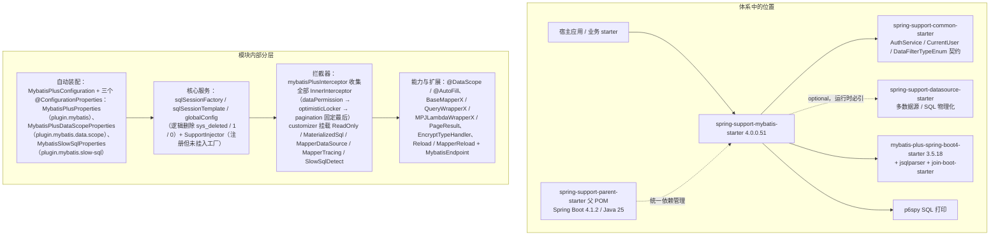
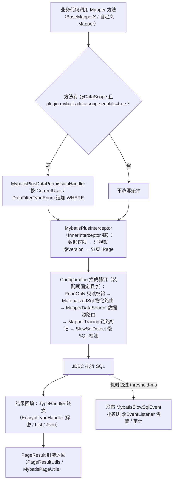

# spring-support-mybatis-starter

Spring Support 体系的 MyBatis-Plus 增强装配模块：在 `mybatis-plus-spring-boot4-starter` 之上提供分页、乐观锁、逻辑删除、声明式数据权限（`@DataScope`）、只读模式、慢 SQL 事件、XML 热重载、自定义 SQL 注入与 p6spy SQL 监控。在 spring-support 体系中它是后端业务 starter 的 ORM 底座：业务 starter（如 account）只声明实体与 Mapper，横切能力统一由本模块装配，避免重复实现。

## 1. 架构图



## 2. 核心流程图

运行期 SQL 执行与拦截链（本模块核心数据流）：



## 3. 能力清单

| 能力域 | 关键类 | 入口 / 触发方式 |
|---|---|---|
| 自动装配与会话 | `MybatisPlusConfiguration` → `SqlSessionFactory` / `SqlSessionTemplate` | `META-INF/spring/...AutoConfiguration.imports` |
| 逻辑删除与字段填充 | `GlobalConfig`（固定 `sys_deleted` / `1` / `0`）、容器 `MetaObjectHandler`、`SysBase` / `SysTenantBase` | `@TableLogic`、`@TableField(fill = ...)`、`@AutoFill` |
| 分页 / 乐观锁 | `PaginationInnerInterceptor`、`PageResult`、`OptimisticLockerInnerInterceptor` | `IPage` / `PageResult` 返回值；实体字段 `@Version` |
| 数据权限 | `@DataScope`、`MybatisPlusDataPermissionInterceptor` / `MybatisPlusDataPermissionHandler` | `plugin.mybatis.data.scope.enable=true` + `AuthService` |
| 只读模式 | `ReadOnlyInterceptor`、`ReadOnlyException` | `plugin.mybatis.read-only=true` |
| 字段加解密 | `EncryptTypeHandler` | `@TableField(typeHandler = EncryptTypeHandler.class)` + `mybatis-plus.encryptor.*` |
| 慢 SQL 检测与 SQL 监控 | `SlowSqlDetectInterceptor`、`MybatisSlowSqlEvent`、`MybatisP6SpyLogger` | `plugin.mybatis.slow-sql.*`（默认开启）；p6spy `modulelist` / `logMessageFormat` |
| 多数据源 / SQL 物理化 | `MapperDataSourceInterceptor`、`MaterializedSqlInterceptor` | 与 `spring-support-datasource-starter` 协作 |
| XML 热重载 | `Reload`、`MapperReload`、`MybatisEndpoint` | `plugin.mybatis.open-xml-reload=true` |
| 自定义 SQL 注入 | `SupportInjector`、`FindAllSqlMethod`、`DynamicSqlMethod` | `plugin.mybatis.sql-method[...]`；⚠️ `SupportInjector` 已注册为 Bean 但未通过 `setSqlInjector` 挂入 `SqlSessionFactory`，当前仅被 `MybatisEndpoint` 消费 |
| 关联 / 查询构造 | `BaseMapperX`、`MPJLambdaWrapperX`、`QueryWrapperX`、`LambdaQueryWrapperX` | 代码调用 |
| 操作日志切面 | `SysLoggerPointcutAdvisor` | `@SysLog`（发布 `SysLoggerInfo` 事件由日志服务落库） |
| 服务信息与端点 | `mybatisPlusServiceInfoContributor`、`MybatisEndpoint`（`mybatis-extension`）、`MapperXmlEndpoint`（`mybatis-xml`，未自动注册） | `ServiceInfoRegistry`；需 Actuator + `mapper-reload` |

## 4. Bean 能力矩阵

以下 Bean 全部来自 `MybatisPlusConfiguration`（`AutoConfiguration.imports` 唯一注册类，本模块无 `spring.factories`）。除特别说明外 Bean 名即方法名。

| Bean 名 | 类型 | 装配条件（含默认值） | 可否覆盖 | 典型用途 |
|---|---|---|---|---|
| `sqlSessionFactory` | `SqlSessionFactory` | `@ConditionalOnMissingBean` | 可；覆盖后本模块的 `GlobalConfig`（逻辑删除）与 `MybatisPlusInterceptor` 插件链不再进入工厂，增强全部失效 | Mapper 体系会话工厂 |
| `sqlSessionTemplate` | `SqlSessionTemplate` | `@ConditionalOnMissingBean` | 可 | Mapper 执行会话 |
| `globalConfig` | `GlobalConfig` | 无条件，**无** `@ConditionalOnMissingBean` | 同名覆盖抛 `BeanDefinitionOverrideException`；异名需 `@Primary` 接管 | 调整 `DbConfig` / 逻辑删除 / 填充器 |
| `mybatisPlusInterceptor` | `MybatisPlusInterceptor` | `@ConditionalOnMissingBean` | 可 | 收集全部 `InnerInterceptor`，分页固定最后 |
| `paginationInnerInterceptor` | `PaginationInnerInterceptor` | `@ConditionalOnMissingBean` | 可（自定义分页参数） | 分页 |
| `optimisticLockerInnerInterceptor` | `OptimisticLockerInnerInterceptor` | `@ConditionalOnMissingBean` | 可 | 乐观锁 |
| `dataPermissionInterceptor` | `DataPermissionInterceptor`（实际 `MybatisPlusDataPermissionInterceptor`） | `@ConditionalOnMissingBean` | 可 | 数据权限；处理器可被容器 Bean 替换 |
| `cryptoInterceptor` | `CryptoInterceptor` | `@ConditionalOnMissingBean` | 可 | ⚠️ 未挂入 `Configuration`，实际不拦截 |
| `deleteOnlySelfInterceptor` | `DeleteOnlySelfInterceptor` | `@ConditionalOnMissingBean`，且需容器已有 `AuthService` Bean | 可 | ⚠️ 未挂入 `Configuration`，实际不拦截 |
| `mybatisConfigurationCustomizer` | `ConfigurationCustomizer` | `@ConditionalOnMissingBean` | 可 | 按序挂载只读 / 物理化 / 数据源 / 追踪 / 慢 SQL 拦截器 |
| `slowSqlDetectInterceptor` | `SlowSqlDetectInterceptor` | `@ConditionalOnProperty(prefix="plugin.mybatis.slow-sql", name="enabled", havingValue="true", matchIfMissing=true)`，**无** `@ConditionalOnMissingBean` | 否：同名覆盖抛 `BeanDefinitionOverrideException`；另声明同类型 Bean 会让 customizer 的 `ObjectProvider#getIfAvailable` 命中多个而报错 | 慢 SQL 检测与事件发布 |
| `mapper-reload`（方法名 `xmlReload`） | `MapperReload`（实现 `Reload`） | `@ConditionalOnMissingBean` + `@ConditionalOnProperty(prefix="plugin.mybatis", name="open-xml-reload", havingValue="true", matchIfMissing=false)` | 可（声明同名 `Reload` Bean） | XML 热重载，被端点消费 |
| `supportInjector` | `SupportInjector`（继承 `DefaultSqlInjector`） | `@ConditionalOnMissingBean(name="supportInjector")` | 可；⚠️ 仅注册为 Bean 并被 `MybatisEndpoint` 消费，本模块未调用 `setSqlInjector`，故未挂入 `SqlSessionFactory` | Mapper 自定义方法注入（`plugin.mybatis.sql-method` 当前不生效） |
| `mybatisEndpoint` | `MybatisEndpoint` | `@ConditionalOnMissingBean` + `@ConditionalOnBean(name={"mapper-reload","supportInjector"})` | 可 | 暴露 `/actuator/mybatis-extension` |
| `mybatisPlusServiceInfoContributor` | `ServiceInfoContributor` | 无条件，**无** `@ConditionalOnMissingBean` | 同名覆盖抛异常；该类型按 `getBeansOfType` 全量收集，异名只并存 | 服务信息面板展示模块状态 |
| `sysLoggerPointcutAdvisor` | `SysLoggerPointcutAdvisor` | `@ConditionalOnMissingBean` | 可 | AOP 拦截 `@SysLog` 方法 |

被本模块消费的协作者（非本模块注册，宿主声明即生效）：`MybatisPlusDataPermissionHandler`（替换默认数据权限处理器）、`MetaObjectHandler`（公共字段填充，取容器第一个）、任意多个 `InnerInterceptor`、Bean 名为 `authService` 或 `defaultAuthService` 的 `AuthService`、`MaterializedSqlDataSourceRouter`（common-starter 契约）/ `MaterializedRouteProperties`（datasource-starter），均可选注入。

## 5. 完整配置

### 5.1 `plugin.mybatis`（`MybatisPlusProperties`）

| 配置路径 | 类型 | 默认值 | 说明 |
|---|---|---|---|
| `plugin.mybatis.enable` | `boolean` | `true` | ⚠️ 预留开关，代码无消费方，写 `false` 不会关闭模块 |
| `plugin.mybatis.read-only` | `boolean` | `false` | 只读模式，写操作抛 `ReadOnlyException` |
| `plugin.mybatis.open-xml-reload` | `boolean` | 字段默认 `true`；Bean 条件 `matchIfMissing=false`，不显式写 `true` 不注册 `mapper-reload` | XML 热重载开关 |
| `plugin.mybatis.reload-type` | 枚举 `ReloadType`（`NONE` / `AUTO`） | `AUTO` | 热重载方式；无 `MANUAL`，手动重载走端点写操作 |
| `plugin.mybatis.reload-time` | `int` | `3000` | 热重载轮询间隔（毫秒） |
| `plugin.mybatis.reload-directories[].path` | `String` | 无 | 监听目录；支持本地路径（`D:/mapper`）与 `classpath:` 前缀 |
| `plugin.mybatis.reload-directories[].pattern` | `String` | `**/*Mapper.xml` | 文件匹配模式 |
| `plugin.mybatis.reload-directories[].watch-enabled` | `boolean` | `true` | jar 包内 `classpath:` 资源无法监听 |
| `plugin.mybatis.sql-method[].type` | 枚举 `SqlMethodType`（`FILE` / `MYSQL`） | 无 | SQL 来源：文件 / MySQL 数据源 Bean |
| `plugin.mybatis.sql-method[].source` | `String` | 无 | 文件路径或数据源 Bean 名 |
| `plugin.mybatis.sql-method[].timeout` | `int` | `3000` | watchdog 超时（毫秒） |
| `plugin.mybatis.sql-method[].watchdog` | `boolean` | `false` | 是否开启变更检测 |

### 5.2 `plugin.mybatis.data.scope`（`MybatisPlusDataScopeProperties`）

⚠️ 前缀是 `plugin.mybatis.data.scope`，不是 `plugin.mybatis-plus.data-scope`。

| 配置路径 | 类型 | 默认值 | 说明 |
|---|---|---|---|
| `plugin.mybatis.data.scope.enable` | `boolean` | `false` | 启用数据权限拦截；还需容器有 `authService` / `defaultAuthService` |
| `plugin.mybatis.data.scope.table-name` | `String` | `sys_dept` | 部门表名 |
| `plugin.mybatis.data.scope.dept-id-column` | `String` | `sys_dept_id` | 部门 ID 列名 |
| `plugin.mybatis.data.scope.dept-tree-id-column` | `String` | `sys_dept_tree_id` | 部门树 ID 列名（`DEPT_AND_SUB` 前缀匹配用） |
| `plugin.mybatis.data.scope.current-user-id-column` | `String` | `create_by` | 当前用户 ID 列名（`SELF` 用） |

### 5.3 `plugin.mybatis.slow-sql`（`MybatisSlowSqlProperties`）

| 配置路径 | 类型 | 默认值 | 说明 |
|---|---|---|---|
| `plugin.mybatis.slow-sql.enabled` | `boolean` | `true` | 慢 SQL 检测开关（`matchIfMissing=true`，不配置默认开启） |
| `plugin.mybatis.slow-sql.threshold-ms` | `long` | `500` | 慢 SQL 阈值（毫秒） |
| `plugin.mybatis.slow-sql.print` | `boolean` | `true` | 是否打印慢 SQL WARN 日志 |
| `plugin.mybatis.slow-sql.include-sql` | `boolean` | `true` | 事件是否携带 SQL 文本（可能含敏感信息） |
| `plugin.mybatis.slow-sql.include-parameters` | `boolean` | `false` | 事件是否携带参数映射（可能含敏感信息） |
| `plugin.mybatis.slow-sql.max-sql-length` | `int` | `2000` | SQL 最大长度，超出截断 |

### 5.4 相关联的原生 / 跨模块配置

| 配置路径 | 来源 | 说明 |
|---|---|---|
| `mybatis-plus.encryptor.password` / `mybatis-plus.encryptor.mode` | MyBatis-Plus 字段加密 | 本模块构造时同步到系统属性，供 `EncryptTypeHandler` 读取；改密钥需重启 |
| `mybatis-plus.mapper-locations`、`mybatis-plus.configuration.*`、`mybatis-plus.global-config.*` | MyBatis-Plus 原生 | 由宿主按 MP 文档配置，本模块不重复封装 |
| `plugin.datasource.materialized.enabled` | `MaterializedRouteProperties`（datasource-starter） | 启用后本模块挂载 `MaterializedSqlInterceptor` |

## 6. 使用方式

### 6.1 Maven 坐标

```xml
<dependency>
    <groupId>com.chua</groupId>
    <artifactId>spring-support-mybatis-starter</artifactId>
    <version>4.0.0.51</version>
</dependency>
```

### 6.2 依赖与可选依赖说明

| 依赖 | 作用 | 缺失后果 |
|---|---|---|
| `mybatis-plus-spring-boot4-starter` / `mybatis-plus-jsqlparser` / `mybatis-plus-join-boot-starter` | MyBatis-Plus 核心、SQL 解析、关联查询 | 必带 |
| `spring-support-common-starter` | `AuthService` / `CurrentUser` / `DataFilterTypeEnum` / `SysLoggerInfo` 契约 | 必带 |
| `p6spy`、`commons-dbutils`、`commons-lang3` | SQL 打印与工具类 | 必带 |
| `spring-support-datasource-starter` | 多数据源 / SQL 物理化 | pom 标记 `optional` 不随本模块传递，但 `mybatisConfigurationCustomizer` 必须注入其 `MultiDataSourceSettingProperties`，**缺 jar 时本模块自动装配直接失败，运行时必须显式引入** |
| `mybatis-plus-generator` + `spring-boot-starter-freemarker` | 代码生成器 | `provided`；不引入仅代码生成不可用，运行无影响 |
| `spring-support-swagger-starter` | `AbstractSwagger*Controller` 文档基类注解 | `provided`；不引入则 swagger 基类不可用 |

### 6.3 最小启用示例

引入依赖后无需手写配置类，本模块自动提供 `SqlSessionFactory` / `SqlSessionTemplate`；保留宿主的 `spring.datasource` 与 `mybatis-plus.mapper-locations`：

```yaml
plugin:
  mybatis:
    open-xml-reload: true      # 必须显式写 true 才注册 mapper-reload
    data:
      scope:
        enable: true           # 数据权限，默认 false
    slow-sql:
      threshold-ms: 500        # 默认已开启
```

```java
@SpringBootApplication
@MapperScan("com.example.**.mapper")
public class Application {
    public static void main(String[] args) { SpringApplication.run(Application.class, args); }
}
@TableName("sys_user")
public class User extends SysBase {           // SysBase 自带 create*/update* 公共字段自动填充
    @TableId(type = IdType.AUTO) private Long id;
    private String username;
    @TableLogic private Integer sysDeleted;   // 对应 GlobalConfig 的 sys_deleted
    @Version private Integer version;
}

@Mapper
public interface UserMapper extends BaseMapperX<User> {
    @DataScope(value = DataFilterTypeEnum.DEPT, useUserPermission = false)
    List<User> selectDeptUserList();

    @DataScope(enabled = false)               // 管理员旁路 / 关闭
    List<User> selectAllUserList();
}
```

数据权限需提供名为 `authService`（或 `defaultAuthService`）的 `AuthService` Bean，返回携带 `userId`、`deptId`、`dataPermission`、`roles` 的 `CurrentUser`；`SUPER_ADMIN` / `ADMIN` 角色直接旁路。多表查询用 `@DataScope` 的 `deptAlias` / `userAlias` 指定别名。

## 7. 使用场景

**适用**：

- Spring Boot 4 宿主需要关系型数据库 ORM，开箱获得分页、乐观锁、逻辑删除、公共字段填充；
- 需要声明式数据权限（`@DataScope` + 部门/本人/自定义规则）与操作日志切面（`@SysLog`）；
- 需要慢 SQL 告警事件、p6spy SQL 监控、链路标记，或与 `spring-support-datasource-starter` 的多数据源 / SQL 物理化协同；开发期需要 Mapper XML 热重载并通过 Actuator 端点查看、触发重载。

**不适用 / 慎用**：

- 非 Spring Boot 宿主，或 Spring Boot 2.x / 3.x——本模块只注册 `AutoConfiguration.imports`（无 `spring.factories`），且 MyBatis-Plus 用 Boot 4 专用坐标；
- 响应式栈（R2DBC / Spring Data Reactive）——本模块是同步 JDBC / MyBatis 体系；
- 只想用原生 MyBatis、不要 MyBatis-Plus 的项目。

**与相邻模块的取舍**：

- `spring-support-common-starter`：只提供契约（认证、常量、日志事件），不含数据库能力；本模块消费契约实现数据权限与操作日志。
- `spring-support-datasource-starter`：数据源定义、`@DS` 切换、物理化路由归它；本模块只把 `MapperDataSourceInterceptor` / `MaterializedSqlInterceptor` 挂进 MyBatis 执行链。
- `mybatis-plus-spring-boot4-starter`（原生）：本模块是其增强封装，复用其自动配置；只要裸 MP 可直接用原生 starter。
- `spring-support-swagger-starter`：`provided` 关系，仅为本模块 `AbstractSwagger*Controller` 提供注解，不产生装配冲突。

## 8. 扩展点

本模块**不提供 Java SPI**（`META-INF` 下只有 `AutoConfiguration.imports`，无 `services` / `extensions` 目录）。扩展方式是 Spring Bean 覆盖与事件监听：

| 扩展点 | 方式 |
|---|---|
| 数据权限处理器 | 声明 `MybatisPlusDataPermissionHandler`（实现 `MultiDataPermissionHandler`）Bean，`dataPermissionInterceptor` 装配时优先取容器实现 |
| 公共字段填充 | 声明 `MetaObjectHandler` Bean，装配进 `GlobalConfig`（容器内取第一个） |
| 内部拦截器 | 声明任意 `InnerInterceptor` Bean，全部收集进 `mybatisPlusInterceptor`（分页固定最后） |
| XML 热重载 | 覆盖名为 `mapper-reload` 的 `Reload` Bean（接口方法 `reload(String)`、`listFiles()`） |
| SQL 注入器 | 覆盖 `supportInjector` 或自定义 `DefaultSqlInjector`；SQL 来源标记为 `SqlMethodMarker`（`MapperSqlMethodMarker` / `MysqlSqlMethodMarker`） |
| 其余 Bean | 第 4 节中带 `@ConditionalOnMissingBean` 的 Bean 均可覆盖（覆盖 `sqlSessionFactory` 会使其余增强失效） |
| 慢 SQL 告警 / 操作日志 | `@EventListener` 监听 `MybatisSlowSqlEvent` / `SysLoggerInfo` |

自定义数据权限处理器示例（需在 `dataPermissionInterceptor` 装配前注册，且 `plugin.mybatis.data.scope.enable=true`）：

```java
@Component
public class TenantDataPermissionHandler extends MybatisPlusDataPermissionHandler {
    public TenantDataPermissionHandler(MybatisPlusDataScopeProperties props, Supplier<AuthService> authService) {
        super(props, authService);
    }
    @Override // 返回 null 表示该表不追加条件
    public Expression getSqlSegment(Table table, Expression where, String mappedStatementId) {
        return super.getSqlSegment(table, where, mappedStatementId);
    }
}
```

## 9. 常见问题

1. **模块装配不生效？** ① `spring-support-datasource-starter` 虽是 pom `optional`，但 `mybatisConfigurationCustomizer` 必须注入其 `MultiDataSourceSettingProperties`，缺 jar 时本模块自动装配直接失败；② 覆盖了 `sqlSessionFactory` 会使全局配置（逻辑删除）与拦截器链不再进入工厂，应只覆盖 `GlobalConfig` 等细粒度 Bean；③ `deleteOnlySelfInterceptor` 需要容器已有 `AuthService` Bean，缺失会导致创建失败。

2. **开关属性为什么「配了没反应」？** `plugin.mybatis.enable` 是无消费方的预留开关，写 `false` 关不掉模块（关闭请移除依赖）；`open-xml-reload` 字段默认值虽是 `true`，但 Bean 条件 `matchIfMissing=false`，必须显式写 `open-xml-reload: true` 才会注册热重载与端点；`slow-sql.enabled` 默认开启，`data.scope.enable` 默认关闭。

3. **Spring Boot 4 兼容性？** 本仓库父 POM 为 Spring Boot 4.1.2 / Java 25；MyBatis-Plus 用 Boot 4 专用坐标 `mybatis-plus-spring-boot4-starter`（3.5.18），不要混入 `spring-boot3-starter` / `spring-boot-starter` 旧坐标。本模块仅提供 `AutoConfiguration.imports` 注册，Spring Boot 2.x 无法使用。

4. **与兄弟模块冲突 / 端点 404？** `/actuator/mybatis-extension` 需同时满足：类路径有 Actuator、`open-xml-reload=true`（`mapper-reload` 存在）、`supportInjector` 存在（由 `@ConditionalOnBean` 约束）；`/actuator/mybatis-xml` 对应的 `MapperXmlEndpoint` 未在自动配置中注册 Bean，需要时自行声明。数据权限前缀必须是 `plugin.mybatis.data.scope`；`@DataScope` 解析结果按方法缓存，改注解需重启。`CryptoInterceptor` 与 `DeleteOnlySelfInterceptor` 仅注册未挂入拦截链，字段加密请用 `EncryptTypeHandler`。
