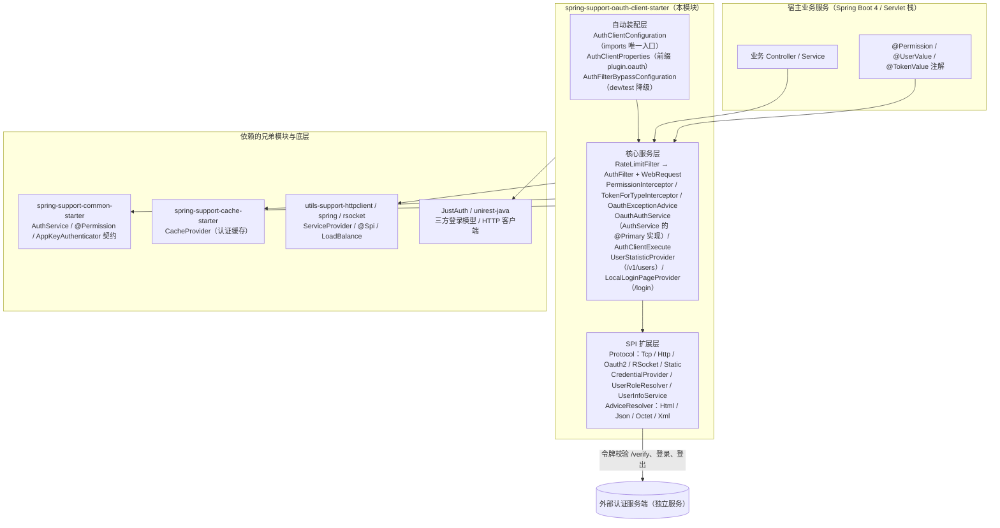
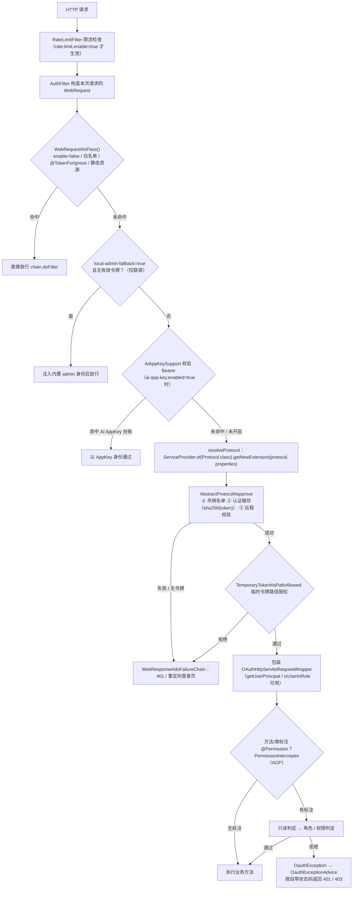

# spring-support-oauth-client-starter

单点登录**客户端** Starter：把「令牌校验 / 白名单 / 权限判定 / 登录页 / 会话控制」下沉到框架层，业务代码只依赖 `OAuthPrincipal` 与 `@Permission`，不再自己解析 token、比对角色。在 spring-support 体系中，它是被各业务服务引入的**纯客户端**模块：认证服务端是独立服务（通过 `plugin.oauth.address` + `plugin.oauth.protocol` 通信），本模块只发起校验、不签发令牌、不存储账号台账；类路径存在 `com.chua.starter.oauth.server.support.SsoServer` 时自动让位。

- 包名：`com.chua.starter.oauth.client.support`
- 版本：`4.0.0.51`（仓库父 pom：`spring-boot-starter-parent` 4.1.2）
- 自动装配入口：`META-INF/spring/org.springframework.boot.autoconfigure.AutoConfiguration.imports` → `AuthClientConfiguration`（唯一条目）；`spring.factories` 仅承载 SPI 登记（`AdviceResolver`、`Protocol`）。

## 1. 架构图



AI AppKey 台账查询走 `spring-support-common-starter` 的 `AppKeyAuthenticator` 契约（由 AI 模块提供实现），本模块不直连 AI 持久层。

## 2. 核心流程图

请求处理流程（从进入过滤器到业务方法执行）：



## 3. 能力清单

| 能力域 | 关键类 | 入口/触发方式 |
|---|---|---|
| 自动装配 / 配置 | `AuthClientConfiguration`（`plugin.oauth.enable`，缺省 `matchIfMissing=true`）、`AuthFilterBypassConfiguration`（`dev`/`test` + `enable=false` 降级，靠组件扫描，见第 9 节）、`AuthClientProperties` | `AutoConfiguration.imports` / `@EnableConfigurationProperties` |
| 限流 | `RateLimitFilter`（`HIGHEST_PRECEDENCE`）+ `RateLimitService` | `plugin.oauth.rate-limit.*` |
| 认证过滤器 / 请求增强 | `AuthFilter`（order `LOWEST_PRECEDENCE - 10`，urlPatterns=`block-address`）、`WebRequest`、`OAuthHttpServletRequestWrapper` | 所有被拦截的 HTTP 请求；`request.getUserPrincipal` / `isUserInRole` |
| 令牌校验 | `Protocol` / `AbstractProtocol`（缓存 + 吊销名单 + 远程校验） | 5 种协议实现 |
| 权限判定 / 参数注入 | `PermissionInterceptor`（AOP）+ `@Permission`；`@UserValue` / `@TokenValue` + 两个 `HandlerMethodArgumentResolver` | 类 / 方法级注解；Controller 方法参数 |
| 当前用户 / 会话 | `OauthAuthService`（`@Primary` 的 `AuthService`）、`OAuthPrincipal`、`AuthSessionUtils`、`AuthClientExecute`（单例） | 注入 `AuthService`；`getUsername()` / `getUserId()` / `getTenantId()` |
| 白名单 | `AuthClientProperties#getEffectiveWhitelist`、`WhitelistFileWatcher`、`OAuthWhitelistController` | `whitelist` / `whitelist-file` / `/oauth/whitelist` |
| 登录页 | `LocalLoginPageProvider`（`GET /login` 自渲染表单）、`UserStatisticProvider`（`POST /v1/users/login` 等） | `plugin.oauth.login-page` / `login-form-action` |
| 凭据扩展 | `CredentialProvider` / `CredentialResolver`、`PasswordCredentialProvider`、`VerifiedCodeCredentialProvider` | 静态账号 / 验证码登录 |
| 异常与响应协商 | `OauthExceptionAdvice`、`OauthException`、`AdviceResolver` + Html/Json/Octet/Xml 实现（`spring.factories` 登记） | 权限判定失败按响应类型转 401/403 |
| AI AppKey | `AiAppKeySupport` | `plugin.oauth.ai-app-key.enabled=true` |
| 指纹校验 | `@VerifyFingerprint`、`@FingerprintCheck`、`Fingerprint` 配置 | 浏览器指纹比对 |
| 服务信息 | `authClientServiceInfoContributor`（`ServiceInfoContributor`） | 登记 `/auth/**` 端点与 `oauth` 能力标记 |

## 4. Bean 能力矩阵

类级条件：`AuthClientConfiguration` 上有 `@ConditionalOnProperty(prefix = "plugin.oauth", name = "enable", havingValue = "true", matchIfMissing = true)`，下表所有 Bean 都受它约束（`enable=false` 时整组不装配）。

| Bean 名 | 类型 | 装配条件（含默认值） | 可否覆盖 | 典型用途 |
|---|---|---|---|---|
| `authService` | `AuthService`（实现 `OauthAuthService`） | 仅类级开关；**`@Primary`** | 不可覆盖（业务再定义非 `@Primary` 同类型 Bean 时本模块胜出；双方 `@Primary` 启动冲突） | 注入 `AuthService` 取当前用户 / 判权 |
| `permissionProxyFactoryBean` | `PermissionInterceptor` | `@ConditionalOnMissingBean` | 可覆盖 | `@Permission` AOP 判权 |
| `oauthExceptionAdvice` | `OauthExceptionAdvice` | `@ConditionalOnMissingBean` | 可覆盖 | `OauthException` → 401/403 |
| `tokenForTypeInterceptor` | `TokenForTypeInterceptor` | `@ConditionalOnMissingBean` | 可覆盖 | `@TokenForType` 令牌类型处理 |
| `whitelistFileWatcher` | `WhitelistFileWatcher` | `@ConditionalOnMissingBean` | 可覆盖 | 外部白名单文件热更新 |
| `aiAppKeySupport` | `AiAppKeySupport` | `@ConditionalOnProperty(prefix="plugin.oauth.ai-app-key", name="enabled", havingValue="true")` + `@ConditionalOnMissingBean` | 开关 + 可覆盖 | Bearer AppKey 本地校验 |
| `tempProvider` | `UserStatisticProvider` | `@ConditionalOnProperty(name="plugin.oauth.temp.open", havingValue="true", matchIfMissing=false)` | 显式开启才装配；**无** `@ConditionalOnMissingBean`，同名自定义 Bean 需改名 | `/v1/users/**`、`/login/form` 本地登录 |
| `authFilter` | `AuthFilter` | `@ConditionalOnMissingClass("com.chua.starter.oauth.server.support.SsoServer")` + `@ConditionalOnWebApplication(SERVLET)` | 不可覆盖（可另注册过滤器，但不能重名） | 认证；动态白名单入口 `addWhitelist` 等 |
| `authFilterFilterRegistrationBean` | `FilterRegistrationBean<AuthFilter>` | 同上两项 | 不可覆盖 | order `LOWEST_PRECEDENCE-10`，urlPatterns=`block-address` |
| `rateLimitFilterRegistrationBean` | `FilterRegistrationBean<RateLimitFilter>` | `@ConditionalOnWebApplication(SERVLET)`（注册无条件，限流执行受 `rate-limit.enable` 控制） | 不可覆盖 | order `HIGHEST_PRECEDENCE`，先于认证过滤器；urlPatterns=`block-address` |
| `authClientServiceInfoContributor` | `ServiceInfoContributor` | 仅类级开关 | 不可覆盖 | 服务信息登记 |
| `com.chua.starter.oauth.client.support.web.WebRequest` | `WebRequest` | 程序化注册（`BeanDefinitionRegistryPostProcessor#postProcessBeanDefinitionRegistry`，构造参数为 `AuthClientProperties`） | 不可通过配置覆盖 | 鉴权编排；参数解析器依赖 |

`AuthFilterBypassConfiguration`（`@Profile({"dev","test"})` + `@ConditionalOnProperty(plugin.oauth.enable=false, matchIfMissing=false)`）：

| Bean 名 | 类型 | 装配条件 | 可否覆盖 | 典型用途 |
|---|---|---|---|---|
| `authFilterBypass` | `AuthFilter`（匿名直通实现） | `@ConditionalOnMissingBean(AuthFilter.class)` | 可覆盖 | `doFilter` 直接放行，不做认证 |
| `authFilterBypassRegistration` | `FilterRegistrationBean<AuthFilter>` | `@ConditionalOnMissingBean(name="authFilterFilterRegistrationBean")` | 可覆盖 | order `LOWEST_PRECEDENCE`，拦 `/*` |

非 Bean 的 MVC 注册：`UserRequestHandlerMethodArgumentResolver`、`TokenRequestHandlerMethodArgumentResolver` 通过 `WebMvcConfigurer#addArgumentResolvers` 加入（本配置类实现了 `WebMvcConfigurer`），不走 Bean 覆盖。

## 5. 完整配置

前缀 `plugin.oauth`（`@ConfigurationProperties(prefix = "plugin.oauth", ignoreInvalidFields = true)`）。除注明外均随 `plugin.oauth.enable` 一起生效。

| 配置路径 | 类型 | 默认值 | 说明 |
|---|---|---|---|
| `plugin.oauth.enable` | boolean | `true` | 自动装配总开关（`matchIfMissing=true`，不写也生效） |
| `plugin.oauth.protocol` | String | `tcp` | 协议：`tcp` / `http` / `http-lite` / `oauth2` / `rsocket` / `static`（无 websocket） |
| `plugin.oauth.address` | String | 无（null） | 认证服务端地址，多地址逗号分隔，配合 `balance` 轮询 |
| `plugin.oauth.oauth-url` | String | `/verify` | 令牌校验路径 |
| `plugin.oauth.login-address` | String | `${plugin.oauth.auth-address:}` | 登录端点地址；为空时 `WebRequest#isFailure` 直接判失败 |
| `plugin.oauth.token-name` | String | `x-oauth-token` | 令牌请求头名（同时接受 `Authorization: Bearer`） |
| `plugin.oauth.cookie-name` | String | `x-oauth-cookie` | 令牌 Cookie 名 |
| `plugin.oauth.alias` | String | `Boren-Token` | 令牌别名头 |
| `plugin.oauth.encryption` | String | `aes` | 传输加密算法 |
| `plugin.oauth.enable-encryption` | boolean | `true` | 是否启用数据加密 |
| `plugin.oauth.balance` | String | `polling` | 多服务端负载均衡模式（`LoadBalance` SPI 名） |
| `plugin.oauth.block-address` | Set\<String\> | `/*` | 过滤器拦截地址（urlPatterns），不是白名单 |
| `plugin.oauth.whitelist` | List\<String\> | `[]` | 自定义白名单（Ant 风格），只能增加不能减少登录链路 |
| `plugin.oauth.whitelist-file` | String | `config/oauth.whitelist` | 外部白名单文件，支持热更新与 `#` 注释 |
| `plugin.oauth.use-default-whitelist` | boolean | `true` | 是否启用内置默认白名单（不影响 ALWAYS 白名单） |
| `plugin.oauth.login-page` | String | `/login` | 登录页 |
| `plugin.oauth.login-form-action` | String | `/login/form` | 自渲染登录表单提交端点（表单编码 POST） |
| `plugin.oauth.logout-page` | String | `/logout` | 登出页 |
| `plugin.oauth.temporary-token-page` | String | `/temporary-token` | 临时令牌页 |
| `plugin.oauth.upgrade-page` | String | `/upgrade` | 升级页 |
| `plugin.oauth.no-permission-page` | String | `/oauth-page` | 无权限页 |
| `plugin.oauth.cache-timeout` | long | `21600`（6 小时） | 认证信息缓存秒数 |
| `plugin.oauth.cache-hot-cold-backup` | boolean | `true` | 缓存冷热备份 |
| `plugin.oauth.connect-timeout` | long | `5000` | 连接超时（毫秒） |
| `plugin.oauth.read-timeout` | long | `10000` | 读取超时（毫秒） |
| `plugin.oauth.request-timeout` | long | `15000` | 请求超时（毫秒） |
| `plugin.oauth.static-token-expire-seconds` | long | `86400`（24 小时） | 静态账号令牌有效期，实际取值夹到 `[60, 604800]` |
| `plugin.oauth.local-admin-fallback` | boolean | `false` | 取不到用户上下文时兜底为本地 admin（等价绕过鉴权，仅联调） |
| `plugin.oauth.retry.enabled` | boolean | `true` | 是否启用重试 |
| `plugin.oauth.retry.max-attempts` | int | `3` | 最大重试次数 |
| `plugin.oauth.retry.delay` | long | `1000` | 首次重试间隔（毫秒） |
| `plugin.oauth.retry.multiplier` | double | `1.5` | 重试间隔倍数（指数退避） |
| `plugin.oauth.retry.max-delay` | long | `5000` | 最大重试间隔（毫秒） |
| `plugin.oauth.circuit-breaker.enabled` | boolean | `true` | 是否启用熔断 |
| `plugin.oauth.circuit-breaker.failure-rate-threshold` | int | `50` | 失败率阈值（%），超过触发熔断 |
| `plugin.oauth.circuit-breaker.slow-call-rate-threshold` | int | `80` | 慢调用率阈值（%） |
| `plugin.oauth.circuit-breaker.slow-call-duration-threshold` | long | `3000` | 慢调用时间阈值（毫秒） |
| `plugin.oauth.circuit-breaker.sliding-window-size` | int | `10` | 滑动窗口大小 |
| `plugin.oauth.circuit-breaker.wait-duration-in-open-state` | int | `30` | 熔断打开后等待时间（秒） |
| `plugin.oauth.circuit-breaker.permitted-calls-in-half-open-state` | int | `5` | 半开状态允许的请求数 |
| `plugin.oauth.circuit-breaker.fallback-message` | String | `认证服务暂时不可用，请稍后重试` | 降级响应消息 |
| `plugin.oauth.rate-limit.enable` | boolean | `false` | 限流总开关；子开关默认全 true，只打开总开关即生效 |
| `plugin.oauth.rate-limit.login.enable` | boolean | `true` | 登录限流（防暴破）子开关 |
| `plugin.oauth.rate-limit.login.ip-limit` | int | `30` | 同一 IP 窗口内最大登录尝试次数 |
| `plugin.oauth.rate-limit.login.ip-window-seconds` | long | `60` | 登录 IP 限流窗口（秒） |
| `plugin.oauth.rate-limit.login.account-fail-limit` | int | `5` | 同一账号失败多少次后锁定 |
| `plugin.oauth.rate-limit.login.account-lock-minutes` | long | `5` | 账号锁定时间（分钟） |
| `plugin.oauth.rate-limit.api.enable` | boolean | `true` | 全局接口限流子开关 |
| `plugin.oauth.rate-limit.api.qps` | int | `200` | 同一 IP 每窗口最大请求数 |
| `plugin.oauth.rate-limit.api.window-seconds` | long | `1` | 接口限流窗口（秒） |
| `plugin.oauth.key.enabled` | boolean | `false` | AK/SK 二次加密开关 |
| `plugin.oauth.key.access-key` | String | 无 | 标识客户端的 accessKey |
| `plugin.oauth.key.secret-key` | String | 无 | 加密数据的 secretKey |
| `plugin.oauth.temp.user` | String | `""`（刻意留空） | 静态账号 `用户名:口令;...`；支持加盐摘要 `用户名:盐$MD5(盐+口令)`；未配置时静态登录被明确拒绝 |
| `plugin.oauth.temp.menu-path` | String | 无 | 临时账号菜单文件 |
| `plugin.oauth.fingerprint.global-verification` | boolean | `false` | 全局指纹验证（否则只验 `@VerifyFingerprint` 接口） |
| `plugin.oauth.fingerprint.enable-client-verification` | boolean | `false` | 客户端侧指纹预校验 |
| `plugin.oauth.fingerprint.config-cache-timeout` | long | `3600` | 指纹配置缓存时间（秒） |
| `plugin.oauth.fingerprint.app-key-configs` | Map\<String, AppKeyFingerprintConfig\> | `{}` | 按 appKey 配置：`enable-fingerprint`（0/1）、`fingerprint-whitelist`（逗号分隔） |
| `plugin.oauth.ai-app-key.enabled` | boolean | `false` | AI AppKey 本地校验；台账由 AI 模块经 `AppKeyAuthenticator` 契约提供 |

**不绑定的开关**：`plugin.oauth.temp.open` 不是 `AuthClientProperties` 的字段，只作为 `tempProvider` 的装配条件读取；`plugin.oauth.ai-app-key.enabled` 同时是绑定字段与装配条件。**没有 `exclude-address`**：排除靠 `whitelist`，`block-address` 只决定拦截范围。

**内置白名单**（`getEffectiveWhitelist()` = ALWAYS + DEFAULT（可关）+ yaml + 动态）：

- ALWAYS（不受任何配置影响，防「拿 token 需要 token」自锁）：`/login`、`/**/login`、`/**/login/**`、`/**/doLogin`、`/**/captcha`、`/**/users/loginCode`。
- DEFAULT（`use-default-whitelist=false` 可整体关闭）：`/**/oauth`、`/**/logout`、`/logout`、`/doc.html`、`/actuator`、`/actuator/**`、`/report`、`/webjars/**`、`/markdown/**`、`/v1/sys/setting`、`/static/**`、`/v1/file/**`、`/**/*.html`、`/v3/api-docs/**`、`/**/node/receive_push`、`/api/system/info`、`/api/auth/status`、`/api/extensions/**`、`/api/workshop/**`、`/v2/usage/**`、`/api/terminals`、`/api/terminals/**`。
- 动态：`GET/POST/DELETE /oauth/whitelist?pattern=...`（`OAuthWhitelistController`，三个端点均要求 `@Permission("admin")`）。

## 6. 使用方式

Maven 坐标：

```xml
<dependency>
    <groupId>com.chua</groupId>
    <artifactId>spring-support-oauth-client-starter</artifactId>
    <version>4.0.0.51</version>
</dependency>
```

最小启用示例（`application.yml`）：

```yaml
plugin:
  oauth:
    enable: true
    protocol: http            # 默认 tcp；http 基于 Unirest 同步实现
    address: http://127.0.0.1:9090
    oauth-url: /verify
    whitelist:
      - /api/public/**
```

业务代码里用注解与注入的 `AuthService`：

```java
@RestController
@RequestMapping("/api/user")
public class UserController {

    private final AuthService authService;   // 实际注入本模块 @Primary 的 OauthAuthService

    public UserController(AuthService authService) {
        this.authService = authService;
    }

    @Permission(role = "ADMIN")              // 角色命中即可；也可写权限位 @Permission("user:create")
    @GetMapping("/me")
    public CurrentUser me() {
        return authService.getCurrentUser();
    }
}
```

需要自渲染登录页与本地登录端点时，再打开 `plugin.oauth.temp.open=true` 并配置 `temp.user`（建议加盐摘要形式），即可获得 `GET /login` 与 `POST /v1/users/login`。

**依赖说明**：

- 必需：`spring-support-common-starter`（`AuthService`/`@Permission`/`AppKeyAuthenticator` 契约）、`spring-support-cache-starter`（`CacheProvider`）、`spring-support-swagger-starter`（OpenAPI 注解）、`spring-support-mybatis-starter`（分页/`PageResult`）、`utils-support-httpclient-starter`、`utils-support-spring-starter`。
- 按协议/场景感知（随 jar 传递，但只有对应路径会触碰）：`com.konghq:unirest-java`（`http`/`http-lite` 协议）、`utils-support-rsocket-starter`（`rsocket` 协议）、`me.zhyd.oauth:JustAuth`（三方登录模型）。排除掉它们后，只要不选对应 `protocol`/不做三方登录就不受影响。
- `jakarta.servlet:jakarta.servlet-api` 为 `provided`，由宿主 Servlet 容器提供；本模块 pom 无 `optional` 依赖。

## 7. 使用场景

**适用**：

- 多个业务服务共享同一认证中心，需要统一「令牌校验 + 白名单 + 接口级权限注解 + 限流 + 会话控制」。
- 需要自渲染登录页（`/login`）与本地登录端点（`/v1/users/login`）的 Servlet Web 应用。
- 需要动态白名单（运行时增删、外部文件热更新）与接口级只读管控（`readonly` / `READ_ONLY` 角色）。
- 无认证服务端时本地联调：`dev`/`test` + `enable=false` 降级，或 `static` 协议 + 静态账号。

**不适用/慎用**：

- 需要在本服务内**提供**认证服务端能力（签发令牌、账号台账管理）——本模块是纯客户端，服务端是独立服务；类路径有 `SsoServer` 时本模块自动让位。
- 响应式栈（WebFlux）——过滤器与参数解析器均面向 Servlet（`@ConditionalOnWebApplication(SERVLET)`）。
- `local-admin-fallback=true` 等价绕过鉴权，严禁在非联调环境开启。

**与相邻模块的取舍**：

| 需求 | 选择 |
|---|---|
| 统一认证、权限注解、白名单、限流 | 本模块 |
| 令牌签发、账号/角色台账、服务端校验接口 | 认证服务端（独立服务，不在本仓库） |
| 只用 `@Permission`、`AuthService` 契约，不要过滤器 | 只依赖 `spring-support-common-starter` |
| 支付宝 / 微信小程序等三方登录 | 以 `UserInfoService` SPI 接入（`spring-support-aliyun-starter` / `-tencent-starter` 提供实现） |
| AI 接口的 AppKey 校验 | `ai-app-key.enabled=true` + AI 模块提供 `AppKeyAuthenticator` 实现 |

## 8. 扩展点

**认证协议 SPI：`Protocol`**（均继承 `AbstractProtocol`，复用令牌编解码、缓存、吊销名单、均衡逻辑）：

| 协议名（`@Spi`） | 实现类 | 说明 |
|---|---|---|
| `tcp` | `TcpProtocol` | 原生 Socket，默认协议 |
| `http` / `http-lite` | `HttpProtocol` | 基于 Unirest 同步实现 |
| `oauth2` | `Oauth2Protocol` | OAuth2 协议 |
| `rsocket` | `RSocketProtocol` | RSocket 通道 |
| `Static` | `StaticProtocol` | 静态协议（本地自包含令牌，测试/联调；匹配不区分大小写） |

新增协议三步：

```java
@Spi("acme")
public class AcmeProtocol extends AbstractProtocol {
    public AcmeProtocol(AuthClientProperties properties) {
        super(properties);
    }
    // 覆写抽象方法：approve(Cookie[], String, String)、authenticationUserCode(AppKeySecret)、
    // upgradeInformation(...)；不支持的能力显式抛 UnsupportedOperationException，不要返回空值冒充成功
}
```

1. **实现**：继承 `AbstractProtocol`。
2. **登记**（三选一）：与 `Protocol` 同包/子包加 `@Spi`（内置协议即此方式）；或写 `META-INF/extensions/com.chua.starter.oauth.client.support.protocol.Protocol`（一行一个实现类全名）；或标准 `META-INF/services/...`。本模块 `spring.factories` 中还以 `Protocol` 为 key 登记了 `HttpProtocol`，作为补充登记渠道。
3. **生效**：`plugin.oauth.protocol=acme`。`WebRequest#getProtocolExtension` 按「协议名 + 配置摘要（sha256）」缓存实例；可用 `ServiceProvider.of(Protocol.class).names()` 打印已注册协议。

**其它 SPI**：

| SPI 接口 | 内置实现 | 用途 |
|---|---|---|
| `UserInfoService`（`@Spi("WEB")`） | 无内置，由 `spring-support-aliyun-starter` / `-tencent-starter` 经 `META-INF/extensions` 提供 | 三方登录用户映射：`checkLogin` / `upgrade` / `authVersion` |
| `ProtocolExecutor` | `DefaultProtocolExecutor`(`@Spi("default")`)、`StaticProtocolExecutor`(`@Spi("static")`) | 传输层执行器（与 `Protocol` 正交） |
| `CredentialProvider` | `PasswordCredentialProvider`（`builtin-web`/`builtin-app`/`builtin-token`/`builtin-wechat`/`builtin-gitee`/`builtin-github`/`builtin-third_party`）、`VerifiedCodeCredentialProvider` | 决定「账号口令从哪来、怎么比对」。`CredentialResolver` 先找同名自定义实现（如 `@Spi("web")`），再回落 `builtin-` 前缀内置实现 |
| `UserRoleResolver`（`@Spi("default")`） | 无内置（回退空） | `http`/`http-lite` 协议下服务端 `/verify` 返回角色为空时按 userId 补充角色；优先取 Spring 容器 Bean，再回退 SPI |
| `AdviceResolver` | `HtmlAdviceResolver`、`JsonAdviceResolver`、`OctetAdviceResolver`、`XmlAdviceResolver` | 认证失败响应的内容协商 |

**运行期扩展方法**：`AuthFilter#addWhitelist/removeWhitelist/clearWhitelist`（动态白名单，实时生效）；`AbstractProtocol#revokeToken(token, expireTime)`（吊销令牌：登记 `oauth:revoked:` 名单 + 清缓存 + 移除在线会话）；`AbstractProtocol#invalidateCache(token)` / `invalidateAllCache()`（清认证缓存）；`AuthClientProperties#addWhitelist/removeWhitelist/clearDynamicWhitelist`（配置层动态白名单）。

## 9. 常见问题

**Q1：引入依赖后过滤器没装配？**
按顺序排查：① `plugin.oauth.enable` 被显式设为 `false`（缺省 `true`）；② 宿主不是 Servlet Web（WebFlux 不装配过滤器）；③ 类路径存在 `com.chua.starter.oauth.server.support.SsoServer`（本模块让位给服务端）；④ 请求路径全部落在白名单内。另外 `AuthFilterBypassConfiguration` **没有**写入 `AutoConfiguration.imports`（该文件只含 `AuthClientConfiguration`），它依赖宿主对 `com.chua.starter.oauth.client.support.configuration` 包的组件扫描——纯自动装配、不扫 `com.chua` 包的宿主里它不会生效。

**Q2：注入 `AuthService` 报冲突或注入不到？**
本模块的 `authService` 是 `@Primary`。业务侧再定义一个非 `@Primary` 的 `AuthService` 时，注入到的是本模块的 `OauthAuthService`；若业务侧也标 `@Primary` 会启动冲突——业务侧应直接使用本模块实现，或去掉自己的 `@Primary`。

**Q3：`temp.open`、`ai-app-key.enabled`、限流这类开关写了没反应？**
- `plugin.oauth.temp.open` 不是绑定字段，只作为 `tempProvider` 装配条件读取，必须显式 `true`；且静态账号要求 `temp.user` 非空（默认刻意留空，未配置时登录被明确拒绝）。
- `plugin.oauth.ai-app-key.enabled=true` 只装配 `AiAppKeySupport`；真正校验还需要类路径上有 AI 模块提供的 `AppKeyAuthenticator` 实现，否则该开关静默无效（继续走认证协议，不会把请求判成失败）。
- `rate-limit.enable` 默认 `false`；`rate-limit.login.*`、`rate-limit.api.*` 子开关默认都是 `true`，只打开总开关即生效。限流过滤器本身总是注册，只是内部检查总开关。

**Q4：与 Spring Boot 4.x 的兼容性与已知坑？**
仓库父 pom 已是 `spring-boot-starter-parent` 4.1.2。本模块使用 Jakarta Servlet 命名空间；自动装配只通过 `AutoConfiguration.imports` 注册（`spring.factories` 仅承载 SPI 登记，不再承担自动装配——这也是 Boot 4 的要求）。其它易踩的坑：权限注解**只有 `@Permission`**（`@RequiredRole` 等从未存在，写了编译不过）；**没有 `protocol: websocket`**；`block-address` 与 `whitelist` 是两套东西，写 `exclude-address` 不生效；ALWAYS 白名单 6 条规则无视任何配置（防自锁设计）；`request.login(...)` 恒抛 `ServletException`，用户名密码登录走 `AuthClientExecute#getAccessToken` 或 `POST /v1/users/login`；`/v1/users/**` 与 `/login` 由本模块提供，宿主已有同名控制器会 `ConflictingBeanDefinitionException`；认证信息有缓存（默认 6 小时），权限变更/踢人在缓存窗口内可能不立即生效，可调 `AbstractProtocol#invalidateCache`；`AuthSessionUtils` 依赖请求上下文，非 Web 线程取值返回空而不抛异常。
