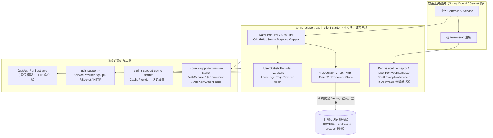
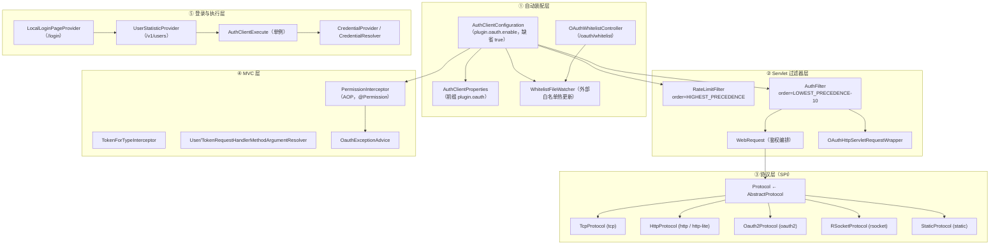
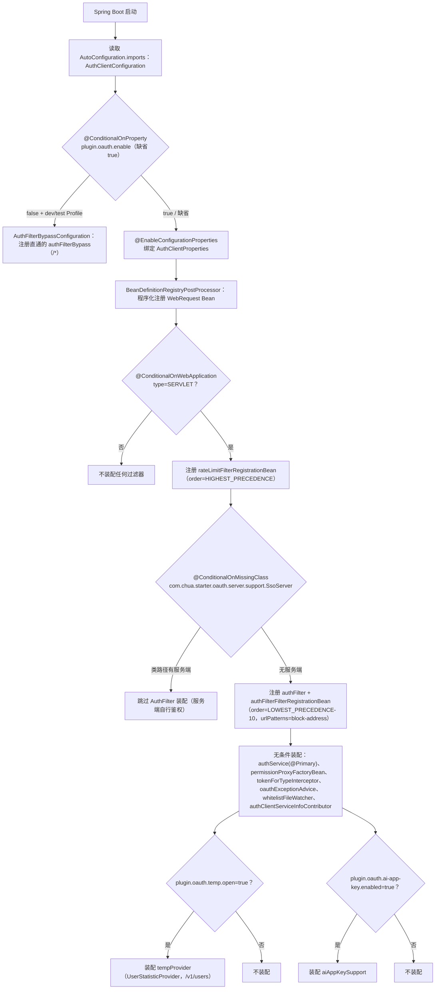
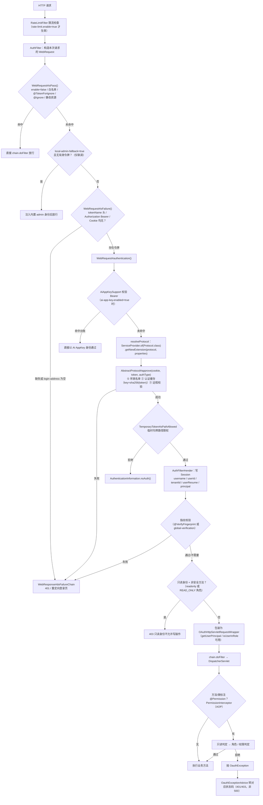

# spring-support-oauth-client-starter

单点登录**客户端** Starter：把「令牌校验 / 白名单 / 权限判定 / 登录页 / 会话控制」下沉到框架层，
业务代码只依赖 `OAuthPrincipal` 与 `@Permission`，不再自己解析 token、比对角色。

- 包名：`com.chua.starter.oauth.client.support`
- 版本：`4.0.0.51`（仓库父 pom：`spring-boot-starter-parent` **4.1.2**）
- 定位：本模块是**纯客户端**。认证服务端由独立服务提供（通过 `plugin.oauth.address` + `plugin.oauth.protocol` 通信）；
  没有服务端时只有 `dev` / `test` Profile + `enable=false` 的降级过滤器可用。
- 自动装配入口：`META-INF/spring/org.springframework.boot.autoconfigure.AutoConfiguration.imports`
  → `com.chua.starter.oauth.client.support.configuration.AuthClientConfiguration`

---

## 1. 架构图

### 1.1 模块在体系中的位置



- 本模块是**消费方**：只发起认证请求，不存储账号台账、不提供登录页面以外的服务端能力。
- 服务端不在本模块（类路径存在 `com.chua.starter.oauth.server.support.SsoServer` 时，本模块会跳过过滤器装配）。
- AI AppKey 台账查询走 `spring-support-common-starter` 的 `AppKeyAuthenticator` 契约，由 AI 模块提供实现；
  本模块不直连 AI 持久层。

### 1.2 内部分层



---

## 2. 核心流程图

### 2.1 自动装配流程



### 2.2 请求处理流程



---

## 3. 能力清单

| 能力域 | 关键类 | 入口 |
|---|---|---|
| 自动装配 | `AuthClientConfiguration`（`plugin.oauth.enable`，缺省 `matchIfMissing=true`） | `META-INF/spring/...AutoConfiguration.imports` |
| 降级装配 | `AuthFilterBypassConfiguration`（`dev`/`test` + `enable=false`） | 组件扫描（见第 9 节注意） |
| 配置 | `AuthClientProperties`（前缀 `plugin.oauth`） | `@EnableConfigurationProperties` |
| 限流 | `RateLimitFilter`（`HIGHEST_PRECEDENCE`）+ `RateLimitService` | `plugin.oauth.rate-limit.*` |
| 认证过滤器 | `AuthFilter`（order `LOWEST_PRECEDENCE - 10`，`url-patterns = block-address`） | 所有被拦截的 HTTP 请求 |
| 鉴权编排 | `WebRequest#authentication`、`WebResponse`（失败链） | 每请求构建 |
| 令牌校验 | `Protocol`、`AbstractProtocol`（缓存 + 吊销名单 + 远程校验） | 5 种协议实现 |
| 权限判定 | `PermissionInterceptor`（AOP 切面）、`@Permission`（来自 common-starter） | 类 / 方法级注解 |
| 当前用户 | `OAuthPrincipal`、`OauthAuthService`（`AuthService` 的 `@Primary` Bean） | 注入 `AuthService` |
| 请求增强 | `OAuthHttpServletRequestWrapper` | `request.getUserPrincipal` / `isUserInRole` |
| 参数注入 | `@UserValue` / `@TokenValue` + `UserRequestHandlerMethodArgumentResolver`、`TokenRequestHandlerMethodArgumentResolver` | Controller 方法参数 |
| 认证执行 | `AuthClientExecute`（单例 `getInstance()`） | 登录 / 登出 / 在线 / 踢人 / 升级 / 临时令牌 |
| 协议扩展 | `Protocol`、`AbstractProtocol`、`TcpProtocol`、`HttpProtocol`、`Oauth2Protocol`、`RSocketProtocol`、`StaticProtocol` | `ServiceProvider.of(Protocol.class)` |
| 传输执行器 | `ProtocolExecutor`、`DefaultProtocolExecutor`(`@Spi("default")`)、`StaticProtocolExecutor`(`@Spi("static")`) | `ServiceProvider` |
| 白名单 | `AuthClientProperties#getEffectiveWhitelist`、`WhitelistFileWatcher`、`OAuthWhitelistController` | `plugin.oauth.whitelist` / `whitelist-file` / `/oauth/whitelist` |
| 登录页 | `LocalLoginPageProvider`（`GET /login` 自渲染表单）、`UserStatisticProvider`（`POST /v1/users/login` 等） | `plugin.oauth.login-page` / `login-form-action` |
| 凭据扩展 | `CredentialProvider`、`CredentialResolver`、`PasswordCredentialProvider`、`VerifiedCodeCredentialProvider` | 静态账号 / 验证码登录 |
| 异常处理 | `OauthExceptionAdvice`、`OauthException` | 权限判定抛出的 401/403 |
| 失败响应协商 | `AdviceResolver` + `Html/Json/Octet/XmlAdviceResolver`（`spring.factories` 登记） | 按响应类型输出错误 |
| 会话工具 | `AuthSessionUtils`、`AuthClientExecute` 静态方法 | `getUsername()` / `getUserId()` / `getTenantId()` |
| 角色补充 | `UserRoleResolver`（SPI，`@Spi("default")`） | 服务端返回角色为空时由业务侧补充 |
| AI AppKey | `AiAppKeySupport` | `plugin.oauth.ai-app-key.enabled=true` |
| 指纹校验 | `@VerifyFingerprint`、`@FingerprintCheck`、`AuthClientProperties.Fingerprint` | 浏览器指纹 |
| 服务信息 | `authClientServiceInfoContributor`（`ServiceInfoContributor`） | 注册 `/auth/**` 端点与 `oauth` 能力标记 |

---

## 4. Bean 能力矩阵

类级条件：`AuthClientConfiguration` 上有
`@ConditionalOnProperty(prefix = "plugin.oauth", name = "enable", havingValue = "true", matchIfMissing = true)`，
下表所有 Bean 都受它约束（`enable=false` 时整组不装配）。

| Bean 名 | 类型 | 装配条件 | 可否覆盖 | 典型注入姿势 |
|---|---|---|---|---|
| `authService` | `AuthService`（实现 `OauthAuthService`） | 仅类级开关；**`@Primary`** | 不可覆盖（业务再定义同类型非 `@Primary` Bean 时本模块胜出；双方都 `@Primary` 会启动冲突） | 构造器注入 `AuthService` |
| `permissionProxyFactoryBean` | `PermissionInterceptor` | `@ConditionalOnMissingBean` | **可覆盖**（自定义同类型 Bean 即替换） | 一般不直接注入，靠 AOP 生效 |
| `tokenForTypeInterceptor` | `TokenForTypeInterceptor` | `@ConditionalOnMissingBean` | **可覆盖** | 一般不直接注入 |
| `oauthExceptionAdvice` | `OauthExceptionAdvice` | `@ConditionalOnMissingBean` | **可覆盖** | 不直接注入，`@RestControllerAdvice` 生效 |
| `whitelistFileWatcher` | `WhitelistFileWatcher` | `@ConditionalOnMissingBean` | **可覆盖** | 注入后管理外部白名单文件 |
| `aiAppKeySupport` | `AiAppKeySupport` | `@ConditionalOnProperty(prefix="plugin.oauth.ai-app-key", name="enabled", havingValue="true")` + `@ConditionalOnMissingBean` | 开关控制；可覆盖 | 注入，或静态 `AiAppKeySupport.get()` |
| `tempProvider` | `UserStatisticProvider` | `@ConditionalOnProperty(name="plugin.oauth.temp.open", havingValue="true", matchIfMissing=false)` | 显式开启才装配；未加 `@ConditionalOnMissingBean`，同名自定义 Bean 需改名避免冲突 | 通常作为 HTTP 端点使用（`/v1/users/**`） |
| `authFilter` | `AuthFilter` | `@ConditionalOnMissingClass("com.chua.starter.oauth.server.support.SsoServer")` + `@ConditionalOnWebApplication(SERVLET)` | 不可覆盖（可另注册过滤器，但不能重名） | 注入后调用 `addWhitelist` / `removeWhitelist` / `clearWhitelist` |
| `authFilterFilterRegistrationBean` | `FilterRegistrationBean<AuthFilter>` | 同上两项 | 不可覆盖 | 一般不注入；order `LOWEST_PRECEDENCE-10`，urlPatterns=`block-address` |
| `rateLimitFilterRegistrationBean` | `FilterRegistrationBean<RateLimitFilter>` | `@ConditionalOnWebApplication(SERVLET)`（注册无条件，限流执行受 `rate-limit.enable` 控制） | 不可覆盖 | 一般不注入；order `HIGHEST_PRECEDENCE` |
| `authClientServiceInfoContributor` | `ServiceInfoContributor` | 仅类级开关 | 不可覆盖 | 框架消费，用于服务信息登记 |
| `com.chua.starter.oauth.client.support.web.WebRequest` | `WebRequest` | **程序化注册**（`postProcessBeanDefinitionRegistry`，构造参数为 `AuthClientProperties`） | 不可通过配置覆盖 | 按类型注入；主要用于参数解析器与内部编排 |

`AuthFilterBypassConfiguration`（`@Profile({"dev","test"})` + `@ConditionalOnProperty(plugin.oauth.enable=false, matchIfMissing=false)`）：

| Bean 名 | 类型 | 装配条件 | 可否覆盖 | 说明 |
|---|---|---|---|---|
| `authFilterBypass` | `AuthFilter`（匿名直通实现） | `@ConditionalOnMissingBean(AuthFilter.class)` | 可覆盖 | `doFilter` 直接放行，不做任何认证 |
| `authFilterBypassRegistration` | `FilterRegistrationBean<AuthFilter>` | `@ConditionalOnMissingBean(name="authFilterFilterRegistrationBean")` | 可覆盖 | order `LOWEST_PRECEDENCE`，拦 `/*` |

非 Bean 的 MVC 注册：`UserRequestHandlerMethodArgumentResolver`、`TokenRequestHandlerMethodArgumentResolver`
通过 `WebMvcConfigurer#addArgumentResolvers` 加入（本配置类实现了 `WebMvcConfigurer`），不走 Bean 覆盖。

---

## 5. 完整配置

前缀 `plugin.oauth`（`@ConfigurationProperties(prefix = "plugin.oauth", ignoreInvalidFields = true)`）。
「生效开关」列表示该配置项依赖哪个开关才有意义；除特别说明外都随 `plugin.oauth.enable` 一起生效。

### 5.1 顶层字段

| 路径 | 类型 | 默认值 | 说明 | 生效开关 |
|---|---|---|---|---|
| `enable` | boolean | `true` | 自动装配总开关（`matchIfMissing=true`，不写也生效） | 本身即开关 |
| `protocol` | String | `tcp` | 协议：`tcp` / `http` / `http-lite` / `oauth2` / `rsocket` / `static`（**无 websocket**） | `enable` |
| `address` | String | 无（null） | 认证服务端地址，多地址逗号分隔，配合 `balance` 轮询 | `enable` |
| `login-address` | String | `${plugin.oauth.auth-address:}` | 登录端点地址；为空时 `WebRequest#isFailure` 直接判失败 | `enable` |
| `oauth-url` | String | `/verify` | 令牌校验路径 | `enable` |
| `token-name` | String | `x-oauth-token` | 令牌请求头名（同时接受 `Authorization: Bearer`） | `enable` |
| `cookie-name` | String | `x-oauth-cookie` | 令牌 Cookie 名 | `enable` |
| `alias` | String | `Boren-Token` | 令牌别名头 | `enable` |
| `encryption` | String | `aes` | 传输加密算法 | `enable` |
| `enable-encryption` | boolean | `true` | 是否启用数据加密 | `enable` |
| `balance` | String | `polling` | 多服务端负载均衡模式（`LoadBalance` SPI 名） | `enable` |
| `block-address` | Set\<String\> | `/*` | **过滤器拦截地址**（url-patterns），不是白名单 | `enable` |
| `whitelist` | List\<String\> | `[]` | 自定义白名单（Ant 风格），只能增加不能减少登录链路 | `enable` |
| `whitelist-file` | String | `config/oauth.whitelist` | 外部白名单文件，支持热更新与 `#` 注释 | `enable` |
| `use-default-whitelist` | boolean | `true` | 是否启用内置默认白名单（不影响 ALWAYS 白名单） | `enable` |
| `login-page` | String | `/login` | 登录页 | `enable` |
| `login-form-action` | String | `/login/form` | 自渲染登录表单提交端点（表单编码 POST） | `enable` |
| `logout-page` | String | `/logout` | 登出页 | `enable` |
| `temporary-token-page` | String | `/temporary-token` | 临时令牌页 | `enable` |
| `upgrade-page` | String | `/upgrade` | 升级页 | `enable` |
| `no-permission-page` | String | `/oauth-page` | 无权限页 | `enable` |
| `cache-timeout` | long | `21600`（6 小时） | 认证信息缓存秒数 | `enable` |
| `cache-hot-cold-backup` | boolean | `true` | 缓存冷热备份 | `enable` |
| `connect-timeout` | long | `5000` | 连接超时（毫秒） | `enable` |
| `read-timeout` | long | `10000` | 读取超时（毫秒） | `enable` |
| `request-timeout` | long | `15000` | 请求超时（毫秒） | `enable` |
| `static-token-expire-seconds` | long | `86400`（24 小时） | 静态账号令牌有效期，取值被夹到 `[60, 604800]` | `enable` |
| `local-admin-fallback` | boolean | `false` | 取不到用户上下文时兜底为本地 admin（等价绕过鉴权，仅联调） | `enable` |

### 5.2 嵌套配置

| 路径 | 类型 | 默认值 | 说明 | 生效开关 |
|---|---|---|---|---|
| `retry.enabled` | boolean | `true` | 是否启用重试 | `enable` |
| `retry.max-attempts` | int | `3` | 最大重试次数 | `enable` |
| `retry.delay` | long | `1000` | 首次重试间隔（毫秒） | `enable` |
| `retry.multiplier` | double | `1.5` | 重试间隔倍数（指数退避） | `enable` |
| `retry.max-delay` | long | `5000` | 最大重试间隔（毫秒） | `enable` |
| `circuit-breaker.enabled` | boolean | `true` | 是否启用熔断 | `enable` |
| `circuit-breaker.failure-rate-threshold` | int | `50` | 失败率阈值（%），超过触发熔断 | `enable` |
| `circuit-breaker.slow-call-rate-threshold` | int | `80` | 慢调用率阈值（%） | `enable` |
| `circuit-breaker.slow-call-duration-threshold` | long | `3000` | 慢调用时间阈值（毫秒） | `enable` |
| `circuit-breaker.sliding-window-size` | int | `10` | 滑动窗口大小 | `enable` |
| `circuit-breaker.wait-duration-in-open-state` | int | `30` | 熔断打开后等待时间（秒） | `enable` |
| `circuit-breaker.permitted-calls-in-half-open-state` | int | `5` | 半开状态允许的请求数 | `enable` |
| `circuit-breaker.fallback-message` | String | `认证服务暂时不可用，请稍后重试` | 降级响应消息 | `enable` |
| `rate-limit.enable` | boolean | `false` | 限流总开关；**子开关默认全 true，只打开总开关即生效** | `enable` |
| `rate-limit.login.enable` | boolean | `true` | 登录限流（防暴破）子开关 | `rate-limit.enable` |
| `rate-limit.login.ip-limit` | int | `30` | 同一 IP 窗口内最大登录尝试次数 | `rate-limit.enable` |
| `rate-limit.login.ip-window-seconds` | long | `60` | 登录 IP 限流窗口（秒） | `rate-limit.enable` |
| `rate-limit.login.account-fail-limit` | int | `5` | 同一账号失败多少次后锁定 | `rate-limit.enable` |
| `rate-limit.login.account-lock-minutes` | long | `5` | 账号锁定时间（分钟） | `rate-limit.enable` |
| `rate-limit.api.enable` | boolean | `true` | 全局接口限流子开关 | `rate-limit.enable` |
| `rate-limit.api.qps` | int | `200` | 同一 IP 每窗口最大请求数 | `rate-limit.enable` |
| `rate-limit.api.window-seconds` | long | `1` | 接口限流窗口（秒） | `rate-limit.enable` |
| `key.enabled` | boolean | `false` | AK/SK 二次加密开关 | `enable` |
| `key.access-key` | String | 无 | 标识客户端的 accessKey | `key.enabled` |
| `key.secret-key` | String | 无 | 加密数据的 secretKey | `key.enabled` |
| `temp.open` | boolean | 无默认 | **只作为装配条件读取**（不绑定字段）：显式 `true` 才装配 `UserStatisticProvider` | 自身 |
| `temp.user` | String | `""` | 静态账号 `用户名:口令;...`，默认**刻意留空**；支持加盐摘要 `用户名:盐$MD5(盐+口令)` | `temp.open` |
| `temp.menu-path` | String | 无 | 临时账号菜单文件 | `temp.open` |
| `fingerprint.global-verification` | boolean | `false` | 全局指纹验证（否则只验 `@VerifyFingerprint` 接口） | `enable` |
| `fingerprint.enable-client-verification` | boolean | `false` | 客户端侧指纹预校验 | `enable` |
| `fingerprint.config-cache-timeout` | long | `3600` | 指纹配置缓存时间（秒） | `enable` |
| `fingerprint.app-key-configs` | Map\<String, AppKeyFingerprintConfig\> | `{}` | 按 appKey 配置：`enable-fingerprint`（0/1）、`fingerprint-whitelist`（逗号分隔） | `enable` |
| `ai-app-key.enabled` | boolean | `false` | AI AppKey 本地校验；台账由 AI 模块通过 `AppKeyAuthenticator` 契约提供 | 自身 |

**没有 `exclude-address` 这个配置项**：排除靠 `whitelist`（yaml 清单 / 外部文件 / 动态接口）实现，
`block-address` 只决定过滤器拦哪些 URL。

### 5.3 内置白名单（不可通过配置删除）

- **ALWAYS 白名单**（不受任何配置影响，防「拿 token 需要 token」自锁）：
  `/login`、`/**/login`、`/**/login/**`、`/**/doLogin`、`/**/captcha`、`/**/users/loginCode`。
- **DEFAULT 白名单**（`use-default-whitelist=false` 可整体关闭）：
  `/**/oauth`、`/**/logout`、`/logout`、`/doc.html`、`/actuator`、`/actuator/**`、`/report`、`/webjars/**`、
  `/markdown/**`、`/v1/sys/setting`、`/static/**`、`/v1/file/**`、`/**/*.html`、`/v3/api-docs/**`、
  `/**/node/receive_push`、`/api/system/info`、`/api/auth/status`、`/api/extensions/**`、`/api/workshop/**`、
  `/v2/usage/**`、`/api/terminals`、`/api/terminals/**`。
- 生效顺序：`getEffectiveWhitelist()` = ALWAYS + DEFAULT（可关）+ yaml `whitelist` + 动态白名单
  （`POST/DELETE /oauth/whitelist?pattern=...`，均要求 `@Permission("admin")`；`GET /oauth/whitelist` 查询）。

---

## 6. 使用方式

### 6.1 Maven 坐标

```xml
<dependency>
    <groupId>com.chua</groupId>
    <artifactId>spring-support-oauth-client-starter</artifactId>
    <version>4.0.0.51</version>
</dependency>
```

### 6.2 最小可运行示例

**第一步**：指向认证服务端（`application.yml`）：

```yaml
plugin:
  oauth:
    enable: true
    protocol: http          # tcp 为默认；http 基于 Unirest 同步实现
    address: http://127.0.0.1:9090
    oauth-url: /verify
    whitelist:
      - /api/public/**
```

**第二步**：业务代码里用注解与注入的 `AuthService`：

```java
@RestController
@RequestMapping("/api/user")
public class UserController {

    // 实际注入的是本模块 @Primary 提供的 OauthAuthService
    private final AuthService authService;

    public UserController(AuthService authService) {
        this.authService = authService;
    }

    @Permission(role = "ADMIN")          // 角色，命中即可；也可写权限位 @Permission("user:create")
    @GetMapping("/me")
    public CurrentUser me() {
        return authService.getCurrentUser();
    }
}
```

> `AuthService#getCurrentUser()` 返回的是 common-starter 的 `CurrentUser`；需要完整用户档案 `UserResume`
> （角色、权限、租户等）时，改用 `OAuthPrincipal#getUserResume()` 或 `AuthSessionUtils.getUserInfo(UserResume.class)`。

**第三步（可选）**：需要登录页与本地登录端点时，打开 `plugin.oauth.temp.open=true`
（并用 `temp.user` 配置静态账号），即可获得 `GET /login` 与 `POST /v1/users/login`。

### 6.3 依赖说明

| 依赖 | 作用 | 说明 |
|---|---|---|
| `com.chua:spring-support-common-starter` | `AuthService`、`@Permission`、`ServiceInfoContributor`、`AppKeyAuthenticator` 契约 | 必需 |
| `com.chua:spring-support-cache-starter` | `CacheProvider`，认证信息缓存 | 必需 |
| `com.chua:spring-support-swagger-starter` | OpenAPI 注解 | 必需 |
| `com.chua:spring-support-mybatis-starter` | 分页 / `PageResult` | 必需 |
| `me.zhyd.oauth:JustAuth` | 三方登录模型（`AuthUser`），`UserInfoService` 扩展点使用 | 必需（仅三方登录场景感知） |
| `com.konghq:unirest-java` | `HttpProtocol` 的 HTTP 客户端 | 必需（仅 `http` 协议感知） |
| `com.chua:utils-support-rsocket-starter` | `RSocketProtocol` | 必需（仅 `rsocket` 协议感知） |
| `com.chua:utils-support-httpclient-starter`、`utils-support-spring-starter` | HTTP / Spring 工具 | 必需 |
| `jakarta.servlet:jakarta.servlet-api` | Servlet API | `provided` |

- AI AppKey 台账查询已改为依赖 `spring-support-common-starter` 的 `AppKeyAuthenticator` 契约，
  由 AI 模块提供实现；本模块**不再需要数据源引擎（JdbcEngine）**，也不直连 AI 持久层。
- Armeria 协议已整体移除（2026-09-29）：旧文档里的 `ArmeriaProtocol` 已不存在。

---

## 7. 使用场景

**适用：**

- 多个业务服务共享同一个认证中心，需要统一「令牌校验 + 白名单 + 接口级权限注解 + 限流 + 会话控制」。
- 需要自渲染登录页（`/login`）与本地登录端点（`/v1/users/login`）的 Servlet Web 应用。
- 需要动态白名单（运行时增删、外部文件热更新）与接口级只读管控（`readonly` / `READ_ONLY`）。
- 需要在无认证服务端时本地联调（`dev`/`test` + `enable=false` 降级，或 `static` 协议 + 静态账号）。

**不适用：**

- 需要在本服务内**提供**认证服务端能力（签发令牌、用户台账管理）——本模块是纯客户端，
  服务端是独立服务；类路径有 `SsoServer` 时本模块自动让位。
- 响应式栈（WebFlux）——过滤器与参数解析器均面向 Servlet（`@ConditionalOnWebApplication(SERVLET)`）。

**与相邻模块的取舍：**

| 需求 | 选择 |
|---|---|
| 统一认证、权限注解、白名单、限流 | 本模块 |
| 令牌签发、账号/角色台账、服务端校验接口 | 认证服务端（独立服务，不在本仓库） |
| 只想用 `@Permission` 注解、`AuthService` 契约，不要过滤器 | 只依赖 `spring-support-common-starter` |
| 支付宝 / 微信小程序等三方登录 | 以 `UserInfoService` SPI 接入（`spring-support-aliyun-starter` / `-tencent-starter` 已提供实现） |
| AI 接口的 AppKey 校验 | `plugin.oauth.ai-app-key.enabled=true` + AI 模块提供 `AppKeyAuthenticator` 实现 |

---

## 8. 扩展点

### 8.1 认证协议 SPI：`Protocol`

内置实现（均继承 `AbstractProtocol`）：

| 协议名（`@Spi`） | 实现类 | 说明 |
|---|---|---|
| `tcp` | `TcpProtocol` | 原生 Socket，默认协议 |
| `http` / `http-lite` | `HttpProtocol` | 基于 Unirest 同步实现 |
| `oauth2` | `Oauth2Protocol` | OAuth2 协议 |
| `rsocket` | `RSocketProtocol` | RSocket 通道 |
| `Static` | `StaticProtocol` | 静态协议（本地自包含令牌，测试/联调） |

新增协议三步：

```java
@Spi("acme")
public class AcmeProtocol extends AbstractProtocol {
    public AcmeProtocol(AuthClientProperties properties) {
        super(properties);
    }
    // 覆写 AbstractProtocol 的抽象方法：approve(Cookie, String, String)、
    // authenticationUserCode(AppKeySecret)、upgradeInformation(...)；
    // 不支持的能力显式抛 UnsupportedOperationException，不要返回空值冒充成功
}
```

1. **实现**：继承 `AbstractProtocol`（复用令牌编解码、缓存、吊销名单、均衡逻辑）。
2. **登记**（三选一）：
   - 同包扫描：实现类与 `Protocol` 接口同包（或子包），`@Spi` 即登记，无需文件（内置协议即此方式）；
   - `META-INF/extensions/com.chua.starter.oauth.client.support.protocol.Protocol`：一行一个实现类全名；
   - `META-INF/services/...`：标准 `ServiceLoader` 格式。
   本模块 `spring.factories` 中还以 `Protocol` 为 key 登记了 `HttpProtocol`，作为补充登记渠道。
3. **生效**：`plugin.oauth.protocol=acme`。`WebRequest#getProtocolExtension` 按
   「协议名 + 配置摘要（sha256）」缓存协议实例；扩展名匹配不区分大小写，
   可用 `ServiceProvider.of(Protocol.class).names()` 打印已注册协议。

### 8.2 其它 SPI

| SPI 接口 | 内置实现 | 用途 |
|---|---|---|
| `UserInfoService`（`@Spi("WEB")`） | 无内置，由 `spring-support-aliyun-starter` / `-tencent-starter` 经 `META-INF/extensions` 提供 | 三方登录的用户映射：`checkLogin(principal, credential, address, ext)` / `upgrade(UserResult)` / `authVersion(UserResult)` |
| `ProtocolExecutor` | `DefaultProtocolExecutor`(`@Spi("default")`)、`StaticProtocolExecutor`(`@Spi("static")`) | 传输层执行器（与 `Protocol` 正交） |
| `CredentialProvider` | `PasswordCredentialProvider`、`VerifiedCodeCredentialProvider` | 凭据层扩展：决定「账号口令从哪来、怎么比对」。`CredentialResolver` 先找同名自定义实现，再回落 `builtin-` 前缀内置实现；自定义实现用 `@Spi("web")` 等标注 |
| `UserRoleResolver`（`@Spi("default")`） | 无内置（回退空） | `http`/`http-lite` 协议下服务端 `/verify` 返回角色为空时，由业务侧按 userId 补充角色；优先取 Spring 容器中的 Bean，再回退 SPI |
| `AdviceResolver` | `HtmlAdviceResolver`、`JsonAdviceResolver`、`OctetAdviceResolver`、`XmlAdviceResolver` | 认证失败响应的内容协商（`spring.factories` 登记） |

### 8.3 运行期扩展方法

- `AuthFilter#addWhitelist(String)` / `removeWhitelist(String)` / `clearWhitelist()`：动态白名单，实时生效。
- `AbstractProtocol#revokeToken(String token, Long expireTime)` / `revokeTokenHash(...)`：吊销令牌
  （登记 `oauth:revoked:` 名单 + 清认证缓存 + 移除在线会话）。
- `AbstractProtocol#invalidateCache(String token)` / `invalidateAllCache()`：清除认证缓存。
- `AuthClientProperties#addWhitelist` / `removeWhitelist` / `clearDynamicWhitelist`：配置层动态白名单。

---

## 9. 常见问题

**Q1：引入依赖后过滤器没装配？**
按顺序排查：① `plugin.oauth.enable` 被显式设为 `false`（缺省是 `true`）；② 宿主不是 Servlet Web
（WebFlux 不装配过滤器）；③ 类路径存在 `com.chua.starter.oauth.server.support.SsoServer`（本模块让位给服务端）；
④ 请求路径全部落在白名单内。另外 `AuthFilterBypassConfiguration` **没有**写入
`AutoConfiguration.imports`（该文件只含 `AuthClientConfiguration`），它依赖宿主对
`com.chua.starter.oauth.client.support.configuration` 包的组件扫描——纯自动装配、不扫 `com.chua` 包的宿主里它不会生效。

**Q2：注入 `AuthService` 报冲突或注入不到？**
本模块的 `authService` 是 `@Primary`。业务侧再定义一个非 `@Primary` 的 `AuthService` 时，注入到的是本模块的
`OauthAuthService`；若业务侧也标 `@Primary` 会启动冲突——业务侧应直接使用本模块实现，或去掉自己的 `@Primary`。

**Q3：限流开了却不生效？**
`rate-limit.enable` 默认 `false`。`rate-limit.login.*`、`rate-limit.api.*` 子开关默认都是 `true`，
所以只打开总开关即生效（默认 200 QPS + 登录 IP 30 次/60 秒 + 失败 5 次锁 5 分钟）。
注意限流过滤器本身（`rateLimitFilterRegistrationBean`）总是注册，只是内部检查总开关。

**Q4：`temp.open`、`ai-app-key.enabled` 这类开关写了没反应？**
- `plugin.oauth.temp.open` 不是 `AuthClientProperties` 的绑定字段，只作为 `tempProvider` 的装配条件读取，
  必须显式 `true`；同时静态账号还要求 `temp.user` 非空（默认刻意留空，未配置时登录会被明确拒绝）。
- `plugin.oauth.ai-app-key.enabled=true` 只装配 `AiAppKeySupport`；真正校验还需要类路径上有 AI 模块提供的
  `AppKeyAuthenticator` 实现，否则该开关静默无效（继续走 o认证 协议，不会把请求判成失败）。

**Q5：与 Spring Boot 4.x 的兼容性？**
仓库父 pom 已是 `spring-boot-starter-parent` 4.1.2。本模块使用 Jakarta Servlet 命名空间，
自动装配只通过 `META-INF/spring/org.springframework.boot.autoconfigure.AutoConfiguration.imports` 注册
（`spring.factories` 仅承载 SPI 登记，不再承担自动装配——这也是 Boot 4 的要求）。
使用时需要 Servlet 容器（Tomcat 等，由 `spring-boot-dependencies` BOM 托管版本）。

**Q6：还有哪些容易踩的坑（已知限制）？**
1. 权限注解**只有 `@Permission`**：`@RequiredRole` / `@RequiredPermission` / `@RequiredAnyRole` 从未存在，写了编译不过。
2. **没有 `protocol: websocket`**；`static` 的实现类标注是 `@Spi("Static")`（匹配不区分大小写）。
3. `local-admin-fallback=true` 等于对「任何鉴权不过的请求」放行为内置 admin，严禁在非联调环境开启。
4. `block-address` 与 `whitelist` 是两套东西：前者是拦截范围（默认 `/*`），后者是放行清单；
   写 `exclude-address` 不生效（字段不存在）。
5. ALWAYS 白名单 6 条规则无视任何配置，是防自锁设计。
6. `request.login(...)` 恒抛 `ServletException`（"OAuth客户端不支持直接用户名密码登录"）；
   用户名密码登录走 `AuthClientExecute#getAccessToken` 或 `POST /v1/users/login`。
7. `/v1/users/**`（`UserStatisticProvider`）与 `/login`（`LocalLoginPageProvider`）由本模块提供，
   宿主已有同名控制器会 `ConflictingBeanDefinitionException`，需改名或排除。
8. 认证信息有缓存（`cache-timeout` 默认 6 小时）：权限变更 / 踢人在缓存窗口内可能不立即生效；
   可调 `AbstractProtocol#invalidateCache`。
9. `AuthSessionUtils` 依赖请求上下文：非 Web 线程（异步任务、定时任务）取值返回空而不抛异常，调用方需判空。
10. AI AppKey 的台账属于 AI 模块：本模块不配置表名/列名，也不直连 AI 持久层。
