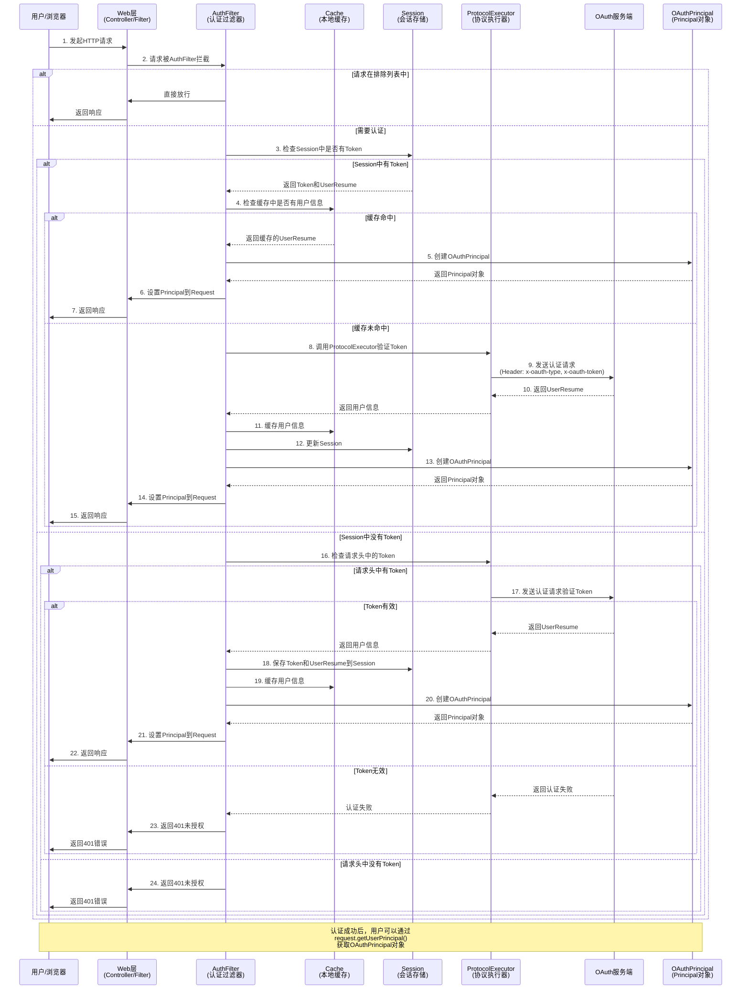

# Spring Support OAuth Client Starter

## 📖 模块简介

Spring Support OAuth Client Starter 是一个功能强大的 OAuth 客户端模块，提供完整的 OAuth 认证集成方案。该模块不仅支持标准的 OAuth 认证流程，还实现了 Java EE/Jakarta EE 的安全 API 标准，包括`java.security.Principal`接口和`HttpServletRequest`的认证相关方法。

## ✨ 主要功能

### 🔐 OAuth 认证

- 多协议支持（HTTP、WebSocket、Static 等）
- 自动令牌管理和刷新
- 用户信息缓存
- 会话管理

### 👤 Principal 支持

- 完整实现`java.security.Principal`接口
- 集成 OAuth 用户信息
- 角色和权限管理
- 用户详细信息访问

### 🌐 HttpServletRequest 增强

- `isUserInRole()` - 角色检查
- `getAuthType()` - 认证类型获取
- `logout()` - 用户登出
- `login()` - 用户登录（OAuth 流程）
- `getUserPrincipal()` - 获取用户 Principal

### 🛡️ 权限控制

- 基于注解的权限验证
- 方法级别的访问控制
- 角色和权限检查
- 自定义权限拦截器

## 🚀 快速开始

### Maven 依赖

```xml
<dependency>
    <groupId>com.chua</groupId>
    <artifactId>spring-support-oauth-client-starter</artifactId>
    <version>4.0.0.42</version>
</dependency>
```

### 基础配置

```yaml
plugin:
  oauth:
    # OAuth服务器地址
    address: "http://oauth-server:8080"
    # 认证协议类型
    protocol: "http"
    # 拦截地址模式
    block-address:
      - "/*"
    # 排除地址模式
    exclude-address:
      - "/login"
      - "/public/*"
      - "/actuator/**"
    # 缓存配置
    cache-timeout: 3600
    cache-hot-cold-backup: true
    # 加密配置
    encryption: "SM4"
```

## 📋 详细功能说明

### 1. Principal 支持

#### 获取用户 Principal

```java
@RestController
public class UserController {

    @GetMapping("/profile")
    public ResponseEntity<?> getUserProfile(Principal principal) {
        if (principal instanceof OAuthPrincipal oauthPrincipal) {
            return ResponseEntity.ok(Map.of(
                "username", oauthPrincipal.getName(),
                "userId", oauthPrincipal.getUserId(),
                "realName", oauthPrincipal.getRealName(),
                "roles", oauthPrincipal.getRoles(),
                "permissions", oauthPrincipal.getPermissions(),
                "tenantId", oauthPrincipal.getTenantId(),
                "deptId", oauthPrincipal.getDeptId(),
                "isAdmin", oauthPrincipal.isAdmin()
            ));
        }
        return ResponseEntity.status(HttpStatus.UNAUTHORIZED).build();
    }
}
```

#### 权限检查

```java
@Service
public class UserService {

    public void updateUser(User user, Principal principal) {
        if (principal instanceof OAuthPrincipal oauthPrincipal) {
            // 检查单个角色
            if (!oauthPrincipal.hasRole("ADMIN")) {
                throw new AccessDeniedException("需要管理员权限");
            }

            // 检查多个角色（任意一个）
            if (!oauthPrincipal.hasAnyRole("ADMIN", "USER_MANAGER")) {
                throw new AccessDeniedException("权限不足");
            }

            // 检查权限
            if (!oauthPrincipal.hasPermission("USER_UPDATE")) {
                throw new AccessDeniedException("缺少用户更新权限");
            }
        }

        userRepository.save(user);
    }
}
```

### 2. HttpServletRequest 增强

#### 使用标准 Java EE API

```java
@RestController
public class AuthController {

    @GetMapping("/login-info")
    public ResponseEntity<?> getUserInfo(HttpServletRequest request) {
        // 获取认证类型
        String authType = request.getAuthType(); // 返回: OAUTH_HTTP, OAUTH_STATIC等

        // 获取远程用户
        String remoteUser = request.getRemoteUser();

        // 获取用户Principal
        Principal principal = request.getUserPrincipal();

        // 角色检查
        boolean isAdmin = request.isUserInRole("ADMIN");
        boolean isUser = request.isUserInRole("USER");

        return ResponseEntity.ok(Map.of(
            "authType", authType,
            "remoteUser", remoteUser,
            "isAdmin", isAdmin,
            "isUser", isUser
        ));
    }

    @PostMapping("/admin-only")
    public ResponseEntity<?> adminOnlyAction(HttpServletRequest request) {
        if (!request.isUserInRole("ADMIN")) {
            return ResponseEntity.status(HttpStatus.FORBIDDEN)
                .body("需要管理员权限");
        }

        // 执行管理员操作
        return ResponseEntity.ok("操作成功");
    }

    @PostMapping("/logout")
    public ResponseEntity<?> logout(HttpServletRequest request) {
        try {
            request.logout(); // 清除Session中的用户信息
            return ResponseEntity.ok("登出成功");
        } catch (ServletException e) {
            return ResponseEntity.status(HttpStatus.INTERNAL_SERVER_ERROR)
                .body("登出失败: " + e.getMessage());
        }
    }
}
```

#### 使用增强功能

```java
@RestController
public class EnhancedController {

    @GetMapping("/enhanced-info")
    public ResponseEntity<?> getEnhancedInfo(HttpServletRequest request) {
        if (request instanceof OAuthHttpServletRequestWrapper oauthRequest) {
            // 多角色检查
            boolean hasAnyRole = oauthRequest.isUserInAnyRole("ADMIN", "USER", "GUEST");

            // 权限检查
            boolean hasPermission = oauthRequest.hasPermission("USER_READ");
            boolean hasAnyPermission = oauthRequest.hasAnyPermission("USER_READ", "USER_WRITE");

            // 用户详细信息
            String userId = oauthRequest.getUserId();
            String tenantId = oauthRequest.getTenantId();
            String deptId = oauthRequest.getDeptId();
            boolean isAdmin = oauthRequest.isAdmin();
            boolean isAuthenticated = oauthRequest.isAuthenticated();

            // 获取OAuth Principal
            OAuthPrincipal oauthPrincipal = oauthRequest.getOAuthPrincipal();

            return ResponseEntity.ok(Map.of(
                "hasAnyRole", hasAnyRole,
                "hasPermission", hasPermission,
                "hasAnyPermission", hasAnyPermission,
                "userId", userId,
                "tenantId", tenantId,
                "deptId", deptId,
                "isAdmin", isAdmin,
                "isAuthenticated", isAuthenticated,
                "principal", oauthPrincipal
            ));
        }

        return ResponseEntity.status(HttpStatus.UNAUTHORIZED).build();
    }
}
```

### 3. 权限注解

```java
@RestController
public class SecureController {

    @GetMapping("/admin/users")
    @RequiredRole("ADMIN")  // 需要管理员角色
    public List<User> getUsers() {
        return userService.findAll();
    }

    @PostMapping("/users")
    @RequiredPermission("USER_CREATE")  // 需要用户创建权限
    public User createUser(@RequestBody CreateUserRequest request) {
        return userService.create(request);
    }

    @DeleteMapping("/users/{id}")
    @RequiredAnyRole({"ADMIN", "USER_MANAGER"})  // 需要任意一个角色
    public void deleteUser(@PathVariable Long id) {
        userService.delete(id);
    }
}
```

### 4. 过滤器和拦截器

#### 自定义安全过滤器

```java
@Component
public class CustomSecurityFilter implements Filter {

    @Override
    public void doFilter(ServletRequest request, ServletResponse response,
                        FilterChain chain) throws IOException, ServletException {

        HttpServletRequest httpRequest = (HttpServletRequest) request;

        // 检查用户是否已认证
        Principal principal = httpRequest.getUserPrincipal();
        if (principal == null) {
            ((HttpServletResponse) response).sendRedirect("/login");
            return;
        }

        // 检查特定路径的权限
        String requestURI = httpRequest.getRequestURI();
        if (requestURI.startsWith("/admin/") && !httpRequest.isUserInRole("ADMIN")) {
            ((HttpServletResponse) response).sendError(HttpStatus.FORBIDDEN.value());
            return;
        }

        chain.doFilter(request, response);
    }
}
```

#### 权限拦截器

```java
@Component
public class AuthInterceptor implements HandlerInterceptor {

    @Override
    public boolean preHandle(HttpServletRequest request, HttpServletResponse response,
                           Object handler) throws Exception {

        Principal principal = request.getUserPrincipal();
        if (principal instanceof OAuthPrincipal oauthPrincipal) {

            // 管理员可以访问所有资源
            if (oauthPrincipal.isAdmin()) {
                return true;
            }

            // 检查特定权限
            if (request.getRequestURI().startsWith("/api/users/") &&
                !oauthPrincipal.hasPermission("USER_MANAGE")) {
                response.sendError(HttpStatus.FORBIDDEN.value(), "权限不足");
                return false;
            }
        }

        return true;
    }
}
```

### 5. 登录单端/多端控制（在线数量限制）

查询用户在线状态，判断当前为单端（SINGLE）还是多端（MULTIPLE）模式：

```java
AuthClientExecute client = AuthClientExecute.getInstance();

// 获取指定用户在线状态（单端/多端、当前在线数、最大在线数）
Protocol.OnlineStatus status = client.getOnlineStatus("userId");
boolean multiple = status.isMultipleMode();   // 是否多端模式
boolean canLogin = status.canLogin();         // 是否还可继续登录

// 分页查询在线用户
Protocol.OnlineUserResult onlineUsers = client.getOnlineUsers(null, null, 1, 100);
```

> **在线数量限制由认证服务器（sso）强制**：登录时校验 `maxOnlineCount`（默认 3），
> 达到上限返回「已达到最大在线设备数量限制」；Http/Armeria 协议返回真实在线状态，
> static/OAuth2 协议无状态部署时返回默认多端模式（不强制限制）。

### 6. Refresh 多种升级模式

`UpgradeType` 支持三种模式：

```java
AuthClientExecute client = AuthClientExecute.getInstance();

// VERSION：升级账号信息（刷新用户信息）
client.upgrade("access-token", UpgradeType.VERSION);

// TIMESTAMP：升级账号信息并重置时长（续期）
client.upgrade("access-token", UpgradeType.TIMESTAMP);

// REFRESH：使用 refresh token 换发新 token
client.upgrade("refresh-token", UpgradeType.REFRESH);
```

对应 HTTP 接口：`POST /v2/user/upgrade`（VERSION/TIMESTAMP，通过 `x-oauth-upgrade-type` 头指定）、
`POST /v2/user/refresh-token`（REFRESH）。

### 7. AppKey 认证模式

基于 `appId` / `appSecret` 的客户端认证，无需用户密码：

```java
AppKeySecret appKeySecret = new AppKeySecret()
        .setAppId("APP-1001")
        .setAppSecret("secret")
        .setUserCode("U-100");               // 缓存键优先使用 userCode
// 可选自定义请求体（兼容服务端两种 body 形式）
appKeySecret.setBody("{\"appKey\":\"xxx\",\"appSecret\":\"yyy\"}");

AuthenticationInformation info = protocol.authentication(appKeySecret);
```

> Http/Armeria/RSocket 协议支持 AppKey 认证；static 协议不支持（降级返回 403）。

### 8. 临时令牌（含 Refresh 换临时令牌）

创建短期有效的临时令牌，可限定过期时间与允许访问的 URL：

```java
AuthClientExecute client = AuthClientExecute.getInstance();

// 基于当前登录用户创建临时令牌（默认 10 秒过期）
client.createTemporaryToken();

// 基于任意有效源令牌创建
client.createTemporaryTokenByToken("source-token", 60, List.of("/api/upload", "/api/download"));

// 用 refresh token 换取临时令牌（access token 过期时的临时授权场景）
client.createTemporaryTokenByRefreshToken("refresh-token", 60, List.of("/api/file/*"));
```

> 过期时间范围 1~3600 秒；Http/Armeria/RSocket 协议实现，OAuth2/static 协议返回 501。

## ⚙️ 高级配置

### 完整配置示例
```yaml
plugin:
  oauth:
    # OAuth服务器配置
    address: "http://oauth-server:8080"
    protocol: "http" # http, websocket, static

    # 路径配置
    block-address:
      - "/*"
    exclude-address:
      - "/login"
      - "/register"
      - "/public/**"
      - "/actuator/**"
      - "/swagger-ui/**"
      - "/v3/api-docs/**"

    # 缓存配置
    cache-timeout: 3600 # 缓存超时时间（秒）
    cache-hot-cold-backup: true # 启用热冷备份

    # 安全配置
    encryption: "SM4" # 加密算法

    # 临时提供者配置
    temp:
      open: true

    # 会话配置
    session:
      timeout: 1800 # 会话超时时间（秒）

    # 权限配置
    permission:
      enable: true
      default-role: "USER"
```

### 多环境配置

```yaml
# 开发环境
spring:
  profiles:
    active: dev

---
spring:
  profiles: dev
plugin:
  oauth:
    address: "http://localhost:8080"
    cache-timeout: 300

---
spring:
  profiles: prod
plugin:
  oauth:
    address: "https://oauth.example.com"
    cache-timeout: 3600
    encryption: "AES"
```

## 🔧 自定义扩展

### 自定义认证处理

```java
@Component
public class CustomAuthService implements AuthService {

    @Override
    public String getCurrentUserId() {
        // 自定义用户ID获取逻辑
        return "custom-login-id";
    }

    @Override
    public String getCurrentUsername() {
        // 自定义用户名获取逻辑
        return "custom-username";
    }

    // 实现其他方法...
}
```

### 自定义权限验证

```java
@Component
public class CustomPermissionEvaluator {

    public boolean hasPermission(Principal principal, String permission) {
        if (principal instanceof OAuthPrincipal oauthPrincipal) {
            // 自定义权限验证逻辑
            return customPermissionCheck(oauthPrincipal, permission);
        }
        return false;
    }
}
```

## 🔄 OAuth 认证流程图



## 📝 注意事项

1. **登录方法限制**：OAuth 客户端不支持直接的用户名密码登录，`request.login()`方法会抛出`ServletException`
2. **登出行为**：`request.logout()`方法会清除 Session 中的用户信息，但不会完全销毁 Session
3. **线程安全**：Principal 和用户信息存储在 Session 中，在多线程环境下是安全的
4. **性能考虑**：用户信息会缓存在 Session 中，避免频繁的远程调用
5. **兼容性**：完全兼容 Java EE/Jakarta EE 的安全 API 标准

## 🐛 故障排除

### 常见问题

1. **Principal 为 null**

   - 检查用户是否已通过 OAuth 认证
   - 确认请求路径不在排除列表中
   - 验证 OAuth 服务器配置是否正确

2. **isUserInRole 返回 false**

   - 确认用户确实具有该角色
   - 检查角色名称是否正确（区分大小写）
   - 验证 OAuth 服务器返回的角色信息

3. **logout 不生效**
   - 检查 Session 是否存在
   - 确认没有其他组件重新设置用户信息

### 调试建议

启用调试日志：

```yaml
logging:
  level:
    com.chua.starter.oauth.client: DEBUG
```

这将输出详细的认证和 Principal 创建过程日志。
