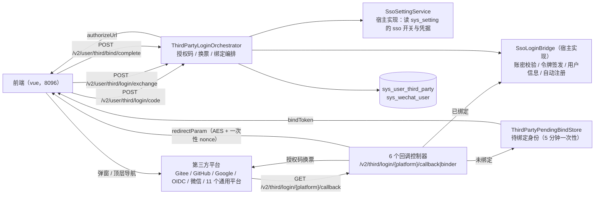

# spring-support-oauth-third-starter

第三方登录（SSO）业务模块：授权码获取、回调编排、三方账号绑定 / 解绑、待绑定身份、一次性换票与令牌签发。
从 `spring-api-support-common-system-starter` 拆分而来——本模块只做「三方登录这一套完整业务」，
本地账号校验与令牌签发经 `SsoLoginBridge` 委托宿主；monitor / ai / collect / oauth 这类不需要整套系统业务的宿主
也可以只实现该桥来复用三方登录能力。

- 宿主：`spring-api-support-common-system-starter`（默认实现 `SsoLoginBridge`）
- 依赖方向：`system → sso`，**sso 不反向依赖宿主业务**
- 自带持久层：`sys_user_third_party`、`sys_wechat_user`（`@MapperScan` 在本模块自动配置里，宿主不补扫描）

## 1. 架构

## 2. 平台覆盖

| 接入方式 | 平台 | 回调前缀 |
|---|---|---|
| 专用控制器 | `gitee`、`github`、`google`、`wechat`、`oidc` | `/v2/third/login/{gitee,github,google,wechat,oidc}` |
| 通用路径变量控制器（白名单） | `wechat_mp`、`wechat_enterprise`、`qq`、`alipay`、`dingtalk`、`weibo`、`baidu`、`microsoft`、`taobao`、`douyin`、`feishu` | `/v2/third/login/{platform}` |

通用控制器只服务上表白名单，白名单之外的路径变量直接拒绝（防止任意平台名流入 `AuthRequestFactory`）。
Spring 精确路径优先，五个专用控制器不会被通用控制器抢占。

## 3. 端点

| 端点 | 方法 | 鉴权 | 说明 |
|---|---|---|---|
| `/v2/user/third/login/code` | POST | `@TokenForIgnore` | 取第三方授权 URL；`thirdType=0` 表示绑定，其它值表示登录。`callback` 为绝对地址时必须命中白名单 |
| `/v2/user/third/login/exchange` | POST | `@TokenForIgnore` | 用回调带回的 `redirectParam` 一次性换票（先核销后解密） |
| `/v2/user/third/bind/pending` | POST | `@TokenForIgnore` | 用 `bindToken` 回显待绑定的三方身份（只读，不核销） |
| `/v2/user/third/bind/complete` | POST | `@TokenForIgnore` | 核销 `bindToken` → 校验本地账密 → 落绑定 → 同请求内签发令牌 |
| `/v2/user/third/bind/code` | POST | 需登录（无 `@TokenForIgnore`） | 把三方账号绑定到当前登录用户（`thirdType=0` 的入口，实现上复用 `thirdLoginCode`） |
| `/v2/user/third/bind/info` | POST | `@UserValue("userId")` | 查询当前用户已绑定的平台列表（含 `wechat`） |
| `/v2/user/third/unbind` | POST | `@UserValue("userId")` | 解绑当前用户的指定平台（平台名忽略大小写匹配） |
| `/v2/user/third/bindings/query` | POST | `@Permission(ADMIN, SUPER_ADMIN)` | 批量查询多个用户的绑定（单次 ≤ 500 个用户） |
| `/v2/user/third/admin/unbind` | POST | `@Permission(ADMIN, SUPER_ADMIN)` | 管理员代用户解绑 |
| `/v2/third/login/{platform}/callback` | GET | `@Ignore` | 授权码回调：已绑定→签发换票凭证；未绑定→下发 `bindToken` |
| `/v2/third/login/{platform}/binder` | GET | `@Ignore` | 绑定回调：落 `sys_user_third_party` 并把头像/邮箱回填到本地账号空位 |

## 4. 四条链路

### 4.1 绑定（已登录用户）

1. 前端 `POST /v2/user/third/bind/code`（`thirdType=0`）拿到授权 URL，弹窗打开；
2. 平台上完成授权 → `GET /v2/third/login/{platform}/binder?code&state`；
3. 回调按 `state` 取回 `clientId/clientSecret/redirectUri/userId`，用 `AuthGiteeRequest` 等换票；
4. 校验「同一本地用户是否已有绑定」→ 落 `sys_user_third_party`（`type` 按平台存量口径：`gitee`/`wechat` 小写，其余为大写枚举名如 `GITHUB`）；
5. 本地账号头像/邮箱为空时用三方值回填，回跳前端。

### 4.2 已绑定身份登录

1. `POST /v2/user/third/login/code` → 授权 URL → 平台授权；
2. `callback` 按 `uid`（+ 平台类型）命中绑定 → `issueThirdPartyToken(userId, platform, request)`：
   - `plugin.oauth.protocol=static` → 走 `SsoLoginBridge.issueLocalToken(user)`（与密码登录同源）；
   - 其它协议 → `AuthClientExecute.getAccessToken(userId, null, AuthType.THIRD_PARTY, ext)`；
3. 登录结果经 AES 加密为 `redirectParam` 并登记一次性 nonce，`302` 回站点；前端调 `exchange` 兑换。

### 4.3 无绑定首次登录

1. `callback` 找不到绑定：把三方身份（uid/用户名/昵称/头像/邮箱）暂存为 `bindToken`（5 分钟、一次性）并回跳；
2. 前端调 `bind/pending` 回显三方身份 → 用户输入本地账号密码；
3. `bind/complete` 顺序固定：**核销 bindToken → 校验本地账密 → 防重（该三方已绑他人 / 当前用户已绑同平台）→ 落绑定 → 签发令牌**；
   绑定与签发在同一请求内完成，不存在「先发 token 再补绑」的窗口。

**自动注册例外（GitHub / Gitee / Google 各一开关）**：`sys_setting` 的 `sso/GithubAutoRegister`、`sso/GiteeAutoRegister`、
`sso/GoogleAutoRegister` 为 `true` 时，对应平台首次登录直接由宿主 `registerThirdPartyUser` 创建本地账号
（用户名 = 平台侧标识，撞名加短后缀）并落绑定，不进入绑定页；注册失败回落上面的 `bindToken` 流程。
开关行缺失、停用或读取异常一律按关闭处理（fail-safe），未绑定必走绑定页。

### 4.4 解绑

`/third/unbind`（本人）或 `/third/admin/unbind`（管理员）按 `sys_user_third_party_type` 忽略大小写匹配删除；
`wechat` 同时清 `sys_wechat_user`。

## 5. 配置

### 5.1 运行时开关与凭据（`sys_setting`）

| 组（`sys_setting_group`） | 名称 | 值 | 说明 |
|---|---|---|---|
| `sso` | `Gitee` / `Github` / `Google` / `Oidc` / `Wechat` / `Qq` … `Feishu` | `true` / `false` | 平台登录开关；关闭时 `getAuthRequest` 返回 `null`，回调侧也会拒绝 |
| `sso` | `GithubAutoRegister` / `GiteeAutoRegister` / `GoogleAutoRegister` | `true` / `false` | 对应平台首次登录是否自动注册本地账号（缺省/停用/异常按关闭处理，fail-safe）；为 `false` 时未绑定一律走 `bindToken` 绑定页 |
| `gitee` / `github` / `google` … | `clientId` | — | OpenAPI 应用标识（`appKey` 同义） |
| 同上 | `clientSecret` | — | 应用密钥（读回恒为掩码 `******`，不能靠回读明文判断是否写入） |
| 同上 | `redirectUri` | — | 平台侧登记的**完全一致**回调地址，如 `http://<host>:18170/v2/third/login/gitee/callback` |

配置写入必须走设置接口（`PUT /v2/setting/update` / `updateBatch`）；直连改库不会回灌运行时缓存。

### 5.2 宿主配置（`plugin.system.security`，`SsoProperties`）

| 键 | 默认 | 说明 |
|---|---|---|
| `third-party-callback-key` | `1234567890Oil#@1` | 换票凭证 `redirectParam` 的 AES 密钥（必须 16 位）；密钥只存服务端，前端无法解密 |
| `allowed-system-callback-hosts` | 空（**fail-closed**） | 回跳地址白名单（`scheme://host[:port]`）；为空时只允许站内相对路径，前端传绝对 origin 会被拒 |

### 5.3 JVM 参数

| 参数 | 默认 | 说明 |
|---|---|---|
| `-Dplugin.oauth.sso.http-timeout=<毫秒>` | `15000`，下限 `3000` | 三方授权（授权码换票、拉取用户信息）的连接超时，经 `ThirdPartyHttpSupport` 注入每个 `AuthConfig` |

> 不显式配置代理：simple-http 未设 `proxy` 时走 JVM 的 `-Dhttps.proxyHost/-Dhttps.proxyPort` 并遵守
> `http.nonProxyHosts`；显式塞 `proxy` 会绕过 `nonProxyHosts`，把内网地址也推给代理。

## 6. SPI：`SsoLoginBridge`（宿主实现）

| 方法 | 宿主职责 |
|---|---|
| `findByUsername` / `getById` / `getCallbackUser` | 查本地账号 |
| `verifyPassword` | 账密校验（含账号状态），失败统一提示「账号或密码错误」 |
| `updateUser` / `updateCallbackUser` | 绑定后回填头像 / 邮箱 |
| `issueLocalToken` | 与密码登录同源签发令牌（`static` 协议下唯一可用路径） |
| `buildUserInfo` / `getUserLoginInfo` | 组装登录用户信息 |
| `registerThirdPartyUser` | 三方自动注册：同事务内建账号（随机不可用口令）+ 落绑定；撞名加短后缀 |

## 7. 安全设计

| 机制 | 落地 |
|---|---|
| 换票凭证不可伪造 / 不可重放 | `redirectParam` = AES(`LoginResult`)，键不下发；兑换时 `nonceKey = xchg_ + sha256(密文)`，**先核销再解密**（核销即置 `0`，fail-closed） |
| 开放重定向三重防线 | 入口 `SystemCallbackPolicy.rejectReason`（绝对地址必须命中白名单）→ 写缓存 `sanitizeStructure` → 读取点 `sanitize` 后才交给 `RedirectView.setUrl` |
| 绑定必须先核验本地账密 | `bind/complete` 在一次请求内完成核验、落绑定、签发令牌 |
| 待绑定身份短时效 | `bindToken` 仅存服务端内存（`ConcurrentHashMap`），5 分钟、一次性（`consume` 命中即移除） |
| 错误提示双写 | `msg` 走 flash attribute（同域可读），`thirdMsg` 走静态属性拼进 query（跨域回跳不丢） |
| 嗅探（bot 挑战）豁免 | `/v2/third/**` 必须在 `BotSniffGuard` 默认豁免内：SSO 回跳是**从第三方站点发起的顶层导航**，没有 ticket、也无法先执行挑战脚本再重放，否则 `CodecSniffOpen=true` 时所有平台登录都被 `428` 卡死 |

## 8. 验收状态

真实链路验收（194 `system-api` 18170 + 8096 前端 + 真实浏览器 + 真实第三方账号），详细断言与截图见
`D:\ch\验收报告\单点登录验收文档.md` 与同名截图目录。

| 平台 | 配置校验 | 绑定 | 已绑定登录 | 解绑 | 无绑定首次登录 | 依据 |
|---|---|---|---|---|---|---|
| GitHub | PASS | PASS | PASS | PASS | PASS（自动注册） | 2026-11-27 全链路跑通，含 §6.4 连接超时补丁之后复跑首登 |
| Gitee | PASS | PASS | PASS | PASS | PASS（`bindToken` 绑定页路径） | 2026-11-27 上午全链路跑通；**补丁后浏览器级回归待复跑**（Gitee 会话过期，需重新登录 ACP 账号） |
| Google | PASS | PASS | PASS | PASS | PASS（自动注册开/关双模式） | 2026-11-28 Chrome 真实授权全链路；quick tunnel 公网回调；自动注册测试账号与孤立绑定行已精确清理，详见报告 §13 |

Google 本轮使用 Cloudflare quick tunnel 作为公网 https 回调载体，隧道地址重启后会变化，必须同步更新 Google 控制台与 `google/redirectUri`。`sso/GoogleAutoRegister` 验收后已还原为 `false`。

补丁后 Gitee 的代码级证据（194 `spring-support-oauth-third-starter-4.0.0.51.jar`，SHA256
`53AA10BE…32186F`，56 条目）：`javap -c` 统计 `ThirdPartyHttpSupport.httpConfig` 调用点
Gitee=2（`binder` + `callback`）、Github=1、Google=1、Wechat=2、Oidc=1、通用=1，合计 8 处。

## 9. 已知坑与排障

1. **3 秒连接超时（Github/Gitee 都中招）**：`AuthConfig` 不带 `httpConfig` 时 simple-http 兜底 3000ms，
   经代理到 github.com 的 TLS 建连实测 1.4~2.8s 且抖动，表现为「GitHub 授权失败」。
   一律经 `ThirdPartyHttpSupport.httpConfig()` 注入，缺省 15s。
2. **`static` 协议下三方用户换不到令牌**：`AuthClientExecute` 的静态账号链路只认 `plugin.oauth.temp.user`
   名单，三方登录对应的本地用户不在名单里 → 会得到空 token。必须走 `issueThirdPartyToken` 的
   `static` 分支（`bridge.issueLocalToken`）。
3. **绑定回调取不到 userId**：`resolveAuthStateUserId` 在单体部署（`SsoServer` 互斥、无 `AuthFilter`）时
   请求上没有用户头/属性，按令牌还原是唯一路径；`bind/code` 也曾因取不到 userId 只报「绑定失败」。
4. **`CodecSniffOpen=true` 时 SSO 全线 428**：症状是回调页正文变成 `(function(){var n="…";…navigator.webdriver…`
   的挑战脚本，`sys_log` 记「嗅探挑战｜GET /v2/third/login/{platform}/callback」。
   判定：`curl -A '<Chrome UA>' -D- <callback>` 得到 `HTTP 428` + `X-Bot-Sniff-Challenge: 1`；
   对照 `/v2/user/login` 得 405 业务报文即说明豁免机制本身正常。修法见第 7 节。
5. **Gitee 回调地址不支持多值/通配**：必须与 Gitee 后台登记的 `redirectUri` 完全一致；
   另需注意「授权页能打开」不等于「回调可用」——Gitee 未登录时只 302 到登录页，不校验回调地址。
6. **Gitee 授权页确认按钮是 `<input type="submit" value="同意授权">`**：文案在 `value` 不在 `innerText`，
   UI 自动化只读文本会误判「没有按钮」。
7. **已授权过的 Gitee 账号再次授权会直接 302 到回调**：探测脚本断言「点了授权按钮」必然假红，
   应以回调是否产生 `oauthPopupId` / `redirectParam` 为准。
8. **secret 类配置读回恒为 `******`**：断言「写入成功」只能靠真实授权换票成功，不能靠回读相等。
9. **绑定类型大小写不统一**：`gitee`/`wechat` 小写，`GITHUB` 等大写枚举名；查询 / 解绑必须忽略大小写，
   否则「查得到却解不掉」。
10. **GitHub 直连被拦**：194 上 SYSTEM 身份直连 github.com 会 `Connection reset` / `SSLHandshake`，
    需走代理并配 MITM truststore；同时 `http.nonProxyHosts` 不能把 `github.com`/`githubusercontent.com` 排除掉。

## 10. 依赖

`spring-support-oauth-starter`、`spring-support-mybatis-starter`、`spring-support-swagger-starter`、Nimbus OIDC SDK、JustAuth；
系统设置读取只依赖本模块的 `SsoSettingService` 窄契约，由宿主实现，不依赖 API 层。
Web / Servlet（`spring-web`、`spring-webmvc`、`jakarta.servlet-api`）按 `provided` 引入，运行时由宿主提供。
