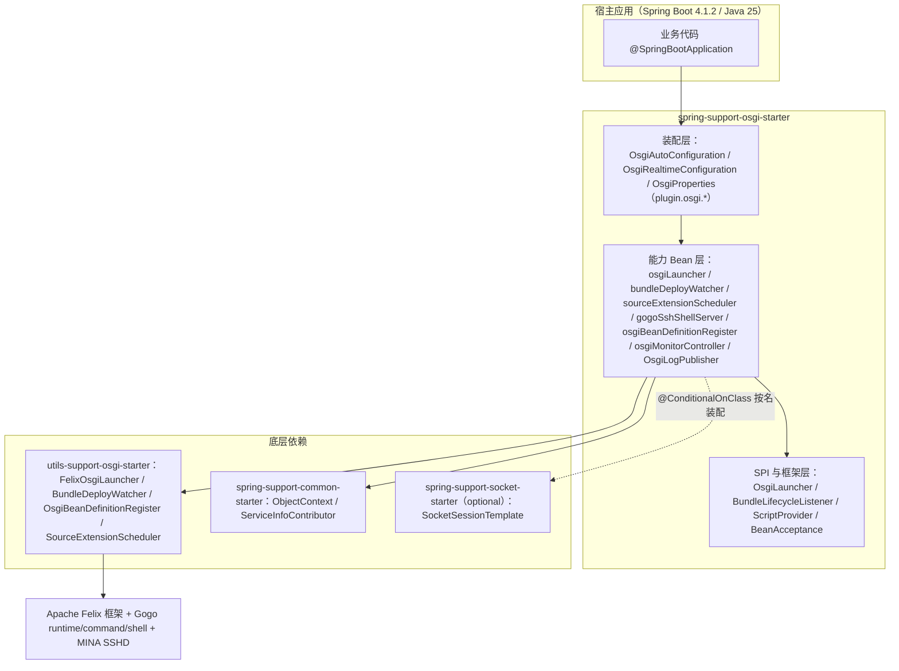
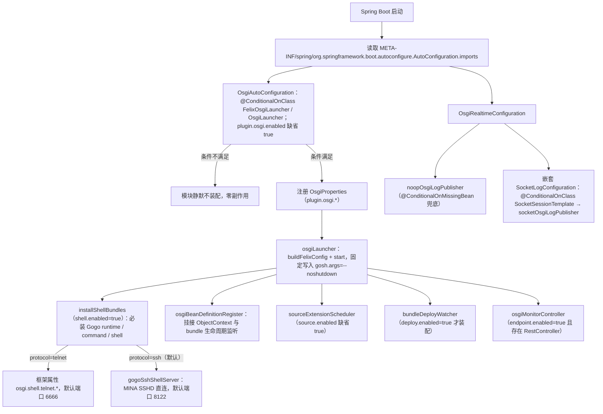

# spring-support-osgi-starter

集成 Apache Felix OSGi 框架的 Spring Boot starter：随应用启动 Felix 框架，提供 Gogo shell 远程管理（SSH/Telnet）、目录热部署、源码扩展点热重载、OSGi 服务到 `ObjectContext` 的 Bean 桥接、`/osgi/**` 观测端点与插件操作实时日志。

在 spring-support 体系中，本模块是「运行期插件化」能力模块：OSGi 具体实现（`FelixOsgiLauncher`、`BundleDeployWatcher`、`OsgiBeanDefinitionRegister`、`SourceExtensionScheduler`）下沉在 `utils-support-osgi-starter`，本模块只做 Spring Boot 自动装配与宿主能力（Web 端点 / SSH 通道 / 实时日志广播）的粘合。

## 1. 架构图



## 2. 核心流程图



## 3. 能力清单

| 能力域 | 关键类 | 入口 / 触发方式 |
|:-------|:-------|:----------------|
| 自动装配 | `OsgiAutoConfiguration`、`OsgiRealtimeConfiguration` | `AutoConfiguration.imports` 注册；`plugin.osgi.enabled`（默认 true）+ classpath 存在 `FelixOsgiLauncher` |
| 配置绑定 | `OsgiProperties` | `plugin.osgi.*`，经 `@EnableConfigurationProperties` 装配 |
| Felix 框架生命周期 | `FelixOsgiLauncher`（utils-support-osgi-starter） | `osgiLauncher` Bean 随自动配置启动/停止 |
| Gogo bundle 安装 | `OsgiAutoConfiguration#installShellBundles` | `plugin.osgi.shell.enabled=true` |
| SSH 远程管理（应用层） | `GogoSshShellServer` | `shell.enabled=true` 且 `protocol=ssh`（默认协议） |
| Telnet 远程管理（框架层） | Felix 框架属性 `osgi.shell.telnet.*` | `shell.enabled=true` 且 `protocol=telnet` |
| 目录热部署 | `BundleDeployWatcher`（utils-support-osgi-starter） | `plugin.osgi.deploy.enabled=true`（默认关闭） |
| 源码扩展点热重载 | `SourceExtensionScheduler` / `SourceJavaCompiler` / `SourceGroovyLoader` | `plugin.osgi.source.enabled`（默认 true） |
| Bean 桥接（服务投影） | `OsgiBeanDefinitionRegister` | 随自动配置装配，注册到 `ObjectContext` |
| 运行时观测端点 | `OsgiMonitorController` | `endpoint.enabled=true` 且 classpath 存在 `RestController` |
| 插件操作实时日志 | `OsgiLogPublisher` / `SocketOsgiLogPublisher` | 始终有兜底实现；引入 socket-starter 后自动切换广播实现 |
| 服务信息登记 | `osgiServiceInfoContributor`（`ServiceInfoContributor`） | 随自动配置装配，向服务目录登记 `osgi` 模块 |

`/osgi/**` 端点（`OsgiMonitorController`，整体开关 `plugin.osgi.endpoint.enabled`，默认关闭）：

| 方法 | 路径 | 说明 | 额外开关 |
|:-----|:-----|:-----|:---------|
| GET | `/osgi/stats` | 框架统计与已注册服务类型 | — |
| GET | `/osgi/bundles` | bundle 清单 | — |
| GET | `/osgi/jars` | 部署目录 jar 清单（含是否仍在框架中） | — |
| GET | `/osgi/bundles/{symbolicName}` | 单 bundle 详情（headers、注册服务类型） | — |
| GET | `/osgi/services` | 服务注册表，按 `service.ranking` 降序 | — |
| GET | `/osgi/snapshot` | 桥接快照与验收拒绝记录 | — |
| GET | `/osgi/context` | 框架 `BundleContext` 可用性 | — |
| GET | `/osgi/bundles/{symbolicName}/download` | 下载 bundle 对应本地 jar | — |
| POST | `/osgi/bundles/install` | 上传安装（同位置自动转升级），参数 `file`、`start` | `manage-enabled=true` |
| POST | `/osgi/bundles/{symbolicName}/update` | 上传新版本原地升级 | `manage-enabled=true` |
| POST | `/osgi/bundles/{symbolicName}/start` / `/stop` / `/uninstall` | 启动 / 停止 / 卸载（卸载不删 jar） | `manage-enabled=true` |
| POST | `/osgi/jars/{fileName}/delete` | 删除部署目录 jar（须先卸载） | `manage-enabled=true` |

## 4. Bean 能力矩阵

| Bean 名 | 类型 | 装配条件（含默认值） | 可否覆盖 | 典型用途 |
|:--------|:-----|:---------------------|:---------|:---------|
| `osgiLauncher` | `FelixOsgiLauncher` | 类级 `@ConditionalOnClass({FelixOsgiLauncher, OsgiLauncher})` + `plugin.osgi.enabled`（缺省 true） | 否（无 `@ConditionalOnMissingBean`） | 框架与 bundle 操作总入口，`destroyMethod="stop"` |
| `bundleDeployWatcher` | `BundleDeployWatcher` | `plugin.osgi.deploy.enabled=true`（默认 false） | 否 | 目录热部署，`destroyMethod="stop"` |
| `sourceExtensionScheduler` | `SourceExtensionScheduler` | `plugin.osgi.source.enabled`（缺省 true），方法内二次校验兜底 | 否 | 源码扩展点编译与注册，`destroyMethod="stop"` |
| `gogoSshShellServer` | `GogoSshShellServer` | `plugin.osgi.shell.enabled=true` 且方法内校验 `protocol=ssh` | 否 | SSH 远程 Gogo 命令通道，`destroyMethod="stop"` |
| `osgiBeanDefinitionRegister` | `OsgiBeanDefinitionRegister` | 随自动配置（仅类级条件），无独立开关 | 否 | OSGi 服务桥接快照，注册进 `ObjectContext` |
| `osgiServiceInfoContributor` | `ServiceInfoContributor` | 随自动配置 | 否 | 服务目录登记 `osgi` 能力 |
| `osgiMonitorController` | `OsgiMonitorController` | `endpoint.enabled=true` + `@ConditionalOnClass(name="org.springframework.web.bind.annotation.RestController")` | 否 | `/osgi/**` 观测与受控变更端点 |
| `noopOsgiLogPublisher` | `OsgiLogPublisher` | `OsgiRealtimeConfiguration` 中 `@ConditionalOnMissingBean(OsgiLogPublisher)` 兜底 | 是（自定义同接口 Bean 即整体替换） | 实时日志空实现 |
| `socketOsgiLogPublisher` | `OsgiLogPublisher` | 嵌套 `SocketLogConfiguration`：`@ConditionalOnClass(name="com.chua.socket.support.session.SocketSessionTemplate")` + `@ConditionalOnMissingBean` | 是 | 经全局 socket 广播插件操作日志 |
| `OsgiProperties` | `OsgiProperties` | `@EnableConfigurationProperties(OsgiProperties.class)` 随自动配置 | — | `plugin.osgi.*` 配置绑定 |

> `bundleDeployWatcher` / `sourceExtensionScheduler` / `gogoSshShellServer` 三个 `@Bean` 方法在内部校验不通过时返回 `null`（登记为 NullBean），注入侧请用 `ObjectProvider`。`osgiLauncher` 启动失败只打 error 日志，不会拖垮应用。

## 5. 完整配置

前缀 **`plugin.osgi`**（`OsgiProperties`，经 configuration-processor 生成 IDE 元数据），以下默认值逐项来自源码。

| 配置路径 | 类型 | 默认值 | 说明 |
|:---------|:-----|:-------|:-----|
| `plugin.osgi.enabled` | `boolean` | `true` | 自动装配总开关 |
| `plugin.osgi.storage` | `String` | `./osgi-cache` | Felix 持久化存储目录 |
| `plugin.osgi.start-level` | `int` | `4` | 框架初始启动级别 |
| `plugin.osgi.storage-clean` | `String` | `onFirstInit` | `onFirstInit` / `onInit` / `none`（保留上次 bundle 状态） |
| `plugin.osgi.auto-start-installed-bundles` | `boolean` | `true` | 安装后自动启动；仅 `shell.enabled=true` 时被读取 |
| `plugin.osgi.framework-properties` | `Map<String,Object>` | 空 | 透传 Felix 框架属性（如 `org.osgi.framework.system.packages.extra`），可覆盖 `gosh.args` |
| `plugin.osgi.deploy.enabled` | `boolean` | `false` | 目录热部署开关 |
| `plugin.osgi.deploy.directory` | `String` | `./osgi-deploy` | 部署目录 |
| `plugin.osgi.deploy.polling-interval` | `long` | `10000` | 扫描间隔（毫秒） |
| `plugin.osgi.deploy.uninstall-on-removed` | `boolean` | `true` | jar 移除后自动卸载 bundle |
| `plugin.osgi.deploy.update-on-changed` | `boolean` | `false` | 移除后对已装 bundle 原地升级 |
| `plugin.osgi.source.enabled` | `boolean` | `true` | 源码扩展点热重载开关（目录不存在则无副作用） |
| `plugin.osgi.source.directory` | `String` | `./osgi-source` | 源码目录 |
| `plugin.osgi.source.output-directory` | `String` | 空串 | 编译输出目录，留空取 `<directory>/../osgi-source-classes`；fat jar 会抽取 `BOOT-INF/lib`（实测约 685MB，停止时清理） |
| `plugin.osgi.source.polling-interval` | `long` | `5000` | 扫描间隔（毫秒），指纹未变不编译 |
| `plugin.osgi.source.groovy-enabled` | `boolean` | `true` | 是否加载 Groovy；无引擎时降级仅 Java |
| `plugin.osgi.source.script-engine` | `String` | `groovy` | 匹配 `ScriptProvider#engineName` |
| `plugin.osgi.bridge.acceptance-enabled` | `boolean` | `true` | 桥接定义经 `BeanAcceptance` 验收器链 |
| `plugin.osgi.bridge.invalidate-on-bundle-lifecycle` | `boolean` | `true` | bundle 生命周期变化时失效桥接快照 |
| `plugin.osgi.endpoint.enabled` | `boolean` | `false` | `/osgi/**` 端点开关（还需 RestController） |
| `plugin.osgi.endpoint.manage-enabled` | `boolean` | `true` | 变更类操作开关 |
| `plugin.osgi.shell.enabled` | `boolean` | `false` | 远程管理开关 |
| `plugin.osgi.shell.protocol` | `String` | `ssh` | `ssh` / `telnet` 二选一 |
| `plugin.osgi.shell.port` | `int` | `0` | 0 时按协议取默认：SSH 8122、Telnet 6666 |
| `plugin.osgi.shell.host` | `String` | `127.0.0.1` | 绑定地址 |
| `plugin.osgi.shell.username` | `String` | 空串 | SSH 用户名，与 `password` 须都非空 |
| `plugin.osgi.shell.password` | `String` | 空串 | SSH 密码 |
| `plugin.osgi.shell.host-key` | `String` | 空串 | 主机密钥路径，留空 `target/osgi-hostkey.ser` 首启自动生成 |
| `plugin.osgi.shell.allow-empty-credential` | `boolean` | `false` | 允许空凭据登录（等同无认证暴露） |
| `plugin.osgi.shell.max-auth-attempts` | `int` | `3` | 已声明但运行期未消费（见第 9 节） |
| `plugin.osgi.shell.install-framework-sshd-bundles` | `boolean` | `false` | 框架内安装 sshd bundle（sshd 2.13.2 下 sftp/scp 必然解析失败） |

> 框架配置固定先写入 `gosh.args=--noshutdown`（防 Gogo 在 stdin EOF 时停掉整个框架），仍可被 `framework-properties` 覆盖。

## 6. 使用方式

```xml
<dependency>
    <groupId>com.chua</groupId>
    <artifactId>spring-support-osgi-starter</artifactId>
    <version>4.0.0.51</version>
</dependency>
```

最小启用示例（框架本体与源码热重载默认开启，无需写 `enabled`）：

```yaml
plugin:
  osgi:
    shell:
      enabled: true          # 远程管理默认关闭，需显式开启
      protocol: ssh
      port: 8122
      username: admin
      password: change-me    # username/password 必须都非空，否则启动抛异常
    endpoint:
      enabled: true          # /osgi/** 观测端点默认关闭
```

验证：

```bash
ssh -p 8122 admin@127.0.0.1   # 进入 Gogo shell
g! bundle:list
curl http://127.0.0.1:8080/osgi/stats
```

编程式使用：注入 `FelixOsgiLauncher`（或接口 `OsgiLauncher`）做 bundle 操作，注入 `OsgiLogPublisher` 发日志；`OsgiBeanDefinitionRegister` 用 `ObjectProvider` 判空后读快照。

可选依赖说明：

- `utils-support-osgi-starter`（必依赖）：缺失时类级 `@ConditionalOnClass` 不满足，整个模块**静默不装配**；
- `spring-support-socket-starter`（optional）：引入后日志经 `SocketOsgiLogPublisher` 广播到全局 socket；缺失时 noop 兜底，模块可独立运行；
- `spring-boot-configuration-processor` / `lombok`（optional）：仅编译期元数据与代码生成，运行期无依赖；
- Felix / Gogo / SSHD 版本由 `utils-support-osgi-starter` 与父 pom 依赖管理托管。

## 7. 使用场景

适用：

- 运行期动态插件化：功能模块以 bundle jar 不停机安装、升级、卸载（目录热部署或 `/osgi/bundles/install` 上传）；
- 源码级扩展点热重载：开发/测试期把带 `@SourceSpi` 的 Java/Groovy 源码放进目录，改完即编译生效；
- 远程运维通道：SSH 进 Gogo shell 执行 bundle 命令，或用 `/osgi/**` 做只读观测与受控变更；
- 跨容器服务桥接与操作审计：OSGi 服务投影为 `ObjectContext` 扩展对象；引入 socket 后实时展示插件操作流。

不适用/慎用：

- 纯静态单体应用：没有插件需求时只多出一个 Felix 实例与后台扫描线程，纯属开销；
- 通用 SSH 服务器需求（登录 + Shell + SFTP）：应使用 `spring-support-ssh-starter`，本模块 SSH 仅面向 Gogo bundle 运维。

与相邻模块取舍：`utils-support-osgi-starter` 是 OSGi 实现所在，本模块只做装配粘合；`spring-support-socket-starter` 仅为实时日志广播，不需要就不要引入；`deploy` 面向已构建 bundle jar、`source` 面向源码现场编译——开发期用 `source`，分发用 `deploy`。

## 8. 扩展点

| 扩展点 | 类型 / 位置 | 注册 / 使用方式 |
|:-------|:------------|:----------------|
| `OsgiLogPublisher` | 接口，`com.chua.starter.osgi.support.realtime` | 声明自己的 Bean 即可替换默认 noop/socket 实现（`@ConditionalOnMissingBean` 让位）；实现必须自行吞掉网络异常，日志是旁路 |
| `OsgiLauncher` / `FelixOsgiLauncher` | 框架 API | 注入后程序化 `installBundle` / `updateBundle` / `uninstallBundle` / `getBundles` / `getServiceDescriptors` 等；`getFrameworkBundleContext` 与 `addListener` / `removeListener` 在实现类 `FelixOsgiLauncher` 上 |
| `BundleLifecycleListener` | 接口，经 `FelixOsgiLauncher#addListener` | 监听 bundle 安装/启动/停止/升级/卸载事件 |
| `ScriptProvider` | SPI，`com.chua.common.support.task.script` | 自定义脚本引擎：`engineName()` 匹配 `plugin.osgi.source.script-engine` 即被 `SourceGroovyLoader` 加载 |
| `@SourceSpi` | 注解，`com.chua.osgi.support.source` | 标记源码目录中的扩展宿主类：public 非静态字段按「字段类型 = SPI 类型、字段名 = 扩展名」注册进 `ServiceProvider` |
| `BeanAcceptance` | SPI，`com.chua.common.support.objects.acceptance` | 桥接验收器，经 `OsgiBeanDefinitionRegister#addAcceptance` 注册，拒绝者不纳入快照 |
| `plugin.osgi.framework-properties` | 配置透传 | 不写代码扩展 Felix 行为，如导出应用侧接口包给 bundle |

```java
@SourceSpi
public class MyExtensions {
    public final MySpi myExt = new MySpiImpl();   // 扩展名 = 字段名 myExt
}
```

## 9. 常见问题

1. **引入依赖后没有任何 OSGi Bean，或 `/osgi/**` 404？** 依次检查：`plugin.osgi.enabled` 是否被显式设为 false；classpath 是否真的带有 `utils-support-osgi-starter`（类级 `@ConditionalOnClass` 不满足时整个模块静默不装配）；端点还要求 `plugin.osgi.endpoint.enabled=true`（默认 false）且 classpath 存在 `RestController`。
2. **8122 没监听 / SSH 启动抛「认证凭据不完整」？** `shell.enabled` 默认 false；SSH 模式 `username` 与 `password` 必须都非空，除非 `allow-empty-credential=true`（等同无认证暴露，仅限受信本地调试）。`max-auth-attempts` 字段存在但运行期未消费，认证失败上限目前交给 SSHD 默认行为。框架启动失败只打 error 日志、不拖垮应用，但此时 SSH 里 `bundle:` 命令仍可用（框架 API 直通），其余 Gogo 命令不可用。
3. **框架刚启动就被 shell 停掉？** Gogo shell 在 stdin 到 EOF（systemd/docker 非交互启动）时会停整个框架；模块固定写入 `gosh.args=--noshutdown`（只停 shell 不停框架），需要覆盖时用 `framework-properties`。
4. **Spring Boot 4 兼容性？** 注册走 `@AutoConfiguration` + `META-INF/spring/...AutoConfiguration.imports`（本模块**没有** `spring.factories`），符合 Boot 3+/4 机制；类级 `@ConditionalOnClass` 用类字面量（`FelixOsgiLauncher` / `OsgiLauncher` 来自必依赖 `utils-support-osgi-starter`，条件按注解元数据判定，缺失时模块静默不装配）；可选依赖（`RestController`、`SocketSessionTemplate`）在 `@Bean` 侧用 name 字符串形式，缺失时不解析方法签名、不会抛 `NoClassDefFoundError`；仓库基线 Boot 4.1.2 / Java 25。
