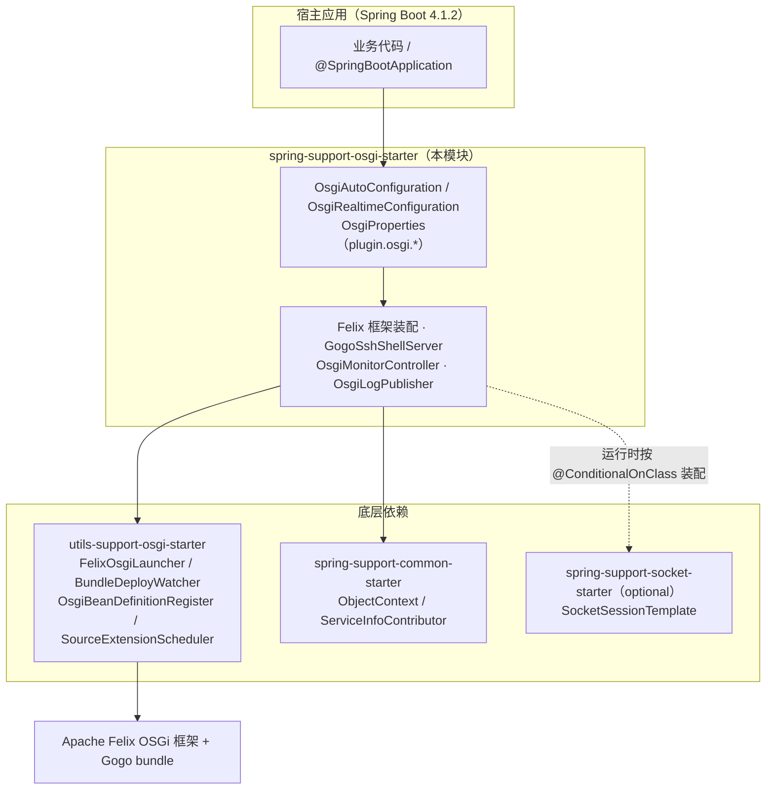
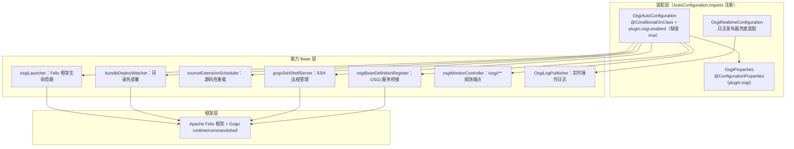
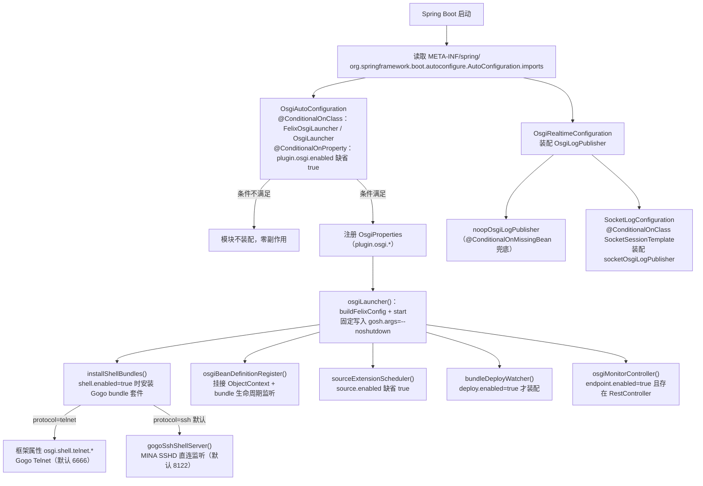
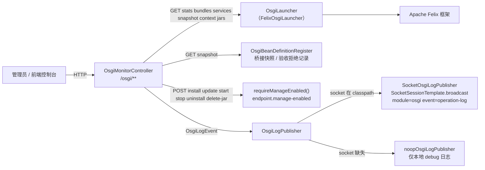
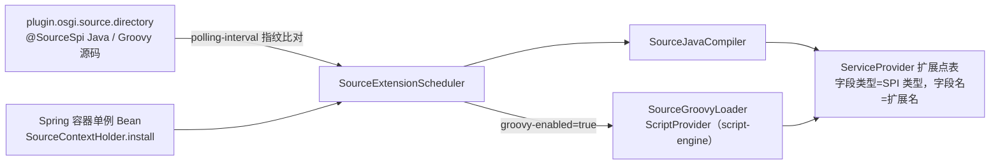

# spring-support-osgi-starter

集成 Apache Felix OSGi 框架的 Spring Boot starter：随应用启动 Felix 框架，提供 Gogo shell 远程管理（SSH/Telnet）、目录热部署、源码扩展点热重载、OSGi 服务到 `ObjectContext` 的 Bean 桥接、只读观测端点与插件操作实时日志。

- 坐标：`com.chua:spring-support-osgi-starter`，版本随父 pom（当前 `4.0.0.51`），基线 Spring Boot `4.1.2`。
- 框架本体默认开启（`plugin.osgi.enabled` 缺省即 true）；远程管理（`shell.enabled`）、观测端点（`endpoint.enabled`）、目录热部署（`deploy.enabled`）默认均关闭，需显式开启；源码扩展点（`source.enabled`）默认开启。

---

## 1. 架构图

### 1.1 模块在体系中的位置



### 1.2 模块内部分层



---

## 2. 核心流程图

### 2.1 启动装配流程



### 2.2 请求处理与实时日志数据流（观测端点）



### 2.3 源码扩展点热重载数据流



---

## 3. 能力清单

| 能力域 | 关键类 | 入口 / 生效条件 |
|:-------|:-------|:----------------|
| 自动配置装配 | `OsgiAutoConfiguration`、`OsgiRealtimeConfiguration` | `AutoConfiguration.imports` 注册；`plugin.osgi.enabled`（默认 true）+ classpath 存在 `FelixOsgiLauncher` |
| 配置绑定 | `OsgiProperties` | `plugin.osgi.*`，经 `@EnableConfigurationProperties` 装配 |
| Felix 框架生命周期 | `FelixOsgiLauncher`（utils-support-osgi-starter） | `osgiLauncher` Bean，随自动配置装配 |
| Gogo bundle 安装 | `OsgiAutoConfiguration#installShellBundles` / `#installGogoBundles` | `plugin.osgi.shell.enabled=true` |
| SSH 远程管理（应用层） | `GogoSshShellServer` | `shell.enabled=true` 且 `protocol=ssh`（默认协议） |
| Telnet 远程管理（框架层） | Felix 框架属性 `osgi.shell.telnet.*` | `shell.enabled=true` 且 `protocol=telnet` |
| 目录热部署 | `BundleDeployWatcher`（utils-support-osgi-starter） | `plugin.osgi.deploy.enabled=true`（默认关闭） |
| 源码扩展点热重载 | `SourceExtensionScheduler` / `SourceJavaCompiler` / `SourceGroovyLoader` | `plugin.osgi.source.enabled`（默认 true） |
| Bean 桥接（服务投影） | `OsgiBeanDefinitionRegister` | 随自动配置装配，注册到 `ObjectContext` |
| 运行时观测端点 | `OsgiMonitorController` | `endpoint.enabled=true` 且 classpath 存在 `RestController` |
| 插件操作实时日志 | `OsgiLogPublisher` / `SocketOsgiLogPublisher` | 始终有兜底实现；引入 socket-starter 后自动切换为广播实现 |
| 服务信息登记 | `osgiServiceInfoContributor`（`ServiceInfoContributor`） | 随自动配置装配，向控制台登记 `osgi` 模块能力 |

实际生效的能力：

- 启动并停止 Felix 框架，持久化存储目录 `plugin.osgi.storage`（默认 `./osgi-cache`）；
- shell 开启时自动安装 Gogo runtime / command / shell bundle；
- SSH 远程管理由应用层 `GogoSshShellServer`（MINA SSHD 2.x）直接提供，命令会话接线到框架内 Gogo `CommandProcessor`，支持 `bundle:list / install / update / start / stop / uninstall`；
- Telnet 远程管理经 Felix 框架配置 `osgi.shell.telnet.*` 交由 Gogo shell bundle 提供；
- 目录热部署：扫描部署目录自动安装新 bundle、卸载已移除 bundle、可原地升级；
- 源码扩展点：目录下的 Java（可选 Groovy）源码被持续编译并注册进 `ServiceProvider` 扩展点表，无需打成 bundle jar；
- OSGi 服务经 `OsgiBeanDefinitionRegister` 桥接为 Spring `ObjectContext` 的扩展对象，bundle 生命周期变化会推进快照并触发扩展对象切换；
- 观测端点只读接口：`/osgi/stats`、`/osgi/bundles`、`/osgi/jars`、`/osgi/bundles/{symbolicName}`、`/osgi/services`、`/osgi/snapshot`、`/osgi/context`、`/osgi/bundles/{symbolicName}/download`；
- 变更类操作（上传安装/升级/启动/停止/卸载/删除 jar）受 `plugin.osgi.endpoint.manage-enabled`（默认 true）控制，端点启用后由既有接口鉴权体系保护。

---

## 4. Bean 能力矩阵

| Bean 名 | 类型 | 装配条件 | 可否覆盖 | 典型注入姿势 |
|:--------|:-----|:---------|:---------|:-------------|
| `osgiLauncher` | `FelixOsgiLauncher` | 类级 `@ConditionalOnClass({FelixOsgiLauncher, OsgiLauncher})` + `plugin.osgi.enabled`（缺省 true） | 否（无 `@ConditionalOnMissingBean`，自定义同类型 Bean 会形成双候选） | 构造器注入 `FelixOsgiLauncher` 或接口 `OsgiLauncher`；`destroyMethod="stop"` |
| `bundleDeployWatcher` | `BundleDeployWatcher` | `plugin.osgi.deploy.enabled=true` | 否 | `ObjectProvider<BundleDeployWatcher>`（未开启时不存在）；`destroyMethod="stop"` |
| `sourceExtensionScheduler` | `SourceExtensionScheduler` | `plugin.osgi.source.enabled`（缺省 true），方法内对 `source.isEnabled()` 二次判空兜底 | 否 | `ObjectProvider<SourceExtensionScheduler>`；`destroyMethod="stop"` |
| `gogoSshShellServer` | `GogoSshShellServer` | `plugin.osgi.shell.enabled=true`，且方法内校验 `protocol=ssh`（否则返回 null） | 否 | `ObjectProvider<GogoSshShellServer>`；`destroyMethod="stop"` |
| `osgiBeanDefinitionRegister` | `OsgiBeanDefinitionRegister` | 随自动配置（仅类级条件），无额外开关 | 否 | 构造器注入或 `ObjectProvider<>`；同时注册进 `ObjectContext` |
| `osgiServiceInfoContributor` | `ServiceInfoContributor` | 随自动配置 | 否 | 由服务信息体系统一收集，一般不直接注入 |
| `osgiMonitorController` | `OsgiMonitorController` | `plugin.osgi.endpoint.enabled=true` 且 `@ConditionalOnClass(name="org.springframework.web.bind.annotation.RestController")` | 否 | 不建议业务注入；用 `ObjectProvider` 判断存在性 |
| `noopOsgiLogPublisher` | `OsgiLogPublisher` | `OsgiRealtimeConfiguration` 中 `@ConditionalOnMissingBean(OsgiLogPublisher)` 兜底 | 是（自定义 `OsgiLogPublisher` Bean 即整体替换） | 直接注入接口 `OsgiLogPublisher`（必有实现） |
| `socketOsgiLogPublisher` | `OsgiLogPublisher` | 嵌套 `SocketLogConfiguration`：`@ConditionalOnClass(name="com.chua.socket.support.session.SocketSessionTemplate")` + `@ConditionalOnMissingBean` | 是 | 同上；socket 缺失时自动让位于 noop 实现 |
| `OsgiProperties` | `OsgiProperties` | `@EnableConfigurationProperties(OsgiProperties.class)` 随自动配置 | — | 直接注入读取 `plugin.osgi.*` |

> 说明：`bundleDeployWatcher` / `sourceExtensionScheduler` / `gogoSshShellServer` 三个 `@Bean` 方法在内部配置缺失时会返回 `null`（防御性判断），Spring 会将其登记为 NullBean，注入侧请使用 `ObjectProvider`。

---

## 5. 完整配置

配置前缀：**`plugin.osgi`**（`OsgiProperties`，经 configuration-processor 生成元数据）。以下字段与默认值逐项来自源码。

### 5.1 框架（plugin.osgi.*）

| 配置项 | 类型 | 默认值 | 说明 | 生效开关 |
|:-------|:-----|:-------|:-----|:---------|
| `plugin.osgi.enabled` | `Boolean` | `true` | 是否装配 OSGi 集成（缺省即开启） | 自动配置总开关 |
| `plugin.osgi.storage` | `String` | `./osgi-cache` | Felix 框架持久化存储目录 | 随 `enabled` |
| `plugin.osgi.start-level` | `Integer` | `4` | Felix 框架初始启动级别 | 随 `enabled` |
| `plugin.osgi.storage-clean` | `String` | `onFirstInit` | 存储清理策略：`onFirstInit`（首次初始化清空）/ `onInit`（每次清空）/ `none`（保留上次 bundle 状态） | 随 `enabled` |
| `plugin.osgi.auto-start-installed-bundles` | `Boolean` | `true` | 安装 bundle 后是否自动启动 | 仅在 `shell.enabled=true` 时被 `installShellBundles` 读取 |
| `plugin.osgi.framework-properties` | `Map<String,Object>` | 空 Map | 自定义 Felix 框架配置，原样透传（如 `org.osgi.framework.system.packages.extra`） | 随 `enabled`；先写入默认值 `gosh.args=--noshutdown`，仍可被本项覆盖 |

> 框架会固定写入 `gosh.args=--noshutdown`，防止 Gogo shell 在 stdin 到 EOF（systemd/docker 非交互启动）时把整个框架停掉；该默认值先于用户自定义属性写入，仍可被 `framework-properties` 覆盖。

### 5.2 目录热部署（plugin.osgi.deploy.*）

| 配置项 | 类型 | 默认值 | 说明 | 生效开关 |
|:-------|:-----|:-------|:-----|:---------|
| `plugin.osgi.deploy.enabled` | `Boolean` | `false` | 是否启用目录热部署；**默认关闭** | 自身即开关 |
| `plugin.osgi.deploy.directory` | `String` | `./osgi-deploy` | 部署目录，放入 jar 即安装启动 | `deploy.enabled=true` |
| `plugin.osgi.deploy.polling-interval` | `Long` | `10000` | 扫描间隔（毫秒） | `deploy.enabled=true` |
| `plugin.osgi.deploy.uninstall-on-removed` | `Boolean` | `true` | 目录中 jar 移除后自动卸载对应 bundle | `deploy.enabled=true` |
| `plugin.osgi.deploy.update-on-changed` | `Boolean` | `false` | 移除后是否对已安装 bundle 做原地升级（保留 bundle 标识与状态） | `deploy.enabled=true` |

### 5.3 源码扩展点（plugin.osgi.source.*）

| 配置项 | 类型 | 默认值 | 说明 | 生效开关 |
|:-------|:-----|:-------|:-----|:---------|
| `plugin.osgi.source.enabled` | `Boolean` | `true` | 源码扩展点热重载总开关（缺省即开启） | 自身即开关（`@ConditionalOnProperty` + 方法内二次校验） |
| `plugin.osgi.source.directory` | `String` | `./osgi-source` | 源码目录；不存在时按「无源码」处理，不报错 | `source.enabled=true` |
| `plugin.osgi.source.output-directory` | `String` | 空串 | 编译产物输出目录；留空取 `<directory>/../osgi-source-classes`。fat jar 部署时会抽取 `BOOT-INF/lib` 依赖到该目录（实测约 685MB，应用停止时清理） | `source.enabled=true` |
| `plugin.osgi.source.polling-interval` | `Long` | `5000` | 扫描间隔（毫秒），指纹未变化不触发编译 | `source.enabled=true` |
| `plugin.osgi.source.groovy-enabled` | `Boolean` | `true` | 是否启用 Groovy 脚本；classpath 无对应引擎时告警降级为仅 Java | `source.enabled=true` |
| `plugin.osgi.source.script-engine` | `String` | `groovy` | 脚本引擎名，对应 `ScriptProvider#engineName` | `source.enabled=true` 且 `groovy-enabled=true` |

### 5.4 Bean 桥接（plugin.osgi.bridge.*）

| 配置项 | 类型 | 默认值 | 说明 | 生效开关 |
|:-------|:-----|:-------|:-----|:---------|
| `plugin.osgi.bridge.acceptance-enabled` | `Boolean` | `true` | 桥接定义是否经过 `BeanAcceptance` 验收器链，拒绝的投影不纳入快照 | 随 `osgiBeanDefinitionRegister` 装配（无独立开关） |
| `plugin.osgi.bridge.invalidate-on-bundle-lifecycle` | `Boolean` | `true` | bundle 生命周期变化时失效桥接快照；关闭后退化为每次查询都重新枚举框架 | 同上 |

### 5.5 观测端点（plugin.osgi.endpoint.*）

| 配置项 | 类型 | 默认值 | 说明 | 生效开关 |
|:-------|:-----|:-------|:-----|:---------|
| `plugin.osgi.endpoint.enabled` | `Boolean` | `false` | 是否暴露 `/osgi/**` 端点；**默认关闭**，开启会暴露插件符号名、版本、来源位置 | 自身即开关（还需 classpath 存在 RestController） |
| `plugin.osgi.endpoint.manage-enabled` | `Boolean` | `true` | 是否允许变更类操作（上传安装、升级、启动/停止、卸载、删除 jar）；只在 `enabled=true` 时才有意义 | `endpoint.enabled=true` |

### 5.6 远程管理（plugin.osgi.shell.*）

| 配置项 | 类型 | 默认值 | 说明 | 生效开关 |
|:-------|:-----|:-------|:-----|:---------|
| `plugin.osgi.shell.enabled` | `Boolean` | `false` | 是否启用远程管理；**默认关闭** | 自身即开关 |
| `plugin.osgi.shell.protocol` | `String` | `ssh` | 协议：`ssh`（默认）或 `telnet`，同一实例只启用一种 | `shell.enabled=true` |
| `plugin.osgi.shell.port` | `Integer` | `0` | 监听端口；SSH 模式 0 时取 8122，Telnet 模式 0 时取 6666 | `shell.enabled=true` |
| `plugin.osgi.shell.host` | `String` | `127.0.0.1` | 绑定地址 | `shell.enabled=true` |
| `plugin.osgi.shell.username` | `String` | 空串 | SSH 认证用户名；与 `password` 必须都非空，否则启动抛异常（除非 `allow-empty-credential=true`） | `shell.enabled=true` 且 `protocol=ssh` |
| `plugin.osgi.shell.password` | `String` | 空串 | SSH 认证密码 | 同上 |
| `plugin.osgi.shell.host-key` | `String` | 空串 | 主机密钥文件路径；留空使用 `target/osgi-hostkey.ser`，首次启动自动生成 | `shell.enabled=true` 且 `protocol=ssh` |
| `plugin.osgi.shell.allow-empty-credential` | `Boolean` | `false` | 允许空凭据登录；开启后空用户名+空密码即可登录，等同无认证暴露 | `shell.enabled=true` 且 `protocol=ssh` |
| `plugin.osgi.shell.max-auth-attempts` | `Integer` | `3` | 认证失败次数上限；**仅声明，运行期未读取**（`GogoSshShellServer#authenticate` 未消费该字段） | 无（见第 9 节 FAQ） |
| `plugin.osgi.shell.install-framework-sshd-bundles` | `Boolean` | `false` | 是否把 Apache SSHD 自身也作为 OSGi bundle 安装进框架；**默认关闭**（sshd 2.13.2 下 sftp/scp bundle 无法解析，见第 9 节 FAQ） | `shell.enabled=true` 且 `protocol=ssh` |

---

## 6. 使用方式

### 6.1 Maven 坐标

```xml
<dependency>
    <groupId>com.chua</groupId>
    <artifactId>spring-support-osgi-starter</artifactId>
    <version>4.0.0.51</version>
</dependency>
```

关键依赖（均由父 pom / `utils-support-osgi-starter` 托管版本，本模块未单独钉版本）：

| 依赖 | 作用 |
|:-----|:-----|
| `spring-support-common-starter` | `ObjectContext`、`ServiceInfoContributor` 等公共契约 |
| `utils-support-osgi-starter` | `FelixOsgiLauncher`、`BundleDeployWatcher`、`OsgiBeanDefinitionRegister`、`SourceExtensionScheduler` 等 OSGi 实现 |
| `spring-boot-autoconfigure` | 自动配置机制（`@AutoConfiguration` / `@ConditionalOnProperty`） |
| `spring-support-socket-starter`（optional） | 引入后插件操作日志经 `SocketOsgiLogPublisher` 广播到全局 socket 连接；未引入时由空实现兜底，模块仍可独立运行 |
| `spring-boot-configuration-processor`（optional） | 生成 `plugin.osgi.*` 配置元数据，供 IDE 提示 |
| `lombok`（optional） | 编译期使用，运行期无依赖 |

Felix 框架、Gogo bundle、SSHD 的版本均由 `utils-support-osgi-starter` 及父 pom 的依赖管理决定。

### 6.2 最小可运行示例

**第一步：引入依赖**（见上）。

**第二步：主类**

```java
@SpringBootApplication
public class OsgiDemoApplication {
    public static void main(String[] args) {
        SpringApplication.run(OsgiDemoApplication.class, args);
    }
}
```

**第三步：配置 yaml**（开启 SSH 远程管理 + 观测端点；框架本体默认开启，无需写 `enabled: true`）：

```yaml
plugin:
  osgi:
    shell:
      enabled: true
      protocol: ssh
      host: 127.0.0.1
      port: 8122
      username: admin
      password: change-me          # username/password 必须都非空，否则启动抛异常
    endpoint:
      enabled: true                 # 开启 /osgi/** 观测端点
```

**第四步：验证**

1. 启动日志出现 `[OSGi] Felix 框架已启动，OSGi 集成就绪`、`[OSGi] Gogo SSH shell 已监听: 127.0.0.1:8122`；
2. SSH 登录后执行 `bundle:list` 查看框架内 bundle：

   ```bash
   ssh -p 8122 admin@127.0.0.1
   g! bundle:list
   ```

3. 浏览器或 curl 查询观测端点：

   ```bash
   curl http://127.0.0.1:8080/osgi/stats
   curl http://127.0.0.1:8080/osgi/bundles
   ```

（`/osgi/**` 端点走应用自身的端口与鉴权体系；不开启 `shell.enabled` 时不会监听 8122。）

### 6.3 编程式调用示例

注入框架与桥接注册器查询运行状态：

```java
@Service
public class OsgiStatusDemo {

    private final FelixOsgiLauncher launcher;
    private final ObjectProvider<OsgiBeanDefinitionRegister> register;

    public OsgiStatusDemo(FelixOsgiLauncher launcher,
                          ObjectProvider<OsgiBeanDefinitionRegister> register) {
        this.launcher = launcher;
        this.register = register;
    }

    public Map<String, Object> status() {
        Map<String, Object> result = new LinkedHashMap<>();
        result.put("active", launcher.isActive());
        result.put("bundleCount", launcher.getBundles().size());
        OsgiBeanDefinitionRegister r = register.getIfAvailable();
        result.put("bridgeAvailable", r != null);
        if (r != null) {
            result.put("definitionCount", r.getBeanDefinitionNames().size());
            result.put("rejected", r.getRejectedSnapshots());
        }
        return result;
    }
}
```

SSH 远程管理命令（`bundle:` 前缀由 `GogoSshShellServer` 直接处理）：

```text
bundle:list
bundle:install file:/path/to/plugin.jar
bundle:start <符号名>          # 也支持数字 bundleId
bundle:stop <符号名>
bundle:update <符号名>
bundle:uninstall <符号名>
```

---

## 7. 使用场景

### 7.1 适用

- **运行期动态插件化**：功能模块以 bundle jar 形式在不停机的前提下安装、升级、卸载（目录热部署或 `/osgi/bundles/install` 上传）；
- **源码级扩展点热重载**：开发/测试期把带 `@SourceSpi` 的 Java/Groovy 源码放进目录，改完即编译生效，不走打包流程；
- **远程运维通道**：通过 SSH 进入 Gogo shell 执行 bundle 运维命令，或用 `/osgi/**` 端点做只读观测；
- **跨容器服务桥接**：把 OSGi 服务投影为 `ObjectContext` 扩展对象，供应用侧按统一视图查询；
- **插件操作审计**：引入 socket-starter 后，前端实时展示「谁在升级哪个插件、结果如何、耗时多少」。

### 7.2 不适用

- **纯静态单体应用**：没有运行期插件需求时，引入本模块只会多出一个 Felix 框架实例与后台扫描线程，纯属开销；
- **通用 SSH 服务器需求**：需要「登录 + Shell + SFTP」的通用 SSH 服务时，应使用 `spring-support-ssh-starter`，本模块的 SSH 仅面向 Gogo bundle 运维；
- **前端页面托管**：本模块不提供任何页面，控制台界面由其它模块承担。

### 7.3 与相邻模块的取舍

| 相邻模块 | 关系 | 取舍建议 |
|:---------|:-----|:---------|
| `spring-support-common-starter` | 本模块依赖 | 公共契约来源；不要在本模块外重复实现 `ObjectContext` 桥接 |
| `utils-support-osgi-starter` | 本模块依赖 | OSGi 具体实现都在这里；本模块只做 Spring 装配与 Web/SSH/日志等宿主能力粘合 |
| `spring-support-socket-starter` | optional 依赖 | 只为实时日志广播；不需要前端实时日志就不要引入 |
| `spring-support-ssh-starter` | 独立模块，非本模块依赖 | 通用 SSH 服务器端（登录+Shell+SFTP）；本模块的 SSH 仅是 Gogo 命令通道，两者用途不同，不要混用 |
| 目录热部署 vs 源码热重载 | 本模块两种机制 | `deploy` 面向**已构建好的 bundle jar**；`source` 面向**源码本身**（现场编译）。开发期用 `source`，分发用 `deploy` |

---

## 8. 扩展点

本模块暴露的 SPI 与自定义入口：

| 扩展点 | 类型 / 位置 | 用法 |
|:-------|:------------|:-----|
| `@SourceSpi` | 注解，`com.chua.osgi.support.source.SourceSpi` | 标记源码目录中的扩展宿主类：所有 **public 非静态字段**按「字段静态类型 = SPI 类型、字段名 = 扩展名」注册进 `ServiceProvider` 扩展点表；实现类需有 public 无参构造器，`null` 字段跳过并告警 |
| `ScriptProvider` | SPI，`com.chua.common.support.task.script.ScriptProvider` | 自定义脚本引擎：实现 `engineName()` 与 `plugin.osgi.source.script-engine` 匹配即可被 `SourceGroovyLoader` 加载；classpath 无实现时降级为仅 Java |
| `BeanAcceptance` | SPI，`com.chua.common.support.objects.acceptance.BeanAcceptance` | Bean 桥接验收器：`isSupport` + `accept`（返回 `AcceptanceResult.accept()/reject(reason)`）；经 `OsgiBeanDefinitionRegister#addAcceptance` 注册，任一拒绝即不纳入快照，原因可经 `getRejectedSnapshots()` 查询 |
| `BundleLifecycleListener` | 接口，`FelixOsgiLauncher#addListener / #removeListener` | 监听 bundle 安装/启动/停止/升级/卸载事件；`OsgiBeanDefinitionRegister` 自身即通过该机制推进桥接快照 |
| `OsgiLogPublisher` | 接口，本模块 `support.realtime` 包 | 自定义插件操作日志去向（如落库+推送双写）：声明自己的 `OsgiLogPublisher` Bean 即可，`@ConditionalOnMissingBean` 使默认 noop/socket 实现让位。注意实现方必须自行吞掉网络异常，日志是旁路 |
| `OsgiLauncher` / `FelixOsgiLauncher` | 框架 API | 注入后可程序化操作框架：`installBundle` / `updateBundle` / `uninstallBundle` / `getBundles` / `getService` / `getFrameworkBundleContext` 等 |
| `plugin.osgi.framework-properties` | 配置透传 | 不写代码扩展 Felix 框架行为，例如 `org.osgi.framework.system.packages.extra` 导出应用侧接口包给 bundle |

源码扩展点示例（`@SourceSpi`）：

```java
@SourceSpi
public class MyExtensions {
    public final MySpi myExt = new MySpiImpl();   // 扩展名 = 字段名 myExt
}
```

> 说明：该扩展点是 utils-support-osgi-starter 的 `ServiceProvider` / `ScriptProvider` 机制，不是 Spring `META-INF/extensions`；Felix 自定义框架行为优先走 `framework-properties` 透传，无需写代码。

---

## 9. 常见问题

### 9.1 装配不生效

- **引入依赖后没有任何 OSGi Bean？** 依次检查：① `plugin.osgi.enabled` 是否被显式设为 false；② classpath 是否真的带有 `utils-support-osgi-starter`（自动配置有 `@ConditionalOnClass({FelixOsgiLauncher, OsgiLauncher})` 前置条件，缺底层 jar 时整个模块静默不装配）。
- **`/osgi/**` 端点 404？** `plugin.osgi.endpoint.enabled` 默认 false，必须显式开启；且 `osgiMonitorController` 还要求 classpath 存在 `RestController`（非 Web 应用不会装配）。
- **`sourceExtensionScheduler` 没启动？** `@ConditionalOnProperty` 只在 Spring 按注解创建 Bean 时求值；模块内已对 `source.enabled` 做方法内二次校验兜底。确认配置前缀是 `plugin.osgi.source.enabled`。
- **`auto-start-installed-bundles` 配了没反应？** 该项只在 `shell.enabled=true` 时被 `installShellBundles` 读取；未开启 shell 时它不生效。

### 9.2 端口与开关

- **SSH/Telnet 端口怎么定？** `shell.port=0`（默认）时：SSH 模式取 8122，Telnet 模式取 6666；显式配置的端口优先。
- **8122 没监听？** `shell.enabled` 默认 false，只引入依赖不会开任何端口；确认 `plugin.osgi.shell.enabled=true` 且 `protocol=ssh`。
- **SSH 启动抛异常「认证凭据不完整」？** `username` 与 `password` 必须都非空；`allow-empty-credential=true` 可放行空凭据，但等同无认证暴露，仅限受信任的本地调试环境。
- **`max-auth-attempts` 不生效？** 已知限制：字段与默认值存在，但 `GogoSshShellServer#authenticate` 未消费，认证失败次数限制目前交给 SSHD 默认行为。
- **框架启动失败会拖垮应用吗？** 不会：`osgiLauncher` 启动失败只打 error 日志；但 `OsgiBeanDefinitionRegister` 等 Bean 仍会装配（挂到未启动的框架上）。此时 SSH 的 `bundle:` 命令仍可用（框架 API 直通），其余 Gogo 命令不可用。

### 9.3 已知限制与红线

- **Gogo shell 把框架停掉？** 框架固定写入 `gosh.args=--noshutdown`：stdin 到 EOF（systemd/docker 非交互启动）时只停 shell 不停框架；如需覆盖请用 `framework-properties`。
- **框架内 sshd bundle 装不上去？** `install-framework-sshd-bundles=true` 在 sshd 2.13.2 下无法真正工作——`sshd-sftp` / `sshd-scp` 声明 Import `org.apache.sshd.client;version="[2.13.2,2.14)"`，而唯一导出该包的 `sshd-osgi` 导出不带 version（视作 0.0.0），版本区间无法满足，两个 bundle 必停在 `INSTALLED`。SSH 实际由应用层 `GogoSshShellServer` 提供，与框架无关，故该开关默认关闭。
- **源码热重载即运行期加载代码**：`source.enabled` 默认开启，但目录不存在时按「无源码」处理、无任何副作用；一旦往目录放源码即等同授权运行期编译加载。fat jar 部署会抽取 `BOOT-INF/lib` 到 `output-directory`（实测约 685MB，应用停止时清理），磁盘紧张请指向大容量卷或改用解压式部署。
- **单会话命令上限**：`GogoSshShellServer` 每个会话最多处理 10000 条命令，超出即断开（`MAX_COMMANDS_PER_SESSION`）。
- **上传校验**：只接受 `.jar` 且必须含 `Bundle-SymbolicName`；文件名只取 basename 并校验落在部署目录内（防路径穿越）；同符号名已存在时拒绝重复安装（请用升级），升级先备份原 jar、失败自动恢复。
- **端点暴露面**：`/osgi/**` 会暴露插件符号名、版本、来源位置；`manage-enabled` 默认 true 允许上传/卸载/删除 jar，生产环境必须纳入鉴权并只对管理员开放。

### 9.4 与 Spring Boot 4 兼容性

- 本模块使用 `@AutoConfiguration` + `META-INF/spring/org.springframework.boot.autoconfigure.AutoConfiguration.imports` 注册（当前注册 `OsgiAutoConfiguration` 与 `OsgiRealtimeConfiguration` 两个自动配置），**未使用** `spring.factories`，符合 Boot 3+/4 的自动配置机制。
- 仓库基线为 Spring Boot **4.1.2**（2026-11-19 升级），Java 25；`OsgiMonitorController` 基于 Spring MVC 注解（`@RestController` / `@GetMapping` / `@PostMapping`），在 Boot 4 下按标准 MVC 方式工作。
- 自动配置大量使用 `@ConditionalOnClass` 的 **name 字符串形式**（如 socket 的 `SocketSessionTemplate`、web 的 `RestController`）：条件判断读注解字符串常量，不提前加载类，optional 依赖缺失时静默跳过，不会抛 `NoClassDefFoundError`。
