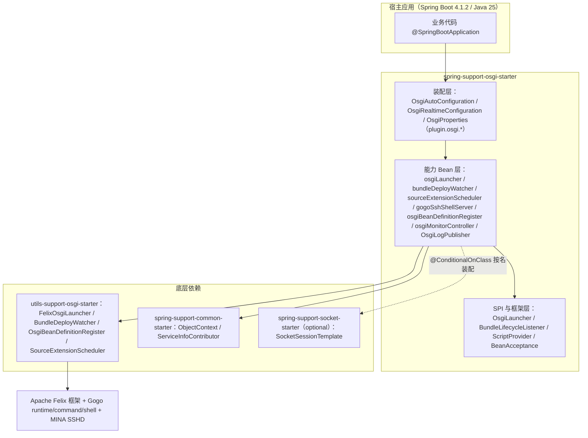
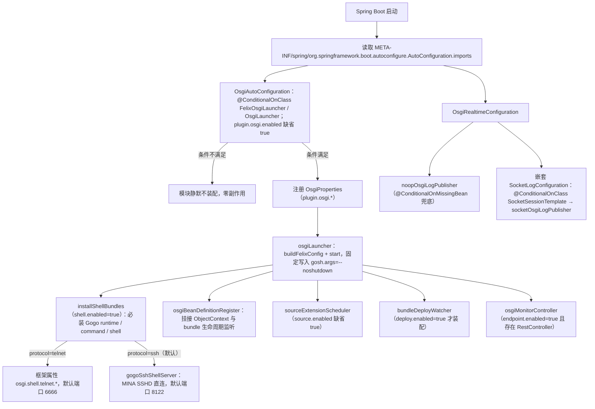

# spring-support-osgi-starter

集成 Apache Felix OSGi 框架的 Spring Boot starter：随应用启动 Felix 框架，提供 Gogo shell 远程管理（SSH/Telnet）、目录热部署、源码扩展点热重载、OSGi 服务到 `ObjectContext` 的 Bean 桥接、`/osgi/**` 观测端点与插件操作实时日志。

在 spring-support 体系中，本模块是「运行期插件化」能力模块：OSGi 具体实现（`FelixOsgiLauncher`、`BundleDeployWatcher`、`OsgiBeanDefinitionRegister`、`SourceExtensionScheduler`）下沉在 `utils-support-osgi-starter`，本模块只做 Spring Boot 自动装配与宿主能力（Web 端点 / SSH 通道 / 实时日志广播）的粘合。

## 1. 架构图



## 2. 核心流程图



## 3. 能力清单

| 能力域 | 关键类 | 入口 / 触发方式 |
|:-------|:-------|:----------------|
| 自动装配 | `OsgiAutoConfiguration`、`OsgiRealtimeConfiguration` | `AutoConfiguration.imports` 注册；`plugin.osgi.enabled`（默认 true）+ classpath 存在 `FelixOsgiLauncher` |
| 配置绑定 | `OsgiProperties` | `plugin.osgi.*`，经 `@EnableConfigurationProperties` 装配 |
| Felix 框架生命周期 | `FelixOsgiLauncher`（utils-support-osgi-starter） | `osgiLauncher` Bean 随自动配置启动/停止 |
| Gogo bundle 安装 | `OsgiAutoConfiguration#installShellBundles` | `plugin.osgi.shell.enabled=true` |
| SSH 远程管理（应用层） | `GogoSshShellServer` | `shell.enabled=true` 且 `protocol=ssh`（默认协议） |
| Telnet 远程管理（框架层） | Felix 框架属性 `osgi.shell.telnet.*` | `shell.enabled=true` 且 `protocol=telnet` |
| 目录热部署 | `BundleDeployWatcher`（utils-support-osgi-starter） | `plugin.osgi.deploy.enabled=true`（默认关闭） |
| 源码扩展点热重载 | `SourceExtensionScheduler` / `SourceJavaCompiler` / `SourceGroovyLoader` | `plugin.osgi.source.enabled`（默认 true） |
| Bean 桥接（服务投影） | `OsgiBeanDefinitionRegister` | 随自动配置装配，注册到 `ObjectContext` |
| 运行时观测端点 | `OsgiMonitorController` | `endpoint.enabled=true` 且 classpath 存在 `RestController` |
| 插件操作实时日志 | `OsgiLogPublisher` / `SocketOsgiLogPublisher` | 始终有兜底实现；引入 socket-starter 后自动切换广播实现 |
| 服务信息登记 | `osgiServiceInfoContributor`（`ServiceInfoContributor`） | 随自动配置装配，向服务目录登记 `osgi` 模块 |

`/osgi/**` 端点（`OsgiMonitorController`，整体开关 `plugin.osgi.endpoint.enabled`，默认关闭）：

| 方法 | 路径 | 说明 | 额外开关 |
|:-----|:-----|:-----|:---------|
| GET | `/osgi/stats` | 框架统计与已注册服务类型 | — |
| GET | `/osgi/bundles` | bundle 清单 | — |
| GET | `/osgi/jars` | 部署目录 jar 清单（含是否仍在框架中） | — |
| GET | `/osgi/bundles/{symbolicName}` | 单 bundle 详情（headers、注册服务类型） | — |
| GET | `/osgi/services` | 服务注册表，按 `service.ranking` 降序 | — |
| GET | `/osgi/snapshot` | 桥接快照与验收拒绝记录 | — |
| GET | `/osgi/context` | 框架 `BundleContext` 可用性 | — |
| GET | `/osgi/bundles/{symbolicName}/download` | 下载 bundle 对应本地 jar | — |
| POST | `/osgi/bundles/install` | 上传安装（同位置自动转升级），参数 `file`、`start` | `manage-enabled=true` |
| POST | `/osgi/bundles/{symbolicName}/update` | 上传新版本原地升级 | `manage-enabled=true` |
| POST | `/osgi/bundles/{symbolicName}/start` / `/stop` / `/uninstall` | 启动 / 停止 / 卸载（卸载不删 jar） | `manage-enabled=true` |
| POST | `/osgi/bundles/batch-start` / `batch-stop` / `batch-uninstall` | 批量启停/卸载，body 为符号名 JSON 数组（单次 ≤100），逐项尽力执行、逐项返回结果与失败原因 | `manage-enabled=true` |
| POST | `/osgi/jars/{fileName}/delete` | 删除部署目录 jar（须先卸载） | `manage-enabled=true` |
| POST | `/osgi/framework/refresh` | 刷新框架装配（bundle 升级/卸载后重新解析），参数 `wait`（默认 true，最多等 30 秒完成事件） | `manage-enabled=true` |

> 插件操作的**进度与日志不经 REST 轮询**：变更接口同步返回，过程日志（`start`/`success`/`failure`，含耗时）经 socket 通道 `osgi/operation-log` 实时推送，见 §6.8。

## 4. Bean 能力矩阵

| Bean 名 | 类型 | 装配条件（含默认值） | 可否覆盖 | 典型用途 |
|:--------|:-----|:---------------------|:---------|:---------|
| `osgiLauncher` | `FelixOsgiLauncher` | 类级 `@ConditionalOnClass({FelixOsgiLauncher, OsgiLauncher})` + `plugin.osgi.enabled`（缺省 true） | 否（无 `@ConditionalOnMissingBean`） | 框架与 bundle 操作总入口，`destroyMethod="stop"` |
| `bundleDeployWatcher` | `BundleDeployWatcher` | `plugin.osgi.deploy.enabled=true`（默认 false） | 否 | 目录热部署，`destroyMethod="stop"` |
| `sourceExtensionScheduler` | `SourceExtensionScheduler` | `plugin.osgi.source.enabled`（缺省 true），方法内二次校验兜底 | 否 | 源码扩展点编译与注册，`destroyMethod="stop"` |
| `gogoSshShellServer` | `GogoSshShellServer` | `plugin.osgi.shell.enabled=true` 且方法内校验 `protocol=ssh` | 否 | SSH 远程 Gogo 命令通道，`destroyMethod="stop"` |
| `osgiBeanDefinitionRegister` | `OsgiBeanDefinitionRegister` | 随自动配置（仅类级条件），无独立开关 | 否 | OSGi 服务桥接快照，注册进 `ObjectContext` |
| `osgiServiceInfoContributor` | `ServiceInfoContributor` | 随自动配置 | 否 | 服务目录登记 `osgi` 能力 |
| `osgiMonitorController` | `OsgiMonitorController` | `endpoint.enabled=true` + `@ConditionalOnClass(name="org.springframework.web.bind.annotation.RestController")` | 否 | `/osgi/**` 观测与受控变更端点 |
| `noopOsgiLogPublisher` | `OsgiLogPublisher` | `OsgiRealtimeConfiguration` 中 `@ConditionalOnMissingBean(OsgiLogPublisher)` 兜底 | 是（自定义同接口 Bean 即整体替换） | 实时日志空实现 |
| `socketOsgiLogPublisher` | `OsgiLogPublisher` | 嵌套 `SocketLogConfiguration`：`@ConditionalOnClass(name="com.chua.socket.support.session.SocketSessionTemplate")` + `@ConditionalOnMissingBean` | 是 | 经全局 socket 广播插件操作日志 |
| `OsgiProperties` | `OsgiProperties` | `@EnableConfigurationProperties(OsgiProperties.class)` 随自动配置 | — | `plugin.osgi.*` 配置绑定 |

> `bundleDeployWatcher` / `sourceExtensionScheduler` / `gogoSshShellServer` 三个 `@Bean` 方法在内部校验不通过时返回 `null`（登记为 NullBean），注入侧请用 `ObjectProvider`。`osgiLauncher` 启动失败只打 error 日志，不会拖垮应用。

## 5. 完整配置

前缀 **`plugin.osgi`**（`OsgiProperties`，经 configuration-processor 生成 IDE 元数据），以下默认值逐项来自源码。

| 配置路径 | 类型 | 默认值 | 说明 |
|:---------|:-----|:-------|:-----|
| `plugin.osgi.enabled` | `boolean` | `true` | 自动装配总开关 |
| `plugin.osgi.storage` | `String` | `./osgi-cache` | Felix 持久化存储目录 |
| `plugin.osgi.start-level` | `int` | `4` | 框架初始启动级别 |
| `plugin.osgi.storage-clean` | `String` | `onFirstInit` | `onFirstInit` / `onInit` / `none`（保留上次 bundle 状态） |
| `plugin.osgi.auto-start-installed-bundles` | `boolean` | `true` | 程序化单参 `installBundle(url)` 安装后是否自动启动；REST `/bundles/install` 的 `start` 参数（默认 true）按次覆盖。注意：该值仅在 `shell.enabled=true` 时被装配进 launcher（launcher 自身默认同为 true） |
| `plugin.osgi.framework-properties` | `Map<String,Object>` | 空 | 透传 Felix 框架属性（如 `org.osgi.framework.system.packages.extra`），可覆盖 `gosh.args` |
| `plugin.osgi.deploy.enabled` | `boolean` | `false` | 目录热部署开关 |
| `plugin.osgi.deploy.directory` | `String` | `./osgi-deploy` | 部署目录 |
| `plugin.osgi.deploy.polling-interval` | `long` | `10000` | 扫描间隔（毫秒） |
| `plugin.osgi.deploy.uninstall-on-removed` | `boolean` | `true` | jar 移除后自动卸载 bundle |
| `plugin.osgi.deploy.update-on-changed` | `boolean` | `false` | 移除后对已装 bundle 原地升级 |
| `plugin.osgi.source.enabled` | `boolean` | `true` | 源码扩展点热重载开关（目录不存在则无副作用） |
| `plugin.osgi.source.directory` | `String` | `./osgi-source` | 源码目录 |
| `plugin.osgi.source.output-directory` | `String` | 空串 | 编译输出目录，留空取 `<directory>/../osgi-source-classes`；fat jar 会抽取 `BOOT-INF/lib`（实测约 685MB，停止时清理） |
| `plugin.osgi.source.polling-interval` | `long` | `5000` | 扫描间隔（毫秒），指纹未变不编译 |
| `plugin.osgi.source.groovy-enabled` | `boolean` | `true` | 是否加载 Groovy；无引擎时降级仅 Java |
| `plugin.osgi.source.script-engine` | `String` | `groovy` | 匹配 `ScriptProvider#engineName` |
| `plugin.osgi.bridge.acceptance-enabled` | `boolean` | `true` | 桥接定义经 `BeanAcceptance` 验收器链 |
| `plugin.osgi.bridge.invalidate-on-bundle-lifecycle` | `boolean` | `true` | bundle 生命周期变化时失效桥接快照 |
| `plugin.osgi.endpoint.enabled` | `boolean` | `false` | `/osgi/**` 端点开关（还需 RestController） |
| `plugin.osgi.endpoint.manage-enabled` | `boolean` | `true` | 变更类操作开关 |
| `plugin.osgi.endpoint.lifecycle-timeout-seconds` | `int` | `60` | 单个 start/stop 生命周期动作的等待上限（秒），≤0 不限时；超时以 504 返回，bundle 状态可能不确定 |
| `plugin.osgi.endpoint.max-upload-bytes` | `long` | `104857600`（100MB） | 上传安装/升级的 jar 大小上限（字节），≤0 不限制；超限以 400 拒绝 |
| `plugin.osgi.shell.enabled` | `boolean` | `false` | 远程管理开关 |
| `plugin.osgi.shell.protocol` | `String` | `ssh` | `ssh` / `telnet` 二选一 |
| `plugin.osgi.shell.port` | `int` | `0` | 0 时按协议取默认：SSH 8122、Telnet 6666 |
| `plugin.osgi.shell.host` | `String` | `127.0.0.1` | 绑定地址 |
| `plugin.osgi.shell.username` | `String` | 空串 | SSH 用户名，与 `password` 须都非空 |
| `plugin.osgi.shell.password` | `String` | 空串 | SSH 密码 |
| `plugin.osgi.shell.host-key` | `String` | 空串 | 主机密钥路径，留空 `target/osgi-hostkey.ser` 首启自动生成 |
| `plugin.osgi.shell.allow-empty-credential` | `boolean` | `false` | 允许空凭据登录（等同无认证暴露） |
| `plugin.osgi.shell.max-auth-attempts` | `int` | `3` | 同一连接认证请求总数达到该次数即断开（经 SSHD `max-auth-requests` 生效，最小 1）。注意：客户端一次认证流程内部会发送多个认证请求，实际可容忍的密码试错次数少于该值 |
| `plugin.osgi.shell.idle-timeout-seconds` | `int` | `600` | SSH 空闲会话超时秒数，超时断开防止半死连接占线程；≤0 用 SSHD 默认（10 分钟） |
| `plugin.osgi.shell.max-sessions` | `int` | `8` | 并发 SSH shell 会话上限，超限新会话立即被拒；≤0 不限制 |
| `plugin.osgi.shell.install-framework-sshd-bundles` | `boolean` | `false` | 框架内安装 sshd bundle（sshd 2.13.2 下 sftp/scp 必然解析失败） |

> 框架配置固定先写入 `gosh.args=--noshutdown`（防 Gogo 在 stdin EOF 时停掉整个框架），仍可被 `framework-properties` 覆盖。

## 6. 使用方式

宿主侧：引入依赖（6.1）→ 最小配置（6.2）→ 按接口取插件服务（6.3，核心）→ 生命周期管理与事件（6.4–6.6）。插件侧：怎么把一个 jar 做成可安装的 bundle，见 6.7（工程依赖 / Activator / 打包 Manifest / 生命周期 / 常见失败）。

### 6.1 引入依赖

```xml
<dependency>
    <groupId>com.chua</groupId>
    <artifactId>spring-support-osgi-starter</artifactId>
    <version>4.0.0.51</version>
</dependency>
```

### 6.2 最小配置

框架本体与源码热重载默认开启（`plugin.osgi.enabled` 与 `source.enabled` 缺省即 true），`auto-start-installed-bundles` 缺省 `true`（安装后自动启动），通常无需显式写。要经页面/接口管理插件时，打开 REST 端点即可：

```yaml
plugin:
  osgi:
    auto-start-installed-bundles: true   # 缺省 true；仅影响单参 installBundle(url)，REST install 的 start 参数按次覆盖
    endpoint:
      enabled: true                      # /osgi/** 端点缺省关闭，需显式打开
      manage-enabled: true               # 变更类操作开关（缺省 true）
      lifecycle-timeout-seconds: 60      # 单个 start/stop 等待上限（秒），超时回 504
      max-upload-bytes: 104857600        # 上传 jar 上限（字节），<=0 不限
    shell:                               # 可选：SSH 远程 Gogo shell（缺省关闭）
      enabled: true
      protocol: ssh
      port: 8122
      username: admin
      password: change-me    # username/password 必须都非空，否则启动抛异常
```

SSH 通道验证：

```bash
ssh -p 8122 admin@127.0.0.1   # 进入 Gogo shell
g! bundle:list                # bundle 清单
g! stats                      # 框架统计（状态分布/服务数）
g! services                   # 服务注册表
g! bundle:info <符号名>       # bundle 详情
g! bundle:headers <符号名>    # Manifest 头
g! help                       # 全部命令
```

### 6.3 获取插件的 SPI 实现（核心用法）

引入本 starter 的核心目的：**插件 jar 运行期接入，业务代码按接口拿到它的实现**。两条等价取用路径，按需选择。

**路径一：经 `ObjectContext` 统一取（推荐）** —— `OsgiBeanDefinitionRegister` 把 OSGi 服务注册表只读投影成容器扩展对象，与 Spring Bean、`ServiceProvider` 装载的 SPI 实现汇聚在同一个 `ObjectContext`；业务代码不区分实现来自插件 jar、Spring 容器还是 SPI 扩展点，按类型一次查到：

```java
@Component
public class ReportFacade {

    private final ObjectContext objectContext;   // com.chua.common.support.objects.ObjectContext

    public ReportFacade(ObjectContext objectContext) {
        this.objectContext = objectContext;
    }

    public String render(ReportRequest req) {
        // 插件实现、Spring Bean、ServiceProvider SPI 在这里汇聚，按 priority/ranking 取最优
        Exporter exporter = objectContext.getBeanOfType(Exporter.class);
        if (exporter == null) {
            throw new IllegalStateException("容器中没有任何 Exporter 实现");
        }
        return exporter.export(req);
    }
}
```

**路径二：直接向 OSGi 服务注册表取（`OsgiLauncher`）** —— 语义最直白，适合明确「只要插件服务」的场景：

```java
@Service
public class ReportService {

    private final OsgiLauncher osgi;

    public ReportService(OsgiLauncher osgi) {
        this.osgi = osgi;
    }

    public String render(ReportRequest req) {
        // 取 service.ranking 最高的一个实现；没有实现或框架未激活时返回 null
        Exporter exporter = osgi.getService(Exporter.class);
        if (exporter == null) {
            throw new IllegalStateException("没有任何插件提供 Exporter 服务");
        }
        return exporter.export(req);
        // 需要全部实现时：List<Exporter> all = osgi.getServices(Exporter.class);
    }
}
```

> 桥接细节：投影出的扩展对象 Bean 名 = `服务接口全限定名:服务标识`，OSGi 的 `service.ranking` 贯通为容器 priority（值越大越优先）；插件升级/卸载后快照随 bundle 生命周期事件自动失效，下次查询即反映最新状态。服务引用由框架持有，`releaseServices(Class)` / `releaseAllServices()` 主动释放前保持有效。投影是否准入由 `BeanAcceptance` 验收器链裁决，被拒记录可经 `GET /osgi/snapshot` 排查。

### 6.4 管理插件生命周期：注入 OsgiLauncher

业务 Service 直接注入 `OsgiLauncher`（接口位于 `com.chua.common.support.osgi`），不接触任何 Felix/OSGi 原生类型：

```java
@Service
public class PluginManager {

    private final OsgiLauncher osgi;

    public PluginManager(OsgiLauncher osgi) {
        this.osgi = osgi;
    }

    /** 安装并立即启动（autoStart=true）；autoStart=false 只落框架不启动。 */
    public OsgiBundle install(String jarUrl) {
        return osgi.installBundle(jarUrl, true);
    }

    /** 查询全部插件（含系统 bundle），每项含 bundleId/symbolicName/version/state/location。 */
    public List<OsgiBundle> list() {
        return osgi.getBundles();
    }

    /** 启动 / 停止 / 卸载。卸载只把 bundle 摘出框架，不删部署目录里的 jar。 */
    public void start(String name) {
        OsgiBundle b = require(name);
        if (!b.isActive()) {
            b.start();
        }
    }

    public void stop(String name) {
        require(name).stop();
    }

    public void uninstall(String name) {
        osgi.uninstallBundle(name);
    }

    /** 原地热升级：保留 bundle 标识与已解析依赖；升级前 ACTIVE 则升级后自动重启。url 传 null 表示沿用原位置。 */
    public OsgiBundle upgrade(String name, String newJarUrl) {
        return osgi.updateBundle(name, newJarUrl);
    }

    private OsgiBundle require(String name) {
        OsgiBundle b = osgi.getBundle(name);
        if (b == null) {
            throw new IllegalArgumentException("bundle 不存在: " + name);
        }
        return b;
    }
}
```

### 6.5 业务代码：监听插件生命周期事件

```java
@Component
public class PluginAuditListener implements BundleLifecycleListener {

    private final FelixOsgiLauncher osgi;

    public PluginAuditListener(FelixOsgiLauncher osgi) {
        this.osgi = osgi;
        osgi.addListener(this);   // 需要注销时调用 removeListener(this)
    }

    @Override public void onBundleInstalled(String name) { audit(name, "installed"); }
    @Override public void onBundleStarted(String name)   { audit(name, "started"); }
    @Override public void onBundleStopped(String name)   { audit(name, "stopped"); }
    @Override public void onBundleUpdated(String name, String version) { audit(name, "updated -> " + version); }
    @Override public void onBundleUninstalled(String name) { audit(name, "uninstalled"); }
    @Override public void onBundleResolveFailed(String name, String reason) { audit(name, "resolve-failed: " + reason); }
}
```

> 编程式使用的另外两个入口：注入 `OsgiLogPublisher` 发插件操作实时日志；`OsgiBeanDefinitionRegister` 用 `ObjectProvider` 判空后读快照与拒绝记录。

### 6.6 宿主向框架注册服务（BundleApplication）

宿主也可以把 Spring 侧能力反向暴露给插件消费。实现 `BundleApplication` 并标注 `@Spi`，在 `src/main/resources/META-INF/extensions/com.chua.common.support.osgi.BundleApplication` 中登记实现类全限定名（未标 `@AutoSpi` 时必须手工登记，否则启动时静默不注册）。`BundleApplication` / `BundleContext` 等契约类型位于零依赖模块 `utils-support-osgi-bundle-starter`，宿主引入本 starter 时传递获得：

```java
@Spi("hostServices")
public class HostServicePublisher implements BundleApplication {

    @Override
    public void onBundleStart(BundleContext context) {   // com.chua.common.support.osgi.BundleContext
        context.registerService(UserQueryApi.class, new UserQueryApiImpl(),
                Map.of("service.ranking", 100));
    }

    @Override
    public void onBundleStop(BundleContext context) {
        // 框架停止时清理（可选）
    }
}
```

### 6.7 插件（bundle）怎么实现

插件 = 标准 OSGi bundle jar。最小实现只要三样：一个 `BundleActivator` 实现类、正确的 `META-INF/MANIFEST.MF`、要注册的服务实现。按「建工程 → 写 Activator → 打包 → 上架」四步走。

**① 建工程、配依赖**：普通 maven `jar` 工程即可，不需要任何 chua 依赖；OSGi API 打 provided（运行期由宿主的 Felix 提供）：

```xml
<dependency>
    <groupId>org.osgi</groupId>
    <artifactId>org.osgi.framework</artifactId>
    <version>1.10.0</version>
    <scope>provided</scope>
</dependency>
```

服务接口（如 `Exporter`）定义在宿主侧或共享 API 包，bundle 只 import 不携带——接口包由宿主经 `plugin.osgi.framework-properties` 的 `org.osgi.framework.system.packages.extra` 导出进框架类空间，缺了它 bundle 解析或调用会失败。

要引用 chua 契约类型（`com.chua.common.support.osgi.*`）的插件：依赖零依赖契约模块 `com.chua:utils-support-osgi-bundle-starter`（`provided` 作用域），**不要**依赖 `spring-support-osgi-starter` 或 `utils-support-osgi-starter`——那会把 Felix、SSHD、Spring 装配整包拖进插件 classpath；运行期契约包由宿主经 `org.osgi.framework.system.packages.extra` 导出进框架类空间，bundle 内不嵌入契约 jar。

**② 写 Activator**：`start` 里注册服务、`stop` 里注销；`service.ranking` 决定宿主 `getBeanOfType` / `getService` 取谁（取最高者）：

```java
public class ExcelActivator implements BundleActivator {

    private ServiceRegistration<Exporter> registration;

    @Override
    public void start(BundleContext context) {
        registration = context.registerService(Exporter.class,
                new ExcelExporter(),
                Map.of("service.ranking", 100));
    }

    @Override
    public void stop(BundleContext context) {
        if (registration != null) {
            registration.unregister();   // 框架 stop 也会自动注销；显式调用便于释放自己的资源
        }
    }
}
```

不对外提供能力、只想在启动/停止时干活的插件（如预热连接池），只实现 `start`/`stop` 即可，服务注册不是必须的。

**③ 打包出 bundle jar**

方式 A（推荐）：maven-bundle-plugin（bnd），免手写 Manifest，`Import-Package` 自动分析：

```xml
<plugin>
    <groupId>org.apache.felix</groupId>
    <artifactId>maven-bundle-plugin</artifactId>
    <extensions>true</extensions>
    <configuration>
        <instructions>
            <Bundle-SymbolicName>com.acme.report.excel</Bundle-SymbolicName>
            <Bundle-Version>1.0.0</Bundle-Version>
            <Bundle-Activator>com.acme.report.excel.ExcelActivator</Bundle-Activator>
            <Import-Package>com.acme.report.api,*</Import-Package>
        </instructions>
    </configuration>
</plugin>
```

方式 B：maven-jar-plugin 手写 Manifest（最小四件套，任何构建工具等价）：

```xml
<plugin>
    <groupId>org.apache.maven.plugins</groupId>
    <artifactId>maven-jar-plugin</artifactId>
    <configuration>
        <archive>
            <manifestEntries>
                <Manifest-Version>1.0</Manifest-Version>
                <Bundle-SymbolicName>com.acme.report.excel</Bundle-SymbolicName>
                <Bundle-Version>1.0.0</Bundle-Version>
                <Bundle-Activator>com.acme.report.excel.ExcelActivator</Bundle-Activator>
                <Import-Package>org.osgi.framework,com.acme.report.api</Import-Package>
            </manifestEntries>
        </archive>
    </configuration>
</plugin>
```

四个头缺一不可：`Bundle-SymbolicName`（全局唯一，REST 与 SSH 命令都按它寻址）、`Bundle-Version`、`Bundle-Activator`（Activator 全限定名，须 public 且有无参构造）、`Import-Package`（至少 `org.osgi.framework`，用到的宿主接口包也要列上）。

**④ 上架与生命周期对照**

| 操作 | 端点 | bundle 状态变化 |
|:-----|:-----|:----------------|
| 安装 | `POST /osgi/bundles/install`（或 jar 放 deploy 目录热部署） | → INSTALLED |
| 启动 | install 参数 `start=true`，或 `POST /bundles/{name}/start` | INSTALLED → RESOLVED → ACTIVE（Activator.start 执行，服务可被宿主取到） |
| 停止 | `POST /bundles/{name}/stop` | ACTIVE → RESOLVED（Activator.stop 执行，服务注销） |
| 升级 | `POST /bundles/{name}/update`（同符号名新版本 jar） | 保留身份换内容，需再 start / refresh 生效 |
| 卸载 | `POST /bundles/{name}/uninstall` | 从框架摘除；deploy 目录 jar 仍在，删文件另调 `POST /jars/{fileName}/delete` |

**⑤ 常见失败与定位**

- 启动报缺少 `Import-Package` / 无法解析：宿主没把接口包加进 `org.osgi.framework.system.packages.extra`，或 MF 的 `Import-Package` 漏写；安装/启动接口会返回 Felix 的真实解析原因（见 FAQ 7）。
- start 返回 504：Activator.start 阻塞超过 `lifecycle-timeout-seconds`（默认 60s），此时 bundle 状态可能不确定，以查询接口为准。
- 服务取不到：bundle 没到 ACTIVE、没 `registerService`，或 ranking 被更高实现压住；`GET /osgi/services` 看注册表现状。
- 宿主接口演进后 bundle 未同步重打包：调用期抛 `NoSuchMethodError`；接口变更时宿主与插件要一起发版。

### 6.8 REST 管理端点调用示例

以下响应均取自隔离宿主 E2E 实测（`start=false` 安装、批量混入不存在的名字、2 秒超时宿主），可直接当作联调对照。

查询清单：

```bash
curl http://127.0.0.1:8080/osgi/bundles
```

```json
[{"bundleId":0,"symbolicName":"org.apache.felix.framework","version":"7.0.5","state":"ACTIVE","location":"System Bundle"}]
```

上传安装（`start=false`：只落框架不启动，先验证再手动启）：

```bash
curl -F "file=@probe-echo.jar" "http://127.0.0.1:8080/osgi/bundles/install?start=false"
```

```json
{"bundleId":1,"symbolicName":"probe.echo","version":"1.0.0","state":"ACTIVE","location":"file:///.../osgi-deploy/probe-echo.jar"}
```

批量启动（body 为符号名数组，单次 ≤100，逐项尽力执行、逐项返回；`batch-stop` / `batch-uninstall` 结构相同）：

```bash
curl -X POST -H "Content-Type: application/json" \
     -d '["probe.echo","probe.echo2","missing.x"]' \
     http://127.0.0.1:8080/osgi/bundles/batch-start
```

```json
{"total":3,"successCount":2,"failureCount":1,"items":[
  {"symbolicName":"probe.echo2","success":true},
  {"symbolicName":"missing.x","success":false,"error":"bundle 不存在: missing.x"},
  {"symbolicName":"probe.echo","success":true}]}
```

下载已安装插件的 jar（把部署文件取回本地，`-OJ` 按响应文件名保存）：

```bash
curl -OJ http://127.0.0.1:8080/osgi/bundles/probe.echo/download
```

其余变更端点：`POST /bundles/{name}/start|stop|uninstall`、`POST /bundles/{name}/update`（multipart 上传新版本）、`POST /jars/{fileName}/delete`（须先卸载）、`POST /framework/refresh?wait=true` → `{"initiated":true,"completed":true}`。

错误原因直接进响应体（不再落入「系统繁忙」兜底）：

```json
400 {"error":"批量操作目标不能为空"}
400 {"error":"批量操作一次最多 100 个 bundle: 101"}
400 {"error":"插件文件超过大小上限: 2099015 > 1000000 字节（plugin.osgi.endpoint.max-upload-bytes）"}
400 {"error":"bundle 不存在: missing.x"}
504 {"error":"start 超过 2s 未完成，已放弃等待（bundle 状态可能不确定）: probe.slow"}
```

400 = 调用方请求有误（参数、上限、目标不存在）；504 = 插件 start/stop 在 `lifecycle-timeout-seconds` 内未完成（插件过慢或挂死），此时 bundle 真实状态可能不确定，以查询接口返回为准。

**操作日志与进度**：安装 / 升级 / 启停 / 卸载是同步 REST 调用（受 `lifecycle-timeout-seconds` 约束），进度不靠轮询——每次操作产生 `start` → `success` / `failure` 日志事件，经 socket 全局通道实时推送（引入 `spring-support-socket-starter` 时自动启用，未引入时降级为本地日志）。前端订阅：

```js
socket.subscribe("osgi", "operation-log", (msg) => {
    // msg.data: {level, status, action, symbolicName, message, startedAt, duration, timestamp}
    // status: start / success / failure；action: install / update / start / stop / uninstall / delete-jar
    // duration: 该步耗时（毫秒），可直接做「装了多久」的进度展示
});
```

### 6.9 可选依赖说明

- `utils-support-osgi-starter`（必依赖）：缺失时类级 `@ConditionalOnClass` 不满足，整个模块**静默不装配**；
- `utils-support-osgi-bundle-starter`（必依赖，经 `utils-support-osgi-starter` 传递）：OSGi 契约类型（`OsgiLauncher` / `BundleApplication` / `BundleContext` 等）的唯一定义处，零第三方依赖；
- `spring-support-socket-starter`（optional）：引入后日志经 `SocketOsgiLogPublisher` 广播到全局 socket；缺失时 noop 兜底，模块可独立运行；
- `spring-boot-configuration-processor` / `lombok`（optional）：仅编译期元数据与代码生成，运行期无依赖；
- Felix / Gogo / SSHD 版本由 `utils-support-osgi-starter` 与父 pom 依赖管理托管。

## 7. 使用场景

适用：

- 运行期动态插件化：功能模块以 bundle jar 不停机安装、升级、卸载（目录热部署或 `/osgi/bundles/install` 上传）；
- 源码级扩展点热重载：开发/测试期把带 `@SourceSpi` 的 Java/Groovy 源码放进目录，改完即编译生效；
- 远程运维通道：SSH 进 Gogo shell 执行 bundle 命令，或用 `/osgi/**` 做只读观测与受控变更；
- 跨容器服务桥接与操作审计：OSGi 服务投影为 `ObjectContext` 扩展对象；引入 socket 后实时展示插件操作流。

不适用/慎用：

- 纯静态单体应用：没有插件需求时只多出一个 Felix 实例与后台扫描线程，纯属开销；
- 通用 SSH 服务器需求（登录 + Shell + SFTP）：应使用 `spring-support-ssh-starter`，本模块 SSH 仅面向 Gogo bundle 运维。

与相邻模块取舍：`utils-support-osgi-starter` 是 OSGi 实现所在，本模块只做装配粘合；`spring-support-socket-starter` 仅为实时日志广播，不需要就不要引入；`deploy` 面向已构建 bundle jar、`source` 面向源码现场编译——开发期用 `source`，分发用 `deploy`。

## 8. 扩展点

| 扩展点 | 类型 / 位置 | 注册 / 使用方式 |
|:-------|:------------|:----------------|
| `OsgiLogPublisher` | 接口，`com.chua.starter.osgi.support.realtime` | 声明自己的 Bean 即可替换默认 noop/socket 实现（`@ConditionalOnMissingBean` 让位）；实现必须自行吞掉网络异常，日志是旁路 |
| `OsgiLauncher` / `FelixOsgiLauncher` | 框架 API | 注入后程序化 `installBundle` / `updateBundle` / `uninstallBundle` / `getBundles` / `getServiceDescriptors` 等；`getFrameworkBundleContext` 与 `addListener` / `removeListener` 在实现类 `FelixOsgiLauncher` 上 |
| `BundleLifecycleListener` | 接口，经 `FelixOsgiLauncher#addListener` | 监听 bundle 安装/启动/停止/升级/卸载事件 |
| `ScriptProvider` | SPI，`com.chua.common.support.task.script` | 自定义脚本引擎：`engineName()` 匹配 `plugin.osgi.source.script-engine` 即被 `SourceGroovyLoader` 加载 |
| `@SourceSpi` | 注解，`com.chua.osgi.support.source` | 标记源码目录中的扩展宿主类：public 非静态字段按「字段类型 = SPI 类型、字段名 = 扩展名」注册进 `ServiceProvider` |
| `BeanAcceptance` | SPI，`com.chua.common.support.objects.acceptance` | 桥接验收器，经 `OsgiBeanDefinitionRegister#addAcceptance` 注册，拒绝者不纳入快照 |
| `plugin.osgi.framework-properties` | 配置透传 | 不写代码扩展 Felix 行为，如导出应用侧接口包给 bundle |

```java
@SourceSpi
public class MyExtensions {
    public final MySpi myExt = new MySpiImpl();   // 扩展名 = 字段名 myExt
}
```

## 9. 常见问题

1. **引入依赖后没有任何 OSGi Bean，或 `/osgi/**` 404？** 依次检查：`plugin.osgi.enabled` 是否被显式设为 false；classpath 是否真的带有 `utils-support-osgi-starter`（类级 `@ConditionalOnClass` 不满足时整个模块静默不装配）；端点还要求 `plugin.osgi.endpoint.enabled=true`（默认 false）且 classpath 存在 `RestController`。
2. **8122 没监听 / SSH 启动抛「认证凭据不完整」？** `shell.enabled` 默认 false；SSH 模式 `username` 与 `password` 必须都非空，除非 `allow-empty-credential=true`（等同无认证暴露，仅限受信本地调试）。`max-auth-attempts`（默认 3）经 SSHD `max-auth-requests` 生效：同一连接的认证请求总数达到上限即被断开（客户端一次认证流程内部会产生多个认证请求，实际可容忍的密码试错次数少于该值）；另有 `idle-timeout-seconds`（默认 600，空闲会话超时）与 `max-sessions`（默认 8，并发会话上限，超限提示后拒绝）。框架启动失败只打 error 日志、不拖垮应用，但此时 SSH 里 `bundle:` 命令仍可用（框架 API 直通），其余 Gogo 命令不可用。SSH 主机密钥默认写入 `target/osgi-hostkey.ser`，父目录不存在会自动创建，重启后服务端指纹保持稳定。
3. **框架刚启动就被 shell 停掉？** Gogo shell 在 stdin 到 EOF（systemd/docker 非交互启动）时会停整个框架；模块固定写入 `gosh.args=--noshutdown`（只停 shell 不停框架），需要覆盖时用 `framework-properties`。
4. **Spring Boot 4 兼容性？** 注册走 `@AutoConfiguration` + `META-INF/spring/...AutoConfiguration.imports`（本模块**没有** `spring.factories`），符合 Boot 3+/4 机制；类级 `@ConditionalOnClass` 用类字面量（`FelixOsgiLauncher` / `OsgiLauncher` 来自必依赖 `utils-support-osgi-starter`，条件按注解元数据判定，缺失时模块静默不装配）；可选依赖（`RestController`、`SocketSessionTemplate`）在 `@Bean` 侧用 name 字符串形式，缺失时不解析方法签名、不会抛 `NoClassDefFoundError`；仓库基线 Boot 4.1.2 / Java 25。
5. **SSH 里执行 `felix:lb` 等命令看不到输出？** 已修复：`felix:*` 命令的输出在 Gogo 命令**返回值**里（不走 System.out，交互式 gosh 由 Console 负责打印），服务端直连 CommandProcessor 时会把非空返回值回传到 SSH 会话；`bundle:*` 走产品直通打印，行为不变。
6. **SSH 里敲 `exit` / `shutdown` 会发生什么？** `exit` 只结束当前 SSH 会话（回显 bye 后关闭通道），宿主 JVM 与 OSGi 框架保持运行，可立即重连；`shutdown`、`felix:shutdown`、`system:exit`、`system:shutdown` 会被拒绝并提示走运维停机流程。原因：gosh_profile 把 `System` 注册为 `system:` 命令，裸 `exit` 会解析到 `System.exit(int)`，而 JDK 25 已移除 SecurityManager，无法在框架层拦截，只能在 shell 读取循环里就地处置。
7. **安装插件返回「插件已安装…但启动失败」？** 安装（落框架）与启动（解析依赖）是两步：启动失败（如缺少 `Import-Package`）时接口返回业务错误并携带 Felix 的真实解析原因（不再是笼统的「系统繁忙」），bundle 仍处于 INSTALLED 状态，可卸载或修复依赖后重装；查询不存在的 bundle 返回 400 与「bundle 不存在: <名字>」，而不是 success=true 空数据。
8. **批量接口部分失败算成功吗？** 算——批量启停/卸载是「逐项尽力执行」：HTTP 200 + `successCount`/`failureCount` + `items` 里逐项给出 `success` 与失败原因，某项失败不影响其余项；只有参数本身非法（目标列表为空、超过 100 个）才整体 400。批量 `batch-start` 对已 ACTIVE 的项直接记成功；`batch-uninstall` 只摘框架不删 jar，要删文件再调 `POST /osgi/jars/{fileName}/delete`。
9. **操作进度和日志怎么拿？** REST 端点是同步的，不提供进度轮询接口；每次变更操作发出三条实时日志事件（`start`/`success`/`failure`，含耗时 `duration`），引入 socket-starter 后经全局 socket 推送，前端 `socket.subscribe("osgi", "operation-log", …)` 订阅即可；未引入 socket 时降级为服务端本地日志。
