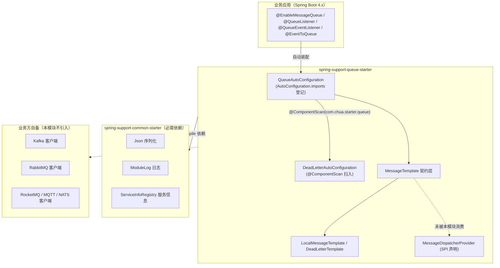
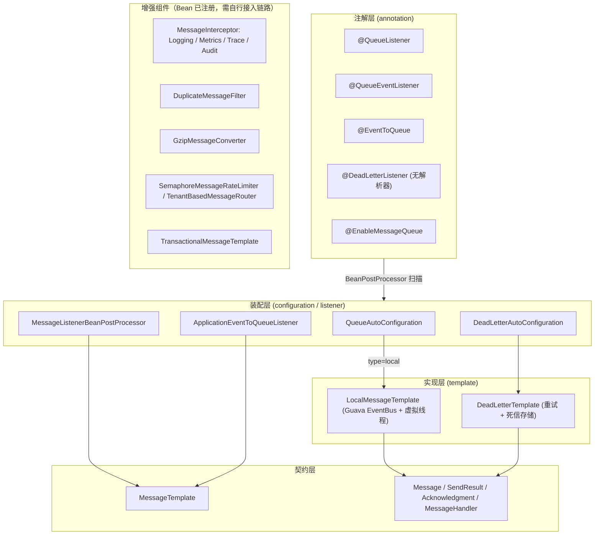
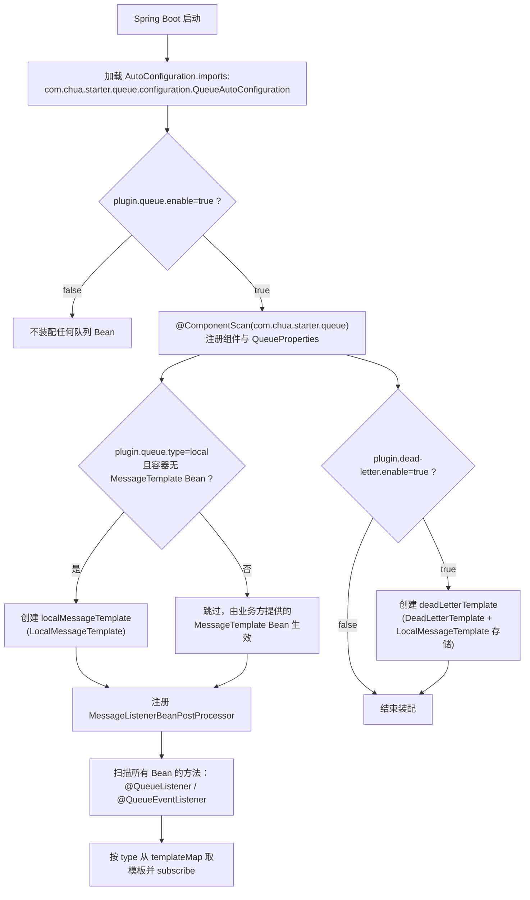

# spring-support-queue-starter

消息队列抽象层：`MessageTemplate` 定义统一收发契约，`@QueueListener` / `@QueueEventListener` / `@EventToQueue` 把 Spring Bean 与队列打通；本模块自带基于 Guava `EventBus` 的本地实现 `LocalMessageTemplate`，并提供死信队列 `DeadLetterTemplate`。模块不绑定任何具体 MQ 中间件，Kafka / RabbitMQ / RocketMQ / MQTT / NATS 的客户端由业务方自行引入。

## 1. 架构图

### 1.1 模块在体系中的位置



- 依赖方向：`spring-support-queue-starter` → `spring-support-common-starter`（JSON、日志、服务信息）；与 `spring-support-sync-starter`（同步通道）、`spring-support-job-starter`（任务调度）**互不依赖**。
- 本模块只实现 `type=local`；`chronicle-queue` / `mqtt` / `kafka` / `rabbitmq` / `rocketmq` / `nats` 等类型只有配置模型，没有对应实现，需要业务方提供 `MessageTemplate` Bean 接入。

### 1.2 模块内部分层



## 2. 核心流程图

### 2.1 自动装配流程（应用启动时）



### 2.2 消息发送与消费数据流（type=local）

```mermaid
flowchart LR
    subgraph P["生产侧"]
        PUB["业务代码"] -->|"send / sendAsync / sendDelayed"| T["LocalMessageTemplate"]
        EV["publishEvent(ApplicationEvent)"] -->|"@EventListener + @Async"| A2Q["ApplicationEventToQueueListener"]
        A2Q -->|"事件类带 @EventToQueue"| T
    end

    T -->|"serializePayload:<br/>byte[] / String(UTF-8) / Json.toJson"| BUS["EventBus(每 destination 一个)"]
    T -.->|"sendDelayed"| SCHED["delayScheduler(平台线程)<br/>→ virtualExecutor(虚拟线程)"] --> BUS

    BUS -->|"@Subscribe"| SUB["EventBusSubscriber"]
    SUB --> H["MessageHandler<br/>(MessageListenerBeanPostProcessor 包装)"]
    H --> RES["resolveArguments:<br/>Message / Acknowledgment / String / byte[] / POJO"]
    RES --> M["监听方法<br/>@QueueListener / @QueueEventListener"]
    M --> ACK["autoAck=true 自动确认<br/>autoAck=false 失败 nack(true) 等同丢弃<br/>（本地队列不支持重新入队）"]
```



## 3. 能力清单

| 能力域 | 关键类 | 入口 |
|---|---|---|
| 统一收发契约 | `MessageTemplate`、`Message`、`SendResult`、`Acknowledgment`、`MessageHandler` | `send` / `sendAsync` / `sendDelayed` / `subscribe` / `unsubscribe` |
| 本地队列实现 | `LocalMessageTemplate`（每目标一个 Guava `EventBus`；异步走虚拟线程，延迟消息用平台线程调度器） | `plugin.queue.type=local` |
| 方法级监听 | `MessageListenerBeanPostProcessor` + `@QueueListener` | 方法标注 `@QueueListener`，支持 `group` / `payloadType` / `autoAck` / `concurrency` |
| 事件式监听 | `MessageListenerBeanPostProcessor` + `@QueueEventListener` | 消息反序列化为 `ApplicationEvent`，可 `republish` 回 Spring 事件总线 |
| Spring 事件转队列 | `ApplicationEventToQueueListener` + `@EventToQueue` | 对事件类 `publishEvent(...)` 自动转发到队列 |
| 死信队列 | `DeadLetterAutoConfiguration`、`DeadLetterTemplate`、`DeadLetterProperties`、`RetryPolicy` | `plugin.dead-letter.enable=true` |
| 事务消息 | `TransactionalMessageTemplate`（事务提交后发送） | 注入 `TransactionalMessageTemplate`，调 `sendAfterCommit` |
| 发送/消费增强 | `MessageInterceptor`（`LoggingMessageInterceptor` / `MetricsMessageInterceptor` / `MessageTraceInterceptor` / `MessageAuditInterceptor`）、`MessageFilter`（`DuplicateMessageFilter`）、`MessageConverter`（`GzipMessageConverter`） | Bean 已随扫描注册，但**未被发送/消费链路自动调用**，需在自定义 `MessageTemplate` 中组合 |
| 限流 / 路由 | `MessageRateLimiter`（`SemaphoreMessageRateLimiter`）、`MessageRouter`（`TenantBasedMessageRouter`） | Bean 已注册，需自行调用 |
| 批量与优先级 | `MessageBatchProcessor`、`MessagePriorityComparator` | 独立工具类（非 Bean） |
| 队列 SPI（仅声明） | `MessageDispatcherProvider` | 本模块内无任何消费方（无 `ServiceLoader`、无注册文件） |
| 服务信息 | `QueueAutoConfiguration#queueServiceInfoContributor` | 向 `ServiceInfoRegistry` 注册 `queue` 标志 |

自动配置登记文件 `META-INF/spring/org.springframework.boot.autoconfigure.AutoConfiguration.imports` 只有 `com.chua.starter.queue.configuration.QueueAutoConfiguration` 一项；模块**没有** `spring.factories`。`DeadLetterAutoConfiguration` 不在 imports 中，仅靠 `QueueAutoConfiguration` 的 `@ComponentScan("com.chua.starter.queue")` 生效。

## 4. Bean 能力矩阵

下表列出 `plugin.queue.enable=true` 时，由自动配置 + `@ComponentScan` 实际注册的 Bean。

| Bean 名 | 类型 | 装配条件 | 可否覆盖 | 典型注入姿势 |
|---|---|---|---|---|
| `localMessageTemplate` | `LocalMessageTemplate`（实现 `MessageTemplate`） | `@ConditionalOnProperty(plugin.queue.type=local)` + `@ConditionalOnMissingBean(MessageTemplate.class)` | **可**：自定义 `MessageTemplate` Bean 优先 | `MessageTemplate` 按类型注入 |
| `messageListenerBeanPostProcessor` | `MessageListenerBeanPostProcessor` | `@ConditionalOnMissingBean`（按类型） | 可（一般无需覆盖） | 框架内部使用，勿直接注入 |
| `queueServiceInfoContributor` | `ServiceInfoContributor`（lambda） | 无条件 | 同名定义会冲突，不建议覆盖 | 服务信息面板展示 |
| `applicationEventToQueueListener` | `ApplicationEventToQueueListener` | 无条件（`@Component`） | 不建议覆盖（同类型多 Bean 有歧义） | 框架内部使用 |
| `transactionalMessageTemplate` | `TransactionalMessageTemplate` | 无条件（`@Component`），**构造器强依赖 `MessageTemplate`** | 不建议覆盖 | `TransactionalMessageTemplate` 按类型注入 |
| `semaphoreMessageRateLimiter` | `SemaphoreMessageRateLimiter`（实现 `MessageRateLimiter`） | 无条件（`@Component`） | 不建议覆盖 | `MessageRateLimiter` 按类型注入 |
| `tenantBasedMessageRouter` | `TenantBasedMessageRouter`（实现 `MessageRouter`） | 无条件（`@Component`） | 不建议覆盖 | `MessageRouter` 按类型注入 |
| `loggingMessageInterceptor` | `LoggingMessageInterceptor`（实现 `MessageInterceptor`） | 无条件（`@Component`） | 不建议覆盖 | `List<MessageInterceptor>` 注入后自行编排 |
| `metricsMessageInterceptor` | `MetricsMessageInterceptor`（实现 `MessageInterceptor`） | 无条件（`@Component`） | 不建议覆盖 | 同上 |
| `messageTraceInterceptor` | `MessageTraceInterceptor`（实现 `MessageInterceptor`） | 无条件（`@Component`） | 不建议覆盖 | 同上 |
| `messageAuditInterceptor` | `MessageAuditInterceptor`（实现 `MessageInterceptor`） | `@ConditionalOnProperty(plugin.queue.audit.enabled=true)` | 不建议覆盖 | 同上 |
| `duplicateMessageFilter` | `DuplicateMessageFilter`（实现 `MessageFilter`） | 无条件（`@Component`） | 不建议覆盖 | `MessageFilter` 按类型注入 |
| `gzipMessageConverter` | `GzipMessageConverter`（实现 `MessageConverter`） | 无条件（`@Component`） | 不建议覆盖 | `MessageConverter` 按类型注入 |
| `deadLetterTemplate` | `DeadLetterTemplate`（实现 `MessageTemplate`） | `DeadLetterAutoConfiguration`：`@ConditionalOnProperty(plugin.dead-letter.enable=true)`，且仅当主配置已激活（被扫描）时存在 | 同名定义会冲突 | `DeadLetterTemplate` 按类型注入 |

说明：

- `LocalMessageTemplate` 带 `@ConditionalOnMissingBean(MessageTemplate.class)`，业务方注册自己的 `MessageTemplate` Bean 即可整体替换发送/消费实现。
- `transactionalMessageTemplate` 是**无条件** `@Component` 且构造器必须注入 `MessageTemplate`。因此 `plugin.queue.enable=true` 但容器里没有 `MessageTemplate` Bean 时（如未设 `type=local` 且未自定义），应用会因缺少该依赖而**启动失败**。
- `queueServiceInfoContributor`、`messageListenerBeanPostProcessor` 的 Bean 方法定义在 `QueueAutoConfiguration` 中；其余 Bean 均来自 `@ComponentScan("com.chua.starter.queue")` 的类路径扫描。
- `QueueProperties`、`DeadLetterProperties` 通过 `@EnableConfigurationProperties` 注册为属性 Bean，可直接注入。

## 5. 完整配置

### 5.1 `plugin.queue`（`QueueProperties`，`@ConfigurationProperties(prefix = "plugin.queue")`）

| 配置项 | 类型 | 默认值 | 说明 | 生效开关 |
|---|---|---|---|---|
| `plugin.queue.enable` | `boolean` | `false` | 总开关；`QueueAutoConfiguration` 上 `@ConditionalOnProperty(havingValue="true")`，不配置不装配 | 必须为 `true` |
| `plugin.queue.type` | `String` | `chronicle-queue` | 队列类型；本模块只实现 `local`，其余取值无内置实现 | 与 `localMessageTemplate` 的 `@ConditionalOnProperty` 联动 |
| `plugin.queue.default-destination` | `String` | 未设置（null） | 默认目标地址（属性已定义，当前代码未消费） | — |
| `plugin.queue.local.delay-threads` | `int` | `2` | 本地延迟消息调度线程数（`LocalConfig.delayThreads`） | `type=local` |
| `plugin.queue.mqtt.address` | `String` | `tcp://localhost:1883` | MQTT 服务器地址 | 需自行接入 MQTT 实现 |
| `plugin.queue.mqtt.client-id` | `String` | 未设置 | MQTT 客户端标识 | 同上 |
| `plugin.queue.mqtt.username` | `String` | 未设置 | MQTT 用户名 | 同上 |
| `plugin.queue.mqtt.password` | `String` | 未设置 | MQTT 密码 | 同上 |
| `plugin.queue.mqtt.qos` | `int` | `1` | QoS 级别 | 同上 |
| `plugin.queue.mqtt.connection-timeout` | `int` | `30` | 连接超时（秒） | 同上 |
| `plugin.queue.mqtt.keep-alive-interval` | `int` | `60` | 心跳间隔（秒） | 同上 |
| `plugin.queue.kafka.bootstrap-servers` | `String` | `localhost:9092` | Kafka 集群地址 | 需自行接入 Kafka 实现 |
| `plugin.queue.kafka.group-id` | `String` | `default-group` | 消费组 | 同上 |
| `plugin.queue.kafka.auto-offset-reset` | `String` | `earliest` | 位点重置策略 | 同上 |
| `plugin.queue.kafka.enable-auto-commit` | `boolean` | `true` | 是否自动提交位点 | 同上 |
| `plugin.queue.kafka.auto-commit-interval-ms` | `int` | `5000` | 自动提交间隔（毫秒） | 同上 |
| `plugin.queue.kafka.acks` | `String` | `all` | 生产者确认机制 | 同上 |
| `plugin.queue.rabbitmq.host` | `String` | `localhost` | RabbitMQ 主机 | 需自行接入 RabbitMQ 实现 |
| `plugin.queue.rabbitmq.port` | `int` | `5672` | RabbitMQ 端口 | 同上 |
| `plugin.queue.rabbitmq.username` | `String` | `""` | 用户名 | 同上 |
| `plugin.queue.rabbitmq.password` | `String` | `""` | 密码 | 同上 |
| `plugin.queue.rabbitmq.virtual-host` | `String` | `/` | 虚拟主机 | 同上 |
| `plugin.queue.rabbitmq.connection-timeout` | `int` | `60000` | 连接超时（毫秒） | 同上 |
| `plugin.queue.rocketmq.name-server` | `String` | `localhost:9876` | NameServer 地址 | 需自行接入 RocketMQ 实现 |
| `plugin.queue.rocketmq.producer-group` | `String` | `default-producer` | 生产者组 | 同上 |
| `plugin.queue.rocketmq.consumer-group` | `String` | `default-consumer` | 消费者组 | 同上 |
| `plugin.queue.rocketmq.send-msg-timeout` | `int` | `3000` | 发送超时（毫秒） | 同上 |
| `plugin.queue.rocketmq.max-message-size` | `int` | `4194304` | 最大消息大小（字节） | 同上 |
| `plugin.queue.nats.url` | `String` | `nats://localhost:4222` | NATS 服务地址 | 需自行接入 NATS 实现 |
| `plugin.queue.nats.username` | `String` | 未设置 | 用户名 | 同上 |
| `plugin.queue.nats.password` | `String` | 未设置 | 密码 | 同上 |
| `plugin.queue.nats.token` | `String` | 未设置 | 令牌认证 | 同上 |
| `plugin.queue.nats.consumer-group` | `String` | `default-group` | 消费组 | 同上 |
| `plugin.queue.nats.connection-timeout` | `long` | `5000` | 连接超时（毫秒） | 同上 |
| `plugin.queue.nats.reconnect-wait` | `long` | `2000` | 重连等待（毫秒） | 同上 |
| `plugin.queue.nats.max-reconnects` | `int` | `60` | 最大重连次数 | 同上 |
| `plugin.queue.audit.enabled` | `boolean` | 无（未配置即关闭） | 是否装配 `MessageAuditInterceptor`；来自该类上的 `@ConditionalOnProperty(prefix="plugin.queue.audit", name="enabled")`，不属于 `QueueProperties` 字段 | 独立条件 |

### 5.2 `plugin.dead-letter`（`DeadLetterProperties`，`@ConfigurationProperties(prefix = "plugin.dead-letter")`）

| 配置项 | 类型 | 默认值 | 说明 | 生效开关 |
|---|---|---|---|---|
| `plugin.dead-letter.enable` | `boolean` | `false` | 死信队列总开关（`DeadLetterAutoConfiguration` 的 `@ConditionalOnProperty`） | 必须为 `true`，且主配置 `plugin.queue.enable=true`（否则 `DeadLetterAutoConfiguration` 不被扫描） |
| `plugin.dead-letter.type` | `String` | `chronicle-queue` | 死信存储类型；`createDlqStorage` 的 switch 只实现 `local`，其余取值打印告警并回落本地 | — |
| `plugin.dead-letter.delay-threads` | `int` | `2` | 死信延迟调度线程数 | — |
| `plugin.dead-letter.max-retries` | `int` | `3` | 最大重试次数（`DeadLetterConfig.maxRetries`） | — |
| `plugin.dead-letter.retry-delay-seconds` | `long` | `5` | 首次重试延迟（秒） | — |
| `plugin.dead-letter.max-retry-delay-seconds` | `long` | `300` | 重试延迟上限（秒） | — |
| `plugin.dead-letter.exponential-backoff` | `boolean` | `true` | 是否指数退避 | — |
| `plugin.dead-letter.backoff-multiplier` | `double` | `2.0` | 退避乘数 | — |

除上表外，模块没有其他配置项；`plugin.queue.type=chronicle-queue` 仅为默认字符串，模块内**不存在** Chronicle Queue 实现。

## 6. 使用方式

### 6.1 Maven 坐标

```xml
<dependency>
    <groupId>com.chua</groupId>
    <artifactId>spring-support-queue-starter</artifactId>
    <version>4.0.0.51</version>
</dependency>
```

版本随父 POM `spring-support-parent-starter` 管理，以实际父版本为准。

### 6.2 依赖说明

| 依赖 | 作用域 | 说明 |
|---|---|---|
| `spring-support-common-starter` | compile | JSON（`Json.toJson` / `fromJson`）、`ModuleLog`、服务信息，必需 |
| `com.google.guava:guava` | compile | `LocalMessageTemplate` 的 `EventBus` 底座 |
| `org.projectlombok:lombok` | provided | 仅编译期 |

本模块**不自带**任何 MQ 客户端。Kafka / RabbitMQ / RocketMQ / MQTT / NATS 对应的 `plugin.queue.*` 配置只是属性模型，需业务方引入客户端 jar 并自行提供 `MessageTemplate` Bean。

### 6.3 最小可运行示例

1. 开启开关并显式选择本地实现（默认值 `chronicle-queue` 在本模块内没有对应实现）：

```yaml
plugin:
  queue:
    enable: true
    type: local
    local:
      delay-threads: 2
  dead-letter:
    enable: true
    max-retries: 3
    retry-delay-seconds: 5
```

2. 发送与监听：

```java
// 发送：同步 / 异步 / 延迟（MessageTemplate 方法返回 SendResult / CompletableFuture / void，无链式 API）
@Service
public class OrderPublisher {

    private final MessageTemplate messageTemplate;   // type=local 时由自动配置提供

    public OrderPublisher(MessageTemplate messageTemplate) {
        this.messageTemplate = messageTemplate;
    }

    public void publish(OrderCreatedEvent event) {
        SendResult result = messageTemplate.send("order.created", event);
        messageTemplate.sendAsync("order.audit", event)
                .thenAccept(r -> System.out.println("async done"));
        messageTemplate.sendDelayed("order.timeout", event, Duration.ofMinutes(30));
    }
}

// 接收：方法级监听，参数支持 Message / Acknowledgment / String / byte[] / 反序列化 POJO
@Component
public class OrderListener {

    @QueueListener("order.created")
    public void onCreated(OrderCreatedEvent event) {
        // 处理业务
    }

    @QueueListener(value = "order.audit", group = "audit-group")
    public void onAudit(Message message, Acknowledgment ack) {
        ack.acknowledge();   // autoAck=false 时手动确认
    }
}
```

3. Spring 事件自动转队列（事件类标注 `@EventToQueue`，`ApplicationEventToQueueListener` 异步监听并转发）：

```java
@EventToQueue(value = "payment.order.created", headers = {"priority=high"})
public class OrderCreatedEvent extends ApplicationEvent {
    public OrderCreatedEvent(Object source) {
        super(source);
    }
}

// 任意位置发布：
applicationEventPublisher.publishEvent(new OrderCreatedEvent(order));
```

4. 消费侧把队列消息再反序列化为 Spring 事件：

```java
@QueueEventListener(value = "payment.order.created", eventType = OrderCreatedEvent.class)
public void handle(OrderCreatedEvent event) {
    // ...
}
```

5. 事务提交后发送（注入 `TransactionalMessageTemplate`）：

```java
transactionalMessageTemplate.sendAfterCommit("order.paid", payload);
// 无事务时立即发送；有事务时注册 TransactionSynchronization，提交后再发
```

`@EnableMessageQueue` 只是 `@Import(QueueAutoConfiguration.class)` 的语法糖，**仍需** `plugin.queue.enable=true` 才会生效。

## 7. 使用场景

### 7.1 适用

- 单体应用内的**进程内解耦**：模块间通过队列消息通信，不希望引入外部 MQ 基础设施。
- **事件驱动**改造：已有 Spring `ApplicationEvent`，想平滑过渡到队列语义（`@EventToQueue` / `@QueueEventListener`）。
- **本地开发与测试**：用 `type=local` 跑通收发、重试、死信逻辑，生产环境再切换自定义 `MessageTemplate`。
- **事务一致性**发送：利用 `TransactionalMessageTemplate` 保证「数据库提交成功才发消息」。

### 7.2 不适用

- **跨节点 / 高可靠**场景：`LocalMessageTemplate` 仅单进程有效，消息存内存，重启即丢，`nack` 不支持重新入队（等同丢弃），不能当作跨节点队列。
- **顺序 / 分区 / 海量吞吐**场景：本地实现没有分区、位点、堆积管理等能力。
- 死信的**远端存储**：`plugin.dead-letter.type` 除 `local` 外都会回落本地实现。

### 7.3 与相邻模块的取舍

| 模块 | 定位 | 取舍 |
|---|---|---|
| `spring-support-sync-starter` | 点对点/广播的**同步**通道（连接与主题推送） | 需要即时响应、长连接推送选 sync；需要重试、死信、事务等**消息语义**选本模块；二者可组合、互不依赖 |
| `spring-support-job-starter` | 任务调度（内部 `JobSyncBus`） | 与本模块无装配关系，不要混用 |
| 各 MQ 客户端 starter | 具体中间件接入 | 本模块未纳入依赖；接入方式 = 引入客户端 + 实现 `MessageTemplate` Bean |
| Spring `ApplicationEvent` | 进程内同步事件 | `@EventToQueue` 是「事件 → 队列」的桥；纯进程内通知用 `@EventListener` 更直接 |

## 8. 扩展点

### 8.1 替换 `MessageTemplate`（推荐、当前真正生效的方式）

实现 `MessageTemplate` 接口（`send` / `sendAsync` / `send(destination, payload, headers)` / `subscribe` / `unsubscribe` / `getType` / `isConnected` / `close`），注册为 Spring Bean 即可整体接管收发。`localMessageTemplate` 带 `@ConditionalOnMissingBean(MessageTemplate.class)`，不会冲突；`@QueueListener` / `@QueueEventListener` / `@EventToQueue` 都按 `getType()` 匹配容器中的实现。

```java
@Component
public class MyKafkaMessageTemplate implements MessageTemplate {
    @Override public SendResult send(String destination, Object payload) { /* 调 KafkaTemplate */ return SendResult.success(id, destination); }
    @Override public SendResult send(String destination, Object payload, Map<String, Object> headers) { return send(destination, payload); }
    @Override public CompletableFuture<SendResult> sendAsync(String destination, Object payload) { return CompletableFuture.supplyAsync(() -> send(destination, payload)); }
    @Override public void subscribe(String destination, MessageHandler handler, boolean autoAck) { /* 注册消费者 */ }
    @Override public void unsubscribe(String destination) { }
    @Override public String getType() { return "kafka"; }   // 与 plugin.queue.type / 注解 type 对应
    @Override public boolean isConnected() { return true; }
    @Override public void close() { }
}
```

### 8.2 `MessageDispatcherProvider` SPI（仅声明，当前无消费方）

`com.chua.starter.queue.spi.MessageDispatcherProvider` 定义了 `name()` / `isAvailable()` / `dispatch(ConfigurableBeanFactory, QueueProperties)`，设计意图是「引入适配器 jar → 注册 SPI → `plugin.queue.type` 激活」。**但本模块当前没有任何代码消费它**（无 `ServiceLoader`、无注册文件），实现它不会自动生效；实际扩展请走 8.1。

### 8.3 横切组件接口

| 接口 | 默认实现（已注册 Bean） | 自定义方法 |
|---|---|---|
| `MessageInterceptor` | `LoggingMessageInterceptor`、`MetricsMessageInterceptor`、`MessageTraceInterceptor`、`MessageAuditInterceptor` | `beforeSend` / `afterSend` / `beforeReceive` / `afterReceive` / `getOrder` |
| `MessageFilter` | `DuplicateMessageFilter`（5 分钟 TTL 去重） | `filter(Message)` |
| `MessageConverter` | `GzipMessageConverter`（≥1KB 才压缩，`X-Compressed` 头） | `convertBeforeSend` / `convertAfterReceive` |
| `MessageRateLimiter` | `SemaphoreMessageRateLimiter`（默认 100 许可） | `tryAcquire` / `acquire` / `release` |
| `MessageRouter` | `TenantBasedMessageRouter`（按 `tenantId` 头路由到 `原目标.tenant.<id>`） | `route` / `supports` / `getOrder` |

注意：这些 Bean 已被扫描注册，但**没有任何链路自动调用它们**；需在自己的 `MessageTemplate` 实现或业务代码中显式编排。

### 8.4 重试与死信

- `RetryPolicy`：纯 POJO 策略，字段 `maxRetries` / `initialDelay` / `maxDelay` / `multiplier` / `enableDeadLetter` / `deadLetterSuffix`（默认 `.dlq`），提供 `defaultPolicy` / `fastRetry` / `slowRetry` / `noRetry` 静态工厂，可自行实现/替换。
- `DeadLetterTemplate`：支持双模板构造（主模板 + 独立死信存储），死信消息带 `X-Retry-Count` / `X-Original-Destination` / `X-Failure-Reason` / `X-Failure-Time` / `X-Original-Message-Id` 头，重试走 `retry:` 前缀目标、死信走 `dlq:` 前缀目标；重试参数由 `DeadLetterConfig`（来自 `plugin.dead-letter.*`）驱动。
- `@DeadLetterListener` 注解**没有对应解析器**：监听死信需自行用 `@QueueListener` 订阅死信目标。

## 9. 常见问题

**Q1：引入 starter 后为什么没有 `MessageTemplate` Bean？**
`plugin.queue.enable` 默认 `false`，且 `type` 默认 `chronicle-queue`（本模块无对应实现）。必须同时满足：`plugin.queue.enable=true` 且 `plugin.queue.type=local`（或自行提供 `MessageTemplate` Bean）。`@EnableMessageQueue` 只是导入自动配置类，不能替代 `enable=true`。

**Q2：`enable=true` 但没配 `type=local`，应用启动报错？**
会。`@ComponentScan` 会无条件装配 `TransactionalMessageTemplate`，其构造器强依赖 `MessageTemplate`；容器里没有该 Bean 时抛 `NoSuchBeanDefinitionException` 导致启动失败。解决：设 `type=local`，或自定义 `MessageTemplate` Bean。此时 `ApplicationEventToQueueListener` 依赖的 `List<MessageTemplate>` 注入空集合，`@EventToQueue` 事件会打印 `No MessageTemplate found for type` 并跳过。

**Q3：`@QueueListener` / `@QueueEventListener` 方法没被调用？**
`MessageListenerBeanPostProcessor` 按「注解 `type`（缺省取 `plugin.queue.type`）」在容器里找 `getType()` 匹配的模板；找不到（如 `type` 仍是 `chronicle-queue`）会打印 `No MessageTemplate found for type` 并跳过注册。另外本地实现**忽略 `group`**（不支持消费组），`concurrency > 1` 时通过 `Semaphore` + 虚拟线程包装实现。

**Q4：死信队列为什么不生效？**
常见三个原因：① `plugin.dead-letter.enable` 未设 `true`；② 主开关 `plugin.queue.enable=false`——`DeadLetterAutoConfiguration` 不在 `AutoConfiguration.imports` 里，只靠 `QueueAutoConfiguration` 的 `@ComponentScan` 带入；③ `@DeadLetterListener` 没有解析器，死信消费要自己用 `@QueueListener` 订阅 `dlq:` 目标。

**Q5：`LoggingMessageInterceptor`、`DuplicateMessageFilter` 等 Bean 存在，为什么日志/去重没效果？**
它们只是被 `@ComponentScan` 注册成 Bean，发送与消费链路（`LocalMessageTemplate`、`DeadLetterTemplate`）**不会自动调用**拦截器/过滤器/转换器。需要在自定义 `MessageTemplate` 中显式编排，或直接调用对应 Bean。

**Q6：`@EventToQueue` 的事件是异步发送的吗？**
`@EventToQueue` 默认 `async=true` 走 `sendAsync`；`ApplicationEventToQueueListener` 方法上的 `@Async` 仅在应用启用了 `@EnableAsync` 时才真正异步，否则退化为同步执行。发送失败只记录错误日志，不影响事件发布方。

**Q7：与 Spring Boot 4.1.2 兼容吗？**
兼容。本模块只使用 `META-INF/spring/org.springframework.boot.autoconfigure.AutoConfiguration.imports` 登记自动配置（Boot 2.7 起的标准方式，Boot 4 继续支持），没有依赖已被移除的 `spring.factories` 自动配置机制；`@Configuration` + `@ComponentScan`、`@ConditionalOnProperty`、`@EnableConfigurationProperties`、`BeanPostProcessor` 均为 Boot 4 仍支持的能力。本地实现使用 Java 21 虚拟线程（`Thread.ofVirtual()`），要求运行时 JDK 21+。

**Q8：本地队列的消息会丢吗？**
会。`LocalMessageTemplate` 的消息在内存中（每目标一个 `EventBus`），进程重启即丢失；`Acknowledgment.nack(true)` 在本地实现中等同丢弃，不会重新入队。对可靠性有要求时，请实现自己的 `MessageTemplate` 对接持久化 MQ。
