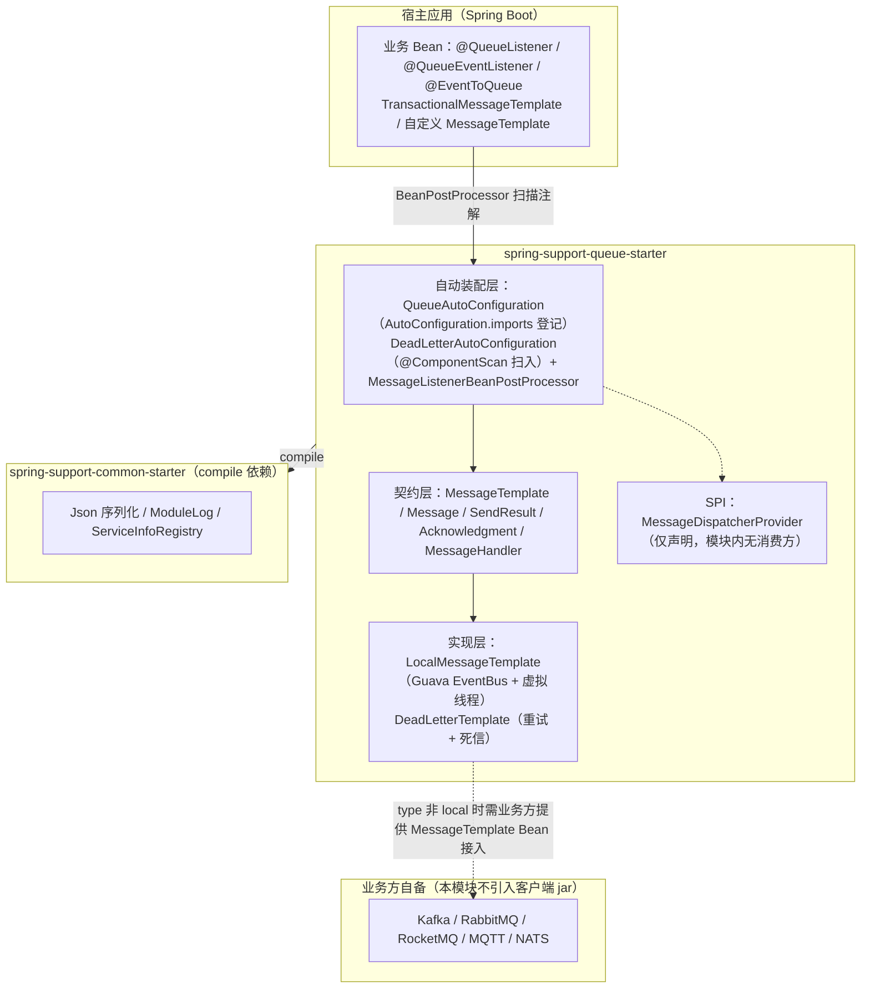
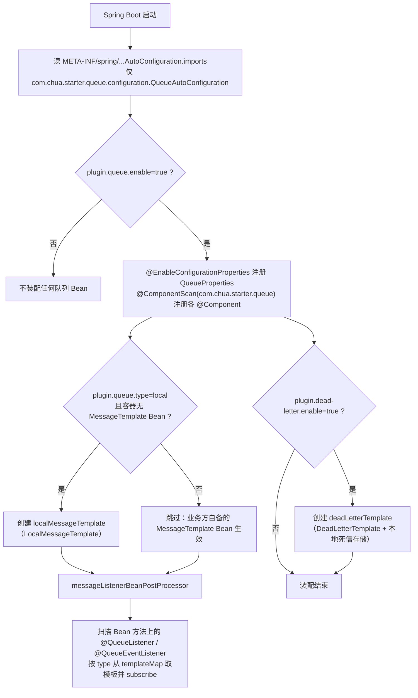

# spring-support-queue-starter

消息队列抽象层：`MessageTemplate` 定义统一收发契约，`@QueueListener` / `@QueueEventListener` / `@EventToQueue` 把 Spring Bean 与队列打通；本模块自带基于 Guava `EventBus` 的本地实现 `LocalMessageTemplate`，并提供死信队列 `DeadLetterTemplate` 与事务消息 `TransactionalMessageTemplate`。模块不绑定任何具体 MQ 中间件，Kafka / RabbitMQ / RocketMQ / MQTT / NATS 的客户端由业务方自行引入。在 spring-support 体系中，它是「消息语义」的基础设施层，与 `spring-support-sync-starter`（同步通道）、`spring-support-job-starter`（任务调度）互不依赖。

## 1. 架构图



依赖方向：本模块 → `spring-support-common-starter`；不依赖任何兄弟业务 starter，也不自带 MQ 客户端。

## 2. 核心流程图（自动装配）



## 3. 能力清单

| 能力域 | 关键类 | 入口/触发方式 |
|---|---|---|
| 统一收发契约 | `MessageTemplate`、`Message`、`SendResult`、`Acknowledgment`、`MessageHandler` | `send` / `sendAsync` / `sendDelayed` / `subscribe` / `unsubscribe` |
| 本地队列实现 | `LocalMessageTemplate`（每目标一个 Guava `EventBus`；异步走虚拟线程，延迟消息用平台线程调度器） | `plugin.queue.type=local` |
| 方法级监听 | `MessageListenerBeanPostProcessor` + `@QueueListener` | 方法标注 `@QueueListener`，支持 `group` / `payloadType` / `autoAck` / `concurrency` |
| 事件式监听 | `MessageListenerBeanPostProcessor` + `@QueueEventListener` | 消息反序列化为 `ApplicationEvent`，可 `republish` 回 Spring 事件总线 |
| Spring 事件转队列 | `ApplicationEventToQueueListener` + `@EventToQueue` | 对标注 `@EventToQueue` 的事件类 `publishEvent(...)` 自动转发到队列 |
| 死信队列 | `DeadLetterAutoConfiguration`、`DeadLetterTemplate`、`RetryPolicy` | `plugin.dead-letter.enable=true` |
| 事务消息 | `TransactionalMessageTemplate` | 注入后调 `sendAfterCommit`，事务提交后才发送 |
| 发送/消费增强 | `MessageInterceptor`（Logging / Metrics / Trace / Audit）、`DuplicateMessageFilter`、`GzipMessageConverter` | Bean 已随扫描注册，但**未被收发链路自动调用**，需自行组合 |
| 限流 / 路由 | `SemaphoreMessageRateLimiter`、`TenantBasedMessageRouter` | Bean 已注册，需自行调用 |
| 批量与优先级 | `MessageBatchProcessor`、`MessagePriorityComparator` | 独立工具类（非 Bean） |
| 队列 SPI（仅声明） | `MessageDispatcherProvider` | 模块内无消费方（无 `ServiceLoader`、无注册文件） |
| 服务信息 | `QueueAutoConfiguration#queueServiceInfoContributor` | 向 `ServiceInfoRegistry` 注册 `queue` 标志 |

## 4. Bean 能力矩阵

下表为 `plugin.queue.enable=true` 时实际注册的 Bean。

| Bean 名 | 类型 | 装配条件（含默认值） | 可否覆盖 | 典型用途 |
|---|---|---|---|---|
| `localMessageTemplate` | `LocalMessageTemplate`（实现 `MessageTemplate`） | `@ConditionalOnProperty(plugin.queue.type=local)` + `@ConditionalOnMissingBean(MessageTemplate.class)` | **可**：自定义 `MessageTemplate` Bean 优先 | 收发消息的默认实现 |
| `messageListenerBeanPostProcessor` | `MessageListenerBeanPostProcessor` | `@ConditionalOnMissingBean` | 可（一般无需覆盖） | 框架内部：扫描监听注解 |
| `queueServiceInfoContributor` | `ServiceInfoContributor`（lambda） | 无条件 | 同名定义会冲突，不建议覆盖 | 服务信息面板展示 |
| `applicationEventToQueueListener` | `ApplicationEventToQueueListener` | 无条件（`@Component`） | 不建议覆盖 | `@EventToQueue` 事件转发 |
| `transactionalMessageTemplate` | `TransactionalMessageTemplate` | 无条件（`@Component`），**构造器强依赖 `MessageTemplate`** | 不建议覆盖 | 事务提交后发送 |
| `semaphoreMessageRateLimiter` | `SemaphoreMessageRateLimiter`（实现 `MessageRateLimiter`） | 无条件（`@Component`） | 不建议覆盖 | 发送限流 |
| `tenantBasedMessageRouter` | `TenantBasedMessageRouter`（实现 `MessageRouter`） | 无条件（`@Component`） | 不建议覆盖 | 按租户头路由 |
| `loggingMessageInterceptor` | `LoggingMessageInterceptor` | 无条件（`@Component`） | 不建议覆盖 | 收发日志 |
| `metricsMessageInterceptor` | `MetricsMessageInterceptor` | 无条件（`@Component`） | 不建议覆盖 | 收发指标 |
| `messageTraceInterceptor` | `MessageTraceInterceptor` | 无条件（`@Component`） | 不建议覆盖 | 链路追踪 |
| `messageAuditInterceptor` | `MessageAuditInterceptor` | `@ConditionalOnProperty(plugin.queue.audit.enabled=true)`（默认关闭） | 不建议覆盖 | 审计日志 |
| `duplicateMessageFilter` | `DuplicateMessageFilter`（实现 `MessageFilter`） | 无条件（`@Component`） | 不建议覆盖 | 幂等去重 |
| `gzipMessageConverter` | `GzipMessageConverter`（实现 `MessageConverter`） | 无条件（`@Component`） | 不建议覆盖 | 大消息压缩 |
| `deadLetterTemplate` | `DeadLetterTemplate`（实现 `MessageTemplate`） | `DeadLetterAutoConfiguration`：`@ConditionalOnProperty(plugin.dead-letter.enable=true)`，且主配置已激活（被扫描） | 同名定义会冲突 | 重试与死信 |

- `QueueProperties`、`DeadLetterProperties` 经 `@EnableConfigurationProperties` 注册为属性 Bean，可直接注入。
- 注意：`transactionalMessageTemplate` 无条件注册且强依赖 `MessageTemplate`。若 `plugin.queue.enable=true` 但既未设 `type=local` 也未自定义 `MessageTemplate`，容器缺少该依赖会导致**启动失败**。

## 5. 完整配置

### 5.1 `plugin.queue`（`QueueProperties`）

| 配置路径 | 类型 | 默认值 | 说明 |
|---|---|---|---|
| `plugin.queue.enable` | `boolean` | `false` | 总开关；`@ConditionalOnProperty(havingValue="true")`，不配置不装配 |
| `plugin.queue.type` | `String` | `chronicle-queue` | 队列类型；本模块只实现 `local`，其余取值无内置实现 |
| `plugin.queue.default-destination` | `String` | 未设置（null） | 默认目标地址（属性已定义，当前代码未消费） |
| `plugin.queue.local.delay-threads` | `int` | `2` | 本地延迟消息调度线程数（`LocalConfig.delayThreads`） |
| `plugin.queue.mqtt.address` | `String` | `tcp://localhost:1883` | MQTT 服务器地址（需自行接入实现） |
| `plugin.queue.mqtt.client-id` | `String` | 未设置 | MQTT 客户端标识 |
| `plugin.queue.mqtt.username` / `plugin.queue.mqtt.password` | `String` | 未设置 | MQTT 凭据 |
| `plugin.queue.mqtt.qos` | `int` | `1` | QoS 级别 |
| `plugin.queue.mqtt.connection-timeout` | `int` | `30` | 连接超时（秒） |
| `plugin.queue.mqtt.keep-alive-interval` | `int` | `60` | 心跳间隔（秒） |
| `plugin.queue.kafka.bootstrap-servers` | `String` | `localhost:9092` | Kafka 集群地址（需自行接入实现） |
| `plugin.queue.kafka.group-id` | `String` | `default-group` | 消费组 |
| `plugin.queue.kafka.auto-offset-reset` | `String` | `earliest` | 位点重置策略 |
| `plugin.queue.kafka.enable-auto-commit` | `boolean` | `true` | 是否自动提交位点 |
| `plugin.queue.kafka.auto-commit-interval-ms` | `int` | `5000` | 自动提交间隔（毫秒） |
| `plugin.queue.kafka.acks` | `String` | `all` | 生产者确认机制 |
| `plugin.queue.rabbitmq.host` / `plugin.queue.rabbitmq.port` | `String` / `int` | `localhost` / `5672` | RabbitMQ 地址（需自行接入实现） |
| `plugin.queue.rabbitmq.username` / `plugin.queue.rabbitmq.password` | `String` | `""` | RabbitMQ 凭据 |
| `plugin.queue.rabbitmq.virtual-host` | `String` | `/` | 虚拟主机 |
| `plugin.queue.rabbitmq.connection-timeout` | `int` | `60000` | 连接超时（毫秒） |
| `plugin.queue.rocketmq.name-server` | `String` | `localhost:9876` | NameServer 地址（需自行接入实现） |
| `plugin.queue.rocketmq.producer-group` / `plugin.queue.rocketmq.consumer-group` | `String` | `default-producer` / `default-consumer` | 生产/消费组 |
| `plugin.queue.rocketmq.send-msg-timeout` | `int` | `3000` | 发送超时（毫秒） |
| `plugin.queue.rocketmq.max-message-size` | `int` | `4194304` | 最大消息大小（字节） |
| `plugin.queue.nats.url` | `String` | `nats://localhost:4222` | NATS 服务地址（需自行接入实现） |
| `plugin.queue.nats.username` / `plugin.queue.nats.password` / `plugin.queue.nats.token` | `String` | 未设置 | NATS 凭据 |
| `plugin.queue.nats.consumer-group` | `String` | `default-group` | 消费组 |
| `plugin.queue.nats.connection-timeout` | `long` | `5000` | 连接超时（毫秒） |
| `plugin.queue.nats.reconnect-wait` | `long` | `2000` | 重连等待（毫秒） |
| `plugin.queue.nats.max-reconnects` | `int` | `60` | 最大重连次数 |
| `plugin.queue.audit.enabled` | `boolean` | 未配置即关闭 | 是否装配 `MessageAuditInterceptor`；来自该类上的 `@ConditionalOnProperty(prefix="plugin.queue.audit", name="enabled")`，不属于 `QueueProperties` 字段 |

### 5.2 `plugin.dead-letter`（`DeadLetterProperties`）

| 配置路径 | 类型 | 默认值 | 说明 |
|---|---|---|---|
| `plugin.dead-letter.enable` | `boolean` | `false` | 死信总开关；需 `plugin.queue.enable=true`（否则 `DeadLetterAutoConfiguration` 不被扫描） |
| `plugin.dead-letter.type` | `String` | `chronicle-queue` | 死信存储类型；`createDlqStorage` 只实现 `local`，其余取值打印告警并回落本地 |
| `plugin.dead-letter.delay-threads` | `int` | `2` | 死信延迟调度线程数 |
| `plugin.dead-letter.max-retries` | `int` | `3` | 最大重试次数 |
| `plugin.dead-letter.retry-delay-seconds` | `long` | `5` | 首次重试延迟（秒） |
| `plugin.dead-letter.max-retry-delay-seconds` | `long` | `300` | 重试延迟上限（秒） |
| `plugin.dead-letter.exponential-backoff` | `boolean` | `true` | 是否指数退避 |
| `plugin.dead-letter.backoff-multiplier` | `double` | `2.0` | 退避乘数 |

除上表外无其他配置；`type=chronicle-queue` 仅为默认字符串，模块内**不存在** Chronicle Queue 实现。

## 6. 使用方式

```xml
<dependency>
    <groupId>com.chua</groupId>
    <artifactId>spring-support-queue-starter</artifactId>
    <version>4.0.0.51</version>
</dependency>
```

依赖说明：`spring-support-common-starter`（compile，必需，提供 JSON / `ModuleLog` / 服务信息）；`com.google.guava:guava`（compile，`EventBus` 底座）；`org.projectlombok:lombok`（provided，仅编译期）。本模块**不自带**任何 MQ 客户端：`plugin.queue.*` 中 Kafka / RabbitMQ / RocketMQ / MQTT / NATS 只是属性模型，缺客户端 jar 不会报错，但对应类型没有实现——业务方需引入客户端并提供自己的 `MessageTemplate` Bean。

最小启用示例（必须显式 `type=local`，默认值 `chronicle-queue` 无内置实现）：

```yaml
plugin:
  queue:
    enable: true
    type: local
    local:
      delay-threads: 2
  dead-letter:
    enable: true
    max-retries: 3
    retry-delay-seconds: 5
```

```java
// 发送：同步 / 异步 / 延迟
@Service
public class OrderPublisher {
    private final MessageTemplate messageTemplate; // type=local 时由自动配置提供

    public OrderPublisher(MessageTemplate messageTemplate) {
        this.messageTemplate = messageTemplate;
    }

    public void publish(OrderCreatedEvent event) {
        messageTemplate.send("order.created", event);                 // 返回 SendResult
        messageTemplate.sendAsync("order.audit", event);              // CompletableFuture<SendResult>
        messageTemplate.sendDelayed("order.timeout", event, Duration.ofMinutes(30));
    }
}

// 接收：参数支持 Message / Acknowledgment / String / byte[] / 反序列化 POJO
@Component
public class OrderListener {
    @QueueListener("order.created")
    public void onCreated(OrderCreatedEvent event) { /* 业务 */ }

    @QueueListener(value = "order.audit", group = "audit-group", autoAck = false)
    public void onAudit(Message message, Acknowledgment ack) {
        ack.acknowledge(); // 手动确认；异常未确认时框架 nack(true)（本地实现等同丢弃）
    }
}
```

Spring 事件互通：事件类标注 `@EventToQueue(value = "payment.order.created", headers = {"priority=high"})` 后，`applicationEventPublisher.publishEvent(...)` 会自动转发到队列；消费侧用 `@QueueEventListener(value = "payment.order.created", eventType = OrderCreatedEvent.class)` 接收。事务场景注入 `TransactionalMessageTemplate` 调 `sendAfterCommit(destination, payload)`：无事务立即发送，有事务注册 `TransactionSynchronization`，提交后再发。

`@EnableMessageQueue` 只是 `@Import(QueueAutoConfiguration.class)` 的语法糖，**仍需** `plugin.queue.enable=true` 才会生效。

## 7. 使用场景

**适用**：① 单体应用内的进程内解耦，不希望引入外部 MQ 基础设施；② 已有 Spring `ApplicationEvent`，想平滑过渡到队列语义（`@EventToQueue` / `@QueueEventListener`）；③ 本地开发与测试用 `type=local` 跑通收发、重试、死信，生产再切换自定义 `MessageTemplate`；④ 需要「数据库提交成功才发消息」的事务一致性发送。

**不适用/慎用**：跨节点、高可靠场景——`LocalMessageTemplate` 仅单进程有效、消息存内存、重启即丢、`nack` 不支持重新入队（等同丢弃）；顺序 / 分区 / 海量吞吐场景本地实现均不具备；死信的 `type` 除 `local` 外都会回落本地存储。

**与相邻模块取舍**：需要即时响应、长连接推送选 `spring-support-sync-starter`；需要重试、死信、事务等消息语义选本模块，二者可组合、互不依赖；`spring-support-job-starter` 与本模块无装配关系，不要混用；纯进程内通知直接用 Spring `@EventListener` 更简单。

## 8. 扩展点

- **替换 `MessageTemplate`（推荐、当前真正生效的方式）**：实现 `send` / `sendAsync` / `send(destination, payload, headers)` / `subscribe(...)` / `unsubscribe` / `getType` / `isConnected` / `close` 并注册为 Spring Bean，即可整体接管收发。`localMessageTemplate` 带 `@ConditionalOnMissingBean(MessageTemplate.class)` 不会冲突；所有注解监听按 `getType()` 匹配容器中的实现（`getType()` 返回值需与 `plugin.queue.type` 或注解 `type` 一致，如 `"kafka"`）。
- **`MessageDispatcherProvider` SPI（仅声明，当前无消费方）**：接口定义 `name()` / `isAvailable()` / `dispatch(ConfigurableBeanFactory, QueueProperties)`，设计意图是「引入适配器 jar → 注册 SPI → `plugin.queue.type` 激活」；但本模块内没有任何代码消费它（无 `ServiceLoader`、无注册文件），实现它不会自动生效，实际扩展请走上一条。
- **横切组件接口**（Bean 已注册，但收发链路不会自动调用，需在自己的 `MessageTemplate` 或业务代码中显式编排）：

| 接口 | 默认实现（已注册 Bean） | 关键方法 |
|---|---|---|
| `MessageInterceptor` | `LoggingMessageInterceptor`、`MetricsMessageInterceptor`、`MessageTraceInterceptor`（以上无条件注册）、`MessageAuditInterceptor`（需 `plugin.queue.audit.enabled=true`） | `beforeSend` / `afterSend` / `beforeReceive` / `afterReceive` / `getOrder` |
| `MessageFilter` | `DuplicateMessageFilter`（5 分钟 TTL 去重） | `filter(Message)` |
| `MessageConverter` | `GzipMessageConverter`（≥1KB 才压缩，`X-Compressed` 头） | `convertBeforeSend` / `convertAfterReceive` |
| `MessageRateLimiter` | `SemaphoreMessageRateLimiter`（默认 100 许可） | `tryAcquire` / `acquire` / `release` |
| `MessageRouter` | `TenantBasedMessageRouter`（按 `tenantId` 头路由到 `原目标.tenant.<id>`） | `route` / `supports` / `getOrder` |

- **重试与死信**：`RetryPolicy` 为纯 POJO 策略（`maxRetries` / `initialDelay` / `maxDelay` / `multiplier` / `enableDeadLetter` / `deadLetterSuffix` 默认 `.dlq`，提供 `defaultPolicy` / `fastRetry` / `slowRetry` / `noRetry` 静态工厂）；`DeadLetterTemplate` 支持双模板构造（主模板 + 独立死信存储），死信消息带 `X-Retry-Count` / `X-Original-Destination` / `X-Failure-Reason` / `X-Failure-Time` / `X-Original-Message-Id` 头，重试走 `retry:` 前缀目标、死信走 `dlq:` 前缀目标。`@DeadLetterListener` 注解**没有对应解析器**，监听死信需自行用 `@QueueListener` 订阅死信目标。

## 9. 常见问题

**Q1：引入 starter 后为什么没有 `MessageTemplate` Bean？**
`plugin.queue.enable` 默认 `false`，且 `type` 默认 `chronicle-queue`（无内置实现）。必须同时满足 `plugin.queue.enable=true` 且 `plugin.queue.type=local`（或自行提供 `MessageTemplate` Bean）。`@EnableMessageQueue` 不能替代 `enable=true`。

**Q2：`enable=true` 但没配 `type=local`，启动报错？**
会。`@ComponentScan` 无条件装配 `TransactionalMessageTemplate`，其构造器强依赖 `MessageTemplate`；容器没有该 Bean 时抛 `NoSuchBeanDefinitionException` 导致启动失败。解决：设 `type=local` 或自定义 `MessageTemplate` Bean。

**Q3：`@QueueListener` / `@QueueEventListener` 方法没被调用？**
`MessageListenerBeanPostProcessor` 按「注解 `type`（缺省取 `plugin.queue.type`）」匹配 `getType()`；找不到会打印 `No MessageTemplate found for type` 并跳过注册。另外本地实现**忽略 `group`**（不支持消费组），`concurrency > 1` 通过 `Semaphore` + 虚拟线程包装实现。

**Q4：死信队列为什么不生效？**
① `plugin.dead-letter.enable` 未设 `true`；② 主开关 `plugin.queue.enable=false`——`DeadLetterAutoConfiguration` 不在 `AutoConfiguration.imports` 里，只靠 `QueueAutoConfiguration` 的 `@ComponentScan` 带入；③ `@DeadLetterListener` 没有解析器，要自己用 `@QueueListener` 订阅 `dlq:` 目标。

**Q5：`LoggingMessageInterceptor`、`DuplicateMessageFilter` 等 Bean 存在，为什么没效果？**
它们只是被 `@ComponentScan` 注册成 Bean；`LocalMessageTemplate` / `DeadLetterTemplate` 的收发链路**不会自动调用**拦截器/过滤器/转换器，需在自定义 `MessageTemplate` 中显式编排。

**Q6：与 Spring Boot 4 兼容吗？消息会丢吗？**
兼容。本模块只用 `META-INF/spring/...AutoConfiguration.imports` 登记自动配置（Boot 2.7 起标准方式，Boot 4 继续支持），无 `spring.factories`；本地实现用 Java 21 虚拟线程（`Thread.ofVirtual()`），要求运行时 JDK 21+。本地队列消息在内存中，进程重启即丢，可靠性要求高时请实现自己的 `MessageTemplate` 对接持久化 MQ。
