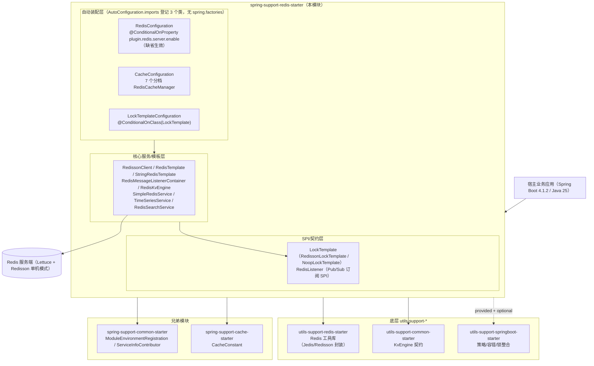
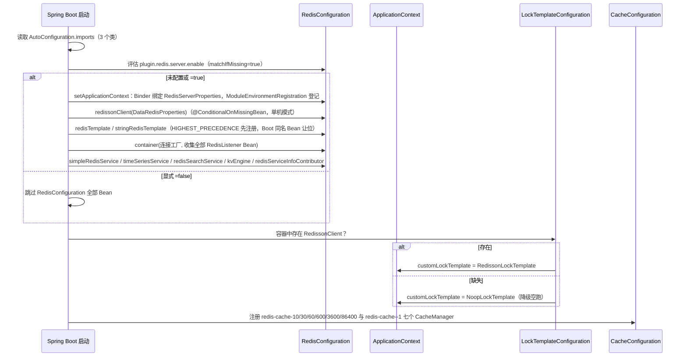

# spring-support-redis-starter

Redis 集成 starter：自动装配 Redisson 客户端、统一序列化的 `RedisTemplate<String,Object>`、7 档预置 TTL 的 `RedisCacheManager`、编程式分布式锁 `LockTemplate`、Pub/Sub 监听容器、统一 KV 引擎（`KvEngine`）与指标计数服务。在 spring-support 体系中属于「被业务应用依赖的底层能力模块」：只依赖兄弟模块 `spring-support-common-starter` / `spring-support-cache-starter` 与底层 `utils-support-*`，不依赖任何上层业务 starter。

## 1. 架构图



- 依赖方向遵守 `spring-support-api-* → spring-support-parent → utils-*`；`KvEngine` 契约来自底层 `utils-support-common-starter`，本模块只提供 Redis 实现。
- `utils-support-springboot-starter` 是 `provided + optional`（替代已下线的 `spring-support-strategy-starter` / `spring-support-lock-starter`），本模块源码不 import 它，宿主按需显式引入。

## 2. 核心流程图



## 3. 能力清单

| 能力域 | 关键类 | 入口/触发方式 |
|---|---|---|
| Redisson 客户端（单机） | `RedisConfiguration#redissonClient` | 自动装配，`@ConditionalOnMissingBean`，`destroyMethod="shutdown"` |
| Redis 操作模板 | `RedisConfiguration#redisTemplate`、`#stringRedisTemplate` | 直接注入；`Ordered.HIGHEST_PRECEDENCE` 先于 Boot `RedisAutoConfiguration` 注册 |
| 分档缓存 | `CacheConfiguration`（7 个 `RedisCacheManager`） | `@Cacheable(cacheManager = "redis-cache-600")` 按 Bean 名选用 |
| 编程式分布式锁 | `LockTemplate` / `RedissonLockTemplate` / `NoopLockTemplate` | 注入 `LockTemplate`（Bean 名 `customLockTemplate`） |
| 发布订阅 | `RedisMessageListenerContainer` + `RedisListener` | 实现 `RedisListener` 的 Bean 被 `container` 自动收集 |
| 统一 KV 引擎 | `RedisKvEngine`（实现底层 `KvEngine` 契约） | 注入 `KvEngine`：`get/put/delete/incr/expire/ttl/findAllByPrefix` |
| 指标计数 | `SimpleRedisService` / `SimpleRedisServiceImpl` | 注入后 `increment` / `decrement` / `incrementDay` / `qps` |
| 时序/搜索（预留） | `TimeSeriesService` / `RedisSearchService` | 空接口占位，当前无方法 |
| 服务信息登记 | `RedisConfiguration#redisServiceInfoContributor` | 启动信息面板展示 `/redis/**` 端点与 `redis` 标志 |
| 注解式锁（带入） | lock4j `@Lock4j` | `lock4j-redis-template-spring-boot-starter` 依赖带入，本模块不额外配置 |

## 4. Bean 能力矩阵

| Bean 名 | 类型 | 装配条件（含默认值） | 可否覆盖 | 典型用途 |
|---|---|---|---|---|
| `redissonClient` | `org.redisson.api.RedissonClient` | `RedisConfiguration` 激活（`plugin.redis.server.enable` 缺省即生效）+ `@ConditionalOnMissingBean` | 可（同名 Bean 替换） | 分布式锁底层客户端 |
| `redisTemplate` | `RedisTemplate<String,Object>` | `RedisConfiguration` 激活；方法无 `@ConditionalOnMissingBean`，但 `HIGHEST_PRECEDENCE` 先注册，Boot 同名 Bean 因 `@ConditionalOnMissingBean` 让位 | 可 | 通用读写：String key + GenericJackson2Json value |
| `stringRedisTemplate` | `StringRedisTemplate` | 同上 | 可 | 字符串 KV、计数、SCAN |
| `container` | `RedisMessageListenerContainer` | `@ConditionalOnMissingBean` | 可 | 收集全部 `RedisListener` 并订阅 topic |
| `simpleRedisService` | `SimpleRedisService`（`SimpleRedisServiceImpl`） | `@ConditionalOnMissingBean` | 可 | 指标自增/自减、qps 估算 |
| `timeSeriesService` | `TimeSeriesService`（空接口） | `@ConditionalOnMissingBean` | 可 | 预留，无方法 |
| `redisSearchService` | `RedisSearchService`（空接口） | `@ConditionalOnMissingBean` | 可 | 预留，无方法 |
| `kvEngine` | `com.chua.common.support.lang.datasource.kv.KvEngine`（`RedisKvEngine`） | `@ConditionalOnMissingBean` | 可 | 统一 KV 抽象，可切换后端 |
| `redisServiceInfoContributor` | `ServiceInfoContributor` | `RedisConfiguration` 激活；方法无 `@ConditionalOnMissingBean` | 可（自定义同类型 Bean 需 `@Primary`） | 端点/标志登记 |
| `redis-cache-10/30/60/600/3600/86400` 与 `redis-cache--1` | `CacheManager`（`RedisCacheManager`，TTL 10s/30s/60s/600s/3600s/86400s/-1 永久） | `CacheConfiguration` 在 classpath 即注册（无独立开关），依赖 `RedisConnectionFactory` | 可 | 如 `@Cacheable(cacheManager = "redis-cache-600")`；永久档 Bean 名是 `redis-cache--1`（`redis-cache-` + `-1`，双连字符） |
| `customLockTemplate` | `LockTemplate` | `LockTemplateConfiguration`（`@ConditionalOnClass(LockTemplate)`）+ `@ConditionalOnMissingBean`；容器有 `RedissonClient` → `RedissonLockTemplate`，否则 `NoopLockTemplate` | 可 | 编程式分布式锁 |

注意：缓存 Bean 名来自 `spring-support-common-starter` 的 `CacheConstant` 常量，与创建方法名（`systemCacheManager600` 等）**不一致**，`cacheManager` 属性必须写 Bean 名。

## 5. 完整配置

本模块唯一 `@ConfigurationProperties` 类：`RedisServerProperties`（前缀 `plugin.redis.server`，无嵌套类）：

| 配置路径 | 类型 | 默认值 | 说明 |
|---|---|---|---|
| `plugin.redis.server.enable` | `boolean` | `false`（字段默认值） | 模块总开关。`@ConditionalOnProperty(..., havingValue="true", matchIfMissing=true)`：**不配置即生效**，只有显式 `false` 才关闭 `RedisConfiguration` 全部 Bean |
| `plugin.redis.server.open-embedded` | `boolean` | `false` | 预留：嵌入式 Redis。当前无代码消费 |
| `plugin.redis.server.port` | `Integer` | `6379` | 预留。实际连接端口取 `spring.data.redis.port` |
| `plugin.redis.server.database` | `Integer` | `0` | 预留。实际取 `spring.data.redis.database` |
| `plugin.redis.server.host` | `String` | `0.0.0.0` | 预留。实际取 `spring.data.redis.host` |
| `plugin.redis.server.max-memory` | `String` | `128M` | 预留，无代码消费 |
| `plugin.redis.server.max-heap` | `String` | `100M` | 预留，无代码消费 |

实际连接行为消费 Spring Boot 4 的 `spring.data.redis`（`org.springframework.boot.data.redis.autoconfigure.DataRedisProperties`）：`host`（localhost）、`port`（6379）、`database`（0）、`username`、`password`、`url`（非空时优先于 host:port）、`client-name`、`timeout` / `connect-timeout`（未配置回退 10000ms），全部喂给 Redisson `useSingleServer()`。Lettuce 连接池等其余属性由 Boot 自身 Redis 自动配置处理，本模块不重复处理。

### 5.1 逐项配置示例（按功能分组）

**① 模块开关**

| 配置项 | 含义 | 默认值 | 生效方式 |
|---|---|---|---|
| `plugin.redis.server.enable` | `RedisConfiguration` 全部 Bean 的总开关 | `false`（字段默认值） | 装配条件 `matchIfMissing=true`：不配置即生效，仅显式 `false` 关闭 |

```yaml
plugin:
  redis:
    server:
      enable: true   # 可省略，效果相同；只有显式 false 才整体关闭模块
```

**② 预留连接项（实际连接以 `spring.data.redis.*` 为准）**

| 配置项 | 含义 | 默认值 | 说明 |
|---|---|---|---|
| `plugin.redis.server.open-embedded` | 嵌入式 Redis 开关（预留） | `false` | 当前无代码消费，嵌入式 Redis 未实现 |
| `plugin.redis.server.port` | 端口（预留） | `6379` | 实际连接端口取 `spring.data.redis.port` |
| `plugin.redis.server.database` | 数据库编号（预留） | `0` | 实际库号取 `spring.data.redis.database` |
| `plugin.redis.server.host` | 主机地址（预留） | `0.0.0.0` | 实际主机取 `spring.data.redis.host` |

```yaml
plugin:
  redis:
    server:
      open-embedded: false   # 预留：当前无代码消费
      port: 6379             # 预留：真实端口见 spring.data.redis.port
      database: 0            # 预留：真实库号见 spring.data.redis.database
      host: 0.0.0.0          # 预留：真实主机见 spring.data.redis.host
```

**③ 预留资源上限项**

| 配置项 | 含义 | 默认值 | 说明 |
|---|---|---|---|
| `plugin.redis.server.max-memory` | 最大内存（预留） | `128M` | 当前无代码消费 |
| `plugin.redis.server.max-heap` | 最大堆内存（预留） | `100M` | 当前无代码消费 |

```yaml
plugin:
  redis:
    server:
      max-memory: 128M
      max-heap: 100M
```

### 5.2 完整 YAML 示例（生产参考）

```yaml
spring:
  data:
    redis:
      host: 192.168.1.10        # Redis 地址
      port: 6379
      database: 0
      username: default         # Redis 6+ ACL 用户名，未启用 ACL 可省略
      password: your-password   # 占位符：真实值请经环境变量/配置中心注入
      client-name: my-app       # 连接标识，便于服务端排查
      timeout: 3s               # 命令超时；不配置时 Redisson 侧回落 10000ms
      connect-timeout: 3s       # 连接超时；不配置时 Redisson 侧回落 10000ms
      # url: redis://:your-password@192.168.1.10:6379/0   # 配置后优先于 host:port

plugin:
  redis:
    server:
      enable: true              # 可省略：matchIfMissing=true，不配置即生效
```

Redisson 单机客户端与 Lettuce 连接工厂共用上述 `spring.data.redis` 地址与凭据；如需调整 Lettuce 连接池，按 Spring Boot 标准属性 `spring.data.redis.lettuce.pool.*` 配置并确保 classpath 含 `commons-pool2`。依赖坐标与最小用法见第 6 节。

### 5.3 生产注意事项

1. **凭据安全**：`password` 一律以占位符书写，真实值经环境变量或配置中心注入，禁止明文入库入仓。
2. **降级风险**：容器缺少 `RedissonClient` 时锁降级为 `NoopLockTemplate`，所有锁操作空跑，启动日志仅一条 WARN（`>>>>> 未检测到 RedissonClient，使用 NoopLockTemplate`）；必须监控该日志，绝不能把降级锁当真实锁使用。
3. **部署形态**：本模块 Redisson 只按 `useSingleServer` 构建，`spring.data.redis.cluster/sentinel` 不会传给 Redisson；需要集群/哨兵时自行声明 `RedissonClient` Bean（本模块因 `@ConditionalOnMissingBean` 自动退让）。
4. **缓存语义**：预置 7 档缓存一律 `disableCachingNullValues()`（方法返回 null 会抛异常而非缓存），缓存键带 `<cacheName>:` 前缀；Spring Data Redis 4.x 缓存写默认异步，本模块已强制 `immediateWrites(true)`，自建 `CacheManager` 务必保留该设置，否则 `@CacheEvict` 可能到不了 Redis。
5. **Pub/Sub 顺序**：监听容器的 topic 序列化器必须在 `addMessageListener` 之后设置（本模块 `container` 已按此顺序实现）；自定义容器时颠倒顺序会导致订阅端收不到消息。
6. **键规范**：分布式锁 key 统一加 `lock:` 前缀；`RedisKvEngine` 前缀查询走 SCAN（每批 1000 键），生产环境避免使用 `KEYS` 全量扫描。

## 6. 使用方式

Maven 坐标：

```xml
<dependency>
    <groupId>com.chua</groupId>
    <artifactId>spring-support-redis-starter</artifactId>
    <version>4.0.0.51</version>
</dependency>
```

最小启用示例（无需额外注解，自动装配即生效；注意前缀是 `spring.data.redis`，旧 `spring.redis.*` 不再生效）：

```yaml
spring:
  data:
    redis:
      host: localhost
      port: 6379
      database: 0
      timeout: 10s
      connect-timeout: 10s

plugin:
  redis:
    server:
      enable: true   # 可省略：matchIfMissing=true，不配置即生效
```

```java
@Autowired private RedisTemplate<String, Object> redisTemplate;
@Autowired private LockTemplate lockTemplate;        // Bean 名 customLockTemplate
@Autowired private KvEngine kvEngine;                // RedisKvEngine
@Autowired private SimpleRedisService simpleRedisService;

// 分布式锁：最多等 5 秒，拿不到走降级
Order o = lockTemplate.tryLock("order:create", Duration.ofSeconds(5),
        () -> doCreate(req), () -> { throw new BusinessException("下单繁忙"); });

// 分档缓存：Bean 名即档位
@Cacheable(cacheManager = "redis-cache-600", cacheNames = "users", key = "#id")
public User findById(Long id) { return userRepository.findById(id); }

// 发布订阅：实现 RedisListener 的 Bean 被自动收集
@Component
public class UserEventListener implements RedisListener {
    public void onMessage(Message message, byte[] pattern) { /* 处理消息 */ }
    public Collection<Topic> getTopics() { return List.of(new ChannelTopic("login:events")); }
}
// 发布端：redisTemplate.convertAndSend("login:events", payload);

// 指标计数（当日有效，到当天结束过期）
simpleRedisService.incrementDay("order:count", req.getUserId());
```

可选依赖说明：`spring-boot-starter-data-redis` / `redisson` / `utils-support-redis-starter` / `spring-support-common-starter` / `spring-support-cache-starter` / `lock4j-redis-template-spring-boot-starter` 为必需依赖，随本模块传递；`utils-support-springboot-starter` 为 `provided + optional`，**缺失不影响本模块任何 Bean 的装配**（本模块源码未 import 它），宿主如需注解式策略/容错/锁整合再自行显式引入。

## 7. 使用场景

适用：

- Spring Boot 4 应用需要 Redis 缓存，尤其想要开箱即用的多档 TTL `CacheManager`；
- 需要编程式分布式锁（`tryLock` + 降级函数），而非注解式；
- 需要 Pub/Sub、统一 KV 抽象（`KvEngine` 可切换后端）、指标自增/QPS 粗统计；
- 宿主已在本生态内，希望 Redis 能力与启动信息面板（`ServiceInfoContributor`）、配置登记打通。

不适用/慎用：

- **无 Redis 环境**：`NoopLockTemplate` 降级后所有锁恒成功、不加锁，绝不能当真实锁用；
- **Redisson 集群/哨兵**：本模块只按 `useSingleServer` 构建，`spring.data.redis.cluster/sentinel` 不会传给 Redisson；需要时自行声明 `RedissonClient` Bean（本模块因 `@ConditionalOnMissingBean` 退让）；
- 预置缓存一律 `disableCachingNullValues()`，需要缓存 null 时自定义 `CacheManager`。

与相邻模块的取舍：

| 相邻模块 | 关系与取舍 |
|---|---|
| `spring-support-cache-starter` | 本模块只依赖其 `CacheConstant`；它的多级缓存 `@AutoConfigureAfter` 本模块 `CacheConfiguration`。单一 Redis 分档缓存用本模块；要 L1 本地 + L2 远程组合用 cache-starter，两者可共存 |
| lock4j（`@Lock4j`） | 注解式声明锁；本模块 `LockTemplate` 是编程式封装，互不覆盖，可按场景混用 |
| `utils-support-redis-starter` | 底层工具库（客户端封装/SPI 基建）；本模块是 Spring Boot 整合层，业务不要绕过本模块直接拼底层客户端 |

## 8. 扩展点

| 扩展点 | 类型 | 注册/自定义方式 |
|---|---|---|
| `RedisListener` | 接口 SPI | 实现 `onMessage(Message, byte[])` + `getTopics()` 并注册为 Bean，`container` 自动收集进 `RedisMessageListenerContainer` |
| `LockTemplate` | 可替换 Bean | `customLockTemplate` 带 `@ConditionalOnMissingBean`，自定义同名 Bean 即整体替换 Redisson/Noop 实现 |
| `RedissonClient` | 可替换 Bean | 带 `@ConditionalOnMissingBean`：需要集群/哨兵时自定义该 Bean，其余能力照常工作 |
| `KvEngine` | 底层契约 + 可替换 Bean | 本模块注册 `RedisKvEngine`（`@ConditionalOnMissingBean`），可换成其它后端实现 |
| `CacheConfiguration#createRedisCacheManager(ObjectMapper, RedisConnectionFactory, int)` | public static 工厂 | 自定义任意 TTL 的 `CacheManager`，如 `createRedisCacheManager(null, factory, 1800)` |
| `TimeSeriesService` / `RedisSearchService` | 预留接口 | 当前为空接口（无方法），实现类均可经 `@ConditionalOnMissingBean` 覆盖 |

本模块没有 `META-INF/extensions` SPI 登记表；旧文档中的 `LockProvider` / `RedissonLockProvider`（`@Spi("redisson")`）已随 strategy/lock starter 下线从源码移除，请勿按旧文档扩展。

## 9. 常见问题

**Q1：引入依赖后 Redis Bean 没有装配？**
按序排查：① 是否显式写了 `plugin.redis.server.enable: false`（只有显式 false 才整体关闭，不配置才是开启）；② 是否有 `spring-boot-starter-data-redis` 提供 `RedisConnectionFactory`（缺失则模板、监听容器、缓存管理器都无法创建）；③ 本模块靠 `AutoConfiguration.imports` 装配，不需要 `@ComponentScan` 扫描 `com.chua.starter.redis.support` 包。

**Q2：改了 `plugin.redis.server.port/host/database/max-memory` 为什么不生效？**
这些字段目前只有配置声明，没有代码消费（嵌入式 Redis 未实现）。连接信息请配置 `spring.data.redis.host/port/database/url`，那才是 `redissonClient` 实际读取的来源。

**Q3：`@Cacheable` 报找不到 `cacheManager` 或缓存 null 报错？**
预置缓存 Bean 名是常量字符串 `redis-cache-10/30/60/600/3600/86400`，永久档是 `redis-cache--1`（`redis-cache-` + `-1`，双连字符），与创建方法名（`systemCacheManager600` 等）不一致，`cacheManager` 属性必须写 **Bean 名**；且预置缓存 `disableCachingNullValues()`，方法返回 null 会抛异常而不是缓存，需自行判空或自定义 `CacheManager`。

**Q4：锁不生效 / Spring Boot 4 兼容注意？**
先确认拿到的是哪种实现：容器有 `RedissonClient` 时是 `RedissonLockTemplate`（真实分布式锁），缺失时降级 `NoopLockTemplate`（启动日志 `>>>>> 未检测到 RedissonClient，使用 NoopLockTemplate`，所有锁操作空跑）。锁 key 统一有 `lock:` 前缀。Boot 4 另注意：Spring Data Redis 4.x 缓存写默认异步，本模块 `createRedisCacheManager` 已强制 `immediateWrites(true)`，自行构建 `CacheManager` 时务必保留该设置，否则 `@CacheEvict` 可能到不了 Redis；监听容器的 topic 序列化器必须在 `addMessageListener` 之后设置，改动顺序会收不到消息。
