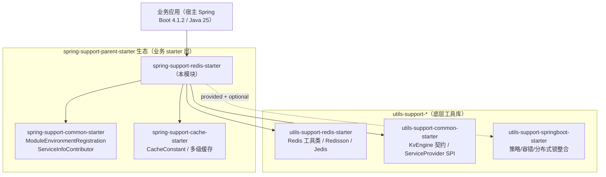
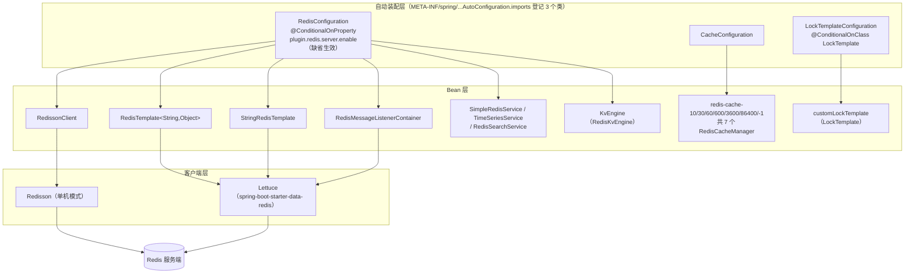
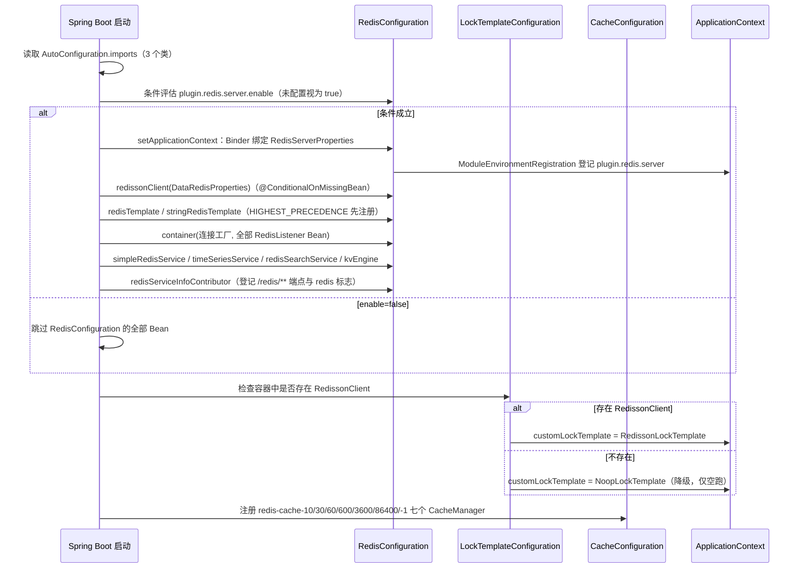
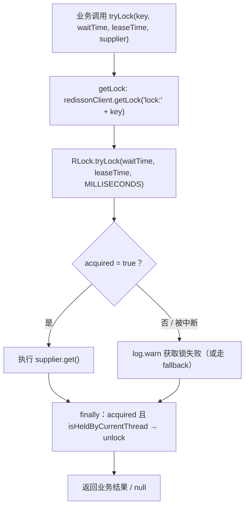

# spring-support-redis-starter

Redis 集成模块：Redisson 客户端、统一序列化的 `RedisTemplate`、7 档预置 `CacheManager`、分布式锁模板、发布订阅监听、统一 KV 引擎与指标计数服务。

- groupId / artifactId / 版本：`com.chua` / `spring-support-redis-starter` / `4.0.0.51`
- 运行基线：Spring Boot **4.1.2**、Java **25**、Redisson **3.32.0**、lock4j **2.2.7**
- Redis 连接配置前缀：**`spring.data.redis`**（Spring Boot 4 口径，旧 `spring.redis.*` 不再生效）

## 1. 架构图

### 1.1 模块在体系中的位置



- 本模块是**被依赖方**：业务应用引入即获得 Redis 全套能力；它不依赖任何上层业务 starter。
- 依赖方向遵守 `spring-support-api-* → spring-support-parent → utils-*`：`KvEngine` 契约来自底层 `utils-support-common-starter`，本模块只提供 Redis 实现。
- `utils-support-springboot-starter` 是 `provided + optional`：替代已下线的 `spring-support-strategy-starter` / `spring-support-lock-starter`，宿主如需注解式锁/策略能力可自行显式引入。

### 1.2 模块内部分层



分层说明：

| 层 | 内容 |
|---|---|
| 自动装配层 | `RedisConfiguration`、`CacheConfiguration`、`LockTemplateConfiguration`，经 `AutoConfiguration.imports` 登记（本模块**没有** `spring.factories`，Boot 4 也不再读取旧文件） |
| Bean 层 | 客户端、模板、监听容器、缓存管理器、锁模板、业务服务与 KV 引擎 |
| 客户端层 | Lettuce（Spring Data Redis 默认）承担模板/监听容器/缓存；Redisson 承担分布式锁 |
| 契约层 | `LockTemplate`、`RedisListener` 为本模块 SPI；`KvEngine` 为底层 utils 契约 |

## 2. 核心流程图

### 2.1 启动装配流程



### 2.2 分布式锁执行流程（RedissonLockTemplate）



锁 key 统一加 `lock:` 前缀；`lock(...)` 阻塞式默认租约 30s（`DEFAULT_LEASE_TIME`），`tryLock` 默认等待 10s（`DEFAULT_WAIT_TIME`）。

## 3. 能力清单

| 能力域 | 关键类 | 入口 |
|---|---|---|
| Redisson 客户端 | `RedisConfiguration#redissonClient` | 自动装配，`@ConditionalOnMissingBean`，单机模式 |
| Redis 操作模板 | `RedisConfiguration#redisTemplate`（`RedisTemplate<String,Object>`）、`#stringRedisTemplate` | 直接注入 |
| 分档缓存 | `CacheConfiguration`（7 个 `RedisCacheManager`） | `@Cacheable(cacheManager = "redis-cache-600")` 等 Bean 名 |
| 分布式锁 | `LockTemplate`、`RedissonLockTemplate`、`NoopLockTemplate` | Bean 名 `customLockTemplate` |
| 发布订阅 | `RedisMessageListenerContainer`、`RedisListener` | 实现 `RedisListener` 的 Bean 自动注册 |
| 统一 KV 引擎 | `RedisKvEngine`（实现底层 `KvEngine` 契约） | 注入 `KvEngine` |
| 指标计数 | `SimpleRedisService` / `SimpleRedisServiceImpl` | 注入后 `increment` / `decrement` / `incrementDay` / `qps` |
| 时间序列（预留） | `TimeSeriesService` / `TimeSeriesServiceImpl` | 占位接口，当前无方法 |
| Redis 搜索（预留） | `RedisSearchService` / `RedisSearchServiceImpl` | 占位接口，当前无方法 |
| 服务信息登记 | `RedisConfiguration#redisServiceInfoContributor` | 启动信息面板展示 `/redis/**` 与 `redis` 标志 |
| 注解式锁（带入） | lock4j `@Lock4j`（`lock4j-redis-template-spring-boot-starter`） | 依赖带入，本模块不做额外配置 |

自动配置登记表（`META-INF/spring/org.springframework.boot.autoconfigure.AutoConfiguration.imports`）：

```text
com.chua.starter.redis.support.RedisConfiguration
com.chua.starter.redis.support.CacheConfiguration
com.chua.starter.redis.support.LockTemplateConfiguration
```

> 历史说明：旧文档中的 `LockProvider` / `RedissonLockProvider`（`@Spi("redisson")`）SPI 已随 strategy/lock starter 下线从源码移除，本模块现无 `META-INF/extensions` 登记表，请勿按旧文档扩展。

## 4. Bean 能力矩阵

装配条件统一前提：模块 jar 在 classpath 且被 Boot 自动装配机制加载（本模块 3 个配置类均登记在 `AutoConfiguration.imports`；`RedisConfiguration`、`LockTemplateConfiguration` 未标 `@Configuration`，靠登记表生效）。

| Bean 名 | 类型 | 装配条件 | 可否覆盖 | 典型注入姿势 |
|---|---|---|---|---|
| `redissonClient` | `org.redisson.api.RedissonClient` | `RedisConfiguration` 激活（`plugin.redis.server.enable` 缺省即生效）+ `@ConditionalOnMissingBean`；`destroyMethod="shutdown"` | 可，自定义同名 Bean 即替换 | 构造器/字段注入 `RedissonClient` |
| `redisTemplate` | `RedisTemplate<String,Object>` | `RedisConfiguration` 激活；方法本身无 `@ConditionalOnMissingBean`，但先于 Boot `RedisAutoConfiguration` 注册（`Ordered.HIGHEST_PRECEDENCE`），Boot 的同名 Bean 因 `@ConditionalOnMissingBean` 让位 | 可 | `@Autowired RedisTemplate<String, Object>` |
| `stringRedisTemplate` | `StringRedisTemplate` | 同上（Boot 同名 Bean 让位） | 可 | `@Autowired StringRedisTemplate` |
| `container` | `RedisMessageListenerContainer` | `RedisConfiguration` 激活 + `@ConditionalOnMissingBean` | 可 | 声明 `RedisListener` Bean 即被收集，一般不直接注入容器 |
| `simpleRedisService` | `SimpleRedisService`（`SimpleRedisServiceImpl`） | `RedisConfiguration` 激活 + `@ConditionalOnMissingBean` | 可 | `@Autowired SimpleRedisService` |
| `timeSeriesService` | `TimeSeriesService`（占位空接口） | 同上 | 可 | 占位，无方法可调 |
| `redisSearchService` | `RedisSearchService`（占位空接口） | 同上 | 可 | 占位，无方法可调 |
| `kvEngine` | `com.chua.common.support.lang.datasource.kv.KvEngine`（`RedisKvEngine`） | 同上 | 可 | `@Autowired KvEngine` |
| `redisServiceInfoContributor` | `ServiceInfoContributor` | `RedisConfiguration` 激活 | 可 | 一般不注入，由启动信息面板聚合展示 |
| `redis-cache-10` | `CacheManager`（`RedisCacheManager`，TTL 10s） | `CacheConfiguration` 在 classpath 即注册（无独立开关），依赖 `RedisConnectionFactory` | 可，自定义同名 Bean | `@Cacheable(cacheManager = "redis-cache-10")` |
| `redis-cache-30` | 同上，TTL 30s | 同上 | 可 | 同上 |
| `redis-cache-60` | 同上，TTL 60s | 同上 | 可 | 同上 |
| `redis-cache-600` | 同上，TTL 600s | 同上 | 可 | 同上 |
| `redis-cache-3600` | 同上，TTL 3600s | 同上 | 可 | 同上 |
| `redis-cache-86400` | 同上，TTL 86400s（1 天） | 同上 | 可 | 同上 |
| `redis-cache--1` | 同上，TTL -1（永不过期） | 同上 | 可 | 同上 |
| `customLockTemplate` | `LockTemplate`（有 `RedissonClient` → `RedissonLockTemplate`；否则 → `NoopLockTemplate`） | `LockTemplateConfiguration`（`@ConditionalOnClass` LockTemplate，本模块内恒真）+ `@ConditionalOnMissingBean` | 可 | `@Autowired LockTemplate` 或 `@Resource(name = "customLockTemplate")` |

注意：缓存 Bean 名来自 `spring-support-common-starter` 的 `CacheConstant` 常量（如 `REDIS_CACHE_MIN = "redis-cache-600"`），与创建方法名（`systemCacheManager600` 等）**不一致**，`cacheManager` 属性必须写 Bean 名。

## 5. 完整配置

### 5.1 本模块配置：`plugin.redis.server`（`RedisServerProperties`）

| 路径 | 类型 | 默认值 | 说明 | 生效开关 |
|---|---|---|---|---|
| `plugin.redis.server.enable` | `boolean` | `false`（字段默认值） | 模块总开关。**注意**：`@ConditionalOnProperty(..., havingValue = "true", matchIfMissing = true)`，即**不配置该属性时模块照常生效**；只有显式写 `false` 才会整体关闭 `RedisConfiguration`（Redisson、两个模板、监听容器、KV/计数服务全部不注册） | 本身即开关 |
| `plugin.redis.server.open-embedded` | `boolean` | `false` | 预留：嵌入式 Redis。当前**无任何代码消费**，嵌入式能力未实现 | 无 |
| `plugin.redis.server.port` | `Integer` | `6379` | 预留：嵌入式服务端口。当前无代码消费（Redisson 连接端口取自 `spring.data.redis.port`） | 无 |
| `plugin.redis.server.database` | `Integer` | `0` | 预留。当前无代码消费（Redisson 的 db 取自 `spring.data.redis.database`） | 无 |
| `plugin.redis.server.host` | `String` | `0.0.0.0` | 预留。当前无代码消费 | 无 |
| `plugin.redis.server.max-memory` | `String` | `128M` | 预留：最大内存。当前无代码消费 | 无 |
| `plugin.redis.server.max-heap` | `String` | `100M` | 预留：最大堆。当前无代码消费 | 无 |

### 5.2 消费的 Spring Boot 配置：`spring.data.redis`（`DataRedisProperties`）

`RedisConfiguration#redissonClient` 直接读取 Spring Boot 4 的 `org.springframework.boot.data.redis.autoconfigure.DataRedisProperties`：

| 路径 | 类型 | 默认值 | 本模块如何消费 |
|---|---|---|---|
| `spring.data.redis.host` | `String` | `localhost`（Boot 默认） | 拼接 `redis://host:port/` 地址 |
| `spring.data.redis.port` | `Integer` | `6379`（Boot 默认） | 同上 |
| `spring.data.redis.database` | `Integer` | `0`（Boot 默认） | `useSingleServer().setDatabase(...)` |
| `spring.data.redis.username` | `String` | 无 | `setUsername(...)` |
| `spring.data.redis.password` | `String` | 无 | `setPassword(...)` |
| `spring.data.redis.url` | `String` | 无 | 非空时优先于 `host:port` 作为 Redisson 地址 |
| `spring.data.redis.client-name` | `String` | 无 | `setClientName(...)` |
| `spring.data.redis.timeout` | `Duration` | 无（Boot 默认） | 命令超时；未配置时回退 **10000ms** |
| `spring.data.redis.connect-timeout` | `Duration` | 无（Boot 默认） | 连接超时；未配置时回退 **10000ms** |

Lettuce 连接池（`spring.data.redis.lettuce.pool.*`）等其余属性由 Spring Boot 自身的 Redis 自动配置消费，本模块不重复处理。

## 6. 使用方式

### 6.1 Maven 坐标

```xml
<dependency>
    <groupId>com.chua</groupId>
    <artifactId>spring-support-redis-starter</artifactId>
    <version>4.0.0.51</version>
</dependency>
```

### 6.2 依赖说明

| 依赖 | 作用 | 说明 |
|---|---|---|
| `spring-boot-starter-data-redis` | `RedisTemplate`、监听容器、`RedisConnectionFactory` | 必需 |
| `redisson`（3.32.0） | 分布式锁与 `RedissonClient` | 必需 |
| `utils-support-redis-starter` | 底层 Redis 工具类库（含 Jedis 等） | 必需 |
| `utils-support-common-starter` | `KvEngine` 契约等底层能力 | 必需（经 utils-support-redis-starter 传递） |
| `spring-support-common-starter` | `ModuleEnvironmentRegistration`、`ServiceInfoContributor`、`JacksonConfiguration` | 必需 |
| `spring-support-cache-starter` | `CacheConstant` 缓存 Bean 名常量 | 必需 |
| `lock4j-redis-template-spring-boot-starter`（2.2.7） | `@Lock4j` 注解式锁 | 依赖带入，本模块不做额外配置 |
| `utils-support-springboot-starter` | 策略/容错/分布式锁整合 | `provided` + `optional`，宿主按需显式引入 |

### 6.3 最小可运行示例

**第一步**：配置连接（注意前缀是 `spring.data.redis`）：

```yaml
spring:
  data:
    redis:
      host: localhost
      port: 6379
      database: 0
      timeout: 10s
      connect-timeout: 10s
      client-name: demo-app

plugin:
  redis:
    server:
      enable: true   # 可省略：matchIfMissing=true，不配置即生效
```

**第二步**：启动类（无需额外注解，自动装配即生效）：

```java
@SpringBootApplication
public class DemoApplication {
    public static void main(String[] args) {
        SpringApplication.run(DemoApplication.class, args);
    }
}
```

**第三步**：使用能力：

```java
@Service
public class OrderService {

    @Autowired
    private RedisTemplate<String, Object> redisTemplate;

    @Autowired
    private LockTemplate lockTemplate;          // Bean 名 customLockTemplate

    @Autowired
    private KvEngine kvEngine;                  // RedisKvEngine

    @Autowired
    private SimpleRedisService simpleRedisService;

    public Order createOrder(OrderRequest req) {
        // 1) 分布式锁：最多等 5 秒，拿不到走降级
        return lockTemplate.tryLock("order:create",
                Duration.ofSeconds(5),
                () -> doCreate(req),
                () -> { throw new BusinessException("下单繁忙，请重试"); });
    }

    private Order doCreate(OrderRequest req) {
        // 2) 模板读写（key 走 String 序列化，value 走 GenericJackson2Json）
        redisTemplate.opsForValue().set("order:last", req, Duration.ofMinutes(10));

        // 3) 统一 KV 引擎
        kvEngine.put("user:" + req.getUserId() + ":lastOrder", req.getOrderNo(),
                Duration.ofHours(1));

        // 4) 指标计数（当日有效）
        simpleRedisService.incrementDay("order:count", req.getUserId());
        return null; // 实际返回创建结果
    }
}
```

**分档缓存**（Bean 名即档位）：

```java
@Cacheable(cacheManager = "redis-cache-600", cacheNames = "users", key = "#id")
public User findById(Long id) { return userRepository.findById(id); }

@Cacheable(cacheManager = "redis-cache--1", cacheNames = "config", key = "#key")
public String getConfig(String key) { return configRepository.getValue(key); }
```

**发布订阅**：实现 `RedisListener` 的 Bean 会被 `container` 自动收集：

```java
@Component
public class UserEventListener implements RedisListener {

    @Override
    public void onMessage(Message message, byte[] pattern) {
        String channel = new String(message.getChannel(), StandardCharsets.UTF_8);
        String body = new String(message.getBody(), StandardCharsets.UTF_8);
        // 处理消息
    }

    @Override
    public Collection<Topic> getTopics() {
        return List.of(new ChannelTopic("login:events"), new PatternTopic("system:*"));
    }
}
```

发布端：`redisTemplate.convertAndSend("login:events", payload)`。

## 7. 使用场景

### 7.1 适用

- Spring Boot 4 应用需要 **Redis 缓存**（尤其想要开箱即用的多档 TTL `CacheManager`）。
- 需要**编程式分布式锁**（`LockTemplate`），而非注解式。
- 需要 **Pub/Sub**、**统一 KV 抽象**（同一套 `KvEngine` 契约可切换后端）、**指标自增/QPS 粗统计**。
- 宿主已在本生态内（已依赖 `spring-support-common-starter` 等），希望 Redis 能力与启动信息面板、配置登记打通。

### 7.2 不适用

- **无 Redis 的环境**：`NoopLockTemplate` 降级后锁恒成功、不加锁，绝不能当真实锁用。
- **Redisson 集群/哨兵**：本模块仅按单机模式构建 `RedissonClient`（`useSingleServer`），`spring.data.redis.cluster` / `sentinel` 不会传给 Redisson；需要时自行声明 `RedissonClient` Bean（本模块会因 `@ConditionalOnMissingBean` 退让）。
- **真正的时序/搜索能力**：`TimeSeriesService`、`RedisSearchService` 是空接口，Bean 虽注册但无方法可调。
- **缓存空值防穿透**：预置缓存一律 `disableCachingNullValues()`，需缓存 null 时自定义 `CacheManager`。

### 7.3 与相邻模块的取舍

| 相邻模块 | 关系与取舍 |
|---|---|
| `spring-support-cache-starter` | 本模块依赖它取 `CacheConstant`。它的缓存配置 `@AutoConfigureAfter` 本模块的 `CacheConfiguration`，因此 `redis-cache-*` 先于其多级缓存就绪。两者可共存：`redis-cache-*` 是单一 Redis 分档缓存，cache-starter 的 `multiLevelCacheManager` 是 L1+L2 组合；只要 Redis 一档就用本模块，要本地+远程两级就用 cache-starter。 |
| `spring-support-common-starter` | 提供配置登记（`ModuleEnvironmentRegistration`，启动横幅显示 `plugin.redis.server` 状态）与 `ServiceInfoContributor`。 |
| `spring-support-datasource-starter` | 无直接依赖；健康检查各自注册，在 `/actuator/health` 并列展示。 |
| lock4j（`@Lock4j`） | 注解式、声明式；本模块 `LockTemplate` 是编程式封装，两者互不覆盖，可按场景混用。 |
| `utils-support-redis-starter` | 底层工具库（Redisson/Jedis 封装、SPI 基础设施）；本模块是 Spring Boot 自动装配整合层，不要绕过本模块直接在业务里拼底层客户端。 |

## 8. 扩展点

本模块暴露的 SPI 与可自定义方法（均来自真实源码）：

| 扩展点 | 类型 | 用法 |
|---|---|---|
| `RedisListener`（`com.chua.starter.redis.support.listener`） | 接口 SPI | 实现 `onMessage(Message, byte[])` + `getTopics()` 并注册为 Bean，`RedisConfiguration#container` 自动收集进 `RedisMessageListenerContainer` |
| `LockTemplate`（`com.chua.starter.redis.support.template`） | 可替换 Bean | `customLockTemplate` 带 `@ConditionalOnMissingBean`：自定义同名 `LockTemplate` Bean 即整体替换 Redisson/Noop 实现 |
| `RedissonClient` | 可替换 Bean | `redissonClient` 带 `@ConditionalOnMissingBean`：需要集群/哨兵时自定义该 Bean，本模块其余能力照常工作 |
| `KvEngine`（底层契约，`com.chua.common.support.lang.datasource.kv`） | 接口 SPI + 可替换 Bean | 本模块注册 `RedisKvEngine`（`@ConditionalOnMissingBean`），可换成 ChronicleMap/RocksDB 等其它后端实现；底层亦支持 `ServiceProvider` 方式按别名取用 |
| `CacheConfiguration#createRedisCacheManager(ObjectMapper, RedisConnectionFactory, int seconds)` | public static 工厂 | 自定义任意 TTL 的 `CacheManager`：`CacheConfiguration.createRedisCacheManager(null, factory, 1800)` |
| `TimeSeriesService` / `RedisSearchService` | 预留接口 | 当前为空接口（无方法），可在此接口上扩展真实能力；实现类 `@ConditionalOnMissingBean` 可覆盖 |
| `ServiceInfoContributor` | 可替换 Bean | `redisServiceInfoContributor` 登记的端点/标志信息可按需覆盖 |

> 历史扩展点 `LockProvider` / `RedissonLockProvider`（`@Spi` + `META-INF/extensions`）已从源码移除（strategy/lock starter 下线，能力归口 `utils-support-springboot-starter`），不要再按旧文档新增该 SPI 实现。

## 9. 常见问题

**Q1：引入依赖后 Redis Bean 没有装配？**
按序排查：① 是否显式配置了 `plugin.redis.server.enable: false`（显式 false 会整体关闭 `RedisConfiguration`，不配置才是开启）；② 是否引入了 `spring-boot-starter-data-redis`（`RedisConnectionFactory` 由它提供，缺失时模板、容器、缓存管理器都无法创建）；③ 本模块是自动装配，**不需要** `@ComponentScan` 扫描 `com.chua.starter.redis.support` 包。

**Q2：`plugin.redis.server.port`、`host`、`max-memory` 改了为什么不生效？**
这些字段目前只有配置声明，**没有代码消费**（嵌入式 Redis 未实现）。连接地址、端口、库号请配置 `spring.data.redis.host/port/database/url`，它们才是 `redissonClient` 实际读取的来源。

**Q3：`@Cacheable` 报找不到 `cacheManager` 或缓存不生效？**
预置缓存 Bean 名是常量字符串（`redis-cache-10/30/60/600/3600/86400/-1`），与创建方法名（`systemCacheManager10` 等）不一致，`@Cacheable(cacheManager = "...")` 必须写 **Bean 名**。另外预置缓存 `disableCachingNullValues()`：方法返回 null 会抛异常而不是缓存，需自行判空或自定义 `CacheManager`。

**Q4：锁不生效 / 拿不到锁没有报错？**
先确认容器里是哪种实现：存在 `RedissonClient` 时是 `RedissonLockTemplate`（真实分布式锁）；缺失时降级为 `NoopLockTemplate`（启动日志会打 `>>>>> 未检测到 RedissonClient，使用 NoopLockTemplate`），此时所有锁操作都是空跑。锁 key 统一有 `lock:` 前缀，用 `redisTemplate` 直接查锁状态时要带前缀。

**Q5：与 Spring Boot 4 的兼容性注意事项？**
① Redis 配置前缀是 `spring.data.redis`，旧 `spring.redis.*` 不再被读取；`DataRedisProperties` 位于新包 `org.springframework.boot.data.redis.autoconfigure`。② Spring Data Redis 4.x 缓存写默认异步，本模块 `createRedisCacheManager` 已强制 `immediateWrites(true)`，否则 `@CacheEvict` 可能到不了 Redis——自行构建 `CacheManager` 时务必保留该设置。③ 监听容器 topic 序列化使用的 `enableDefaultTyping` 是 Jackson 已废弃 API，且序列化器必须在 `addMessageListener` 之后设置，改动顺序会收不到消息。④ 运行环境为 Java 25 + Spring Boot 4.1.2，勿混入 Spring Boot 3 时代的 `spring.redis` 配置示例。

**Q6：`SimpleRedisService#qps` 的值是精确 QPS 吗？**
不是。它把指定 hash 的所有字段值求和后除以 86400（一天秒数）估算，不是滑动窗口 QPS，仅作粗略指标。

**Q7：如何自定义缓存过期时间（非预置档位）？**
直接调用 public static 工厂注册自己的 Bean，例如 `@Bean public CacheManager myCacheManager(RedisConnectionFactory f) { return CacheConfiguration.createRedisCacheManager(null, f, 1800); }`。
