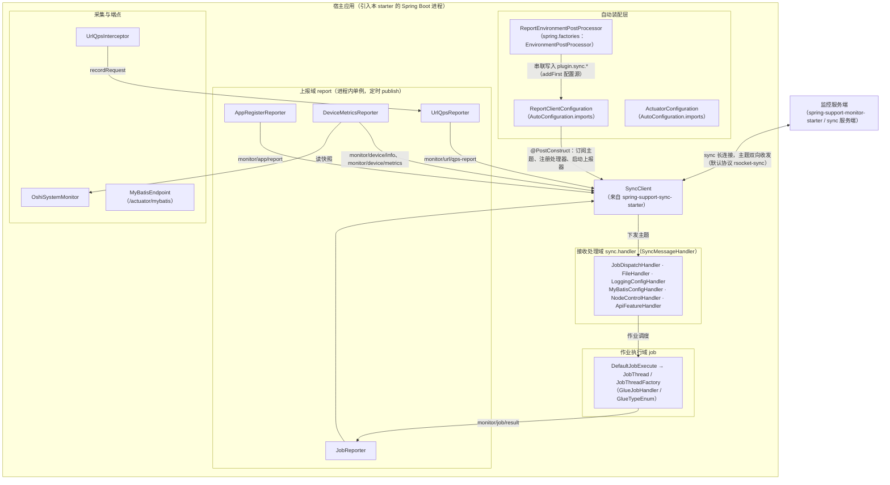
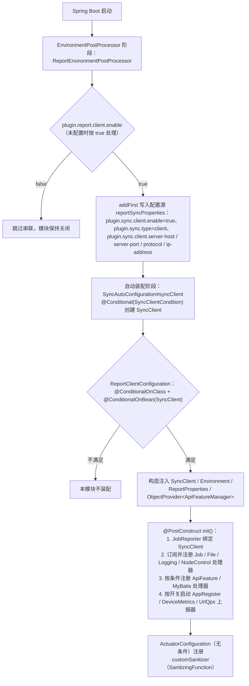

# spring-support-report-client-starter

监控体系中的**被监控节点 Agent** starter：基于 `spring-support-sync-starter` 的 `SyncClient` 与监控服务端（`spring-support-monitor-starter`）建立双向主题通道，定时上报应用信息（`monitor/app/report`）、设备指标（`monitor/device/info`、`monitor/device/metrics`）、URL QPS 统计（`monitor/url/qps-report`），并接收服务端下发的作业调度（`monitor/job/dispatch`）、文件操作、日志级别调整、MyBatis XML 刷新、API 功能开关与节点控制（重启/关闭）命令。在 spring-support 体系中，它与 `spring-support-monitor-starter`（服务端）构成「服务端 ↔ 节点」一对，是节点侧的基础设施模块。

> 坐标 `com.chua:spring-support-report-client-starter:4.0.0.51`，随父 POM `spring-support-parent-starter`（`spring-boot-starter-parent:4.1.2`，Java 25）统一管理。

## 1. 架构图



分层：自动装配层（配置串联、订阅注册、Actuator 脱敏）→ 上报域 / 接收处理域 / 作业执行域（核心服务）→ 底层依赖 `spring-support-sync-starter`（通信）、`utils-support-oshi-starter`（采集）、`spring-support-job-starter`（`@Job` 与 GLUE 执行）。

## 2. 核心流程图（自动装配 → 初始化）



> `UrlQpsConfiguration` 与 `MyBatisEndpoint` **不在** `AutoConfiguration.imports` 中（前者 `@Configuration`、后者 `@Component`），仅当宿主组件扫描覆盖 `com.chua.report.client.starter` 包或显式 `@Import` 时才注册。

## 3. 能力清单

自动装配登记：`META-INF/spring/org.springframework.boot.autoconfigure.AutoConfiguration.imports` 含 `ReportClientConfiguration`、`ActuatorConfiguration`；`META-INF/spring.factories` 含 `ReportEnvironmentPostProcessor`。

| 能力域 | 关键类 | 入口 / 触发方式 |
|:-------|:-------|:----------------|
| 配置串联 | `ReportEnvironmentPostProcessor` | `spring.factories`；把 `plugin.report.client.*` 映射为 `plugin.sync.*`（`enable=false` 才跳过） |
| 自动装配 | `ReportClientConfiguration`（`@AutoConfigureAfter(SyncAutoConfiguration.class)`） | 容器存在 `SyncClient` Bean 时装配，完成订阅、注册处理器、启动上报器 |
| Actuator 脱敏 | `ActuatorConfiguration#customSanitizer`（`SanitizingFunction`） | 经 `AutoConfiguration.imports` 注册；敏感键输出 `******`（`public.key`、`allowed.origins` 例外） |
| 应用信息上报 | `AppRegisterReporter`（单例） | 定时 publish `monitor/app/report`（初始延迟 3s，间隔 `app-report.interval`） |
| 设备指标上报 | `DeviceMetricsReporter` + `OshiSystemMonitor` | publish `monitor/device/info`（20s 后首报）、`monitor/device/metrics`（10s 后首报，间隔 `metrics.interval`；CPU 由独立线程 5s 起采样） |
| URL QPS 统计 | `UrlQpsInterceptor` → `UrlQpsReporter`（单例） | 拦截器记录 `/**` 请求（排除 `url-qps.exclude-patterns`），定时 publish `monitor/url/qps-report`；拦截器注册需 `UrlQpsConfiguration` 被扫描/导入 |
| 作业调度执行与结果上报 | `JobDispatchHandler` → `DefaultJobExecute` → `JobThread(Factory)`、`GlueJobHandler`；`JobReporter`（单例） | 订阅 `monitor/job/dispatch`、`monitor/job/cancel`，按 `GlueTypeEnum` 执行；结果 publish `monitor/job/result` |
| `@Job` 注解任务 | 依赖 `spring-support-job-starter` 的 `JobAnnotationScanner` / `JobHandlerFactory` | 业务方法标 `@Job("handlerName")`，启动时扫描注册 |
| 文件操作 | `FileHandler` | 订阅 `monitor/file/request` |
| 日志级别调整 | `LoggingConfigHandler`（Logback） | 订阅 `monitor/control/log-level` |
| MyBatis XML 刷新 / 信息端点 | `MyBatisConfigHandler`；`MyBatisEndpoint` | classpath 存在 `SqlSessionFactory` 时订阅 `monitor/control/mybatis`（mybatis 为本模块 compile 依赖，恒注册；运行时从容器查 `SqlSessionFactory`，缺失则动作返回错误）；端点 `/actuator/mybatis`、`/actuator/mybatis/{mapperName}` 为 `@Component`，需宿主扫描 |
| API 功能开关 | `ApiFeatureHandler`（依赖 common-starter 的 `ApiFeatureManager`） | 容器存在 `ApiFeatureManager` Bean 时订阅 `monitor/control/api-feature` |
| 节点控制 | `NodeControlHandler`（重启/关闭，含跨平台守护脚本） | 订阅 `monitor/control/node-restart`、`monitor/control/node-shutdown` |
| 服务信息登记 | `ReportClientConfiguration#reportClientServiceInfoContributor`（`ServiceInfoContributor`） | 向控制台登记 `report-client` / `app-report` / `device-metrics` / `node-control` 能力位 |
| 节点维护 / 日志推送（未挂接） | `NodeMaintenanceHandler`；`LogPushHandler` | 主题 `monitor/maintenance/backup\|upgrade\|restore`、`monitor/log/subscribe\|unsubscribe` → `monitor/log/push`；**类已实现但 `init()` 未注册**，需自行挂接 |

## 4. Bean 能力矩阵

| Bean 名 | 类型 | 装配条件（含默认值） | 可否覆盖 | 典型用途 |
|:--------|:-----|:---------------------|:---------|:---------|
| `reportClientServiceInfoContributor` | `ServiceInfoContributor` | 类级 `@ConditionalOnClass(SyncClient)` + `@ConditionalOnBean(SyncClient)`；方法无额外条件 | 同名覆盖不可（Boot 默认禁止 Bean 覆盖）；可并存更多 `ServiceInfoContributor` | 控制台汇总展示本模块能力位 |
| `customSanitizer` | `SanitizingFunction` | 无条件（经 `AutoConfiguration.imports` 登记，模块在 classpath 即生效） | 同名覆盖不可；Actuator 收集所有 `SanitizingFunction`，可再注册补充 | Actuator 端点敏感信息脱敏 |
| `reportProperties` | `ReportProperties` | 随 `ReportClientConfiguration` 的 `@EnableConfigurationProperties` 装配 | 属性值可被配置覆盖 | 注入读取 `plugin.report.client.*` |
| `syncClient`（依赖提供） | `SyncClient`（默认实现 `SyncClientWrapper`） | `SyncAutoConfiguration#syncClient`：`@Conditional(SyncClientCondition)`（`plugin.sync.type` ∈ client/both 且 `plugin.sync.client.enable=true`）+ `@ConditionalOnMissingBean` | 可覆盖：宿主自定义 `SyncClient` Bean 替换默认实现 | 本模块构造注入；业务可注入发布自定义主题 |
| `threadPoolTaskScheduler` | `ThreadPoolTaskScheduler`（池 200，前缀 `job`） | `JobConfiguration#threadPoolTaskScheduler()` 带 `@ConditionalOnMissingBean`；但 `JobConfiguration` **未登记自动装配**，需宿主 `@Import(JobConfiguration.class)` 或扫描到该包 | 可覆盖：宿主自定义 `ThreadPoolTaskScheduler` 即命中 `@ConditionalOnMissingBean` 让位 | 作业调度线程池 / `SchedulingConfigurer` |
| `myBatisEndpoint` | `MyBatisEndpoint`（`@Endpoint(id="mybatis")`） | `@Component` + `@ConditionalOnClass(SqlSessionFactory.class)`；需宿主组件扫描到 `...starter.endpoint` | 同名覆盖不可 | HTTP 访问 `/actuator/mybatis`；内部 `SqlSessionFactory` 为 `@Autowired(required=false)` |
| `urlQpsConfiguration` | `UrlQpsConfiguration`（`WebMvcConfigurer`） | `@Configuration` + `@ConditionalOnProperty(prefix="plugin.report.client.url-qps", name="enabled", havingValue="true", matchIfMissing=false)`；需宿主组件扫描 | 同名覆盖不可 | 经 `addInterceptors` 注册 `UrlQpsInterceptor` |

> 各 `SyncMessageHandler`（`JobDispatchHandler`、`FileHandler` 等）与 4 个 Reporter **不是 Bean**：处理器由 `ReportClientConfiguration#init()` 手工 `new` 并注册，Reporter 是 `getInstance()` 单例。

## 5. 完整配置

配置前缀：**`plugin.report.client`**（`ReportProperties.PRE`），配置类 `ReportProperties`（含嵌套类 `AppReport`、`Metrics`、`ClientInfo`、`UrlQps`）。

### 5.1 `ReportProperties` 全字段

| 配置路径 | 类型 | 默认值 | 说明 |
|:---------|:-----|:-------|:-----|
| `plugin.report.client.enable` | `boolean` | `false`（字段）；`ReportEnvironmentPostProcessor` 读取时未配置按 `true` 处理（见 §9 Q1） | 总开关：控制 EPP 是否串联 `plugin.sync.*`；显式 `false` 才关闭模块 |
| `plugin.report.client.protocol` | `String` | `rsocket-sync` | 与 sync 服务端的通信协议 |
| `plugin.report.client.host` | `String` | `localhost` | sync 服务端地址 |
| `plugin.report.client.port` | `int` | `29170` | sync 服务端端口（不是本应用 HTTP 端口） |
| `plugin.report.client.app-report.enabled` | `boolean` | `true` | 是否启动应用信息定时上报 |
| `plugin.report.client.app-report.interval` | `long` | `30` | 应用信息上报间隔（秒）；首次上报固定初始延迟 3 秒 |
| `plugin.report.client.metrics.enabled` | `boolean` | `true` | 是否启动设备指标上报 |
| `plugin.report.client.metrics.interval` | `long` | `30` | 指标上报间隔（秒）；设备信息 20s、指标 10s、CPU 采集 5s 启动 |
| `plugin.report.client.metrics.types` | `Set<MetricType>` | 空集（`getEffectiveTypes()` 视为全部） | 可选 `CPU`、`MEMORY`、`DISK`、`NETWORK`、`LOAD`、`PROCESS`、`TEMPERATURE`；**注意**：`ReportClientConfiguration#init()` 未把该值传给 `DeviceMetricsReporter#setEnabledMetrics`，运行时实际恒采集全部类型（`DeviceMetricsReporter` 默认 `Set.of(MetricType.values())`）。其中 `LOAD`/`PROCESS`/`TEMPERATURE` 无采集分支，即使启用也不产生数据 |
| `plugin.report.client.info.host` | `String` | 无（自动获取本机 IP） | 多网卡场景指定客户端 IP |
| `plugin.report.client.url-qps.enabled` | `boolean` | `true` | URL QPS 统计开关（存在双读取差异，见 §9 Q2） |
| `plugin.report.client.url-qps.interval` | `long` | `30` | QPS 统计上报间隔（秒） |
| `plugin.report.client.url-qps.exclude-patterns` | `Set<String>` | `/actuator`、`/health`、`/favicon.ico` | 排除的 URL 前缀（注册拦截器时自动追加 `/**` 变体） |

### 5.2 非 `@ConfigurationProperties`、但被本模块读取的配置

| 配置路径 | 类型 | 默认值 | 说明 | 消费方 |
|:---------|:-----|:-------|:-----|:-------|
| `plugin.report.type` | `String` | 无 | 显式配置时透传给 `plugin.sync.type`；未配置时读 `plugin.sync.type`，两者都无才写死 `client` | `ReportEnvironmentPostProcessor` |
| `plugin.report.maintenance.home-dir` | `String` | 无（基于 `ApplicationHome` 推导） | 备份 `backups/`、升级包 `upgrades/`、回滚 `rollbacks/` 目录根 | `NodeMaintenanceHandler`（未被自动挂接） |
| `plugin.report.maintenance.current-artifact` | `String` | 无（`ApplicationHome.getSource()`） | 当前运行产物（jar）路径，升级替换目标 | `NodeMaintenanceHandler`（未被自动挂接） |
| `spring.application.name` | `String` | `unknown` | 上报应用名、作业归属、守护脚本命名 | `ReportClientConfiguration`（`@Value`）、`LogPushHandler` |
| `server.port` / `server.servlet.context-path` / `management.endpoints.web.base-path` | `Integer` / `String` | `8080` / 空 / `/actuator` | 上报 `serviceUrl`；重启守护脚本健康检查 URL 拼接 | `ReportClientConfiguration`（`@Value`）、`NodeControlHandler` |

### 5.3 自动串联写入的 sync 配置（宿主无需手填）

`enable` 判定通过后，`ReportEnvironmentPostProcessor` 以 `addFirst` 写入名为 `reportSyncProperties` 的配置源：`plugin.sync.client.enable=true`、`plugin.sync.type=client`、`plugin.sync.client.server-host/-port`、`plugin.sync.client.protocol`、`plugin.sync.client.ip-address`（sync 侧已存在的项不覆盖）。传输加密由 sync 模块的 `plugin.sync.crypto-secret`（无默认，未配置为明文）与 `plugin.sync.crypto-version`（默认 `2`）决定。

## 6. 使用方式

### 6.1 Maven 坐标

```xml
<dependency>
    <groupId>com.chua</groupId>
    <artifactId>spring-support-report-client-starter</artifactId>
    <version>4.0.0.51</version>
</dependency>
```

版本随父 POM（`spring-support-parent-starter:4.0.0.51` → `spring-boot-starter-parent:4.1.2`）统一管理；处于同一生态时可不写版本号。

### 6.2 最小启用示例

```yaml
spring:
  application:
    name: my-app                      # 应用信息上报、作业归属、守护脚本使用

plugin:
  report:
    client:
      enable: true                    # 显式开启（缺省按 true 串联，见 §9 Q1）
      host: monitor-server            # sync 服务端地址
      port: 29170                     # sync 服务端端口，默认 29170
      # protocol: rsocket-sync        # 默认 rsocket-sync
```

写一个可被服务端调度的任务（`@Job` 注解来自传递依赖 `spring-support-job-starter`，由其 `JobAnnotationScanner` 注册到 `JobHandlerFactory`）：

```java
@Component
public class MyJobs {

    @Job(value = "demoJobHandler", desc = "示例任务")
    public void demoJob() {
        // 参数可经 JobContext 读取；结果由 JobThread 自动上报 monitor/job/result
    }
}
```

启动后依次出现 `[ReportEnvPostProcessor]`、`[Sync] 创建客户端`、`[ReportClient] 初始化`、`[AppReport] 启动应用信息上报` 等日志；服务端在线后，监控端节点列表即可看到本节点。

### 6.3 可选依赖说明

| 依赖 | 引入方式 | 缺失影响 |
|:-----|:---------|:---------|
| `spring-support-sync-starter` | compile 传递 | 唯一通信通道；无 `SyncClient` Bean 则本模块整体不装配 |
| `spring-support-common-starter` | compile 传递 | `ApiFeatureManager`、`ServiceInfoContributor` 缺失时对应能力不启用（API 开关通道、能力位登记） |
| `spring-support-job-starter` | compile 传递 | `@Job` 注解、`JobHandlerFactory`、GLUE/脚本解析不可用 |
| `utils-support-spring-starter` | compile 传递（pom 直接依赖） | Spring 上下文/事务/WebMvc 等通用工具链；缺失时其传递能力（`utils-support-network-starter` 等）一并不可用 |
| `spring-boot-starter-actuator` | compile 传递 | `MyBatisEndpoint` 与 `SanitizingFunction` 脱敏不可用 |
| `utils-support-oshi-starter` / `utils-support-groovy-starter` | compile 传递 | OSHI 设备指标采集、GLUE(Java)（Groovy）脚本任务类加载不可用 |
| `org.mybatis:mybatis`（3.5.19，仅核心包） | compile 传递（本模块固定引入） | MyBatis 端点与 XML 刷新；刻意不引入 mybatis-plus starter（避免带入 MP 自动装配），宿主需自行提供 `SqlSessionFactory` |
| `jakarta.servlet-api` | provided（宿主提供） | 非 Web 应用无 `UrlQpsInterceptor`，URL QPS 无数据 |
| `commons-compress` / `hutool-core` | compile 传递 | 升级包（jar/zip/tar.gz/tgz）解压、日期工具不可用 |

> 旧版本直接依赖的 `spring-support-ssh-starter`、`spring-support-oauth-client-starter`、`spring-support-swagger-starter`、`utils-support-network-starter`、`spring-support-discovery-starter` 已从 pom 删除（源码零引用）；其中 `utils-support-network-starter` 仍会随 `utils-support-spring-starter` 传递进入 classpath。服务发现按需由 sync 通道的 `ServiceDiscovery` Bean 可选接入。

## 7. 使用场景

**适用：**

- 业务服务作为**被监控节点**接入监控体系：自动上报应用信息、设备指标、URL QPS；
- 需要**服务端集中调度作业**并在业务进程内执行（`@Job` Bean 任务、GLUE/脚本任务）；
- 运维自动化：远程调整日志级别、刷新 MyBatis XML、查看 MyBatis 运行时状态、远程文件巡检；
- 节点生命周期管理：远程重启/关闭（含守护脚本健康检查），配合备份/升级/还原流程。

**不适用 / 慎用：**

- 不需要上报或没有监控服务端的应用：模块仍会尝试按默认值连接 `localhost:29170`，请显式 `enable=false` 或不引入；
- 需要高吞吐实时推送 / 消息队列的场景：本模块走 sync 主题通道，不是 socket / MQ 替代品；
- `FileHandler` 等处理器直接操作本地文件系统，授权边界依赖 sync 服务端访问控制，**不要把 sync 服务端暴露到不可信网络**。

**与相邻模块的取舍：**

| 相邻模块 | 关系 | 取舍 |
|:---------|:-----|:-----|
| `spring-support-monitor-starter` | 服务端 ↔ 客户端 | 监控端消费 `monitor/*` 主题并下发控制命令；本模块只装在被监控节点上 |
| `spring-support-sync-starter` | 底层通道 | 本模块是 sync 的业务消费方（上报 + 接收），不做协议/连接管理 |
| `spring-support-job-starter` | 能力依赖 | 提供 `@Job` 与处理器注册；调度决策在监控服务端，执行在本模块 |
| `spring-support-socket-*` / `spring-support-queue-starter` | 无直接依赖 | 实时推送/队列场景选它们；本模块日志推送等走 sync 主题 |

## 8. 扩展点

- **`SyncMessageHandler` SPI（核心扩展点）**：接口来自 `spring-support-sync-starter`（`getName()`、`getOrder()`、`supports(topic)`、`handle(topic, sessionId, data)`）。本模块全部处理器都实现该接口；其中多数标注 `@Spi("...")`（`ApiFeatureHandler` 未标注），但 `@Spi` 在本模块内仅是命名标识，实际由 `ReportClientConfiguration#init()` 手工 `new` 并 `syncClient.registerHandler(topic, handler)` 注册，不走 SPI 自动加载。**宿主扩展方式**：注入 `SyncClient` 后调用 `subscribe(topic)` + `registerHandler(topic, yourHandler)`，即可追加同主题或自定义主题处理器（追加式，可与内置处理器并存；`getOrder()` 更小者优先）。
- **可替换 Bean**：`SyncClient`（`@ConditionalOnMissingBean`，可自定义实现统一接管收发/加密/重连）；`ApiFeatureManager`（存在时才启用 API 开关通道，替换实现即改变开关语义）；`ThreadPoolTaskScheduler`（`JobConfiguration` 带 `@ConditionalOnMissingBean`，需自行 `@Import(JobConfiguration.class)`）。
- **单例 Reporter 定制**：`AppRegisterReporter` / `DeviceMetricsReporter` / `UrlQpsReporter` / `JobReporter` 均为 `getInstance()` + setter 风格，可在启动早期以代码方式改写 `SyncClient`、间隔、主机等属性。
- **主题常量**：`MonitorTopics` 接口集中定义全部 `monitor/*` 主题，宿主可复用这些常量向服务端发布自定义监控数据。
- **边界说明**：`OshiSystemMonitor` 是普通类（`DeviceMetricsReporter` 内直接 `new`），不是 Bean，无法以换 Bean 方式替换采集实现；各内置 Handler 不是 Bean，不能按 Bean 名覆盖，改变其行为需自行注册同主题高优先级处理器或调整 `init()`。

## 9. 常见问题

**Q1：引入依赖后没有任何上报、日志里也没有 `[ReportClient]`？**
排查链路：① `ReportEnvironmentPostProcessor` 读取 `plugin.report.client.enable` 时**未配置按 `true` 处理**（`getProperty(key, "true")`），只有显式 `false` 才跳过串联——注意 `ReportProperties.enable` 字段默认值虽是 `false`，但只影响能力位展示，不参与装配判定；② EPP 串联后 `SyncClientCondition`（`plugin.sync.type` ∈ client/both 且 `plugin.sync.client.enable=true`）成立才会创建 `SyncClient`；③ `ReportClientConfiguration` 因 `@ConditionalOnBean(SyncClient.class)` 装配。若想彻底关闭，必须显式配置 `plugin.report.client.enable=false`。零配置时模块会尝试连接 `localhost:29170`，无服务端时仅连接失败报错。

**Q2：`url-qps.enabled=true` 配了，为什么还是没有 URL 统计？**
存在双读取差异：`ReportClientConfiguration#init` 按 `isEnabled()`（默认 `true`）启动 `UrlQpsReporter` 线程，但**拦截器**由 `UrlQpsConfiguration` 注册，条件是 `enabled=true` 且 `matchIfMissing=false`；且 `UrlQpsConfiguration` 不在 `AutoConfiguration.imports` 中，需要宿主组件扫描覆盖 `com.chua.report.client.starter` 包（或 `@Import(UrlQpsConfiguration.class)`），并处于 Servlet Web 环境。另注意 `qps` 字段按 `count / 30.0` 计算（分母硬编码 30），调整 `url-qps.interval` 时 `qps` 语义会有偏差。

**Q3：`/actuator/mybatis` 返回 404？**
`MyBatisEndpoint` 是 `@Component`（`@ConditionalOnClass(SqlSessionFactory.class)`），依赖宿主组件扫描；同时需在 `management.endpoints.web.exposure.include` 中暴露 `mybatis` 端点，且容器中存在 `SqlSessionFactory`（缺失时端点返回 `enabled=false` 而非报错）。

**Q4：端口怎么区分？与 Spring Boot 4 兼容吗？**
`plugin.report.client.port`（默认 `29170`）是 **sync 服务端**端口；`server.port` 才是本应用 HTTP 端口，用于上报 `serviceUrl` 与重启守护脚本的健康检查 URL（`http://localhost:{server.port}{context-path}{management.endpoints.web.base-path}/health`）。兼容性方面，本模块随父 POM 以 `spring-boot-starter-parent:4.1.2`、Java 25（`--release=25`）构建，使用 jakarta 命名空间与 Boot 4 的 Actuator API（`SanitizableData`/`SanitizingFunction`、`@Endpoint`）；MyBatis 仅引入核心包 3.5.19，不带入 mybatis-plus 自动装配（是否用 MP 由宿主决定）。另外 `NodeMaintenanceHandler`、`LogPushHandler` 已实现但未被 `init()` 注册，需要时自行 `subscribe` + `registerHandler` 挂接。
