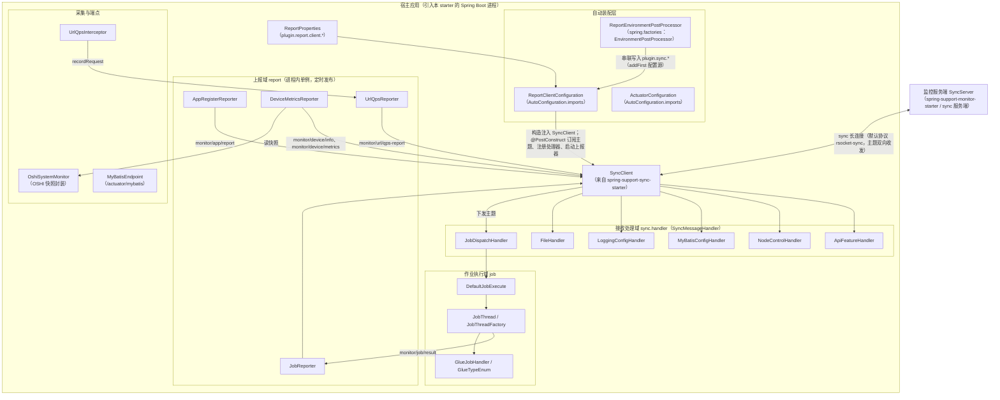
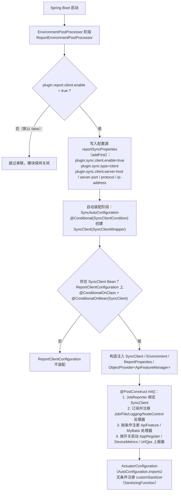
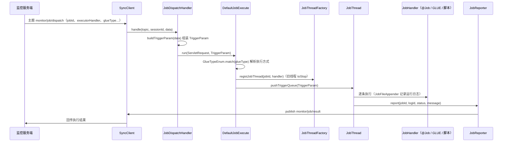
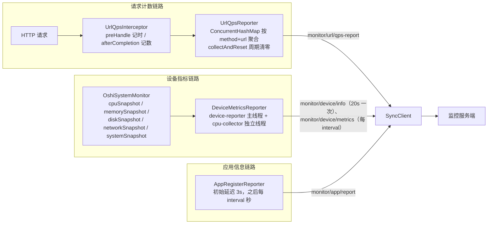

# spring-support-report-client-starter

上报信息客户端 starter（监控体系中的「被监控节点 Agent」）：通过 `spring-support-sync-starter` 提供的 `SyncClient` 与监控服务端建立长连接，定时上报应用信息（`monitor/app/report`）、设备指标（`monitor/device/metrics`、`monitor/device/info`）、URL QPS 统计（`monitor/url/qps-report`），并接收服务端下发的作业调度（`monitor/job/dispatch`）、文件操作、日志级别调整、MyBatis XML 刷新、API 功能开关与节点控制（重启/关闭）命令。

模块**默认不启用**：必须显式配置 `plugin.report.client.enable=true`，由 `ReportEnvironmentPostProcessor` 自动串联 `plugin.sync.*`、创建 `SyncClient` 后，`ReportClientConfiguration` 才会装配（`@ConditionalOnBean(SyncClient.class)`）。

> 基于 Spring Boot **4.1.2**（`spring-boot-starter-parent:4.1.2`，Java 25）构建，版本随父 POM `spring-support-parent-starter:4.0.0.51` 统一管理。

---

## 1. 架构图

### 1.1 模块在体系中的位置 + 内部分层



### 1.2 分层说明

| 层 | 类 | 职责 |
|:---|:---|:---|
| 自动装配层 | `ReportEnvironmentPostProcessor`、`ReportClientConfiguration`、`ActuatorConfiguration` | 配置串联、订阅/注册处理器、启动上报器、Actuator 脱敏 |
| 上报域 | `AppRegisterReporter`、`DeviceMetricsReporter`、`UrlQpsReporter`、`JobReporter` | 定时采集并向服务端发布应用/设备/QPS/作业结果数据 |
| 接收处理域 | `JobDispatchHandler` 等 6 个已挂接 Handler | 消费服务端下发的控制/调度主题 |
| 作业执行域 | `DefaultJobExecute`、`JobThread(Factory)`、`GlueJobHandler` | XXL-JOB 风格的任务线程、队列与 GLUE 脚本执行 |
| 采集与端点 | `OshiSystemMonitor`、`MyBatisEndpoint`、`UrlQpsInterceptor` | OSHI 指标快照、MyBatis 运行时端点、请求计数 |

---

## 2. 核心流程图

### 2.1 装配流程（EnvironmentPostProcessor → SyncClient → ReportClientConfiguration）



> 注意：`UrlQpsConfiguration` 与 `MyBatisEndpoint` **不在** `AutoConfiguration.imports` 中，属于 `@Configuration` / `@Component`，只有当宿主组件扫描覆盖 `com.chua.report.client.starter` 包（或显式 `@Import`）时才会注册。

### 2.2 作业下发处理流程（服务端 → 本地执行 → 结果回传）



### 2.3 上报数据流（采集 → 聚合 → publish）



---

## 3. 能力清单

自动装配登记：`META-INF/spring/org.springframework.boot.autoconfigure.AutoConfiguration.imports` 含 `ReportClientConfiguration`、`ActuatorConfiguration`；`META-INF/spring.factories` 含 `ReportEnvironmentPostProcessor`。

| 能力域 | 关键类（本模块） | 入口 / 主题 | 状态 |
|:-------|:-------|:-----|:-----|
| 配置串联 | `ReportEnvironmentPostProcessor` | `META-INF/spring.factories`；`plugin.report.client.*` → `plugin.sync.*` | `enable=true` 时生效 |
| 自动装配 | `ReportClientConfiguration`（`@AutoConfigureAfter(SyncAutoConfiguration.class)`） | 存在 `SyncClient` Bean 时装配 | 总开关开启后生效 |
| 应用信息上报 | `AppRegisterReporter`（单例，初始延迟 3s） | 发布 `monitor/app/report` | `app-report.enabled=true`（默认 true） |
| 设备指标上报 | `DeviceMetricsReporter`（单例，设备信息 20s / 指标 10s 启动，CPU 独立线程） | 发布 `monitor/device/info`、`monitor/device/metrics` | `metrics.enabled=true`（默认 true） |
| URL QPS 统计 | `UrlQpsReporter` + `UrlQpsInterceptor` + `UrlQpsConfiguration` | 发布 `monitor/url/qps-report` | `url-qps.enabled=true`；拦截器注册另需组件扫描（见 §9） |
| 作业调度执行 | `JobDispatchHandler` → `DefaultJobExecute` → `JobThread(Factory)` | 订阅 `monitor/job/dispatch`、`monitor/job/cancel` | 随 `ReportClientConfiguration` 自动挂接 |
| 作业结果上报 | `JobReporter`（单例） | 发布 `monitor/job/result` | 随自动装配绑定 |
| `@Job` 注解任务 | 由依赖 `spring-support-job-starter` 的 `JobAnnotationScanner`（`BeanPostProcessor`）扫描，`JobHandlerFactory` 注册 | 业务代码标 `@Job("handlerName")` | 依赖自带，非本模块类 |
| 文件操作 | `FileHandler` | 订阅 `monitor/file/request` | 随自动装配挂接 |
| 日志级别调整 | `LoggingConfigHandler`（Logback） | 订阅 `monitor/control/log-level`（action：`SET_LOG_LEVEL` / `getLoggers` / `getLevel`） | 随自动装配挂接 |
| MyBatis XML 刷新 | `MyBatisConfigHandler` | 订阅 `monitor/control/mybatis`（action：`refreshXml` / `refreshAllXml`） | 随 `ReportClientConfiguration#init()` 注册（`ReflectUtils.forName` 判 classpath，本模块 compile 依赖 mybatis 恒成立）；运行时从容器查找 `SqlSessionFactory`，缺失时刷新动作返回错误 |
| MyBatis 信息端点 | `MyBatisEndpoint`（`@Endpoint(id = "mybatis")`） | `/actuator/mybatis`、`/actuator/mybatis/{mapperName}` | `@ConditionalOnClass(SqlSessionFactory)`；需宿主组件扫描 |
| API 功能开关 | `ApiFeatureHandler`（依赖 common-starter 的 `ApiFeatureManager`） | 订阅 `monitor/control/api-feature`（action：`setEnabled` / `setBatch` / `resetAll` / `reset`） | 容器存在 `ApiFeatureManager` Bean 时才订阅 |
| 节点控制 | `NodeControlHandler`（重启/关闭，含跨平台守护脚本） | 订阅 `monitor/control/node-restart`、`monitor/control/node-shutdown` | 随自动装配挂接 |
| Actuator 脱敏 | `ActuatorConfiguration#customSanitizer`（`SanitizingFunction`） | 敏感键（password/secret/key/token/credential/auth/private/cert）输出 `******`（`public.key`、`allowed.origins` 例外） | 模块在 classpath 即注册 |
| 服务信息登记 | `ReportClientConfiguration#reportClientServiceInfoContributor`（`ServiceInfoContributor`） | 向控制台登记 `report-client` / `app-report` / `device-metrics` / `node-control` 能力位 | 随自动装配注册 |
| 系统信息采集 | `OshiSystemMonitor`（封装 `utils-support-oshi-starter` 的 `Oshi` 工具） | 供 `DeviceMetricsReporter` 调用 | 普通类，非 Bean |
| 节点维护（备份/升级/还原） | `NodeMaintenanceHandler` | 主题 `monitor/maintenance/backup\|upgrade\|restore` | **类已存在但未被自动装配注册**，需自行 `registerHandler` |
| 日志推送 | `LogPushHandler`（Root Appender） | 主题 `monitor/log/subscribe\|unsubscribe` → `monitor/log/push` | **类已存在但未被自动装配注册**，需自行 `registerHandler` |

---

## 4. Bean 能力矩阵

| Bean 名 | 类型 | 来源 | 装配条件 | 可否覆盖 | 典型注入姿势 |
|:--------|:-----|:-----|:---------|:---------|:-------------|
| `reportClientServiceInfoContributor` | `ServiceInfoContributor` | `ReportClientConfiguration#reportClientServiceInfoContributor()` | 类级 `@ConditionalOnClass(SyncClient)` + `@ConditionalOnBean(SyncClient)`；方法本身无额外条件 | 同名覆盖不可（Boot 默认禁止 Bean 定义覆盖）；可并存注册更多 `ServiceInfoContributor` | 宿主/控制台注入 `List<ServiceInfoContributor>` 汇总展示模块能力位 |
| `customSanitizer` | `SanitizingFunction` | `ActuatorConfiguration#customSanitizer()` | 无 `@ConditionalOnXxx`（经 `AutoConfiguration.imports` 登记，模块在 classpath 即生效） | 同名覆盖不可；Actuator 会收集所有 `SanitizingFunction`，可再注册一个补充 | 由 Actuator 端点自动应用，一般不直接注入 |
| `threadPoolTaskScheduler` | `ThreadPoolTaskScheduler`（池 200，前缀 `job`） | `JobConfiguration#threadPoolTaskScheduler()` | `@ConditionalOnMissingBean`；但 `JobConfiguration` **未登记自动装配**，需宿主 `@Import(JobConfiguration.class)` 或扫描到该包 | 可覆盖：宿主自定义 `ThreadPoolTaskScheduler` Bean 即命中 `@ConditionalOnMissingBean` 让位 | `@Autowired ThreadPoolTaskScheduler` 或 `SchedulingConfigurer` |
| `myBatisEndpoint` | `MyBatisEndpoint`（`@Endpoint(id="mybatis")`） | `@Component` | `@ConditionalOnClass(SqlSessionFactory.class)`；且需宿主组件扫描到 `com.chua.report.client.starter.endpoint` | 同名覆盖不可 | HTTP 访问 `/actuator/mybatis`；内部 `SqlSessionFactory` 为 `@Autowired(required=false)` |
| `urlQpsConfiguration` | `UrlQpsConfiguration`（`WebMvcConfigurer`） | `@Configuration` | `@ConditionalOnProperty(prefix="plugin.report.client.url-qps", name="enabled", havingValue="true", matchIfMissing=false)`；且需宿主组件扫描到该包 | 同名覆盖不可 | 经 `addInterceptors` 注册 `UrlQpsInterceptor`，拦截 `/**` 并排除 `exclude-patterns` |
| `syncClient`（依赖提供） | `SyncClient`（接口，默认实现 `SyncClientWrapper`） | `SyncAutoConfiguration#syncClient`（spring-support-sync-starter） | `@Conditional(SyncClientCondition)`：`plugin.sync.type` ∈ client/both 且 `plugin.sync.client.enable=true`；`@ConditionalOnMissingBean` | 可覆盖：宿主自定义 `SyncClient` Bean 替换默认实现 | 本模块构造器注入；业务可 `@Autowired SyncClient` 发布自定义主题 |
| `apiFeatureManager`（可选依赖） | `ApiFeatureManager` | spring-support-common-starter | Bean 存在时，本模块才订阅 API 功能开关主题（经 `ObjectProvider` 探测） | 可替换为自定义实现 | `ObjectProvider<ApiFeatureManager>` 注入 |
| `reportProperties` | `ReportProperties` | `@EnableConfigurationProperties(ReportProperties.class)` | 随 `ReportClientConfiguration` 装配 | 属性值可被配置覆盖 | `@Autowired ReportProperties` 读取 `plugin.report.client.*` |

---

## 5. 完整配置

配置前缀：**`plugin.report.client`**（`ReportProperties.PRE`）。以下字段逐项来自 `ReportProperties` 源码。

### 5.1 `ReportProperties` 全字段

| 配置路径 | 类型 | 默认值 | 说明 | 生效开关 / 消费方 |
|:----|:-----|:-------|:-----|:-------------|
| `plugin.report.client.enable` | `boolean` | `false` | 总开关。`ReportEnvironmentPostProcessor` 据此决定是否串联 `plugin.sync.*`；不开启则 `SyncClient` 不装配、模块整体不工作 | EPP → `ReportClientConfiguration` 装配前提 |
| `plugin.report.client.protocol` | `String` | `rsocket-sync` | 与 sync 服务端的通信协议 | EPP → `plugin.sync.client.protocol` |
| `plugin.report.client.host` | `String` | `localhost` | sync 服务端地址 | EPP → `plugin.sync.client.server-host` |
| `plugin.report.client.port` | `int` | `29170` | sync 服务端端口（注意：不是本应用 HTTP 端口） | EPP → `plugin.sync.client.server-port` |
| `plugin.report.client.app-report.enabled` | `boolean` | `true` | 是否启动应用信息定时上报 | `ReportClientConfiguration#init` → `AppRegisterReporter.start()` |
| `plugin.report.client.app-report.interval` | `long` | `30` | 应用信息上报间隔（秒）；首次上报固定初始延迟 3 秒 | `AppRegisterReporter.reportInterval` |
| `plugin.report.client.metrics.enabled` | `boolean` | `true` | 是否启动设备指标上报 | `ReportClientConfiguration#init` → `DeviceMetricsReporter.start()` |
| `plugin.report.client.metrics.interval` | `long` | `30` | 指标上报间隔（秒）；设备信息启动延迟 20s、指标 10s、CPU 采集 5s | `DeviceMetricsReporter.intervalSeconds` |
| `plugin.report.client.metrics.types` | `Set<MetricType>` | 空集（= 全部） | 可选 `CPU`、`MEMORY`、`DISK`、`NETWORK`、`LOAD`、`PROCESS`、`TEMPERATURE`（注意：`LOAD`/`PROCESS`/`TEMPERATURE` 目前无采集分支，配置也不产生数据） | `DeviceMetricsReporter.enabledMetrics` |
| `plugin.report.client.info.host` | `String` | 无（自动获取本机 IP） | 多网卡场景指定客户端 IP | EPP → `plugin.sync.client.ip-address`；同时作为三个上报器的 `host` |
| `plugin.report.client.url-qps.enabled` | `boolean` | `true` | URL QPS 统计开关（存在双读取差异，见 §9） | `UrlQpsConfiguration`（拦截器，`matchIfMissing=false`）与 `ReportClientConfiguration#init`（启动 reporter） |
| `plugin.report.client.url-qps.interval` | `long` | `30` | QPS 统计上报间隔（秒） | `UrlQpsReporter.intervalSeconds` |
| `plugin.report.client.url-qps.exclude-patterns` | `Set<String>` | `/actuator`、`/health`、`/favicon.ico` | 排除的 URL 前缀（注册拦截器时自动追加 `/**` 变体） | `UrlQpsConfiguration#addInterceptors` |

### 5.2 非 `@ConfigurationProperties`、但被本模块读取的配置

| 配置路径 | 类型 | 默认值 | 说明 | 消费方 |
|:----|:-----|:-------|:-----|:-----|
| `plugin.report.type` | `String` | 无 | 显式配置时透传给 `plugin.sync.type`；未配置时读 `plugin.sync.type`，两者都无才写死 `client` | `ReportEnvironmentPostProcessor` |
| `plugin.report.maintenance.home-dir` | `String` | 无（基于 `ApplicationHome` 推导） | 备份 `backups/`、升级包 `upgrades/`、回滚 `rollbacks/` 目录根 | `NodeMaintenanceHandler`（未被自动挂接） |
| `plugin.report.maintenance.current-artifact` | `String` | 无（`ApplicationHome.getSource()`） | 当前运行产物（jar）路径，升级替换目标 | `NodeMaintenanceHandler`（未被自动挂接） |
| `spring.application.name` | `String` | `unknown` | 上报应用名、作业归属、守护脚本命名 | `ReportClientConfiguration`（`@Value`）、`LogPushHandler` |
| `server.port` / `server.servlet.context-path` | `Integer` / `String` | `8080` / 空 | 上报 `serviceUrl`；重启守护脚本健康检查 URL 拼接 | `ReportClientConfiguration`（`@Value`）、`NodeControlHandler` |

### 5.3 自动串联写入的 sync 配置（宿主无需手填）

`enable=true` 时，`ReportEnvironmentPostProcessor` 以 `addFirst` 写入名为 `reportSyncProperties` 的配置源：`plugin.sync.client.enable=true`、`plugin.sync.type=client`、`plugin.sync.client.server-host/-port`、`plugin.sync.client.protocol`、`plugin.sync.client.ip-address`（均已存在的项不覆盖）。传输加密由 sync 模块的 `plugin.sync.crypto-secret`（无默认，未配置为明文）与 `plugin.sync.crypto-version`（默认 `2`）决定。

---

## 6. 使用方式

### 6.1 Maven 坐标

```xml
<dependency>
    <groupId>com.chua</groupId>
    <artifactId>spring-support-report-client-starter</artifactId>
    <version>4.0.0.51</version>
</dependency>
```

版本随父 POM（`spring-support-parent-starter:4.0.0.51` → `spring-boot-starter-parent:4.1.2`）统一管理；处于同一生态时可不写版本号。

### 6.2 最小可运行示例

**第一步：引入依赖**（见 6.1）。

**第二步：配置 yaml**（总开关 + 服务端地址必填，其余可省略）：

```yaml
spring:
  application:
    name: my-app                      # 应用信息上报、作业归属、守护脚本使用

plugin:
  report:
    client:
      enable: true                    # 总开关，默认 false
      host: monitor-server            # sync 服务端地址
      port: 29170                     # sync 服务端端口，默认 29170
      # protocol: rsocket-sync        # 默认 rsocket-sync
```

**第三步：写一个可被服务端调度的任务**：

```java
@Component
public class MyJobs {

    @Job(value = "demoJobHandler", desc = "示例任务")
    public void demoJob() {
        // 参数可经 JobContext 读取；执行结果由 JobThread 自动上报 monitor/job/result
        System.out.println("hello report-job");
    }
}
```

`@Job` 注解（`com.chua.starter.job.support.annotation.Job`）来自依赖 `spring-support-job-starter`，由其 `JobAnnotationScanner` 在启动时注册到 `JobHandlerFactory`。

**第四步：启动验证**——应用启动后应依次出现：

```text
[ReportEnvPostProcessor] plugin.report.client.enable = true
[Sync] 模式: client, 服务端: [false], 客户端: [true]
[Sync] 创建客户端
[ReportClient] 初始化
[ReportClient] 已向服务端注册
[ReportClient] 已注册日志配置处理器
[ReportClient] 已注册节点控制处理器（重启/关闭）
[ReportClient] 初始化完成 (AppRegister, Job, File, DeviceMetrics, MyBatis, UrlQps, NodeControl)
[AppReport] 启动应用信息上报，间隔: 30秒
[DeviceReporter] 启动定时上报，间隔: 30秒，上报指标: [...]
```

服务端在线后，监控端（`spring-support-monitor-starter`）节点列表即可看到本节点，并可经 `monitor/app/report` 中的 `serviceUrl` 回访本应用。

### 6.3 可选依赖说明

| 依赖 | 引入方式 | 作用 / 缺失影响 |
|:-----|:---------|:----------------|
| `spring-support-sync-starter` | 传递依赖（compile） | 唯一通信通道；无 `SyncClient` Bean 则本模块整体不装配 |
| `spring-support-common-starter` | 传递依赖 | `ApiFeatureManager`、`ServiceInfoContributor`、`ServletRequest/ServletResponse` 协议 |
| `spring-support-job-starter` | 传递依赖 | `@Job` 注解、`JobHandlerFactory`、`ScriptGlueHandlers`（GLUE/脚本解析） |
| `spring-boot-starter-actuator` | 传递依赖 | `MyBatisEndpoint` 与 `SanitizingFunction` 脱敏的基础 |
| `utils-support-oshi-starter` | 传递依赖 | `OshiSystemMonitor` 的 OSHI 采集实现 |
| `utils-support-groovy-starter` | 传递依赖 | GLUE(Java)（Groovy）脚本任务的类加载 |
| `org.mybatis:mybatis`（3.5.19，仅核心包） | 传递依赖 | MyBatis 端点与 XML 刷新；刻意不引入 mybatis-plus starter（避免给宿主带入 MP 自动装配），宿主需自行提供 `SqlSessionFactory` |
| `jakarta.servlet-api`（provided） | 宿主提供 | `UrlQpsInterceptor` 需要 Web 环境；非 Web 应用 URL QPS 无数据 |
| `commons-compress` / `hutool-core` | 传递依赖 | 升级包（jar/zip/tar.gz/tgz）解压；`DefaultJobLog` 日期工具 |

> 旧版本曾声明 `spring-support-ssh-starter`、`spring-support-oauth-client-starter`、`spring-support-swagger-starter`、`utils-support-network-starter`、`spring-support-discovery-starter`，现均已从 pom 删除（源码零引用，见 pom 注释 R5 说明）；服务发现按需由 sync 通道的 `ServiceDiscovery` Bean 可选接入。

---

## 7. 使用场景

### 7.1 适用

- 业务服务作为**被监控节点**接入监控体系：自动上报应用信息、设备指标、URL QPS；
- 需要**服务端集中调度作业**并在业务进程内执行（`@Job` Bean 任务、GLUE/脚本任务）；
- 运维自动化：远程调整日志级别、刷新 MyBatis XML、查看 MyBatis 运行时状态、远程文件巡检；
- 节点生命周期管理：远程重启/关闭（含守护脚本健康检查），配合备份/升级/还原流程。

### 7.2 不适用

- 没有监控服务端（或不需要上报）的应用：模块虽可引入但不会装配，属多余依赖；
- 需要**高吞吐实时推送/消息队列**的场景：本模块走 sync 主题通道，不是 socket / MQ 替代品；
- 面向互联网暴露：`FileHandler` 等处理器直接操作本地文件系统，授权边界依赖 sync 服务端访问控制，**不要把同步服务端暴露到不可信网络**。

### 7.3 与相邻模块的取舍

| 相邻模块 | 关系 | 取舍 |
|:-----|:-----|:-----|
| `spring-support-monitor-starter` | 服务端 ↔ 客户端 | 监控端消费 `monitor/*` 主题并下发控制命令；本模块只装在被监控节点上 |
| `spring-support-sync-starter` | 底层通道 | 本模块是 sync 的业务消费方（上报 + 接收），不做协议/连接管理 |
| `spring-support-job-starter` | 能力依赖 | 提供 `@Job` 与处理器注册；调度决策在监控服务端，执行在本模块 |
| `spring-support-socket-*` / `spring-support-queue-starter` | 无直接依赖 | 实时推送/队列场景请选它们，日志推送等走 sync 主题 |
| 其它业务上报类模块（如 ai-training、ueba 等） | 无关 | 本模块是**基础设施级**节点上报/控制通道，不承载具体业务语义 |

---

## 8. 扩展点

### 8.1 `SyncMessageHandler` SPI（核心扩展点）

接口来自 `spring-support-sync-starter`（`com.chua.starter.sync.support.spi.SyncMessageHandler`）：`getName()`、`getOrder()`、`supports(topic)`、`handle(topic, sessionId, data)`。

- 本模块全部处理器（`JobDispatchHandler`、`FileHandler`、`LoggingConfigHandler`、`MyBatisConfigHandler`、`NodeControlHandler`、`ApiFeatureHandler`，以及未挂接的 `NodeMaintenanceHandler`、`LogPushHandler`）都实现该接口；
- 它们虽标注 `@Spi("...")`，但 `@Spi` 在本模块内**仅是命名标识**，实际由 `ReportClientConfiguration#init()` 手工 `new` 并 `syncClient.registerHandler(topic, handler)` 注册，不走 SPI 自动加载；
- **宿主扩展方式**：注入 `SyncClient` 后调用 `subscribe(topic)` + `registerHandler(topic, yourHandler)`，即可追加同主题或自定义主题处理器（追加式，可与内置处理器并存）。

### 8.2 可替换 / 可定制的 Bean 与组件

- **`SyncClient`**：sync-starter 以 `@ConditionalOnMissingBean` 提供，宿主可自定义实现统一接管收发、加密、重连；
- **`ApiFeatureManager`**：存在时才启用 API 功能开关通道，替换实现即可改变开关执行语义；
- **`SqlSessionFactory`**：MyBatis 处理器按 classpath 判断注册（`ReportClientConfiguration#init()` 用 `ReflectUtils.forName` 探测，mybatis 为本模块 compile 依赖，处理器恒注册），端点按 `@ConditionalOnClass` 注册；`SqlSessionFactory` 本身在运行时按需获取（处理器查容器 Bean，端点字段 `@Autowired(required=false)`），容器缺失时功能降级而非不装配；MyBatis/MP 装配完全由宿主决定；
- **`ThreadPoolTaskScheduler`**：`JobConfiguration#threadPoolTaskScheduler` 带 `@ConditionalOnMissingBean`，宿主可自定义线程池（需自行 `@Import(JobConfiguration.class)`）；
- **单例上报器**：`AppRegisterReporter` / `DeviceMetricsReporter` / `UrlQpsReporter` / `JobReporter` 均为 `getInstance()` + setter 风格，可在启动早期以代码方式改写 `SyncClient`、间隔、主机等属性；
- **`MonitorTopics`**：主题常量接口，宿主可复用这些常量向服务端发布自定义监控数据。

### 8.3 边界说明

- `OshiSystemMonitor` 是普通类（`DeviceMetricsReporter` 内直接 `new`），**不是 Bean**，无法以换 Bean 的方式替换采集实现；需要替换采集逻辑时只能包装/修改本模块；
- 各 `SyncMessageHandler` 不是 Bean，不能按 Bean 名覆盖；要改变其行为，可自行注册同主题的高优先级处理器（`getOrder()` 更小者优先），或 fork 本模块调整 `init()`。

---

## 9. 常见问题

**Q1：引入依赖后没有任何上报、日志里也没有 `[ReportClient]`？**
`plugin.report.client.enable` 默认 `false`。不配置时 `ReportEnvironmentPostProcessor` 不会写 `plugin.sync.client.enable=true`，`SyncClientCondition` 不成立 → 无 `SyncClient` Bean → `ReportClientConfiguration` 因 `@ConditionalOnBean(SyncClient.class)` 不装配。排查顺序：`[ReportEnvPostProcessor]` 日志 → `[Sync] 模式/创建客户端` 日志 → `[ReportClient] 初始化` 日志。

**Q2：`url-qps.enabled=true` 配了，为什么还是没有 URL 统计？**
存在双读取差异：`ReportClientConfiguration#init` 按 `isEnabled()`（默认 `true`）启动 `UrlQpsReporter` 线程，但**拦截器**由 `UrlQpsConfiguration` 注册，条件是 `enabled=true` 且 `matchIfMissing=false`；且 `UrlQpsConfiguration` 不在 `AutoConfiguration.imports` 中，需要宿主组件扫描覆盖 `com.chua.report.client.starter` 包（或 `@Import(UrlQpsConfiguration.class)`），并处于 Servlet Web 环境。要真正采集，请显式配置 `plugin.report.client.url-qps.enabled=true` 并确保扫描覆盖。

**Q3：`/actuator/mybatis` 返回 404？**
`MyBatisEndpoint` 是 `@Component`（`@ConditionalOnClass(SqlSessionFactory.class)`），同样依赖宿主组件扫描；同时需在 `management.endpoints.web.exposure.include` 中暴露 `mybatis` 端点，且容器中存在 `SqlSessionFactory`。

**Q4：端口怎么区分？**
`plugin.report.client.port`（默认 `29170`）是 **sync 服务端**的端口；`server.port` 才是本应用 HTTP 端口，用于上报 `serviceUrl` 与重启守护脚本的健康检查 URL（`http://localhost:{server.port}{context-path}{management.endpoints.web.base-path}/health`）。

**Q5：与 Spring Boot 4 的兼容性？**
本模块随仓库父 POM 升级到 `spring-boot-starter-parent:4.1.2`，以 Java 25（`--release=25`）编译；使用 jakarta 命名空间与 Boot 4 的 Actuator API（`SanitizableData`/`SanitizingFunction`、`@Endpoint`）。MyBatis 仅引入核心包 3.5.19，不带入 mybatis-plus 自动装配（R5：是否用 MP 由宿主决定）。

**Q6：备份/升级、日志推送主题下发了没反应？**
`NodeMaintenanceHandler`、`LogPushHandler` 已实现但**未被 `ReportClientConfiguration#init()` 注册订阅**。需要时在宿主启动后自行 `syncClient.subscribe(...)` + `syncClient.registerHandler(...)` 挂接。

**Q7：作业执行日志写到哪里？**
`JobFileAppender.logBasePath` 硬编码为 `/data/applogs/job/jobhandler`（按日期建子目录，文件名 `logId.log`）。`initLogPath(...)` 提供了覆盖入口，但本模块内没有调用点，无法通过配置修改；Windows 环境也会写到该固定路径。

**Q8：`metrics.types` 配了 `LOAD`/`PROCESS`/`TEMPERATURE` 为什么没数据？**
`DeviceMetricsReporter#collectMetrics` 目前仅实现 CPU（独立线程缓存采样）、MEMORY、DISK、NETWORK 四类；`MetricType` 枚举中的 `LOAD`、`PROCESS`、`TEMPERATURE` 没有对应采集分支，配置了也不会出现在上报数据里。

**Q9：上报数据里的 `qps` 字段怎么算的？**
`UrlQpsReporter` 以 `count / 30.0` 计算（分母硬编码 30），并非按实际 `interval` 折算；调整 `url-qps.interval` 时注意 `qps` 字段的语义偏差（`count`、耗时、状态码分布不受影响）。

**Q10：应用重复启动会重复注册上报器吗？**
不会。`AppRegisterReporter`、`DeviceMetricsReporter`、`UrlQpsReporter` 均为进程级单例，`start()` 有 `running` 标志幂等保护；应用关闭时 `ReportClientConfiguration#destroy()` 会停止应用信息与设备指标上报。
