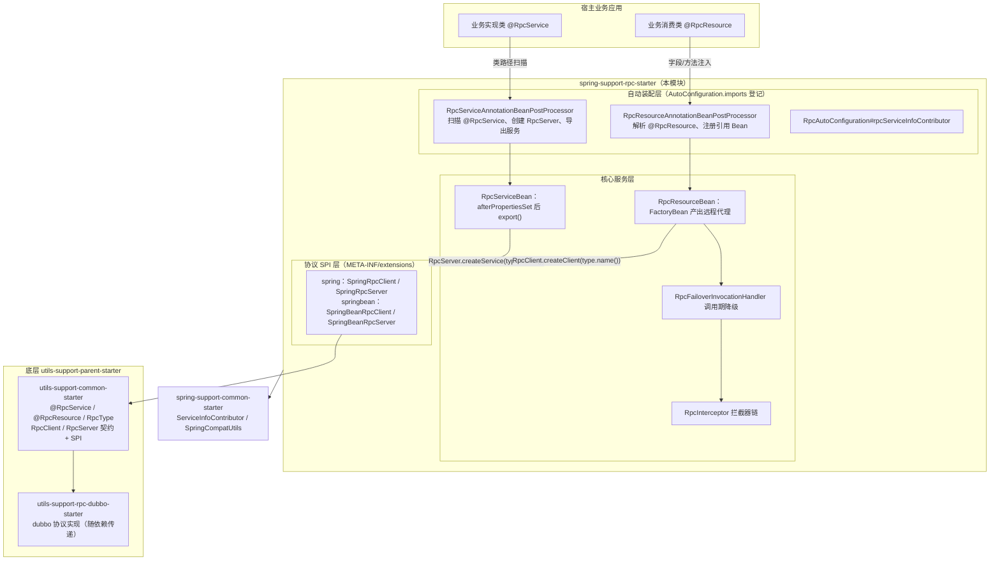
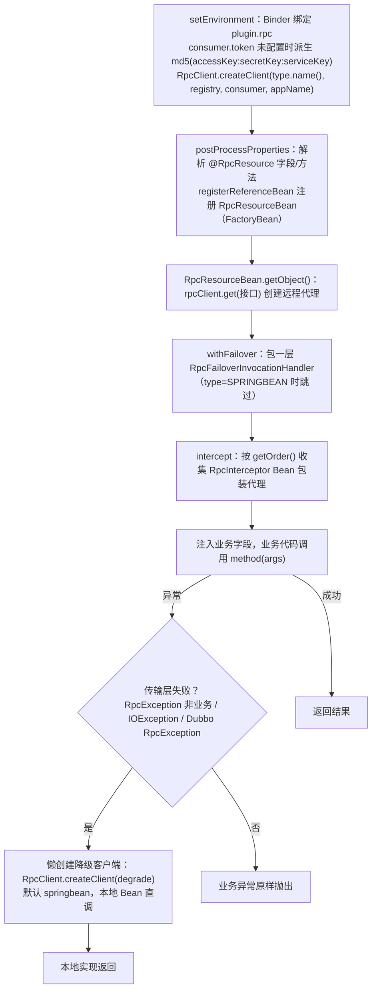

# spring-support-rpc-starter

Spring Boot 自动装配的 RPC 门面：用 `@RpcService` 暴露服务、用 `@RpcResource` 注入远程代理，底层协议由 `plugin.rpc.type`（`RpcType`：`DUBBO` / `SOFA` / `JSON` / `SPRINGBEAN` / `NONE`）选择。在 spring-support 体系中，它是宿主应用与底层 utils 协议实现之间的装配层：自己不实现任何具体协议，只负责注解扫描、动态 Bean 注册、代理创建、调用期降级与增强；协议实现通过 `META-INF/extensions` SPI 提供（本模块注册 `spring` / `springbean` 两个键，`dubbo` 等由 `utils-support-rpc-dubbo-starter` 等底层模块提供）。

## 1. 架构图



- `@RpcService`、`@RpcResource`、`RpcType`、`RpcClient`、`RpcServer`、`RpcConsumerConfig`、`RpcProtocolConfig`、`RpcRegistryConfig` 均定义在 `utils-support-common-starter`（包 `com.chua.common.support.network.rpc`），不在本模块；自动装配入口只有 `META-INF/spring/org.springframework.boot.autoconfigure.AutoConfiguration.imports`（登记 3 个类），无 `spring.factories`。

## 2. 核心流程图

消费端 `@RpcResource` 从注入到调用降级的完整链路：



要点：`RpcResourceBean` 创建期失败也会直接改走降级客户端；服务端 `RpcServiceBean.export()` 失败时按 `degrade`（默认 `springbean`）把实现注册为本地 Bean，`exception=false` 或降级可用时不阻断启动；纯消费端（无任何 `@RpcService`）不调用 `rpcServer.afterPropertiesSet()`，JSON 等协议不会白占端口。

## 3. 能力清单

| 能力域 | 关键类 | 入口/触发方式 |
|---|---|---|
| 服务暴露 | `RpcServiceBean`、`AbstractRpcServiceSetting`、`RpcServiceAnnotationBeanPostProcessor` | `@RpcService`（类/方法） |
| 包扫描 | `RpcClassPathBeanDefinitionScanner`、`ScanExcludeFilter`、`ServicePackagesHolder` | `plugin.rpc.scan`（缺省扫主类包），扫描结果去重记录 |
| 服务引用 | `RpcResourceBean`、`RpcResourceAnnotationBeanPostProcessor`、`AbstractAnnotationBeanPostProcessor` | `@RpcResource`（字段/方法） |
| 协议适配（客户端） | `SpringRpcClient`（spring）、`SpringBeanRpcClient`（springbean）+ utils 层实现 | SPI `META-INF/extensions/...RpcClient`，按 `plugin.rpc.type` 创建 |
| 协议适配（服务端） | `SpringRpcServer`（spring）、`SpringBeanRpcServer`（springbean）+ utils 层实现 | SPI `META-INF/extensions/...RpcServer` |
| 调用期降级 | `RpcFailoverInvocationHandler`、`RpcResourceBean#getDegradeClient` | `@RpcResource(degrade=...)` / `@RpcService(degrade=...)`，默认 `springbean` |
| 调用拦截 | `RpcInterceptor`、`MetricsRpcInterceptor`、`LoggingRpcInterceptor` | Spring Bean，按 `getOrder()` 排序，对所有协议代理生效 |
| 重试 | `RpcRetryPolicy`（指数退避：初始 100ms、倍数 2.0、上限 10s、默认 3 次） | `plugin.rpc.consumer.retry-*`，仅 `spring` 协议调用链 |
| 熔断 | `RpcCircuitBreakerManager`、`RpcCircuitBreaker`（CLOSED/OPEN/HALF_OPEN，失败阈值 5、半开成功阈值 2、打开 60s） | 需声明 Bean；当前无 `circuit-breaker-enabled` 配置项，熔断分支不可达（见第 9 节） |
| 负载均衡 | `RpcLoadBalancer`、`RandomLoadBalancer`、`RoundRobinLoadBalancer` | 仅有实现类，本模块调用链未消费；`consumer.load-balance` 由底层协议解释 |
| 代理创建 | `RpcProxyFactoryManager`、`JdkRpcProxyFactory`、`JavassistRpcProxyFactory` | 单例管理器；本模块调用链走 `ReflectUtils.newProxy`，管理器未被消费 |
| 监控端点 | `RpcMonitorController`、`RpcServerHolder` | `GET /v2/rpc/monitor/info`、`/connections`、`/metrics`（需自行注册 Bean） |
| 服务信息 | `RpcAutoConfiguration#rpcServiceInfoContributor` | 自动装配，向 `ServiceInfoContributor` 登记 `rpc` 标志 |
| 异常体系 | `RpcServiceException`（导出失败）、`RpcProxyCreationException`（代理创建失败） | 运行时异常 |

## 4. Bean 能力矩阵

| Bean 名称 | 类型 | 装配条件（含默认值） | 可否覆盖 | 典型用途 |
|---|---|---|---|---|
| `com.chua.starter.rpc.support.configuration.RpcServiceAnnotationBeanPostProcessor` | `BeanDefinitionRegistryPostProcessor` | 登记于 `AutoConfiguration.imports`；类上 `@ConditionalOnProperty(prefix="plugin.rpc", name="enable", havingValue="true", matchIfMissing=true)`，各入口再查 `RpcProperties.isEnable()` | 不建议覆盖（核心装配） | 扫描 `@RpcService`、创建 `RpcServer`、动态注册服务 Bean |
| `com.chua.starter.rpc.support.configuration.RpcResourceAnnotationBeanPostProcessor`（常量 `RpcResourceAnnotationBeanPostProcessor.BEAN_NAME` = `referenceAnnotationBeanPostProcessor`，仅作缓存系统属性前缀） | `BeanFactoryPostProcessor` + `BeanPostProcessor` | 登记于 `AutoConfiguration.imports`，无类级条件；所有入口检查 `RpcProperties.isEnable()` | 不建议覆盖 | 解析 `@RpcResource` 并注入远程代理 |
| `rpcServiceInfoContributor` | `ServiceInfoContributor`（`RpcAutoConfiguration` `@Bean`） | `@AutoConfiguration`，无条件注册（`enable=false` 时也登记标志） | 可覆盖（同名 Bean） | 服务信息面板显示 RPC 模块状态 |
| `RpcProperties` | `@ConfigurationProperties(prefix="plugin.rpc")` | 由 `RpcServiceAnnotationBeanPostProcessor` 的 `@EnableConfigurationProperties` 启用 | 可覆盖（同前缀自定义绑定） | 两个后置处理器经 `Binder` 持有 |
| `RpcServiceBean<接口>` | 动态注册的 `InitializingBean` 包装 Bean（非 `FactoryBean`） | 存在 `@RpcService` 时由后置处理器注册；Bean 名 = `RpcServiceBean` + 接口全限定名 + version + group | 否（重复定义抛 `BeanDefinitionStoreException`） | `afterPropertiesSet()` 导出服务到 `RpcServer` |
| `RpcResourceBean<接口>` | 动态注册的 `FactoryBean<T>` | 存在 `@RpcResource` 注入点时注册；Bean 名取字段/方法属性名（`@RpcResource` 无 `id` 属性，冲突自动 `#2` 递增） | 否 | 产出远程代理（含降级与拦截器链） |
| `RpcMonitorController` | `@RestController`，类上 `@ConditionalOnProperty(plugin.rpc.enable, havingValue="true", matchIfMissing=true)` | **不在** `AutoConfiguration.imports`、无 `@Component`，需宿主 `@Bean` 注册 | 可覆盖 | 暴露 `/v2/rpc/monitor/*` |
| `RpcCircuitBreakerManager` | `@Component` | 不在 `AutoConfiguration.imports`；仅当宿主扫描到 `com.chua.starter.rpc.support.circuitbreaker` 包或 `@Bean` 声明 | 可自行声明/覆盖 | `SpringRpcInvocationHandler` 按类型获取，取不到仅 debug 日志 |
| `MetricsRpcInterceptor`（order=-100） / `LoggingRpcInterceptor`（order=`Integer.MAX_VALUE`） | `@Component`，实现 `RpcInterceptor` | 同上，需宿主扫描或 `@Bean` 声明 | 可自行声明/覆盖 | 方法级指标统计 / DEBUG 调用日志 |
| `SpringBeanRpcServer` | `@Service` + `@Spi("springbean")` | SPI 按名实例化，不依赖 `@Service`；`@Service` 仅在宿主扫描到该包时额外注册普通 Bean | SPI 实例不可覆盖；可注册自定义 `RpcServer` 实现占同名 SPI 键 | 本地 Bean 直调协议的服务端 |

> 结论：自动装配只登记 3 个类（两个后置处理器 + `RpcAutoConfiguration`）；带 `@Component`/`@RestController` 的支撑组件都不会被自动装配，需宿主显式声明。

## 5. 完整配置

前缀 `plugin.rpc`（`RpcProperties.PRE`）。总开关 `plugin.rpc.enable` 默认 `false`：为 `false` 时仅 `rpcServiceInfoContributor` 照常登记，扫描、导出、引用、代理全部关闭。

**顶层 `plugin.rpc.*`（`RpcProperties`）：**

| 配置路径 | 类型 | 默认值 | 说明 |
|---|---|---|---|
| `plugin.rpc.enable` | `boolean` | `false` | RPC 总开关 |
| `plugin.rpc.type` | `RpcType` 枚举 | `DUBBO` | `DUBBO` / `SOFA` / `JSON` / `SPRINGBEAN` / `NONE`；SPI 名匹配忽略大小写 |
| `plugin.rpc.scan` | `Set<String>` | 未设置 → `@SpringBootApplication` 主类所在包 | `@RpcService` 扫描包，支持占位符 |
| `plugin.rpc.application-name` | `String` | `${spring.application.name:app}` | 应用名，透传协议实现 |
| `plugin.rpc.access-key` / `plugin.rpc.secret-key` | `String` | `""` | 访问 AK/SK，参与派生 `consumer.token`，严禁硬编码 |
| `plugin.rpc.service-key` | `String` | `98bb5008c946bdce065af13070241e10` | 服务序列，参与派生 `consumer.token`，生产必须外部覆盖 |
| `plugin.rpc.crypto` | `String` | `aes` | 加密算法 |
| `plugin.rpc.protocols` | `List<RpcProtocolConfig>` | 空列表 | 服务端协议列表；装配时只取 `getFirst()` |
| `plugin.rpc.registry` | `List<RpcRegistryConfig>` | 空列表 | 注册中心列表 |
| `plugin.rpc.consumer` | `RpcConsumerConfig` | `new RpcConsumerConfig()`（`auto=true`） | 消费端全局配置，见下表 |

**消费端 `plugin.rpc.consumer.*`（`RpcConsumerConfig`，除 `auto` 外均为包装类型，未配置为 `null`，由 `autoConfig()` 或底层协议兜底）：**

| 配置路径 | 类型 | 未配置默认 | 说明 |
|---|---|---|---|
| `auto` | `boolean` | `true` | 创建客户端前自动调优：`timeout=clamp(CPU×1500, 3000, 15000)`、`connectTimeout=max(timeout/3, 1000)`、`connections=max(CPU×8, 16)`、`retryDelay=堆≥4G?200:500` |
| `timeout` / `connect-timeout` | `Integer` | `null` | 调用/连接超时（毫秒） |
| `retries` | `Integer` | `null` | 重试次数，映射 `RpcRetryPolicy.maxRetries` |
| `retry-enabled` / `retry-delay` | `Boolean` / `Integer` | `null` | 重试开关 / 初始间隔（毫秒），仅 `spring` 协议链路消费 |
| `load-balance` | `String` | `null` | `random` / `roundrobin` / `leastactive` / `consistenthash` / `shortestresponse` |
| `cluster` | `String` | `null` | `failover` / `failfast` / `failsafe` / `failback` / `forking` / `broadcast` |
| `async` / `invoke-type` | `Boolean` / `String` | `null` | 异步开关；`sync` / `async` / `future` / `callback` / `oneway` |
| `version` / `group` | `String` | `null` | 默认服务版本 / 分组 |
| `connections` / `sticky` | `Integer` / `Boolean` | `null` | 最大连接数 / 粘性连接 |
| `serialization` | `String` | `null` | 序列化协议（模块常量 `RpcProperties.DEFAULT_SERIALIZATION="hessian"`） |
| `check` / `lazy` / `inline` / `access-log` | `Boolean` | `null` | 启动检查 / 延迟连接 / 同 JVM 直调 / 访问日志 |
| `url` | `String` | `null` | 直连地址 |
| `token` | `String` | `null` → 派生 `md5(accessKey:secretKey:serviceKey)` | 服务治理令牌（请求头 `X-RPC-Token`），服务端 `@RpcService#token()` 校验 |
| `interface-class` / `interface-name` | `Class<?>` / `String` | `null` | 服务接口（定向引用） |

**服务端协议 `plugin.rpc.protocols[n]`（`RpcProtocolConfig` record）**：`name`、`host`、`port`、`payload`、`buffer`、`threads`、`accepts`、`ioThreads`、`alive`、`queues`、`serialization`、`codec`、`transporter`、`dispatcher`、`threadpool`、`heartbeat`、`ssl`、`register`、`charset`、`keepAlive`、`coreThreads`、`maxThreads`、`idleTimeout`（数值/布尔项均可空）；可用 `RpcProtocolConfig.auto(name, port)` 按 CPU/堆生成调优配置（payload 8MB、`threadpool="cached"`、`register=true` 等）。

**注册中心 `plugin.rpc.registry[n]`（`RpcRegistryConfig`）**：`address`、`username`、`password`、`port`、`protocol`（`zookeeper` / `nacos` / `redis` / `multicast` / `direct`）、`timeout`、`sessionTimeout`、`group`、`version`、`check`、`dynamic`、`register`、`subscribe`、`weight`、`parameters`（Map）、`file`。

### 5.1 逐项配置示例（按功能分组）

下列示例按功能分组，逐项给出含义与默认值；键名遵循 Spring Boot 宽松绑定（如 `accessKey` 写作 `access-key`）。`consumer.*` 中包装类型项未配置时为 `null`，由 `autoConfig()` 或底层协议兜底。

**总开关、协议与扫描：**

```yaml
plugin:
  rpc:
    enable: true                      # 总开关，默认 false；false 时仅登记服务信息标志
    type: DUBBO                       # 协议类型枚举，默认 DUBBO；可选 DUBBO/SOFA/JSON/SPRINGBEAN/NONE
    application-name: order-service   # 应用名，默认 ${spring.application.name:app}
    scan:                             # @RpcService 扫描包集合，缺省扫 @SpringBootApplication 主类所在包
      - com.example.order.api
      - com.example.user.api
```

**安全凭据与令牌：**

```yaml
plugin:
  rpc:
    access-key: your-access-key       # 访问 AK，默认空串；参与派生 consumer.token，严禁硬编码
    secret-key: your-secret-key       # 访问 SK，默认空串；参与派生 consumer.token，严禁硬编码
    service-key: your-service-key     # 服务序列，默认内置示例值，生产必须外部覆盖
    crypto: aes                       # 加密算法，默认 aes
    consumer:
      token: your-token               # 服务治理令牌（请求头 X-RPC-Token）；未配置时派生 md5(accessKey:secretKey:serviceKey)
```

**注册中心（registry[n]）：**

```yaml
plugin:
  rpc:
    registry:
      - address: zookeeper://localhost:2181   # 注册中心地址
        protocol: zookeeper                   # zookeeper/nacos/redis/multicast/direct
        username: your-username               # 登录用户名，可空
        password: your-password               # 登录密码，可空
        timeout: 3000                         # 连接超时（毫秒），可空
        session-timeout: 60000                # 会话超时（毫秒），ZooKeeper 等使用，可空
        group: default                        # 服务分组，可空
        check: true                           # 启动时检查连通性，可空
        register: true                        # 服务端是否注册，可空
        subscribe: true                       # 客户端是否订阅，可空
```

**服务端协议（protocols[n]，装配时只取第一个）：**

```yaml
plugin:
  rpc:
    protocols:
      - name: dubbo                 # 协议名（dubbo/http/sofa 等）
        host: 0.0.0.0               # 监听地址，0.0.0.0 表示所有网卡
        port: 20880                 # 监听端口
        payload: 8388608            # 最大载荷（字节），默认 8MB
        threads: 200                # 业务线程数，可空
        io-threads: 8               # IO 线程数，可空
        accepts: 10000              # 最大接入连接数，可空
        queues: 256                 # 等待队列大小，可空
        serialization: hessian2     # 序列化协议（hessian2/java/kryo/protobuf），可空
        heartbeat: 30000            # 心跳间隔（毫秒），可空
        register: true              # 是否向注册中心注册此协议，可空
        ssl: false                  # 是否启用 SSL/TLS，可空
```

**消费端调优与重试（consumer.*）：**

```yaml
plugin:
  rpc:
    consumer:
      auto: true                    # 自动调优开关，默认 true；autoConfig() 按 CPU/堆计算 timeout/connect-timeout/connections/retry-delay
      timeout: 3000                 # 调用超时（毫秒），未配置为 null；auto 公式 clamp(CPU×1500, 3000, 15000)
      connect-timeout: 1000         # 连接超时（毫秒），未配置为 null；auto 公式 max(timeout/3, 1000)
      retries: 2                    # 重试次数，未配置为 null
      retry-enabled: true           # 重试开关，未配置为 null；仅 spring 协议调用链消费
      retry-delay: 500              # 重试初始间隔（毫秒），未配置为 null；auto 公式 堆≥4G 取 200 否则 500
      load-balance: random          # random/roundrobin/leastactive/consistenthash/shortestresponse
      cluster: failover             # failover/failfast/failsafe/failback/forking/broadcast
      async: false                  # 异步开关，未配置为 null
      invoke-type: sync             # sync/async/future/callback/oneway
      connections: 64               # 最大连接数，未配置为 null；auto 公式 max(CPU×8, 16)
      sticky: false                 # 粘性连接，未配置为 null
      serialization: hessian        # 序列化协议，模块常量 DEFAULT_SERIALIZATION=hessian
      check: true                   # 启动时检查服务端可用，未配置为 null
      lazy: false                   # 延迟连接，未配置为 null
      inline: false                 # 同 JVM 直调（本机已注册该服务时跳过网络），未配置为 null
      access-log: false             # 访问日志，未配置为 null
      url: ""                       # 直连地址，可空
      version: "1.0.0"              # 默认服务版本，可空
      group: default                # 默认服务分组，可空
```

## 6. 使用方式

```xml
<dependency>
    <groupId>com.chua</groupId>
    <artifactId>spring-support-rpc-starter</artifactId>
    <version>4.0.0.51</version>
</dependency>
```

| 依赖 | 作用域 | 缺失影响 |
|---|---|---|
| `utils-support-rpc-dubbo-starter` | compile，随本模块传递 | 缺失则 `type=DUBBO` 解析不到 SPI 实现 |
| `spring-support-common-starter` | compile | 必需，服务信息与兼容工具 |
| `utils-support-rpc-sofa-starter` / `-json-starter` / `-zmq-starter` | 可选，按需自行引入 | 使用 `SOFA` / `JSON` / ZMQ 协议时缺了对应协议就解析不到 SPI 实现 |

最小启用示例（提供端 + 消费端可同应用或分两个应用）：

```yaml
plugin:
  rpc:
    enable: true          # 默认 false，必须显式打开
    type: DUBBO
    application-name: order-service
    registry:
      - address: zookeeper://localhost:2181
        timeout: 3000
    protocols:
      - name: dubbo
        host: 0.0.0.0
        port: 20880
    consumer:
      timeout: 3000
      retries: 2
```

```java
// 提供端：接口可从实现的第一个接口推断；version/group 需与消费端一致
@RpcService(interfaceClass = UserService.class, version = "1.0.0", group = "default")
public class UserServiceImpl implements UserService {
    public User getUserById(Long id) { return userMapper.selectById(id); }
}

// 消费端：注解属性优先于 plugin.rpc.consumer 全局配置
@Service
public class OrderService {
    @RpcResource(version = "1.0.0", group = "default", timeout = 3000)
    private UserService userService;
}
```

监控端点需自行注册 Bean 后才可访问 `GET /v2/rpc/monitor/info`、`/connections`、`/metrics`：

```java
@Bean
@ConditionalOnProperty(prefix = "plugin.rpc", name = "enable", havingValue = "true")
public RpcMonitorController rpcMonitorController(ApplicationContext context, ObjectProvider<MetricsRpcInterceptor> metrics) {
    return new RpcMonitorController(context, metrics);
}
```

本模块无链式 Builder API：`RpcServiceBean` / `RpcResourceBean` 由框架动态注册，配置只能通过 `plugin.rpc.*` 与注解属性表达。

### 6.1 完整 YAML 使用示例（生产参考）

提供端与消费端同应用、Dubbo 协议 + ZooKeeper 注册中心的生产级参考（各项含义与默认值见第 5 节与 5.1 节）：

```yaml
spring:
  application:
    name: order-service

plugin:
  rpc:
    enable: true
    type: DUBBO
    application-name: ${spring.application.name}
    scan:
      - com.example.order.rpc
    access-key: ${RPC_ACCESS_KEY}        # 从环境变量/配置中心注入，严禁硬编码
    secret-key: ${RPC_SECRET_KEY}
    service-key: ${RPC_SERVICE_KEY}
    crypto: aes
    registry:
      - address: zookeeper://zk-1:2181
        protocol: zookeeper
        timeout: 3000
        session-timeout: 60000
        check: true
    protocols:
      - name: dubbo
        host: 0.0.0.0
        port: 20880
        payload: 8388608
        serialization: hessian2
    consumer:
      auto: false               # 生产建议固定参数，避免跨环境漂移
      timeout: 3000
      connect-timeout: 1000
      retries: 2
      retry-enabled: true
      retry-delay: 500
      load-balance: random
      cluster: failover
      connections: 64
      serialization: hessian
      check: true
```

### 6.2 生产注意事项

- `plugin.rpc.enable` 默认 `false`：忘记打开时 `@RpcService` / `@RpcResource` 静默不生效（仅登记服务信息标志）。
- `access-key` / `secret-key` / `service-key` 严禁硬编码：从配置中心或环境变量注入；`service-key` 的内置默认值仅作示例，生产必须覆盖。`consumer.token` 未显式配置时按 `md5(accessKey:secretKey:serviceKey)` 派生，轮换 AK/SK 会改变派生令牌，需与服务端校验规则同步。
- `scan` 未配置时只扫 `@SpringBootApplication` 主类所在包；多模块 / 多包结构必须显式列出，否则服务导出或引用会静默缺失。
- `type=JSON` 会真实监听 HTTP 端口；纯消费端（无任何 `@RpcService`）不启动服务端，不会白占端口。
- `consumer.auto=true` 时 `timeout` / `connect-timeout` / `connections` / `retry-delay` 按 CPU 与堆自动计算，跨环境性能基线会漂移；压测或容量规划场景建议 `auto: false` 并显式固定参数。
- 重试（`retry-*`）仅对 `spring` 协议调用链生效（见第 9 节 Q3）；业务异常不重试、不降级。熔断分支当前不可达（无 `circuit-breaker-enabled` 配置项）。
- 降级目标默认 `springbean`（本地 Bean 直调）：依赖本地存在对应实现，跨应用纯消费端请显式评估降级可用性。
- `/v2/rpc/monitor/*` 端点需自行注册 `RpcMonitorController` Bean 才存在（见第 6 节示例）。

## 7. 使用场景

**适用：**

- Spring Boot 微服务间方法级远程调用（默认 `type=DUBBO`，注册中心 + 服务治理）。
- 单体/同工程内统一「接口 + 注解」调用：`type=SPRINGBEAN`，无网络、无注册中心，Bean 即 RPC（Spring 6 移除 HttpInvoker 后的替代）。
- 需要平滑降级：远端不可用自动回退本地 Bean（`degrade="springbean"`），或跨语言轻量集成（`type=JSON`，HTTP 传输）。

**不适用/慎用：**

- 消息/数据同步、任务调度：用 `spring-support-sync-starter` / `spring-support-job-starter`，与本模块无装配关系。
- 对外 REST 网关、强 HTTP 语义调用（OpenFeign 等）：本模块是内部 RPC 门面，不提供 HTTP 路由治理。

**与相邻模块的取舍：** 高并发企业内 RPC 选 `DUBBO`（随依赖传递）；金融级大促流量选 `SOFA`（需加 `utils-support-rpc-sofa-starter`）；跨语言/开发测试选 `JSON`（jsonrpc4j，纯 HTTP，会监听端口）；同进程解耦与永久降级目标选 `SPRINGBEAN`。长连接推送/双向通信用 `spring-support-socket-starter` 系列（WebSocket/SSE/RSocket/Socket.IO），方法级调用才用本模块；服务发现由 `spring-support-discovery-starter` 承担，本模块只消费注册中心配置。

## 8. 扩展点

| 扩展点 | 注册方式 | 生效位置 |
|---|---|---|
| `RpcInterceptor` | 声明为 Spring Bean（`@Bean` 或被扫描），按 `getOrder()` 排序 | `RpcResourceBean#intercept` 包装**所有协议**的远程代理；`preHandle` 返回 `false` 拦截调用，`postHandle` 可替换返回值，`handleException` 可转换异常，`afterCompletion` 必达 |
| `RpcCircuitBreakerManager` | 声明为 Spring Bean | `SpringRpcInvocationHandler` 按类型获取（取不到仅 debug 日志）；当前无 `circuit-breaker-enabled` 配置项，熔断分支不可达 |
| `RpcProxyFactory` | `RpcProxyFactoryManager.getInstance().registerFactory(factory)`，按 `getOrder()` 排序 | 单例管理器按序尝试创建代理；本模块调用链走 `ReflectUtils.newProxy`，仅外部显式使用时生效 |
| `RpcLoadBalancer` | 实现 `select(List<T>)` + `getName()`，声明为 Bean | 当前版本没有调用链读取该 Bean；`consumer.load-balance` 由底层协议解释 |

协议 SPI（`META-INF/extensions`）：`RpcClient` / `RpcServer` 由 utils 层 `ServiceProvider` 按名创建，本模块注册 `spring`（`SpringRpcClient`/`SpringRpcServer`）与 `springbean`（`SpringBeanRpcClient`/`SpringBeanRpcServer`）两个键。新增协议：实现 `RpcClient` / `RpcServer`，加 `@Spi("协议名")` 并提供 `(List<RpcRegistryConfig>, [RpcProtocolConfig], RpcConsumerConfig, String appName)` 兼容构造器，再在自身 jar 的 `META-INF/extensions/com.chua.common.support.network.rpc.RpcClient`（及 `RpcServer`）登记 `协议名=实现类`；utils 层已有 `native` / `dubbo` / `json` / `sofa` / `zmq` 实现。

其他：`RpcRetryPolicy` 由 `SpringRpcInvocationHandler` 按 `consumer.retries/retry-enabled/retry-delay` 构造（非 Bean），可用 `defaultPolicy()` / `fastRetry()` / `slowRetry()` / `noRetry()` 工厂；`RpcServerHolder` 进程级持有当前 `RpcServer` 供监控读取；GraalVM native-image 配置见 `META-INF/native-image/com.chua/spring-support-rpc-starter/`（`reflect-config.json` 注册 `SpringRpcClient`/`SpringRpcServer` 反射、`resource-config.json`）。

## 9. 常见问题

**Q1：引入依赖后 `@RpcService` / `@RpcResource` 完全不生效？**
依次检查：① `plugin.rpc.enable` 是否为 `true`（默认 `false`，两个后置处理器所有入口都检查 `isEnable()`）；② 实现类是否在扫描范围——`plugin.rpc.scan` 未配置时只扫 `@SpringBootApplication` 主类所在包；③ `type` 指向的协议 SPI 是否在 classpath——`SOFA`/`JSON`/ZMQ 需自行引入对应 starter，`DUBBO` 随本模块传递引入。

**Q2：`RpcMonitorController`、`MetricsRpcInterceptor`、`LoggingRpcInterceptor`、`RpcCircuitBreakerManager` 为什么没被装配？**
它们虽带 `@Component`/`@RestController`，但不在 `AutoConfiguration.imports` 中，宿主组件扫描通常不覆盖 `com.chua.starter.rpc.support` 包。需要 `@Bean` 显式注册（或 `@ComponentScan` 指到本包）；未注册 `MetricsRpcInterceptor` 时 `/metrics` 的方法级统计为空。

**Q3：重试和熔断为什么没起作用？**
重试与熔断位于 `SpringRpcInvocationHandler`，只对以 SPI 名 `spring` 创建的 `RpcClient` 代理生效；`@RpcResource` 主链路按 `plugin.rpc.type` 创建客户端（如 `DUBBO`→`DubboRpcClient`），其增强是拦截器链 + 调用期降级。需要重试时用 `RpcClient.createClient("spring", ...)` 显式创建并设 `retry-enabled=true`；业务异常（`RpcException.isBusiness()`）不重试、不降级。熔断当前实现不会开启：`RpcConsumerConfig` 没有 `circuit-breaker-enabled` 字段，`SpringRpcInvocationHandler` 反射读取 `getCircuitBreakerEnabled` 恒得 `null`，即使声明了 `RpcCircuitBreakerManager`，`Boolean.TRUE.equals(null)` 也为假。

**Q4：与 Spring Boot 4 及兄弟模块的兼容性如何？**
本模块随父 pom `spring-support-parent-starter`（4.0.0.51，继承 `spring-boot-starter-parent:4.1.2`）构建；自动装配使用 Boot 2.7+ 的 `META-INF/spring/...AutoConfiguration.imports` 机制（Boot 4 延续支持），`@Bean` 工厂方法返回类型解析经 `SpringCompatUtils` 适配，监控端点依赖宿主具备 web 环境（`spring-boot-webmvc`），并提供 native-image 反射/资源配置。与兄弟 starter 并存时：`/v2/rpc/monitor/*` 端点需自行注册才存在，不会与 `swagger`/`swagger2` 的端点冲突；`socket-*`、`sync`、`queue`、`message` 等模块走各自通道，与本模块无自动装配交集，可按场景并存。
