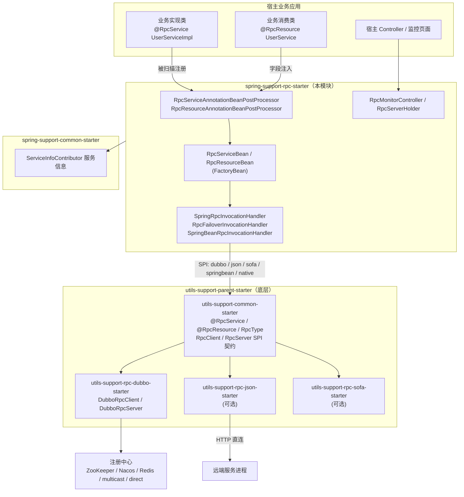
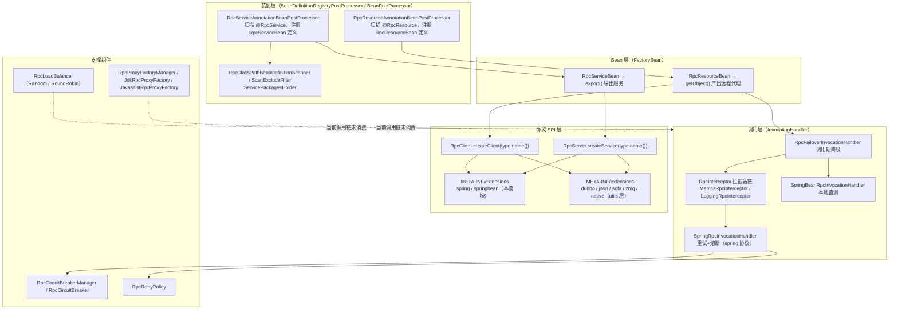
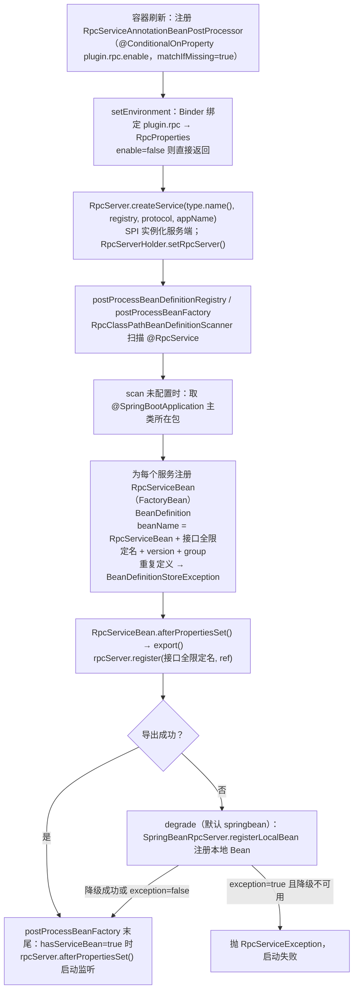
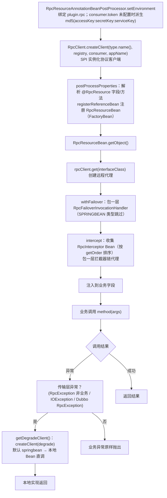

# spring-support-rpc-starter

Spring Boot 自动配置的 RPC 门面：用 `@RpcService` 暴露服务、用 `@RpcResource` 注入远程代理，底层协议由 `plugin.rpc.type`（`RpcType`：`DUBBO` / `SOFA` / `JSON` / `SPRINGBEAN` / `NONE`）选择。本模块不实现具体协议，只负责注解装配、代理创建、降级与增强；协议实现由 `META-INF/extensions` SPI 提供。

## 1. 架构图

### 1.1 模块在体系中的位置



- 依赖方向：本模块 → `utils-support-rpc-dubbo-starter` + `spring-support-common-starter`；`@RpcService`、`@RpcResource`、`RpcType`、`RpcClient`、`RpcServer`、`RpcConsumerConfig`、`RpcRegistryConfig`、`RpcProtocolConfig` 均定义在 `utils-support-common-starter`（包 `com.chua.common.support.network.rpc`），不在本模块内。
- Dubbo 实现随依赖传递引入（模块 `pom.properties` 声明 `dubbo.version=3.3.6`）；SOFA / JSON / ZMQ 需自行追加对应 `utils-support-rpc-*-starter`。

### 1.2 模块内部分层



## 2. 核心流程图

### 2.1 服务端暴露流程（@RpcService）



要点：纯消费端（没有任何 `@RpcService`）`hasServiceBean=false`，不会调用 `rpcServer.afterPropertiesSet()`，JSON 等协议不会白占端口。

### 2.2 消费端引用与调用流程（@RpcResource）



代理叠加顺序（外→内）：`拦截器链 → RpcFailoverInvocationHandler → 协议远程代理`。拦截器（如 `MetricsRpcInterceptor`）对**所有协议**的 `@RpcResource` 代理生效；重试与熔断位于 `SpringRpcInvocationHandler`，仅当以 SPI 名 `spring` 创建 `RpcClient` 时参与调用链（见第 9 节）。

## 3. 能力清单

| 能力域 | 关键类 | 入口 |
|---|---|---|
| 服务暴露 | `RpcServiceBean`、`AbstractRpcServiceSetting`、`RpcServiceAnnotationBeanPostProcessor` | `@RpcService`（类/方法） |
| 服务引用 | `RpcResourceBean`、`RpcResourceAnnotationBeanPostProcessor`、`AbstractAnnotationBeanPostProcessor` | `@RpcResource`（字段/方法） |
| 包扫描 | `RpcClassPathBeanDefinitionScanner`、`ScanExcludeFilter`、`ServicePackagesHolder` | `plugin.rpc.scan`（缺省扫主类包） |
| 协议适配（客户端） | `SpringRpcClient`（spring）、`SpringBeanRpcClient`（springbean）+ utils 层 `DubboRpcClient` 等 | SPI `META-INF/extensions/com.chua.common.support.network.rpc.RpcClient` |
| 协议适配（服务端） | `SpringRpcServer`（spring）、`SpringBeanRpcServer`（springbean）+ utils 层 `DubboRpcServer` 等 | SPI `META-INF/extensions/com.chua.common.support.network.rpc.RpcServer` |
| 调用期降级 | `RpcFailoverInvocationHandler`、`RpcResourceBean#getDegradeClient` | `@RpcResource(degrade=...)`，默认 `springbean` |
| 调用拦截 | `RpcInterceptor`、`MetricsRpcInterceptor`、`LoggingRpcInterceptor` | Spring Bean，按 `getOrder()` 排序 |
| 重试 | `RpcRetryPolicy`（指数退避：初始 100ms、倍数 2.0、上限 10s、默认 3 次） | `plugin.rpc.consumer.retry-*`；经 `SpringRpcInvocationHandler` 生效 |
| 熔断 | `RpcCircuitBreakerManager`、`RpcCircuitBreaker`（CLOSED/OPEN/HALF_OPEN，失败阈值 5、半开成功阈值 2、打开 60s） | **当前实现熔断不会开启**：`RpcConsumerConfig` 无 `circuit-breaker-enabled` 字段，`SpringRpcInvocationHandler` 读取该开关恒为 `null`，熔断分支不可达（详见 8.1、Q3） |
| 负载均衡 | `RpcLoadBalancer`、`RandomLoadBalancer`、`RoundRobinLoadBalancer` | 仅有实现类，当前调用链未消费；`consumer.load-balance` 由底层协议解释 |
| 代理创建 | `RpcProxyFactoryManager`、`JdkRpcProxyFactory`、`JavassistRpcProxyFactory`（Dubbo 字节码） | 单例管理器；当前模块调用链走 `ReflectUtils.newProxy`，该管理器未被消费 |
| 监控端点 | `RpcMonitorController`、`RpcServerHolder` | `GET /v2/rpc/monitor/info`、`/connections`、`/metrics`（需自行注册 Bean） |
| 服务信息 | `RpcAutoConfiguration#rpcServiceInfoContributor` | 向 `ServiceInfoContributor` 注册表登记 `rpc` 标志 |
| 异常体系 | `RpcServiceException`（服务端导出）、`RpcProxyCreationException`（代理创建） | 运行时异常 |

## 4. Bean 能力矩阵

| Bean 名称 | 类型 | 装配条件 | 可否覆盖 | 典型注入姿势 |
|---|---|---|---|---|
| `com.chua.starter.rpc.support.configuration.RpcServiceAnnotationBeanPostProcessor` | `BeanDefinitionRegistryPostProcessor` | 登记于 `AutoConfiguration.imports`；类上 `@ConditionalOnProperty(prefix="plugin.rpc", name="enable", havingValue="true", matchIfMissing=true)`，且代码内再查 `RpcProperties.isEnable()`（双重开关） | 不建议覆盖（框架核心装配） | 无需注入，容器自动执行扫描与导出 |
| `referenceAnnotationBeanPostProcessor`（`RpcResourceAnnotationBeanPostProcessor.BEAN_NAME`） | `BeanFactoryPostProcessor` + `BeanPostProcessor` | 登记于 `AutoConfiguration.imports`，无类级条件；所有入口检查 `RpcProperties.isEnable()` | 不建议覆盖 | 无需注入，容器自动完成 `@RpcResource` 注入 |
| `rpcServiceInfoContributor` | `ServiceInfoContributor`（`RpcAutoConfiguration` `@Bean`） | `@AutoConfiguration`，无条件注册（`enable=false` 时也登记服务信息标志） | 可覆盖（同名 Bean） | 框架内部收集模块服务信息 |
| `RpcProperties` | `@ConfigurationProperties(prefix="plugin.rpc")` | 由 `RpcServiceAnnotationBeanPostProcessor` 的 `@EnableConfigurationProperties` 启用 | 可覆盖（自定义 `@ConfigurationProperties` 同前缀） | `Binder` 绑定；两个后置处理器内部持有 |
| `RpcCircuitBreakerManager` | `@Component` | **不在** `AutoConfiguration.imports`；仅当宿主组件扫描覆盖 `com.chua.starter.rpc.support.circuitbreaker` 包时成为 Bean（默认宿主扫描不到） | 可自行声明/覆盖 | `SpringRpcInvocationHandler` 构造时按类型 `getBean`，取不到仅记 debug 日志 |
| `MetricsRpcInterceptor`（order=-100，最高优先） | `@Component`，实现 `RpcInterceptor` | 同上，需宿主扫描或 `@Bean` 声明 | 可自行声明/覆盖 | `RpcResourceBean#intercept` 通过 `getBeanProvider(RpcInterceptor.class).orderedStream()` 收集 |
| `LoggingRpcInterceptor`（order=`Integer.MAX_VALUE`，最低优先） | `@Component`，实现 `RpcInterceptor` | 同上 | 可自行声明/覆盖 | 同上 |
| `SpringBeanRpcServer` | `@Service` + `@Spi("springbean")` | SPI 按名创建，不依赖 `@Service` 扫描；`@Service` 仅在宿主扫描到该包时额外注册一个普通 Bean | SPI 实例不可覆盖；可注册自定义 `RpcServer` 实现覆盖同名 SPI 键 | 框架内部经 `RpcServer.createService` 创建 |
| `RpcServiceBean<接口>` | `FactoryBean<T>`（动态注册） | 存在 `@RpcService` Bean 时由 `RpcServiceAnnotationBeanPostProcessor` 注册 | 否（重复定义直接抛异常） | 框架内部导出服务，业务无感 |
| `RpcResourceBean<接口>` | `FactoryBean<T>`（动态注册） | 存在 `@RpcResource` 注入点时由 `RpcResourceAnnotationBeanPostProcessor#registerReferenceBean` 注册，Bean 名取字段/方法属性名（`@RpcResource` 无 `id` 属性，冲突自动 `#2` 递增） | 否 | 业务直接按接口类型 `@RpcResource` 注入 |
| `RpcMonitorController` | `@RestController`，`@ConditionalOnProperty(plugin.rpc.enable, havingValue="true", matchIfMissing=true)` | **不在** `AutoConfiguration.imports`、无 `@Component`，需宿主 `@Bean` 注册 | 可覆盖 | 宿主 `@Bean public RpcMonitorController rpcMonitorController()` 后访问 `/v2/rpc/monitor/*` |

> 结论：`AutoConfiguration.imports` 只登记 3 个类（两个后置处理器 + `RpcAutoConfiguration`）。带 `@Component` 的支撑组件（熔断管理器、两个内置拦截器）和 `@RestController` 监控端点都**不会**被自动装配，需要宿主显式声明（详见第 9 节）。

## 5. 完整配置

前缀 `plugin.rpc`（`RpcProperties.PRE`）。**生效开关**：`plugin.rpc.enable=true` 时扫描、导出、引用、代理才工作；`enable=false`（默认）时仅 `rpcServiceInfoContributor` 照常登记服务信息。

### 5.1 顶层 `plugin.rpc.*`（`RpcProperties`）

| 路径 | 类型 | 默认值 | 说明 | 生效开关 |
|---|---|---|---|---|
| `plugin.rpc.enable` | `boolean` | `false` | RPC 总开关 | 自身即开关 |
| `plugin.rpc.type` | `RpcType` 枚举 | `DUBBO` | 协议类型：`DUBBO` / `SOFA` / `JSON` / `SPRINGBEAN` / `NONE`；SPI 名称匹配忽略大小写（`ServiceDefinitionFinder` 用 `equalsIgnoreCase`），`SPRINGBEAN` 命中本模块注册的 `springbean` 实现 | `enable=true` |
| `plugin.rpc.scan` | `Set<String>` | 未设置 → 取 `@SpringBootApplication` 主类所在包 | 扫描 `@RpcService` 的包集合，支持占位符 | `enable=true` |
| `plugin.rpc.application-name` | `String` | `${spring.application.name:app}` | 应用名，传给协议实现 | `enable=true` |
| `plugin.rpc.access-key` | `String` | `""` | 访问 AK；也参与派生 `consumer.token`，禁止硬编码 | `enable=true` |
| `plugin.rpc.secret-key` | `String` | `""` | 访问 SK；同上 | `enable=true` |
| `plugin.rpc.service-key` | `String` | `98bb5008c946bdce065af13070241e10`（内置固定值） | 服务序列；参与派生 `consumer.token`，生产必须外部覆盖 | `enable=true` |
| `plugin.rpc.crypto` | `String` | `aes` | 加密算法 | `enable=true` |
| `plugin.rpc.protocols` | `List<RpcProtocolConfig>` | 空列表 | 服务端协议列表；`RpcServiceAnnotationBeanPostProcessor` 只取 `getFirst()` | `enable=true` 且导出服务 |
| `plugin.rpc.registry` | `List<RpcRegistryConfig>` | 空列表 | 注册中心列表 | `enable=true` |
| `plugin.rpc.consumer` | `RpcConsumerConfig` | `new RpcConsumerConfig()`（`auto=true`） | 消费端全局配置，见 5.2 | `enable=true` |

### 5.2 消费端 `plugin.rpc.consumer.*`（`RpcConsumerConfig`）

除 `auto`（`boolean`，默认 `true`）外，其余字段均为包装类型，**未配置时为 `null`**，由 `autoConfig()` 或底层协议实现兜底，不要假设固定默认值：

| 路径 | 类型 | 未配置默认 | 说明 |
|---|---|---|---|
| `auto` | `boolean` | `true` | 创建客户端前执行 `autoConfig()`：`timeout=clamp(CPU×1500, 3000, 15000)`、`connectTimeout=max(timeout/3, 1000)`、`connections=max(CPU×8, 16)`、`retryDelay=堆≥4G?200:500` |
| `timeout` | `Integer` | `null`（调优后 3000–15000） | 调用超时（毫秒） |
| `connect-timeout` | `Integer` | `null`（调优后 `timeout/3`） | 连接超时（毫秒） |
| `retries` | `Integer` | `null` | 失败重试次数；同时决定 `RpcRetryPolicy.maxRetries` |
| `retry-enabled` | `Boolean` | `null` | 是否启用重试（`SpringRpcInvocationHandler` 链路） |
| `retry-delay` | `Integer` | `null`（调优后 200/500ms） | 重试初始间隔（毫秒） |
| `load-balance` | `String` | `null` | `random` / `roundrobin` / `leastactive` / `consistenthash` / `shortestresponse`，由底层协议解释 |
| `cluster` | `String` | `null` | `failover` / `failfast` / `failsafe` / `failback` / `forking` / `broadcast` |
| `async` | `Boolean` | `null` | 异步调用开关 |
| `invoke-type` | `String` | `null` | `sync` / `async` / `future` / `callback` / `oneway` |
| `version` / `group` | `String` | `null` | 默认服务版本 / 分组 |
| `connections` | `Integer` | `null`（调优后 `max(CPU×8,16)`） | 最大连接数 |
| `sticky` | `Boolean` | `null` | 粘性连接 |
| `serialization` | `String` | `null`（本模块常量 `DEFAULT_SERIALIZATION="hessian"`） | 序列化协议 |
| `check` | `Boolean` | `null` | 启动时检查服务端可用 |
| `lazy` | `Boolean` | `null` | 延迟建立连接 |
| `inline` | `Boolean` | `null` | 同 JVM 直调：本地已注册的服务跳过网络 |
| `access-log` | `Boolean` | `null` | 访问日志 |
| `url` | `String` | `null` | 直连地址 |
| `token` | `String` | `null` → 派生 `md5(accessKey:secretKey:serviceKey)`（三者全空则 `null`） | 服务治理令牌（请求头 `X-RPC-Token`），服务端 `@RpcService#token()` 校验用 |
| `interface-class` / `interface-name` | `Class<?>` / `String` | `null` | 服务接口（定向引用时使用） |

### 5.3 服务端协议 `plugin.rpc.protocols[n]`（`RpcProtocolConfig` record）

组件：`name`、`host`、`port`、`payload`、`buffer`、`threads`、`accepts`、`ioThreads`、`alive`、`queues`、`serialization`、`codec`、`transporter`、`dispatcher`、`threadpool`、`heartbeat`、`ssl`、`register`、`charset`、`keepAlive`、`coreThreads`、`maxThreads`、`idleTimeout`（除 `name`/`host`/`serialization` 等字符串外均为 `Integer`/`Boolean`，可空）。
可用 `RpcProtocolConfig.auto(name, port)` 生成按 CPU/堆调优的配置（payload 8MB、`threadpool="cached"`、`register=true` 等）。

### 5.4 注册中心 `plugin.rpc.registry[n]`（`RpcRegistryConfig`）

字段：`address`、`username`、`password`、`port`、`protocol`（`zookeeper` / `nacos` / `redis` / `multicast` / `direct`）、`timeout`、`sessionTimeout`、`group`、`version`、`check`、`dynamic`、`register`、`subscribe`、`weight`、`parameters`（Map）、`file`。

## 6. 使用方式

### 6.1 Maven 坐标

```xml
<dependency>
    <groupId>com.chua</groupId>
    <artifactId>spring-support-rpc-starter</artifactId>
    <version>4.0.0.51</version>
</dependency>
```

| 依赖 | 作用域 | 说明 |
|---|---|---|
| `utils-support-rpc-dubbo-starter` | compile | Dubbo 协议 SPI 实现（`dubbo` 键），随本模块传递引入；模块 `dubbo.version=3.3.6` |
| `spring-support-common-starter` | compile | 服务信息、公共工具（必需） |
| `utils-support-rpc-sofa-starter` / `-json-starter` / `-zmq-starter` | 可选 | 使用 `SOFA` / `JSON` / ZMQ 协议时自行追加，否则对应 `type` 解析不到 SPI 实现 |

`@RpcService`、`@RpcResource` 等注解与契约类型来自 `utils-support-common-starter`，随依赖树自动可见，无需单独引入。

### 6.2 最小可运行示例

**1）打开开关（提供端 + 消费端同一应用或分两个应用均可）：**

```yaml
plugin:
  rpc:
    enable: true
    type: DUBBO
    application-name: order-service
    registry:
      - address: zookeeper://localhost:2181
        protocol: zookeeper
        timeout: 3000
    protocols:
      - name: dubbo
        host: 0.0.0.0
        port: 20880
    consumer:
      timeout: 3000
      retries: 2
      load-balance: random
```

**2）提供端：**

```java
// 接口可从实现的第一个接口推断；version/group 必须与消费端一致
@RpcService(interfaceClass = UserService.class, version = "1.0.0", group = "default")
public class UserServiceImpl implements UserService {
    @Override
    public User getUserById(Long id) {
        return userMapper.selectById(id);
    }
}
```

**3）消费端：**

```java
@Service
public class OrderService {

    // 注解属性优先于 plugin.rpc.consumer 全局配置
    @RpcResource(version = "1.0.0", group = "default", timeout = 3000)
    private UserService userService;

    public void createOrder(Long userId) {
        User user = userService.getUserById(userId);   // 远程调用；传输层失败自动降级
    }
}
```

**4）（可选）监控端点**——`RpcMonitorController` 不会被自动装配，需自行注册：

```java
@Bean
@ConditionalOnProperty(prefix = "plugin.rpc", name = "enable", havingValue = "true")
public RpcMonitorController rpcMonitorController(ApplicationContext context,
                                                 ObjectProvider<MetricsRpcInterceptor> metrics) {
    return new RpcMonitorController(context, metrics);
}
```

之后可查询：`GET /v2/rpc/monitor/info`（协议与服务列表）、`GET /v2/rpc/monitor/connections`（连接信息）、`GET /v2/rpc/monitor/metrics`（运行时指标，含方法级统计）。

> 本模块无链式 Builder API：`RpcServiceBean` / `RpcResourceBean` 是 `FactoryBean`，配置只能通过 `plugin.rpc.*` 与注解属性表达。

## 7. 使用场景

**适用：**

- Spring Boot 微服务间方法级远程调用（Dubbo 注册中心 + 多协议）。
- 单体/同工程内想统一走「接口 + 注解」的调用方式：`type=SPRINGBEAN`，无网络、无注册中心，Bean 即 RPC。
- 需要平滑降级：远端不可用时自动回退本地 Bean（`degrade="springbean"`），或跨语言轻量集成（`type=JSON`，HTTP 传输）。

**不适用：**

- 消息/数据同步、任务调度：用 `spring-support-sync-starter` / `spring-support-job-starter`（走 `SyncClient`/`SyncServer`，与本模块无装配依赖）。
- 对外 REST API 网关：本模块是内部 RPC 门面，不提供 HTTP 路由治理。
- 强依赖 HTTP 语义的调用（REST 客户端、OpenFeign 场景）。

**与相邻模块的取舍：**

| 场景 | 选择 | 理由 |
|---|---|---|
| 高并发企业内 RPC、需要服务治理 | `type=DUBBO`（默认） | Dubbo 3.3.6 随依赖传递，注册中心/集群/负载均衡能力完整 |
| 金融级大促流量 | `type=SOFA` | 需自行引入 `utils-support-rpc-sofa-starter` |
| 跨语言、开发测试、轻量 HTTP | `type=JSON` | jsonrpc4j，纯 HTTP；注意会监听端口 |
| 同进程解耦、永久降级目标 | `type=SPRINGBEAN` | 无网络传输，Spring 6 移除 HttpInvoker 后的替代 |
| 消息同步/数据管道 | `spring-support-sync-starter` | 不是方法级 RPC，互不替代 |

## 8. 扩展点

### 8.1 本模块暴露的 Spring Bean 扩展点

| 扩展点 | 登记方式 | 生效位置 |
|---|---|---|
| `RpcInterceptor` | 声明为 Spring Bean（`@Bean` 或被扫描），按 `getOrder()` 排序 | `RpcResourceBean#intercept` 包装**所有协议**的远程代理；`preHandle` 返回 `false` 拦截调用，`postHandle` 可替换返回值，`handleException` 可转换异常，`afterCompletion` 必达 |
| `RpcCircuitBreakerManager` | 声明为 Spring Bean | `SpringRpcInvocationHandler` 构造时按类型获取（取不到仅 debug 日志）。**当前实现熔断不会生效**：`RpcConsumerConfig` 无 `circuit-breaker-enabled` 开关，即使声明该 Bean，熔断分支也不可达（见 5.2、Q3） |
| `RpcProxyFactory` | `RpcProxyFactoryManager.getInstance().registerFactory(factory)` | 单例管理器按 `getOrder()` 逐个尝试创建代理；注意当前模块调用链（`ReflectUtils.newProxy`）未消费该管理器，仅外部显式使用时生效 |
| `RpcLoadBalancer` | 实现 `select(List<T>)` + `getName()` | **当前版本没有调用链读取 `RpcLoadBalancer` Bean**；`consumer.load-balance` 由底层协议实现自行解释 |

内置实现可直接复用：`MetricsRpcInterceptor`（order=-100，方法级调用统计，供 `/v2/rpc/monitor/metrics` 展示）、`LoggingRpcInterceptor`（order=MAX，DEBUG 日志）。

### 8.2 协议 SPI（`META-INF/extensions`）

`RpcClient` / `RpcServer` 通过 utils 层 `ServiceProvider` SPI 按名创建（`RpcClient.createClient(name, ...)` / `RpcServer.createService(name, ...)`），本模块注册了两个键：

```
# com.chua.common.support.network.rpc.RpcClient
spring=com.chua.starter.rpc.support.spring.SpringRpcClient
springbean=com.chua.starter.rpc.support.spring.SpringBeanRpcClient

# com.chua.common.support.network.rpc.RpcServer
spring=com.chua.starter.rpc.support.spring.SpringRpcServer
springbean=com.chua.starter.rpc.support.spring.SpringBeanRpcServer
```

新增协议的步骤：实现 `RpcClient` / `RpcServer`，加 `@Spi("协议名")` 并提供与 `(List<RpcRegistryConfig>, [RpcProtocolConfig], RpcConsumerConfig, String appName)` 兼容的构造器，再在自身 jar 的 `META-INF/extensions/com.chua.common.support.network.rpc.RpcClient`（及 `RpcServer`）中登记 `协议名=实现类`。utils 层已有实现：`native`（common）、`dubbo`、`json`、`sofa`、`zmq`。

### 8.3 其他扩展方法

- `RpcRetryPolicy`：由 `RpcConsumerConfig` 在 `SpringRpcInvocationHandler` 内部构造（`retries`/`retry-enabled`/`retry-delay` 映射），不是 Bean；可用 `defaultPolicy()` / `fastRetry()` / `slowRetry()` / `noRetry()` 工厂。
- `RpcServerHolder`：进程级持有当前 `RpcServer`，供监控与自定义管理端点读取。
- `ServicePackagesHolder`：单例记录已扫描包/类，供重复扫描判断。
- GraalVM native-image：本模块自带 `META-INF/native-image/com.chua/spring-support-rpc-starter/reflect-config.json`（注册 `SpringRpcClient`/`SpringRpcServer` 全量反射）与 `resource-config.json`。

## 9. 常见问题

**Q1：引入依赖后 `@RpcService` / `@RpcResource` 完全不生效？**
依次检查：① `plugin.rpc.enable` 是否为 `true`（默认 `false`；两个后置处理器所有入口都检查 `isEnable()`）；② `@RpcService` 实现类是否在扫描范围内——`plugin.rpc.scan` 未配置时扫描 `@SpringBootApplication` 主类所在包，若实现类在其他包需显式配置 `scan`；③ `type` 指向的协议 SPI 是否在 classpath——`SOFA`/`JSON`/`ZMQ` 需自行引入对应 starter，`DUBBO` 随本模块传递引入。

**Q2：为什么 `RpcMonitorController`、`MetricsRpcInterceptor`、`LoggingRpcInterceptor`、`RpcCircuitBreakerManager` 没有被装配？**
它们虽带 `@Component`/`@RestController`，但**不在** `AutoConfiguration.imports` 中；宿主组件扫描通常不覆盖 `com.chua.starter.rpc.support` 包，所以不会自动成为 Bean。需要用 `@Bean` 显式注册（或 `@ComponentScan` 指到本包）。监控端点的三个接口在 Bean 注册后可用；未注册 `MetricsRpcInterceptor` 时 `/metrics` 中方法级统计为空。

**Q3：重试和熔断为什么没起作用？**
重试与熔断位于 `SpringRpcInvocationHandler`，只对以 SPI 名 `spring` 创建的 `RpcClient` 代理生效；`@RpcResource` 主链路按 `plugin.rpc.type` 创建客户端（`DUBBO`→`DubboRpcClient` 等），其增强是拦截器链 + 调用期降级（`RpcFailoverInvocationHandler`）。需要重试时：用 `RpcClient.createClient("spring", ...)` 显式创建客户端，并设置 `retry-enabled=true`。业务异常（`RpcException.isBusiness()`）不重试、不降级。**熔断当前实现不会开启**：`RpcConsumerConfig` 并无 `circuit-breaker-enabled` 字段，`SpringRpcInvocationHandler` 反射读取 `getCircuitBreakerEnabled` 恒得 `null`，即使声明 `RpcCircuitBreakerManager` Bean，`Boolean.TRUE.equals(null)` 也为假，熔断分支不可达。

**Q4：JSON 协议启动后端口被占用 / 纯消费端也想省端口？**
`type=JSON` 的服务端会真正监听端口；`RpcServiceAnnotationBeanPostProcessor` 只在导出了至少一个 `@RpcService`（`hasServiceBean=true`）时才调用 `rpcServer.afterPropertiesSet()`，因此**纯消费端不会占端口**。`SPRINGBEAN`/`NONE` 本身无网络传输，不涉及端口。

**Q5：与 Spring Boot 4 的兼容性如何？**
本模块随仓库父 pom `spring-support-parent-starter`（4.0.0.51）构建，父 pom 继承 `org.springframework.boot:spring-boot-starter-parent:4.1.2`。自动装配使用 Boot 2.7+ 的 `META-INF/spring/...AutoConfiguration.imports` 机制（Boot 4 延续支持）；`@Bean` 工厂方法返回类型解析经 `SpringCompatUtils` 适配；web 相关端点依赖 Boot 4 中需显式管理的 `spring-boot-webmvc`（宿主应用需具备 web 环境）；已提供 native-image 反射/资源配置，可参与 AOT。

**Q6：降级会误吞业务异常吗？**
不会。`RpcFailoverInvocationHandler` 只对**传输层失败**降级（`RpcException` 非业务类型、`IOException`、Dubbo `RpcException`）；业务异常原样抛出，避免「远端业务校验失败」被误判成远端不可用而重复执行本地逻辑。服务端导出失败同理：`@RpcService(exception=false)` 且降级可用时不阻断启动。

**Q7：`service-key` / `access-key` / `secret-key` 需要改吗？**
`service-key` 自带内置默认值，`access-key`/`secret-key` 默认空字符串；三者均参与 `consumer.token` 的派生（`md5(ak:sk:serviceKey)`），属于敏感配置，生产环境必须在外部配置中心覆盖，且严禁硬编码。
