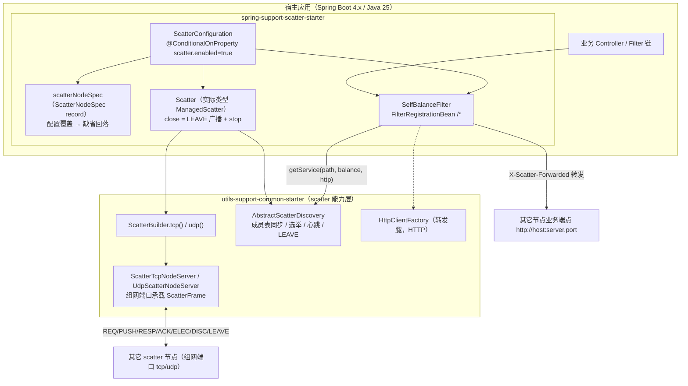
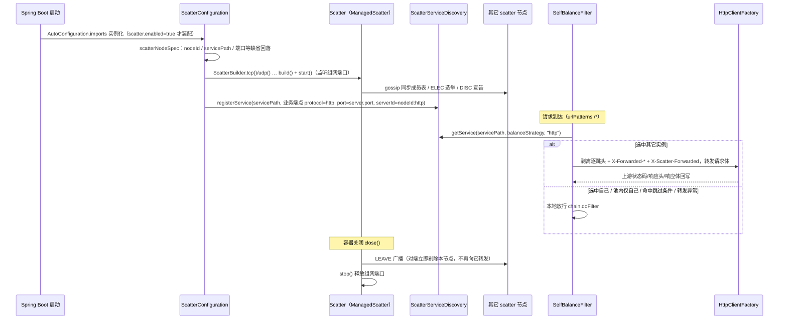

# spring-support-scatter-starter

把 utils 层 scatter 去中心化组网装配成 Spring Bean：各节点经**组网端口**（TCP/UDP 控制面，无 HTTP）自动同步成员表、选举引导节点；同时把本节点**业务 HTTP 端点**（`server.port`）作为服务实例登记进 scatter 服务表；并内置 **self-balance 反向代理 Filter**——请求到达本节点时按负载均衡从服务池选实例，选中其它节点就转发，选中自己（或池内仅自己）就本地放行。本模块是 `spring-support-parent-starter`（4.0.0.51）体系中的「scatter 组网」starter，基于 Spring Boot 4.x / Java 25 构建；组网、发现与转发能力全部来自 classpath 上的 `utils-support-common-starter`（经 `spring-support-common-starter` 传递引入），本模块只做装配与 Servlet 适配。

## 1. 架构图



- **上游**：`spring-support-common-starter`（pom 中唯一编译依赖），提供 `Project`（本机地址/端口探测）并传递引入 `utils-support-common-starter`（`Scatter` / `ScatterBuilder` / `ScatterServiceDiscovery` / `HttpClientFactory` 所在，天然在 classpath 上）。
- **Servlet API**：`jakarta.servlet-api` 在 common-starter 里是 `provided`（不传递），本 starter 的 Filter 需要显式声明（`provided`，由宿主容器提供实现）。因此 self-balance Filter 仅适用于 **Servlet Web 宿主**（Tomcat / Jetty / Undertow）；WebFlux 宿主只能使用组网与发现能力。
- **被依赖**：`spring-support-api-starter` 已引入本模块（宿主侧默认获得组网能力，`scatter.enabled=true` 才装配）。本模块不依赖 web / rpc / 缓存等上层 starter，也不感知任何注册中心。

## 2. 核心流程图：装配、转发与关闭



生命周期与转发要点（源码事实）：

- `ScatterConfiguration` 经 `META-INF/spring/...AutoConfiguration.imports` 注册，`@ConditionalOnProperty(prefix="scatter", name="enabled", havingValue="true")` 门控；`scatter.enabled=false`（默认）时**零装配、零副作用**。
- `scatter` Bean `destroyMethod="close"`；`ManagedScatter.close()` **先向集群广播 LEAVE**（对端立即剔除本节点），再 `stop()` 释放组网端口——滚动重启时对端不会把请求转发到已停实例。
- **两组服务条目互不覆盖**：组网 self 条目 `serverId=nodeId`（protocol=tcp/udp，port=组网端口）由 scatter 启动时登记；业务端点由本模块另行 `registerService`，`serverId=nodeId+":http"`（protocol=http，port=server.port，metadata 携带 `context-path` / `node-id` / `self-balance`）。分开登记是因为 `updateService` 按 `serverId` 去重合并，同 ID 会互相覆盖。
- self-balance 选实例只按 `protocol=http` 过滤（`getService(path, strategy, "http")`），**永远不会把请求经组网端口转发给对端的 tcp/udp 控制面**。
- **为什么转发腿用 utils HttpClient 而不是 scatter 帧**：scatter 帧协议只有 7 种控制帧（REQ/PUSH/RESP/ACK/ELEC/DISC/LEAVE），全是成员表同步/选举/宣告/离网语义；且单帧上限 16MB、TCP 短连接一请求一响应、无流式分块；业务逻辑在**对端 Servlet HTTP 端点**里，帧到达对端后仍需回环 HTTP。转发腿选 `HttpClientFactory`（按 classpath 自动选择底层实现）是复用本层已有能力（R4），不是另造轮子。

## 3. 能力清单

| 能力域 | 关键类 | 入口/触发方式 |
|---|---|---|
| 配置绑定 | `ScatterProperties` | `scatter.` 前缀（`@ConfigurationProperties`） |
| 装配编排 | `ScatterConfiguration` | `AutoConfiguration.imports`；`scatter.enabled=true` 门控 |
| 节点规格推导 | `ScatterConfiguration#scatterNodeSpec`（`ScatterNodeSpec` record） | 一级配置覆盖 → `Project` / `server.*` 缺省回落，组网与 Filter 共享同一套 nodeId/serverId/端口口径 |
| 组网生命周期 | `ScatterConfiguration#scatter`（`ManagedScatter`，`destroyMethod=close`） | 启动 `build()+start()`；关闭先 `discovery().leave()` 再 `stop()` |
| 成员发现/同步/选举 | utils `AbstractScatterDiscovery` | 组网端口帧协议（gossip + 心跳 + ELEC 选举 + DISC 宣告 + LEAVE 离网） |
| 业务端点登记 | `ScatterConfiguration#scatter` 内 `registerService` | `protocol=http`、`port=server.port`、`uriSpec=servicePath`、metadata 带 context-path |
| self-balance 转发 | `SelfBalanceFilter` | `FilterRegistrationBean`，`urlPatterns=/*`，`scatter.self-balance=true`（缺省）开启 |
| 负载均衡选择 | `ScatterServiceDiscovery#getService(path, strategy, "http")` | `weight` / `random` / `round`（`scatter.balance-strategy`） |
| 转发执行 | utils `HttpClientFactory` | HTTP 反向代理：逐跳头剥离、`X-Forwarded-For/Proto/Host` 追加、请求/响应体透传 |
| 防循环转发 | `X-Scatter-Forwarded` 请求头 | 携带该头的请求（来自对端节点转发）本地直接处理，不再二次选路 |
| 转发失败兜底 | `SelfBalanceFilter#forward` 返回 `false` | 转发异常且响应未提交 → 本地放行 `chain.doFilter` |
| 自动选端口 | `ScatterConfiguration#findFreePort` | `scatter.port`≤0 时预占一个空闲端口（自动发现要求端口固定） |

## 4. Bean 能力矩阵

`ScatterConfiguration` 本身是自动配置 Bean（`AutoConfiguration.imports` 登记，无 `@AutoConfiguration` 注解，与 discovery-starter 同款写法），`@EnableConfigurationProperties(ScatterProperties.class)` 完成配置绑定；`scatter.enabled=false` 时以下 Bean 全部不注册。

| Bean 名 | 类型 | 装配条件 | 可否覆盖 | 典型用途 |
|---|---|---|---|---|
| `scatterNodeSpec` | `ScatterNodeSpec`（record：nodeId / host / announceHost / port / servicePath / group / contextPath / serverPort / businessServerId） | `scatter.enabled=true` | 可以（普通 `@Bean` 覆盖规则） | 需要复用同一套节点口径时注入 |
| `scatter` | `Scatter`（实际类型 `ManagedScatter`） | `scatter.enabled=true`；`destroyMethod=close` | 可以 | 业务注入：`discovery()` 查询/登记成员、`getPort()` 拿组网端口 |
| `selfBalanceFilter` | `FilterRegistrationBean<SelfBalanceFilter>` | `scatter.enabled=true` 且 `scatter.self-balance=true`（缺省 `true`，`matchIfMissing=true`） | 可以 | 自动注册到 `/*`，顺序 `scatter.filter-order` |

## 5. 完整配置（含逐项示例）

配置类 `ScatterProperties`，前缀 `scatter.`。以下字段全部来自源码（YAML 用 kebab-case）。

### 5.1 配置总表

| 配置路径 | 类型 | 默认值 | 说明 |
|---|---|---|---|
| `scatter.enabled` | `boolean` | `false` | 总开关；`false` 时本 starter 零装配、零副作用 |
| `scatter.protocol` | `String` | `tcp` | 组网协议：`tcp` / `udp`。`tcp` 为帧协议（4 字节长度头 + ScatterFrame，短连接，单帧上限 16MB）；`udp` 为数据报承载（无连接、不保证送达），生产建议 `tcp` |
| `scatter.port` | `int` | `0` | 组网监听端口；≤0 时自动预占空闲端口。自动发现要求各节点端口固定，生产环境建议显式配置 |
| `scatter.host` | `String` | 无 → `Project.applicationHost` → `127.0.0.1` | 组网绑定地址 |
| `scatter.announce-host` | `String` | 无 → `host` | 对外通告地址（多网卡/NAT 场景与绑定地址不同时配置） |
| `scatter.node-id` | `String` | 无 → `{spring.application.name}@{announceHost}:{port}` | 节点唯一标识；组网 self 条目 `serverId` 同值 |
| `scatter.service-path` | `String` | 无 → `/{spring.application.name}` | 服务分组（发现路径），自动补前导 `/` |
| `scatter.group` | `String` | `default` | 组网范围（scatterId）；同组节点互相同步成员与负载 |
| `scatter.context-path` | `String` | 无 → `server.servlet.context-path` | 业务上下文路径，登记进业务端点 metadata，便于对端拼转发地址 |
| `scatter.seeds` | `List<String>` | `[]` | 种子地址列表（`host:port`，指向**组网端口**）；seed 模式下用于首次入网 |
| `scatter.subnet` | `String` | 无 | 子网过滤（CIDR），仅发现同网段节点；缺省不过滤 |
| `scatter.auto-discovery` | `boolean` | `true` | 自动发现（组播 / gossip）开关 |
| `scatter.auto-discovery-interval` | `long` | `0` | 自动发现周期（毫秒）；≤0 用 utils 层缺省值 |
| `scatter.heartbeat-interval` | `long` | `0` | 心跳周期（毫秒）；≤0 用 utils 层缺省值 |
| `scatter.fail-remove-count` | `int` | `0` | 心跳连续失败多少次后剔除节点；≤0 用 utils 层缺省值 |
| `scatter.timeout-millis` | `long` | `0` | 网络 / 同步超时（毫秒）；≤0 用 utils 层缺省值 |
| `scatter.persistence-enabled` | `boolean` | `false` | 是否持久化成员表；Spring 宿主重启即无状态，按宿主形态把 utils 原始缺省（`true`）改为 `false` |
| `scatter.persistence-file` | `String` | 无 | 成员表持久化文件路径；仅 `persistence-enabled=true` 时生效 |
| `scatter.self-balance` | `boolean` | `true` | self-balance Filter 开关；开启后本节点收到请求按策略选中其它实例则反向代理转发 |
| `scatter.balance-strategy` | `String` | `weight` | 负载均衡策略：`weight` / `random` / `round`；也可指向自定义 `LoadBalance` SPI 名 |
| `scatter.max-forward-body-bytes` | `long` | `10485760`（10MB） | 转发请求体大小上限（字节），超限放弃转发、本地放行；≤0 不限制 |
| `scatter.filter-order` | `int` | `0` | self-balance Filter 注册顺序（值越小越靠前） |

## 6. 使用方式

### 6.1 Maven 坐标

```xml
<dependency>
    <groupId>com.chua</groupId>
    <artifactId>spring-support-scatter-starter</artifactId>
    <version>4.0.0.51</version>
</dependency>
```

### 6.2 依赖说明

| 依赖 | 作用 | 是否必需 |
|---|---|---|
| `spring-support-common-starter` | `Project`（地址/端口探测），并传递 `utils-support-common-starter`（`Scatter` / `ScatterBuilder` / `ScatterServiceDiscovery` / `HttpClientFactory`） | 必需（pom 唯一编译依赖） |
| `jakarta.servlet-api` | `SelfBalanceFilter` 的 Servlet 契约 | 必需（`provided`，Servlet 宿主自带；本 pom 显式声明是因为 common 里它不传递） |

本模块 pom **不引入任何 HTTP 客户端或组网实现**：转发腿与组网全部复用 `utils-support-common-starter` 里已有的能力，无新增三方依赖。

### 6.3 最小启用示例（单节点）

```yaml
spring:
  application:
    name: demo-service
server:
  port: 8080
scatter:
  enabled: true
  protocol: tcp          # 组网协议 tcp/udp，缺省 tcp
  port: 9700             # 组网监听端口；自动发现要求各节点固定，生产建议显式配置
  group: default         # 组网范围 scatterId
  self-balance: true     # self-balance 反向代理 Filter，缺省 true
  balance-strategy: weight
```

启动即完成组网并登记业务端点（日志 `[Scatter] 组网已启动` / `[Scatter] 业务端点已注册`）。单节点时服务池内只有自己，所有请求本地放行，Filter 等价于直通。

### 6.4 多节点组网 + self-balance

同 `group`、同 `service-path` 的节点互为服务池。B 节点通过 `seeds` 指向 A 的**组网端口**入网：

```yaml
# 节点 A（10.0.0.10）——引导节点，seeds 可留空
scatter:
  enabled: true
  port: 9700
  group: default
```

```yaml
# 节点 B（10.0.0.11）——通过种子入网
scatter:
  enabled: true
  port: 9700
  group: default
  seeds:
    - 10.0.0.10:9700     # 指向 A 的组网端口，不是 server.port
```

两节点都起 self-balance 后：任一节点收到请求，按 `balance-strategy` 从服务池选实例；选中对方就把请求（含上下文路径与查询串）转发到对方 `server.port` 的业务端点，响应原样回写；选中自己则本地处理。某节点优雅下线时先广播 LEAVE，对端立即把它剔出服务池。

### 6.5 直接使用 Scatter API

```java
@Service
@RequiredArgsConstructor
public class ClusterInfoService {

    private final Scatter scatter;

    /** 当前服务池内全部业务实例（protocol=http 条目） */
    public Collection<Discovery> peers() {
        return scatter.discovery().getServiceAll("/demo-service");
    }

    /** 组网监听端口 */
    public int meshPort() {
        return scatter.getPort();
    }
}
```

`ScatterServiceDiscovery` 同时实现了 utils 层 `ServiceDiscovery` 契约：`registerService` / `unregisterService` / `updateService` / `getService` / `getServiceAll` / `subscribe` 均可用；宿主如需把额外端点（如其它协议端口）登记进同一服务池，直接调 `registerService` 即可。

## 7. 使用场景

**适用**：

- 无中心注册中心的**去中心化对等组网**：几个对等节点自动互发现、同步成员表、选举引导节点，不部署 Nacos/ZK/Redis；
- 同一服务的多实例之间做 **self-balance 负载均衡 / 反向代理**：每个节点既是服务端又是转发器，请求落到谁身上都行；
- 需要在业务代码里直接拿集群成员视图（注入 `Scatter`，读 `getServiceAll`）做自定义协同。

**不适用/慎用**：

- 需要强一致注册中心、命名空间分级、灰度元数据中心化管理——用 `spring-support-discovery-starter` 接 nacos / zookeeper / redis / apollo，本模块是「无注册中心」的对等模型；
- **大文件上传、流式接口、WebSocket、SSE**——self-balance Filter 对这些请求一律本地放行（见跳过条件），不会转发；需要转发这类流量请放专门的网关；
- **WebFlux 宿主**——self-balance Filter 是 jakarta Servlet Filter，只在 Servlet Web 宿主生效；
- 跨网段 / 防火墙环境——组网端口（`scatter.port`）与业务端口（`server.port`）都必须双向可达，`udp` 模式还需放行组播/数据报。

**与相邻模块的取舍**：discovery-starter 面向「注册中心」模型（client/server/embbed + 外部注册中心协议），注册中心挂了可降级为本地空实现；scatter-starter 面向「去中心化对等组网」模型（无注册中心，成员表 gossip 同步 + ELEC 选举），并把 self-balance 反向代理内置成开箱即用的 Filter。两者同源于 utils 层 `ServiceDiscovery` 契约（`ScatterServiceDiscovery` 也是其实现），可并存。

## 8. 扩展点

**`LoadBalance` SPI（自定义负载均衡）**：实现 `com.chua.common.support.lang.balance.LoadBalance` 并以 `@Spi("自定义策略名")` 登记，`scatter.balance-strategy=自定义策略名` 即可生效。内置策略：`weight`（`WeightLoadBalance`）、`random`（`RandomRoundLoadBalance`）、`round`（`RoundLoadBalance`）。

**`ScatterServiceDiscovery`（成员表操作）**：宿主可继续调用 `registerService` / `unregisterService` / `updateService` 维护自定义端点，或 `subscribe(servicePath, listener)` 订阅成员变更（需确认所选传输实现 `isSupportSubscribe()` 为 `true`）。

**`ScatterBuilder`（非 Spring 场景）**：utils 层同一套 API 可脱离 Spring 直接使用（`ScatterBuilder.tcp().nodeId(...).port(...).build()`），本模块只是它的 Spring 装配壳。

**self-balance 跳过条件（可按需继承扩展）**：`SelfBalanceFilter` 是普通 `Filter`，如需增加跳过规则（如按路径前缀排除），可继承并重写 `shouldForward`（package-private，建议连同本模块一起调整后自行装配），或在宿主再叠一个更高优先级的 Filter 短路。

## 9. 常见问题

**Q1：引入依赖后没有任何组网日志？**
`scatter.enabled` 默认 `false`，此时本 starter 不装配任何 Bean。先确认配置了 `scatter.enabled: true`，再确认启动日志出现 `[Scatter] 组网已启动` 与 `[Scatter] 业务端点已注册` 两行。

**Q2：请求没有被转发，全部本地处理？**
按顺序排查：① 服务池内只有本节点（`getServiceAll(servicePath)` 看条目数，单实例时转发无从谈起）；② 负载均衡恰好选中自己（`weight` 策略下正常现象）；③ 命中跳过条件——带 `X-Scatter-Forwarded` 头、WebSocket 升级、SSE（`Accept: text/event-stream`）、异步请求、multipart 上传、请求体超过 `scatter.max-forward-body-bytes`；④ `scatter.self-balance` 被关成 `false`。

**Q3：转发过去的请求报 404 / 路径不对？**
转发路径 = 上游请求的 `requestURI + queryString` 原样透传，且对端 metadata 里带 `context-path`。确认两节点 `server.servlet.context-path` 口径一致；不一致时用 `scatter.context-path` 显式指定登记值。

**Q4：节点之间互相发现不了？**
依次检查：`scatter.group` 是否一致（同组才互相同步）、`scatter.service-path` 是否一致、`seeds` 是否指向对方**组网端口**（不是 `server.port`）、组网端口防火墙是否放行、`scatter.subnet` 是否把对端网段过滤掉了。`udp` 模式还需确认组播/数据报可达。

**Q5：组网端口和业务端口是什么关系？**
两个平面、两组条目：组网 self 条目（`serverId=nodeId`，protocol=`tcp`/`udp`，port=`scatter.port`）负责成员表同步/选举/心跳；业务端点条目（`serverId=nodeId+":http"`，protocol=`http`，port=`server.port`）供 self-balance 转发与业务发现使用。两组 serverId 不同，`updateService` 不会互相覆盖；self-balance 只按 `protocol=http` 选实例，绝不会把业务请求打到对端组网端口。

**Q6：节点下线后，其它节点多快感知？**
优雅关闭（容器 `close()`）时先广播 `LEAVE`，对端**立即**剔除本节点，不存在转发到已停实例的窗口；异常掉线（进程被杀、断网）靠心跳连续失败计数（`scatter.fail-remove-count`）剔除，期间转发可能命中死节点——此时转发异常且响应未提交，Filter 会本地放行兜底。

**Q7：和 discovery-starter 怎么选？**
有注册中心诉求（集中管理、强一致、跨机房元数据）→ discovery-starter；纯对等组网 + 实例间互为备份转发、不想引入任何中心组件 → 本模块。二者底层同源，可共存，但同一个服务池不要混用两套注册口径。
