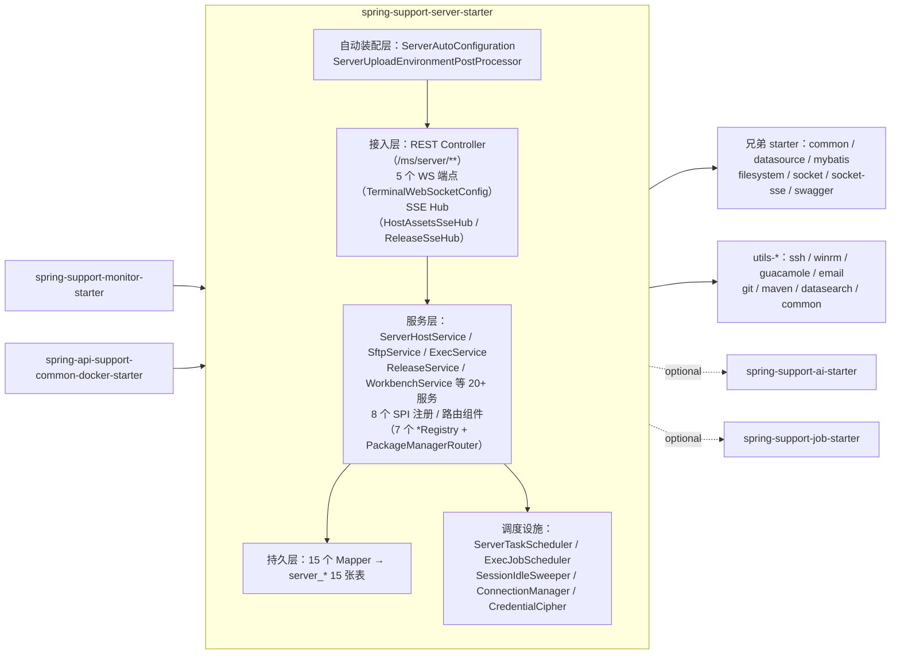
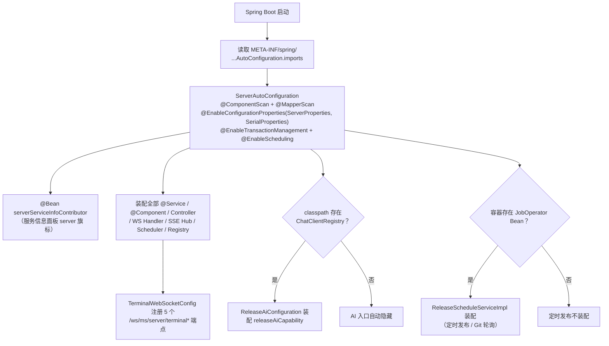

# spring-support-server-starter

服务器资产与远程运维 starter：主机台账、分组、登录身份与密钥库等资产管理，基于 Guacamole（guacd）的 SSH/RDP/VNC 远程控制 WebSocket 网关与 SSH/VNC/Telnet/RDP 直连桥、SFTP 文件管理、批量命令执行与 cron 计划任务、Git+Maven 发布管理、Docker/Kubernetes 主机工作台、代理池与主机隧道、邮箱、远控令牌、SSE 推送、Arthas/Agent 构件投放、维护计划台账、服务节点管理，以及主机文件/网络/画像/系统管理运行时。在 spring-support 体系中属业务 starter 层：向下依赖 common/datasource/mybatis/filesystem/socket 等 starter 与 utils-* 工具包，向上被 spring-support-monitor-starter、spring-api-support-common-docker-starter 依赖；以内部库形式由宿主应用引入，经 `ServerAutoConfiguration` 自动装配。

## 1. 架构图



- 依赖方向遵守 `spring-support-api-*` → `spring-support-parent` → `utils-*`，本模块只向下依赖；父工程内反向依赖本模块的是 monitor 与 docker，改动本模块公开服务接口会同时影响这两个模块。

## 2. 核心流程图（自动装配）



另有一条不走 `AutoConfiguration.imports` 的入口：`META-INF/spring.factories` 注册的 `ServerUploadEnvironmentPostProcessor`（EnvironmentPostProcessor），在环境准备阶段为文件上传补默认值。

## 3. 能力清单

| 能力域 | 关键类 | 入口 / 触发方式 |
|---|---|---|
| 主机台账 / 分组 / 导入导出 | `ServerHostService`、`ServerGroupService`、`HostArchiveService` 及对应 Controller | `/ms/server/host`、`/ms/server/group`、`/ms/server/host/archive` |
| 登录身份 / 密钥库 | `ServerIdentityService`、`ServerKeyService`、`ServerCredentialController`、`CredentialCipher` | `/ms/server/identity`、`/ms/server/key` |
| 硬件探测与指标采集 | `HostDetectProvider`、`HostCollectProvider`（SPI）、`ServerTaskScheduler` | SPI 扩展点 + 内建定时采集 |
| 远控终端（guacd 中转） | `TerminalWebSocketHandler`、`GuacdConnectionFactory`、`GuacdTunnel` | WS `/ws/ms/server/terminal` |
| 直连终端桥 | `SshDirectWebSocketHandler`、`VncWebsockifyWebSocketHandler`、`TelnetWebSocketHandler`、`RdpDirectWebSocketHandler`、`RdpjNative` | WS `/ws/ms/server/terminal/{ssh,vnc,telnet,rdp}` |
| 串口终端 | `SerialWebSocketHandler`、`SerialSessionRegistry`、`SerialConnectionFactory` | 参数由 `SerialProperties` 提供；WS 端点未在 `TerminalWebSocketConfig` 注册，`plugin.server.support.serial.enabled` 目前仅绑定、不参与装配判断 |
| SFTP 文件管理 | `SftpService`、`SftpController` | `/ms/server/sftp/{hostId}` |
| 会话审计 / 分享 / 主题 | `TerminalSessionService`、`TerminalShareStore`、`TerminalShareController`、`TerminalThemeController` | `/ms/server/terminal`、`/terminal/share`、`/terminal/theme` |
| 主机工作台（Docker/K8s） | `WorkbenchService`、`WorkbenchController` | `/ms/server/host/{hostId}` 下 docker / kubernetes 子路径 |
| 发布管理 | `ReleaseService`、`ReleaseController`、`ReleaseScheduleService`、`ReleaseAiController` | `/ms/server/release`、`/ms/server/release/ai` |
| 主机文件分发 | `HostFileService`、`ReleaseHostFileController`（复用 filesystem 模块 `FileStorageTemplate`） | `/ms/server/host-file` |
| 批量执行与计划任务 | `ExecService`、`ExecJobScheduler`、`ExecController` | `/ms/server/exec` |
| 代理池 / 主机隧道 | `ProxyService`、`ProxyController`、`TunnelService`、`TunnelController` | `/ms/server/proxy`、`/ms/server/host/{hostId}/tunnel` |
| 邮箱 | `MailboxService`、`MailboxSseService`、`MailboxController`、`MailboxConnectionController` | `/ms/server/identity`（含 mailbox 子路径） |
| 远控令牌 | `RemoteTokenService`、`RemoteTokenController`、`RemoteControlPageController` | `/ms/server/remote` |
| SSE 推送 | `HostAssetsSseHub`、`ReleaseSseHub`、`HostAssetsSseController`、`ReleaseSseController` | `/ms/server/host/assets`、`/ms/server/release` |
| 运行期系统配置 | `ServerConfigService`、`ServerConfigController` | `/ms/server/config`（保存后发 `ServerConfigChangedEvent` 热生效） |
| SIP 服务管理 | `SipServiceManager`、`SipServerManager`、`SipController` | `/ms/server/sip` |
| Arthas / Agent 构件投放 | `ArthasService`、`ArthasController`、`AgentArtifactService`、`AgentArtifactController`、`HostAgentController` | `/ms/server/arthas`、`/ms/server/agent`、`/ms/server/host/agent` |

## 4. Bean 能力矩阵

装配总入口 `ServerAutoConfiguration`：`@ComponentScan("com.chua.starter.server.support")` + `@MapperScan("com.chua.starter.server.support.mapper")` + `@EnableConfigurationProperties({ServerProperties.class, SerialProperties.class})` + `@EnableTransactionManagement` + `@EnableScheduling`。

| Bean | 类型 | 装配条件（含默认值） | 可否覆盖 | 典型用途 |
|---|---|---|---|---|
| `serverServiceInfoContributor` | `ServiceInfoContributor` | `@Bean`，无条件 | 无 `@ConditionalOnMissingBean`；同名覆盖需开 `spring.main.allow-bean-definition-overriding=true` | 向服务信息面板注册 `server` 旗标 |
| `serverProperties` / `serialProperties` | `@ConfigurationProperties` | `@EnableConfigurationProperties`，无条件 | 属性值可经 yml 覆盖 | 配置注入 |
| 20+ 业务服务（`ServerHostServiceImpl` 等） | `@Service` | `@ComponentScan`，无条件 | 可：自定义同类型 `@Bean` + `@Primary` | 构造器注入接口使用 |
| `connectionManager` | `ConnectionManager`（`@Component`） | `@ComponentScan` | 同上 | SSH 连接缓存，批量执行 / SFTP / 探测复用 |
| `credentialCipher` | `CredentialCipher`（`@Component`） | `@ComponentScan` | 同上 | 凭据列加解密 |
| `terminalWebSocketConfig` | `@Configuration` + `@EnableWebSocket` | `@ComponentScan` | 不建议（5 个 WS 端点集中在此注册） | — |
| `serverTaskScheduler` / `execJobScheduler` / `sessionIdleSweeper` | `@Component` | `@ComponentScan` | 同上 | 周期任务与空闲会话清理 |
| `releaseAiCapability` | `RegistryReleaseAiCapability` | `@ConditionalOnClass(name="com.chua.starter.ai.support.registry.ChatClientRegistry")` + `@ConditionalOnMissingBean(ReleaseAiCapability.class)` | 可：自定义 `ReleaseAiCapability` Bean 时默认实现让位 | 发布 AI 门面 |
| `releaseScheduleServiceImpl` | `ReleaseScheduleServiceImpl` | `@ConditionalOnBean(JobOperator.class)`（宿主引入 job-starter 才有） | 可：自定义同接口 Bean（注入处用集合 / `ObjectProvider`） | 定时发布 / Git 轮询 |
| 8 个 SPI 注册 / 路由组件（7 个 `*Registry` + `PackageManagerRouter`） | `@Component` | `@ComponentScan` | 可覆盖 | SPI 实现索引与路由 |
| 各 `@Spi` 实现 | 非 Spring Bean | `META-INF/extensions/<接口全限定名>` 登记 | 新增实现即扩展 | 经对应 Registry 按类型路由 |

说明：本模块没有 `@ConditionalOnProperty`，`plugin.server.support.enabled` 只是展示旗标，不是模块开关。

## 5. 完整配置

### 5.1 `plugin.server.support.*`（`ServerProperties`）

| 配置路径 | 类型 | 默认值 | 说明 |
|---|---|---|---|
| `plugin.server.support.enabled` | `boolean` | `true` | 服务信息面板「服务器资产」旗标；不是模块开关，置 false 不卸载任何 Bean |
| `plugin.server.support.credential-key` | `String` | `server-support-default-credential-key` | 凭据加密密钥，生产必须经配置中心 / 环境变量覆盖 |
| `plugin.server.support.session-idle-minutes` | `int` | `30` | 远控会话空闲超时（分钟），超时由清理任务关闭 |
| `plugin.server.support.exec-concurrency` | `int` | `16` | 批量执行最大并发主机数 |
| `plugin.server.support.guacd.host` | `String` | `127.0.0.1` | guacd 地址 |
| `plugin.server.support.guacd.port` | `int` | `4822` | guacd 端口 |
| `plugin.server.support.guacd.client-host` | `String` | `127.0.0.1:8082` | 浏览器侧 guacamole 客户端回连地址（`host:port`），同域部署置空 |
| `plugin.server.support.guacd.drive-path` | `String` | `/opt/spring-support/drive` | RDP 磁盘映射挂载根目录（enable-Drive 时使用） |
| `plugin.server.support.guacd.recording-path` | `String` | `/opt/spring-support/recordings` | 录屏输出目录 |
| `plugin.server.support.telnet.port` | `int` | `23` | 台账未配远控端口时的 Telnet 默认端口 |
| `plugin.server.support.telnet.timeout` | `int` | `8000` | Telnet 建连超时（毫秒） |

#### 5.1.1 逐项配置示例（按功能分组）

**基础开关与凭据安全**

```yaml
plugin:
  server:
    support:
      enabled: true                # 展示旗标（非模块开关，置 false 不卸载 Bean）；默认 true
      credential-key: change-me    # 凭据加密密钥；默认 server-support-default-credential-key，生产必须覆盖
```

**会话与批量执行**

```yaml
plugin:
  server:
    support:
      session-idle-minutes: 30     # 远控会话空闲超时（分钟）；默认 30，0/负数无兜底（会立即判超时）
      exec-concurrency: 16         # 批量执行最大并发主机数；默认 16，须为正整数
```

**guacd 网关**

```yaml
plugin:
  server:
    support:
      guacd:
        host: 127.0.0.1             # guacd 地址；默认 127.0.0.1
        port: 4822                  # guacd 端口；默认 4822
        client-host: 127.0.0.1:8082 # 浏览器侧回连地址（host:port）；默认 127.0.0.1:8082，同域部署置空
        drive-path: /opt/spring-support/drive          # RDP 磁盘映射挂载根目录；默认 /opt/spring-support/drive
        recording-path: /opt/spring-support/recordings # 录屏输出目录；默认 /opt/spring-support/recordings
```

**Telnet 直连**

```yaml
plugin:
  server:
    support:
      telnet:
        port: 23                   # 台账未配远控端口时的默认端口；默认 23
        timeout: 8000              # 建连超时（毫秒）；默认 8000
```

### 5.2 `plugin.server.support.serial.*`（`SerialProperties`）

| 配置路径 | 类型 | 默认值 | 说明 |
|---|---|---|---|
| `plugin.server.support.serial.enabled` | `boolean` | `true` | 串口开关字段：后端仅完成属性绑定，未参与任何装配或端点注册判断（置 false 不卸载 Bean），串口 WS 端点也不在本模块 `TerminalWebSocketConfig` 注册 |
| `plugin.server.support.serial.baud-rate` | `int` | `115200` | 默认波特率 |
| `plugin.server.support.serial.data-bits` | `int` | `8` | 数据位（jSerialComm 合法值 5/6/7/8） |
| `plugin.server.support.serial.stop-bits` | `int` | `1` | 停止位（合法值 1/2） |
| `plugin.server.support.serial.parity` | `int` | `0` | 校验位：0 无 / 1 奇 / 2 偶 / 3 标记 / 4 空 |
| `plugin.server.support.serial.flow-control` | `int` | `0` | 流控组合：0 关 / 1 RTS / 2 CTS / 4 DSR / 8 DTR / 16 XON/XOFF 入 / 32 出 |
| `plugin.server.support.serial.read-timeout` | `int` | `1000` | 读超时（毫秒），只影响轮询节奏 |
| `plugin.server.support.serial.write-timeout` | `int` | `0` | 写超时（毫秒），0 表示等待发送完成 |
| `plugin.server.support.serial.exclusive` | `boolean` | `true` | 是否独占打开串口 |
| `plugin.server.support.serial.device-path-prefix` | `String` | `/dev/` | 设备路径前缀，仅用于规范化；实际路径以台账 `serverHostAddress` 为准 |

逐项配置示例：

```yaml
plugin:
  server:
    support:
      serial:
        enabled: true              # 开关字段（当前仅属性绑定，不参与装配判断）；默认 true
        baud-rate: 115200          # 默认波特率
        data-bits: 8               # 数据位（5/6/7/8）；默认 8
        stop-bits: 1               # 停止位（1/2）；默认 1
        parity: 0                  # 校验位 0 无 / 1 奇 / 2 偶 / 3 标记 / 4 空；默认 0
        flow-control: 0            # 流控位掩码 0 关 / 1 RTS / 2 CTS / 4 DSR / 8 DTR / 16 XON/XOFF 入 / 32 出；默认 0
        read-timeout: 1000         # 读超时（毫秒），只影响轮询节奏；默认 1000
        write-timeout: 0           # 写超时（毫秒），0 表示等待发送完成；默认 0
        exclusive: true            # 是否独占打开串口；默认 true
        device-path-prefix: /dev/  # 设备路径规范化前缀；默认 /dev/，实际路径以台账为准
```

### 5.3 运行期键值（`server_config` 表，`ServerConfigService`）

不在 `@ConfigurationProperties` 中：多数缺省值来自 `ServerConfigServiceImpl` 的 `DEFAULTS`，保存后发布 `ServerConfigChangedEvent` 热生效；读取时配置表优先，缺失则回落 `DEFAULTS` 常量，`guacd.host` / `guacd.port` / `guacd.client.host` 再由 `ServerProperties` 兜底：

| 键组 | 默认值 | 说明 |
|---|---|---|
| `guacd.host` / `guacd.port` / `guacd.rdp.security` / `guacd.client.host` | `127.0.0.1` / `4822` / `nla` / `127.0.0.1:8082` | guacd 网关、RDP 安全模式、浏览器回连地址 |
| `guacd.client.port` / `guacd.token.ttl-minutes` | `80` / `60` | `RemoteTokenService` 生成会话 URL 时的 web 前端端口 / 令牌有效期（分钟）；两者不在 `DEFAULTS` 中，未配置时由该类常量兜底，`guacd.client.host` 为空则不生成 URL |
| `connection.sweep.interval` / `connection.idle.timeout` | `60` / `300` | 连接缓存巡检 / 空闲超时（秒） |
| `ssh.connect.timeout` / `ssh.session.timeout` / `ssh.read.timeout` | `15` / `30` / `60` | SSH 三级超时（秒） |
| `rdp.*` | `width=1280`、`height=768`、`color-depth=24`、`dpi=96`、`force-lossless=false`、`wallpaper=false`、`theming=false`、`font-smoothing=true`、`full-window-drag=true`、`desktop-composition=true`、`menu-animations=false`、`audio-input=false`、`audio-output=true`、`drive=false`、`console=false`、`ignore-cert=true`、`timezone=Asia/Shanghai`、`keyboard-layout=en-us-qwerty` | RDP 画面 / 体验 / 安全参数 |
| `vnc.*` | `color-depth=24`、`compress-level=7`、`quality-level=6`、`swap-red-blue=false`、`cursor=local`、`encodings=ZRLE,Hextile,Tight`、`auto-retry=0` | VNC 画面与重试 |
| `ssh.terminal-type` / `ssh.font-name` / `ssh.font-size` / `ssh.backspace` | `xterm-256color` / `monospace` / `12` / `127` | SSH 终端外观（guacd 链路） |

### 5.4 上传默认值（`ServerUploadEnvironmentPostProcessor`）

经 `META-INF/spring.factories` 注册，仅在用户**未显式配置**时追加默认属性源（显式配置始终优先）：

| key | 默认值 |
|---|---|
| `spring.servlet.multipart.enabled` | `true` |
| `spring.servlet.multipart.max-file-size` | `2GB` |
| `spring.servlet.multipart.max-request-size` | `2GB` |
| `server.tomcat.max-swallow-size` | `2GB` |
| `server.tomcat.max-http-form-post-size` | `2GB` |

### 5.5 完整 YAML 配置示例（生产模板）

```yaml
plugin:
  server:
    support:
      enabled: true                              # 展示旗标（非模块开关）
      credential-key: ${SERVER_CREDENTIAL_KEY:change-me}  # 凭据加密密钥：必须经环境变量/配置中心注入强随机值
      session-idle-minutes: 30                   # 远控会话空闲 30 分钟由后台任务回收
      exec-concurrency: 16                       # 批量执行并发：按主机规模与出口带宽调整，须为正整数
      guacd:
        host: 127.0.0.1                          # guacd 与后端同机部署；跨机改为 guacd 实际地址
        port: 4822
        client-host: ""                          # 前后端同域（反向代理）部署时置空，浏览器自动使用当前访问地址
        drive-path: /opt/spring-support/drive    # RDP 磁盘映射挂载根目录（需 guacd 进程可写）
        recording-path: /opt/spring-support/recordings  # 录屏输出目录（需 guacd 进程可写，注意容量与清理）
      telnet:
        port: 23                                 # 台账未配远控端口时的默认端口
        timeout: 8000                            # Telnet 建连超时（毫秒）
      serial:                                    # 串口参数（可选；当前仅属性绑定，串口 WS 端点未在本模块注册）
        enabled: true
        baud-rate: 115200
        data-bits: 8
        stop-bits: 1
        parity: 0
        flow-control: 0
        read-timeout: 1000
        write-timeout: 0
        exclusive: true
        device-path-prefix: "/dev/"

# 以下上传默认值由 ServerUploadEnvironmentPostProcessor 仅在未显式配置时追加，显式配置优先
spring:
  servlet:
    multipart:
      enabled: true
      max-file-size: 2GB
      max-request-size: 2GB
server:
  tomcat:
    max-swallow-size: 2GB
    max-http-form-post-size: 2GB
```

### 5.6 生产注意事项

- **凭据密钥必须覆盖**：`credential-key` 默认值是随代码公开的常量，用默认值上线等同于台账凭据可逆明文；须经环境变量或配置中心注入强随机密钥，并保证多实例取值一致（否则解不开彼此写入的密文）。
- **guacd 是外部进程**：本模块只做协议对接，不内嵌 guacd；先独立部署 guacd（默认 `127.0.0.1:4822`），再配置 `guacd.host/port`。`guacd.client-host` 必须是浏览器可达地址；前后端同域（反向代理）部署时置空。
- **会话与并发**：`session-idle-minutes` 按业务巡检节奏设置（0/负数无兜底，会话会被立即判定超时）；`exec-concurrency` 必须为正整数，且不要超过目标机 SSH 并发承受能力。
- **磁盘与权限**：`guacd.drive-path`、`guacd.recording-path` 指向的目录需真实存在、对 guacd 进程可写；录屏文件可能很大，需配额与定期清理。
- **数据库初始化**：首次启用需执行 `src/main/resources/db/init/V3.1__init_all_server.sql`（或由宿主启动时的 FlywayLike 初始化），共 15 张 `server_*` 表；维护计划表由 `V3.3__init_maintenance_plan.sql` 创建，服务节点与操作日志由 `V3.4__init_server_manage.sql` 创建。
- **运行期键值优先**：5.3 的 `server_config` 运行期键值读取优先于本节静态配置，且保存后热生效（`ServerConfigChangedEvent`）；调整 guacd/RDP/VNC/SSH 体验参数优先走 `/ms/server/config`，无需重启。
- **开关语义**：`plugin.server.support.enabled` 与 `plugin.server.support.serial.enabled` 都不是模块开关（本模块无 `@ConditionalOnProperty`）；真要停用只能移除依赖。
- **上传默认值不覆盖显式配置**：5.4 的默认值仅在对应键未配置时追加；一旦显式配置 `spring.servlet.multipart.*` / `server.tomcat.*`，以显式值为准。

## 6. 使用方式

```xml
<dependency>
    <groupId>com.chua</groupId>
    <artifactId>spring-support-server-starter</artifactId>
    <version>4.0.0.51</version>
</dependency>
```

最小启用（本模块不可单独运行，`spring-boot-maven-plugin` 已 `skip`，产出原始 jar）：宿主引入依赖并保证有数据源 → 执行建表脚本 `src/main/resources/db/init/V3.1__init_all_server.sql`（建全部 15 张 `server_*` 表）→ 执行 `V3.3__init_maintenance_plan.sql`（维护计划）与 `V3.4__init_server_manage.sql`（服务节点）→ 按需覆盖配置 → 注入服务调用：

```yaml
plugin:
  server:
    support:
      credential-key: ${SERVER_CREDENTIAL_KEY}
      guacd:
        host: 127.0.0.1
        port: 4822
        client-host: 127.0.0.1:8082
```

```java
@Service
public class ServerOpsDemo {

    private final ServerHostService hostService;
    private final ExecService execService;

    public ServerOpsDemo(ServerHostService hostService, ExecService execService) {
        this.hostService = hostService;
        this.execService = execService;
    }

    public void inspect(Long hostId) {
        hostService.testConnect(hostId);                              // 连通性测试
        hostService.detectHardware(hostId);                           // 硬件探测并回写台账
        execService.runCommand(List.of(hostId), "uname -a", 30, null); // 批量命令
    }
}
```

可选依赖（`optional=true`，缺失时的表现）：

| 依赖 | 作用 | 不引入时 |
|---|---|---|
| `spring-support-ai-starter` | 发布 AI 门面（`ReleaseAiCapability`） | `ReleaseAiConfiguration` 因 `@ConditionalOnClass` 不装配，AI 入口自动隐藏 |
| `spring-support-job-starter` | 定时发布 / Git 定时轮询 | 无 `JobOperator` Bean，`ReleaseScheduleServiceImpl` 因 `@ConditionalOnBean` 不装配，仅影响定时能力 |

主机运行时统一经 `SystemInfoProvider` / `HostOperationsProvider` SPI 路由到本机 OSHI、Agent HTTP、SSH 或 WinRM；`/ms/server/host/file|network|profile` 与 `/ms/system` 路径保持不变。SSH/SFTP 复用 `ConnectionManager`，monitor 只通过 `HostPushStateQuery` 与 `HostAgentHistoryWriter` 适配监控在线态和历史。

其它关键依赖：`spring-boot-starter-web` / `spring-boot-starter-websocket`（REST 与 WS 端点）、`spring-support-datasource-starter` + `spring-support-mybatis-starter`（持久化）、`spring-support-filesystem-starter`（分片上传）、`spring-support-socket-sse-starter` + `spring-support-socket-starter`（SSE）、`org.apache.guacamole:guacamole-common:1.6.0`（对接外部 guacd 进程）、`com.fazecast:jSerialComm:2.11.0`（串口，缺一报 ClassNotFound / 编译失败）、`utils-support-ssh-starter` / `utils-support-winrm-starter`（按系统类型路由）、`utils-support-common-starter`（RDP 原生桥契约：`rdpj.dll` + JNA 由部署期按需加入的 `utils-support-native-rdp` 提供，缺失时 `RdpjNative.exists()` 为 false，直连提示不支持）、`utils-support-email/git/maven/datasearch-starter`。

## 7. 使用场景

适用：

- 企业内网服务器的统一资产台账（主机、分组、登录身份、密钥库，凭据加密存储）。
- 堡垒机式远程终端：SSH/RDP/VNC 走 guacd 协议转换，SSH/VNC/Telnet/RDP 亦可直连；会话审计与空闲回收内建。
- 批量运维与文件分发：批量命令、cron 计划任务、SFTP、代理池、主机隧道。
- Git + Maven 应用发布（定时发布与 Git 轮询需 job-starter）。

不适用 / 慎用：

- 面向公网的多租户 SaaS：权限模型是「登录用户 + 归属」，无租户隔离与计费设计。
- 强合规审计场景：内建会话审计与录屏较基础，等保 / 金融级需外挂专业堡垒机。

与相邻模块的取舍：

| 相邻模块 | 分工 | 建议 |
|---|---|---|
| `spring-support-monitor-starter` | 依赖本模块台账与 SSH 通道做指标 / 日志采集与告警 | 资产底座在本模块，展示与告警在 monitor |
| `spring-api-support-common-docker-starter` | 依赖本模块主机台账做容器编排扩展 | 单机 Docker 用本模块工作台；跨主机编排走 docker-starter |
| `spring-support-ai-starter` | 提供发布 AI 门面实现（`ChatClientRegistry`） | 只做发布辅助；模型路由 / 渠道管理不属于本模块 |
| `spring-support-job-starter` | 分布式任务调度 | 内建时间轮够用；需分布式调度 / 分片再引入 |
| `spring-support-swagger-starter` | 接口文档 | 随宿主装配，无需单独配置 |

## 8. 扩展点

本模块经 common-starter 的 SPI 机制（`@Spi` 注解 + `META-INF/extensions` 登记文件）暴露 8 个扩展点，均有内建默认实现：

| SPI 接口 | 用途 | 本模块默认实现 |
|---|---|---|
| `HostDetectProvider` | 按系统类型做硬件 / 系统信息探测 | `LinuxHostDetectProvider`、`WindowsHostDetectProvider`、`MacosHostDetectProvider`、`FreebsdHostDetectProvider`、`AixHostDetectProvider`、`SolarisHostDetectProvider` |
| `HostCollectProvider` | 主机指标定时采集通道 | `ScheduledHostCollectProvider`、`OpenSshHostCollectProvider`、`AgentHostCollectProvider`、`HttpHostCollectProvider`、`PrometheusHostCollectProvider` |
| `HostRemoteProvider` | 远程命令执行通道（POSIX SSH / Windows WinRM） | `PosixSshHostRemoteProvider`、`WindowsHostRemoteProvider` |
| `TerminalSessionChannel` | 远控终端会话通道 | `GuacdTerminalSessionChannel`、`SshDirectTerminalSessionChannel`、`VncDirectTerminalSessionChannel`、`TelnetDirectTerminalSessionChannel`、`RdpDirectTerminalSessionChannel` |
| `SystemServiceProvider` | 系统服务（systemd / launchd / Windows 服务）管理 | `SystemdSystemServiceProvider`、`LaunchdSystemServiceProvider`、`WindowsSystemServiceProvider` |
| `ProjectTypeProvider` | 发布项目类型识别（脚本生成） | `SpringbootProjectTypeProvider`、`FatjarProjectTypeProvider`、`GitProjectTypeProvider`、`SeparatedProjectTypeProvider`、`StaticProjectTypeProvider`、`NginxProjectTypeProvider`、`ModelProjectTypeProvider` |
| `ProjectPlatformProvider` | 发布目标平台（POSIX / macOS / Windows）差异 | `PosixProjectPlatformProvider`、`MacosProjectPlatformProvider`、`WindowsProjectPlatformProvider` |
| `PackageManagerProvider` | 包管理器（apt / yum / dnf / winget / chocolatey） | `AptPackageManagerProvider`、`YumPackageManagerProvider`、`DnfPackageManagerProvider`、`WingetPackageManagerProvider`、`ChocolateyPackageManagerProvider` |

自定义实现注册三步：实现接口 → 标注 `@Spi` → 在宿主 `src/main/resources/META-INF/extensions/<接口全限定名>` 文件中登记实现类全名（每行一个），由对应 Registry 首次解析时按类型建索引路由。

Spring 层扩展：自定义 `ReleaseAiCapability` Bean 替换默认实现（带 `@ConditionalOnMissingBean` 自动让位）；以 `@Primary` 或 `allow-bean-definition-overriding` 覆盖任意 `@Service` / `@Component`；监听本模块事件 `ServerConfigChangedEvent`、`HostPortScanEvent`、`ExecJobChangedEvent`。

## 9. 常见问题

**Q1：引入依赖后模块没装配？**
确认三点：宿主是 Spring Boot 4.x 应用（自动配置走 `AutoConfiguration.imports`，非 spring.factories）；坐标为 `com.chua:spring-support-server-starter:4.0.0.51`；未在排除列表排除 `ServerAutoConfiguration`。本模块产出原始 jar（boot 插件 `skip=true`），勿自行 repackage 以免破坏 `com.chua.starter.server.support.*` 类结构。

**Q2：`plugin.server.support.enabled=false` 了，为什么接口还在？**
该键只是服务信息面板展示旗标，本模块没有 `@ConditionalOnProperty`，monitor / docker 直接注入本模块服务，真要停用只能移除依赖。串口虽有 `plugin.server.support.serial.enabled`，但后端目前只做属性绑定、不据此装配任何组件，串口 WS 端点也未在本模块注册。

**Q3：远程终端连不上？**
分两段排查：后端 → guacd，检查 `guacd.host` / `guacd.port`（默认 `127.0.0.1:4822`，guacd 须作为外部进程先行部署）；浏览器 → 后端，检查 `guacd.client-host`（或配置表 `guacd.client.host` / `guacd.client.port`）与浏览器实际回连地址是否一致，前后端同域部署时置空即可。

**Q4：AI 入口 / 定时发布不生效，或与 Boot 4 兼容性存疑？**
两者均为可选能力：AI 门面需宿主引入 `spring-support-ai-starter`（classpath 出现 `ChatClientRegistry`）；定时发布需引入 `spring-support-job-starter`（容器出现 `JobOperator` Bean），缺省时静默隐藏、不影响其余能力。兼容性方面：`EnvironmentPostProcessor` 仍按 spring.factories 注册，源码为 Jakarta 命名空间，编译目标 Java 25，宿主需使用同代 Spring Boot 4.x 与 JDK 25。
