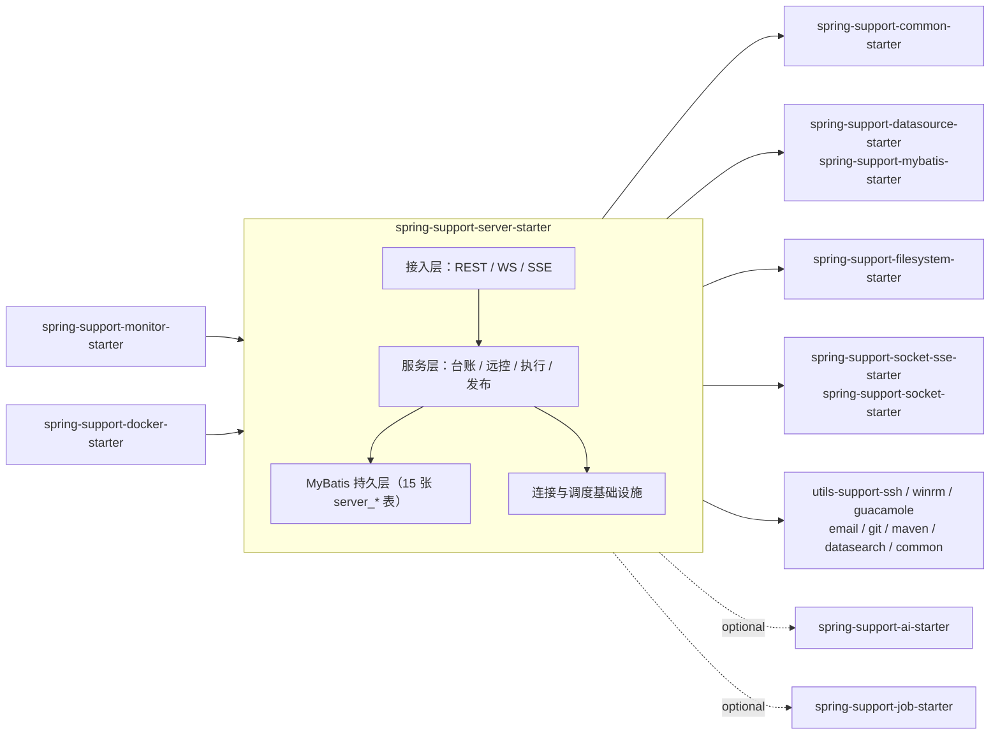
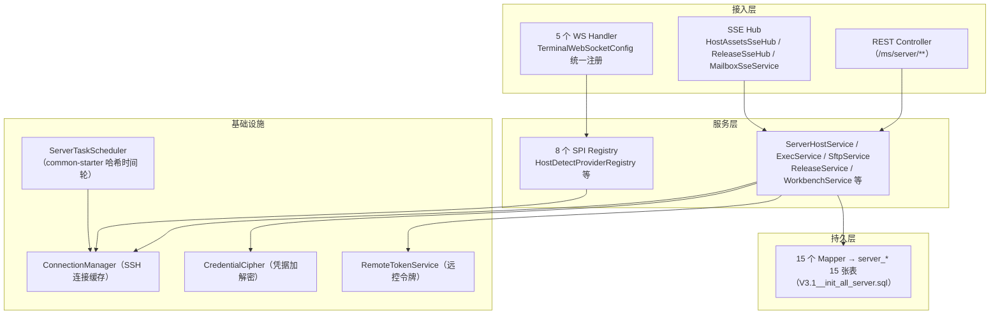
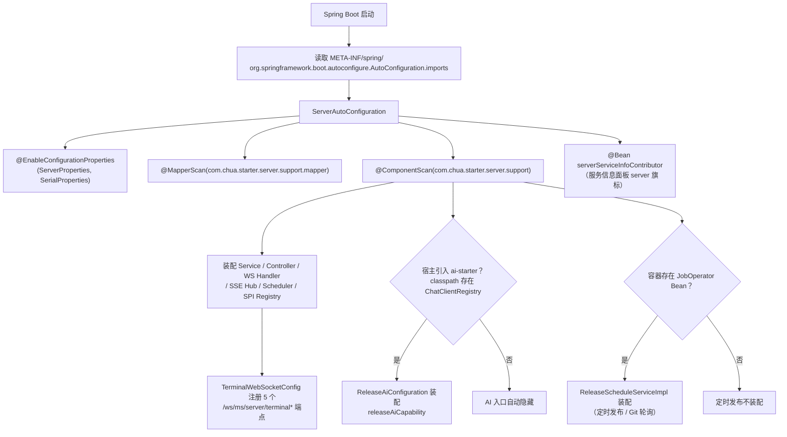
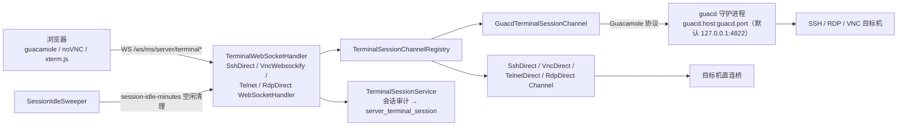

# spring-support-server-starter

服务器资产与远程运维 starter：主机台账 / 登录身份 / 密钥库、基于 guacd 与直连桥的远程终端、SFTP 文件管理、主机工作台（Docker / Kubernetes）、发布管理、批量执行与计划任务、代理与隧道、邮箱、远控令牌与终端分享、SSE 推送、Arthas 与 Agent 构件投放。

模块定位是「内部 starter 库」：`pom.xml` 中 `spring-boot-maven-plugin` 显式 `skip=true`，不产出 fat-jar，由宿主应用以普通依赖引入后经 `ServerAutoConfiguration` 装配。当前随父工程 `4.0.0.51` 发布，基于 Spring Boot 4.1.2、Java 25。

## 1. 架构图

### 1.1 模块在体系中的位置



- 依赖方向：`spring-support-api-*` → `spring-support-parent` → `utils-*`，本模块位于业务 starter 层，只向下依赖，不反向依赖 utils。
- 反向依赖本模块（父工程内）：`spring-support-monitor-starter`、`spring-support-docker-starter`。改动本模块公开服务接口会同时影响这两个模块。

### 1.2 内部分层



## 2. 核心流程图

### 2.1 自动装配流程



另有一个不走 `AutoConfiguration.imports` 的入口：`META-INF/spring.factories` 注册的 `ServerUploadEnvironmentPostProcessor`（EnvironmentPostProcessor），在环境准备阶段为文件上传补默认值。

### 2.2 远控终端数据流（浏览器 → 目标机）



`ProtocolType` 枚举只有 `SSH` / `SFTP` / `RDP` / `VNC` 四个值；`isGuacdProtocol()` 对 `SSH`、`RDP`、`VNC` 返回 true，`SFTP` 为 REST 实现，不经 guacd。Telnet 与串口不在该枚举中，分别由 `TelnetWebSocketHandler`、`SerialWebSocketHandler` 承载。

## 3. 能力清单

| 能力域 | 关键类 | 入口 |
|---|---|---|
| 主机台账 | `ServerHostService`、`ServerHostController` | `/ms/server/host` |
| 主机分组 | `ServerGroupService`、`ServerGroupController` | `/ms/server/group` |
| 登录身份 / 密钥库 | `ServerIdentityService`、`ServerKeyService`、`ServerCredentialController`、`CredentialCipher` | `/ms/server/identity`、`/ms/server/key` |
| 资产导入导出 | `HostArchiveService`、`HostArchiveController` | `/ms/server/host/archive` |
| 硬件探测与指标采集 | `HostDetectProvider`、`HostCollectProvider`、`HostRemoteProvider` | SPI 扩展点（见第 8 节） |
| 远程终端（guacd 中转） | `TerminalWebSocketHandler`、`GuacdConnectionFactory`、`GuacdTunnel` | `/ws/ms/server/terminal` |
| SSH 直连终端 | `SshDirectWebSocketHandler`、`ConnectionManager` | `/ws/ms/server/terminal/ssh` |
| VNC 直连桌面 | `VncWebsockifyWebSocketHandler` | `/ws/ms/server/terminal/vnc` |
| Telnet 直连终端 | `TelnetWebSocketHandler`、`TelnetNegotiation` | `/ws/ms/server/terminal/telnet` |
| RDP 直连桌面 | `RdpDirectWebSocketHandler`、`RdpjNative` | `/ws/ms/server/terminal/rdp` |
| SFTP 文件管理 | `SftpService`、`SftpController` | `/ms/server/sftp/{hostId}` |
| 会话审计与在线列表 | `TerminalSessionService`、`TerminalController` | `/ms/server/terminal`（含 `/online` 等） |
| 终端分享 / 主题 | `TerminalShareStore`、`TerminalShareController`、`TerminalThemeController` | `/ms/server/terminal/share`、`/ms/server/terminal/theme` |
| 主机工作台（Docker / K8s） | `WorkbenchService`、`WorkbenchController` | `/ms/server/host/{hostId}/docker/*`、`/kubernetes/*` |
| 发布管理 | `ReleaseService`、`ReleaseScheduleService`、`ReleaseController` | `/ms/server/release` |
| 发布主机文件 | `HostFileService`、`ReleaseHostFileController` | `/ms/server/host-file` |
| 批量执行与计划任务 | `ExecService`、`ExecJobScheduler` | `/ms/server/exec` |
| 代理池 | `ProxyService`、`ProxyController` | `/ms/server/proxy` |
| 主机隧道 | `TunnelService`、`TunnelController` | `/ms/server/host/{hostId}/tunnel` |
| 邮箱 | `MailboxService`、`MailboxSseService`、`MailboxController`、`MailboxConnectionController` | `/ms/server/identity/{identityId}/mailbox/*` |
| 远控令牌 | `RemoteTokenService`、`RemoteTokenController`、`RemoteControlPageController` | `/ms/server/remote` |
| SSE 推送 | `HostAssetsSseHub`、`ReleaseSseHub` | `/ms/server/host/assets/stream`、`/ms/server/release/stream` |
| 运行期系统配置 | `ServerConfigService`、`ServerConfigController` | `/ms/server/config` |
| SIP 服务管理 | `SipServiceManager`、`SipServerManager`、`SipController` | `/ms/server/sip` |
| Arthas 诊断 | `ArthasService`、`ArthasController` | `/ms/server/arthas` |
| Agent 构件投放 | `AgentArtifactService`、`AgentArtifactController`、`HostAgentController` | `/ms/server/agent`、`/ms/server/host/agent` |

路径常量集中在 `ServerConstants`（`API_PREFIX = "/ms/server"`）。WS 端点由 `TerminalWebSocketConfig#registerWebSocketHandlers` 统一注册，并设置 `setAllowedOriginPatterns("*")`，生产环境应在外层网关或安全配置中收敛来源。

## 4. Bean 能力矩阵

装配总入口是 `ServerAutoConfiguration`：`@ComponentScan("com.chua.starter.server.support")` + `@MapperScan("com.chua.starter.server.support.mapper")` + `@EnableConfigurationProperties({ServerProperties.class, SerialProperties.class})` + `@EnableTransactionManagement` + `@EnableScheduling`。

| Bean | 类型 | 装配条件 | 可否覆盖 | 典型注入姿势 |
|---|---|---|---|---|
| `serverServiceInfoContributor` | `ServiceInfoContributor` | `@Bean`，无条件 | 否（多贡献者共存，移除只能排除自动配置） | 注入 `List<ServiceInfoContributor>` 由 common-starter 汇总 |
| `serverProperties` / `serialProperties` | `@ConfigurationProperties` | `@EnableConfigurationProperties` | 值可经配置覆盖 | 构造器注入 |
| `serverHostService`、`execService`、`sftpService`、`releaseService`、`workbenchService` 等 20+ 服务 | 对应 `*ServiceImpl`（`@Service`） | `@ComponentScan`，无条件 | 可：自定义同类型 `@Bean` 加 `@Primary`，或开启 `spring.main.allow-bean-definition-overriding=true` 后同名覆盖 | 构造器注入接口类型 |
| `connectionManager` | `ConnectionManager`（`@Component`） | `@ComponentScan` | 同上 | 构造器注入，批量执行 / 探测 / SFTP 复用 SSH 缓存 |
| `credentialCipher` | `CredentialCipher`（`@Component`） | `@ComponentScan` | 同上 | 构造器注入，凭据列加解密 |
| `terminalWebSocketConfig` | `@Configuration` + `@EnableWebSocket` | `@ComponentScan` | 不建议（5 个 WS 端点集中在此注册） | — |
| `releaseAiCapability` | `RegistryReleaseAiCapability` | `@ConditionalOnClass(name="com.chua.starter.ai.support.registry.ChatClientRegistry")` + `@ConditionalOnMissingBean(ReleaseAiCapability.class)` | 可：自定义 `ReleaseAiCapability` Bean 时本 Bean 不装配 | `ObjectProvider<ReleaseAiCapability>` 可选注入 |
| `releaseScheduleService` | `ReleaseScheduleServiceImpl` | `@ConditionalOnBean(JobOperator.class)`（宿主引入 `spring-support-job-starter`） | 可：自定义同接口 Bean 会形成多实现，注入处用 `ObjectProvider` / 集合 | `ObjectProvider<ReleaseScheduleService>` 可选调用 |
| `hostDetectProviderRegistry` 等 8 个 Registry | `*Registry`（`@Component`） | `@ComponentScan`；SPI 实现经 `META-INF/extensions` 加载 | Registry 可覆盖；SPI 实现按第 8 节扩展 | 构造器注入 |
| 各 SPI 实现（`@Spi` 标注） | **不是 Spring Bean** | `META-INF/extensions/<接口全限定名>` 登记，由 common-starter SPI 机制加载 | 新增实现即扩展，无需改动本模块 | 经对应 Registry 按类型路由 |

说明：

- 本模块没有 `@ConditionalOnProperty`，`plugin.server.support.enabled` 不是模块开关。
- Spring Boot 默认禁止同名 Bean 定义覆盖；要替换组件扫描出的 Bean，推荐自定义 `@Bean` + `@Primary`，或显式开启 `spring.main.allow-bean-definition-overriding=true`。
- 条件装配只发生在两处：`ReleaseAiConfiguration`（AI 门面）与 `ReleaseScheduleServiceImpl`（定时发布），其余组件随包扫描无条件装配。

## 5. 完整配置

### 5.1 `plugin.server.support.*`（`ServerProperties`）

| key | 类型 | 默认值 | 说明 | 生效开关 |
|---|---|---|---|---|
| `plugin.server.support.enabled` | `boolean` | `true` | 服务信息面板「服务器资产」展示旗标；**不是模块开关**（无 `@ConditionalOnProperty`，置 false 不卸载任何 Bean） | — |
| `plugin.server.support.credential-key` | `String` | `server-support-default-credential-key` | 凭据加密密钥，生产必须通过配置中心或环境变量覆盖 | — |
| `plugin.server.support.session-idle-minutes` | `int` | `30` | 远控会话空闲超时（分钟），超时后由清理任务关闭 | — |
| `plugin.server.support.exec-concurrency` | `int` | `16` | 批量执行最大并发主机数 | — |
| `plugin.server.support.guacd.host` | `String` | `127.0.0.1` | guacd 地址 | — |
| `plugin.server.support.guacd.port` | `int` | `4822` | guacd 端口 | — |
| `plugin.server.support.guacd.client-host` | `String` | `127.0.0.1:8082` | 浏览器侧 guacamole 客户端回连地址（`host:port`），同域部署可置空 | — |
| `plugin.server.support.guacd.drive-path` | `String` | `/opt/spring-support/drive` | RDP 磁盘映射挂载根目录（enable-Drive 时使用） | `rdp.drive=true` 时使用 |
| `plugin.server.support.guacd.recording-path` | `String` | `/opt/spring-support/recordings` | 录屏输出目录 | — |
| `plugin.server.support.telnet.port` | `int` | `23` | 主机台账未配远控端口时的 Telnet 默认端口 | — |
| `plugin.server.support.telnet.timeout` | `int` | `8000` | Telnet 建连超时（毫秒） | — |

### 5.2 `plugin.server.support.serial.*`（`SerialProperties`）

| key | 类型 | 默认值 | 说明 | 生效开关 |
|---|---|---|---|---|
| `plugin.server.support.serial.enabled` | `boolean` | `true` | 串口开关；false 时不启用串口页面与 WS 端点，注册表与查询接口仍可用 | 仅控制串口链路，不影响其他能力 |
| `plugin.server.support.serial.baud-rate` | `int` | `115200` | 默认波特率 | — |
| `plugin.server.support.serial.data-bits` | `int` | `8` | 数据位（jSerialComm 合法值 5/6/7/8） | — |
| `plugin.server.support.serial.stop-bits` | `int` | `1` | 停止位（合法值 1/2） | — |
| `plugin.server.support.serial.parity` | `int` | `0` | 校验位：0 无 / 1 奇 / 2 偶 / 3 标记 / 4 空 | — |
| `plugin.server.support.serial.flow-control` | `int` | `0` | 流控位组合：0 关 / 1 RTS / 2 CTS / 4 DSR / 8 DTR / 16 XON/XOFF 入 / 32 XON/XOFF 出 | — |
| `plugin.server.support.serial.read-timeout` | `int` | `1000` | 读超时（毫秒），只影响轮询节奏 | — |
| `plugin.server.support.serial.write-timeout` | `int` | `0` | 写超时（毫秒），0 表示等待发送完成 | — |
| `plugin.server.support.serial.exclusive` | `boolean` | `true` | 是否独占打开串口 | — |
| `plugin.server.support.serial.device-path-prefix` | `String` | `/dev/` | 设备路径前缀，仅用于路径规范化；实际路径以台账 `serverHostAddress` 为准 | — |

### 5.3 运行期键值（`server_config` 表，`ServerConfigService`）

以下键不在 `@ConfigurationProperties` 中，由 `ServerConfigService` 从 `server_config` 表读取（代码内 `DEFAULTS` 为缺省值），保存后发布 `ServerConfigChangedEvent` 热生效：

| key | 默认值 | 说明 |
|---|---|---|
| `guacd.host` / `guacd.port` | `127.0.0.1` / `4822` | guacd 网关地址 / 端口（配置表优先，回落 `ServerProperties`） |
| `guacd.rdp.security` | `nla` | RDP 安全模式（any/rdp/tls/nla/nla-ext/vmconnect） |
| `guacd.client.host` / `guacd.client.port` | `127.0.0.1:8082` / — | 浏览器侧 WS 隧道回连地址（`RemoteTokenService` 生成会话 URL 用，空串=同域） |
| `guacd.token.ttl-minutes` | `60` | 远控令牌有效期（分钟，`RemoteTokenService`） |
| `connection.sweep.interval` / `connection.idle.timeout` | `60` / `300` | 连接缓存巡检间隔 / 空闲超时（秒） |
| `ssh.connect.timeout` / `ssh.session.timeout` / `ssh.read.timeout` | `15` / `30` / `60` | SSH 三级超时（秒），保存后热生效 |
| `rdp.width` / `rdp.height` / `rdp.color-depth` / `rdp.dpi` | `1280` / `768` / `24` / `96` | RDP 画面参数 |
| `rdp.force-lossless` / `rdp.wallpaper` / `rdp.theming` / `rdp.font-smoothing` | `false` / `false` / `false` / `true` | RDP 体验开关 |
| `rdp.full-window-drag` / `rdp.desktop-composition` / `rdp.menu-animations` | `true` / `true` / `false` | RDP 体验开关 |
| `rdp.audio-input` / `rdp.audio-output` | `false` / `true` | RDP 音频 |
| `rdp.drive` / `rdp.console` / `rdp.ignore-cert` | `false` / `false` / `true` | RDP 磁盘映射 / 控制台会话 / 忽略证书 |
| `rdp.timezone` / `rdp.keyboard-layout` | `Asia/Shanghai` / `en-us-qwerty` | RDP 时区 / 键盘布局 |
| `vnc.color-depth` / `vnc.compress-level` / `vnc.quality-level` | `24` / `7` / `6` | VNC 画面 |
| `vnc.swap-red-blue` / `vnc.cursor` / `vnc.encodings` / `vnc.auto-retry` | `false` / `local` / `ZRLE,Hextile,Tight` / `0` | VNC 画面 / 重试 |
| `ssh.terminal-type` / `ssh.font-name` / `ssh.font-size` / `ssh.backspace` | `xterm-256color` / `monospace` / `12` / `127` | SSH 终端外观（guacd 链路） |

### 5.4 上传默认值（`ServerUploadEnvironmentPostProcessor`）

通过 `META-INF/spring.factories` 注册，仅在用户**未显式配置**时追加默认属性源（显式配置始终优先）：

| key | 默认值 | 说明 |
|---|---|---|
| `spring.servlet.multipart.enabled` | `true` | 开启 multipart |
| `spring.servlet.multipart.max-file-size` | `2GB` | 单文件上限（发布主机文件 / SFTP 上传需要大文件） |
| `spring.servlet.multipart.max-request-size` | `2GB` | 单请求上限 |
| `server.tomcat.max-swallow-size` | `2GB` | 避免 413 后连接被截断 |
| `server.tomcat.max-http-form-post-size` | `2GB` | 表单 POST 上限 |

## 6. 使用方式

### 6.1 Maven 坐标

```xml
<dependency>
    <groupId>com.chua</groupId>
    <artifactId>spring-support-server-starter</artifactId>
    <version>4.0.0.51</version>
</dependency>
```

关键依赖（版本随父工程）：`spring-boot-starter-web` / `spring-boot-starter-websocket`（REST 与 WS 端点，必选）；`spring-support-datasource-starter` + `spring-support-mybatis-starter`（台账持久化，必选，建表脚本在 `db/init`）；`spring-support-filesystem-starter`（主机文件页与分片上传，必选）；`spring-support-socket-sse-starter` + `spring-support-socket-starter`（SSE 推送，必选）；`org.apache.guacamole:guacamole-common:1.6.0`（对接 guacd）；`com.fazecast:jSerialComm:2.11.0`（串口终端，缺失会导致整模块编译失败）；`utils-support-ssh-starter` / `utils-support-winrm-starter`（SSH / WinRM 通道，按系统类型路由）；`utils-support-common-starter`（RDP 原生桥契约 + 端口扫描 SPI）；`utils-support-email-starter`、`utils-support-git-starter`、`utils-support-maven-starter`（邮箱 / Git 发布 / 本地构建）。

可选依赖（`optional=true`，按需在宿主引入）：

| 依赖 | 作用 | 不引入时的表现 |
|---|---|---|
| `spring-support-ai-starter` | 发布模块 AI 门面（`ReleaseAiCapability`） | `ReleaseAiConfiguration` 因 `@ConditionalOnClass` 不装配，AI 入口自动隐藏 |
| `spring-support-job-starter` | 定时发布 / Git 定时轮询 | 无 `JobOperator` Bean，`ReleaseScheduleServiceImpl` 因 `@ConditionalOnBean` 不装配，仅影响定时能力 |

### 6.2 最小可运行示例

本模块不可单独作为可执行 jar 运行（`spring-boot-maven-plugin` 已 `skip`），最小用法是「宿主引入依赖 → 建表 → 覆盖配置 → 注入服务调用」。

第一步，宿主引入依赖（见上），并保证已有数据源；建表脚本位于 `src/main/resources/db/init`（`V3.1__init_all_server.sql` 建全部 15 张 `server_*` 表：`server_host`、`server_identity`、`server_group`、`server_key`、`server_project`、`server_release` 等；`V3.1__initdata_all_server.sql` 为种子数据）。

第二步，按需覆盖配置：

```yaml
plugin:
  server:
    support:
      credential-key: ${SERVER_CREDENTIAL_KEY}
      session-idle-minutes: 30
      exec-concurrency: 16
      guacd:
        host: 127.0.0.1
        port: 4822
        client-host: 127.0.0.1:8082
      telnet:
        port: 23
        timeout: 8000
```

第三步，启动后注入服务调用（本模块无 Builder / 链式 API，全部能力都是 Spring Bean 的接口方法调用，按步骤书写）：

```java
import com.chua.common.support.lang.code.ReturnResult;
import com.chua.starter.server.support.entity.MsExecLog;
import com.chua.starter.server.support.entity.MsServerHost;
import com.chua.starter.server.support.model.vo.SftpEntryVO;
import com.chua.starter.server.support.service.ExecService;
import com.chua.starter.server.support.service.ServerHostService;
import com.chua.starter.server.support.service.SftpService;
import com.chua.starter.server.support.service.WorkbenchService;

import java.util.List;
import java.util.Map;

@Service
public class ServerOpsDemo {

    private final ServerHostService hostService;
    private final ExecService execService;
    private final SftpService sftpService;
    private final WorkbenchService workbenchService;

    public ServerOpsDemo(ServerHostService hostService, ExecService execService,
                         SftpService sftpService, WorkbenchService workbenchService) {
        this.hostService = hostService;
        this.execService = execService;
        this.sftpService = sftpService;
        this.workbenchService = workbenchService;
    }

    public void inspect(Long hostId) {
        // 1. 连通性测试（按已绑定身份 SSH 登录并回显）
        ReturnResult<String> ping = hostService.testConnect(hostId);
        if (!ping.isSuccess()) {
            return;
        }

        // 2. 硬件探测并回写台账
        ReturnResult<MsServerHost> detected = hostService.detectHardware(hostId);

        // 3. 批量命令（单机超时 30 秒，不绑定计划任务）
        ReturnResult<List<MsExecLog>> logs =
                execService.runCommand(List.of(hostId), "uname -a", 30, null);

        // 4. 目录列表（identityId 传 null 表示按优先级取已绑定身份）
        ReturnResult<List<SftpEntryVO>> entries = sftpService.list(hostId, null, "/opt");

        // 5. 工作台：容器列表（含已停止）
        ReturnResult<List<Map<String, Object>>> containers =
                workbenchService.listDockerContainers(hostId, true);
    }
}
```

方法签名以源码为准：`ServerHostService#testConnect(Long)`、`#detectHardware(Long)`、`ExecService#runCommand(List<Long>, String, Integer, Long)`、`SftpService#list(Long, Long, String)`、`WorkbenchService#listDockerContainers(Long, Boolean)`。

远控令牌签发同样是步骤式（`RemoteTokenService` 为普通 `@Service`，不是接口）：

```java
String token = remoteTokenService.issueToken("ssh", "10.0.0.12", 22, "root", password);
String url = remoteTokenService.buildSessionUrl(token);
```

第四步，访问入口（默认无额外 context-path 时）：REST `/ms/server/**`；SSE `GET /ms/server/host/assets/stream`、`GET /ms/server/release/stream`；远控 WS `/ws/ms/server/terminal`（guacd）、`/ws/ms/server/terminal/ssh`、`/ws/ms/server/terminal/vnc`、`/ws/ms/server/terminal/telnet`、`/ws/ms/server/terminal/rdp`。

## 7. 使用场景

### 7.1 适用

- 企业内网多云 / 多机房服务器的**统一资产台账**（主机、分组、登录身份、密钥库、凭据加密存储）。
- **堡垒机式远程终端**：SSH / RDP / VNC 走 guacd 协议转换，SSH / VNC / Telnet / RDP 亦可直连；会话审计与空闲回收内建。
- **文件运维**：SFTP 目录管理、大文件分片上传、主机文件分发。
- **批量运维**：批量命令执行、cron 计划任务、代理池、主机隧道。
- **应用发布**：Git 拉取 + 本地 Maven 构建 + 目标机部署，支持定时发布与 Git 轮询自动发布。
- **主机工作台**：Docker 容器 / 镜像 / 网络 / 卷管理与 Kubernetes 工作负载查看、扩缩容、重启。
- **辅助能力**：临时邮箱（SSE 实时推送）、Arthas 诊断构件投放、Agent 构件下发。

### 7.2 不适用

- 面向公网的多租户 SaaS：本模块面向内部运维，权限模型是「登录用户 + 归属」，无租户级隔离与计费设计。
- 强合规审计场景：内建会话审计（`server_terminal_session`）与录屏目录配置较基础，等保 / 金融级审计需外挂专业堡垒机。
- 非 Spring Boot 宿主：自动装配依赖 Spring Boot 4.x 的 `AutoConfiguration.imports` 机制。

### 7.3 与相邻模块的取舍

| 相邻模块 | 分工 | 取舍建议 |
|---|---|---|
| `spring-support-monitor-starter` | 依赖本模块的主机台账与 SSH 通道做指标 / 日志采集与告警 | 采集展示与告警规则在 monitor；本模块只提供「连得上、查得到」的资产底座 |
| `spring-support-docker-starter` | 依赖本模块主机台账做容器编排扩展 | 单机 Docker 查看用本模块工作台即可，跨主机编排扩展走 docker-starter |
| `spring-support-ai-starter` | 提供发布 AI 门面的实现（`ChatClientRegistry`） | 只做发布辅助（脚本生成等）；模型路由 / 渠道管理不属于本模块 |
| `spring-support-job-starter` | 提供分布式任务调度 | 本模块的计划任务扫描用内建时间轮即可；需要分布式调度 / 任务分片时引入 job-starter |
| `spring-support-filesystem-starter` | 文件存储与分片上传底座 | 主机文件页复用其 `FileStorageTemplate`，不重复实现上传 |

## 8. 扩展点

本模块通过 common-starter 的 SPI 机制（`@Spi` 注解 + `META-INF/extensions` 登记文件）暴露 8 个扩展点。扩展方式统一为三步：实现接口 → 标注 `@Spi` → 在宿主 `src/main/resources/META-INF/extensions/<接口全限定名>` 文件中登记实现类全名（每行一个）。

| SPI 接口 | 用途 | 本模块默认实现 |
|---|---|---|
| `HostDetectProvider` | 按系统类型做硬件 / 系统信息探测（CPU / 内存 / 磁盘 / 版本 / 架构 / IP） | `LinuxHostDetectProvider`、`WindowsHostDetectProvider`、`MacosHostDetectProvider`、`FreebsdHostDetectProvider`、`AixHostDetectProvider`、`SolarisHostDetectProvider` |
| `HostCollectProvider` | 主机指标定时采集通道 | `ScheduledHostCollectProvider`、`OpenSshHostCollectProvider`、`AgentHostCollectProvider`、`HttpHostCollectProvider`、`PrometheusHostCollectProvider` |
| `HostRemoteProvider` | 远程命令执行通道（POSIX SSH / Windows WinRM） | `PosixSshHostRemoteProvider`、`WindowsHostRemoteProvider` |
| `TerminalSessionChannel` | 远控终端会话通道 | `GuacdTerminalSessionChannel`、`SshDirectTerminalSessionChannel`、`VncDirectTerminalSessionChannel`、`TelnetDirectTerminalSessionChannel`、`RdpDirectTerminalSessionChannel` |
| `SystemServiceProvider` | 系统服务（systemd / launchd / Windows 服务）管理 | `SystemdSystemServiceProvider`、`LaunchdSystemServiceProvider`、`WindowsSystemServiceProvider` |
| `ProjectTypeProvider` | 发布项目类型识别（脚本生成） | `SpringbootProjectTypeProvider`、`FatjarProjectTypeProvider`、`GitProjectTypeProvider`、`SeparatedProjectTypeProvider`、`StaticProjectTypeProvider`、`NginxProjectTypeProvider`、`ModelProjectTypeProvider` |
| `ProjectPlatformProvider` | 发布目标平台（POSIX / macOS / Windows）差异 | `PosixProjectPlatformProvider`、`MacosProjectPlatformProvider`、`WindowsProjectPlatformProvider` |
| `PackageManagerProvider` | 包管理器（apt / yum / dnf / winget / chocolatey） | `AptPackageManagerProvider`、`YumPackageManagerProvider`、`DnfPackageManagerProvider`、`WingetPackageManagerProvider`、`ChocolateyPackageManagerProvider` |

示例：新增 OpenBSD 主机探测 Provider。`HostDetectProvider` 的真实方法签名为：

```java
String osType();

default boolean requiresCredential() { ... }

ReturnResult<MsServerHost> detect(MsServerHost host, SshCredential credential);

default ReturnResult<String> test(MsServerHost host) { ... }
```

第一步，实现接口：

```java
package com.example.server;

import com.chua.common.support.lang.code.ReturnResult;
import com.chua.common.support.spi.annotations.Spi;
import com.chua.starter.server.support.entity.MsServerHost;
import com.chua.starter.server.support.model.SshCredential;
import com.chua.starter.server.support.spi.HostDetectProvider;

@Spi(value = "openbsd", order = 100)
public class OpenBsdHostDetectProvider implements HostDetectProvider {

    @Override
    public String osType() {
        return "OPENBSD";
    }

    @Override
    public ReturnResult<MsServerHost> detect(MsServerHost host, SshCredential credential) {
        // 采集逻辑略：可参考 LinuxHostDetectProvider 借 ConnectionManager 执行命令
        return ReturnResult.ok(host, "已采集");
    }
}
```

第二步，登记扩展点文件 `META-INF/extensions/com.chua.starter.server.support.spi.HostDetectProvider`：

```text
com.example.server.OpenBsdHostDetectProvider
```

第三步，生效方式：`HostDetectProviderRegistry` 首次解析时遍历扩展点定义，按 `osType()` 建索引（同一实现类只登记一次），`ServerHostServiceImpl` 的硬件探测按主机的 `serverHostOsType`（或采集方式）路由到对应实现。登记成功时日志输出 `[detect] 注册探测 Provider: osType=..., impl=...`；无任何实现时输出「HostDetectProvider 扩展点无任何实现，硬件探测不可用」。

除 SPI 外，还可通过 Spring 常规手段扩展：

- 自定义 `ReleaseAiCapability` Bean 替换默认 `RegistryReleaseAiCapability`（默认实现带 `@ConditionalOnMissingBean`，自动让位）。
- 覆盖任意 `@Service` / `@Component` Bean（`@Primary` 或开启 `allow-bean-definition-overriding`）。
- 监听本模块事件：`ServerConfigChangedEvent`（系统配置变更热生效）、`HostPortScanEvent`、`ExecJobChangedEvent`。

## 9. 常见问题

**Q1：引入依赖后模块没装配？**
确认三点：宿主是 Spring Boot 4.x 应用；依赖坐标与版本正确（`com.chua:spring-support-server-starter:4.0.0.51`）；没有在 `@SpringBootApplication(exclude=...)` 或自动配置排除列表里排除 `ServerAutoConfiguration`。本模块 `spring-boot-maven-plugin` 已 `skip`，产出的是原始 jar，下游可正常解析 `com.chua.starter.server.support.*`；若自行 repackage 反而会破坏类结构。

**Q2：`plugin.server.support.enabled=false` 了，为什么接口还在？**
该配置只是服务信息面板的展示旗标，不是模块开关。本模块没有 `@ConditionalOnProperty`，monitor / docker 等模块直接注入本模块服务，真要停用只能移除依赖。串口有独立开关 `plugin.server.support.serial.enabled`，也只控制串口页面与 WS 端点。

**Q3：远程终端连不上？**
分两段排查：后端 → guacd，检查 `guacd.host` / `guacd.port`（默认 `127.0.0.1:4822`），guacd 必须作为外部进程先行部署；浏览器 → 后端，检查 `guacd.client-host`（或配置表 `guacd.client.host` / `guacd.client.port`）是否与浏览器实际回连地址一致，前端后端同域部署时置空即可。`RemoteTokenService#buildSessionUrl` 生成的 URL 形如 `http://host:port/guacamole/#token=xxx`。

**Q4：WS 端点跨域被拦或被滥用？**
`TerminalWebSocketConfig` 对 5 个端点统一 `setAllowedOriginPatterns("*")`，生产环境应在外层网关或安全配置中收敛来源，本模块不替代安全网关。

**Q5：RDP 直连提示「不支持」？**
本模块只依赖 `utils-support-common-starter` 的原生桥契约，实际实现（rdpj.dll + JNA）由部署时按需加入的 `utils-support-native-rdp` 提供。未部署时 `RdpjNative.exists()` 返回 false，直连被拒绝，提示语为 `RdpjNative.UNSUPPORTED_MESSAGE`：「当前环境不支持 RDP 直连：未部署 RDP 原生库（utils-support-native-rdp）」。

**Q6：AI 入口 / 定时发布不生效？**
两者都是可选能力：AI 门面需要宿主引入 `spring-support-ai-starter`（classpath 出现 `ChatClientRegistry`）；定时发布需要宿主引入 `spring-support-job-starter`（容器出现 `JobOperator` Bean）。缺省时对应功能静默隐藏，不影响其余能力启动。

**Q7：大文件上传报 413？**
`ServerUploadEnvironmentPostProcessor` 已把 multipart 与 Tomcat swallow 上限默认放宽到 2GB；若仍报错，检查是否显式配置了更小的 `spring.servlet.multipart.max-file-size`（显式配置优先于默认值）。

**Q8：与 Spring Boot 4 的兼容性？**
本模块随 Spring Boot 4.1.2 构建：自动配置走 `META-INF/spring/org.springframework.boot.autoconfigure.AutoConfiguration.imports`（不再使用 spring.factories 注册自动配置类）；`EnvironmentPostProcessor` 仍按 Spring Boot 约定经 `META-INF/spring.factories` 注册；源码为 Jakarta 命名空间，编译目标 Java 25。宿主需使用同代 Spring Boot 4.x 与 JDK 25。

**Q9：旧版本建表脚本里的 `ms_*` 表去哪了？**
V3.1 起表名统一为 `server_` 前缀（列名同步去掉 `ms_` 前缀），迁移口径是「RENAME 合并成 CREATE」：新表直接以 `server_*` 建出，不做数据搬迁；`FlywayLike` 按「脚本名 + 版本」记账，命中成功记录即跳过，因此存量库会因版本递进（V3.0 → V3.1）重跑建表。新部署直接执行 `V3.1__init_all_server.sql` 即可。

**Q10：为什么有串口相关类却连不上串口终端？**
`SerialWebSocketHandler`、`SerialSessionRegistry`、`SerialCommListingService`、`SerialConnectionFactory` 等组件已存在（受 `serial.enabled` 控制），但 `TerminalWebSocketConfig` 当前只注册 guacd / SSH / VNC / Telnet / RDP 五个远控 WS 端点，串口端点未在其中注册，以代码实际注册行为为准。
