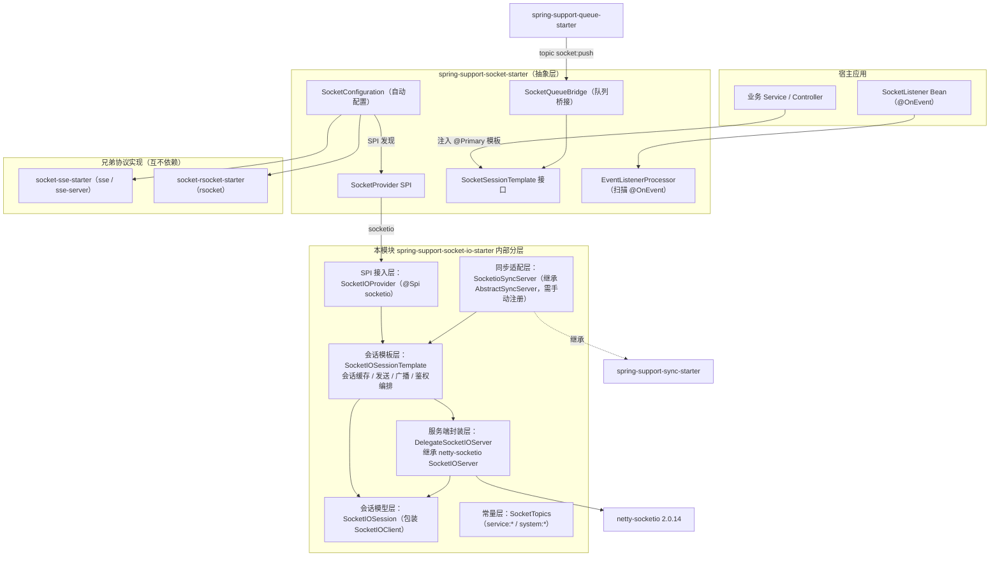
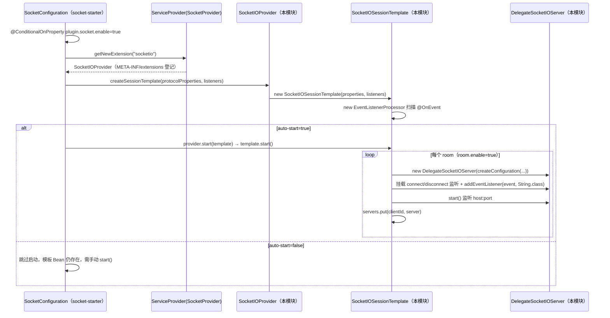

# spring-support-socket-io-starter

Socket.IO 协议实现：基于 `netty-socketio 2.0.14` 为 `spring-support-socket-starter` 提供 `socketio` 协议，独立监听端口，按 `room` 配置为每个客户端标识启动一个 Socket.IO 服务实例。本模块是 spring-support 体系中 Socket 抽象层的协议实现之一，通过 SPI（`SocketProvider`）接入抽象层，自身不注册任何 Spring Bean。

- 坐标：`com.chua:spring-support-socket-io-starter:4.0.0.51`；基线 Spring Boot `4.1.2`（`spring-boot-starter-parent`）、Java `25`；协议栈 `com.corundumstudio.socketio:netty-socketio:2.0.14`（父 POM 托管）

## 1. 架构图



依赖方向唯一：本模块 → 抽象层。抽象层不感知本模块具体类型，仅通过 `SocketProvider` SPI 与 `SocketSessionTemplate` 接口交互；`spring-support-socket-websocket-starter` 走独立 `plugin.websocket` 配置，不参与 `plugin.socket`。

## 2. 核心流程图



## 3. 能力清单

| 能力域 | 关键类 | 入口/触发方式 |
|---|---|---|
| 协议接入（SPI） | `com.chua.starter.socket.io.spi.SocketIOProvider`（`@Spi("socketio")`） | `META-INF/extensions/com.chua.socket.support.spi.SocketProvider`，由 `SocketConfiguration` 通过 `ServiceProvider.of(SocketProvider.class).getNewExtension("socketio")` 调用 |
| 会话管理 / 消息收发 | `com.chua.starter.socket.io.session.SocketIOSessionTemplate`（实现 `SocketSessionTemplate`） | 注入 `SocketSessionTemplate`（抽象层 `@Primary`） |
| 服务端封装与会话模型 | `com.chua.starter.socket.io.server.DelegateSocketIOServer`（继承 `SocketIOServer`）、`SocketIOSession`（实现 `SocketSession`，包装 `SocketIOClient`） | `SocketIOSessionTemplate#getServer(clientId)`（具体类方法）/ `SocketSessionTemplate#getSession(sessionId)` |
| 入站事件分发 | `@OnEvent` + `SocketListener`（抽象层）+ `EventListenerProcessor` | 声明 `SocketListener` Bean，方法标注 `@OnEvent("事件名")` |
| 握手鉴权 | `SocketAuthFactory`（抽象层契约），本模块 `configureAuthorization` / `resolveAuthFactory` 完成装配 | `plugin.socket.auth-factory=工厂全限定类名` |
| 同步协议适配 | `com.chua.starter.socket.io.sync.SocketioSyncServer`（继承 `AbstractSyncServer`） | 未标注组件注解，不自动注册；需要时手动 `new` 并接入同步体系 |
| 事件命名常量 | `com.chua.starter.socket.io.constant.SocketTopics`（`Service.Message/Operation`、`System.Message/User/Config/Auth`） | 常量引用，命名格式 `项目:模块:功能` |

本模块**不注册任何 Spring 自动配置类**：`META-INF/spring/org.springframework.boot.autoconfigure.AutoConfiguration.imports` 只有一行注释，也没有 `spring.factories`；所有 Bean 由 `spring-support-socket-starter` 的 `SocketConfiguration` 统一创建。native-image 元数据在 `META-INF/native-image/com.chua/spring-support-socket-io-starter/`（`reflect-config.json` 登记 `SocketIOProvider`，`resource-config.json` 包含 `META-INF/extensions/.*`）。

## 4. Bean 能力矩阵

**本模块注册的 Bean：无。** 没有任何 `@Configuration` / `@Component` / `@Bean`，只通过 SPI 文件向 `SocketProvider` 扩展点提供 `SocketIOProvider`。引入本模块并设 `plugin.socket.enable=true` 后，以下 Bean 由抽象层 `SocketConfiguration` 创建（本模块的 `SocketIOProvider` 在其中被 SPI 选中）：

| Bean 名 | 类型 | 装配条件（含默认值） | 可否覆盖 | 典型用途 |
|---|---|---|---|---|
| `plugin.socket-com.chua.socket.support.properties.SocketProperties` | `com.chua.socket.support.properties.SocketProperties` | 无条件（`@EnableConfigurationProperties`） | 配置绑定，一般不覆盖 | 读取 `plugin.socket.*` 配置 |
| `socketSessionTemplates` | `Map<String, SocketSessionTemplate>`（协议名 → 模板） | `@ConditionalOnProperty(prefix="plugin.socket", name="enable", havingValue="true")` + `@ConditionalOnMissingBean` | 可以：自定义同类型 Bean 时自动配置退让 | 注入整个 Map，按 `protocol()` 名取用 |
| `socketSessionTemplate` | `SocketSessionTemplate`（实际实例为 `SocketIOSessionTemplate`），`@Primary` | `@ConditionalOnProperty(plugin.socket.enable=true)`；**无** `@ConditionalOnMissingBean` | 不可直接覆盖（会与 `@Primary` 冲突，需排除自动配置） | 构造器注入 `SocketSessionTemplate`（最常用） |
| `socketLifecycle` | `SocketConfiguration.SocketLifecycle`（`InitializingBean` / `DisposableBean`） | `@ConditionalOnProperty(plugin.socket.enable=true)`；无 `@ConditionalOnMissingBean` | 一般不覆盖 | `auto-start` 启动与容器关闭时 `stop()` |
| `socketServiceInfoContributor` | `ServiceInfoContributor`（登记 `socket` 能力标志） | 无条件；无 `@ConditionalOnMissingBean` | 可以 | 服务信息端点展示 Socket 能力 |
| `socketQueueBridge` | `com.chua.socket.support.bridge.SocketQueueBridge`（`@Component` 扫描） | `@ConditionalOnProperty(prefix="plugin.queue", name="enable", havingValue="true")` + `@ConditionalOnMissingBean(name="monitorSocketQueueBridge")` | 可以：定义名为 `monitorSocketQueueBridge` 的 Bean 替换 | 监听队列 `socket:push` 并广播到 Socket 会话 |

> `enable=false`（默认）时 `socketSessionTemplates` / `socketSessionTemplate` / `socketLifecycle` 均不存在，注入 `SocketSessionTemplate` 会直接 `NoSuchBeanDefinitionException`。

## 5. 完整配置

本模块**没有自己的 `@ConfigurationProperties`**，全部复用抽象层 `com.chua.socket.support.properties.SocketProperties`（前缀 `plugin.socket`，`ignoreInvalidFields=true`），以下字段逐一核对自该类源码。

### 5.1 主配置 `plugin.socket.*`

| 配置路径 | 类型 | 默认值 | 说明 |
|---|---|---|---|
| `plugin.socket.enable` | `boolean` | `false` | Socket 总开关；`false` 时抽象层不创建任何模板 Bean |
| `plugin.socket.auto-start` | `boolean` | `true` | 是否随容器启动自动 `start()`；`false` 时模板 Bean 仍创建，需手动启动 |
| `plugin.socket.protocol` | `SocketProtocol`（`socketio`/`rsocket`/`sse`/`sse-server`） | `sse` | 单协议模式协议名；使用本模块必须设为 `socketio` |
| `plugin.socket.protocols` | `List<ProtocolConfig>` | `[]` | 多协议分组；非空时忽略顶层 `protocol` 与 `room` |
| `plugin.socket.room` | `List<Room>` | `[]` | 服务实例列表，每个元素启动一个 Socket.IO 服务；为空则 `start()` 跳过 |
| `plugin.socket.host` | `String` | `0.0.0.0` | 默认监听地址（`room[].host` 为空时使用） |
| `plugin.socket.codec-type` | `String` | `json` | 保留字段，`SocketIOSessionTemplate` 未使用 |
| `plugin.socket.max-frame-size` | `int` | `1048576`（1MB） | 写入 `setMaxFramePayloadLength` 与 `setMaxHttpContentLength` |
| `plugin.socket.boss-count` | `int` | `1` | `Configuration.setBossThreads` |
| `plugin.socket.work-count` | `int` | `100` | `Configuration.setWorkerThreads` |
| `plugin.socket.allow-custom-requests` | `boolean` | `true` | `Configuration.setAllowCustomRequests` |
| `plugin.socket.ping-timeout` | `int` | `60000` | 心跳超时（毫秒） |
| `plugin.socket.ping-interval` | `int` | `25000` | 心跳间隔（毫秒） |
| `plugin.socket.auth-factory` | `String` | 空 | 鉴权工厂全限定类名；配置后失败关闭（加载失败拒绝所有连接） |
| `plugin.socket.use-linux-native-epoll` | `boolean` | `false` | Linux native Epoll（`Configuration.setUseLinuxNativeEpoll`） |

### 5.2 嵌套配置 `plugin.socket.room[]`（`SocketProperties.Room`）

| 配置路径 | 类型 | 默认值 | 说明 |
|---|---|---|---|
| `plugin.socket.room[].client-id` | `String` | `default` | 实例标识，`servers` map 与会话缓存的 key |
| `plugin.socket.room[].context-path` | `String` | `/socket.io` | 写入 `Configuration.setContext(...)` |
| `plugin.socket.room[].port` | `int` | `-1` | `>=0` 直接使用；负数以 9000 为基准（本模块 `start()` 写死 `room.getActualPort(9000)`）：`-1`→9000、`-2`→9001 |
| `plugin.socket.room[].host` | `String` | 空 | 实例专属监听地址，为空则用 `plugin.socket.host` |
| `plugin.socket.room[].auth-factory` | `String` | 空 | 本模块当前按主配置 `auth-factory` 解析，此字段为抽象层预留 |
| `plugin.socket.room[].enable` | `boolean` | `true` | `false` 时跳过该实例（打印 `房间 {} 未启用，跳过`） |

### 5.3 嵌套配置 `plugin.socket.protocols[]`（`SocketProperties.ProtocolConfig`）

| 配置路径 | 类型 | 默认值 | 说明 |
|---|---|---|---|
| `plugin.socket.protocols[].protocol` | `SocketProtocol` | `socketio` | 分组协议名（嵌套默认与顶层默认 `sse` 不同） |
| `plugin.socket.protocols[].room` | `List<Room>` | `[]` | 该协议分组的服务实例列表 |

```yaml
plugin:
  socket:
    enable: true          # 必须显式开启
    protocol: socketio    # 必须是 socketio
    room:
      - client-id: default
        port: 9092
        context-path: /socket.io
      - client-id: webrtc
        port: -2          # 负数基准 9000 → 实际 9001
        context-path: /webrtc
```

### 5.4 逐项配置示例（按功能分组）

以下按功能分组给出每个配置项的含义、默认值与 YAML 写法。所有键均对应抽象层 `com.chua.socket.support.properties.SocketProperties`（前缀 `plugin.socket`）的真实字段，与 5.1–5.3 的总表一致。

**开关与生命周期**

| 配置项 | 含义 | 默认值 |
|---|---|---|
| `plugin.socket.enable` | Socket 总开关；`false` 时抽象层不创建任何模板 Bean | `false` |
| `plugin.socket.auto-start` | 是否随容器启动自动 `start()` 监听端口；`false` 时模板 Bean 仍存在，需手动调用 `template.start()` | `true` |

```yaml
plugin:
  socket:
    enable: true        # 默认 false，必须显式开启
    auto-start: true    # 默认 true；false 时需自行 template.start()
```

**协议选择**

| 配置项 | 含义 | 默认值 |
|---|---|---|
| `plugin.socket.protocol` | 单协议模式的协议名；使用本模块必须设为 `socketio` | `sse` |
| `plugin.socket.protocols` | 多协议分组列表；非空时忽略顶层 `protocol` 与 `room` | 空列表 |

```yaml
plugin:
  socket:
    protocol: socketio   # 可选值：socketio / rsocket / sse / sse-server
    # 多协议写法（与 protocol/room 二选一，protocols 非空时优先）：
    # protocols:
    #   - protocol: socketio
    #     room:
    #       - port: 9092
```

**网络与线程**

| 配置项 | 含义 | 默认值 |
|---|---|---|
| `plugin.socket.host` | 所有实例的默认监听地址（`room[].host` 为空时使用） | `0.0.0.0` |
| `plugin.socket.boss-count` | netty boss 线程数（每个 room 实例独立一份） | `1` |
| `plugin.socket.work-count` | netty worker 线程数（每个 room 实例独立一份） | `100` |
| `plugin.socket.use-linux-native-epoll` | 是否启用 Linux native Epoll | `false` |

```yaml
plugin:
  socket:
    host: 0.0.0.0
    boss-count: 1
    work-count: 100
    use-linux-native-epoll: false   # 仅 Linux 生效
```

**心跳与帧**

| 配置项 | 含义 | 默认值 |
|---|---|---|
| `plugin.socket.ping-interval` | 心跳间隔（毫秒） | `25000` |
| `plugin.socket.ping-timeout` | 心跳超时（毫秒），需大于 `ping-interval` | `60000` |
| `plugin.socket.max-frame-size` | 单帧与 HTTP 内容上限（字节），同时写入 `setMaxFramePayloadLength` 与 `setMaxHttpContentLength` | `1048576`（1MB） |
| `plugin.socket.allow-custom-requests` | 是否允许自定义请求 | `true` |
| `plugin.socket.codec-type` | 保留字段，本模块 `SocketIOSessionTemplate` 未使用 | `json` |

```yaml
plugin:
  socket:
    ping-interval: 25000
    ping-timeout: 60000
    max-frame-size: 1048576
    allow-custom-requests: true
    codec-type: json
```

**握手鉴权**

| 配置项 | 含义 | 默认值 |
|---|---|---|
| `plugin.socket.auth-factory` | 鉴权工厂全限定类名（需 public 无参构造器）；不配置则匿名放行、`sendToUser` 不可用；配置后失败关闭 | 空 |

```yaml
plugin:
  socket:
    auth-factory: com.example.socket.AuthFactory   # 占位类名，替换为你的实现
```

**服务实例 `room[]`**（`SocketProperties.Room`）

| 配置项 | 含义 | 默认值 |
|---|---|---|
| `plugin.socket.room[].client-id` | 实例标识，`servers` map 与会话缓存的 key | `default` |
| `plugin.socket.room[].context-path` | Socket.IO 上下文路径 | `/socket.io` |
| `plugin.socket.room[].port` | 监听端口；正数直接使用，负数以 9000 为基准换算（`-1`→9000、`-2`→9001） | `-1` |
| `plugin.socket.room[].host` | 实例专属监听地址，为空时用主配置 `host` | 空 |
| `plugin.socket.room[].auth-factory` | 预留字段，本模块当前按主配置 `auth-factory` 解析 | 空 |
| `plugin.socket.room[].enable` | 是否启用该实例 | `true` |

```yaml
plugin:
  socket:
    room:
      - client-id: default
        context-path: /socket.io
        port: 9092          # 生产建议写明确正数端口
        host: 0.0.0.0       # 可省略，默认继承主配置 host
        enable: true
```

**多协议分组 `protocols[]`**（`SocketProperties.ProtocolConfig`）

| 配置项 | 含义 | 默认值 |
|---|---|---|
| `plugin.socket.protocols[].protocol` | 分组协议名 | `socketio` |
| `plugin.socket.protocols[].room` | 该协议分组的服务实例列表 | 空列表 |

```yaml
plugin:
  socket:
    protocols:
      - protocol: socketio
        room:
          - client-id: default
            port: 9092
```

### 5.5 完整 YAML 配置示例（生产参考）

```yaml
plugin:
  socket:
    enable: true                                  # 总开关，默认 false，必须显式开启
    auto-start: true                              # 随容器启动自动监听端口
    protocol: socketio                            # 使用本模块必须为 socketio
    host: 0.0.0.0                                 # 所有实例的默认监听地址
    boss-count: 1                                 # 每 room 实例的 boss 线程数
    work-count: 100                               # 每 room 实例的 worker 线程数
    ping-interval: 25000                          # 心跳间隔（毫秒）
    ping-timeout: 60000                           # 心跳超时（毫秒），需大于 ping-interval
    max-frame-size: 1048576                       # 帧/HTTP 内容上限（字节），默认 1MB
    allow-custom-requests: true
    use-linux-native-epoll: false                 # Windows/macOS 保持 false
    auth-factory: com.example.socket.AuthFactory  # 占位类名，替换为你的鉴权工厂
    room:
      - client-id: default                        # 主通道
        port: 9092
        context-path: /socket.io
        enable: true
      - client-id: webrtc                         # 独立业务通道（独立端口 + 上下文）
        port: 9093
        context-path: /webrtc
        enable: true
```

### 5.6 生产注意事项

- **端口规划**：每个 `room[]` 元素独占一个 netty 监听端口；负数端口以 9000 为基准（本模块 `start()` 写死 `room.getActualPort(9000)`），生产环境建议直接写正数端口，避免依赖隐式基准。端口被占用会抛 `RuntimeException("Socket.IO 服务启动失败: <clientId>")` 并导致容器启动失败，不会跳过该实例继续。
- **线程与内存**：`boss-count` / `work-count` 按 room 实例各自创建（默认每实例 1 + 100 线程），多实例部署时按 `N × (boss + worker)` 估算线程开销；连接数不大时可下调 `work-count`。
- **鉴权失败关闭**：配置 `auth-factory` 后，工厂加载失败、`getUser` 返回 null、`userId` 为空或抛异常，一律按 `FAILED_AUTHORIZATION` 拒绝连接，不会降级为匿名；工厂由反射创建（模板不在 Spring 容器内），必须提供 public 无参构造器。握手数据只含 `headers`（键已转小写）、`query`、`address` 三个键，令牌从 `headers` 取。
- **跨源部署**：服务端固定放行自定义请求头 `x-oauth-token`（`setAllowHeaders("x-oauth-token")`）并自动放行 CORS 预检（OPTIONS）；若前端还要携带其它自定义头，需在网关/代理层处理，服务端不会额外放行。
- **大报文**：`max-frame-size` 同时是帧上限与 HTTP 内容上限，上调前评估内存；入站事件固定按 `String.class` 接收，出站非 String 载荷经 Jackson 序列化为字符串（失败时退化为 `toString()`）。
- **心跳调优**：`ping-timeout` 必须大于 `ping-interval`，并与前端 socket.io 客户端的超时/重连配置匹配；默认 25s/60s 适合常规场景。
- **多实例水平扩展**：会话缓存是单机内存（`ConcurrentHashMap`），跨实例广播请引入 `spring-support-queue-starter` 并设 `plugin.queue.enable=true`，由 `SocketQueueBridge` 消费队列 `socket:push` 后广播；不要假设单实例会话对其它实例可见。
- **优雅停机与手动启停**：`auto-start=true` 时由抽象层 `SocketLifecycle` 在容器关闭时调用 `stop()`；`auto-start=false` 时启停完全由调用方负责。`stop()` 会清空全部服务实例与会话缓存，重复 `start()` 前需确认已 `stop()`（`servers` 非空时 `start()` 直接告警返回）。

## 6. 使用方式

```xml
<dependency>
    <groupId>com.chua</groupId>
    <artifactId>spring-support-socket-io-starter</artifactId>
    <version>4.0.0.51</version>
</dependency>
```

| 依赖 | 作用 | 是否可选 |
|---|---|---|
| `com.chua:spring-support-socket-starter` | 抽象层：`SocketProvider` SPI、`SocketSessionTemplate`、`SocketProperties`、`SocketConfiguration` | 否 |
| `com.chua:spring-support-sync-starter` | `AbstractSyncServer` 基类（仅 `SocketioSyncServer` 使用） | 否 |
| `com.corundumstudio.socketio:netty-socketio` | Socket.IO 协议栈 | 否 |
| `com.chua:utils-support-common-starter` | `@Spi` 等 SPI 基础设施 | 否 |

pom 中**没有 optional / provided 依赖**，引入即获得全部能力，不存在「缺依赖降级」路径。两个可选能力由宿主决定：队列桥接广播需另引 `spring-support-queue-starter` 并设 `plugin.queue.enable=true`（见第 4 节 `socketQueueBridge`）；`plugin.socket.auth-factory` 不配置则连接匿名放行、`sendToUser` 不可用。

```yaml
plugin:
  socket:
    enable: true
    protocol: socketio
    room:
      - client-id: default
        port: 9092
        context-path: /socket.io
```

```java
@Component
public class ChatListener implements SocketListener {

    @OnEvent("chat")
    public void onChat(SocketSession session, String data) {
        // 房间标识（clientId）由本模块写入会话属性，不是 SocketSession 的字段
        log.info("clientId={}, data={}", session.getAttribute("clientId"), data);
    }
}
```

前端用 socket.io 客户端连接 `http://<host>:9092`（默认上下文 `/socket.io`），`socket.emit("chat", "hello")` 即触发监听器。业务侧推送注入 `SocketSessionTemplate`：`template.broadcast("notice", text)`；`protocol()` 返回 `socketio`，`isReady()` 表示至少一个实例已监听端口，`supportsUserTargeting()` 表示已配置 `auth-factory`。生命周期由抽象层 `SocketLifecycle` 调 `start()` / `stop()`，一般无需手动调用。

## 7. 使用场景

适用：

- 前端使用 **socket.io 客户端**（轮询 + WebSocket 传输、自动重连、心跳），需要服务端原生 Socket.IO 语义（事件、广播）。
- 需要**多个独立监听端口**承载不同业务通道（如 `chat`、`webrtc` 各占一个端口/上下文）。
- 需要**握手鉴权 + 按用户定向推送**（`auth-factory` + `sendToUser`），或**跨实例解耦广播**（业务方只向队列 `socket:push` 发消息，由 `SocketQueueBridge` 广播到会话）。

不适用 / 慎用：

- 只需**单向服务端推送**、可容忍重连轮询 → 用 `spring-support-socket-sse-starter`（SSE）更轻。
- 客户端是**原生 WebSocket**（非 socket.io 协议）或想**复用应用主端口**（同源、无额外跨域）→ 选 `spring-support-socket-websocket-starter`；需要 RSocket 背压语义 → `spring-support-socket-rsocket-starter`。兄弟实现互不依赖，可通过 `protocols` 分组同时启用。

| 模块 | 协议名 | 端口模型 | 何时选它而不是本模块 |
|---|---|---|---|
| `spring-support-socket-io-starter`（本模块） | `socketio` | 独立端口（每 room 一个 netty 监听） | 前端已是 socket.io 生态，或需要房间/降级传输/心跳语义 |
| `spring-support-socket-sse-starter` | `sse` / `sse-server` | 复用应用端口或独立端口 | 只需服务端→客户端单向流 |
| `spring-support-socket-rsocket-starter` | `rsocket` | 独立端口 | 需要 RSocket 交互模型与背压 |
| `spring-support-socket-websocket-starter` | 不参与 `plugin.socket` | 复用应用主端口 | 要求同源、同端口、原生 WebSocket |

本模块不提供 SSE 推送、不提供原生 RSocket 语义、也不处理 `plugin.websocket` 配置。

## 8. 扩展点

1. **业务事件扩展（最常用，不动 SPI）**：实现 `SocketListener` 标记接口并声明为 Spring Bean，方法标注 `@OnEvent("事件名")`。`SocketIOSessionTemplate` 构造时用 `EventListenerProcessor` 扫描全部 `SocketListener` Bean，把事件名注册为 netty-socketio 入站事件（**载荷固定按 `String.class` 接收**），处理方法支持 0/1/2 个参数（`SocketSession` 与 `data` 任意组合）。注意：抽象层只扫描 `@OnEvent`；`@OnConnect` / `@OnDisconnect` 注解存在但**不会被分发**，请用 `template.getServer(clientId).addConnectListener(...)` 自行挂载。
2. **握手鉴权扩展 `SocketAuthFactory`**：实现 `com.chua.socket.support.auth.SocketAuthFactory`（`isAuthorized` + `getUser`），配置 `plugin.socket.auth-factory=全限定类名`。本模块用反射创建实例（**必须有 public 无参构造器**，因为模板由 SPI 手工创建、不在 Spring 容器内）。握手 Map 只含 `headers`（键已转小写）、`query`、`address` 三个键，没有顶层 `token` 键，令牌从 `headers` 取。语义为**失败关闭**：工厂加载失败、`getUser` 返回 null 或 `userId` 为空、抛异常 → 一律 `FAILED_AUTHORIZATION` 拒绝连接。鉴权成功后 `SocketUser` 经 `data.setAuthToken(user)` 写入会话，`sendToUser` 才能定向送达。
3. **底层服务端定制**：`getServer(clientId)` 返回 `DelegateSocketIOServer`，可挂载连接/断开监听、命名空间、广播过滤等本模块未封装的能力；`SocketIOSession.getConnection()` / `getClient()` 可取原生 `SocketIOClient`。
4. **协议 SPI 扩展 `SocketProvider`**：本模块自身即范例。新增协议三步：实现 `com.chua.socket.support.spi.SocketProvider`（`getProtocol` / `createSessionTemplate` / `start` / `stop`）；在 `META-INF/extensions/com.chua.socket.support.spi.SocketProvider` 登记 `<协议名>=<实现类全限定名>`；`SocketConfiguration` 按 `getNewExtension(协议名)` 取用并按 `auto-start` 启动。native-image 配置照抄本模块 `META-INF/native-image/com.chua/spring-support-socket-io-starter/` 下的两个 json。
5. **同步体系适配 `SocketioSyncServer`**：继承 `spring-support-sync-starter` 的 `AbstractSyncServer`，`doSend` 委托 `SocketIOSessionTemplate.send`，并提供 `onSocketioConnect` / `onSocketioDisconnect` / `onSocketioMessage` 三个回调入口（内部 `fireConnectionEstablished` / `fireConnectionClosed` / `fireMessageReceived`）。未标注组件注解，本模块不自动注册，需要接入同步服务体系的宿主自行实例化接线。

## 9. 常见问题

| 现象 | 原因与处置 |
|---|---|
| 注入 `SocketSessionTemplate` 报 `NoSuchBeanDefinitionException` | `plugin.socket.enable` 未设 `true`（默认 `false`，模板 Bean 全部不创建） |
| 启动报 `未找到协议 [xxx] 的 SPI 实现` | `protocol` 不是 `socketio`，或 classpath 缺少本模块 jar（SPI 经 `META-INF/extensions/com.chua.socket.support.spi.SocketProvider` 发现） |
| 应用启动成功但连不上 | `room` 未配置时 `start()` 打印 `未配置 room，跳过服务启动`；配了 `room` 但全部 `enable=false` 时逐个打印 `房间 {} 未启用，跳过`——两种情况都不监听任何端口，`isReady()` 为 `false` |
| 模板 Bean 存在但端口没监听 | `auto-start=false`：`SocketLifecycle.afterPropertiesSet` 跳过自动启动，需自行 `template.start()` |
| 端口被占用 | `startServer` 抛 `RuntimeException("Socket.IO 服务启动失败: <clientId>")`，**导致容器启动失败**，不会跳过该实例继续 |

- 负数端口以 **9000 为基准**（`room.getActualPort(9000)`）：`-1`→9000、`-2`→9001，与 `plugin.socket.host` 等其它配置无关；要自定义端口直接写正数。
- `@OnConnect` / `@OnDisconnect` 不生效是**预期行为**（只扫描 `@OnEvent`）；入站事件按 `String.class` 注册，复杂对象在监听器内自行反序列化；出站非 String 载荷用 Jackson 序列化为字符串。
- `sendToUser` 失败：需配置 `plugin.socket.auth-factory` 建立用户身份，否则 `supportsUserTargeting()` 为 `false`；鉴权配置写错会**拒绝所有连接**（失败关闭），不会降级为匿名。
- 客户端断线重连后收不到广播：本模块已设 `randomSession=true` 并关闭 SO_LINGER（`setSoLinger(-1)`），避免轮询会话被陈旧 `io` cookie 复用或 RST 重置；若仍异常检查前端连接重建逻辑。
- Spring Boot 4 兼容：父 POM 继承 `spring-boot-starter-parent:4.1.2`，编译目标 Java 25，本模块随仓库基线构建，无独立适配层；自动配置登记采用 Boot 2.7+ 的 `AutoConfiguration.imports` 机制（本模块该文件只有注释），无 `spring.factories`（Boot 3/4 已移除）。netty-socketio 使用独立 netty 线程（`boss-count` / `work-count`）与独立端口，不与宿主 Web 容器共享；宿主同时使用 WebFlux/Netty 时注意端口不要冲突。
