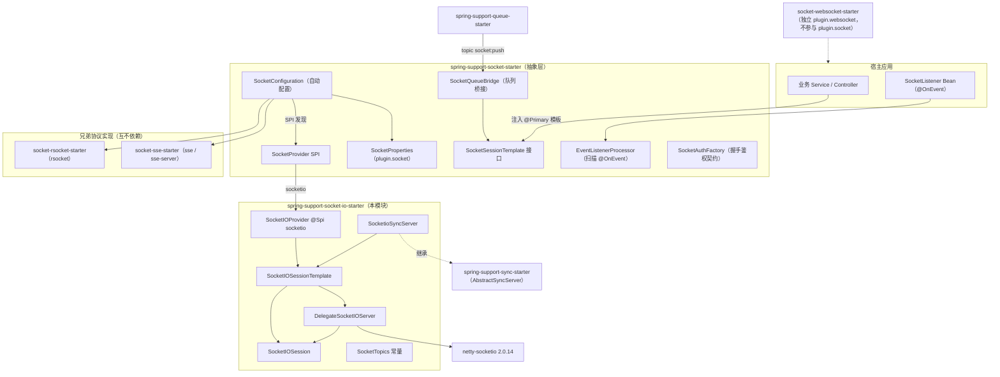
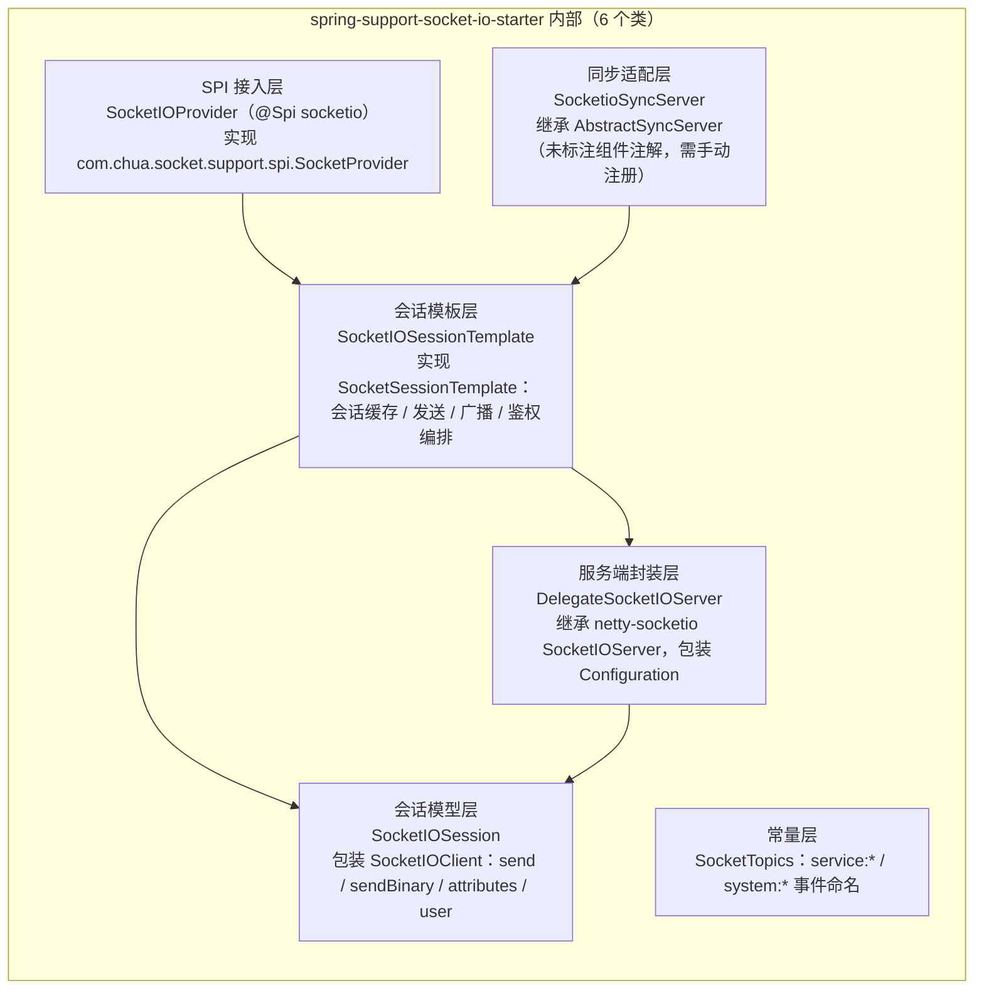
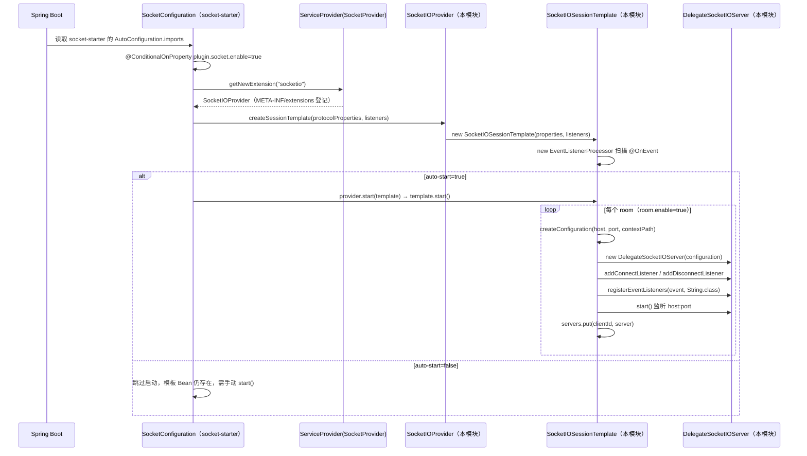
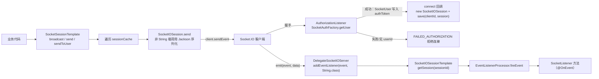

# spring-support-socket-io-starter

Socket.IO 协议实现：基于 `netty-socketio 2.0.14` 为 `spring-support-socket-starter` 提供 `socketio` 协议，独立监听端口，按 `room` 配置为每个客户端标识启动一个 Socket.IO 服务实例。本模块通过 SPI（`SocketProvider`）接入抽象层，自身不注册任何 Spring Bean。

- 坐标：`com.chua:spring-support-socket-io-starter:4.0.0.51`
- 基线：Spring Boot `4.1.2`（`spring-boot-starter-parent`，2026-11-19 升级）、Java `25`
- 协议栈：`com.corundumstudio.socketio:netty-socketio:2.0.14`（版本由父 POM `${netty.socketio.version}` 统一托管）

---

## 1. 架构图

### 1.1 模块在体系中的位置



依赖方向唯一：本模块 → 抽象层（`spring-support-socket-starter`）。抽象层不感知本模块的具体类型，仅通过 `SocketProvider` SPI 与 `SocketSessionTemplate` 接口交互。

### 1.2 模块内部分层



---

## 2. 核心流程图

### 2.1 装配与启动流程（SPI 发现 → 模板创建 → 多 room 监听）



### 2.2 消息收发流程（握手鉴权 → 入站事件 → 出站推送）



---

## 3. 能力清单

| 能力域 | 关键类 | 入口 |
|---|---|---|
| 协议接入（SPI） | `com.chua.socketio.support.spi.SocketIOProvider`（`@Spi("socketio")`） | `META-INF/extensions/com.chua.socket.support.spi.SocketProvider`，由 `SocketConfiguration` 通过 `ServiceProvider.of(SocketProvider.class).getNewExtension("socketio")` 调用 |
| 会话管理 / 消息收发 | `com.chua.socketio.support.session.SocketIOSessionTemplate`（实现 `SocketSessionTemplate`） | 注入 `SocketSessionTemplate`（抽象层 `@Primary`）或直接注入 `SocketIOSessionTemplate` |
| 服务端封装 | `com.chua.socketio.support.server.DelegateSocketIOServer`（继承 netty-socketio `SocketIOServer`） | `template.getServer(clientId)` / `template.getServers()` |
| 会话模型 | `com.chua.socketio.support.session.SocketIOSession`（实现 `SocketSession`，包装 `SocketIOClient`） | `template.getSession(sessionId)` |
| 入站事件分发 | `@OnEvent` + `SocketListener`（抽象层）+ `EventListenerProcessor` | 声明 `SocketListener` Bean，方法标注 `@OnEvent("事件名")` |
| 握手鉴权 | `SocketAuthFactory`（抽象层契约），本模块 `configureAuthorization` / `resolveAuthFactory` 完成装配 | `plugin.socket.auth-factory=工厂全限定类名` |
| 同步协议适配 | `com.chua.socketio.support.sync.SocketioSyncServer`（继承 `AbstractSyncServer`） | 未标注组件注解，本模块不自动注册；需要时手动 `new` 并接入同步体系 |
| 事件命名常量 | `com.chua.socketio.support.constant.SocketTopics`（`Service.Message/Operation`、`System.Message/User/Config/Auth`） | 常量引用，命名格式 `项目:模块:功能` |
| native-image 支持 | `reflect-config.json`（登记 `SocketIOProvider` 反射元数据）、`resource-config.json`（包含 `META-INF/extensions/.*`） | `META-INF/native-image/com.chua/spring-support-socket-io-starter/` |

本模块**不注册任何 Spring 自动配置类**：`META-INF/spring/org.springframework.boot.autoconfigure.AutoConfiguration.imports` 中只有一行说明注释，也没有 `spring.factories`。所有 Bean 由 `spring-support-socket-starter` 的 `SocketConfiguration` 统一创建。

---

## 4. Bean 能力矩阵

### 4.1 本模块注册的 Bean

**无。** 本模块没有任何 `@Configuration` / `@Component` / `@Bean`，`AutoConfiguration.imports` 仅含注释，因此不会向宿主容器注册 Bean；它只通过 SPI 文件向 `SocketProvider` 扩展点提供 `SocketIOProvider` 实现。

### 4.2 由抽象层 `SocketConfiguration` 代为装配的 Bean

引入本模块并启用 `plugin.socket.enable=true` 后，以下 Bean 由 `spring-support-socket-starter` 的 `SocketConfiguration` 创建（本模块的 `SocketIOProvider` 在其中被 SPI 选中）：

| Bean 名 | 类型 | 装配条件 | 可否覆盖 | 典型注入姿势 |
|---|---|---|---|---|
| `plugin.socket-com.chua.socket.support.properties.SocketProperties` | `com.chua.socket.support.properties.SocketProperties` | 无条件（`@EnableConfigurationProperties(SocketProperties.class)`） | 配置绑定，一般不覆盖 | 构造器注入 `SocketProperties` |
| `socketSessionTemplates` | `Map<String, SocketSessionTemplate>`（协议名 → 模板） | `@ConditionalOnProperty(prefix="plugin.socket", name="enable", havingValue="true")` + `@ConditionalOnMissingBean` | 可以：自定义同类型 `Map<String, SocketSessionTemplate>` Bean 时自动配置退让；但需同时保证主模板可用 | 注入整个 Map，按 `protocol()` 名取用 |
| `socketSessionTemplate` | `SocketSessionTemplate`（实际实例为 `SocketIOSessionTemplate`） | `@ConditionalOnProperty(plugin.socket.enable=true)`，`@Primary`，返回 `socketSessionTemplates` 中第一个模板 | 不带 `@ConditionalOnMissingBean`：自定义同类型 Bean 会与 `@Primary` 冲突，需自行处理限定符或排除自动配置 | 构造器注入 `SocketSessionTemplate`（最常用） |
| `socketLifecycle` | `SocketConfiguration.SocketLifecycle`（`InitializingBean` / `DisposableBean`） | `@ConditionalOnProperty(plugin.socket.enable=true)` | 无 `@ConditionalOnMissingBean`，一般不覆盖 | 通常不直接注入；负责 `auto-start` 与容器关闭时 `stop()` |
| `socketServiceInfoContributor` | `ServiceInfoContributor`（登记 `socket` 能力标志） | 无条件 | 可以（无条件注册，建议直接注入使用） | 注入 `ServiceInfoContributor` 或通过服务信息端点观察 |
| `socketQueueBridge` | `com.chua.socket.support.bridge.SocketQueueBridge`（`@Component` 扫描自 `com.chua.socket.support.bridge`） | `@ConditionalOnProperty(prefix="plugin.queue", name="enable", havingValue="true")` + `@ConditionalOnMissingBean(name="monitorSocketQueueBridge")` | 可以：定义名为 `monitorSocketQueueBridge` 的 Bean 即可替换 | 不直接注入；监听 `socket:push` 队列消息并广播到 Socket 会话 |

> 说明：`socketSessionTemplates` / `socketSessionTemplate` / `socketLifecycle` 三个 Bean 的装配条件都是 `plugin.socket.enable=true`。`enable=false`（默认）时这些 Bean 全部不存在，此时注入 `SocketSessionTemplate` 会直接 `NoSuchBeanDefinitionException`。`SocketProperties` 的 Bean 名遵循 Boot 的 `<前缀>-<类全名>` 注册约定。

---

## 5. 完整配置

本模块**没有自己的 `@ConfigurationProperties`**，全部复用抽象层的 `com.chua.socket.support.properties.SocketProperties`（前缀 `plugin.socket`，`ignoreInvalidFields=true`）。以下字段逐一来自 `SocketProperties` 源码。

### 5.1 主配置（`plugin.socket.*`）

| 配置项 | 类型 | 默认值 | 说明 | 生效开关 |
|---|---|---|---|---|
| `plugin.socket.enable` | `boolean` | `false` | Socket 总开关；为 `false` 时抽象层不创建任何模板 Bean | 全局前提 |
| `plugin.socket.auto-start` | `boolean` | `true` | 是否随容器启动自动 `start()` 监听端口；`false` 时模板 Bean 仍会创建，但需手动启动 | `enable=true` 时 |
| `plugin.socket.protocol` | `SocketProtocol` 枚举（`socketio` / `rsocket` / `sse` / `sse-server`） | `sse` | 单协议模式的协议名；使用本模块必须设为 `socketio` | `protocols` 为空时生效 |
| `plugin.socket.protocols` | `List<ProtocolConfig>` | `[]` | 多协议分组配置；非空时忽略顶层 `protocol` 与 `room` | 非空时生效 |
| `plugin.socket.room` | `List<Room>` | `[]` | 服务实例列表，**每个元素启动一个 Socket.IO 服务**；为空则 `start()` 直接跳过 | `enable=true` 且单协议模式 |
| `plugin.socket.host` | `String` | `0.0.0.0` | 默认监听地址 | `room[].host` 为空时使用 |
| `plugin.socket.codec-type` | `String` | `json` | 保留字段；`SocketIOSessionTemplate` 未使用（旧版消息加密/编解码已移除） | 无 |
| `plugin.socket.max-frame-size` | `int` | `1048576`（1MB） | 同时写入 `Configuration.setMaxFramePayloadLength` 与 `setMaxHttpContentLength` | `enable=true` |
| `plugin.socket.boss-count` | `int` | `1` | `Configuration.setBossThreads` | `enable=true` |
| `plugin.socket.work-count` | `int` | `100` | `Configuration.setWorkerThreads` | `enable=true` |
| `plugin.socket.allow-custom-requests` | `boolean` | `true` | `Configuration.setAllowCustomRequests` | `enable=true` |
| `plugin.socket.ping-timeout` | `int` | `60000` | 心跳超时（毫秒），`Configuration.setPingTimeout` | `enable=true` |
| `plugin.socket.ping-interval` | `int` | `25000` | 心跳间隔（毫秒），`Configuration.setPingInterval` | `enable=true` |
| `plugin.socket.auth-factory` | `String` | 空 | 握手鉴权工厂全限定类名；配置后启用鉴权且**失败关闭**（工厂加载失败拒绝所有连接） | 配置后生效；同时决定 `supportsUserTargeting()` |
| `plugin.socket.use-linux-native-epoll` | `boolean` | `false` | 是否启用 Linux native Epoll（`Configuration.setUseLinuxNativeEpoll`） | 仅 Linux 环境有意义 |

### 5.2 嵌套配置：`plugin.socket.room[]`（`SocketProperties.Room`）

| 配置项 | 类型 | 默认值 | 说明 |
|---|---|---|---|
| `client-id` | `String` | `default` | 实例标识，同时作为 `servers` map 与会话缓存的 key |
| `context-path` | `String` | `/socket.io` | 写入 `Configuration.setContext(...)` |
| `port` | `int` | `-1` | `>=0`：直接使用该端口；`-1`：基准端口；`-2`/`-3`…：基准端口 + 偏移。**本模块 `start()` 中负数端口基准写死为 9000**（`room.getActualPort(9000)`），即 `-1`→9000、`-2`→9001 |
| `host` | `String` | 空 | 该实例专属监听地址；为空则用 `plugin.socket.host` |
| `auth-factory` | `String` | 空 | 该实例专属鉴权工厂（本模块当前按主配置 `auth-factory` 解析，此字段为抽象层预留） |
| `enable` | `boolean` | `true` | `false` 时跳过该实例（打印 `房间 {} 未启用，跳过`） |

### 5.3 嵌套配置：`plugin.socket.protocols[]`（`SocketProperties.ProtocolConfig`）

| 配置项 | 类型 | 默认值 | 说明 |
|---|---|---|---|
| `protocol` | `SocketProtocol` 枚举 | `socketio` | 该分组的协议名（注意：嵌套默认值是 `socketio`，与顶层默认 `sse` 不同） |
| `room` | `List<Room>` | `[]` | 该协议分组的服务实例列表 |

### 5.4 配置示例

单协议（本模块最常用）：

```yaml
plugin:
  socket:
    enable: true          # 必须显式开启
    protocol: socketio    # 必须是 socketio
    host: 0.0.0.0
    boss-count: 1
    work-count: 100
    ping-interval: 25000
    ping-timeout: 60000
    max-frame-size: 1048576
    room:
      - client-id: default
        port: 9092
        context-path: /socket.io
      - client-id: webrtc
        port: -2            # 负数基准 9000 → 实际 9001
        context-path: /webrtc
        enable: true
```

多协议同时启用（`protocols` 非空时忽略顶层 `protocol`/`room`）：

```yaml
plugin:
  socket:
    enable: true
    protocols:
      - protocol: socketio
        room:
          - client-id: chat
            port: 9092
      - protocol: sse
        room:
          - client-id: notify
```

---

## 6. 使用方式

### 6.1 Maven 坐标

```xml
<dependency>
    <groupId>com.chua</groupId>
    <artifactId>spring-support-socket-io-starter</artifactId>
    <version>4.0.0.51</version>
</dependency>
```

### 6.2 依赖说明（均来自本模块 `pom.xml`，无可选依赖）

| 依赖 | 作用 | 是否可选 |
|---|---|---|
| `com.chua:spring-support-socket-starter` | 抽象层：`SocketProvider` SPI、`SocketSessionTemplate`、`SocketProperties`、`SocketConfiguration`、`EventListenerProcessor`、`SocketAuthFactory` | 否 |
| `com.chua:spring-support-sync-starter` | `AbstractSyncServer` / `SyncSession` 基类（仅 `SocketioSyncServer` 使用） | 否（随 pom 引入） |
| `com.corundumstudio.socketio:netty-socketio` | Socket.IO 协议栈（父 POM 托管为 `2.0.14`） | 否 |
| `com.chua:utils-support-common-starter` | 公共工具（`com.chua.common.support` 体系，如 `@Spi` 注解，供 `SocketIOProvider` 做 SPI 登记使用） | 否 |

> 注：本模块 `SocketIOSessionTemplate` 使用的 `ModuleLog`（`com.chua.starter.common.support.logger.ModuleLog`）来自 `spring-support-common-starter`，经 `spring-support-socket-starter` 传递引入，并非 `utils-support-common-starter` 提供。

可选能力：队列桥接广播需要宿主另行引入 `spring-support-queue-starter` 并设置 `plugin.queue.enable=true`（见 4.2 `socketQueueBridge`）；不引入不影响本模块核心功能。

### 6.3 最小可运行示例

**第一步：引入依赖**（见 6.1）。

**第二步：配置 `plugin.socket`**（`protocol: socketio` + 至少一个 `room`）：

```yaml
plugin:
  socket:
    enable: true
    protocol: socketio
    room:
      - client-id: default
        port: 9092
        context-path: /socket.io
```

**第三步：写一个 `@OnEvent` 监听器 Bean：**

```java
@Component
public class ChatListener implements SocketListener {

    @OnEvent("chat")
    public void onChat(SocketSession session, String data) {
        log.info("clientId={}, data={}", session.getClientId(), data);
    }
}
```

**第四步：前端连接。** 用 socket.io 客户端连接 `http://<host>:9092`（默认上下文 `/socket.io`），`socket.emit("chat", "hello")` 即可触发上面的方法。

**第五步（可选）：业务侧推送。**

```java
@Service
public class NotifyService {

    private final SocketSessionTemplate template;

    public NotifyService(SocketSessionTemplate template) {
        this.template = template;
    }

    public void push(String text) {
        if (!template.isReady()) {
            log.warn("Socket.IO 尚未就绪，跳过推送");
            return;
        }
        template.broadcast("notice", text);
    }
}
```

`SocketSessionTemplate` 常用方法（`SocketIOSessionTemplate` 的实现语义）：

1. `broadcast(event, msg)` / `send(sessionId, event, msg)` / `sendToUser(userId, event, msg)` 发消息（`sendToUser` 依赖握手鉴权建立的用户身份）。
2. `getOnlineSessions()` / `getOnlineCount()` 查询在线状态；`getOnlineSession(type, roomId)` 按 `client-id` 与会话属性 `roomId` 过滤；`getOnlineUsers(type)` 按用户去重。
3. `protocol()` 返回 `socketio`；`isReady()` 返回是否至少有一个服务端实例启动成功；`supportsUserTargeting()` 返回是否配置了 `auth-factory`。
4. `getServer(clientId)` / `getServers()` 取底层 `DelegateSocketIOServer`，用于挂载自定义连接/断开监听等高级定制。
5. 生命周期由抽象层 `SocketLifecycle` 调 `start()` / `stop()`，一般无需手动调用。

---

## 7. 使用场景

### 7.1 适用

- 前端使用 **socket.io 客户端**（轮询 + WebSocket 传输、自动重连、心跳），需要服务端原生 Socket.IO 语义（事件、广播）。
- 需要**多个独立监听端口**承载不同业务通道（如 `chat`、`webrtc` 各占一个端口/上下文）。
- 需要**握手鉴权 + 按用户定向推送**（`auth-factory` + `sendToUser`）。
- 需要**跨实例解耦广播**：业务方只向队列 `socket:push` 发消息，由 `SocketQueueBridge` 广播到本模块会话。

### 7.2 不适用

- 只需要**单向服务端推送**、可容忍重连轮询 → 用 `spring-support-socket-sse-starter`（SSE）更轻。
- 需要 **RSocket 语义**（request/response、背压、多路复用）→ 用 `spring-support-socket-rsocket-starter`。
- 想**复用应用主端口**（同一 Tomcat、同源、无需额外跨域）→ 用 `spring-support-socket-websocket-starter`（独立 `plugin.websocket` 配置，与本模块无装配关系）。
- 客户端是**原生 WebSocket**（非 socket.io 协议）→ 本模块不兼容，选 websocket-starter。

### 7.3 与相邻模块的取舍

| 模块 | 协议名 | 端口模型 | 何时选它而不是本模块 |
|---|---|---|---|
| `spring-support-socket-io-starter`（本模块） | `socketio` | **独立端口**（每 room 一个 netty 监听，如 9092） | 前端已是 socket.io 生态，或需要 socket.io 的房间/降级传输/心跳语义 |
| `spring-support-socket-sse-starter` | `sse` / `sse-server` | 复用应用端口（`sse`）或独立端口（`sse-server`） | 只需服务端→客户端单向流，不想要额外端口与 socket.io 客户端库 |
| `spring-support-socket-rsocket-starter` | `rsocket` | 独立端口 | 需要 RSocket 交互模型与背压 |
| `spring-support-socket-websocket-starter` | 不参与 `plugin.socket` | 复用应用主端口 | 要求同源、同端口、原生 WebSocket |

兄弟实现（sse / rsocket）与本模块互不依赖，可通过 `protocols` 分组**同时启用**；本模块不提供 SSE 推送、不提供原生 RSocket 语义、也不处理 `plugin.websocket` 配置。

---

## 8. 扩展点

### 8.1 业务事件扩展（最常用，不动 SPI）

实现 `SocketListener` 标记接口并声明为 Spring Bean，方法标注 `@OnEvent("事件名")`。`SocketIOSessionTemplate` 构造时用 `EventListenerProcessor` 扫描全部 `SocketListener` Bean，把注解里的事件名注册为 netty-socketio 入站事件（**载荷固定按 `String.class` 接收**）。处理方法支持 0/1/2 个参数（`SocketSession` 与 `data` 任意组合，超过 2 个参数不支持）。

注意：抽象层只扫描 `@OnEvent`；`@OnConnect` / `@OnDisconnect` 注解存在但**不会被分发**，连接/断开逻辑请通过 `template.getServer(clientId).addConnectListener(...)` 自行挂载。

### 8.2 握手鉴权扩展：`SocketAuthFactory`

实现抽象层 `com.chua.socket.support.auth.SocketAuthFactory`（`isAuthorized` + `getUser`），配置 `plugin.socket.auth-factory=全限定类名`。本模块用反射创建实例（**必须有 public 无参构造器**；因为模板由 SPI 手工创建、不在 Spring 容器内）。握手数据 Map 含 `headers`（`Map<String,String>`，键小写）、`query`（`Map<String,List<String>>`）、`address`。

鉴权语义是**失败关闭**：工厂加载失败、`getUser` 返回 null 或 `userId` 为空、抛异常 → 一律 `FAILED_AUTHORIZATION` 拒绝连接，不会降级为匿名。鉴权成功后 `SocketUser` 会写入会话，`sendToUser` 才能定向送达。

注意：握手数据 Map 中**没有**顶层 `token` 键（本模块 `toHandshakeData` 只放 `headers` / `query` / `address` 三个键），令牌请从 `headers` 里取；也不要用 `String.valueOf(handshakeData.get(...))` 判空——键不存在时它返回的是字符串 `"null"` 而不是 `null`，会让空令牌以 `userId="null"` 通过鉴权，破坏失败关闭语义。

```java
public class TokenAuthFactory implements SocketAuthFactory {

    @Override
    public boolean isAuthorized(Map<String, Object> handshakeData) {
        return getUser(handshakeData) != null;
    }

    @Override
    @SuppressWarnings("unchecked")
    public SocketUser getUser(Map<String, Object> handshakeData) {
        // 握手数据只有 headers / query / address 三个键；headers 的键已转为小写
        Map<String, String> headers = (Map<String, String>) handshakeData.get("headers");
        String token = headers == null ? null : headers.get("token");
        if (token == null || token.isBlank()) {
            return null;
        }
        SocketUser user = new SocketUser();
        user.setUserId(token);
        return user;
    }
}
```

```yaml
plugin:
  socket:
    enable: true
    protocol: socketio
    auth-factory: com.example.socket.TokenAuthFactory
    room:
      - client-id: default
        port: 9092
```

### 8.3 底层服务端定制：`getServer` / `getServers`

`SocketIOSessionTemplate.getServer(clientId)` 返回 `DelegateSocketIOServer`（netty-socketio `SocketIOServer` 子类），可用于挂载连接/断开监听、命名空间、广播过滤等本模块未封装的能力。`SocketIOSession.getConnection()` / `getClient()` 可取到原生 `SocketIOClient`。

### 8.4 协议 SPI 扩展：`SocketProvider`

本模块自身就是 SPI 实现的范例，新增一种协议实现照此三步：

1. **实现**：实现 `com.chua.socket.support.spi.SocketProvider`（`getProtocol()`、`createSessionTemplate(properties, listeners)`、`start(template)`、`stop(template)`）。
2. **登记**：在自身模块创建 `src/main/resources/META-INF/extensions/com.chua.socket.support.spi.SocketProvider`，内容如本模块的：
   ```properties
   socketio=com.chua.socketio.support.spi.SocketIOProvider
   ```
3. **生效**：`SocketConfiguration` 用 `ServiceProvider.of(SocketProvider.class).getNewExtension(协议名)` 取到实现并创建模板；`auto-start=true` 时立即 `start()`。

配套 native-image 文件（新增 SPI 实现时照抄结构）：

```text
src/main/resources/META-INF/native-image/com.chua/spring-support-socket-io-starter/reflect-config.json
src/main/resources/META-INF/native-image/com.chua/spring-support-socket-io-starter/resource-config.json
```

### 8.5 同步体系适配：`SocketioSyncServer`

`com.chua.socketio.support.sync.SocketioSyncServer` 继承 `spring-support-sync-starter` 的 `AbstractSyncServer`，`doSend` 委托 `SocketIOSessionTemplate.send`，并提供 `onSocketioConnect` / `onSocketioDisconnect` / `onSocketioMessage` 三个回调入口（内部 `fireConnectionEstablished` / `fireConnectionClosed` / `fireMessageReceived`）。该类**未标注任何 Spring 组件注解，本模块不自动注册**；需要接入同步服务体系的宿主自行实例化并接线。

---

## 9. 常见问题

### 9.1 装配不生效

| 现象 | 原因与处置 |
|---|---|
| 注入 `SocketSessionTemplate` 报 `NoSuchBeanDefinitionException` | `plugin.socket.enable` 未设为 `true`（默认 `false`，此时 `socketSessionTemplates` / `socketSessionTemplate` / `socketLifecycle` 都不会创建） |
| 启动报 `未找到协议 [xxx] 的 SPI 实现` | `protocol` 不是 `socketio`，或 classpath 缺少本模块 jar。SPI 通过 `META-INF/extensions/com.chua.socket.support.spi.SocketProvider` 发现实现 |
| 应用启动成功但连不上 | `room` 未配置或全部 `enable=false`：`start()` 打印 `未配置 room，跳过服务启动`，一个端口都不监听，`isReady()` 返回 `false` |
| 模板 Bean 存在但端口没监听 | `auto-start=false`：抽象层跳过自动启动（`SocketLifecycle.afterPropertiesSet` 直接返回），需自行调用 `template.start()` |
| 想整体替换 Socket 装配 | `SocketConfiguration` 是注册在 `AutoConfiguration.imports` 中的自动配置类，可用 `spring.autoconfigure.exclude` 排除后完全自行接管 |

### 9.2 端口与开关

| 问题 | 结论 |
|---|---|
| 负数端口怎么算 | 本模块 `start()` 对负数端口以 **9000 为基准**（`room.getActualPort(9000)`）：`-1`→9000、`-2`→9001、`-3`→9002；与 `plugin.socket.host` 等其它配置无关。要自定义端口请直接写正数 |
| 端口被占用 | `startServer` 捕获后抛 `RuntimeException("Socket.IO 服务启动失败: <clientId>")`，**导致容器启动失败**，不会跳过该实例继续 |
| 与应用端口的关系 | 本模块使用**独立 netty 端口**，不占应用 Tomcat 端口；前端需要按 room 的 `host:port + context-path` 访问，并处理好跨域与地址配置 |
| `@OnConnect` / `@OnDisconnect` 不生效 | 抽象层 `EventListenerProcessor` 只扫描 `@OnEvent`；连接/断开回调请用 `template.getServer(clientId).addConnectListener(...)` / `addDisconnectListener(...)` |
| 客户端发对象收不到预期结构 | 入站事件按 `String.class` 注册，复杂对象请在监听器内自行反序列化；出站非 String 载荷会用 Jackson 序列化为字符串 |
| `sendToUser` 发送失败 | 需要配置 `plugin.socket.auth-factory` 建立用户身份，否则 `supportsUserTargeting()` 为 `false`；未配置时请改用 `broadcast` |
| 鉴权配置写错会放行吗 | 不会。工厂类加载失败 / 实例化失败 / 未实现接口 → 拒绝**所有**连接（`FAILED_AUTHORIZATION`），失败关闭 |

### 9.3 与 Spring Boot 4 兼容性

- 本仓库父 POM 继承 `spring-boot-starter-parent:4.1.2`（2026-11-19 升级），编译目标 Java 25；本模块随仓库基线构建，无独立的 Boot 版本适配层。
- 自动配置登记采用 Boot 2.7+ 的 `META-INF/spring/org.springframework.boot.autoconfigure.AutoConfiguration.imports` 机制；本模块该文件只有注释（不注册自动配置），上游 `spring-support-socket-starter` 在同一机制下注册 `SocketConfiguration`。
- 本模块及其上游**没有 `spring.factories`**（Boot 3/4 已移除该机制），不存在旧式工厂注册遗留问题。
- netty-socketio 为 `2.0.14`（父 POM `dependencyManagement` 托管），自带独立 netty 服务线程（boss/worker 由 `boss-count` / `work-count` 控制）；若宿主同时使用 WebFlux/Netty，注意端口与线程不要冲突（本模块监听独立端口，不共享应用容器）。
