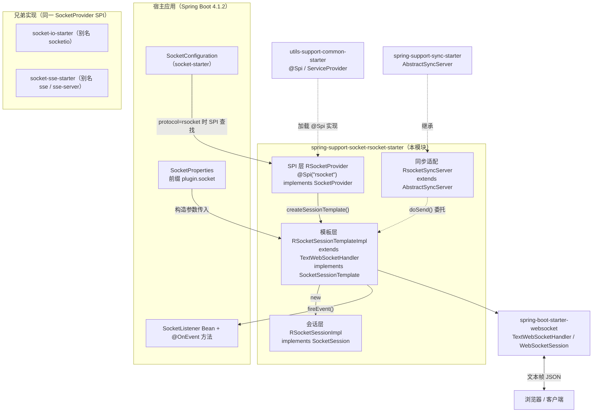
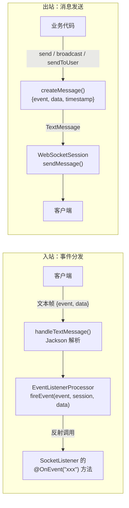

# spring-support-socket-rsocket-starter

`rsocket` 协议别名的实现模块：用 Spring WebSocket 文本通道承载 JSON 事件（`{event, data, timestamp}`），向 `spring-support-socket-starter` 提供 `SocketSessionTemplate` 实现。**不是** RSocket 二进制协议与 Reactor 响应式栈——没有背压、没有 request-response / fire-and-forget / request-stream / channel 四种交互模式、没有连接复用。在 spring-support 体系中，它隶属于 socket 家族：上游抽象层 `spring-support-socket-starter` 定义 SPI 与装配，本模块作为可插拔协议实现与 socket-io、sse 并列，由宿主应用以 `plugin.socket.protocol=rsocket` 选中。

## 1. 架构图

本模块**无自动装配入口**（`AutoConfiguration.imports` 仅有一行注释，见第 4 节），装配完全由上游 `SocketConfiguration` 驱动；模块内部按「SPI 实现 → 会话模板 → 会话」分层。



## 2. 核心流程图

选「消息处理与数据流转」——本模块的本质是一条双向文本事件通道：



连接建立时 `afterConnectionEstablished` 从请求路径提取分组标识：`/ws/webrtc` → `webrtc`，`/ws`、`/` → `default`。

## 3. 能力清单

| 能力域 | 关键类 | 入口/触发方式 |
|---|---|---|
| SPI 协议实现 | `RSocketProvider`（`@Spi("rsocket")`，`getProtocol()` 返回 `SocketProtocol.RSOCKET`） | 抽象层经 `ServiceProvider` 查找 `META-INF/extensions` |
| 会话模板 | `RSocketSessionTemplateImpl`（`TextWebSocketHandler` + `SocketSessionTemplate`） | `RSocketProvider.createSessionTemplate()` 创建；`SocketLifecycle` 调 `start()` |
| 会话模型 | `RSocketSessionImpl`（包装 `WebSocketSession`，持有 `attributes` 与 `SocketUser`） | `template.getSession(sessionId)` |
| 入站事件分发 | `EventListenerProcessor` + `@OnEvent` | 业务侧实现 `SocketListener` Bean |
| 客户端分组 | 按连接路径提取 `clientId` | `afterConnectionEstablished` |
| 消息发送 | `send` / `broadcast` / `sendToUser`；会话级 `send(event, data)`、`sendRaw(message)` | `SocketSessionTemplate` 与会话方法 |
| 查询统计 | `getOnlineSessions()` / `getOnlineCount()` / `getOnlineSession(type, roomId)` / `getOnlineUsers(type)` | `SocketSessionTemplate` 方法 |
| 同步协议适配 | `RsocketSyncServer`（`protocol="rsocket"`） | 无组件注解，需自行实例化并接线回调 |

能力边界：`RSocketSessionTemplateImpl` 未覆写 `SocketSessionTemplate` 的 default 方法——`isReady()` 恒 `true`、`protocol()` 恒 `"unknown"`、`supportsUserTargeting()` 恒 `false`；`start()` 只翻转内部 `running` 标记，不绑定端口。

## 4. Bean 能力矩阵

**本模块自身不注册任何 Bean。** `META-INF/spring/org.springframework.boot.autoconfigure.AutoConfiguration.imports` 只有一行注释（「RSocket 模块不再自行注册 Bean，由 spring-support-socket-starter 统一管理」），且无 `spring.factories`；4 个类均无 `@Component` / `@Bean`。启用 `protocol=rsocket` 后，由上游 `SocketConfiguration` 创建的相关 Bean：

| Bean 名 | 类型 | 装配条件 | 可否覆盖 | 典型用途 |
|---|---|---|---|---|
| `socketSessionTemplates` | `Map<String, SocketSessionTemplate>` | `@ConditionalOnProperty(prefix="plugin.socket", name="enable", havingValue="true")` + `@ConditionalOnMissingBean` | 可（声明同类型 Bean 顶替） | 注入 Map 后按 `"rsocket"` 取本协议模板 |
| `socketSessionTemplate` | `SocketSessionTemplate` | `@Primary` + `@ConditionalOnProperty(plugin.socket.enable=true)`；取 Map 第一个值 | 无 `@ConditionalOnMissingBean`，仅可经覆盖 Map 间接替换 | 构造器注入直接使用 |
| `socketLifecycle` | `SocketConfiguration.SocketLifecycle` | `@ConditionalOnProperty(plugin.socket.enable=true)` | 无 `@ConditionalOnMissingBean`，一般不覆盖 | 容器启停时回调 start/stop |
| `socketServiceInfoContributor` | `ServiceInfoContributor` | 无条件注册 | 可再注册自己的实例共存 | 服务信息面板展示 |

注意：`RSocketSessionTemplateImpl` 实例本身不是独立 Bean，只能从上述 Map / `@Primary` 模板获取，端点注册时需强转为 `RSocketSessionTemplateImpl`。

## 5. 完整配置

**本模块无 `@ConfigurationProperties`。** 所有配置定义在 `spring-support-socket-starter` 的 `SocketProperties`（前缀 `plugin.socket`），经构造参数传入 `RSocketSessionTemplateImpl` 后**只保存引用、不读取任何字段**；真正消费配置的是上游抽象层。

| 配置路径 | 类型 | 默认值 | 说明 |
|---|---|---|---|
| `plugin.socket.enable` | `boolean` | `false` | 总开关；`true` 时才创建模板 Bean（抽象层消费） |
| `plugin.socket.auto-start` | `boolean` | `true` | 容器启动阶段是否自动 `start()`（抽象层消费） |
| `plugin.socket.protocol` | `SocketProtocol` 枚举 | `SSE` | 协议别名 `socketio`/`rsocket`/`sse`/`sse-server`；设 `rsocket` 选中本模块（抽象层消费） |
| `plugin.socket.protocols[]` | `List<ProtocolConfig>` | `[]` | 多协议列表；非空时忽略单一 `protocol`/`room` |
| `plugin.socket.protocols[].room[]` | `List<Room>` | `[]` | 该协议的房间列表 |
| `plugin.socket.room[]` | `List<Room>` | `[]` | 单协议模式房间列表 |
| `plugin.socket.room[].client-id` | `String` | `default` | 房间标识（与本模块按路径提取的 `clientId` 是两回事） |
| `plugin.socket.room[].context-path` | `String` | `/socket.io` | 房间上下文路径 |
| `plugin.socket.room[].port` | `int` | `-1` | `-1` 用主端口，`-2` 起为主端口偏移；本模块不监听独立端口 |
| `plugin.socket.room[].host` | `String` | `null` | 房间独立地址；本模块无生效路径 |
| `plugin.socket.room[].auth-factory` | `String` | `null` | 房间独立鉴权工厂类名；本模块无握手鉴权 |
| `plugin.socket.room[].enable` | `boolean` | `true` | 是否启用该房间 |
| `plugin.socket.host` | `String` | `0.0.0.0` | 监听地址；本模块不生效 |
| `plugin.socket.codec-type` | `String` | `json` | 编解码器类型；本模块硬编码 Jackson JSON |
| `plugin.socket.max-frame-size` | `int` | `1048576` | 最大帧大小（字节） |
| `plugin.socket.boss-count` | `int` | `1` | Boss 线程数 |
| `plugin.socket.work-count` | `int` | `100` | 工作线程数 |
| `plugin.socket.allow-custom-requests` | `boolean` | `true` | 是否允许自定义请求 |
| `plugin.socket.ping-timeout` | `int` | `60000` | Ping 超时（毫秒） |
| `plugin.socket.ping-interval` | `int` | `25000` | Ping 间隔（毫秒） |
| `plugin.socket.auth-factory` | `String` | 未设置 | 鉴权工厂类名；本模块无握手鉴权 |
| `plugin.socket.use-linux-native-epoll` | `boolean` | `false` | 是否使用 Linux Native Epoll |

最小生效配置：

```yaml
plugin:
  socket:
    enable: true
    protocol: rsocket
    auto-start: true
```

## 6. 使用方式

### 6.1 Maven 坐标

```xml
<dependency>
    <groupId>com.chua</groupId>
    <artifactId>spring-support-socket-rsocket-starter</artifactId>
    <version>4.0.0.51</version>
</dependency>
```

### 6.2 最小启用示例

第一步，配置协议：

```yaml
plugin:
  socket:
    enable: true
    protocol: rsocket
    auto-start: true
```

第二步，补 SPI 登记文件。本模块当前**没有** `META-INF/extensions` 目录，须在宿主应用 `src/main/resources/META-INF/extensions/com.chua.socket.support.spi.SocketProvider` 中补一行（格式与 socket-io / sse 一致），否则启动即抛异常：

```text
rsocket=com.chua.rsocket.support.spi.RSocketProvider
```

第三步，把模板注册为 WebSocket 端点（`start()` 不绑定端口，注册必须由宿主完成）：

```java
@Configuration
@EnableWebSocket
public class RsocketEndpointConfig implements WebSocketConfigurer {

    private final SocketSessionTemplate template;

    public RsocketEndpointConfig(SocketSessionTemplate template) {
        this.template = template;
    }

    @Override
    public void registerWebSocketHandlers(WebSocketHandlerRegistry registry) {
        registry.addHandler((RSocketSessionTemplateImpl) template, "/ws/*")
                .setAllowedOrigins("*");
    }
}
```

第四步，业务收发。监听事件（客户端发 `{"event":"chat.message","data":"hi"}` 时触发）与广播推送：

```java
@Component
public class EventHandler implements SocketListener {

    private final SocketSessionTemplate template;

    public EventHandler(SocketSessionTemplate template) {
        this.template = template;
    }

    @OnEvent("chat.message")
    public void onChat(SocketSession session, Object data) {
        template.broadcast("notice", "echo: " + data);
    }
}
```

### 6.3 依赖说明（pom 实际声明，均非 optional）

| 依赖 | 作用 | 缺失后果 |
|---|---|---|
| `com.chua:spring-support-socket-starter` | 抽象层、SPI 接口、`SocketProperties`、`SocketConfiguration` | 编译失败；无装配入口 |
| `com.chua:spring-support-sync-starter` | `AbstractSyncServer` 基类（供 `RsocketSyncServer`） | `RsocketSyncServer` 编译失败；不用同步适配则无感知 |
| `org.springframework.boot:spring-boot-starter-websocket` | `TextWebSocketHandler` / `WebSocketSession` | 编译失败；无 WebSocket 端点能力 |
| `com.chua:utils-support-common-starter` | `@Spi` 注解与 `ServiceProvider` SPI 框架 | SPI 机制失效，抽象层找不到本实现 |

**没有** `io.rsocket:rsocket-core`、**没有** Project Reactor、**没有** `utils-support-rsocket-starter` 依赖。

## 7. 使用场景

**适用：**

- 需要轻量双向文本通道：连接按 URL 路径分组，收发 `{event, data, timestamp}` JSON 事件。
- 已有基于 Spring WebSocket 的前端，想接入统一的 `SocketSessionTemplate` 抽象与 `@OnEvent` 事件模型。
- 单实例、内存会话即可满足的推送/联动场景（白板、简单通知、演示环境）。

**不适用/慎用：**

- 需要真 RSocket 语义（二进制帧、背压、request-stream / channel、连接复用）——本模块没有 `rsocket-core` 与 Reactor。
- 需要房间/命名空间/握手鉴权/独立端口——这些能力本模块都没有，请改用 socket-io 实现。
- 多实例部署需要共享会话——`sessionCache` 是本地 `ConcurrentHashMap`，实例间不共享。

**与相邻模块的取舍：**

| 模块 | 关系与取舍 |
|---|---|
| `spring-support-socket-starter` | 上游抽象层；`protocol=rsocket` 时按别名查找本模块的 `RSocketProvider` |
| `spring-support-socket-io-starter` | 兄弟实现（`socketio`，SPI 已登记）；Socket.IO 有房间、鉴权、独立端口，本模块都没有 |
| `spring-support-socket-sse-starter` | 兄弟实现（`sse` / `sse-server`，SPI 已登记）；SSE 单向推送，本模块是双向文本通道 |
| `spring-support-socket-websocket-starter` | 同用 Spring WebSocket，但前缀 `plugin.websocket`、自带端点注册与 `WebSocketTemplate`，与本模块无装配关系 |

## 8. 扩展点

- **本模块不提供 SPI 扩展点**：没有自己的 `META-INF/extensions` 目录，也不接受自定义别名。它自身是抽象层 `SocketProvider` SPI 的一个实现（`RSocketProvider`，`@Spi("rsocket")`），但登记文件缺失（见第 9 节 Q1）。
- **子类化 `RSocketSessionTemplateImpl`**：覆写 `afterConnectionEstablished`（补握手鉴权、写入 `SocketUser`）、`handleTextMessage`（自定义协议解析）、`afterConnectionClosed`；`RSocketProvider.createSessionTemplate()` 是工厂入口，可换成自己的子类实例。
- **子类化 `RSocketSessionImpl`**：扩展 `send` / `sendRaw`（消息拦截、日志、限流）。
- **`RsocketSyncServer` 手动回调**：`onRsocketConnect` / `onRsocketDisconnect` / `onRsocketMessage` 需自行接线（如在 `afterConnectionEstablished` 中调用），分别触发 `fireConnectionEstablished` / `fireConnectionClosed` / `fireMessageReceived`；该类未注册为 Bean，需自行 `new RsocketSyncServer(template)`。
- **事件处理扩展**：任何实现 `SocketListener` 的 Bean 都会被 `EventListenerProcessor` 扫描 `@OnEvent` 方法并分发（支持 0/1/2 参数签名）。

## 9. 常见问题

**Q1：启动报 `IllegalStateException("[Socket] 未找到协议 [rsocket] 的 SPI 实现...")`**

仓库内缺少 `META-INF/extensions/com.chua.socket.support.spi.SocketProvider` 登记文件，`ServiceProvider` 发现不到 `RSocketProvider`。在宿主应用补一行 `rsocket=com.chua.rsocket.support.spi.RSocketProvider` 即可（见 6.2 第二步）。

**Q2：配置了 `plugin.socket.*` 但大部分不生效**

正常。本模块只保存 `SocketProperties` 引用、不读取任何字段；`enable` / `auto-start` / `protocol` 由抽象层消费，其余（`room`、`max-frame-size`、`ping-*`、`auth-factory` 等）对本实现无影响。`SocketProperties` 中不存在任何 `encrypt-*` 配置项。

**Q3：`isReady()` 返回 `true`，服务就可用了？端口怎么配？Boot 4 兼容吗？**

不是。`start()` 只把内部 `running` 置为 `true`，不绑定端口；真正对外服务的是 6.2 第三步中宿主注册的 WebSocket 端点（挂在 Web 容器端口上），不注册端点客户端无处可连，而 `isReady()` 依然为 `true`。`room[].port`、`host` 在本实现里没有生效路径。模板的 `protocol()` 恒返回 `"unknown"`、`supportsUserTargeting()` 恒返回 `false`，需要真实语义请子类化覆写。装配机制方面，本模块经上游 `AutoConfiguration.imports` 装配，在当前基线 Spring Boot 4.1.2 下正常；模块内无 `rsocket-core` / Reactor，不受 Boot 4 RSocket starter 变化影响。

**Q4：`@OnConnect` / `@OnDisconnect` 不触发，`sendToUser` 收不到消息**

`EventListenerProcessor` 只扫描 `@OnEvent`；连接/断开回调需覆写 `afterConnectionEstablished` / `afterConnectionClosed`，或用 `RsocketSyncServer` 手动回调。本实现连接时不建立用户身份（不调 `setUser`），`sendToUser` 按 `user.getUserId()` 匹配通常为空，需在握手后自行 `session.setUser(...)`。`getOnlineSession(type, roomId)` 按会话属性 `roomId` 过滤，而该属性从未被写入，传 `roomId` 通常返回空列表。
