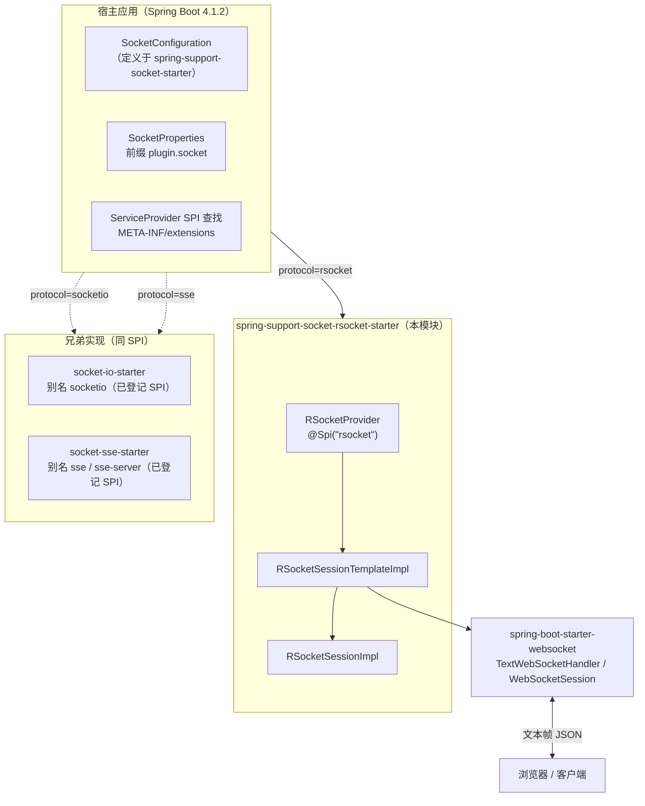
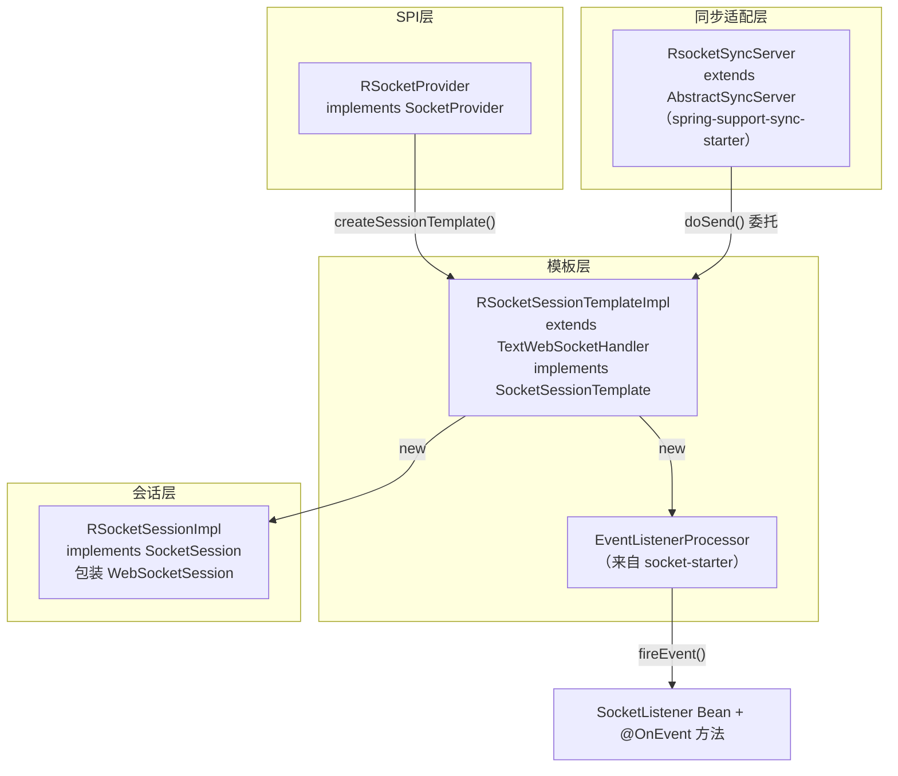
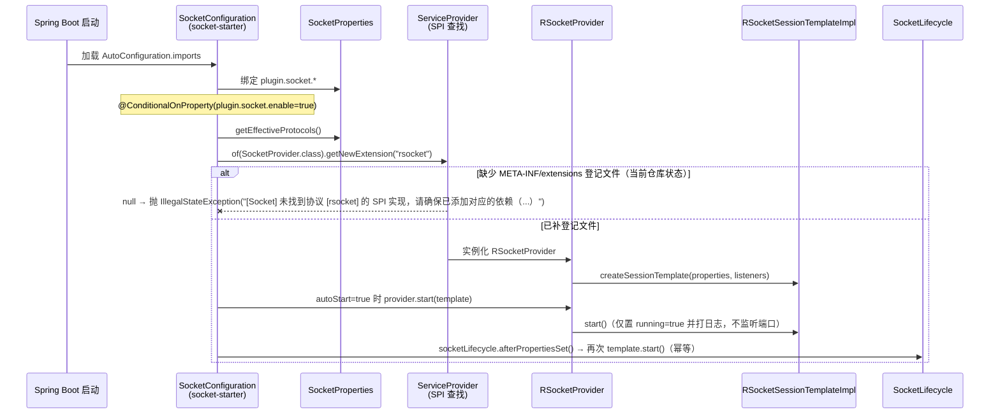
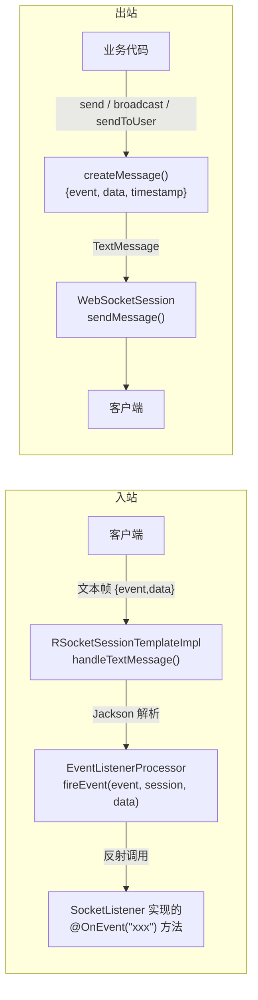

# spring-support-socket-rsocket-starter

`rsocket` 协议别名的实现模块：用 Spring WebSocket 文本通道承载 JSON 事件（`{event, data, timestamp}`），向 `spring-support-socket-starter` 提供 `SocketSessionTemplate`。**不是** RSocket 二进制协议与 Reactor 响应式栈——没有背压、没有四种交互模式（request-response / fire-and-forget / request-stream / channel）、没有连接复用。

## 1. 架构图

### 1.1 模块在体系中的位置



### 1.2 模块内部分层



## 2. 核心流程图

### 2.1 装配与启动流程



### 2.2 消息处理与数据流



## 3. 能力清单

| 能力域 | 关键类 | 入口 |
|---|---|---|
| SPI 实现 | `RSocketProvider`（`@Spi("rsocket")`，`getProtocol()` 返回 `SocketProtocol.RSOCKET`） | 抽象层 `SocketProvider` 扩展点 |
| 会话模板 | `RSocketSessionTemplateImpl`（`TextWebSocketHandler` + `SocketSessionTemplate`） | 由 `SocketProvider.createSessionTemplate()` 创建，`SocketLifecycle` 调 `start()` |
| 会话模型 | `RSocketSessionImpl`（包装 `WebSocketSession`，持有 `attributes`） | `template.getSession(sessionId)` |
| 入站事件分发 | `EventListenerProcessor` + `@OnEvent` | 业务侧实现 `SocketListener` Bean |
| 客户端分组 | 从连接路径提取 `clientId`（`/ws/webrtc` → `webrtc`，`/ws`、`/` → `default`） | `afterConnectionEstablished` |
| 文本发送 | `RSocketSessionImpl.send(event, data)`、`sendRaw(message)` | 会话方法 |
| 查询统计 | `getOnlineSessions()` / `getOnlineCount()` / `getOnlineSession(type, roomId)` / `getOnlineUsers(type)` | `SocketSessionTemplate` 方法 |
| 同步协议适配 | `RsocketSyncServer`（继承 `AbstractSyncServer`，`protocol="rsocket"`） | 未标注组件注解，本模块不自动注册，需自行实例化 |

**能力边界（接口默认实现未被覆盖）**：`RSocketSessionTemplateImpl` 未覆写 `SocketSessionTemplate` 的三个 default 方法，全部沿用接口默认值——

- `isReady()` 恒返回 `true`：只表示模板 Bean 已创建，不代表已绑定端口或已注册端点；不完成 6.3 第四步的端点注册，客户端无处可连。
- `protocol()` 恒返回 `"unknown"`：需要拿到 `"rsocket"` 协议名时不要依赖该方法，请自行覆写。
- `supportsUserTargeting()` 恒返回 `false`：本实现握手阶段不建立用户身份（见 Q5），调用方不应假设 `sendToUser` 一定能送达。

## 4. Bean 能力矩阵

**本模块自身不注册任何 Bean。** `META-INF/spring/org.springframework.boot.autoconfigure.AutoConfiguration.imports` 只有一行注释（「RSocket 模块不再自行注册 Bean，由 spring-support-socket-starter 统一管理」），也没有 `spring.factories`；4 个类均无 `@Component` / `@Bean` 注解。下表列出启用 `protocol=rsocket` 后，**由上游 `spring-support-socket-starter` 的 `SocketConfiguration` 创建**的相关 Bean：

| Bean 名 | 类型 | 装配条件 | 可否覆盖 | 典型注入姿势 |
|---|---|---|---|---|
| `socketSessionTemplates` | `Map<String, SocketSessionTemplate>` | `@ConditionalOnProperty(prefix="plugin.socket", name="enable", havingValue="true")` + `@ConditionalOnMissingBean` | 可（声明同类型 Bean 即可顶替） | 注入 `Map` 后按 `"rsocket"` 取本协议模板 |
| `socketSessionTemplate` | `SocketSessionTemplate` | `@Primary` + `@ConditionalOnProperty(plugin.socket.enable=true)`；取 `templates` 的第一个值 | 不可直接覆盖（无 `@ConditionalOnMissingBean`）；可通过覆盖 `socketSessionTemplates` 间接替换 | 直接构造器注入；多协议时需 `@Qualifier` 配合 |
| `socketLifecycle` | `SocketConfiguration.SocketLifecycle` | `@ConditionalOnProperty(plugin.socket.enable=true)` | 同类型自定义 Bean 会与之共存（无 `@ConditionalOnMissingBean`），一般不覆盖 | 一般不直接注入；容器启停时自动回调 |
| `socketServiceInfoContributor` | `ServiceInfoContributor` | 无条件注册 | 可再注册自己的 `ServiceInfoContributor` 共存 | 服务信息面板使用，业务一般不碰 |

注意：`RSocketSessionTemplateImpl` 实例本身**不是**独立 Bean，只能从上面的 Map / `@Primary` 模板获取，或强转为 `RSocketSessionTemplateImpl` 用于端点注册。

## 5. 完整配置

**本模块无 `@ConfigurationProperties`。** 所有配置定义在 `spring-support-socket-starter` 的 `SocketProperties`（前缀 `plugin.socket`），由抽象层读取后以构造参数传入 `RSocketSessionTemplateImpl`；本模块**只保存引用、不读取任何字段**，因此「本模块是否实际消费」多数为否。

| 路径 | 类型 | 默认值 | 说明 | 本模块是否实际消费 |
|---|---|---|---|---|
| `plugin.socket.enable` | `boolean` | `false` | 总开关；`true` 时 `SocketConfiguration` 才创建模板 Bean | 间接（抽象层 `@ConditionalOnProperty`） |
| `plugin.socket.auto-start` | `boolean` | `true` | 是否在容器启动阶段自动 `start()` | 间接（抽象层判断后调 `start()`） |
| `plugin.socket.protocol` | `SocketProtocol` 枚举 | `SSE` | 协议别名：`socketio` / `rsocket` / `sse` / `sse-server`；需设为 `rsocket` 才选中本实现 | 间接（抽象层按别名查 SPI） |
| `plugin.socket.protocols[]` | `List<ProtocolConfig>` | `[]` | 多协议列表；非空时忽略下面的单一 `protocol`/`room`；`ProtocolConfig.protocol` 默认 `SOCKETIO` | 否 |
| `plugin.socket.protocols[].room[]` | `List<Room>` | `[]` | 该协议的房间列表 | 否 |
| `plugin.socket.room[]` | `List<Room>` | `[]` | 单协议模式房间列表 | 否 |
| `plugin.socket.room[].client-id` | `String` | `default` | 房间标识（与本模块按路径提取的 `clientId` 是两回事） | 否 |
| `plugin.socket.room[].context-path` | `String` | `/socket.io` | 房间上下文路径 | 否 |
| `plugin.socket.room[].port` | `int` | `-1` | `-1` 用主端口，`-2` 起为主端口偏移 | 否（本模块不监听独立端口） |
| `plugin.socket.room[].host` | `String` | `null` | 房间独立地址 | 否 |
| `plugin.socket.room[].auth-factory` | `String` | `null` | 房间独立鉴权工厂类名 | 否 |
| `plugin.socket.room[].enable` | `boolean` | `true` | 是否启用该房间 | 否 |
| `plugin.socket.host` | `String` | `0.0.0.0` | 监听地址 | 否 |
| `plugin.socket.codec-type` | `String` | `json` | 编解码器类型 | 否（硬编码 Jackson JSON） |
| `plugin.socket.max-frame-size` | `int` | `1048576` | 最大帧大小（字节） | 否 |
| `plugin.socket.boss-count` | `int` | `1` | Boss 线程数 | 否 |
| `plugin.socket.work-count` | `int` | `100` | 工作线程数 | 否 |
| `plugin.socket.allow-custom-requests` | `boolean` | `true` | 是否允许自定义请求 | 否 |
| `plugin.socket.ping-timeout` | `int` | `60000` | Ping 超时（毫秒） | 否 |
| `plugin.socket.ping-interval` | `int` | `25000` | Ping 间隔（毫秒） | 否 |
| `plugin.socket.auth-factory` | `String` | 未设置 | 鉴权工厂类名 | 否（本模块无握手鉴权） |
| `plugin.socket.use-linux-native-epoll` | `boolean` | `false` | 是否使用 Linux Native Epoll | 否 |

最小生效配置：

```yaml
plugin:
  socket:
    enable: true
    protocol: rsocket
    auto-start: true
```

## 6. 使用方式

### 6.1 Maven 坐标

```xml
<dependency>
    <groupId>com.chua</groupId>
    <artifactId>spring-support-socket-rsocket-starter</artifactId>
    <version>4.0.0.51</version>
</dependency>
```

### 6.2 依赖说明（pom 实际声明，均非 optional）

| 依赖 | 作用 | 是否可选 |
|---|---|---|
| `com.chua:spring-support-socket-starter` | 抽象层、SPI 接口、`SocketProperties`、`SocketConfiguration` | 否 |
| `com.chua:spring-support-sync-starter` | `AbstractSyncServer` 基类（供 `RsocketSyncServer`） | 否 |
| `org.springframework.boot:spring-boot-starter-websocket` | `TextWebSocketHandler` / `WebSocketSession` | 否 |
| `com.chua:utils-support-common-starter` | 公共工具、SPI 框架（`ServiceProvider`） | 否 |

**没有** `io.rsocket:rsocket-core`、**没有** Project Reactor、**没有** `utils-support-rsocket-starter` 依赖。

### 6.3 最小可运行示例

**第一步：引入依赖**（见上）。

**第二步：配置协议。**

```yaml
plugin:
  socket:
    enable: true
    protocol: rsocket
    auto-start: true
```

**第三步：补 SPI 登记文件（当前仓库缺失，必须手动补齐，否则启动即抛异常）。**

在宿主应用的 `src/main/resources/META-INF/extensions/com.chua.socket.support.spi.SocketProvider` 中加一行（与 socket-io / sse 模块的登记格式一致）：

```text
rsocket=com.chua.rsocket.support.spi.RSocketProvider
```

**第四步：把模板注册为 WebSocket 端点（必须由宿主完成）。**

```java
@Configuration
@EnableWebSocket
public class RsocketEndpointConfig implements WebSocketConfigurer {

    private final SocketSessionTemplate template;

    public RsocketEndpointConfig(SocketSessionTemplate template) {
        this.template = template;
    }

    @Override
    public void registerWebSocketHandlers(WebSocketHandlerRegistry registry) {
        registry.addHandler((RSocketSessionTemplateImpl) template, "/ws/*")
                .setAllowedOrigins("*");
    }
}
```

`start()` 只把内部 `running` 置为 `true` 并打日志，不会自行绑定端口或注册端点；不完成上面的注册，客户端无处可连。

### 6.4 调用示例

**本模块无链式 API**，按步骤使用：

1. 注入 `SocketSessionTemplate`（抽象层 `@Primary`）或强转为 `RSocketSessionTemplateImpl` 做端点注册。
2. 发送：`send(sessionId, event, msg)` 走会话 `send(event, data)`，序列化为 `{"event":...,"data":...,"timestamp":...}` 后作为文本帧写出。
3. 广播：`broadcast(event, msg)` 遍历全部已登记会话逐个发送。
4. 按用户：`sendToUser(userId, event, msg)` 遍历会话比较 `session.getUser().getUserId()`；本实现未在连接时建立用户身份，实际很难命中。
5. 查询：`getOnlineSessions()`、`getOnlineCount()`、`getOnlineSession(type, roomId)`、`getOnlineUsers(type)`。
6. 原始文本：强转 `RSocketSessionImpl` 后调 `sendRaw(message)`。

```java
@Service
public class MessageService {

    private final SocketSessionTemplate template;

    public MessageService(SocketSessionTemplate template) {
        this.template = template;
    }

    public void push(String text) {
        template.broadcast("notice", text);
    }
}
```

事件监听（客户端发 `{"event":"chat.message","data":"hi"}` 时触发）：

```java
@Component
public class EventHandler implements SocketListener {

    @OnEvent("chat.message")
    public void onChat(SocketSession session, Object data) {
        log.info("session={}, data={}", session.getId(), data);
    }

    @OnEvent("user.login")
    public void onLogin(SocketSession session, Map<String, Object> data) {
        session.setAttribute("username", data.get("username"));
    }
}
```

客户端分组由路径决定：连接 `/ws/webrtc` 时 `clientId` 为 `webrtc`，`/ws` 或 `/` 归为 `default`；`getOnlineSession(type, roomId)` 用 `type` 作为 `clientId` 取分组，`roomId` 非空时再按会话属性 `roomId` 过滤——而该属性从未被写入，所以传了 `roomId` 通常返回空列表。

## 7. 使用场景

**适用：**

- 需要一个轻量双向文本通道：连接按 URL 路径分组、收发 `{event, data, timestamp}` JSON 事件。
- 已有基于 Spring WebSocket 的前端，想接入统一的 `SocketSessionTemplate` 抽象与 `@OnEvent` 事件模型。
- 单实例、内存会话即可满足的推送/联动场景（如白板、简单通知、演示环境）。

**不适用：**

- 需要真 RSocket 语义（二进制帧、背压、request-stream / channel、连接复用）——本模块没有 `rsocket-core` 与 Reactor。
- 需要房间/命名空间/鉴权/独立端口——这些能力本模块都没有。
- 多实例部署需要共享会话——`sessionCache` 是本地 `ConcurrentHashMap`，实例间不共享。

**与相邻模块的取舍：**

| 模块 | 与本模块的关系 |
|---|---|
| `spring-support-socket-starter` | 上游抽象层；`protocol=rsocket` 时按别名查找本模块的 `RSocketProvider` |
| `spring-support-socket-io-starter` | 兄弟实现（`socketio`，SPI 已登记）；Socket.IO 有房间、鉴权、独立端口，本模块都没有，不要按 Socket.IO 的配置项来写 |
| `spring-support-socket-sse-starter` | 兄弟实现（`sse` / `sse-server`，SPI 已登记）；单向推送，本模块是双向文本通道 |
| `spring-support-socket-websocket-starter` | 同用 Spring WebSocket，但配置前缀是 `plugin.websocket`（`enable` 默认 `false`、`endpoints` 默认 `[/ws]`）、自带端点注册与 `WebSocketTemplate`，与本模块无装配关系 |

能力边界：本模块只做「WebSocket 文本帧 + JSON 事件名分发」，不具备 RSocket 的二进制帧、背压、连接复用与响应式流。

## 8. 扩展点

- **本模块不提供 SPI 扩展点**：没有自己的 `META-INF/extensions` 目录，也不接受自定义别名。它自身是抽象层 `SocketProvider` SPI 的一个实现（`RSocketProvider` 标注 `@Spi("rsocket")`），但**未在 `META-INF/extensions/com.chua.socket.support.spi.SocketProvider` 中登记**（详见第 9 节 FAQ 第 1 条）。
- **子类化 `RSocketSessionTemplateImpl`**：可覆写 `afterConnectionEstablished`（补握手鉴权、写入 `SocketUser`）、`handleTextMessage`（自定义协议解析）、`afterConnectionClosed` 等；`RSocketProvider.createSessionTemplate` 是工厂入口，可换成自己的子类实例。
- **子类化 `RSocketSessionImpl`**：可扩展 `send` / `sendRaw`（如增加消息拦截、日志、限流）。
- **`RsocketSyncServer` 的手动回调**：`onRsocketConnect(sessionId)`、`onRsocketDisconnect(sessionId)`、`onRsocketMessage(sessionId, topic, data)` 需要自行接线（例如在 `afterConnectionEstablished` 里调用），它们分别触发 `fireConnectionEstablished` / `fireConnectionClosed` / `fireMessageReceived`。该类未注册为 Bean，需要自行 `new RsocketSyncServer(template)`。
- **事件处理扩展**：任何实现 `SocketListener` 的 Bean 都会被 `EventListenerProcessor` 扫描 `@OnEvent` 方法并分发（支持 0/1/2 参数签名）。

## 9. 常见问题

**Q1：启动报 `IllegalStateException("[Socket] 未找到协议 [rsocket] 的 SPI 实现，请确保已添加对应的依赖（...）")`**

仓库内缺少 `spring-support-socket-rsocket-starter/src/main/resources/META-INF/extensions/com.chua.socket.support.spi.SocketProvider` 文件，`ServiceProvider` 的 `META-INF/extensions` 机制发现不到 `RSocketProvider`。补一行 `rsocket=com.chua.rsocket.support.spi.RSocketProvider`（与 socket-io / sse 的登记格式一致）即可。

**Q2：配置了 `plugin.socket.*` 但大部分不生效**

正常。本模块只保存 `SocketProperties` 引用、不读取任何字段；`enable` / `auto-start` / `protocol` 由抽象层消费，其余（`room`、`max-frame-size`、`ping-*`、`auth-factory` 等）对本实现无影响。`SocketProperties` 中不存在任何 `encrypt-*` 配置项，若见到相关说法均属讹传。

**Q3：端口怎么配？`room[].port` 为什么没用？**

本模块不监听独立端口。`start()` 只翻转 `running` 标记；真正对外服务的是宿主通过 `WebSocketHandlerRegistry` 注册的端点（挂在 Web 容器端口上）。`room[].port`、`host` 在本实现里没有生效路径。

**Q4：`@OnConnect` / `@OnDisconnect` 不触发**

`EventListenerProcessor` 只扫描 `@OnEvent`。连接/断开回调需要自行扩展：覆写 `afterConnectionEstablished` / `afterConnectionClosed`，或用 `RsocketSyncServer` 的手动回调。

**Q5：`sendToUser` 收不到消息**

本实现连接时不建立用户身份（不调 `setUser`），`sendToUser` 按 `user.getUserId()` 匹配通常为空。需要定向发送时请在握手/连接建立后自行 `session.setUser(...)`。

**Q6：`getOnlineSession(type, roomId)` 传了 `roomId` 返回空**

过滤条件是会话属性 `roomId`，而本模块没有任何代码写入该属性。只按 `type`（即路径分组 `clientId`）查询即可。

**Q7：与 Spring Boot 4 的兼容性**

仓库当前基线为 Spring Boot 4.1.2。本模块通过 `AutoConfiguration.imports`（由上游 `spring-support-socket-starter` 注册 `SocketConfiguration`）装配，该机制在 Boot 4 下正常；WebSocket 能力来自 `spring-boot-starter-websocket`。模块内没有 `rsocket-core` / Reactor 依赖，不受 Boot 4 RSocket starter 变化影响；`pom.xml` 的 description「RSocket 响应式通信实现」与实际能力不符，以本文档的能力边界为准。

**Q8：`isReady()` 返回 `true`，服务是不是就可用了？**

不是。`RSocketSessionTemplateImpl` 未覆写 `SocketSessionTemplate` 的 default 方法：`isReady()` 恒返回 `true`（即使未绑定端口、未注册端点），`protocol()` 恒返回 `"unknown"`，`supportsUserTargeting()` 恒返回 `false`。模板 Bean 创建成功 ≠ 对外可用——`start()` 只翻转内部 `running` 标记，真正对外服务的是 6.3 第四步中宿主注册的 WebSocket 端点；不注册端点，客户端无处可连，而 `isReady()` 依然是 `true`。需要真实的就绪/协议/定向能力语义时，请子类化 `RSocketSessionTemplateImpl` 覆写这三个方法。
