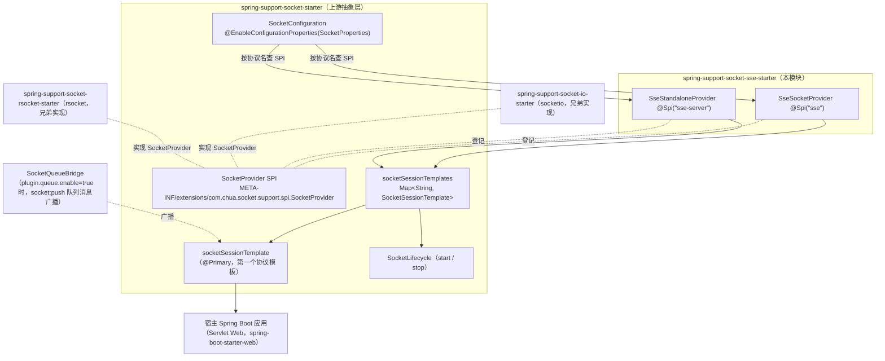
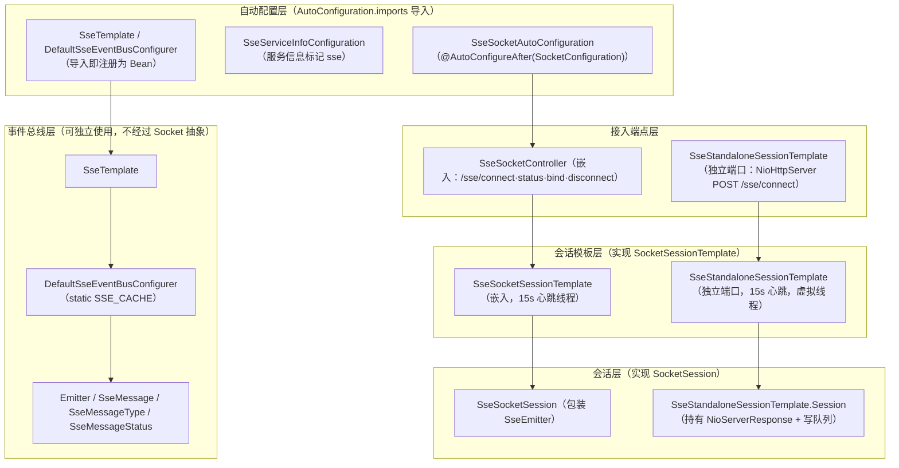
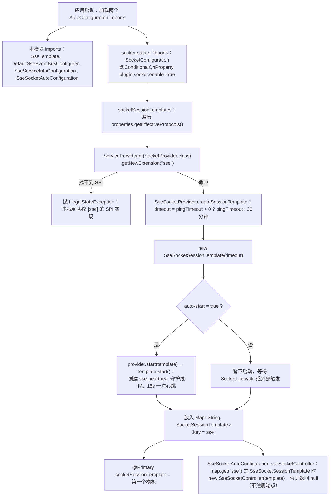
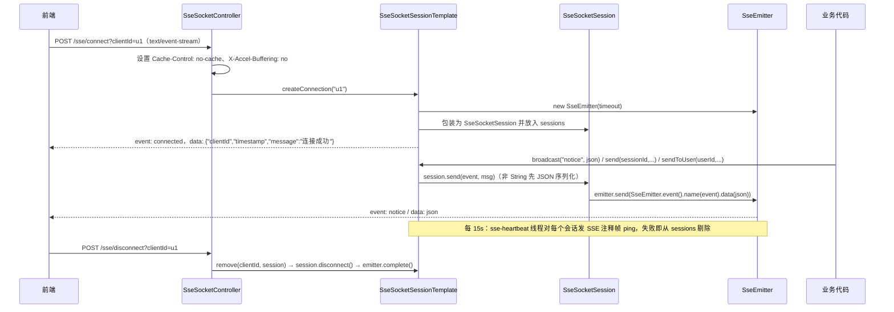

# spring-support-socket-sse-starter

SSE（Server-Sent Events）服务端单向推送实现。把 Spring MVC 的 `SseEmitter` 适配为 `SocketSessionTemplate`，通过 `spring-support-socket-starter` 的 SPI 注册两种协议：`sse`（嵌入主应用 Servlet 端口）与 `sse-server`（`NioHttpServer` 独立端口）；另提供一套不依赖 Socket 抽象的事件总线（`SseTemplate` + `DefaultSseEventBusConfigurer`）。

- 模块版本：`4.0.0.51`（父 POM `spring-support-parent-starter`，继承 `spring-boot-starter-parent` `4.1.2`）
- Maven 描述：SSE 服务器推送事件实现
- 代码根包：`com.chua.starter.sse.support`

## 1. 架构图

### 1.1 模块在 Socket 体系中的位置



### 1.2 模块内部分层



## 2. 核心流程图

### 2.1 装配流程（启动期）



### 2.2 请求处理 / 数据流（嵌入模式）



独立端口模式（`sse-server`）的数据流与上图一致，差别只在“连接从哪来”：`SseStandaloneSessionTemplate` 用 `NioHttpServer` 在 `plugin.socket.room[0].port` 上监听 `POST /sse/connect`，连接线程为虚拟线程，写操作经每连接一个的 `LinkedBlockingQueue` 串行写出。

## 3. 能力清单

| 能力域 | 关键类 | 入口 |
|---|---|---|
| SPI 实现（嵌入 SSE） | `SseSocketProvider`（`@Spi("sse")`，`SocketProtocol.SSE`） | `META-INF/extensions/com.chua.socket.support.spi.SocketProvider` |
| SPI 实现（独立端口 SSE） | `SseStandaloneProvider`（`@Spi("sse-server")`，`SocketProtocol.SSE_SERVER`，默认端口 29612） | 同上（`sse-server=...` 行） |
| 统一会话模板 | `SseSocketSessionTemplate` / `SseStandaloneSessionTemplate`（均实现 `SocketSessionTemplate`） | 注入 `SocketSessionTemplate`（@Primary）或 `Map<String, SocketSessionTemplate>` 取 `sse` |
| 会话模型 | `SseSocketSession`（包装 `SseEmitter`）；`SseStandaloneSessionTemplate.Session`（`NioServerResponse` + 写队列） | `template.getSession(clientId)` |
| HTTP 端点（仅嵌入模式） | `SseSocketController`：`POST /sse/connect`、`GET /sse/status`、`POST /sse/bind`、`POST /sse/disconnect` | 由 `SseSocketAutoConfiguration` 注册 |
| 独立端口 HTTP 服务 | `SseStandaloneSessionTemplate`（`NioHttpServer`，仅 `POST /sse/connect`） | `plugin.socket.protocols[?].protocol=sse-server` |
| 连接管理 | `createConnection(clientId)`（空 clientId 自动生成 uuid，先关旧连接，立即推 `connected` 事件） | 嵌入：`SseSocketController` / 自定义 Controller；独立：`POST /sse/connect` |
| 事件发送模板（事件总线） | `SseTemplate`：`emit(...)`、`createSseEmitter(Emitter)`、`getEmitter(event)`、`closeEmitter(clientIds)` | 自动配置导入的 Bean，直接注入 |
| 事件总线/连接注册表 | `DefaultSseEventBusConfigurer`（`static` `ConcurrentHashMap` 缓存，注册/注销/按事件检索/关闭） | 自动配置导入的 Bean |
| 消息模型 | `SseMessage`（`type`/`message`/`event`/`status`/`tid`/`ext`）、`SseMessageType`（NOTIFY、NOTIFY_HTML、PROCESS、FINISH）、`SseMessageStatus`（SUCCESS、ERROR、WARN） | `SseTemplate.emit(SseMessage, ...)` |
| 订阅者模型 | `Emitter`（`@Builder`：`clientId`、`event` 集合、`entity`、`response`、`sseEmitter`） | `SseTemplate.createSseEmitter(...)` |
| 服务信息 | `SseServiceInfoConfiguration` → `sseServiceInfoContributor`（向服务信息面板注册 `sse` 标记） | 自动配置 |
| 心跳保活 | 两个模板各 15s 一次 SSE 注释帧（`sse-heartbeat` 守护线程 / 虚拟线程 park 超时） | 随 `start()` 启动，间隔硬编码不可配 |
| native-image | `reflect-config.json`（注册 `SseSocketProvider` 反射）、`resource-config.json`（包含 `META-INF/extensions/.*`） | `META-INF/native-image/com.chua/spring-support-socket-sse-starter/` |

## 4. Bean 能力矩阵

本模块 Bean（均来自 `AutoConfiguration.imports` 的 4 个导入类）：

| Bean 名 | 类型 | 装配来源与条件 | 可否覆盖 | 典型注入姿势 |
|---|---|---|---|---|
| `com.chua.starter.sse.support.SseTemplate`（全限定类名） | `SseTemplate` | imports 导入；类本身无 `@Configuration`，按单构造器注入 `DefaultSseEventBusConfigurer` 注册为 Bean；无条件 | 无 `@ConditionalOnMissingBean`：自定义同类型 Bean 会与之**共存**，按类型注入会冲突，需 `@Primary` 或按名称区分 | `@Autowired SseTemplate sseTemplate;` |
| `com.chua.starter.sse.support.DefaultSseEventBusConfigurer` | `DefaultSseEventBusConfigurer` | imports 导入；无参构造；无条件 | 同上（共存 + `@Primary`） | 一般不直接注入，经 `SseTemplate` 使用 |
| `sseServiceInfoContributor` | `ServiceInfoContributor` | `SseServiceInfoConfiguration` 的 `@Bean`；无条件 | 同上 | 由服务信息面板收集，业务无需注入 |
| `sseSocketController` | `SseSocketController` | `SseSocketAutoConfiguration` 的 `@Bean`，`@AutoConfigureAfter(SocketConfiguration.class)`；**运行时条件**：从 `Map<String, SocketSessionTemplate>` 取 `sse`，且实例为 `SseSocketSessionTemplate` 才创建，否则返回 `null` 不注册（socketio 单协议部署不受影响） | 同上 | 一般不注入；前端直接 HTTP 访问 `/sse/**` |

上游 `spring-support-socket-starter` 提供的关联 Bean（本模块的模板由它们产出）：

| Bean 名 | 类型 | 装配条件 | 说明 |
|---|---|---|---|
| `socketSessionTemplates` | `Map<String, SocketSessionTemplate>` | `@ConditionalOnProperty(plugin.socket.enable=true)` + `@ConditionalOnMissingBean` | SPI 按协议创建的模板集合；本模块在 `protocol=sse` 或 `protocols` 含 `sse`/`sse-server` 时贡献条目 |
| `socketSessionTemplate`（`@Primary`） | `SocketSessionTemplate` | `plugin.socket.enable=true` | 取第一个协议模板；多协议时 `@Primary` 指向第一个 |
| `socketLifecycle` | `SocketConfiguration.SocketLifecycle` | `plugin.socket.enable=true` | `auto-start=true` 时容器启动调 `template.start()`，销毁时统一 `stop()` |
| `socketServiceInfoContributor` | `ServiceInfoContributor` | 无条件 | 注册 `socket` 服务信息标记 |

> 说明：`SseSocketSessionTemplate` / `SseStandaloneSessionTemplate` 本身**不是**独立 Bean，只能通过上面的 `Map` 或 `@Primary` 模板拿到（需要具体类型时注入 `Map` 后自行 `get("sse")` 并判断类型）。

## 5. 完整配置

本模块**没有自己的 `@ConfigurationProperties`**，全部复用上游 `spring-support-socket-starter` 的 `SocketProperties`（前缀 `plugin.socket`，`ignoreInvalidFields=true`）。注意：**不存在** `plugin.sse.*` 配置，配了也不会生效。

### 5.1 `plugin.socket` 主配置（SocketProperties 全字段）

| 路径 | 类型 | 默认值 | 说明 | 本模块是否读取 |
|---|---|---|---|---|
| `plugin.socket.enable` | `boolean` | `false` | Socket 总开关，`socketSessionTemplates` 的装配条件 | ✅ 读取（决定模板与 `/sse/**` 端点是否存在） |
| `plugin.socket.auto-start` | `boolean` | `true` | 是否随容器启动调用 `start()`（嵌入 SSE 启动即拉起 15s 心跳；独立 SSE 启动即监听端口） | ✅ 读取 |
| `plugin.socket.protocol` | `SocketProtocol` | `SSE`（即 `sse`） | 单协议模式；可选 `socketio` / `rsocket` / `sse` / `sse-server` | ✅ 读取（决定走哪个 SPI） |
| `plugin.socket.protocols` | `List<ProtocolConfig>` | `[]` | 多协议模式；配置后**覆盖** `protocol` 与 `room` | ✅ 读取（每项可独立配 `sse` / `sse-server` + `room`） |
| `plugin.socket.room` | `List<Room>` | `[]` | 房间/实例配置 | ⚠️ 仅 `sse-server` 读取 `room[].port`（取第一个 `port>0`，否则 29612）；嵌入 SSE 不读 |
| `plugin.socket.host` | `String` | `0.0.0.0` | 监听地址 | ⚠️ 仅 `sse-server` 读取（独立监听地址） |
| `plugin.socket.ping-timeout` | `int` | `60000` | **嵌入 SSE 下被当作 `SseEmitter` 连接超时（毫秒）**；`<=0` 时回落 30 分钟 | ✅ 嵌入读取；`sse-server` 不读 |
| `plugin.socket.ping-interval` | `int` | `25000` | Socket.IO 心跳间隔 | ❌ 不读（SSE 心跳固定 15s，不可配） |
| `plugin.socket.codec-type` | `String` | `json` | 编解码器 | ❌ 不读 |
| `plugin.socket.max-frame-size` | `int` | `1048576` | 最大帧大小 | ❌ 不读 |
| `plugin.socket.boss-count` | `int` | `1` | Netty boss 线程 | ❌ 不读 |
| `plugin.socket.work-count` | `int` | `100` | Netty worker 线程 | ❌ 不读 |
| `plugin.socket.allow-custom-requests` | `boolean` | `true` | 是否允许自定义请求 | ❌ 不读 |
| `plugin.socket.auth-factory` | `String` | 空 | 认证工厂类名 | ❌ 不读（SSE 连接鉴权需自行在 Controller/网关处理） |
| `plugin.socket.use-linux-native-epoll` | `boolean` | `false` | Linux epoll | ❌ 不读 |

### 5.2 嵌套结构

| 路径 | 类型 | 默认值 | 说明 |
|---|---|---|---|
| `plugin.socket.protocols[n].protocol` | `SocketProtocol` | `SOCKETIO` | 该协议项的类型，可填 `sse` / `sse-server` |
| `plugin.socket.protocols[n].room` | `List<Room>` | `[]` | 该协议的房间列表 |
| `plugin.socket.room[n].client-id` | `String` | `default` | 实例标识 |
| `plugin.socket.room[n].context-path` | `String` | `/socket.io` | 上下文路径（SSE 不使用） |
| `plugin.socket.room[n].port` | `int` | `-1` | `sse-server` 取第一个 `port>0` 的房间；`-1` 表主端口，`-2、-3…` 表主端口偏移 |
| `plugin.socket.room[n].host` | `String` | 空 | 覆盖主 `host` |
| `plugin.socket.room[n].auth-factory` | `String` | 空 | 覆盖主 `auth-factory` |
| `plugin.socket.room[n].enable` | `boolean` | `true` | 是否启用该房间 |

### 5.3 生效开关与组合

- 一切的前提：`plugin.socket.enable=true`，否则本模块在 Socket 侧不产出任何模板，`/sse/**` 端点也不会注册（`sseSocketController` 返回 `null`）。
- 嵌入模式：`protocol: sse`（也是默认值），复用主应用 Tomcat 端口，`ping-timeout` 即连接超时。
- 独立模式：`protocols: [{protocol: sse-server, room: [{port: 29612}]}]`，另开 `NioHttpServer` 端口，不占主应用连接。

## 6. 使用方式

### 6.1 Maven 坐标

```xml
<dependency>
    <groupId>com.chua</groupId>
    <artifactId>spring-support-socket-sse-starter</artifactId>
    <version>4.0.0.51</version>
</dependency>
```

| 依赖 | 作用 | 是否可选 |
|---|---|---|
| `com.chua:utils-support-common-starter` | 公共工具、SPI 基础设施 | 否 |
| `com.chua:spring-support-socket-starter` | Socket 抽象层、`SocketProvider` SPI、`SocketProperties` | 是（`optional`；但 SPI 接入、`/sse/**` 端点、模板都建立在它之上，仅用 `SseTemplate` 事件总线时可省） |
| `org.springframework:spring-webmvc` | `SseEmitter`、`@RestController` | 是（`provided`，由宿主 Web 环境提供） |
| `jakarta.servlet:jakarta.servlet-api` | Servlet API | 是（`provided`） |

必须有 Servlet Web 环境（`spring-boot-starter-web`）；WebFlux 栈不支持（`SseEmitter` 属于 spring-webmvc）。

### 6.2 最小可运行示例（嵌入模式）

第一步，开启 sse 协议：

```yaml
plugin:
  socket:
    enable: true
    protocol: sse          # 本就是默认值，可不写
    ping-timeout: 1800000  # SSE 连接超时 30 分钟（默认 60000）
```

第二步，用 GET 端点桥接给原生 `EventSource`（内置 `/sse/connect` 是 POST，`EventSource` 只会发 GET，所以业务侧自建一个 GET 入口最简单），并暴露一个推送接口：

```java
@RestController
@RequestMapping("/push")
public class PushController {

    private final SseSocketSessionTemplate sse;

    public PushController(SocketSessionTemplate template) {
        this.sse = (SseSocketSessionTemplate) template; // protocol=sse 时即 SSE 模板
    }

    /** 前端订阅入口：EventSource 只支持 GET */
    @GetMapping(value = "/stream", produces = MediaType.TEXT_EVENT_STREAM_VALUE)
    public SseEmitter stream(@RequestParam(required = false) String clientId) {
        return sse.createConnection(clientId); // 立即推送 connected 事件
    }

    /** 广播 */
    @PostMapping("/broadcast")
    public void broadcast(@RequestParam String text) {
        sse.broadcast("notice", text);
    }

    /** 定向：先 POST /sse/bind 绑定 userId↔clientId，再按 userId 推 */
    @PostMapping("/to-user")
    public void toUser(@RequestParam String userId, @RequestParam String text) {
        sse.sendToUser(userId, "notice", text);
    }
}
```

第三步，前端订阅：

```javascript
const es = new EventSource("/push/stream?clientId=u1");
es.addEventListener("connected", (e) => console.log("已连接:", e.data));
es.addEventListener("notice", (e) => console.log("收到:", e.data));
es.onerror = () => console.warn("SSE 断开，浏览器将自动重连");
```

也可直接使用内置端点（token 放请求头，不经 URL/网关日志）：

| 方法 | 路径 | 参数 | 说明 |
|---|---|---|---|
| POST | `/sse/connect` | `clientId`（可选，`text/event-stream`） | 建连，返回 SSE 流 |
| GET | `/sse/status` | — | `totalConnections` / `onlineCount` / `timestamp` |
| POST | `/sse/bind` | `userId`、`clientId` | 绑定用户与会话，供 `sendToUser` 定向 |
| POST | `/sse/disconnect` | `clientId` | 主动断开 |

内置端点是 POST，前端需用支持 POST 的 SSE 客户端（如 `fetch` + 流式解析或 `@microsoft/fetch-event-source`），或按上面的方式自建 GET 桥接端点。

### 6.3 独立端口模式（sse-server）

```yaml
plugin:
  socket:
    enable: true
    protocols:
      - protocol: sse-server
        room:
          - port: 29612   # 缺省即 29612；host 取 plugin.socket.host
```

前端把请求指向独立端口即可，路径仍是 `POST /sse/connect`：

```javascript
fetch("http://host:29612/sse/connect?clientId=u1", {
  method: "POST",
  headers: { "x-oauth-token": token }
}).then((res) => res.body /* 用 ReadableStream 按 SSE 帧解析 */);
```

### 6.4 事件总线用法（SseTemplate，可不依赖 Socket 抽象）

```java
@RestController
@RequestMapping("/sse")
public class SseBusController {

    private final SseTemplate sseTemplate;

    public SseBusController(SseTemplate sseTemplate) {
        this.sseTemplate = sseTemplate;
    }

    /** 订阅：一个客户端可订阅多个事件；SseEmitter 固定 new SseEmitter(0L)，永不超时 */
    @GetMapping(value = "/bus", produces = MediaType.TEXT_EVENT_STREAM_VALUE)
    public SseEmitter subscribe(@RequestParam String clientId) {
        Emitter emitter = Emitter.builder()
                .clientId(clientId)
                .event("notice")
                .event("alarm")
                .build();
        return sseTemplate.createSseEmitter(emitter);
    }

    /** 发布：带 SseMessage 模型与重试间隔 */
    @PostMapping("/publish")
    public void publish(@RequestParam String clientId, @RequestParam String text) {
        SseMessage message = SseMessage.builder()
                .type(SseMessageType.NOTIFY)
                .status(SseMessageStatus.SUCCESS)
                .message(text)
                .event("notice")   // 缺省即 "message"
                .build();
        sseTemplate.emit(message, Duration.ofSeconds(3), clientId);
    }
}
```

## 7. 使用场景

### 7.1 适用

- 服务端 → 客户端的单向推送：通知公告、任务进度（`SseMessageType.PROCESS/FINISH`）、告警、日志流、大屏刷新。
- 只想用 HTTP/1.1、不引入 WebSocket 基础设施；需要穿透只放行 HTTP 的代理/网关。
- 已有 `spring-support-socket-starter` 生态，希望与 socketio/rsocket 共用一套 `SocketSessionTemplate` 推送口径与 `socket:push` 队列桥接。
- 主应用连接紧张时，用 `sse-server` 把 SSE 长连接迁到独立端口。

### 7.2 不适用

- 客户端 → 服务端高频上行、双向实时交互（SSE 是单向的，上行只能另走 HTTP 接口）。
- 需要房间/命名空间、断线期间消息补发、二进制帧（`sendBinary` 在 SSE 会话上不可用）。
- WebFlux / 响应式栈（本模块基于 Servlet + `SseEmitter`）。
- 多实例部署且未做会话粘滞/跨实例广播：会话表在单机内存（嵌入模板的 `ConcurrentHashMap`、事件总线还是 `static` 缓存），广播不会跨实例。

### 7.3 与相邻模块的取舍

| 模块 | 协议 | 与本模块的关系与取舍 |
|---|---|---|
| `spring-support-socket-io-starter` | `socketio` | 兄弟实现：双向、独立端口、房间、鉴权、断线重连语义更完整；只需单向推送时 SSE 更轻 |
| `spring-support-socket-rsocket-starter` | `rsocket` | 兄弟实现：双向文本通道、支持请求流；需要响应式语义时选它 |
| `spring-support-socket-websocket-starter` | `plugin.websocket`（原生 WebSocket，同端口） | 独立体系，不参与 `plugin.socket`，与本模块互不依赖；需要双向但不想引 socket.io 时可选 |
| `spring-support-queue-starter` | — | 可选配合：`plugin.queue.enable=true` 时 `SocketQueueBridge` 监听 `socket:push` 队列，把 `{module,event,data}` 广播到所有 SSE 连接，业务模块无需直接依赖 Socket |

## 8. 扩展点

### 8.1 SocketProvider SPI（新增/替换协议实现）

上游定义的扩展点：实现 `com.chua.socket.support.spi.SocketProvider`（`getProtocol()`、`createSessionTemplate(properties, listeners)`、`start(template)`、`stop(template)`、`supports(protocol)`），类上标 `@Spi("别名")`，并在 `META-INF/extensions/com.chua.socket.support.spi.SocketProvider` 中登记 `别名=实现类全名`。本模块内置两个实现可作参考：

```properties
sse=com.chua.starter.sse.support.socket.SseSocketProvider
sse-server=com.chua.starter.sse.support.server.SseStandaloneProvider
```

注意：

- 登记文件缺失时 `SocketConfiguration` 会抛 `IllegalStateException("...未找到协议 [xxx] 的 SPI 实现...")`，所有依赖 `SocketSessionTemplate` 的 Bean 随之失败。
- GraalVM native-image 下需同步补 `META-INF/native-image/**/reflect-config.json`（本模块对 `SseSocketProvider` 已登记全量反射）与 `resource-config.json`（包含 `META-INF/extensions/.*`）。
- `SseSocketProvider` 传入的 `List<SocketListener>` **未接线**：SSE 是单向推送，没有入站帧，`@OnConnect` / `@OnEvent` / `@OnDisconnect` 不会因 SSE 连接触发。

### 8.2 SocketSessionTemplate 的 default 方法

`SseSocketSessionTemplate` 未覆盖 `protocol()`（返回 `unknown`）、`isReady()`（`true`）、`supportsUserTargeting()`（`false`，虽然 `sendToUser` 实际可用）；`SseStandaloneSessionTemplate` 覆盖为 `sse` / `server.isRunning()` / `true`。业务侧可包装模板或自行实现 `SocketSessionTemplate` 补齐这些能力标记，也可以覆盖 `sendBinary` 等默认抛错/空实现的方法。

### 8.3 自定义 Bean

- 替换事件总线：自定义 `SseTemplate` / `DefaultSseEventBusConfigurer` Bean（注意第 4 节的共存问题，需 `@Primary`）。
- 替换端点：不依赖内置 `SseSocketController`，直接注入 `SseSocketSessionTemplate`（经 `Map` 或 `(SseSocketSessionTemplate) socketSessionTemplate`）自建 GET/POST 端点、鉴权与限流。
- 消息扩展：`SseMessage.ext`（`Map<String,Object>`）可携带任意附加信息；`Emitter.entity` 可挂业务上下文。

### 8.4 队列桥接

开启 `plugin.queue.enable=true` 后，`SocketQueueBridge` 监听固定 topic `socket:push`，把消息负载 `{module, event, data, dataId}` 广播到所有 SSE 连接；业务模块只需发队列消息，不必依赖 Socket。也可用 `@ConditionalOnMissingBean(name = "monitorSocketQueueBridge")` 提供自己的同名 Bean 替换它。

## 9. 常见问题

1. **`/sse/connect` 404 或 `SseSocketController` 不存在？**
   逐项检查：`plugin.socket.enable` 是否为 `true`；协议是否为 `sse`（或 `protocols` 含 `sse`）；是否引入了本模块与 `spring-support-socket-starter`；SPI 登记文件是否存在。`sseSocketController` 只有在模板 Map 里取到 `sse` 模板时才注册，任一环缺失都只会“安静地没有端点”。

2. **启动报 `未找到协议 [sse] 的 SPI 实现`？**
   `META-INF/extensions/com.chua.socket.support.spi.SocketProvider` 未随 jar 打包（或 native-image 未含该资源）。确认依赖完整且未被裁剪。

3. **原生 `EventSource` 连不上内置端点？**
   内置 `/sse/connect` 只有 POST（token 走请求头，不进 URL/日志），而 `EventSource` 只发 GET。改用支持 POST 的 SSE 客户端（`fetch` 流式解析、`@microsoft/fetch-event-source`），或按 6.2 自建 GET 桥接端点。

4. **推送“攒一批才吐”或连接被网关掐断？**
   控制器与独立服务都已设置 `Cache-Control: no-cache`、`X-Accel-Buffering: no`；若仍出现，检查中间的 nginx/网关是否又开了 `proxy_buffering`，以及读超时是否大于 15s。两个模板每 15s 发一次 SSE 注释帧心跳保活，间隔硬编码、不可配置。

5. **连接多久超时？**
   嵌入模式：`plugin.socket.ping-timeout`（默认 60000ms，`<=0` 回落 30 分钟）传给 `new SseEmitter(timeout)`，超时后回调移除会话，浏览器会自动重连。事件总线 `SseTemplate.createSseEmitter` 固定 `new SseEmitter(0L)` 永不超时。独立模式无该超时，靠心跳探活。

6. **多实例/集群下广播收不到？**
   会话表是单机内存（嵌入模板 `ConcurrentHashMap`；事件总线还是 `static` 缓存，同 JVM 多份 `SseTemplate` 共享连接）。跨实例需会话粘滞，或每实例都接 `socket:push` 队列各自广播。

7. **`plugin.sse.*` 配置了没反应？**
   本模块没有 `plugin.sse` 前缀，任何 `plugin.sse.*`（如 `enable`、`heartbeat-interval`、`max-connections`）都不存在；请使用 `plugin.socket.*`。

8. **`sendToUser` 推不出去？**
   必须先 `POST /sse/bind`（或调用 `bindUser(userId, clientId)`）建立 `userId → clientId` 映射；断线不会清理该映射，向已失效 clientId 发送是无害空操作。嵌入模板的 `supportsUserTargeting()` 返回 `false`（能力标记未同步），按用户定向实际可用，但调用方不应只依赖该标记。

9. **`getOnlineSession(type, roomId)` 行为异常？**
   SSE 无房间概念，该实现忽略参数、直接返回全部在线会话；需要房间语义请用 socketio。

10. **与 Spring Boot 4.1.2 的兼容性？**
    父 POM 继承 `spring-boot-starter-parent:4.1.2`。本模块只使用 `jakarta.servlet`、Spring MVC `SseEmitter`、`@AutoConfiguration` / `AutoConfiguration.imports` 等 Boot 4 / Jakarta API，源码中无 `javax.*` 遗留；要求宿主为 Servlet Web（Tomcat 等），WebFlux 环境不可用。`spring-webmvc` 与 servlet-api 均为 `provided`，由宿主提供版本。
