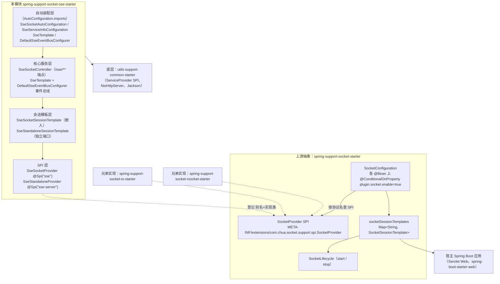
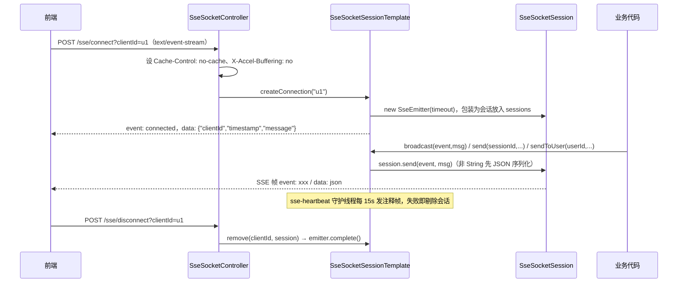

# spring-support-socket-sse-starter

SSE（Server-Sent Events）服务端单向推送实现：把 Spring MVC 的 `SseEmitter` 适配为 `SocketSessionTemplate`，经 `spring-support-socket-starter` 的 `SocketProvider` SPI 注册 `sse`（嵌入主应用 Servlet 端口）与 `sse-server`（`NioHttpServer` 独立端口）两种协议；另提供一套不依赖 Socket 抽象的事件总线（`SseTemplate` + `DefaultSseEventBusConfigurer`）。在 spring-support 体系中，它是 Socket 家族里最轻量的单向推送实现，与 socketio、rsocket 兄弟模块并列，共享同一套会话模板口径。

## 1. 架构图



## 2. 核心流程图

嵌入模式「连接建立 → 业务推送 → 心跳保活 → 断开」的数据流：



独立端口模式（`sse-server`）数据流一致，差别只在连接承载：`SseStandaloneSessionTemplate` 用 `NioHttpServer` 在 `plugin.socket.room[0].port` 监听 `POST /sse/connect`，连接线程为虚拟线程，写操作经每连接一个的 `LinkedBlockingQueue` 串行写出。

## 3. 能力清单

| 能力域 | 关键类 | 入口/触发方式 |
|---|---|---|
| 嵌入式 SSE 协议 SPI | `SseSocketProvider`（`@Spi("sse")`，`SocketProtocol.SSE`） | `META-INF/extensions/com.chua.socket.support.spi.SocketProvider`，由 `SocketConfiguration` 按协议名加载 |
| 独立端口 SSE 协议 SPI | `SseStandaloneProvider`（`@Spi("sse-server")`，`SocketProtocol.SSE_SERVER`，默认端口 29612） | 同上（`sse-server=...` 行） |
| 统一会话模板 | `SseSocketSessionTemplate` / `SseStandaloneSessionTemplate`（实现 `SocketSessionTemplate`） | 注入 `Map<String, SocketSessionTemplate>` 取 `sse`，或注入 `@Primary` 的 `SocketSessionTemplate` |
| HTTP 端点（嵌入模式） | `SseSocketController`：`POST /sse/connect`、`GET /sse/status`、`POST /sse/bind`、`POST /sse/disconnect` | `SseSocketAutoConfiguration` 注册，前端直接访问 |
| 独立端口 HTTP 服务 | `SseStandaloneSessionTemplate`（`NioHttpServer`，仅 `POST /sse/connect`） | `plugin.socket.protocols` 含 `sse-server` |
| 连接管理 | `createConnection(clientId)`：空 clientId 自动生成 uuid、先关旧连接、立即推 `connected` 事件 | 内置端点或自定义 Controller |
| 事件总线 | `SseTemplate`：`emit(...)`、`createSseEmitter(Emitter)`、`getEmitter(event)`、`closeEmitter(clientIds)` | 自动装配 Bean，直接注入 |
| 连接注册表 | `DefaultSseEventBusConfigurer`（`static` `ConcurrentHashMap` 缓存） | 由 `SseTemplate` 内部使用 |
| 消息模型 | `SseMessage`、`SseMessageType`（NOTIFY/NOTIFY_HTML/PROCESS/FINISH）、`SseMessageStatus`（SUCCESS/ERROR/WARN）、`Emitter` | `SseTemplate.emit(SseMessage, ...)` |
| 服务信息 | `SseServiceInfoConfiguration` → `sseServiceInfoContributor`（注册 `sse` 标记） | 自动装配 |
| 心跳保活 | 两模板各每 15s 发 SSE 注释帧（`sse-heartbeat` 守护线程 / 虚拟线程 park 超时） | 随 `start()` 启动，间隔硬编码不可配 |
| native-image | `reflect-config.json`（`SseSocketProvider` 全量反射）、`resource-config.json`（含 `META-INF/extensions/.*`） | `META-INF/native-image/com.chua/spring-support-socket-sse-starter/` |

## 4. Bean 能力矩阵

本模块经 `AutoConfiguration.imports` 注册 4 个 Bean：

| Bean 名 | 类型 | 装配条件 | 可否覆盖 | 典型用途 |
|---|---|---|---|---|
| `com.chua.starter.sse.support.SseTemplate`（全限定类名） | `SseTemplate` | imports 导入，单构造器注入，无条件 | 无 `@ConditionalOnMissingBean`；自定义同类型 Bean 会与之共存，按类型注入冲突需 `@Primary` | 业务侧 SSE 事件总线推送 |
| `com.chua.starter.sse.support.DefaultSseEventBusConfigurer` | `DefaultSseEventBusConfigurer` | imports 导入，无参构造，无条件 | 同上 | 连接注册表，一般经 `SseTemplate` 间接使用 |
| `sseServiceInfoContributor` | `ServiceInfoContributor` | `SseServiceInfoConfiguration` 的 `@Bean`，无条件 | 同上 | 服务信息面板注册 `sse` 标记 |
| `sseSocketController` | `SseSocketController` | `SseSocketAutoConfiguration` 的 `@Bean`，`@AutoConfigureAfter(SocketConfiguration.class)`；运行时从模板 Map 取 `sse` 且为 `SseSocketSessionTemplate` 才创建，否则返回 `null` 不注册 | 同上 | 前端 HTTP 访问 `/sse/**` |

> `SseSocketSessionTemplate` / `SseStandaloneSessionTemplate` 本身不是独立 Bean，只能经上游 `SocketConfiguration` 产出的 `socketSessionTemplates` Map 或 `@Primary socketSessionTemplate` 获取；上游 Bean（含 `socketLifecycle`）均在 `plugin.socket.enable=true` 时注册。

## 5. 完整配置

本模块没有自己的 `@ConfigurationProperties`，全部复用上游 `SocketProperties`（前缀 `plugin.socket`）。**不存在 `plugin.sse.*` 配置**，配了不生效。

| 配置路径 | 类型 | 默认值 | 说明（本模块视角） |
|---|---|---|---|
| `plugin.socket.enable` | `boolean` | `false` | 总开关；`false` 时无模板、无 `/sse/**` 端点 |
| `plugin.socket.auto-start` | `boolean` | `true` | 随容器启动 `start()`（嵌入拉起心跳，独立开始监听端口） |
| `plugin.socket.protocol` | `SocketProtocol` | `SSE` | 单协议模式，可选 `socketio`/`rsocket`/`sse`/`sse-server` |
| `plugin.socket.protocols` | `List<ProtocolConfig>` | `[]` | 多协议模式，配置后覆盖 `protocol` 与 `room` |
| `plugin.socket.room` | `List<Room>` | `[]` | 房间/实例配置；仅 `sse-server` 读 `room[].port` |
| `plugin.socket.host` | `String` | `0.0.0.0` | 监听地址，仅 `sse-server` 读取 |
| `plugin.socket.ping-timeout` | `int` | `60000` | 嵌入模式下作为 `SseEmitter` 连接超时（毫秒），`<=0` 回落 30 分钟；`sse-server` 不读 |
| `plugin.socket.ping-interval` | `int` | `25000` | Socket.IO 心跳间隔，SSE 不读（SSE 心跳固定 15s） |
| `plugin.socket.codec-type` | `String` | `json` | 编解码器，SSE 不读 |
| `plugin.socket.max-frame-size` | `int` | `1048576` | 最大帧大小，SSE 不读 |
| `plugin.socket.boss-count` / `work-count` | `int` | `1` / `100` | Netty 线程数，SSE 不读 |
| `plugin.socket.allow-custom-requests` | `boolean` | `true` | SSE 不读 |
| `plugin.socket.auth-factory` | `String` | 空 | SSE 不读；鉴权需自行在 Controller/网关处理 |
| `plugin.socket.use-linux-native-epoll` | `boolean` | `false` | SSE 不读 |

嵌套结构：

| 配置路径 | 类型 | 默认值 | 说明 |
|---|---|---|---|
| `plugin.socket.protocols[n].protocol` | `SocketProtocol` | `SOCKETIO` | 该协议项类型，可填 `sse` / `sse-server` |
| `plugin.socket.protocols[n].room` | `List<Room>` | `[]` | 该协议的房间列表 |
| `plugin.socket.room[n].client-id` | `String` | `default` | 实例标识 |
| `plugin.socket.room[n].context-path` | `String` | `/socket.io` | SSE 不使用 |
| `plugin.socket.room[n].port` | `int` | `-1` | `sse-server` 取第一个 `port>0` 的房间；全为 `-1`/未配置时回落默认 `29612`，不跟随主端口 |
| `plugin.socket.room[n].host` | `String` | 空 | 覆盖主 `host` |
| `plugin.socket.room[n].auth-factory` | `String` | 空 | 覆盖主 `auth-factory` |
| `plugin.socket.room[n].enable` | `boolean` | `true` | 是否启用该房间 |

## 6. 使用方式

```xml
<dependency>
    <groupId>com.chua</groupId>
    <artifactId>spring-support-socket-sse-starter</artifactId>
    <version>4.0.0.51</version>
</dependency>
```

最小启用（嵌入模式）：

```yaml
plugin:
  socket:
    enable: true
    protocol: sse          # 本就是默认值，可不写
    ping-timeout: 1800000  # SSE 连接超时 30 分钟（默认 60000）
```

内置 `/sse/connect` 是 POST（token 走请求头，不经 URL/网关日志），而原生 `EventSource` 只发 GET，业务侧通常自建 GET 桥接端点：

```java
@RestController
@RequestMapping("/push")
public class PushController {

    private final SseSocketSessionTemplate sse;

    public PushController(SocketSessionTemplate template) {
        this.sse = (SseSocketSessionTemplate) template; // protocol=sse 时即 SSE 模板
    }

    /** 前端订阅入口：EventSource 只支持 GET */
    @GetMapping(value = "/stream", produces = MediaType.TEXT_EVENT_STREAM_VALUE)
    public SseEmitter stream(@RequestParam(required = false) String clientId) {
        return sse.createConnection(clientId);
    }

    /** 广播 */
    @PostMapping("/broadcast")
    public void broadcast(@RequestParam String text) {
        sse.broadcast("notice", text);
    }
}
```

只用事件总线、不要 Socket 抽象时，直接注入 `SseTemplate`：`createSseEmitter(Emitter.builder().clientId(id).event("notice").build())` 订阅（内部 `new SseEmitter(0L)` 永不超时），`emit(SseMessage, clientIds)` 发布。

依赖说明：

| 依赖 | Scope | 缺失后果 |
|---|---|---|
| `com.chua:utils-support-common-starter` | compile（必需） | 模块不可用 |
| `com.chua:spring-support-socket-starter` | `optional` | Socket 侧全部不可用（无模板、无 `/sse/**` 端点）；仅 `SseTemplate` 事件总线仍可独立使用 |
| `org.springframework:spring-webmvc` | `provided` | 由宿主提供；非 Servlet Web 环境无 `SseEmitter`，模块不可用 |
| `jakarta.servlet:jakarta.servlet-api` | `provided` | 同上 |

宿主必须是 Servlet Web 环境（`spring-boot-starter-web`）；WebFlux 栈不支持。

## 7. 使用场景

适用：

- 服务端 → 客户端单向推送：通知公告、任务进度（`PROCESS`/`FINISH`）、告警、日志流、大屏刷新。
- 只想用 HTTP/1.1、不引入 WebSocket 基础设施，或需穿透仅放行 HTTP 的代理/网关。
- 已有 `spring-support-socket-starter` 生态，需与 socketio/rsocket 共用 `SocketSessionTemplate` 推送口径与 `socket:push` 队列桥接。
- 主应用连接紧张时，用 `sse-server` 把 SSE 长连接迁到独立端口。

不适用/慎用：

- 客户端 → 服务端高频上行、双向实时交互（SSE 单向，上行只能另走 HTTP 接口）。
- WebFlux 响应式栈；多实例部署且未做会话粘滞/跨实例广播（会话表是单机内存，事件总线还是 `static` 缓存）。

与相邻模块取舍：

| 模块 | 取舍 |
|---|---|
| `spring-support-socket-io-starter` | 双向、房间、鉴权、断线重连更完整；只需单向推送时 SSE 更轻 |
| `spring-support-socket-rsocket-starter` | 需要响应式双向流语义时选它 |
| `spring-support-socket-websocket-starter` | 独立 `plugin.websocket` 体系，不参与 `plugin.socket`，与本模块互不依赖 |

## 8. 扩展点

- **`SocketProvider` SPI（新增/替换协议实现）**：实现 `com.chua.socket.support.spi.SocketProvider`（`getProtocol()`、`createSessionTemplate(properties, listeners)`、`start(template)`、`stop(template)`、`supports(protocol)`），类上标 `@Spi("别名")`，并在 `META-INF/extensions/com.chua.socket.support.spi.SocketProvider` 登记 `别名=实现类全名`。本模块内置两个实现可作参考：

  ```properties
  sse=com.chua.starter.sse.support.socket.SseSocketProvider
  sse-server=com.chua.starter.sse.support.server.SseStandaloneProvider
  ```

  登记文件缺失时 `SocketConfiguration` 抛 `IllegalStateException`；native-image 下需同步补 `reflect-config.json` 与 `resource-config.json`。注意 `SseSocketProvider` 收到的 `List<SocketListener>` 未接线：SSE 无入站帧，`@OnConnect`/`@OnEvent`/`@OnDisconnect` 不会因 SSE 连接触发。
- **`SocketSessionTemplate` default 方法**：可覆盖 `protocol()`/`isReady()`/`supportsUserTargeting()` 等能力标记（嵌入模板 `protocol()` 返回 `unknown`、`supportsUserTargeting()` 返回 `false`；独立模板分别为 `sse`/`true`），也可覆盖 `sendBinary` 等默认抛错/空实现。
- **自定义 Bean**：替换 `SseTemplate` / `DefaultSseEventBusConfigurer`（注意第 4 节共存问题，需 `@Primary`）；绕过内置 `SseSocketController`，直接注入模板自建端点、鉴权与限流；用 `SseMessage.ext`、`Emitter.entity` 携带业务上下文。

## 9. 常见问题

1. **`/sse/connect` 404 或 `SseSocketController` 不存在（装配不生效）？** 逐项检查：`plugin.socket.enable` 是否 `true`；协议是否 `sse`（或 `protocols` 含 `sse`）；是否引入了本模块与 `spring-support-socket-starter`；SPI 登记文件是否存在。`sseSocketController` 取不到 `sse` 模板时返回 `null`，只会“安静地没有端点”。另外本模块没有 `plugin.sse.*` 前缀，任何 `plugin.sse.*` 配置都不存在，请用 `plugin.socket.*`。
2. **启动报 `未找到协议 [sse] 的 SPI 实现`？** `META-INF/extensions/com.chua.socket.support.spi.SocketProvider` 未随 jar 打包（或 native-image 裁掉了该资源），确认依赖完整且未被裁剪。
3. **原生 `EventSource` 连不上，或推送“攒一批才吐”、连接被掐断？** 内置端点仅 POST（token 走请求头），`EventSource` 只发 GET；改用支持 POST 的 SSE 客户端（`fetch` 流式解析、`@microsoft/fetch-event-source`）或按第 6 节自建 GET 桥接端点。控制器与独立服务均已设 `Cache-Control: no-cache`、`X-Accel-Buffering: no`；仍攒批则检查网关 `proxy_buffering` 与读超时（心跳 15s 硬编码）。嵌入模式超时 = `ping-timeout`（默认 60000ms，`<=0` 回落 30 分钟）；事件总线 `SseEmitter(0L)` 永不超时；`sse-server` 无该超时，靠心跳探活。
4. **与 Spring Boot 4 的兼容性、与兄弟模块共存？** 父 POM 继承 `spring-boot-starter-parent:4.1.2`；模块只用 `jakarta.servlet`、Spring MVC `SseEmitter`、`@AutoConfiguration`/`AutoConfiguration.imports`，无 `javax.*` 遗留，要求 Servlet Web 宿主。多协议部署时各协议模板共存于 Map，`@Primary socketSessionTemplate` 指向第一个；socketio 单协议部署不受本模块影响（`sseSocketController` 返回 `null` 不注册）。
