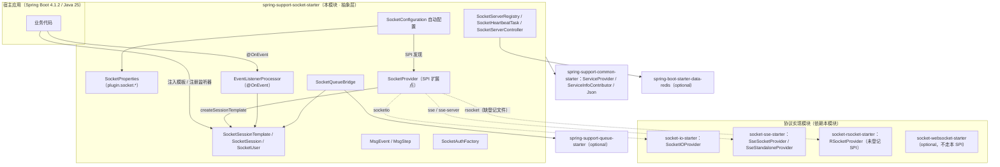
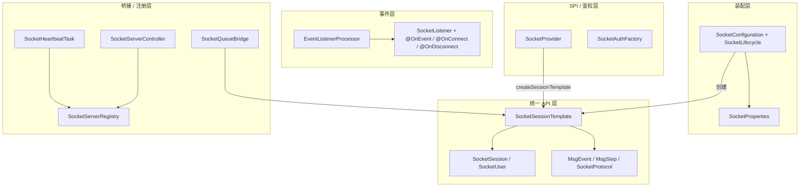
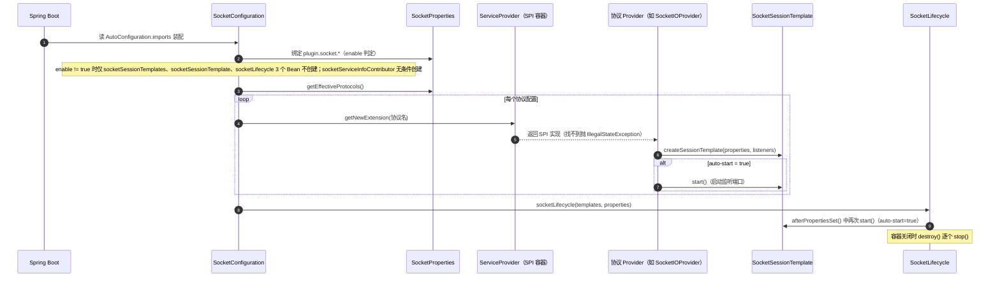
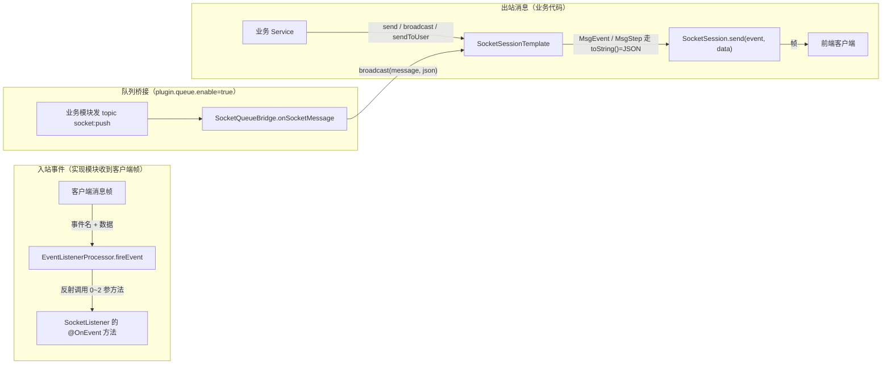

# spring-support-socket-starter

Socket 通信抽象层：只定义协议枚举、统一会话模型、SPI 发现机制与自动装配逻辑，自身**不包含任何传输实现**。具体协议由 `spring-support-socket-io-starter`、`spring-support-socket-sse-starter`（含独立端口 SSE）、`spring-support-socket-rsocket-starter` 提供。

基线（取自 POM）：`com.chua:spring-support-socket-starter:4.0.0.51`，父 POM `spring-support-parent-starter:4.0.0.51` → `spring-boot-starter-parent:4.1.2`（Spring Boot 4.1.2，2026-11-19 升级），Java 25。

## 1. 架构图

### 1.1 模块在体系中的位置



依赖方向单向：本模块不依赖任何实现模块，实现模块依赖本模块。`spring-support-socket-websocket-starter` 对本模块是 `optional` 依赖（注释：可选，如需统一抽象），自带 `plugin.websocket` 配置，不参与 `plugin.socket` 装配。

### 1.2 内部分层



## 2. 核心流程图

### 2.1 自动装配流程



### 2.2 消息收发与队列桥接数据流



## 3. 能力清单

| 能力域 | 关键类 | 入口 |
|---|---|---|
| 自动装配 | `SocketConfiguration`（含 `SocketLifecycle`） | `META-INF/spring/org.springframework.boot.autoconfigure.AutoConfiguration.imports` |
| 配置属性 | `SocketProperties` | `plugin.socket.*` |
| 协议枚举 | `SocketProtocol`（`socketio` / `rsocket` / `sse` / `sse-server`） | `plugin.socket.protocol` / `protocols[].protocol` |
| SPI 扩展点 | `SocketProvider` | `META-INF/extensions/com.chua.socket.support.spi.SocketProvider` + `ServiceProvider` |
| 统一会话操作 | `SocketSessionTemplate` | 注入 Bean（`@Primary` 默认模板） |
| 会话与用户模型 | `SocketSession`、`SocketUser` | `template.getSession(...)` / `session.getUser()` |
| 消息载体 | `MsgEvent`、`MsgStep` | `broadcast(event, msgEvent)`，序列化为 JSON 字符串 |
| 事件分发 | `EventListenerProcessor`、`@OnEvent` | 实现 `SocketListener` 的 Bean |
| 握手鉴权 | `SocketAuthFactory` | `plugin.socket.auth-factory`（实现模块加载） |
| 队列桥接 | `SocketQueueBridge` | `plugin.queue.enable=true`，订阅 topic `socket:push` |
| 服务端注册表 | `SocketServerRegistry`、`SocketHeartbeatTask` | Redis key `socket:servers:*`，30s 心跳 |
| 服务端查询端点 | `SocketServerController` | `GET /socket/servers`、`GET /socket/addresses` |
| 服务信息登记 | `socketServiceInfoContributor` → `ServiceInfoContributor` | 注册 `socket` 能力标志 |

本模块**无独立消息编解码类**：消息加密能力已移除（见第 9 节），`MsgEvent`/`MsgStep` 通过 `toString()`（JSON）出站，对象消息由 `Json.toJson` 序列化。

## 4. Bean 能力矩阵

`SocketConfiguration` 通过 `@EnableConfigurationProperties(SocketProperties.class)` 启用配置绑定，并通过 `@ComponentScan(basePackages = "com.chua.socket.support.bridge")` 扫描桥接包。本模块**没有** `spring.factories`，仅使用 `AutoConfiguration.imports` 注册。

| Bean 名 | 类型 | 装配条件 | 可否覆盖 | 典型注入姿势 |
|---|---|---|---|---|
| `socketSessionTemplates` | `Map<String, SocketSessionTemplate>`（协议名 → 模板） | `@ConditionalOnMissingBean` 且 `plugin.socket.enable=true`；某协议找不到 SPI 实现时抛 `IllegalStateException` | 可：自定义同类型 Bean 后该 Bean 退让 | `@Qualifier("socketSessionTemplates")` 注入，按协议名取模板 |
| `socketSessionTemplate` | `SocketSessionTemplate`（`@Primary`，取 map 中第一个协议） | `plugin.socket.enable=true`；模板映射为空时抛 `IllegalStateException` | 不退让（无 `@ConditionalOnMissingBean`）；需自定义 `@Primary` Bean 且避免同名 | 构造器直接注入 `SocketSessionTemplate` |
| `socketLifecycle` | `SocketConfiguration.SocketLifecycle`（`InitializingBean` + `DisposableBean`） | `plugin.socket.enable=true` | 否（开关打开即创建） | 一般不注入；`auto-start=true` 时启动、容器关闭时逐协议 `stop()` |
| `socketServiceInfoContributor` | `ServiceInfoContributor` | 无条件 | 否 | 一般不注入；向服务信息面板登记 `socket` 能力 |
| `socketQueueBridge`（组件扫描） | `SocketQueueBridge`（`@Component`） | 本模块 `@ComponentScan` 自动扫描 bridge 包；`@ConditionalOnProperty(plugin.queue.enable=true)`；`@ConditionalOnMissingBean(name="monitorSocketQueueBridge")` | 可：定义名为 `monitorSocketQueueBridge` 的 Bean 覆盖 | 不注入；业务只向 topic `socket:push` 发消息 |
| `socketServerRegistry`（宿主扫描） | `SocketServerRegistry`（`@Service`） | 宿主组件扫描覆盖 `com.chua.socket.support.session`；构造器需要 `RedisTemplate<String, Object>` | 可（常规组件） | 注入后调 `getAllOnlineServers()`；可子类化扩展 `getDatabaseServers()` |
| `socketHeartbeatTask`（宿主扫描） | `SocketHeartbeatTask`（`@Component`） | 宿主扫描覆盖 `com.chua.socket.support.schedule`，且宿主开启 `@EnableScheduling` | 可 | 一般不注入；每 30s 触发 `registry.heartbeat()` |
| `socketServerController`（宿主扫描） | `SocketServerController`（`@RestController`，`/socket/*`） | 宿主扫描覆盖 `com.chua.socket.support.controller`；宿主为 Web 环境 | 可 | 前端调用 `GET /socket/servers`、`GET /socket/addresses` |

说明：本模块自身的 `@ComponentScan` 只覆盖 `com.chua.socket.support.bridge`；`session` / `schedule` / `controller` 包下的 `@Service` / `@Component` / `@RestController` 依赖**宿主**组件扫描（宿主主类位于 `com.chua` 之下时默认覆盖）。

## 5. 完整配置

前缀固定为 `plugin.socket`（`SocketProperties.PRE`），`ignoreInvalidFields = true`。全部配置仅在 `plugin.socket.enable=true` 时驱动 Bean 创建；`auto-start` 决定是否在启动阶段自动监听端口。

### 5.1 顶层配置（`plugin.socket.*`）

| 配置路径 | 类型 | 默认值 | 说明 |
|---|---|---|---|
| `plugin.socket.enable` | `boolean` | `false` | 总开关；关闭时 `socketSessionTemplates` / `socketSessionTemplate` / `socketLifecycle` 均不创建 |
| `plugin.socket.auto-start` | `boolean` | `true` | 是否在容器启动阶段自动 `start()`；`false` 时模板 Bean 仍创建，仅跳过启动 |
| `plugin.socket.protocol` | `SocketProtocol` 枚举 | `SSE` | 单协议模式；可选 `socketio` / `rsocket` / `sse` / `sse-server` |
| `plugin.socket.protocols` | `List<ProtocolConfig>` | `[]` | 多协议模式；非空时忽略 `protocol` 与 `room`（`getEffectiveProtocols()` 优先返回） |
| `plugin.socket.room` | `List<Room>` | `[]` | 单协议模式下的服务实例（房间）列表 |
| `plugin.socket.host` | `String` | `0.0.0.0` | 默认监听地址 |
| `plugin.socket.codec-type` | `String` | `json` | 编解码类型 |
| `plugin.socket.max-frame-size` | `int` | `1048576` | 最大帧大小（字节，1MB） |
| `plugin.socket.boss-count` | `int` | `1` | Boss 线程数 |
| `plugin.socket.work-count` | `int` | `100` | 工作线程数 |
| `plugin.socket.allow-custom-requests` | `boolean` | `true` | 是否允许自定义请求 |
| `plugin.socket.ping-timeout` | `int` | `60000` | 心跳超时（毫秒）；SSE 实现把它当作连接超时 |
| `plugin.socket.ping-interval` | `int` | `25000` | 心跳间隔（毫秒） |
| `plugin.socket.auth-factory` | `String` | 空 | `SocketAuthFactory` 实现类全名（由实现模块负责加载） |
| `plugin.socket.use-linux-native-epoll` | `boolean` | `false` | 是否启用 Linux Epoll |

### 5.2 多协议项（`plugin.socket.protocols[]`，`ProtocolConfig`）

| 配置路径 | 类型 | 默认值 | 说明 |
|---|---|---|---|
| `plugin.socket.protocols[].protocol` | `SocketProtocol` 枚举 | `SOCKETIO` | 该组协议类型 |
| `plugin.socket.protocols[].room` | `List<Room>` | `[]` | 该组协议的实例列表，字段同 5.3 |

### 5.3 实例项（`plugin.socket.room[]` / `plugin.socket.protocols[].room[]`，`Room`）

| 配置路径 | 类型 | 默认值 | 说明 |
|---|---|---|---|
| `...room[].client-id` | `String` | `default` | 服务实例标识 |
| `...room[].context-path` | `String` | `/socket.io` | 上下文路径（Socket.IO 实现用作 `Configuration.context`） |
| `...room[].port` | `int` | `-1` | `-1`=复用实现侧主端口；`-2、-3…`=主端口+偏移（`getActualPort`：主端口+&#124;port&#124;-1）；正数=独立端口 |
| `...room[].host` | `String` | 空 | 为空则回落主配置 `host` |
| `...room[].auth-factory` | `String` | 空 | 该实例专属鉴权工厂类名 |
| `...room[].enable` | `boolean` | `true` | 是否启用该实例 |

> 历史上的 `encrypt-enabled` / `encrypt-mode` / `encrypt-key` 配置已随消息加密能力一起删除，当前 `SocketProperties` 中不存在这些字段。

### 5.4 相邻开关

| 开关 | 归属 | 作用 |
|---|---|---|
| `plugin.queue.enable` | `spring-support-queue-starter`（默认 `false`） | 打开后 `SocketQueueBridge` 才会注册并监听 `socket:push` |
| `plugin.websocket.*` | `spring-support-socket-websocket-starter` | 独立 WebSocket 实现，不走本模块装配 |

示例（单协议）：

```yaml
plugin:
  socket:
    enable: true
    protocol: socketio
    room:
      - client-id: default
        port: 9000
        context-path: /socket.io
```

示例（多协议同时启用）：

```yaml
plugin:
  socket:
    enable: true
    protocols:
      - protocol: socketio
        room:
          - client-id: chat
            port: 9000
      - protocol: sse
        room:
          - client-id: push
            port: 9001
```

## 6. 使用方式

### 6.1 Maven 坐标

```xml
<dependency>
    <groupId>com.chua</groupId>
    <artifactId>spring-support-socket-starter</artifactId>
    <version>4.0.0.51</version>
</dependency>
```

### 6.2 依赖说明

| 依赖 | 作用 | 是否可选 |
|---|---|---|
| `com.chua:spring-support-common-starter` | 日志、SPI 容器（`ServiceProvider`）、`ServiceInfoContributor`、`Json` | 否 |
| `org.springframework.boot:spring-boot-starter` | Spring 基础容器 | 否 |
| `org.springframework.boot:spring-boot-configuration-processor` | 生成配置元数据 | 是（`optional`，仅编译期） |
| `com.chua:spring-support-queue-starter` | `SocketQueueBridge` 的队列监听能力（`Message` / `@QueueListener`） | 是（`optional`） |
| `org.springframework.boot:spring-boot-starter-data-redis` | `SocketServerRegistry` 的动态注册 | 是（`optional`） |

本模块**不含网络传输实现**：只引入它并设置 `plugin.socket.enable=true`，装配时会因找不到 `SocketProvider` 抛 `IllegalStateException`。

### 6.3 最小可运行示例

**第一步：引入本模块 + 至少一个实现模块。**

```xml
<dependency>
    <groupId>com.chua</groupId>
    <artifactId>spring-support-socket-starter</artifactId>
    <version>4.0.0.51</version>
</dependency>
<dependency>
    <groupId>com.chua</groupId>
    <artifactId>spring-support-socket-io-starter</artifactId>
    <version>4.0.0.51</version>
</dependency>
```

**第二步：配置开关、协议与 room。**

```yaml
plugin:
  socket:
    enable: true
    protocol: socketio
    room:
      - client-id: default
        port: 9000
```

**第三步：注入 `SocketSessionTemplate` 发消息。**

```java
@Service
public class PushService {
    private final SocketSessionTemplate template;

    public PushService(SocketSessionTemplate template) {
        this.template = template;
    }

    public void notifyAll(String text) {
        template.broadcast("notice", text);
    }
}
```

### 6.4 模板调用速查

`SocketSessionTemplate` 是接口，**本模块无链式 API**，按步骤使用：

1. 注入 `SocketSessionTemplate`（`@Primary`，即第一个协议的模板）；多协议时注入 `@Qualifier("socketSessionTemplates") Map<String, SocketSessionTemplate>` 按协议名取。
2. 单播：`send(sessionId, event, msg)`；对象重载 `sendObject(sessionId, event, obj)` 用 `Json.toJson` 序列化。
3. 广播：`broadcast(event, msg)`；对象用 `broadcastObject(event, obj)`，`MsgEvent` / `MsgStep` 走各自 `toString()`（JSON）。
4. 按用户：`sendToUser(userId, event, msg)`；是否真能送达取决于实现的 `supportsUserTargeting()`。
5. 查询：`getOnlineSessions()`、`getOnlineCount()`、`getOnlineSession(type, roomId)`、`getOnlineUsers(type)`。
6. 二进制：`sendBinary(sessionId, event, bytes)`、`broadcastBinary(event, bytes)`、`sendBinaryToUser(userId, event, bytes)`（默认把字节 Base64 后走文本发送）。
7. 生命周期：`start()` / `stop()`；健康判断 `isReady()`、协议名 `protocol()`。

```java
@Service
public class SessionQueryService {
    private final SocketSessionTemplate template;

    public SessionQueryService(SocketSessionTemplate template) {
        this.template = template;
    }

    public void report() {
        log.info("protocol={}, ready={}, online={}",
                template.protocol(), template.isReady(), template.getOnlineCount());
        template.getOnlineSessions().forEach(s -> template.send(s.getId(), "ping", "1"));
    }
}
```

事件处理（事件名必须与 `@OnEvent` 的 `value` 一致，实现模块把该事件注册为入站事件）：

```java
@Component
public class ChatListener implements SocketListener {

    @OnEvent("chat.send")
    public void onChat(SocketSession session, String payload) {
        log.info("session={}, payload={}", session.getId(), payload);
    }
}
```

`EventListenerProcessor` 支持 0~2 个参数：参数为 `SocketSession` 时注入会话，否则注入消息体；超过 2 个参数只记 WARN 不调用。

## 7. 使用场景

### 7.1 适用

- 向浏览器/前端实时推送：聊天、任务进度（`MsgStep`）、告警、状态变更。
- 一套业务代码需要在多种推送协议间切换或**同时启用多协议**（`protocols`）。
- 同一服务暴露多个 Socket 实例（`room`：多端口 / 多上下文路径）。
- 业务方只想发消息、不想依赖 Socket API：向队列 topic `socket:push` 发 JSON，由 `SocketQueueBridge` 广播。
- 需要按协议统一健康判断、在线会话统计等能力接口。

### 7.2 不适用

- 纯后端服务间通信：用 `spring-support-queue-starter` / RPC，而不是 Socket。
- 需要原生 WebSocket 完整语义（子协议协商、独立配置体系）：直接用 `spring-support-socket-websocket-starter`（`plugin.websocket`）。
- classpath 上没有任何实现模块：只有本抽象层无法工作（装配期抛异常，不会静默降级）。

### 7.3 与相邻模块的取舍

| 模块 | 协议别名 | 端口形态 | 特点与取舍 |
|---|---|---|---|
| `spring-support-socket-starter`（本模块） | — | — | 抽象层、装配与 SPI；单独使用无传输能力 |
| `spring-support-socket-io-starter` | `socketio` | 独立端口（默认 9000） | netty-socketio 实现，功能最全，支持房间/ACK |
| `spring-support-socket-sse-starter` | `sse` | 复用主应用 HTTP 端口 | 单向推送，部署最简单 |
| `spring-support-socket-sse-starter` | `sse-server` | 独立端口 SSE | 事件流由本进程单独监听，不占主应用 Tomcat |
| `spring-support-socket-rsocket-starter` | `rsocket` | 复用 WebSocket 通道 | 基于 Spring WebSocket 文本通道；**SPI 未登记**，直接配置会失败（见第 9 节） |
| `spring-support-socket-websocket-starter` | 无 | 同应用端口 | 独立实现，`plugin.websocket` 配置，不参与本模块 SPI |

## 8. 扩展点

### 8.1 SPI：`SocketProvider`

接口定义（`@Spi("socketio")` 为默认别名，实现类用 `getProtocol()` 声明实际协议）：

| 方法 | 作用 |
|---|---|
| `getProtocol()` | 返回 `SocketProtocol` |
| `createSessionTemplate(SocketProperties, List<SocketListener>)` | 创建该协议的会话模板 |
| `start(SocketSessionTemplate)` | 启动服务 |
| `stop(SocketSessionTemplate)` | 停止服务 |
| `supports(SocketProtocol)`（default） | 默认按 `getProtocol() == protocol` 判断 |

生效链路：`SocketConfiguration.socketSessionTemplates` → `ServiceProvider.of(SocketProvider.class).getNewExtension(协议名)` → `createSessionTemplate(...)` → `auto-start=true` 时 `provider.start(template)`。找不到实现抛 `IllegalStateException("未找到协议 [xxx] 的 SPI 实现...")`。

本仓库现有登记（`META-INF/extensions/com.chua.socket.support.spi.SocketProvider`，格式 `别名=实现类全名`）：

| 别名 | 实现类 | 所在模块 |
|---|---|---|
| `socketio` | `com.chua.socketio.support.spi.SocketIOProvider` | `spring-support-socket-io-starter` |
| `sse` | `com.chua.starter.sse.support.socket.SseSocketProvider` | `spring-support-socket-sse-starter` |
| `sse-server` | `com.chua.starter.sse.support.server.SseStandaloneProvider` | `spring-support-socket-sse-starter` |
| `rsocket` | `com.chua.rsocket.support.spi.RSocketProvider` | `spring-support-socket-rsocket-starter`（**类存在但未登记 extensions 文件**） |

新增协议三步：**实现 → 登记 → 枚举**。

1. 实现 `SocketProvider`，别名必须与 `SocketProtocol` 的 `value` 一致：

```java
@Spi("myproto")
public class MySocketProvider implements SocketProvider {

    @Override
    public SocketProtocol getProtocol() {
        return SocketProtocol.SSE; // 需同时扩展枚举才能配置 myproto
    }

    @Override
    public SocketSessionTemplate createSessionTemplate(SocketProperties properties, List<SocketListener> listeners) {
        return new MySessionTemplate(properties, listeners);
    }

    @Override
    public void start(SocketSessionTemplate template) {
        template.start();
    }

    @Override
    public void stop(SocketSessionTemplate template) {
        template.stop();
    }
}
```

2. 在实现模块登记 `src/main/resources/META-INF/extensions/com.chua.socket.support.spi.SocketProvider`：

```properties
myproto=com.example.socket.MySocketProvider
```

3. 若使用 GraalVM native-image，同步补 `META-INF/native-image/<groupId>/<artifactId>/reflect-config.json`（参考 socket-io / sse 模块现成文件），否则反射构造会失败。

> 注意：`protocol` / `protocols[].protocol` 的类型是 `SocketProtocol` 枚举，新增协议必须先在枚举里加值（如 `MYPROTO("myproto")`），单靠 SPI 别名无法配置；`SocketProtocol.of(...)` 对未知值回落 `SOCKETIO`。

### 8.2 事件监听：`SocketListener` + `@OnEvent`

实现 `SocketListener` 的 Bean 会被 `EventListenerProcessor` 扫描，`@OnEvent("事件名")` 方法在实现模块收到对应入站事件时被反射调用。方法参数 0~2 个：`SocketSession` 注入会话，其余注入消息体；超过 2 个参数只记 WARN。`@OnConnect` / `@OnDisconnect` 已定义但**当前未接线**。

### 8.3 握手鉴权：`SocketAuthFactory`

```java
public interface SocketAuthFactory {
    boolean isAuthorized(Map<String, Object> handshakeData);
    SocketUser getUser(Map<String, Object> handshakeData);
}
```

实现类全名通过 `plugin.socket.auth-factory`（或 `room[].auth-factory`）下发给实现模块，在握手阶段校验并组装 `SocketUser`。握手数据键常量见 `SocketSessionTemplate.HANDSHAKE_HEADERS`（`headers`）与 `HANDSHAKE_QUERY`（`query`）。

### 8.4 模板 default 方法

`SocketSessionTemplate` 的以下 default 方法可按需覆盖：`isReady()`（默认 `true`）、`protocol()`（默认 `"unknown"`）、`supportsUserTargeting()`（默认 `false`）、`sendBinary*` / `broadcastBinary` / `sendBinaryToUser`（默认 Base64 转文本）、`sendObject` / `broadcastObject` / `sendToUserObject`。

### 8.5 注册表数据源

`SocketServerRegistry.getDatabaseServers()` 为 `protected`，默认返回空列表；可子类化合并数据库侧的 Socket 服务配置，`/socket/servers` 会自动去重合并。

## 9. 常见问题

1. **启动报 `[Socket] 未找到协议 [xxx] 的 SPI 实现`**：只引了本抽象层、没引实现模块；或配置了 `rsocket`（该实现类存在但未登记 extensions 文件）。引 `spring-support-socket-io-starter` / `spring-support-socket-sse-starter`，或按 rsocket 模块 README 补登记。
2. **配置了 `plugin.socket` 却没有模板 Bean**：`enable` 未设为 `true`；或容器里已有同类型 Bean 触发 `@ConditionalOnMissingBean` 退让。注意 `enable=false`（默认）时本模块不产出任何模板 Bean。
3. **想先启动应用、稍后手动开 Socket**：`plugin.socket.auto-start=false`。模板 Bean 仍会创建，但跳过自动 `start()`，由外部逻辑显式控制。
4. **`GET /socket/servers` 404**：`SocketServerController` 不在本模块的 `@ComponentScan`（只扫 bridge 包）内，需要宿主组件扫描覆盖 `com.chua.socket.support.controller`（宿主主类在 `com.chua` 之下时默认覆盖），且宿主为 Web 环境（`spring-webmvc` 由 `spring-support-common-starter` 传递提供）。
5. **Redis 注册/心跳不工作**：`SocketServerRegistry` 构造器要求 `RedisTemplate<String, Object>`（需引入 `spring-boot-starter-data-redis` 并配置连接）；`SocketHeartbeatTask` 的 `@Scheduled(fixedDelay=30s)` 需要宿主开启 `@EnableScheduling`，本模块自身没有 `@EnableScheduling`。
6. **队列桥接不广播**：检查 `plugin.queue.enable=true`（`SocketQueueBridge` 的装配条件）、Socket 模板是否可用（`enable=true` 且实现模块在），以及消息是否发往 topic `socket:push`。payload 非 JSON 对象时按 `module=system / event=message` 原样透传。
7. **端口怎么算**：`room[].port=-1` 复用实现侧主端口；`-2、-3…` 为主端口+偏移（`getActualPort`：主端口+`|port|-1`）；正数为独立端口。`SocketServerRegistry` 在无 room 或端口非正数时按 `9000` 兜底。
8. **与 Spring Boot 4 的兼容性**：本模块通过 `META-INF/spring/org.springframework.boot.autoconfigure.AutoConfiguration.imports` 注册（未使用 Boot 3 起已移除的 `spring.factories` 自动配置），在 Spring Boot 4.1.2 + Java 25 下按标准机制装配；实现模块需使用同一 Boot 4 基线。
9. **`encrypt-*` 配置无效**：消息加密已移除（旧 `SocketMessageCodec` 依赖无实现的 `CodecKeyPair`，已连同 `SocketEncryptMode`、`encrypt-*` 配置删除）。需要消息机密性请走 TLS，或用 `SessionCipher` 自定义会话层。
10. **`@OnConnect` / `@OnDisconnect` 不触发**：两个注解已定义，但 `EventListenerProcessor` 只扫描 `@OnEvent`，连接/断开回调当前不可依赖。
11. **`sendToUser` 没送到**：`SocketSessionTemplate.supportsUserTargeting()` 默认 `false`，只有实现模块在握手阶段建立可信身份后才返回 `true`；否则应继续广播。
12. **`isReady()` 返回 true 但连不上**：`isReady()` 默认 `true`，仅 Socket.IO 实现按实际服务端实例数判断；SSE / RSocket 未覆盖该默认值，端口未就绪也可能报就绪。以 `room[].port` / 实现模块日志为准排查端口占用。
