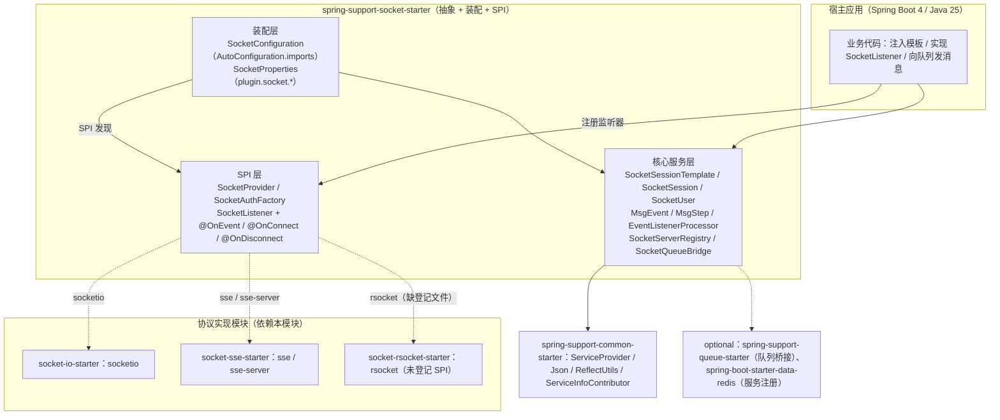
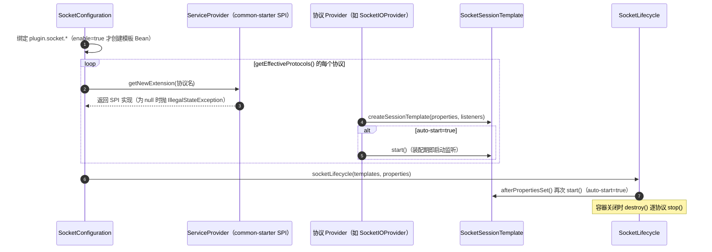

# spring-support-socket-starter

Socket 通信抽象层：定义协议枚举、统一会话模型、SPI 发现机制与自动装配；自身仅内置一套 NDJSON（jsonl）传输实现，其余传输实现由实现模块提供。在 spring-support 体系中，它是所有 Socket/推送能力（socketio / sse / sse-server / rsocket / ndjson）的公共契约与装配入口；具体协议由 `spring-support-socket-io-starter`、`spring-support-socket-sse-starter`、`spring-support-socket-rsocket-starter` 等实现模块提供，依赖方向恒为实现模块依赖本模块。基线：`com.chua:spring-support-socket-starter:4.0.0.51`，父 POM `spring-support-parent-starter:4.0.0.51`（Spring Boot 4.1.2，Java 25）。

## 1. 架构图



依赖方向单向：本模块不依赖任何实现模块。`spring-support-socket-websocket-starter` 自带 `plugin.websocket` 配置体系，不参与 `plugin.socket` 装配。例外：`ndjson` 协议的 Provider 与连接端点由本模块内置（`NdjsonSocketProvider` / `NdjsonSocketController`），无需额外依赖即可启用。

## 2. 核心流程图



## 3. 能力清单

| 能力域 | 关键类 | 入口/触发方式 |
|---|---|---|
| 自动装配 | `SocketConfiguration`（内含 `SocketLifecycle`） | `META-INF/spring/...AutoConfiguration.imports`（无 `spring.factories`） |
| 配置属性 | `SocketProperties` | `plugin.socket.*`，`ignoreInvalidFields=true` |
| 协议枚举 | `SocketProtocol`：`socketio` / `rsocket` / `sse` / `sse-server` / `ndjson`（别名 `jsonl`） | `plugin.socket.protocol` / `protocols[].protocol` |
| SPI 扩展点 | `SocketProvider` | `META-INF/extensions/com.chua.socket.support.spi.SocketProvider`，经 `ServiceProvider` 发现 |
| 内置 NDJSON 传输 | `NdjsonSocketProvider` / `NdjsonSocketSessionTemplate` | 本模块 extensions 文件登记 `ndjson`，配置 `protocol: ndjson` 即用 |
| 统一会话操作 | `SocketSessionTemplate` | 注入 Bean（`@Primary` 默认模板） |
| 会话/用户模型 | `SocketSession`、`SocketUser` | `template.getSession(...)`、`session.getUser()` |
| 消息载体 | `MsgEvent`、`MsgStep` | `broadcast(event, msgEvent)`，`toString()` 输出 JSON |
| 事件分发 | `EventListenerProcessor` + `@OnEvent` | 实现 `SocketListener` 的 Bean 被收集后交给 Provider |
| 握手鉴权 | `SocketAuthFactory` | `plugin.socket.auth-factory`（由实现模块加载） |
| 队列→Socket 桥接 | `SocketQueueBridge` | `plugin.queue.enable=true`，订阅 topic `socket:push` |
| 服务端注册/发现 | `SocketServerRegistry`、`SocketHeartbeatTask` | Redis key `socket:servers:*`，30s 心跳、120s 判离线 |
| 查询端点 | `SocketServerController` | `GET /socket/servers`、`GET /socket/addresses` |
| NDJSON 连接端点 | `NdjsonSocketController`（经 `NdjsonSocketAutoConfiguration` 装配） | `POST /ndjson/connect`、`GET /ndjson/status`、`POST /ndjson/bind`、`POST /ndjson/disconnect` |
| 服务信息登记 | `socketServiceInfoContributor` → `ServiceInfoContributor` | 无条件注册 `socket` 能力标志 |

本模块无消息编解码类：对象消息由 `Json.toJson` 序列化，`MsgEvent`/`MsgStep` 走 `toString()`（JSON）出站。

## 4. Bean 能力矩阵

`SocketConfiguration` 通过 `@EnableConfigurationProperties(SocketProperties.class)` 绑定配置，`@ComponentScan(basePackages = "com.chua.socket.support.bridge")` 只扫桥接包；`session` / `schedule` / `controller` 包下的组件依赖**宿主**组件扫描（宿主主类位于 `com.chua` 之下时默认覆盖）。

| Bean 名 | 类型 | 装配条件（含默认值） | 可否覆盖 | 典型用途 |
|---|---|---|---|---|
| `socketSessionTemplates` | `Map<String, SocketSessionTemplate>`（协议名→模板） | `plugin.socket.enable=true`（默认 false）且 `@ConditionalOnMissingBean`；某协议缺 SPI 实现抛 `IllegalStateException` | 可：自定义同类型 Bean 后退让 | 多协议时按协议名取模板 |
| `socketSessionTemplate` | `SocketSessionTemplate`（`@Primary`，取 map 中第一个协议） | `plugin.socket.enable=true`；map 为空抛 `IllegalStateException` | 不退让（无 `@ConditionalOnMissingBean`）；自定义同类型 Bean 与之并存但不会顶替本 Bean（按类型注入仍命中 `@Primary`），需用 `@Qualifier` 指定自定义 Bean 名 | 业务直接注入发消息 |
| `socketLifecycle` | `SocketConfiguration.SocketLifecycle`（`InitializingBean`+`DisposableBean`） | `plugin.socket.enable=true` | 否 | `auto-start=true` 时启动，容器关闭逐协议 `stop()` |
| `socketServiceInfoContributor` | `ServiceInfoContributor` | 无条件 | 否 | 向服务信息面板登记 `socket` 能力 |
| `socketQueueBridge`（模块扫描） | `SocketQueueBridge`（`@Component`） | `plugin.queue.enable=true`（默认 false）且无名为 `monitorSocketQueueBridge` 的 Bean | 可：定义名为 `monitorSocketQueueBridge` 的 Bean 覆盖 | 业务只向 `socket:push` 发 JSON 即广播前端 |
| `socketServerRegistry`（宿主扫描） | `SocketServerRegistry`（`@Service`） | 宿主扫描覆盖 `...support.session`；构造器需 `RedisTemplate<String,Object>` | 可（常规组件） | Socket 服务动态注册与地址发现 |
| `socketHeartbeatTask`（宿主扫描） | `SocketHeartbeatTask`（`@Component`） | 宿主扫描覆盖 `...support.schedule`，且宿主开启 `@EnableScheduling` | 可 | 每 30s 触发 `registry.heartbeat()` |
| `socketServerController`（宿主扫描） | `SocketServerController`（`@RestController`） | 宿主扫描覆盖 `...support.controller`，Web 环境 | 可 | 前端查询 `/socket/servers`、`/socket/addresses` |
| `ndjsonSocketController`（`NdjsonSocketAutoConfiguration`） | `NdjsonSocketController`（`@RestController`） | `plugin.socket.enable=true` 且 `socketSessionTemplates` 含 `ndjson` 模板；否则 Bean 方法返回 null、不注册 | 否 | NDJSON 长连接端点 `/ndjson/*` |

注：`EventListenerProcessor` 不是 Spring Bean，由实现模块在 `createSessionTemplate` 时以 `List<SocketListener>` 构造。

## 5. 完整配置

前缀固定为 `plugin.socket`（`SocketProperties.PRE`），`ignoreInvalidFields=true`。所有模板 Bean 仅在 `plugin.socket.enable=true` 时创建。

`plugin.socket.*` 顶层：

| 配置路径 | 类型 | 默认值 | 说明 |
|---|---|---|---|
| `plugin.socket.enable` | `boolean` | `false` | 总开关；关闭时 3 个模板/生命周期 Bean 均不创建 |
| `plugin.socket.auto-start` | `boolean` | `true` | 是否随容器启动自动 `start()`；false 时模板仍创建、仅跳过启动 |
| `plugin.socket.protocol` | `SocketProtocol` | `SSE` | 单协议模式；可选 `socketio` / `rsocket` / `sse` / `sse-server` |
| `plugin.socket.protocols` | `List<ProtocolConfig>` | `[]` | 多协议模式；非空时忽略 `protocol` 与 `room`（`getEffectiveProtocols()` 优先返回） |
| `plugin.socket.room` | `List<Room>` | `[]` | 单协议模式的实例（房间）列表 |
| `plugin.socket.host` | `String` | `0.0.0.0` | 默认监听地址 |
| `plugin.socket.codec-type` | `String` | `json` | 编解码类型 |
| `plugin.socket.max-frame-size` | `int` | `1048576` | 最大帧大小（字节） |
| `plugin.socket.boss-count` | `int` | `1` | Boss 线程数 |
| `plugin.socket.work-count` | `int` | `100` | 工作线程数 |
| `plugin.socket.allow-custom-requests` | `boolean` | `true` | 是否允许自定义请求 |
| `plugin.socket.ping-timeout` | `int` | `60000` | 心跳超时（毫秒） |
| `plugin.socket.ping-interval` | `int` | `25000` | 心跳间隔（毫秒） |
| `plugin.socket.auth-factory` | `String` | 空 | `SocketAuthFactory` 实现类全名 |
| `plugin.socket.use-linux-native-epoll` | `boolean` | `false` | 是否启用 Linux Epoll |

`plugin.socket.protocols[]`（`ProtocolConfig`）与 `plugin.socket.room[]`（`Room`）：

| 配置路径 | 类型 | 默认值 | 说明 |
|---|---|---|---|
| `...protocols[].protocol` | `SocketProtocol` | `SOCKETIO` | 该组协议类型 |
| `...protocols[].room` | `List<Room>` | `[]` | 该组协议的实例列表，字段同下 |
| `...room[].client-id` | `String` | `default` | 服务实例标识 |
| `...room[].context-path` | `String` | `/socket.io` | 上下文路径 |
| `...room[].port` | `int` | `-1` | `-1`=实现侧主端口；`-2、-3…`=主端口+偏移（-2 即主端口+1）；正数=独立端口 |
| `...room[].host` | `String` | 空 | 为空回落主配置 `host` |
| `...room[].auth-factory` | `String` | 空 | 该实例专属鉴权工厂类名 |
| `...room[].enable` | `boolean` | `true` | 是否启用该实例 |

相邻开关：`plugin.queue.enable`（`spring-support-queue-starter`，默认 `false`）打开后 `SocketQueueBridge` 才装配并监听 `socket:push`；`plugin.websocket.*` 属 `spring-support-socket-websocket-starter`，独立 WebSocket 实现，不走本模块装配。

单协议最小配置：

```yaml
plugin:
  socket:
    enable: true
    protocol: socketio
    room:
      - client-id: default
        port: 9000
        context-path: /socket.io
```

多协议同时启用时改用 `protocols` 列表，每项含 `protocol` 与 `room`（见上表），例如 socketio 占 9000、sse 占 9001。

### 5.1 逐项配置示例（按功能分组）

**① 总开关与生命周期**

| 配置项 | 含义 | 默认值 |
|---|---|---|
| `plugin.socket.enable` | 总开关；`false` 时不创建任何会话模板/生命周期 Bean | `false` |
| `plugin.socket.auto-start` | 是否随容器启动自动 `start()`；`false` 时模板仍创建、仅跳过自动启动 | `true` |

```yaml
plugin:
  socket:
    enable: true        # 不开启 enable，其余所有配置均不生效
    auto-start: true    # 改为 false 可由外部逻辑手动调用 template.start()/stop()
```

**② 协议与实例（room / protocols）**

| 配置项 | 含义 | 默认值 |
|---|---|---|
| `plugin.socket.protocol` | 单协议模式；可选 `socketio` / `rsocket` / `sse` / `sse-server` / `ndjson`（别名 `jsonl`）；无法识别的值回落 `socketio`；配置了 `protocols` 后被忽略 | `sse` |
| `plugin.socket.protocols` | 多协议列表；非空时忽略 `protocol` 与 `room` | `[]` |
| `plugin.socket.room` | 单协议模式的实例（房间）列表 | `[]` |
| `...room[].client-id` | 服务实例标识 | `default` |
| `...room[].context-path` | 上下文路径 | `/socket.io` |
| `...room[].port` | `-1`=主端口；`-2、-3…`=主端口+偏移（-2 即主端口+1）；正数=独立端口 | `-1` |
| `...room[].host` | 实例监听地址；为空回落主配置 `host` | 空 |
| `...room[].auth-factory` | 实例专属鉴权工厂类名；为空回落主配置 `auth-factory` | 空 |
| `...room[].enable` | 是否启用该实例 | `true` |

```yaml
plugin:
  socket:
    protocol: socketio
    room:
      - client-id: default
        context-path: /socket.io
        port: 9000          # -1=主端口；-2=主端口+1；正数=独立端口
        host: 0.0.0.0       # 留空回落主配置 host
        enable: true
```

**③ 网络与线程**

| 配置项 | 含义 | 默认值 |
|---|---|---|
| `plugin.socket.host` | 默认监听地址 | `0.0.0.0` |
| `plugin.socket.boss-count` | Boss 线程数 | `1` |
| `plugin.socket.work-count` | 工作线程数 | `100` |
| `plugin.socket.use-linux-native-epoll` | 是否启用 Linux Epoll（仅 Linux 生效） | `false` |

```yaml
plugin:
  socket:
    host: 0.0.0.0
    boss-count: 1
    work-count: 100
    use-linux-native-epoll: false   # Linux 生产环境可改 true
```

**④ 心跳与帧**

| 配置项 | 含义 | 默认值 |
|---|---|---|
| `plugin.socket.ping-timeout` | 心跳超时（毫秒）；NDJSON 传输复用该值作连接超时，≤0 时回落 30 分钟 | `60000` |
| `plugin.socket.ping-interval` | 心跳间隔（毫秒） | `25000` |
| `plugin.socket.max-frame-size` | 最大帧大小（字节） | `1048576`（1MB） |
| `plugin.socket.codec-type` | 编解码类型 | `json` |
| `plugin.socket.allow-custom-requests` | 是否允许自定义请求 | `true` |

```yaml
plugin:
  socket:
    ping-timeout: 60000     # NDJSON 下即连接超时；0 或负数回落 30 分钟
    ping-interval: 25000
    max-frame-size: 1048576
    codec-type: json
    allow-custom-requests: true
```

**⑤ 鉴权**

| 配置项 | 含义 | 默认值 |
|---|---|---|
| `plugin.socket.auth-factory` | `SocketAuthFactory` 实现类全限定名；为空时不指定专属工厂，是否鉴权由实现模块决定 | 空 |

```yaml
plugin:
  socket:
    auth-factory: com.example.socket.MySocketAuthFactory
```

### 5.2 完整 YAML 使用示例

单协议（socketio）完整示例：

```yaml
plugin:
  socket:
    enable: true
    auto-start: true
    protocol: socketio
    host: 0.0.0.0
    codec-type: json
    max-frame-size: 1048576
    boss-count: 1
    work-count: 100
    allow-custom-requests: true
    ping-timeout: 60000
    ping-interval: 25000
    # auth-factory: com.example.socket.MySocketAuthFactory   # 可选
    use-linux-native-epoll: false                             # Linux 下可改 true
    room:
      - client-id: default
        context-path: /socket.io
        port: 9000
```

多协议（socketio + 内置 ndjson）示例：

```yaml
plugin:
  socket:
    enable: true
    protocols:
      - protocol: socketio
        room:
          - client-id: default
            context-path: /socket.io
            port: 9000
      - protocol: ndjson        # 本模块内置，无需额外依赖
        room:
          - client-id: default
```

配套可选项（队列桥接）：

```yaml
plugin:
  queue:
    enable: true   # 需已引入 spring-support-queue-starter；打开后向 topic socket:push 发 JSON 即广播
```

### 5.3 生产注意事项

1. **必须引入实现模块**：只引本模块并设 `enable=true`，除内置 `ndjson` 外的协议都会在装配期抛 `IllegalStateException`（找不到 `SocketProvider`），不会静默降级。
2. **`ignoreInvalidFields=true`**：配置项写错（类型不符、键名拼错）不会启动报错，而是被静默忽略——上线前建议用 `/actuator/configprops` 或启动日志核对实际绑定值。
3. **NDJSON 连接超时**：`ndjson` 传输复用 `ping-timeout` 作为连接超时；若设为 0 或负数会回落 30 分钟，按需调整。
4. **心跳与服务发现依赖宿主**：`SocketHeartbeatTask` 需宿主开启 `@EnableScheduling`，`SocketServerRegistry` 需 Redis 连接；缺任一则 `/socket/servers` 心跳不更新。
5. **队列桥接**：开 `plugin.queue.enable=true` 前必须引入 `spring-support-queue-starter`，否则 `SocketQueueBridge` 实例化报 `NoClassDefFoundError`。
6. **反向代理场景**：SSE / NDJSON 为流式响应，Nginx 等代理需关闭缓冲（如 `proxy_buffering off` 或响应头 `X-Accel-Buffering: no`），否则消息会被攒包延迟送达。
7. **多实例端口规划**：同进程多协议/多实例用 `room[].port` 的 `-2、-3…` 偏移或正数独立端口错开，避免端口冲突；跨实例用 `client-id` 区分。
8. **GraalVM native-image**：新增 `SocketProvider` / `SocketAuthFactory` 实现需同步补 reflect-config，否则反射构造失败。
9. **rsocket 勿配**：`rsocket` 的 Provider 类存在但未登记 extensions 文件，配置 `protocol: rsocket` 会启动失败。

## 6. 使用方式

```xml
<dependency>
    <groupId>com.chua</groupId>
    <artifactId>spring-support-socket-starter</artifactId>
    <version>4.0.0.51</version>
</dependency>
<!-- 必须再引入至少一个实现模块，如 spring-support-socket-io-starter（同版本） -->
```

依赖说明：

| 依赖 | 作用 | 可选性 |
|---|---|---|
| `com.chua:spring-support-common-starter` | SPI 容器 `ServiceProvider`、`Json`、`ReflectUtils`、`ServiceInfoContributor`、日志 | 必需 |
| `org.springframework.boot:spring-boot-starter` | Spring 基础容器 | 必需 |
| `org.springframework.boot:spring-boot-configuration-processor` | 生成配置元数据 | `optional`，仅编译期，缺失不影响运行 |
| `com.chua:spring-support-queue-starter` | `SocketQueueBridge` 依赖的 `Message` / `@QueueListener` | `optional`；不引入时勿开 `plugin.queue.enable=true`，否则桥接 Bean 实例化报 `NoClassDefFoundError` |
| `org.springframework.boot:spring-boot-starter-data-redis` | `SocketServerRegistry` 动态注册 | `optional`；不引入时宿主不应把 `session` 包扫进容器 |

本模块除内置 `ndjson` 外**不含其他传输实现**：只引它并配置 socketio/sse 等协议，装配期会因找不到对应 `SocketProvider` 抛 `IllegalStateException`，不会静默降级。按第 5 节示例配置后，注入模板即可发消息：

```java
@Service
@RequiredArgsConstructor
public class PushService {
    private final SocketSessionTemplate template;

    public void notifyAll(Object msgStep) {
        template.broadcast("notice", "hello");       // 广播字符串
        template.broadcastObject("step", msgStep);   // 对象自动转 JSON
    }
}
```

多协议时注入 `@Qualifier("socketSessionTemplates") Map<String, SocketSessionTemplate>` 按协议名取模板；模板常用方法：`send(sessionId, event, msg)`、`sendToUser(userId, event, msg)`、`getOnlineSessions()`、`getOnlineCount()`、`isReady()`、`protocol()`、`start()` / `stop()`。

## 7. 使用场景

**适用：**

- 向浏览器/前端实时推送：聊天、任务进度（`MsgStep`）、告警、状态变更。
- 一套业务代码在多种推送协议间切换，或同时启用多协议（`protocols`）。
- 同一服务暴露多个 Socket 实例（`room`：多端口 / 多上下文路径）。
- 业务方不想依赖 Socket API：向队列 topic `socket:push` 发 JSON，由 `SocketQueueBridge` 广播。

**不适用/慎用：**

- 纯后端服务间通信：用 `spring-support-queue-starter` 或 RPC，而非 Socket。
- 需要原生 WebSocket 完整语义（子协议协商等）：直接用 `spring-support-socket-websocket-starter`（`plugin.websocket`）。

**与相邻模块的取舍：**

| 模块 | 协议别名 | 端口形态 | 取舍 |
|---|---|---|---|
| 本模块 | — | — | 抽象层 + 装配 + SPI；仅内置 `ndjson` 传输，其余协议需实现模块 |
| `spring-support-socket-io-starter` | `socketio` | 独立端口（默认 9000） | netty-socketio，功能最全，支持房间/ACK |
| `spring-support-socket-sse-starter` | `sse` | 复用主应用 HTTP 端口 | 单向推送，部署最简 |
| `spring-support-socket-sse-starter` | `sse-server` | 独立端口 SSE | 事件流单独监听，不占主应用端口 |
| 本模块（内置） | `ndjson`（`jsonl`） | 复用主应用 HTTP 端口 | NDJSON 流式长连接，端点 `/ndjson/*`，随本模块自带、无需实现模块 |
| `spring-support-socket-rsocket-starter` | `rsocket` | 复用 WebSocket 通道 | SPI 类存在但未登记 extensions，直接配置会失败 |
| `spring-support-socket-websocket-starter` | — | 同应用端口 | `plugin.websocket` 独立体系，不经本 SPI |

## 8. 扩展点

**SPI：`SocketProvider`**（接口标注 `@Spi("socketio")` 默认别名，实现类用 `getProtocol()` 声明实际协议）：

| 方法 | 作用 |
|---|---|
| `getProtocol()` | 返回 `SocketProtocol` |
| `createSessionTemplate(SocketProperties, List<SocketListener>)` | 创建该协议的会话模板 |
| `start(SocketSessionTemplate)` / `stop(SocketSessionTemplate)` | 启动 / 停止服务 |
| `supports(SocketProtocol)`（default） | 默认按 `getProtocol() == protocol` 判断 |

新增协议三步：① 实现 `SocketProvider`；② 在实现模块登记 `src/main/resources/META-INF/extensions/com.chua.socket.support.spi.SocketProvider`（格式 `别名=实现类全名`；现有登记：`socketio`→io 模块，`sse`、`sse-server`→sse 模块，`ndjson`→本模块内置 `NdjsonSocketProvider`）；③ 在 `SocketProtocol` 枚举补值——`protocol` 配置项是枚举类型，只加 SPI 别名无法配置，`SocketProtocol.of(...)` 对未知值回落 `SOCKETIO`。GraalVM native-image 需同步补 reflect-config，否则反射构造失败。

**事件监听：`SocketListener` + `@OnEvent("事件名")`**：实现 `SocketListener` 的 Spring Bean 会被收集进 `socketSessionTemplates`，由实现模块包装为 `EventListenerProcessor`；入站事件按名称反射调用，方法参数 0~2 个（`SocketSession` 参数注入会话，其余注入消息体，超过 2 个仅记 WARN）。`@OnConnect` / `@OnDisconnect` 已定义但当前未被扫描，不可依赖。

**握手鉴权：`SocketAuthFactory`**：实现 `isAuthorized(Map)` 与 `getUser(Map)`，类全名经 `plugin.socket.auth-factory`（或 `room[].auth-factory`）下发给实现模块；握手数据键见 `SocketSessionTemplate.HANDSHAKE_HEADERS` / `HANDSHAKE_QUERY`。

**模板 default 方法**：`isReady()`（默认 true）、`protocol()`（默认 "unknown"）、`supportsUserTargeting()`（默认 false）、`sendObject*` / `sendBinary*` / `broadcastBinary` / `sendToUserObject` 均可按需覆盖。

**注册表数据源**：`SocketServerRegistry.getDatabaseServers()` 为 `protected`，默认返回空列表；可子类化合并数据库侧 Socket 服务配置，`/socket/servers` 会自动去重合并。

## 9. 常见问题

1. **启动报「[Socket] 未找到协议 [xxx] 的 SPI 实现」**：只引了抽象层未引实现模块，或配置了 `rsocket`（该 Provider 类存在但未登记 extensions 文件）。引入 `spring-support-socket-io-starter` / `spring-support-socket-sse-starter`，或先补登记文件。
2. **配置了 `plugin.socket` 却没有模板 Bean**：`enable` 未设 `true`（默认 `false` 时本模块不产出任何模板 Bean）；或容器已有同类型 Bean 触发 `@ConditionalOnMissingBean` 退让。想先启动应用、稍后手动开 Socket 用 `auto-start=false`。
3. **`GET /socket/servers` 404 或心跳不跑**：`SocketServerController` / `SocketHeartbeatTask` / `SocketServerRegistry` 不在本模块的 `@ComponentScan`（只扫 bridge 包）内，需宿主组件扫描覆盖 `com.chua.socket.support.*`（宿主主类在 `com.chua` 下默认覆盖）；心跳还需宿主 `@EnableScheduling`，注册表还需 Redis 连接。
4. **与 Spring Boot 4 的兼容性**：本模块经 `META-INF/spring/...AutoConfiguration.imports` 注册（Boot 3 起已移除 `spring.factories` 自动配置方式），Spring Boot 4.1.2 + Java 25 下按标准机制装配，实现模块需使用同一 Boot 4 基线。另注意 `sendToUser` 依赖实现的 `supportsUserTargeting()`（默认 false），未建立可信用户身份时应继续用广播。
