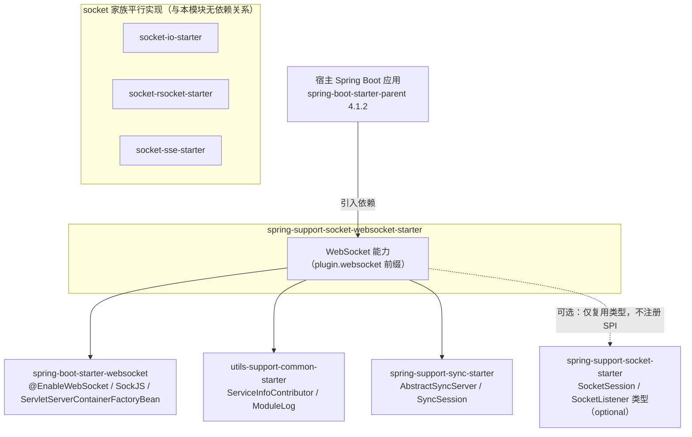
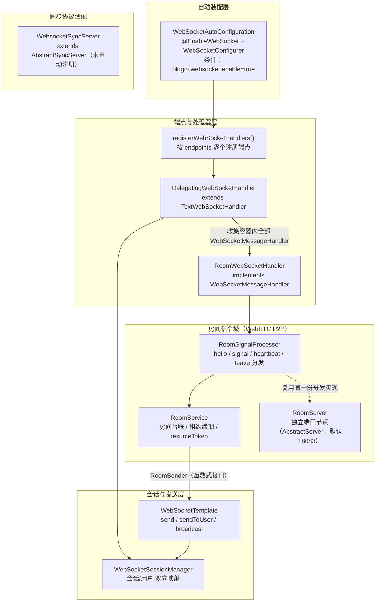
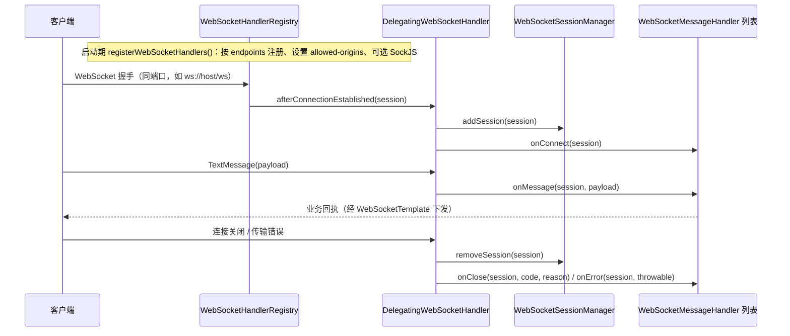
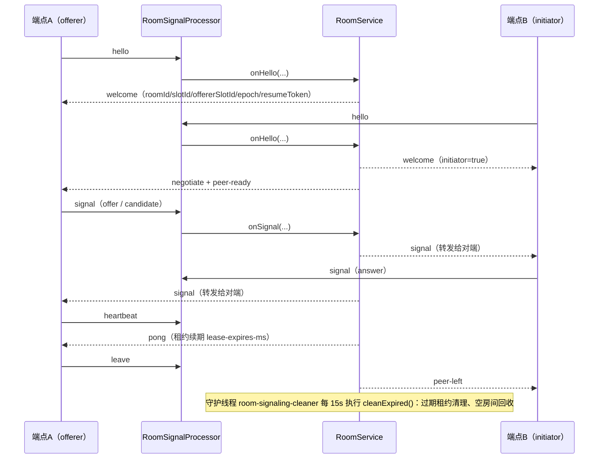

# spring-support-socket-websocket-starter

基于 Spring 原生 WebSocket 的实现模块：与应用**同端口**运行、不额外监听端口，也不注册 `spring-support-socket-starter` 的 `SocketProtocol` SPI。配置前缀是 `plugin.websocket`（不是 `plugin.socket`）。

- Maven 坐标：`com.chua:spring-support-socket-websocket-starter:4.0.0.51`
- 基线：Spring Boot `4.1.2`（由父工程 `spring-support-parent-starter` 的 `spring-boot-starter-parent 4.1.2` 托管）
- 自动装配：仅通过 `META-INF/spring/org.springframework.boot.autoconfigure.AutoConfiguration.imports` 注册（无 `spring.factories`）

## 1. 架构图

### 1.1 模块在体系中的位置



### 1.2 模块内部分层



## 2. 核心流程图

### 2.1 连接与消息处理流程

所有文本帧都进入同一个 `DelegatingWebSocketHandler`，再依次分发给容器内全部 `WebSocketMessageHandler`（含内置的 `RoomWebSocketHandler`）；单个处理器抛异常只记日志，不影响其它处理器。



### 2.2 房间信令流程（hello / signal / heartbeat / leave）



断线重连（续练）：端点重连时携带 `resumeToken`（有效期 240s，即 `TOKEN_LIFETIME_MS`），`RoomService.onHello` 校验同房间/同代数/租约未过期后恢复旧 `slotId`，向对端发 `peer-reconnected`，若旧连接仍挂着则向其发 `replaced`。

## 3. 能力清单

| 能力域 | 关键类 | 入口 |
|---|---|---|
| 端点注册 | `WebSocketAutoConfiguration`（`@EnableWebSocket` + `WebSocketConfigurer`） | `plugin.websocket.endpoints` |
| 会话管理 | `WebSocketSessionManager` | `webSocketSessionManager` Bean |
| 消息发送 | `WebSocketTemplate` | `webSocketTemplate` Bean |
| 消息处理 | `WebSocketMessageHandler`（SPI 接口）、`DelegatingWebSocketHandler`（委托器） | 自定义 `WebSocketMessageHandler` Bean |
| SockJS 回退 | `WebSocketHandlerRegistration.withSockJS()` | `plugin.websocket.sock-js=true` |
| 容器参数 | `ServletServerContainerFactoryBean`（`createWebSocketContainer` Bean） | `max-message-size`、`send-time-limit` |
| 房间信令（WebRTC P2P） | `RoomService`、`RoomSignalProcessor`、`RoomWebSocketHandler`、`RoomMessage`、`RoomSignal` | 同端口走 `/ws` 报文；独立节点走 `RoomServer` |
| 独立端口房间节点 | `RoomServer`（`extends AbstractServer`，RFC 6455，复用 `WebSocketProtocol`） | 由服务管理 `ServerNodeRegistry` 按节点构造，默认端口 18083 |
| 同步协议适配 | `WebsocketSyncServer`（`extends AbstractSyncServer`，protocol=`websocket`） | 本模块与仓库内均无自动注册，需要时由宿主自行实例化接入 |
| 服务信息 | `webSocketServiceInfoContributor`（`ServiceInfoContributor`） | 服务信息面板注册 `websocket` 标记 |

本模块**不依赖** netty-socketio、RSocket，也不会因引入它而自动获得 `plugin.socket` 协议能力。

## 4. Bean 能力矩阵

自动配置类为 `WebSocketAutoConfiguration`，注册文件为 `META-INF/spring/org.springframework.boot.autoconfigure.AutoConfiguration.imports`。**所有 Bean 的前置条件都是 `plugin.websocket.enable=true`**（类级 `@ConditionalOnProperty`）。

| Bean 名 | 类型 | 装配条件 | 可否覆盖 | 典型注入姿势 |
|---|---|---|---|---|
| `webSocketSessionManager` | `WebSocketSessionManager` | `plugin.websocket.enable=true` + `@ConditionalOnMissingBean` | 可（定义同类型 Bean） | 构造器注入，管理会话/用户绑定 |
| `webSocketTemplate` | `WebSocketTemplate` | 同上 + `@ConditionalOnMissingBean` | 可 | 构造器注入，业务侧发送消息 |
| `delegatingWebSocketHandler` | `DelegatingWebSocketHandler` | 同上 + `@ConditionalOnMissingBean` | 可（接管后自行决定分发逻辑） | 一般不直接注入 |
| `roomService` | `RoomService` | 同上 + `@ConditionalOnMissingBean(RoomService.class)`；**依赖 `RoomProperties` Bean**（见 5.2 说明） | 可 | 构造器注入，房间台账查询 |
| `roomWebSocketHandler` | `RoomWebSocketHandler` | 同上 + `@ConditionalOnMissingBean`；类上另有 `@Service`，若宿主扫描到该包则走组件扫描、自动装配退让 | 可 | 一般不直接注入 |
| `createWebSocketContainer` | `ServletServerContainerFactoryBean` | 同上 + `@ConditionalOnMissingBean` | 可 | 一般不直接注入 |
| `webSocketServiceInfoContributor` | `ServiceInfoContributor` | 仅 `plugin.websocket.enable=true`；**无** `@ConditionalOnMissingBean` | 不可直接覆盖（同名 Bean 会触发定义冲突，除非开启 `spring.main.allow-bean-definition-overriding=true`） | 一般不直接注入 |

`WebSocketAutoConfiguration` 还通过 `@Autowired(required = false) List<WebSocketMessageHandler>` 收集容器内**全部**该类型 Bean（含内置 `RoomWebSocketHandler`）传给 `DelegatingWebSocketHandler`；未提供任何实现时退化为空列表，仅保留会话管理能力。

## 5. 完整配置

### 5.1 `plugin.websocket`（`WebSocketProperties`）

由自动配置类上的 `@EnableConfigurationProperties(WebSocketProperties.class)` 注册，引入模块即完成绑定；但**整个模块是否生效取决于 `enable=true`**。

| key | 类型 | 默认值 | 说明 | 生效开关 |
|---|---|---|---|---|
| `plugin.websocket.enable` | `boolean` | `false` | 总开关；`false` 时自动配置整体跳过、不注册任何端点与 Bean | 本身即开关 |
| `plugin.websocket.endpoints` | `List<String>` | `["/ws"]` | 端点路径列表，逐个注册到同一个 `DelegatingWebSocketHandler` | `enable=true` |
| `plugin.websocket.allowed-origins` | `List<String>` | `["*"]` | 允许的 Origin 列表；为空列表时不调用 `setAllowedOrigins` | `enable=true` |
| `plugin.websocket.sock-js` | `boolean` | `false` | 是否对端点启用 SockJS 回退 | `enable=true` |
| `plugin.websocket.heartbeat-interval` | `long` | `25000` | SockJS 心跳间隔（毫秒），仅在 `sock-js=true` 时写入 `setHeartbeatTime` | `enable=true && sock-js=true` |
| `plugin.websocket.max-message-size` | `int` | `65536` | 文本/二进制帧缓冲上限（字节），写入 `ServletServerContainerFactoryBean` | `enable=true` |
| `plugin.websocket.send-time-limit` | `int` | `10000` | 发送超时（毫秒）；实现中同时用作 `maxSessionIdleTimeout = send-time-limit * 2`（默认 20000ms） | `enable=true` |
| `plugin.websocket.send-buffer-size-limit` | `int` | `524288` | 发送缓冲上限；字段存在但当前自动配置**未使用**该值 | 当前不生效 |

### 5.2 `room`（`RoomProperties`，房间信令）

`RoomProperties` 标注了 `@ConfigurationProperties(prefix = "room")`，但**本模块没有通过 `@EnableConfigurationProperties` 注册它**：

- 同端口链路：`roomService(RoomProperties, WebSocketTemplate)` 需要 `RoomProperties` Bean；宿主未注册时该 Bean 会因缺少依赖而创建失败。需要同端口房间信令的宿主，请自行补充 `@EnableConfigurationProperties(RoomProperties.class)` 或定义该 Bean。
- 独立节点链路：`RoomServer` 在构造时自行 `new RoomProperties()`（或接受外部传入），不依赖 Spring 绑定。

| key | 类型 | 默认值 | 说明 | 生效开关 |
|---|---|---|---|---|
| `room.enable` | `boolean` | `false` | 房间信令开关；**当前不控制任何 Bean 创建**（`roomService`/`roomWebSocketHandler` 不带该条件） | 无（仅配置项） |
| `room.endpoint` | `String` | `/api/rooms/{roomId}/ws` | 文档性端点描述；实际端点仍由 `plugin.websocket.endpoints` 决定 | 无（仅配置项） |
| `room.max-peers` | `int` | `2` | 每房间最大参与端点数（P2P 即 2） | 房间链路启用后 |
| `room.timeouts.lease-expires-ms` | `long` | `30000` | 端点心跳续期时间，超时判定掉线 | 房间链路启用后 |
| `room.timeouts.remove-empty-room-ms` | `long` | `240000` | 无活跃端点房间的回收时间 | 房间链路启用后 |
| `room.stun-server` | `String` | 空串 | STUN 服务器（内网发现） | 房间链路启用后 |
| `room.turn-server` | `String` | 空串 | TURN 服务器 URI（中继失败时备用） | 房间链路启用后 |
| `room.turn-user` | `String` | 空串 | TURN 用户名 | 房间链路启用后 |
| `room.turn-password` | `String` | 空串 | TURN 密码 | 房间链路启用后 |

## 6. 使用方式

### 6.1 Maven 坐标

```xml
<dependency>
    <groupId>com.chua</groupId>
    <artifactId>spring-support-socket-websocket-starter</artifactId>
    <version>4.0.0.51</version>
</dependency>
```

依赖由父工程 `spring-support-parent-starter:4.0.0.51` 管理（其 parent 为 `spring-boot-starter-parent:4.1.2`），通常无需手写版本号。

### 6.2 依赖说明

| 依赖 | 作用 | 是否可选 |
|---|---|---|
| `org.springframework.boot:spring-boot-starter-websocket` | `@EnableWebSocket`、`WebSocketHandler`、SockJS | 否 |
| `com.chua:utils-support-common-starter` | `ServiceInfoContributor`、`ModuleLog` 等公共支撑 | 否 |
| `com.chua:spring-support-sync-starter` | `AbstractSyncServer` / `SyncSession`（供 `WebsocketSyncServer` 继承） | 否 |
| `com.chua:spring-support-socket-starter` | 统一 `SocketSession` / `SocketListener` 类型（如需共享抽象） | 是（`optional`） |

### 6.3 最小可运行示例

**第一步：开启端点。**

```yaml
plugin:
  websocket:
    enable: true
    endpoints:
      - /ws
    allowed-origins:
      - "*"
    sock-js: false
```

**第二步：实现消息处理器 Bean。**

```java
@Component
public class EchoHandler implements WebSocketMessageHandler {

    private final WebSocketTemplate template;

    public EchoHandler(WebSocketTemplate template) {
        this.template = template;
    }

    @Override
    public void onMessage(WebSocketSession session, String message) {
        template.send(session.getId(), "echo: " + message);
    }
}
```

**第三步：启动应用。** 浏览器连接 `ws://localhost:8080/ws` 即可收发文本帧。

浏览器端最小示例（原生 WebSocket）：

```javascript
const ws = new WebSocket(`ws://${location.host}/ws`);
ws.onopen = () => ws.send("hello");
ws.onmessage = (event) => console.log("recv:", event.data);
```

启用 SockJS 时（`plugin.websocket.sock-js=true`）改用 SockJS 客户端连接同一路径：

```javascript
const sock = new SockJS("/ws");
sock.onmessage = (event) => console.log("recv:", event.data);
```

### 6.4 常用调用（WebSocketTemplate）

`WebSocketTemplate` 为普通类，方法返回 `boolean` / `int`，**无链式 API**：

1. `send(sessionId, message)` → 单会话发送，返回是否成功。
2. `sendToUser(userId, message)` → 按用户发送，需先 `bindUser(sessionId, userId)`。
3. `broadcast(message)` → 全量广播，返回成功条数。
4. `bindUser` / `unbindUser` / `getOnlineCount` → 会话与用户绑定、在线数。

结合 Controller 做服务端推送：

```java
@RestController
@RequestMapping("/push")
public class PushController {

    private final WebSocketTemplate template;

    public PushController(WebSocketTemplate template) {
        this.template = template;
    }

    @PostMapping("/broadcast")
    public int broadcast(@RequestParam String text) {
        return template.broadcast(text);
    }

    @PostMapping("/bind")
    public void bind(@RequestParam String sessionId, @RequestParam String userId) {
        template.bindUser(sessionId, userId);
    }

    @GetMapping("/online")
    public int online() {
        return template.getOnlineCount();
    }
}
```

### 6.5 房间信令报文（WebRTC P2P）

上行报文统一为 JSON，`type` 取 `hello` / `signal` / `heartbeat` / `leave`：

```json
{ "type": "hello", "roomId": "room-1", "slotId": "slot-a" }
```

服务端回执 `RoomMessage` 的 `type` 包含：`welcome`、`negotiate`、`peer-ready`、`signal`、`pong`、`left`、`peer-left`、`peer-disconnected`、`peer-reconnected`、`replaced`、`error`。`signal` 会把 offer / answer / candidate 转发给对端。

## 7. 使用场景

### 7.1 适用

- 需要**浏览器原生 WebSocket** 且希望与 Web 应用**同端口**（复用 8080/HTTPS）。
- 服务端定点推送 / 全量广播：公告、进度、状态变更、简单 IM。
- 需要按用户维度定点下发（`bindUser` + `sendToUser`）。
- WebRTC P2P 场景的信令交换（1v1 房间、offer/answer/candidate 转发、断线续练）。
- 需要兼容老旧网络环境的 SockJS 回退。

### 7.2 不适用

- 需要 STOMP 订阅模型（`/topic`、`/queue`、`SimpMessagingTemplate`）→ 请使用 Spring Messaging 的 `@EnableWebSocketMessageBroker` 自行搭建。
- 需要 Socket.IO 协议兼容（房间事件、ACK、自动重连语义）→ 用 `spring-support-socket-io-starter`。
- 需要服务端主动按 RSocket 交互模型通信 → 用 `spring-support-socket-rsocket-starter`。
- 单向服务器推送且无需全双工 → `spring-support-socket-sse-starter` 更轻。
- 多实例部署下的全量广播：本模块会话表是**单机** `ConcurrentHashMap`，跨实例需自行接消息队列。

### 7.3 与相邻模块的取舍

| 模块 | 关系与取舍 |
|---|---|
| `spring-support-socket-starter` | 仅 `optional` 依赖，用于复用 `SocketSession` / `SocketListener` / `@OnEvent` 类型；本模块不作为其 `SocketProvider` 实现，`SocketProtocol` 里也没有 `websocket` 值 |
| `spring-support-socket-io-starter` | 平行实现：Socket.IO 独立监听端口、协议兼容；本模块复用应用端口、原生 WebSocket。两者可同时存在，互不装配 |
| `spring-support-socket-rsocket-starter` | 平行实现：走 `plugin.socket` + SPI；与本模块无依赖关系 |
| `spring-support-socket-sse-starter` | 平行实现：走 `plugin.socket` + SPI，基于 MVC `SseEmitter`，单向推送 |
| `spring-support-sync-starter` | 提供 `AbstractSyncServer`；本模块的 `WebsocketSyncServer` 继承它，但该类无组件注解、仓库内也无装配点，不会自动注册 |

选择建议：需要浏览器原生 `WebSocket`、且希望与 Web 应用同端口时用本模块；需要 Socket.IO 协议兼容或独立端口时用 socket-io 实现。

## 8. 扩展点

本模块**没有** `META-INF/extensions` 注册文件，也没有 `SocketProtocol` 别名；扩展方式是 **Spring Bean 注入**与**条件覆盖**：

| 扩展点 | 类型 | 用法 |
|---|---|---|
| `WebSocketMessageHandler` | 接口（`onConnect` / `onMessage` / `onClose` / `onError`，除 `onMessage` 外均有 default 实现） | 实现为 `@Component`（或 `@Bean`）交容器管理即可；自动配置通过 `List<WebSocketMessageHandler>` 收集并逐个回调，单个实现抛异常不影响其它实现 |
| `WebSocketSessionManager` / `WebSocketTemplate` / `DelegatingWebSocketHandler` / `roomService` / `roomWebSocketHandler` / `createWebSocketContainer` | 自动配置 Bean（均带 `@ConditionalOnMissingBean`） | 定义同类型同名校 Bean 即可整体替换默认实现 |
| `RoomSender` | 函数式接口（`send(connectionId, message)`） | 房间引擎的下行出口；同端口链路默认接 `WebSocketTemplate::send`，独立节点链路由 `RoomServer` 直接注 `this::send`；自定义传输通道时实现该接口即可复用 `RoomService` / `RoomSignalProcessor` |
| `RoomService` / `RoomSignalProcessor` | 房间信令引擎与分发器（传输无关） | 可直接复用或继承扩展；`RoomSignalProcessor` 同时服务同端口 `RoomWebSocketHandler` 与独立端口 `RoomServer` |

`WebsocketSyncServer` 面向 `spring-support-sync-starter` 的同步协议（`protocol = "websocket"`）：仓库内没有自动装配点，宿主可自行 `new WebsocketSyncServer(sessionManager)` 并按 sync 体系启动，把 WebSocket 会话桥接为 `SyncSession`。

## 9. 常见问题

**Q1：引入依赖后 WebSocket 端点 404 / 装配不生效？**
默认 `plugin.websocket.enable=false`，自动配置类带 `@ConditionalOnProperty(prefix="plugin.websocket", name="enable", havingValue="true")`，开关不开则**整个模块不装配**（无端点、无 Bean）。在配置中显式设置 `plugin.websocket.enable=true`。

**Q2：启动报 `RoomProperties` 缺失 / `roomService` 创建失败？**
本模块未为 `RoomProperties` 注册 `@EnableConfigurationProperties`。需要同端口房间信令时，请在宿主配置类上加 `@EnableConfigurationProperties(RoomProperties.class)` 或自行定义该 Bean；仅用普通消息收发则不受影响。

**Q3：`room.enable=false` 为什么房间 Bean 还在？**
`roomService` / `roomWebSocketHandler` 的创建只受 `plugin.websocket.enable` 与 `@ConditionalOnMissingBean` 控制，`room.enable` 当前**不控制 Bean 创建**，仅是配置项。

**Q4：WebSocket 用哪个端口？**
与应用同端口（复用 Servlet 容器端口），没有独立监听端口。独立端口的是 `RoomServer`（服务管理里的 ROOM 节点，默认 18083），与本模块同端口链路互不影响。

**Q5：与 Spring Boot 4.1.2 的兼容性？**
模块由 `spring-boot-starter-parent:4.1.2` 托管构建：自动装配走 `AutoConfiguration.imports`（Boot 3 起的唯一机制，本模块无 `spring.factories`）；代码使用 `jakarta.annotation`（`@PostConstruct` / `@PreDestroy`）与 `spring-boot-starter-websocket` 的 `@EnableWebSocket` / `ServletServerContainerFactoryBean`，均为 Boot 4 延续的 API 面。

**Q6：二进制帧 / 分片消息收不到？**
`DelegatingWebSocketHandler` 继承 `TextWebSocketHandler`，只处理文本帧；`supportsPartialMessages()` 返回 `false`，不支持分片。二进制需求需自行扩展处理器。

**Q7：消息没有到达我的处理器？**
确认实现类是 `WebSocketMessageHandler` 且交给了容器（`@Component` / `@Bean`）。若你自定义了 `delegatingWebSocketHandler` Bean，则分发逻辑完全由你接管，默认的收集机制不再生效。

**Q8：多实例部署广播不全？**
`WebSocketSessionManager` 是单机内存会话表，`broadcast` 只覆盖本进程连接；跨实例需要自行通过 MQ/Redis 广播桥接。

**Q9：有连接鉴权吗？**
没有。`WebSocketProperties` 不含认证配置，也未注册 `HandshakeInterceptor`；鉴权请自行添加握手拦截器或在 `onConnect` 中校验后关闭会话。
