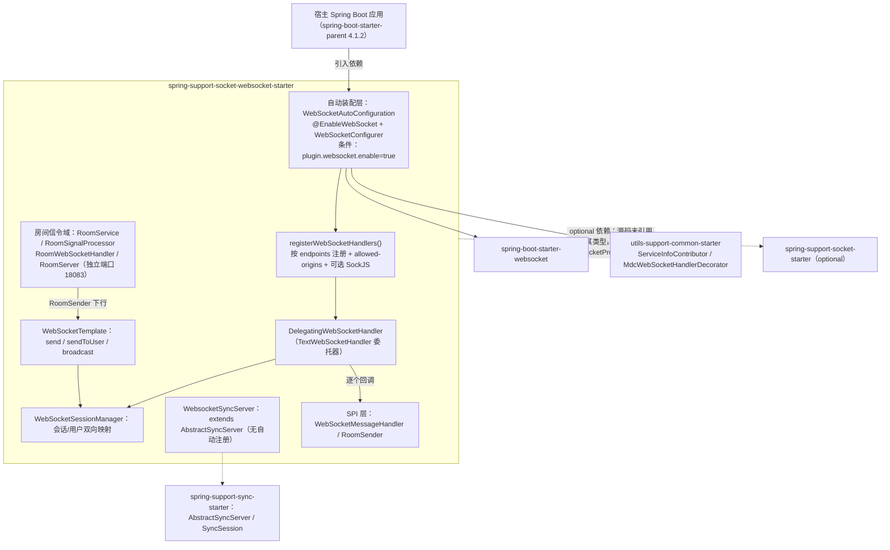
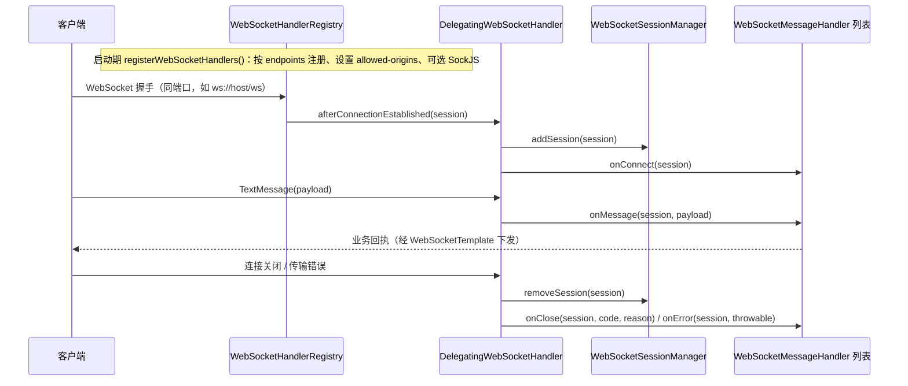

# spring-support-socket-websocket-starter

基于 Spring 原生 WebSocket（`spring-boot-starter-websocket`）的实时通信模块：与应用**同端口**运行、不额外监听端口，也不注册 `spring-support-socket-starter` 的 `SocketProvider` SPI。在 spring-support 体系中，它是 socket 家族（socket-io / rsocket / sse / websocket）里负责「原生 WebSocket 同端口接入」的实现模块，依托 `utils-support-common-starter` 公共支撑与 `spring-support-sync-starter` 同步协议基座，提供会话管理、消息模板、WebRTC 房间信令与同步协议适配。

## 1. 架构图



## 2. 核心流程图

所有文本帧都进入同一个 `DelegatingWebSocketHandler`，再分发给容器内全部 `WebSocketMessageHandler`（含内置 `RoomWebSocketHandler`）；单个处理器抛异常只记日志，不影响其它处理器。仅处理文本帧，`supportsPartialMessages()` 返回 `false`。



房间信令（WebRTC P2P）复用同一条链路：端点在 `/ws` 上发 `hello` / `signal` / `heartbeat` / `leave`，经 `RoomWebSocketHandler` → `RoomSignalProcessor` → `RoomService` 处理并回执 `welcome` / `signal` / `pong` / `peer-left` 等；`resumeToken` 有效期 240s（`TOKEN_LIFETIME_MS`）支持断线续接，守护线程每 15s 执行 `cleanExpired()` 回收过期租约与空房间。独立端口的 `RoomServer` 复用同一套信令引擎。

## 3. 能力清单

| 能力域 | 关键类 | 入口/触发方式 |
|---|---|---|
| 端点注册 | `WebSocketAutoConfiguration`（`@EnableWebSocket` + `WebSocketConfigurer`） | `plugin.websocket.enable=true` 时随自动装配生效 |
| 会话管理 | `WebSocketSessionManager` | `webSocketSessionManager` Bean |
| 消息发送 | `WebSocketTemplate` | `webSocketTemplate` Bean |
| 消息处理 | `WebSocketMessageHandler`（SPI）+ `DelegatingWebSocketHandler`（委托器） | 容器内全部 `WebSocketMessageHandler` Bean |
| SockJS 回退 | `WebSocketHandlerRegistration.withSockJS()` | `plugin.websocket.sock-js=true` |
| 容器参数 | `ServletServerContainerFactoryBean` | `createWebSocketContainer` Bean |
| 房间信令（WebRTC P2P） | `RoomService`、`RoomSignalProcessor`、`RoomWebSocketHandler` | 同端口 `/ws` 报文（`hello` / `signal` / `heartbeat` / `leave`） |
| 独立端口房间节点 | `RoomServer`（`extends AbstractServer`，RFC 6455，复用 `WebSocketProtocol`） | 服务管理 `ServerNodeRegistry` 按节点构造，默认端口 18083 |
| 同步协议适配 | `WebsocketSyncServer`（`extends AbstractSyncServer`，protocol=`websocket`） | 本模块与仓库内均无自动注册，需宿主自行实例化接入 |
| 服务信息 | `webSocketServiceInfoContributor`（`ServiceInfoContributor`） | 服务信息面板注册 `websocket` 标记 |

本模块不依赖 netty-socketio、RSocket，也不会因引入它而自动获得 `plugin.socket` 协议能力。

## 4. Bean 能力矩阵

自动配置类为 `WebSocketAutoConfiguration`，注册于 `META-INF/spring/org.springframework.boot.autoconfigure.AutoConfiguration.imports`（无 `spring.factories`）。所有 Bean 的前置条件都是类级 `@ConditionalOnProperty(prefix = "plugin.websocket", name = "enable", havingValue = "true")`。

| Bean 名 | 类型 | 装配条件（含默认值） | 可否覆盖 | 典型用途 |
|---|---|---|---|---|
| `webSocketSessionManager` | `WebSocketSessionManager` | `plugin.websocket.enable=true`（默认 `false`）+ `@ConditionalOnMissingBean` | 可（定义同类型 Bean） | 会话/用户双向映射、在线数 |
| `webSocketTemplate` | `WebSocketTemplate` | 同上 + `@ConditionalOnMissingBean` | 可 | 业务侧 `send` / `sendToUser` / `broadcast` |
| `delegatingWebSocketHandler` | `DelegatingWebSocketHandler` | 同上 + `@ConditionalOnMissingBean` | 可（接管后自行决定分发逻辑） | 帧事件委托与异常隔离 |
| `roomService` | `RoomService` | 同上 + `@ConditionalOnMissingBean(RoomService.class)`；入参需 `RoomProperties` Bean（本模块未注册，见第 9 节） | 可 | 房间台账、租约续期、resumeToken |
| `roomWebSocketHandler` | `RoomWebSocketHandler` | 同上 + `@ConditionalOnMissingBean`；类上另有 `@Service`，若宿主扫描到该包则走组件扫描、自动装配退让 | 可 | 房间信令报文处理 |
| `createWebSocketContainer` | `ServletServerContainerFactoryBean` | 同上 + `@ConditionalOnMissingBean` | 可 | 设置帧缓冲与空闲超时 |
| `webSocketServiceInfoContributor` | `ServiceInfoContributor` | 仅 `plugin.websocket.enable=true`；**无** `@ConditionalOnMissingBean` | 不可直接覆盖（同名会触发 Bean 定义冲突，除非 `spring.main.allow-bean-definition-overriding=true`） | 服务面板标记 |

`WebSocketAutoConfiguration` 还通过 `@Autowired(required = false) List<WebSocketMessageHandler>` 收集容器内全部该类型 Bean 传给 `DelegatingWebSocketHandler`；未提供任何实现时为空列表，仅保留会话管理能力。

## 5. 完整配置

### 5.1 `plugin.websocket`（`WebSocketProperties`，经 `@EnableConfigurationProperties` 注册）

| 配置路径 | 类型 | 默认值 | 说明 |
|---|---|---|---|
| `plugin.websocket.enable` | `boolean` | `false` | 总开关；`false` 时整个自动配置跳过，不注册端点与 Bean |
| `plugin.websocket.endpoints` | `List<String>` | `["/ws"]` | 端点路径列表，逐个注册到同一个 `DelegatingWebSocketHandler` |
| `plugin.websocket.allowed-origins` | `List<String>` | `["*"]` | 允许的 Origin；空列表时不调用 `setAllowedOrigins` |
| `plugin.websocket.sock-js` | `boolean` | `false` | 是否启用 SockJS 回退 |
| `plugin.websocket.heartbeat-interval` | `long` | `25000` | SockJS 心跳间隔（ms），仅 `sock-js=true` 时写入 `setHeartbeatTime` |
| `plugin.websocket.max-message-size` | `int` | `65536` | 文本/二进制帧缓冲上限（字节） |
| `plugin.websocket.send-time-limit` | `int` | `10000` | 发送超时（ms）；实现中同时用作 `maxSessionIdleTimeout = send-time-limit * 2` |
| `plugin.websocket.send-buffer-size-limit` | `int` | `524288` | 发送缓冲上限；字段存在但当前自动装配未使用 |

### 5.2 `room`（`RoomProperties`，房间信令）

`RoomProperties` 标注 `@ConfigurationProperties(prefix = "room")`，但**本模块未通过 `@EnableConfigurationProperties` 注册它**：同端口链路的 `roomService(RoomProperties, WebSocketTemplate)` 需要宿主自行提供该 Bean；独立节点 `RoomServer` 构造时自行 `new RoomProperties()`，不依赖 Spring 绑定。

| 配置路径 | 类型 | 默认值 | 说明 |
|---|---|---|---|
| `room.enable` | `boolean` | `false` | 文档性开关；当前**不控制任何 Bean 创建** |
| `room.endpoint` | `String` | `/api/rooms/{roomId}/ws` | 文档性端点描述；实际端点由 `plugin.websocket.endpoints` 决定 |
| `room.max-peers` | `int` | `2` | 每房间最大参与端点数（P2P 即 2） |
| `room.timeouts.lease-expires-ms` | `long` | `30000` | 端点心跳续期时间，超时判定掉线 |
| `room.timeouts.remove-empty-room-ms` | `long` | `240000` | 无活跃端点房间的回收时间 |
| `room.stun-server` | `String` | 空串 | STUN 服务器（内网发现） |
| `room.turn-server` | `String` | 空串 | TURN 服务器 URI（中继失败时备用） |
| `room.turn-user` | `String` | 空串 | TURN 用户名 |
| `room.turn-password` | `String` | 空串 | TURN 密码 |

### 5.3 逐项配置示例（按功能分组）

以下示例均可直接用于 `application.yml`；「默认值」与源码字段初始化一致。

#### （1）基础开关与端点（`plugin.websocket`）

| 配置项 | 含义 | 默认值 |
|---|---|---|
| `plugin.websocket.enable` | 总开关；`false` 时整个自动配置跳过，不注册端点与 Bean | `false` |
| `plugin.websocket.endpoints` | 端点路径列表，逐个注册到同一个 `DelegatingWebSocketHandler`，与应用同端口 | `["/ws"]` |
| `plugin.websocket.allowed-origins` | 允许的 Origin；空列表时不调用 `setAllowedOrigins`（交由容器默认） | `["*"]` |

```yaml
plugin:
  websocket:
    enable: true                 # 不开启则整个模块不装配
    endpoints:
      - /ws                      # 默认端点
      # - /ws/v2                 # 可注册多个端点
    allowed-origins:
      - "*"                      # 生产环境建议收敛为具体 Origin
```

#### （2）SockJS 回退

| 配置项 | 含义 | 默认值 |
|---|---|---|
| `plugin.websocket.sock-js` | 是否启用 SockJS 回退（老浏览器/受限网络） | `false` |
| `plugin.websocket.heartbeat-interval` | SockJS 心跳间隔（ms）；仅 `sock-js=true` 时写入 `setHeartbeatTime` | `25000` |

```yaml
plugin:
  websocket:
    sock-js: true
    heartbeat-interval: 25000    # 0 表示禁用心跳（按字段注释口径，本模块原样透传）
```

#### （3）缓冲与超时

| 配置项 | 含义 | 默认值 |
|---|---|---|
| `plugin.websocket.max-message-size` | 文本/二进制帧缓冲上限（字节），写入 `ServletServerContainerFactoryBean` | `65536` |
| `plugin.websocket.send-time-limit` | 发送超时（ms）；当前实现用作会话空闲超时：`maxSessionIdleTimeout = 2 × send-time-limit` | `10000` |
| `plugin.websocket.send-buffer-size-limit` | 发送缓冲上限（字节）；字段存在但当前自动装配未使用 | `524288` |

```yaml
plugin:
  websocket:
    max-message-size: 1048576    # 1MB，按最大单帧业务报文评估
    send-time-limit: 10000       # 会话空闲超时 = 2 × 10000 = 20000ms
    send-buffer-size-limit: 524288
```

#### （4）房间信令（`room.*`，WebRTC P2P）

| 配置项 | 含义 | 默认值 |
|---|---|---|
| `room.enable` | 文档性开关；当前不控制任何 Bean 创建 | `false` |
| `room.endpoint` | 文档性端点描述；实际端点由 `plugin.websocket.endpoints` 决定 | `/api/rooms/{roomId}/ws` |
| `room.max-peers` | 每房间最大参与端点数（P2P 即 2）；当前仅用于 `RoomServer` 启动日志 | `2` |
| `room.timeouts.lease-expires-ms` | 端点心跳续期时间，超时判定掉线 | `30000` |
| `room.timeouts.remove-empty-room-ms` | 无活跃端点房间的回收时间 | `240000` |
| `room.stun-server` | STUN 服务器（内网发现）；当前源码未消费，预留 | 空串 |
| `room.turn-server` | TURN 服务器 URI（中继失败时备用）；当前源码未消费，预留 | 空串 |
| `room.turn-user` | TURN 用户名；当前源码未消费，预留 | 空串 |
| `room.turn-password` | TURN 密码；当前源码未消费，预留 | 空串 |

```yaml
room:
  enable: true
  endpoint: /api/rooms/{roomId}/ws
  max-peers: 2
  timeouts:
    lease-expires-ms: 30000
    remove-empty-room-ms: 240000
  stun-server: "stun:stun.example.com:3478"
  turn-server: "turn:turn.example.com:3478"
  turn-user: "your-turn-user"
  turn-password: "change-me"     # 占位符，勿写真实凭据
```

> 提示：`room.*` 的 STUN/TURN 当前为预留字段，模块不会消费或下发它们；ICE 协商地址需由业务侧自行处理。

## 6. 使用方式

### 6.1 Maven 坐标

```xml
<dependency>
    <groupId>com.chua</groupId>
    <artifactId>spring-support-socket-websocket-starter</artifactId>
    <version>4.0.0.51</version>
</dependency>
```

### 6.2 依赖与可选性

| 依赖 | 作用 | 可选性 |
|---|---|---|
| `org.springframework.boot:spring-boot-starter-websocket` | `@EnableWebSocket`、`WebSocketHandler`、SockJS | 必需 |
| `com.chua:utils-support-common-starter` | `ServiceInfoContributor`、`MdcWebSocketHandlerDecorator` 等公共支撑 | 必需 |
| `com.chua:spring-support-sync-starter` | `AbstractSyncServer` / `SyncSession`（供 `WebsocketSyncServer` 继承） | 必需 |
| `com.chua:spring-support-socket-starter` | 预留依赖：当前源码未引用其任何类型（`SocketSession` / `SocketListener` 均未使用） | `optional`：缺失不影响本模块装配 |

### 6.3 最小启用示例

```yaml
plugin:
  websocket:
    enable: true          # 不开启则整个模块不装配
    endpoints:
      - /ws
    allowed-origins:
      - "*"
    sock-js: false
```

```java
@Component
public class EchoHandler implements WebSocketMessageHandler {

    private final WebSocketTemplate template;

    public EchoHandler(WebSocketTemplate template) {
        this.template = template;
    }

    @Override
    public void onMessage(WebSocketSession session, String message) {
        template.send(session.getId(), "echo: " + message);
    }
}
```

启动后连接 `ws://localhost:8080/ws` 即可收发文本帧；`sock-js=true` 时改用 SockJS 客户端连接同一路径。

常用发送 API（`WebSocketTemplate`，无链式调用）：`send(sessionId, message)`、`sendToUser(userId, message)`（需先 `bindUser`）、`broadcast(message)`、`bindUser` / `unbindUser` / `getOnlineCount()`。

### 6.4 完整 YAML 配置示例（生产参考）

```yaml
plugin:
  websocket:
    enable: true                       # 必开：否则整个模块不装配
    endpoints:
      - /ws                            # 与前端连接地址保持一致
    allowed-origins:                   # 生产环境收敛为白名单，勿用 "*"
      - "https://www.example.com"
    sock-js: true                      # 需要兼容老浏览器/受限网络时开启
    heartbeat-interval: 25000          # SockJS 心跳，仅 sock-js=true 生效
    max-message-size: 1048576          # 1MB，按最大单帧业务报文评估
    send-time-limit: 15000             # 会话空闲超时 = 2 × 15000 = 30000ms
    send-buffer-size-limit: 524288

room:                                  # 房间信令（WebRTC P2P）可选，不用房间功能可整段省略
  enable: true
  max-peers: 2
  timeouts:
    lease-expires-ms: 30000            # 心跳续期窗口，建议 ≥ 2 × 客户端心跳间隔
    remove-empty-room-ms: 240000
  stun-server: "stun:stun.example.com:3478"
  turn-server: "turn:turn.example.com:3478?transport=tcp"
  turn-user: "your-turn-user"
  turn-password: "change-me"           # 占位符，请替换为凭据管理系统下发的值
```

> `room.*` 需要宿主自行注册 `RoomProperties`（见第 9 节 Q2），仅用普通消息收发时可整段省略。

### 6.5 生产注意事项

1. **先开总开关**：`plugin.websocket.enable=false`（默认）时端点与 Bean 都不会装配，端点 404 先查这一项。
2. **Origin 白名单**：`allowed-origins: ["*"]` 仅适合开发环境；生产按前端域名收敛，避免跨站 WebSocket 劫持。
3. **消息体大小**：`max-message-size` 过小会拒绝大帧、过大放大内存占用；结合网关/负载均衡的请求体限制一起评估。
4. **连接鉴权**：模块未注册 `HandshakeInterceptor`，握手鉴权（token 校验）需自行添加握手拦截器，或在 `onConnect` 中校验后关闭会话。
5. **集群部署**：`WebSocketSessionManager` 是单机内存会话表（`ConcurrentHashMap`），`sendToUser` / `broadcast` 只覆盖本实例连接；多实例需自行接 Redis/MQ 广播桥，或使用粘性会话。
6. **房间信令凭据**：`room.turn-password` 等请从配置中心/密钥管理注入，不要把真实凭据提交到仓库；STUN/TURN 字段当前为预留，模块不消费。
7. **SockJS 与反向代理**：经 Nginx 等反代时，确保端点路径透传 `Upgrade` / `Connection` 头；SockJS 的 XHR 流式传输需关闭代理缓冲。
8. **优雅停机与断线**：会话表为进程内数据，实例下线时客户端需依赖 `resumeToken`（240s 有效期）重连续接，或自行做重连补偿。

## 7. 使用场景

适用：

- 浏览器原生 WebSocket，且要求与 Web 应用**同端口**（复用 8080/HTTPS）。
- 服务端定点推送 / 全量广播：公告、进度、状态变更、简单 IM。
- 按用户维度定点下发（`bindUser` + `sendToUser`）。
- WebRTC P2P 信令交换（1v1 房间、offer/answer/candidate 转发、断线续接）。

不适用 / 慎用：

- 需要 STOMP 订阅模型（`/topic`、`/queue`、`SimpMessagingTemplate`）→ 用 Spring Messaging 的 `@EnableWebSocketMessageBroker` 自行搭建。
- 多实例部署的全量广播：会话表是单机 `ConcurrentHashMap`，跨实例需自行接 MQ/Redis 广播桥。

与相邻模块取舍：

| 模块 | 关系与取舍 |
|---|---|
| `spring-support-socket-starter` | `optional` 依赖，当前源码未引用其任何类型；本模块不是其 `SocketProvider` 实现，`SocketProtocol` 中无 `websocket` 值 |
| `spring-support-socket-io-starter` | 平行实现：Socket.IO 独立监听端口、协议兼容；本模块同端口、原生 WebSocket，两者可共存互不装配 |
| `spring-support-socket-rsocket-starter` | 平行实现：走 `plugin.socket` + SPI，与本模块无依赖关系 |
| `spring-support-socket-sse-starter` | 平行实现：基于 MVC `SseEmitter` 的单向推送，更轻量 |
| `spring-support-sync-starter` | 提供 `AbstractSyncServer`；本模块 `WebsocketSyncServer` 继承它，但该类无组件注解、仓库内也无装配点 |

## 8. 扩展点

本模块没有 `META-INF/extensions` 注册文件，也没有 `SocketProtocol` 别名；扩展方式是 Spring Bean 注入与条件覆盖：

| 扩展点 | 类型 | 注册/自定义方式 |
|---|---|---|
| `WebSocketMessageHandler` | 接口（`onMessage` 必须实现，`onConnect` / `onClose` / `onError` 为 default） | 实现为 `@Component` / `@Bean` 交容器管理即被自动收集并逐个回调；单个实现抛异常不影响其它实现 |
| `WebSocketSessionManager` / `WebSocketTemplate` / `DelegatingWebSocketHandler` / `roomService` / `roomWebSocketHandler` / `createWebSocketContainer` | 自动配置 Bean（均带 `@ConditionalOnMissingBean`） | 定义同类型同名校 Bean 即可整体替换默认实现 |
| `RoomSender` | 函数式接口 `send(connectionId, message)` | 房间引擎的下行出口；同端口链路默认接 `WebSocketTemplate::send`，独立节点由 `RoomServer` 注入 `this::send`；自定义传输通道实现该接口即可复用 `RoomService` / `RoomSignalProcessor` |
| `RoomService` / `RoomSignalProcessor` | 房间信令引擎与分发器（传输无关） | 可直接复用或继承扩展 |
| `WebsocketSyncServer` | `extends AbstractSyncServer`（protocol=`websocket`） | 无自动装配点；宿主自行 `new WebsocketSyncServer(sessionManager)` 并按 sync 体系启动，把 WebSocket 会话桥接为 `SyncSession` |

## 9. 常见问题

**Q1：引入依赖后 WebSocket 端点 404 / 装配不生效？**
默认 `plugin.websocket.enable=false`；自动配置类带 `@ConditionalOnProperty(prefix = "plugin.websocket", name = "enable", havingValue = "true")`，开关不开则整个模块不装配（无端点、无 Bean）。在配置中显式设置 `plugin.websocket.enable=true`。

**Q2：启动报 `RoomProperties` 缺失 / `roomService` 创建失败？**
本模块未为 `RoomProperties` 注册 `@EnableConfigurationProperties`。需要同端口房间信令时，请在宿主配置类上加 `@EnableConfigurationProperties(RoomProperties.class)` 或自行定义该 Bean；仅用普通消息收发则不受影响。另注意 `room.enable` 当前不控制任何 Bean 创建。

**Q3：WebSocket 用哪个端口？与 Spring Boot 4 兼容吗？**
与应用同端口（复用 Servlet 容器端口），没有独立监听端口；独立端口的是 `RoomServer`（服务管理 ROOM 节点，默认 18083）。模块由 `spring-boot-starter-parent:4.1.2` 托管构建：装配走 `AutoConfiguration.imports`（无 `spring.factories`），代码使用 `jakarta.annotation` 与 `spring-boot-starter-websocket` 的 API 面，均为 Boot 4 延续用法。

**Q4：二进制帧 / 分片消息收不到？广播不全？有连接鉴权吗？**
`DelegatingWebSocketHandler` 继承 `TextWebSocketHandler`，只处理文本帧且 `supportsPartialMessages()=false`，二进制需求需自行扩展处理器。`WebSocketSessionManager` 是单机内存会话表，`broadcast` 只覆盖本进程连接，跨实例需自行桥接。模块未注册 `HandshakeInterceptor`，连接鉴权请自行添加握手拦截器或在 `onConnect` 中校验后关闭会话。
