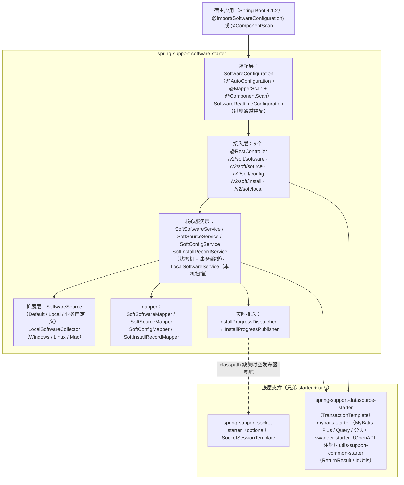
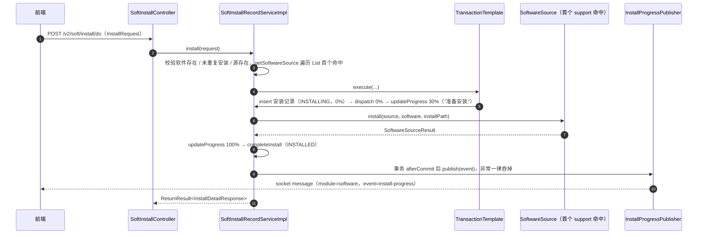

# spring-support-software-starter

软件资产与安装管理 starter：软件目录、软件源、安装/卸载/升级记录、软件配置四张表（`soft_software` / `soft_source` / `soft_config` / `soft_install_record`）的完整 CRUD 与统计，外加「当前机器已装软件扫描」与安装进度实时推送。在 spring-support 体系中是与 account、device、ai 并列的业务 starter：CRUD 走 MyBatis-Plus + MySQL，真实安装/卸载动作通过 `SoftwareSource` SPI 交给具体源实现，进度推送通过 `InstallProgressPublisher` SPI 解耦 socket 通道。

## 1. 架构图



## 2. 核心流程图（安装请求处理 `POST /v2/soft/install/do`）



> `install` 不判断 `SoftwareSourceResult#success`：拿到结果即推 100% 并置 INSTALLED；只有 SPI 实现**抛异常**才走 `failInstall` 落 FAILED。

## 3. 能力清单

| 能力域 | 关键类 | 入口 / 触发方式 |
| --- | --- | --- |
| 软件目录维护 | `SoftSoftwareController` / `SoftSoftwareService` | `/v2/soft/software`（`page` / `save` / `update` / `delete` / `detail`） |
| 软件源管理（启停、同步、默认源） | `SoftSourceController` / `SoftSourceService` | `/v2/soft/source`（`page` / `save` / `update` / `delete` / `detail` / `enable` / `disable` / `sync` / `default`） |
| 软件配置（按软件挂键值，支持批量） | `SoftConfigController` / `SoftConfigService` | `/v2/soft/config`（`page` / `save` / `update` / `delete` / `list` / `batch`） |
| 安装 / 卸载 / 升级与记录 | `SoftInstallController` / `SoftInstallRecordService` | `/v2/soft/install`（`do` / `uninstall` / `update` / `detail` / `list` / `installed`） |
| 本机软件扫描、清理、手动添加 | `LocalSoftwareController` / `LocalSoftwareService` | `/v2/soft/local`（`scan` / `clear` / `page` / `detail` / `install` / `uninstall` / `add` / `list`） |
| 软件源扩展点 | `SoftwareSource` / `SoftwareSourceResult` | 注入 `List<SoftwareSource>`，按 `support(SoftSource)` 取首个命中 |
| 平台采集器扩展点 | `LocalSoftwareCollector` | 内置 `WindowsLocalSoftwareCollector` / `LinuxLocalSoftwareCollector` / `MacLocalSoftwareCollector` |
| 安装进度实时推送 | `InstallProgressPublisher` / `SocketInstallProgressPublisher` / `InstallProgressDispatcher` | socket 通道 `module=software`、`event=install-progress` |
| 装配 / 数据表 | `SoftwareConfiguration` / `SoftwareRealtimeConfiguration`；实体 `SoftSoftware` / `SoftSource` / `SoftConfig` / `SoftInstallRecord` | `@AutoConfiguration` + `@MapperScan` + `@ComponentScan`；建表脚本 `db/init/V2.0__init_all_software.sql`、`V2.0__initdata_software.sql` |

## 4. Bean 能力矩阵

| Bean 名 | 类型 | 装配条件（含默认值） | 可否覆盖 | 典型用途 |
| --- | --- | --- | --- | --- |
| `softwareServiceInfoContributor` | `ServiceInfoContributor` | `SoftwareConfiguration#@Bean`，无条件 | 同类型 Bean 需 `@Primary` 区分 | 向 common-starter 的 `ServiceInfoRegistry` 注册「软件管理」模块标志 |
| 5 个 `@RestController` | Controller | `@ComponentScan("com.chua.starter.software.support")` | 一般不覆盖 | REST 端点 `/v2/soft/**` |
| 5 个 `@Service` 实现 | Service | 组件扫描，无条件 | 需排除扫描或 `@Primary` | 构造器注入 Service 接口 |
| 4 个 Mapper | MyBatis Mapper | `@MapperScan("com.chua.starter.software.support.mapper")` | — | 构造器注入 Mapper |
| `defaultSoftwareSource` | `SoftwareSource` 空兜底 | `@Component` + `@ConditionalOnMissingBean(SoftwareSource.class)` | **可**：容器已有任意 `SoftwareSource` 即退位 | 汇入 `List<SoftwareSource>`，`support` 恒 `false` |
| `localSoftwareSource` | `SoftwareSource`（`sourceType==3` 命中） | `@Component`，无条件 | — | 本机扫描的采集入口 |
| 3 个平台采集器 | `LocalSoftwareCollector` | `@Component`，无条件 | 可新增采集器，按 `support()` 竞争取首个 | 注入 `List<LocalSoftwareCollector>` |
| `noopInstallProgressPublisher` | `InstallProgressPublisher` 空实现 | `@Bean` + `@ConditionalOnMissingBean(InstallProgressPublisher.class)` | **可**：已有同类型 Bean 时让位 | socket 缺失时的兜底，仅 debug 日志 |
| `socketInstallProgressPublisher` | `InstallProgressPublisher` socket 实现 | 嵌套类 `SocketProgressConfiguration`：`@ConditionalOnClass(name="com.chua.socket.support.session.SocketSessionTemplate")` + `@ConditionalOnMissingBean(InstallProgressPublisher.class)` | **可**：业务自定义发布器存在时退位 | 广播 + 定向推送安装进度 |

注意：`InstallProgressDispatcher` **不是 Bean**——`SoftInstallRecordServiceImpl#publishProgress` 每次推送时 `new InstallProgressDispatcher(publisher)`；`TransactionTemplate` 来自 `spring-support-datasource-starter`，非本模块定义。本模块没有 `@ConditionalOnProperty` 开关，唯一「生效开关」是 socket 的 `@ConditionalOnClass`。

## 5. 完整配置

**本模块没有任何 `@ConfigurationProperties` 配置类**（代码中不存在自定义配置前缀），因此没有「配置路径 / 类型 / 默认值」可列。行为由宿主配置决定：

下文按「5.1 逐项配置示例（宿主侧）→ 5.2 完整 YAML 使用示例 → 5.3 生产注意事项」展开；本模块自身唯一的「行为开关」不在 YAML 里，是 classpath 上是否存在 socket-starter（见下表第 3 行）。

| 宿主配置 | 作用 | 缺省行为 |
| --- | --- | --- |
| `spring.datasource.*` | MySQL 数据来源，本模块强依赖 | 未配置则启动失败 |
| `mybatis-plus.mapper-locations` / `global-config.db-config.id-type` | 加载模块内 `mapper/SoftSoftwareMapper.xml`、`mapper/SoftConfigMapper.xml`；主键生成（实体主键为 String） | 建议 `classpath*:mapper/**/*.xml`；id-type 由宿主 MyBatis-Plus 配置决定 |
| classpath 是否有 `spring-support-socket-starter` | 唯一开关：`@ConditionalOnClass(name="com.chua.socket.support.session.SocketSessionTemplate")` 决定装 socket 发布器还是空发布器 | 缺失时空发布器兜底 |
| 宿主权限拦截器 | `@Permission` 注解的解析方 | 无拦截器时 `/v2/soft/**` 完全开放 |

模块自带的 `src/main/resources/application.yml` 只是 `SoftStarterApplication` 独立启动（`mvn spring-boot:run`）的示例，**不是 starter 配置项**：`server.port=8081`、`spring.application.name=soft-starter`、数据源指向 `jdbc:mysql://172.16.0.40:3306/softdb`（密码走环境变量 `SOFTWARE_DB_PASSWORD`）、`spring.sql.init.mode=never`（建表由 db/init 自动脚本负责，与该开关无关）、`id-type=ASSIGN_ID`，并 exclude 了 `ShardingSphereAutoConfiguration` 与两个 Elasticsearch 自动配置。

### 5.1 逐项配置示例（宿主侧）

本模块自身没有可配置项，下面按功能分组列出它**实际消费**的宿主配置。「默认值」指宿主不配置该项时的行为。

**① 数据源（必配，缺失启动失败）**

| 配置项 | 含义 | 默认值 / 缺省行为 |
| --- | --- | --- |
| `spring.datasource.url` | MySQL JDBC 地址，4 张 `soft_*` 表所在库 | 无默认；未配置数据源则启动失败 |
| `spring.datasource.username` / `spring.datasource.password` | 数据库账号与口令 | 无默认；口令建议走环境变量（示例 `${SOFTWARE_DB_PASSWORD:change-me}`） |
| `spring.datasource.driver-class-name` | JDBC 驱动类 | 不配时由 URL 推断；示例显式 `com.mysql.cj.jdbc.Driver` |

```yaml
spring:
  datasource:
    url: jdbc:mysql://127.0.0.1:3306/softdb?useUnicode=true&characterEncoding=UTF-8&useSSL=false&allowPublicKeyRetrieval=true
    username: soft_user
    password: ${SOFTWARE_DB_PASSWORD:change-me}
    driver-class-name: com.mysql.cj.jdbc.Driver
```

**② MyBatis-Plus（决定模块 4 个 Mapper 与 2 个 Mapper XML 如何工作）**

| 配置项 | 含义 | 默认值 / 缺省行为 |
| --- | --- | --- |
| `mybatis-plus.mapper-locations` | 扫描 Mapper XML；模块内为 `mapper/SoftSoftwareMapper.xml`、`mapper/SoftConfigMapper.xml` | MyBatis-Plus 自带默认值；建议与模块示例一致：`classpath*:mapper/**/*.xml` |
| `mybatis-plus.global-config.db-config.id-type` | 主键生成策略；模块实体主键均为 String | 宿主未配置时由 MyBatis-Plus 默认策略决定；模块示例显式 `ASSIGN_ID`，建议保持一致 |
| `mybatis-plus.configuration.log-impl` | SQL 日志实现 | 默认不输出 SQL 日志；开发期可设 `org.apache.ibatis.logging.stdout.StdOutImpl`，生产不要开（见 5.3） |

```yaml
mybatis-plus:
  mapper-locations: classpath*:mapper/**/*.xml
  global-config:
    db-config:
      id-type: ASSIGN_ID
  # configuration:
  #   log-impl: org.apache.ibatis.logging.stdout.StdOutImpl   # 仅开发调试
```

**③ SQL 初始化（建表口径）**

| 配置项 | 含义 | 默认值 / 缺省行为 |
| --- | --- | --- |
| `spring.sql.init.mode` | Spring SQL 初始化开关 | 模块示例设 `never`。模块建表脚本在 `db/init/` 下，随应用启动由 datasource-starter 的脚本机制（FlywayLike）自动执行（`CREATE TABLE IF NOT EXISTS` 幂等），与 `spring.sql.init.*` 无关，无需手工执行 `V2.0__init_all_software.sql` |

**④ 独立启动示例项（`SoftStarterApplication` 专用，作为 starter 引入时不生效）**

| 配置项 | 含义 | 默认值 / 缺省行为 |
| --- | --- | --- |
| `server.port` | 独立启动监听端口 | 模块示例 `8081`；作为 starter 时端口由宿主决定 |
| `spring.application.name` | 应用名 | 模块示例 `soft-starter` |
| `spring.autoconfigure.exclude` | 排除的自动配置 | 模块示例排除 ShardingSphere 与两个 Elasticsearch 自动配置；宿主按需自行决定 |

**⑤ 唯一的「行为开关」不在 YAML 里**

socket 进度推送的开关是**运行期 classpath**：存在 `com.chua.socket.support.session.SocketSessionTemplate` 类（即引入了 `spring-support-socket-starter`）时装 socket 发布器，否则由空发布器兜底。它不是配置项，写任何 YAML 都改变不了这个判定。

### 5.2 完整 YAML 使用示例

宿主引入本 starter 后的参考配置（数据源、MyBatis-Plus 为必配/建议项；安装进度实时推送需另在 pom 中引入可选依赖 `spring-support-socket-starter`，无对应 YAML 配置）：

```yaml
server:
  port: 8080

spring:
  application:
    name: my-host-app
  datasource:
    driver-class-name: com.mysql.cj.jdbc.Driver
    url: jdbc:mysql://127.0.0.1:3306/softdb?useUnicode=true&characterEncoding=UTF-8&useSSL=false&allowPublicKeyRetrieval=true
    username: soft_user
    password: ${SOFTWARE_DB_PASSWORD:change-me}
  sql:
    init:
      mode: never

mybatis-plus:
  mapper-locations: classpath*:mapper/**/*.xml
  global-config:
    db-config:
      id-type: ASSIGN_ID
```

配套动作：建表脚本 `db/init/V2.0__init_all_software.sql` 随应用启动由 datasource-starter 的脚本机制（FlywayLike）自动执行（`CREATE TABLE IF NOT EXISTS` 幂等），无需手工执行；宿主主类 `@ComponentScan("com.chua.starter.software.support")` 或 `@Import(SoftwareConfiguration.class)`（见 6.2）。

### 5.3 生产注意事项

1. **口令不落仓库**：数据库口令一律走环境变量或配置中心（如 `${SOFTWARE_DB_PASSWORD:change-me}`）；示例中的 `change-me` 只是占位符。
2. **建表脚本随启动自动执行**：模块 DDL 在 `db/init/` 下，由 datasource-starter 的脚本机制（FlywayLike）随应用启动自动执行（`CREATE TABLE IF NOT EXISTS` 幂等），与 `spring.sql.init.*` 无关，无需手工执行。演示数据脚本 `V2.0__initdata_software.sql` 不要在生产库执行。
3. **SQL 日志**：`mybatis-plus.configuration.log-impl=StdOutImpl` 会把每条 SQL 打到 stdout，仅限开发排查，生产环境删除该配置。
4. **同步长事务**：`syncFromSource` 在单个事务内逐条写库，软件目录大的源请安排在低峰期同步，并控制单源目录规模。
5. **进度推送依赖**：安装进度推送要求 `spring-support-socket-starter` 在运行期 classpath 且 socket 服务启用；`InstallProgressPublisher` 在容器中必须唯一，出现多个时该帧推送被跳过（不影响安装本身）。
6. **端点鉴权**：`/v2/soft/**` 的权限由宿主权限拦截器解析 `@Permission` 注解实现；宿主未配置拦截器时这些端点完全开放，接入前务必先接好认证鉴权。
7. **装配必须显式**：本模块没有 `AutoConfiguration.imports`/`spring.factories`，依赖引入后不会自动生效，必须 `@ComponentScan` 或 `@Import(SoftwareConfiguration.class)`（见 Q1）。

## 6. 使用方式

### 6.1 Maven 坐标

```xml
<dependency>
    <groupId>com.chua</groupId>
    <artifactId>spring-support-software-starter</artifactId>
    <version>4.0.0.51</version>
</dependency>
```

### 6.2 最小启用示例

**第一步**：引入依赖，保证宿主已有 MySQL 数据源；建表脚本 `db/init/V2.0__init_all_software.sql` 随应用启动由 datasource-starter 的脚本机制（FlywayLike）自动执行（`CREATE TABLE IF NOT EXISTS` 幂等），无需手工执行；演示数据脚本 `V2.0__initdata_software.sql` 仅建议在开发库使用。

**第二步**：让装配生效。本模块**没有** `META-INF/spring/...AutoConfiguration.imports`，也没有 `spring.factories`，Boot 的自动配置发现机制不会加载它；`SoftwareConfiguration` 上的 `@AutoConfiguration` 只是声明，必须显式装配（或 `@Import(SoftwareConfiguration.class)`），之后 `/v2/soft/**` 端点与各 Service Bean 可用：

```java
@SpringBootApplication
@ComponentScan(basePackages = "com.chua.starter.software.support")
public class HostApplication {
    public static void main(String[] args) {
        SpringApplication.run(HostApplication.class, args);
    }
}
```

**第三步**：Java 侧调用示例（`InstallRequest` 是 record，5 个字段依次为 `softwareId / userId / deviceId / installPath / sourceId`）：

```java
@Service
@RequiredArgsConstructor
public class SoftwareOps {
    private final SoftSourceService softSourceService;
    private final LocalSoftwareService localSoftwareService;
    private final SoftInstallRecordService installRecordService;

    public void demo() {
        localSoftwareService.scanLocalSoftware(null);      // 扫描本机；null=默认本地源（source_type=3）
        SoftSource local = softSourceService.getDefaultLocalSource();
        softSourceService.syncSource(local.getSourceId()); // 同步目录：遍历 List<SoftwareSource> 按 support 命中
        InstallRequest request = new InstallRequest("sw-1", "u-1", "dev-1", "D:/apps/demo", null);
        installRecordService.install(request);             // 落记录 → 推 0%/30% → SoftwareSource#install → 推 100%
        installRecordService.listInstalledByUserId("u-1"); // 查询用户已装列表
    }
}
```

前端订阅进度：`socket.subscribe("software", "install-progress", handler)`，载荷为 `{module, event, data, dataId, timestamp}`，`data` 内含 `percentage / statusText / recordId / finished` 等字段。

### 6.3 可选依赖说明

| 依赖 | scope | 缺失会怎样 |
| --- | --- | --- |
| `com.chua:spring-support-socket-starter` | **optional** | 安装进度无实时推送，`noopInstallProgressPublisher` 兜底（仅 debug 日志），其余功能完整 |
| `jakarta.servlet:jakarta.servlet-api` | 显式声明 6.1.0 | 宿主为 Servlet Web 应用时天然具备 |
| `org.projectlombok:lombok`（provided）/ `com.uber.nullaway:nullaway`（注解处理器） | 编译期 | 仅编译期需要（`proc=full`），不影响运行时 |

必选传递依赖：`spring-support-datasource-starter`（`TransactionTemplate`）、`spring-support-mybatis-starter`（MyBatis-Plus / 分页）、`spring-support-swagger-starter`（OpenAPI 注解）、`spring-boot-starter-web`、`utils-support-common-starter`（`ReturnResult` / `IdUtils`）。

## 7. 使用场景

**适用**：

- 内网/私有化环境的软件资产台账：软件目录、来源、版本、安装记录统一管理。
- 多软件源汇聚：官方/第三方/自建源目录同步（实现 `SoftwareSource`），配合 `/v2/soft/source/sync` 定期拉取。
- 控制台型「软件商店」体验与本机资产盘点：安装实时进度条（socket 推送）、Windows/Linux/macOS 已装软件扫描入库。

**不适用 / 慎用**：

- 开箱即用的跨平台静默安装引擎：内置 `SoftwareSource` 实现均为占位/本地源，真实安装动作必须自行实现。
- 没有 MySQL，或不希望落地 4 张业务表的环境：强依赖 4 张表（建表脚本随应用启动自动执行），`syncFromSource` 是单事务逐条写库的长事务。

**与相邻模块的取舍**：

- `spring-support-device-starter`：无依赖关系，安装记录的 `deviceId` 由宿主自行关联设备体系，本模块不校验设备存在性。
- `spring-support-socket-starter`：可选依赖，要进度推送就引入并启用 socket；已有成熟安装编排时，也可只把本模块当 CRUD + 进度广播框架用。

## 8. 扩展点

本模块扩展点均走 **Spring 容器注册**（`@Component` / `@Bean`），不使用 `META-INF/services`。

### 8.1 `SoftwareSource` —— 接入新的软件源类型

接口方法：`support(SoftSource)`、`fetchSoftwareList(SoftSource)`、`fetchSoftwareDetail(SoftSource, String)`、`install(...)`、`uninstall(...)`、`update(...)`、`getLatestVersion(...)`；返回值用 `SoftwareSourceResult.success(...)` / `fail(...)` 静态工厂。

```java
@Component
public class NexusSoftwareSource implements SoftwareSource {
    // support() 命中的实现会被 syncFromSource / getSoftwareSource 首个选用
    @Override
    public boolean support(SoftSource source) {
        return source != null && source.getSourceType() == SourceType.THIRD_PARTY.getValue();
    }
    // 目录同步：按 source.getSourceApiUrl() 拉取待入库的 SoftSoftware 列表
    @Override
    public List<SoftSoftware> fetchSoftwareList(SoftSource source) {
        return List.of();
    }
    // 安装动作；失败语义请抛异常而不是返回 fail(...)，见 Q3
    @Override
    public SoftwareSourceResult install(SoftSource source, SoftSoftware software, String installPath) {
        return SoftwareSourceResult.success("安装完成", installPath);
    }
    // fetchSoftwareDetail / uninstall / update / getLatestVersion 按接口签名实现
}
```

生效路径：`POST /v2/soft/source/sync` → `SoftSourceService#syncSource` → `SoftSoftwareServiceImpl#syncFromSource` 在**单个事务**内遍历 `List<SoftwareSource>`，对**每个** `support(source)` 为 true 的实现都调用 `fetchSoftwareList`（不短路），结果按 `softwareCode` 去重入库（已存在则更新）；安装/卸载/升级由 `SoftInstallRecordServiceImpl#getSoftwareSource` 取**首个**命中。内置实现：`LocalSoftwareSource`（`sourceType==3`）与 `DefaultSoftwareSource`（空兜底）。

### 8.2 `LocalSoftwareCollector` —— 支持新的操作系统

接口方法：`support()`（当前 OS 是否可用）与 `collect()`（返回名称/版本/安装路径/图标等基础信息）。

```java
@Component
public class FreeBsdLocalSoftwareCollector implements LocalSoftwareCollector {
    @Override
    public boolean support() {
        return System.getProperty("os.name", "").toLowerCase().contains("freebsd");
    }
    @Override
    public List<SoftSoftware> collect() {
        return List.of();   // 只填基础信息，sourceId/状态/时间由 LocalSoftwareServiceImpl 回填
    }
}
```

生效路径：`POST /v2/soft/local/scan` → `LocalSoftwareService#scanLocalSoftware` → `LocalSoftwareSource#fetchSoftwareList` → 遍历 `List<LocalSoftwareCollector>` 取**第一个** `support()` 为 true 的采集器（可用 `@Order` 干预顺序）。

### 8.3 `InstallProgressPublisher` —— 自定义进度推送通道

模块只依赖 `InstallProgressPublisher#publish(InstallProgressEvent)`，不直接依赖 Socket/SSE/WebSocket 类型。提供自己的 `@Component`/`@Bean` 实现（如「落库 + SSE 双写」）后，`noopInstallProgressPublisher` 与 `socketInstallProgressPublisher` 会因 `@ConditionalOnMissingBean` 同时退位。两点约定：

1. 容器里若出现**多个** `InstallProgressPublisher`，`ObjectProvider#getIfAvailable` 抛装配歧义异常，服务侧捕获后**跳过该帧**（warn 日志），安装不受影响——自定义实现要确保唯一。
2. **任何异常都必须吞掉**：推送失败只意味着页面看不到进度，不能反过来让已成功的安装失败。

## 9. 常见问题

**Q1：引入依赖后 `/v2/soft/**` 全部 404，Service 也注入不了？**
本模块没有 `META-INF/spring/...AutoConfiguration.imports` 与 `spring.factories`，Boot 自动配置发现机制（2.7+ 至 4.x）不会加载它。必须由宿主 `@ComponentScan("com.chua.starter.software.support")` 或 `@Import(SoftwareConfiguration.class)` 显式装配；否则连 `@MapperScan` 也随之失效，四个 Mapper 都不存在。

**Q2：装配生效了，但安装进度前端收不到？**
按顺序排查：① 宿主是否真的引入了 `spring-support-socket-starter` 并在运行期 classpath 上（开关是 `@ConditionalOnClass(name="com.chua.socket.support.session.SocketSessionTemplate")`，不是配置项）；② `SocketSessionTemplate` 对应的 socket 服务是否启用（模板缺失时发布器 debug 日志后跳过）；③ 是否存在多个 `InstallProgressPublisher` 导致装配歧义（日志出现「进度发布器装配歧义，跳过本帧」）。

**Q3：安装接口返回成功，但我实现的 `SoftwareSource` 明明返回了 `fail(...)`？**
`SoftInstallRecordServiceImpl#install` 不判断 `SoftwareSourceResult#success`，拿到结果就推 100% 并置 INSTALLED。需要失败语义时，让实现在失败分支**抛异常**，才会走 `failInstall` 落 FAILED 状态。

**Q4：与 Spring Boot 4.x 的兼容性？模块自带的 `server.port=8081` 为什么不生效？**
仓库以 `spring-boot-starter-parent:4.1.2` 构建（父 POM `spring.boot.version=4.1.2`），模块使用 `jakarta.*` 命名空间（`jakarta.servlet-api 6.1.0`），数据访问由 `spring-support-mybatis-starter` 按 Boot 4 适配（父 POM 管理 `mybatis-plus-spring-boot4-starter`），升级 Boot 4 无额外适配点。`8081` 只出现在模块自带的 `application.yml`——那是 `SoftStarterApplication` 独立启动示例的配置；作为 starter 引入后端口完全由宿主决定。另注意该示例 yml 实际指向 MySQL（`jdbc:mysql://172.16.0.40:3306/softdb`），`SoftStarterApplication` 注释里的「内置 H2」与实际配置不一致，独立调试必须提供 MySQL（建表脚本随启动自动执行，无需手工跑 `db/init` 脚本）。
