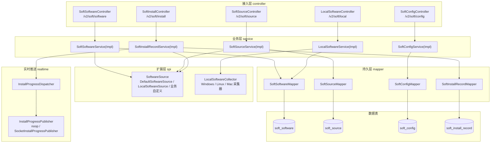
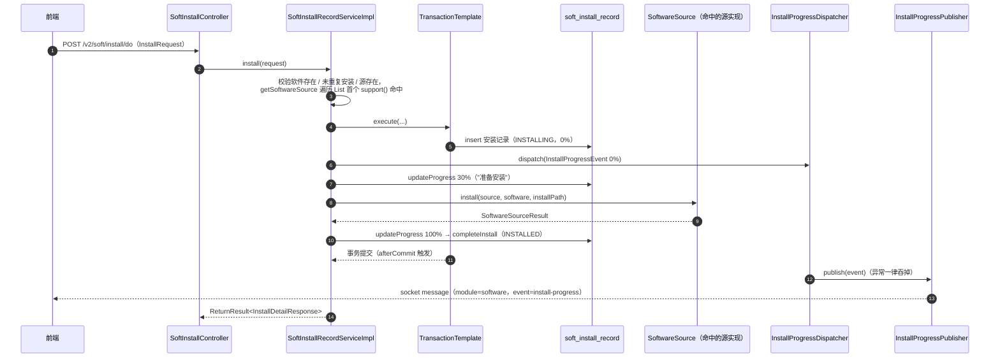
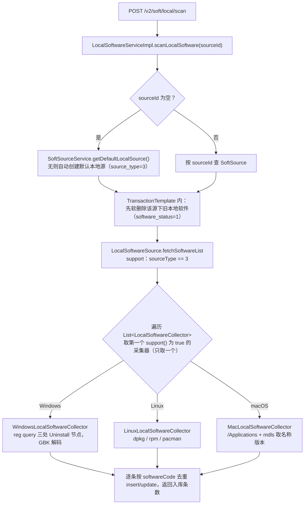
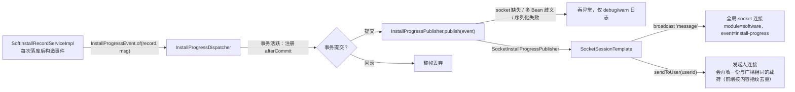

# spring-support-software-starter

软件资产与安装管理的完整闭环模块：软件目录、软件源、安装/卸载/升级记录、软件配置，外加「当前机器已装软件扫描」与安装进度实时推送。CRUD 与统计走 MyBatis-Plus + MySQL，真实安装动作通过 `SoftwareSource` 扩展点交给具体源实现。

- 坐标：`com.chua:spring-support-software-starter:4.0.0.51`
- 父 POM：`com.chua:spring-support-parent-starter:4.0.0.51`（Spring Boot **4.1.2**，Java 25）
- 装配方式：**没有** `META-INF/spring/org.springframework.boot.autoconfigure.AutoConfiguration.imports`，也没有 `spring.factories`；`SoftwareConfiguration` 虽标了 `@AutoConfiguration`，仍需宿主扫描 `com.chua.starter.software.support` 包或显式 `@Import(SoftwareConfiguration.class)` 才会生效。

## 1. 架构图

### 1.1 模块在体系中的位置

```mermaid
graph TB
    APP["宿主应用（Spring Boot 4.1.2 业务服务）"]

    subgraph 本模块
        SOFT["spring-support-software-starter<br/>软件目录 / 软件源 / 安装记录 / 本机扫描 / 进度推送"]
    end

    subgraph 同层业务 starter（并列，互不依赖）
        ACC["spring-support-account-starter"]
        DEV["spring-support-device-starter"]
        AI["spring-support-ai-starter"]
    end

    subgraph 底层支撑
        DS["spring-support-datasource-starter<br/>数据源 / TransactionTemplate"]
        MB["spring-support-mybatis-starter<br/>MyBatis-Plus / Query / 分页"]
        SW["spring-support-swagger-starter<br/>OpenAPI 注解"]
        UTIL["utils-support-common-starter<br/>ReturnResult / IdUtils / 工具"]
        SOCK["spring-support-socket-starter（optional）<br/>SocketSessionTemplate"]
    end

    APP --> SOFT
    SOFT --> DS
    SOFT --> MB
    SOFT --> SW
    SOFT --> UTIL
    SOFT -. 可选，缺失时空发布器兜底 .-> SOCK
```

### 1.2 模块内部分层



## 2. 核心流程图

### 2.1 安装请求处理流程（POST /v2/soft/install/do）



> 注意：`install` 不判断 `SoftwareSourceResult#success`——拿到结果后直接推 100% 并置为 INSTALLED；只有 SPI 实现**抛异常**才会走 `failInstall` 变为 FAILED。

### 2.2 本机软件扫描流程（POST /v2/soft/local/scan）



### 2.3 安装进度数据流



## 3. 能力清单

| 能力域 | 关键类 | 入口 |
| --- | --- | --- |
| 软件目录维护 | `SoftSoftwareController` / `SoftSoftwareService` | `/v2/soft/software`（`page` / `save` / `update` / `delete` / `detail`） |
| 软件源管理（含启用、禁用、同步、默认源） | `SoftSourceController` / `SoftSourceService` | `/v2/soft/source`（`page` / `save` / `update` / `delete` / `detail` / `enable` / `disable` / `sync` / `default`） |
| 软件配置（按软件挂键值配置，支持批量） | `SoftConfigController` / `SoftConfigService` | `/v2/soft/config`（`page` / `save` / `update` / `delete` / `list` / `batch`） |
| 安装 / 卸载 / 升级与记录 | `SoftInstallController` / `SoftInstallRecordService` | `/v2/soft/install`（`do` / `uninstall` / `update` / `detail` / `list` / `installed`） |
| 本机软件扫描、清理、手动添加 | `LocalSoftwareController` / `LocalSoftwareService` | `/v2/soft/local`（`scan` / `clear` / `page` / `detail` / `install` / `uninstall` / `add` / `list`） |
| 软件源扩展点（SPI） | `SoftwareSource`、`SoftwareSourceResult` | 注入 `List<SoftwareSource>`，按 `support(SoftSource)` 匹配首个命中 |
| 平台采集器扩展点（SPI） | `LocalSoftwareCollector` | 内置 `WindowsLocalSoftwareCollector` / `LinuxLocalSoftwareCollector` / `MacLocalSoftwareCollector` |
| 安装进度实时推送 | `InstallProgressPublisher` / `SocketInstallProgressPublisher` / `InstallProgressDispatcher` | socket 通道 `module=software`、`event=install-progress`；`InstallProgressDispatcher#dispatch(InstallProgressEvent)` |
| 进度事件组装 | `InstallProgressEvent` | `InstallProgressEvent#of(SoftInstallRecord, String)`、`#toMsgStep()` |
| 数据表与初始化脚本 | 实体 `SoftSoftware` / `SoftSource` / `SoftConfig` / `SoftInstallRecord` | `db/init/V2.0__init_all_software.sql`、`db/init/V2.0__initdata_software.sql` |
| 装配与服务信息 | `SoftwareConfiguration`、`SoftwareRealtimeConfiguration` | `@AutoConfiguration` + `@MapperScan` + `@ComponentScan`；`softwareServiceInfoContributor` 注册模块标志 |

数据表：`soft_software`、`soft_source`、`soft_config`、`soft_install_record`（均由实体 `@TableName` 声明）。

## 4. Bean 能力矩阵

| Bean 名 / 类 | 类型 | 来源与装配条件 | 可否覆盖 | 典型注入姿势 |
| --- | --- | --- | --- | --- |
| `softwareServiceInfoContributor` | `ServiceInfoContributor` | `SoftwareConfiguration#@Bean`，无条件 | 同类型自定义 Bean 需 `@Primary` 区分 | 直接注入 `ServiceInfoContributor`（由 common-starter 的 `ServiceInfoRegistry` 消费） |
| `softSoftwareController` 等 5 个 Controller | `@RestController` | `@ComponentScan("com.chua.starter.software.support")` | —（一般不覆盖） | 不直接注入；通过 REST 调用 |
| `softSoftwareServiceImpl` / `softSourceServiceImpl` / `softConfigServiceImpl` / `softInstallRecordServiceImpl` / `localSoftwareServiceImpl` | 对应 Service 接口 | `@Service` + 组件扫描，无条件 | 无条件注册；要替换需排除扫描或用 `@Primary` | 构造器注入 Service 接口 |
| `softSoftwareMapper` / `softSourceMapper` / `softConfigMapper` / `softInstallRecordMapper` | MyBatis Mapper | `@MapperScan("com.chua.starter.software.support.mapper")` | — | 构造器注入 Mapper |
| `defaultSoftwareSource` | `SoftwareSource`（空实现兜底） | `@Component` + `@ConditionalOnMissingBean(SoftwareSource.class)` | **可**：容器中存在任意 `SoftwareSource` 实现即退位 | 随 `List<SoftwareSource>` 注入业务服务 |
| `localSoftwareSource` | `SoftwareSource`（`sourceType==3` 命中） | `@Component`，无条件 | — | 构造器注入，或随 `List<SoftwareSource>` |
| `windowsLocalSoftwareCollector` / `linuxLocalSoftwareCollector` / `macLocalSoftwareCollector` | `LocalSoftwareCollector` | `@Component`，无条件 | 可新增自己的采集器（按 `support()` 竞争，首个命中生效） | 注入 `List<LocalSoftwareCollector>` |
| `noopInstallProgressPublisher` | `InstallProgressPublisher`（空实现） | `SoftwareRealtimeConfiguration#@Bean` + `@ConditionalOnMissingBean(InstallProgressPublisher.class)`（外层） | **可**：已有同类型 Bean 时让位 | `ObjectProvider<InstallProgressPublisher>`（服务内即如此注入） |
| `socketInstallProgressPublisher` | `InstallProgressPublisher`（socket 广播 + 定向） | 嵌套类 `SocketProgressConfiguration`：`@ConditionalOnClass(name="com.chua.socket.support.session.SocketSessionTemplate")` + `@ConditionalOnMissingBean(InstallProgressPublisher.class)` | **可**：业务方自定义发布器存在时退位 | 同上 |
| `transactionTemplate` | `TransactionTemplate` | 来自 `spring-support-datasource-starter`（非本模块定义） | — | 构造器注入 |

装配顺序说明（源码注释明确）：Spring 解析配置类时**先处理嵌套成员类、再收集本类 `@Bean` 方法**，因此 socket 发布器先注册，外层空实现随后求值时发现已有同类 Bean 自动让位；反过来写会让 socket 发布器被误判「已存在」而静默跳过。把 socket 参数的 `@Bean` 方法放进嵌套类，也是为了避免 socket 为 optional 依赖时反射解析方法签名抛 `NoClassDefFoundError`。

## 5. 完整配置

**本模块无任何 `@ConfigurationProperties` 配置项**：代码中不存在自定义配置前缀与配置绑定类，因此没有「路径 / 类型 / 默认值」可列。所有行为由宿主配置决定：

| 宿主配置 | 作用 | 缺省行为 |
| --- | --- | --- |
| `spring.datasource.*` | 数据来源（MySQL），本模块强依赖 | 无兜底，未配置启动失败 |
| `mybatis-plus.mapper-locations` | 加载本模块 `mapper/SoftSoftwareMapper.xml`、`mapper/SoftConfigMapper.xml` | 建议保持 `classpath*:mapper/**/*.xml` |
| `mybatis-plus.global-config.db-config.id-type` | 主键生成（实体主键为 String，用雪花/ASSIGN_ID 风格 ID） | 由宿主 MyBatis-Plus 配置决定 |
| `spring-support-socket-starter` 是否在 classpath | 唯一的「生效开关」：`@ConditionalOnClass(name="com.chua.socket.support.session.SocketSessionTemplate")` 决定装 socket 发布器还是空发布器 | 缺失时空发布器兜底，仅 debug 日志 |
| 宿主权限拦截器 | `@Permission` 注解的解析方 | 宿主无拦截器时 `/v2/soft/**` 完全开放 |

模块自带的 `src/main/resources/application.yml` 只是 `SoftStarterApplication` 独立启动（`mvn spring-boot:run` 调试）时的示例，**不是 starter 配置项**：

| 配置项 | 示例值 | 说明 |
| --- | --- | --- |
| `server.port` | `8081` | 仅独立启动时生效 |
| `spring.application.name` | `soft-starter` | 独立启动示例名 |
| `spring.datasource.url` | `jdbc:mysql://172.16.0.40:3306/softdb?...` | 示例指向 MySQL；密码走环境变量 `SOFTWARE_DB_PASSWORD` |
| `spring.datasource.username` / `password` | `root` / `${SOFTWARE_DB_PASSWORD:}` | 密码从环境变量读取 |
| `spring.sql.init.mode` | `never` | 不自动建表，需手工执行 `db/init` 脚本 |
| `mybatis-plus.mapper-locations` | `classpath*:mapper/**/*.xml` | 加载模块内 2 个 XML |
| `mybatis-plus.global-config.db-config.id-type` | `ASSIGN_ID` | 雪花 ID |
| `spring.autoconfigure.exclude` | `ShardingSphereAutoConfiguration`、两个 Elasticsearch 自动配置 | 独立启动时精简上下文 |

## 6. 使用方式

### 6.1 Maven 坐标

```xml
<dependency>
    <groupId>com.chua</groupId>
    <artifactId>spring-support-software-starter</artifactId>
    <version>4.0.0.51</version>
</dependency>
```

### 6.2 依赖说明

| 依赖 | 版本 | 作用 |
| --- | --- | --- |
| `com.chua:spring-support-datasource-starter` | 父 POM 统一管理 | 数据源与事务模板 `TransactionTemplate` |
| `com.chua:spring-support-mybatis-starter` | 父 POM 统一管理 | MyBatis-Plus、`Query` / 分页 / `ReturnPageResult` |
| `com.chua:spring-support-swagger-starter` | 父 POM 统一管理 | `@Tag` / `@Operation` / `@ParameterObject` 文档注解 |
| `org.springframework.boot:spring-boot-starter-web` | 4.1.2（BOM） | REST 层 |
| `org.springframework.boot:spring-boot-starter-tomcat` | 4.1.2（BOM） | 独立启动时的容器 |
| `jakarta.servlet:jakarta.servlet-api` | `6.1.0`（显式声明） | Servlet 契约 |
| `org.springframework.boot:spring-boot-autoconfigure` | 4.1.2（BOM） | `@AutoConfiguration` / `@ConditionalOnXxx` |
| `com.chua:utils-support-common-starter` | 父 POM 统一管理 | `ReturnResult`、`IdUtils`、`StringUtils`、`CollectionUtils` |
| `com.chua:spring-support-socket-starter` | `${project.version}`，**`optional`** | 安装进度广播；未引入时由空发布器兜底 |
| `org.projectlombok:lombok` / `com.uber.nullaway:nullaway` | `provided` / 注解处理器 | 编译期 `proc=full` |

> 模块**没有**测试依赖与 `src/test` 目录（旧文档提到的 junit 已从 pom 移除）。

### 6.3 最小可运行示例

**第一步**：引入依赖（见上），保证宿主已有 MySQL 数据源。

**第二步**：建表。手工执行 `src/main/resources/db/init/V2.0__init_all_software.sql`（建 4 张表），需要演示数据再执行 `V2.0__initdata_software.sql`。

**第三步**：让配置生效。宿主启动类加 `@ComponentScan(basePackages = "com.chua.starter.software.support")`，或 `@Import(SoftwareConfiguration.class)`。之后 `/v2/soft/**` 端点与各 Service Bean 可用。

```java
@SpringBootApplication
@ComponentScan(basePackages = "com.chua.starter.software.support")
public class HostApplication {
    public static void main(String[] args) {
        SpringApplication.run(HostApplication.class, args);
    }
}
```

**第四步**：Java 侧按步骤调用（本模块无链式 API；`InstallRequest` 是 record，5 个字段依次为 `softwareId / userId / deviceId / installPath / sourceId`）：

```java
@Service
@RequiredArgsConstructor
public class SoftwareOps {

    private final SoftSourceService softSourceService;
    private final LocalSoftwareService localSoftwareService;
    private final SoftInstallRecordService installRecordService;
    private final SoftSoftwareService softSoftwareService;

    public void demo() {
        // 1) 扫描本机已装软件；sourceId 传 null 时使用默认本地源（source_type=3）
        int scanned = localSoftwareService.scanLocalSoftware(null);

        // 2) 从某个源同步软件目录（内部遍历 List<SoftwareSource>，按 support(source) 命中）
        SoftSource local = softSourceService.getDefaultLocalSource();
        ReturnResult<Integer> synced = softSourceService.syncSource(local.getSourceId());

        // 3) 安装：落 soft_install_record → 推 0%/30% 进度 → 调命中的 SoftwareSource#install → 推 100%
        InstallRequest request = new InstallRequest("sw-1", "u-1", "dev-1", "D:/apps/demo", null);
        ReturnResult<InstallDetailResponse> installed = installRecordService.install(request);

        // 4) 读安装详情与用户已装列表
        String recordId = installed.getData().getInstallRecordId();
        ReturnResult<InstallDetailResponse> detail = installRecordService.getInstallDetail(recordId);
        List<SoftInstallRecord> records = installRecordService.listInstalledByUserId("u-1");

        // 5) 分页查询（已安装的排前面）
        var page = softSoftwareService.pageFor(new Query<>(), new SoftwarePageRequest(),
                installRecordService.getInstalledSoftwareIds("u-1"));
    }
}
```

前端订阅进度：`socket.subscribe("software", "install-progress", handler)`，载荷为 `{module, event, data, dataId, timestamp}`，`data` 内含 `percentage / statusText / recordId / finished` 等字段。

**状态与字典**（落库为整数）：

安装状态机 `InstallStatus`（列 `install_record_status`）：

| 值 | 枚举 | 含义 |
| --- | --- | --- |
| 0 | `NOT_INSTALLED` | 未安装 |
| 1 | `INSTALLING` | 安装中 |
| 2 | `INSTALLED` | 已安装 |
| 3 | `FAILED` | 安装失败 |
| 4 | `UNINSTALLING` | 卸载中 |
| 5 | `UNINSTALLED` | 已卸载 |
| 6 | `UPDATING` | 更新中 |
| 7 | `UPDATE_FAILED` | 更新失败 |

软件源类型 `SourceType`（列 `source_type`）：`OFFICIAL(0)` 官方仓库、`THIRD_PARTY(1)` 第三方、`SELF_BUILT(2)` 自建源、`LOCAL(3)` 本地文件。

**REST 端点一览**（全部带 `@Permission`，角色限定 `AuthConstant.ADMIN` / `AuthConstant.SUPER_ADMIN`，需宿主权限拦截器）：

```text
# 软件目录 /v2/soft/software
GET    /page          POST /save(sys:soft:add)   PUT /update(sys:soft:update)
DELETE /delete(sys:soft:delete)                  GET  /detail

# 软件源 /v2/soft/source
GET /page   POST /save(sys:soft:source:add)   PUT /update(sys:soft:source:update)
DELETE /delete(sys:soft:source:delete)           GET /detail
PUT /enable|/disable(sys:soft:source:update)     POST /sync(sys:soft:source:sync)
GET /default

# 安装 /v2/soft/install
POST   /do(sys:soft:install)      body: InstallRequest
DELETE /uninstall?softwareId=&userId=&deviceId=          (sys:soft:uninstall)
PUT    /update?softwareId=&userId=&deviceId=&targetVersion=   (sys:soft:update)
GET    /detail?recordId=   GET /list?softwareId=   GET /installed?userId=

# 本机软件 /v2/soft/local
POST   /scan?sourceId=(sys:soft:local:scan)    DELETE /clear?sourceId=(sys:soft:local:delete)
GET    /page   GET /detail
POST   /install(sys:soft:local:install)        DELETE /uninstall(sys:soft:local:uninstall)
POST   /add(sys:soft:local:add)                GET  /list?keyword=
```

## 7. 使用场景

**适用**：

- 内网/私有化环境中的软件资产台账：软件目录、来源、版本、安装记录的统一管理。
- 多软件源汇聚：官方/第三方/自建源目录同步（通过实现 `SoftwareSource`），配合 `/v2/soft/source/sync` 定期拉取。
- 控制台型产品的「软件商店」体验：发起安装 → 页面实时进度条（socket 推送）→ 安装记录可查。
- 服务器本机软件盘点：Windows/Linux/macOS 已装软件扫描入库，作为资产基线。

**不适用**：

- 开箱即用的跨平台静默安装引擎：内置实现都是占位（见第 9 节），真实安装/卸载必须由你实现 `SoftwareSource`。
- 没有 MySQL、不想建表的环境：模块强依赖 4 张表，且不会自动建表。
- 没有权限体系却要求接口安全的环境：`@Permission` 只在宿主拦截器存在时才生效。
- 高频、海量软件的大规模并发同步：`syncFromSource` 是单事务逐条写库，源列表很大时是长事务。

**与相邻模块的取舍**：

- `spring-support-device-starter`：无依赖关系。安装记录里的 `deviceId` 只是字符串，由宿主自行关联设备体系；不要指望本模块校验设备存在性。
- `spring-support-socket-starter`：可选依赖。要进度推送就引入它并启用 socket；不引入则功能完整但无实时推送。
- `spring-support-datasource/mybatis-starter`：必选传递能力。本模块不自管连接池与分页插件。
- 自己写安装编排 vs 复用本模块：本模块提供「记录 + 状态机 + 进度推送 + 权限端点」的骨架，安装动作留白；如果你的安装逻辑已经成熟，也可以只把它当 CRUD + 进度广播框架用。

## 8. 扩展点

本模块扩展点均走 **Spring 容器注册**（`@Component` / `@Bean`），不使用 `META-INF/services`（模块内不存在该目录）。

### 8.1 `SoftwareSource` —— 接入新的软件源类型

接口方法：`support(SoftSource)`、`fetchSoftwareList(SoftSource)`、`fetchSoftwareDetail(SoftSource, String)`、`install(...)`、`uninstall(...)`、`update(...)`、`getLatestVersion(...)`；返回值用 `SoftwareSourceResult.success(...)` / `fail(...)` 静态工厂。

```java
@Component
public class NexusSoftwareSource implements SoftwareSource {

    @Override
    public boolean support(SoftSource source) {
        return source != null && source.getSourceType() == SourceType.THIRD_PARTY.getValue();
    }

    @Override
    public List<SoftSoftware> fetchSoftwareList(SoftSource source) {
        // 按 source.getSourceApiUrl() 拉取，返回待入库的 SoftSoftware
        return List.of();
    }

    @Override
    public SoftSoftware fetchSoftwareDetail(SoftSource source, String softwareCode) {
        return null;
    }

    @Override
    public SoftwareSourceResult install(SoftSource source, SoftSoftware software, String installPath) {
        return SoftwareSourceResult.success("安装完成", installPath);
    }

    @Override
    public SoftwareSourceResult uninstall(SoftSource source, SoftSoftware software, String installPath) {
        return SoftwareSourceResult.success("卸载完成", installPath);
    }

    @Override
    public SoftwareSourceResult update(SoftSource source, SoftSoftware software,
                                       String targetVersion, String installPath) {
        return SoftwareSourceResult.fail("该源不支持原地升级");
    }

    @Override
    public String getLatestVersion(SoftSource source, String softwareCode) {
        return null;
    }
}
```

生效路径：`POST /v2/soft/source/sync` → `SoftSourceService#syncSource` → `SoftSoftwareServiceImpl#syncFromSource` 遍历 `List<SoftwareSource>` → 首个 `support(source)` 命中 → `fetchSoftwareList` 结果按 `softwareCode` 去重入库。安装/卸载/升级同理，由 `SoftInstallRecordServiceImpl#getSoftwareSource` 首个命中。

内置实现：`LocalSoftwareSource`（`sourceType==3`，本地源）与 `DefaultSoftwareSource`（`@ConditionalOnMissingBean(SoftwareSource.class)` 的空兜底，`support` 恒为 `false`，操作一律 `fail("不支持的软件源类型")`）。

### 8.2 `LocalSoftwareCollector` —— 支持新的操作系统

接口方法：`support()`（当前 OS 是否可用）与 `collect()`（返回名称/版本/安装路径/图标等基础信息）。

```java
@Component
public class FreeBsdLocalSoftwareCollector implements LocalSoftwareCollector {

    @Override
    public boolean support() {
        return System.getProperty("os.name", "").toLowerCase().contains("freebsd");
    }

    @Override
    public List<SoftSoftware> collect() {
        return List.of();   // 只填基础信息，sourceId/状态/时间由 LocalSoftwareServiceImpl 回填
    }
}
```

生效路径：`POST /v2/soft/local/scan` → `LocalSoftwareService#scanLocalSoftware` → `LocalSoftwareSource#fetchSoftwareList` → 遍历 `List<LocalSoftwareCollector>` 取**第一个** `support()` 为 true 的采集器。多个采集器命中时只取第一个，顺序即 `List` 注入顺序（可用 `@Order` 干预）。

### 8.3 `InstallProgressPublisher` —— 自定义进度推送通道

模块只依赖 `InstallProgressPublisher#publish(InstallProgressEvent)`，不直接依赖 Socket/SSE/WebSocket 类型。你提供一个自己的 `@Component`/`@Bean` 实现（例如「落库 + SSE 双写」）后，`noopInstallProgressPublisher` 与 `socketInstallProgressPublisher` 会因 `@ConditionalOnMissingBean` 同时退位。

注意两点（源码注释明确）：

1. 容器里若出现**多个** `InstallProgressPublisher`（例如自定义实现没有让兜底退位），`ObjectProvider#getIfAvailable` 会抛装配歧义异常，服务侧捕获后**跳过该帧**（warn 日志），安装不受影响——所以自定义实现要确保唯一。
2. 实现约定：**任何异常都必须吞掉**。推送失败只意味着页面看不到进度，不能反过来让已成功的安装失败。

## 9. 常见问题

**Q1：引入依赖后 `/v2/soft/**` 全部 404，Service 也注入不了？**
本模块没有 `META-INF/spring/...AutoConfiguration.imports`，也没有 `spring.factories`，Boot 的自动配置发现机制（2.7+ 至 4.x）都不会加载它。`SoftwareConfiguration` 上的 `@AutoConfiguration` 注解只是声明，必须由宿主 `@ComponentScan("com.chua.starter.software.support")` 或 `@Import(SoftwareConfiguration.class)` 显式装配；否则连 `@MapperScan` 也随之失效，四个 Mapper 都不存在。

**Q2：装配生效了，但安装进度前端收不到？**
按顺序排查：① 宿主是否真的引入了 `spring-support-socket-starter` 并在运行期 classpath 上（开关是 `@ConditionalOnClass(name="com.chua.socket.support.session.SocketSessionTemplate")`，不是配置项）；② `SocketSessionTemplate` 对应的 socket 服务是否启用（模板缺失时发布器会 debug 日志后跳过）；③ 是否存在多个 `InstallProgressPublisher` 导致装配歧义（日志会有「进度发布器装配歧义，跳过本帧」）。

**Q3：发起人为什么收到两条一样的进度消息？**
`SocketInstallProgressPublisher` 刻意「广播 + 定向」各发一次：广播保证同控制台所有人看到进度，`sendToUser` 兜底保证发起人在房间/会话异常时也能收到。后端不去重（无从判断某条会话是否真在广播集合里），前端按载荷内容指纹去重即可。

**Q4：安装接口返回成功，但我实现的 `SoftwareSource` 明明返回了 `fail(...)`？**
`SoftInstallRecordServiceImpl#install` 不判断 `SoftwareSourceResult#success`，拿到结果就推 100% 并置 INSTALLED。需要失败语义时，请让实现在失败分支**抛异常**，才会走 `failInstall` 落 FAILED 状态。

**Q5：`server.port=8081` 在宿主里不生效？**
`8081` 只出现在模块自带的 `application.yml`，那是 `SoftStarterApplication` 独立启动示例的配置；作为 starter 被引入后端口完全由宿主决定，本模块不读取任何端口配置。

**Q6：与 Spring Boot 4.x 的兼容性？**
仓库以 `spring-boot-starter-parent:4.1.2` 构建（父 POM `spring.boot.version=4.1.2`），模块使用 `jakarta.*` 命名空间（`jakarta.servlet-api 6.1.0`、`jakarta.validation`），数据访问由 `spring-support-mybatis-starter` 按 Boot 4 适配（父 POM dependencyManagement 中管理 `mybatis-plus-spring-boot4-starter`）。本模块自身没有使用已被 Boot 3/4 移除的 API，升级 Boot 4 无额外适配点；唯一要记住的是 Q1——它从来不是靠自动配置注册文件装配的模块。

**Q7：为什么启动后查询不到本机软件 / 扫描很慢？**
本机扫描是**同步阻塞**的：Windows 走 `reg query` 读三处 Uninstall 节点（GBK 解码），Linux 走 `dpkg`/`rpm`/`pacman`，macOS 读 `/Applications` 并用 `mdls` 取名称版本；软件数量大时接口耗时明显。且只取第一个 `support()` 命中的采集器结果，Windows 采集器不会在 Linux 上命中。

**Q8：删除软件后数据还在吗？**
删除是软删除：`SoftSoftwareService#deleteSoftware` 把 `software_status` 置 1，不删行；本机扫描前也会先软删该源旧数据。查询统计时需自行带状态条件。

**Q9：Elasticsearch 检索能用吗？**
不能。`SoftSoftwareServiceImpl` 的 `indexToElasticsearch` / `deleteFromElasticsearch` 只打日志，`searchFromElasticsearch` 直接返回空列表，检索能力是占位，尚未落地。

**Q10：`SoftStarterApplication` 注释说内置 H2，为什么还要连 MySQL？**
以 `application.yml` 为准：它指向 `jdbc:mysql://172.16.0.40:3306/softdb`，且 `spring.sql.init.mode: never` 不会自动建表。类注释里的「内置 H2」与实际配置不一致，独立调试也必须提供 MySQL 并手工执行 `db/init` 脚本。
