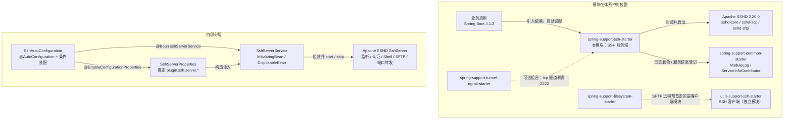
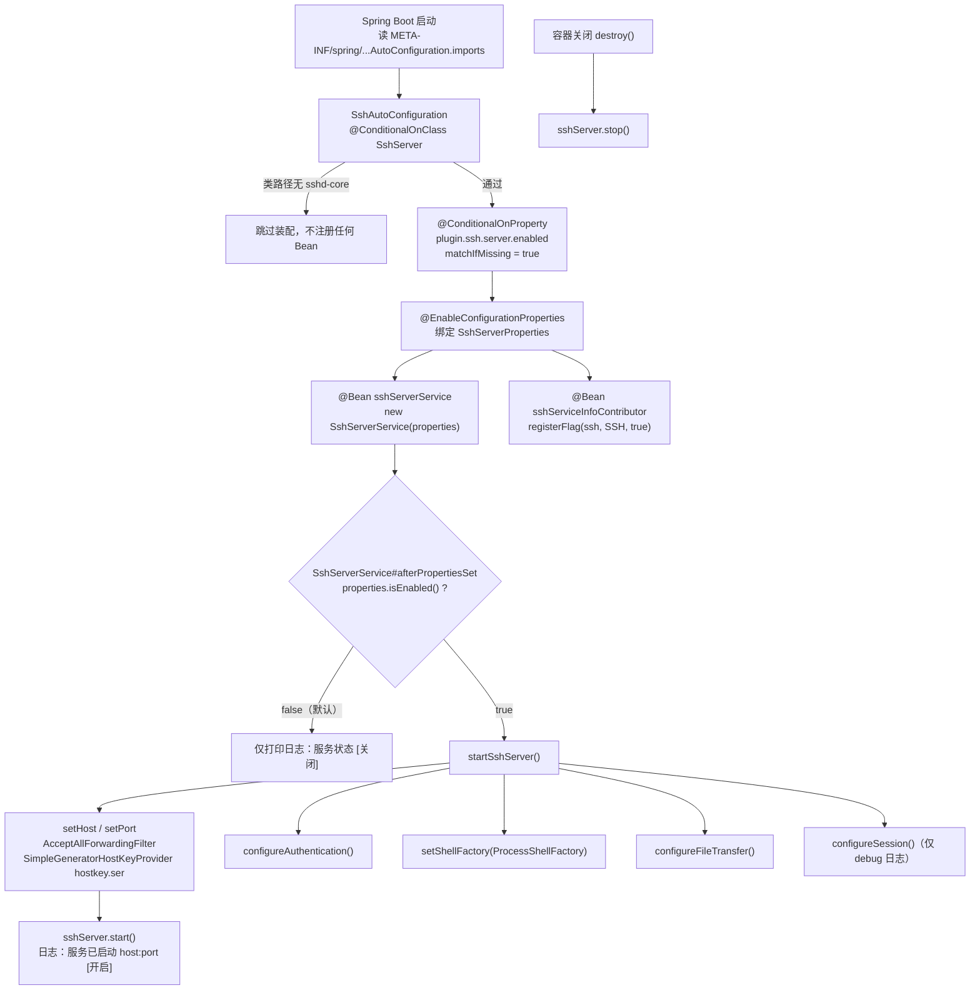
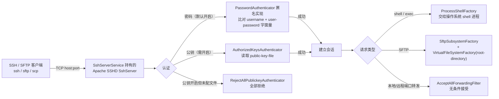

# spring-support-ssh-starter

基于 Apache SSHD 的 **SSH 服务端** starter：随 Spring Boot 启动一个可登录的 SSH/SFTP 服务端。
默认不启动服务端进程，必须显式设置 `plugin.ssh.server.enabled=true`。

- 坐标：`com.chua:spring-support-ssh-starter:4.0.0.51`
- 基线：Spring Boot **4.1.2**（父 pom `spring-support-parent-starter:4.0.0.51`，2026-11-19 升级），Apache SSHD **2.20.0**（由父 pom 依赖管理统一钉版）
- 注意：本模块是 **SSH 服务端**（让别人登录你的应用所在机器）；SSH **客户端**能力在 `utils-support-ssh-starter`（独立模块，互不依赖），不要混淆。

## 1. 架构图



分层说明：

| 层 | 类 | 职责 |
|:---|:---|:---|
| 装配层 | `com.chua.starter.ssh.configuration.SshAutoConfiguration` | 条件装配两个 Bean，注册配置属性绑定 |
| 配置层 | `com.chua.starter.ssh.properties.SshServerProperties` | `@ConfigurationProperties(prefix = "plugin.ssh.server")` |
| 服务层 | `com.chua.starter.ssh.service.SshServerService` | SSHD 生命周期与全部服务端配置逻辑 |
| 运行时 | `org.apache.sshd.server.SshServer`（Apache SSHD） | 实际监听端口、处理连接、Shell/SFTP/转发 |

## 2. 核心流程图

### 2.1 装配与启动流程



要点：自动配置类上的 `@ConditionalOnProperty(..., matchIfMissing = true)` 意味着**属性缺省时配置类也会加载、Bean 也会注册**；真正决定是否启动服务端进程的，是 `SshServerService#afterPropertiesSet` 里对 `properties.isEnabled()`（默认 `false`）的二次判断。

### 2.2 连接与请求处理流程



## 3. 能力清单

| 能力域 | 关键类 | 入口 |
|:-------|:-------|:-----|
| 自动装配 | `SshAutoConfiguration` | `AutoConfiguration.imports` + `@ConditionalOnClass` / `@ConditionalOnProperty` |
| 配置绑定 | `SshServerProperties` | `plugin.ssh.server.*` |
| 服务端生命周期 | `SshServerService` | `InitializingBean#afterPropertiesSet` 启动 / `DisposableBean#destroy` 停止 |
| 密码认证 | `SshServerService#configureAuthentication` | SSHD `PasswordAuthenticator`（单账号字面量比对） |
| 公钥认证 | `SshServerService#configureAuthentication` | SSHD `AuthorizedKeysAuthenticator`；未配文件时 `RejectAllPublickeyAuthenticator` |
| Shell 命令执行 | `SshServerService#startSshServer` | SSHD `ProcessShellFactory`（操作系统进程） |
| SFTP 文件传输 | `SshServerService#configureFileTransfer` | `SftpSubsystemFactory` + `VirtualFileSystemFactory`（虚拟根目录） |
| 端口转发 | `SshServerService#startSshServer` | `AcceptAllForwardingFilter`（无条件接受） |
| 主机密钥 | `SshServerService#startSshServer` | `SimpleGeneratorHostKeyProvider`（首次启动生成工作目录下 `hostkey.ser`） |
| 运行状态查询 | `SshServerService#isRunning` / `#getActiveSessionCount` | 注入 Bean 直接调用 |
| 服务信息登记 | `SshAutoConfiguration#sshServiceInfoContributor` | 实现 common-starter 的 `ServiceInfoContributor`，向 `ServiceInfoRegistry` 注册开关 `ssh` |

本模块**没有**对外 REST 端点、没有链式 API、没有自带 SPI 接口；使用方式是「配置 + 注入 `SshServerService` 查询状态」。

## 4. Bean 能力矩阵

| Bean 名 | 类型 | 装配条件 | 可否覆盖 | 典型注入姿势 |
|:--------|:-----|:---------|:---------|:-------------|
| `sshServerService` | `com.chua.starter.ssh.service.SshServerService` | 类路径存在 `org.apache.sshd.server.SshServer`（`@ConditionalOnClass`），且 `plugin.ssh.server.enabled` 为 `true` 或缺省（`matchIfMissing = true`） | 可以：推荐 `spring.autoconfigure.exclude` 排除本自动配置后自行声明，或声明同类型 `@Primary` Bean（Boot 默认禁止同名覆盖，需开 `spring.main.allow-bean-definition-overriding=true`，不推荐） | 构造器注入，调用 `isRunning()` / `getActiveSessionCount()` |
| `sshServiceInfoContributor` | `com.chua.starter.common.support.serviceinfo.ServiceInfoContributor`（函数式接口） | 同上（同一个自动配置类） | 同上 | 一般不注入；由 common-starter 的服务信息横幅/端点收集展示 |
| `plugin.ssh.server-com.chua.starter.ssh.properties.SshServerProperties` | `com.chua.starter.ssh.properties.SshServerProperties` | `@EnableConfigurationProperties(SshServerProperties.class)` 随自动配置注册 | 可重复注册覆盖（一般无需动） | 注入后读取任意 `plugin.ssh.server.*` 绑定值 |

> 注意：由于 `matchIfMissing = true`，即使什么都没配置，上面两个 Bean 也会存在；但 `SshServerService` 构造后不会启动服务端，只会打印「[SSH] 服务状态 [关闭]」。

## 5. 完整配置

配置前缀：**`plugin.ssh.server`**（不是 `ssh.server`）。下表「生效」列依据 `SshServerService` 实际读取逻辑标注：✅ 运行期生效；⚠️ 仅打印日志；❌ 仅有字段、运行期未读取。

### 5.1 服务端

| 路径 | 类型 | 默认值 | 说明 | 生效 |
|:-----|:-----|:-------|:-----|:-----|
| `plugin.ssh.server.enabled` | `boolean` | `false` | 是否真正启动 SSHD；**必须显式设为 true**。同时是自动装配条件键（缺省时 Bean 仍会注册，但服务不启动） | ✅ |
| `plugin.ssh.server.enable` | `boolean` | `false` | 历史声明字段，运行期**未读取**，配置无效 | ❌ |
| `plugin.ssh.server.host` | `String` | `0.0.0.0` | 监听地址 | ✅ |
| `plugin.ssh.server.port` | `int` | `2222` | 监听端口 | ✅ |

### 5.2 认证（`plugin.ssh.server.authentication.*`）

| 路径 | 类型 | 默认值 | 说明 | 生效 |
|:-----|:-----|:-------|:-----|:-----|
| `password` | `boolean` | `true` | 启用密码认证 | ✅ |
| `public-key` | `boolean` | `false` | 启用公钥认证 | ✅ |
| `username` | `String` | `admin` | 唯一允许的用户名 | ✅ |
| `user-password` | `String` | 空串 | 密码；默认空串，不配置则密码登录必然失败 | ✅ |
| `public-key-file` | `String` | 无 | `authorized_keys` 格式公钥文件路径；`public-key=true` 时必配，否则回退为全部拒绝 | ✅ |
| `private-key-file` | `String` | 无 | 仅声明字段，运行期未使用 | ❌ |

### 5.3 会话（`plugin.ssh.server.session.*`）

| 路径 | 类型 | 默认值 | 说明 | 生效 |
|:-----|:-----|:-------|:-----|:-----|
| `timeout` | `long` | `3600` | 会话超时（秒）；当前只在 debug 日志打印，不真正生效 | ⚠️ |
| `max-sessions` | `int` | `10` | 最大会话数；当前只在 debug 日志打印，不限制并发 | ⚠️ |
| `idle-timeout` | `long` | `1800` | 空闲超时（秒）；设置逻辑已被注释，未使用 | ❌ |

### 5.4 文件传输（`plugin.ssh.server.file-transfer.*`）

| 路径 | 类型 | 默认值 | 说明 | 生效 |
|:-----|:-----|:-------|:-----|:-----|
| `scp-enabled` | `boolean` | `true` | 仅声明字段；服务端**未注册** SCP 命令工厂，配置无效 | ❌ |
| `sftp-enabled` | `boolean` | `true` | 是否注册 SFTP 子系统与虚拟文件系统 | ✅ |
| `root-directory` | `String` | `/tmp` | SFTP 虚拟根目录（`VirtualFileSystemFactory`），建议显式绝对路径 | ✅ |
| `max-file-size` | `long` | `104857600`（100MB） | 仅声明字段，无大小校验逻辑 | ❌ |

### 5.5 安全（`plugin.ssh.server.security.*`）

以下字段均**未接入运行期逻辑**，配置了也不会限制访问，仅供未来扩展占位：

| 路径 | 类型 | 默认值 | 说明 | 生效 |
|:-----|:-----|:-------|:-----|:-----|
| `allowed-ips` | `List<String>` | `[]` | 允许的 IP 列表 | ❌ |
| `denied-ips` | `List<String>` | `[]` | 禁止的 IP 列表 | ❌ |
| `max-login-attempts` | `int` | `3` | 最大登录尝试次数 | ❌ |
| `lockout-duration` | `long` | `300` | 登录失败锁定时间（秒） | ❌ |
| `host-key-verification` | `boolean` | `true` | 是否启用主机密钥验证 | ❌ |

另：模块 jar 内附带示例文件 `application-ssh.yml`，其前缀写的是 `ssh.server.*`，与实际绑定前缀 `plugin.ssh.server.*` **不一致**，不会被绑定生效，只可当字段清单参考，请勿照抄其前缀。

## 6. 使用方式

### 6.1 Maven 坐标

```xml
<dependency>
    <groupId>com.chua</groupId>
    <artifactId>spring-support-ssh-starter</artifactId>
    <version>4.0.0.51</version>
</dependency>
```

依赖说明：

| 依赖 | 性质 | 说明 |
|:-----|:-----|:-----|
| `org.apache.sshd:sshd-core` | 必需 | SSH 服务端核心；缺失时 `@ConditionalOnClass` 直接跳过装配 |
| `org.apache.sshd:sshd-sftp` | 必需 | SFTP 子系统实现 |
| `org.apache.sshd:sshd-scp` | 已引入但未装配 | pom 声明了依赖，但服务端未注册 SCP 命令工厂，`scp-enabled` 也不参与装配 |
| `org.springframework.boot:spring-boot-starter` | 必需 | 自动配置与容器 |
| `com.chua:spring-support-common-starter` | 必需 | `ModuleLog` 日志着色、`ServiceInfoContributor` 服务信息登记 |
| `org.springframework.boot:spring-boot-configuration-processor` | `optional` | 仅编译期生成配置元数据（IDE 提示），无运行期作用 |

版本（SSHD 2.20.0 等）由父 pom `spring-support-parent-starter` 的 `dependencyManagement` 统一管理，本模块未单独钉版；本模块按仓库构建配置以 Java 25 编译，`spring-boot-maven-plugin` 已 `skip`（纯库 jar，不打 fat jar）。

### 6.2 最小可运行示例

第一步，引入依赖（见上）。

第二步，`application.yml` 显式开启并配置凭据：

```yaml
plugin:
  ssh:
    server:
      enabled: true          # 必须显式开启
      host: 0.0.0.0
      port: 2222
      authentication:
        password: true
        username: admin
        user-password: change-me   # 默认空串，必须配置
      file-transfer:
        sftp-enabled: true
        root-directory: /data/sftp  # 建议 Windows 下写绝对路径，如 D:/sftp-root
```

第三步，连接验证：

```bash
ssh admin@127.0.0.1 -p 2222
sftp -P 2222 admin@127.0.0.1
```

启动成功日志形如（颜色由 common-starter 的 `ModuleLog#address/#enabled/#highlight` 着色）：

```text
 >>>>>>> 初始化SSH服务端服务，端口: 2222
[SSH] 服务已启动 0.0.0.0:2222 [开启]
[SSH] SFTP文件传输 [开启] 根目录: /data/sftp
```

未开启（`enabled=false` 或缺省）时日志为 `[SSH] 服务状态 [关闭]`，不占用端口。

### 6.3 程序内查询状态

```java
@Service
public class SshStatusDemo {

    private final SshServerService sshServerService;

    public SshStatusDemo(SshServerService sshServerService) {
        this.sshServerService = sshServerService;
    }

    public String status() {
        return "running=" + sshServerService.isRunning()
                + ", sessions=" + sshServerService.getActiveSessionCount();
    }
}
```

## 7. 使用场景

### 7.1 适用

- 给运维/内部工具在 Spring 应用所在机器开一个受控的 SSH 登录与 SFTP 文件出入口；
- 本地或内网联调 SFTP 客户端逻辑（用本模块当被连接方）；
- 需要随应用生命周期自动启停的嵌入式 SSHD（应用关闭时自动 `stop`）；
- 配合 `spring-support-tunnel-ngrok-starter` 等 tcp 隧道，把 2222 端口临时暴露到公网做远程救援。

### 7.2 不适用

- 需要真实用户体系、角色权限、登录失败锁定、IP 白名单、会话限额的场景（相关 `security.*`、`session.*` 配置**未接入**）；
- 依赖原生 SCP 协议（`scp -O`）的文件传输（服务端未注册 SCP 命令工厂）；
- 直接暴露公网的生产环境（`AcceptAllForwardingFilter` 端口转发全开放、`ProcessShellFactory` 直接起系统 shell，权限边界取决于运行应用的 OS 用户）；
- 需要你的应用去**连接别人机器**的场景——那是 `utils-support-ssh-starter`（SSH 客户端）的职责。

### 7.3 与相邻模块的取舍

| 模块 | 方向 | 取舍说明 |
|:-----|:-----|:---------|
| `spring-support-common-starter` | 本模块依赖 | 复用 `ModuleLog`、`ServiceInfoContributor`，不重复造日志/横幅 |
| `utils-support-ssh-starter` | 独立模块，无依赖关系 | SSH **客户端**（连接远程主机、读远程文件）。方向与本模块相反，按需二选一或并用 |
| `spring-support-filesystem-starter` | 间接使用 utils 层 | 其 SFTP 远程文件预览依赖 `utils-support-ssh-starter`（见其 pom），与本服务端模块无关 |
| `spring-support-tunnel-ngrok-starter` | 可组合，无依赖 | ngrok `tcp` 模式可把 2222 暴露公网；生产勿裸奔，建议改默认凭据 + 防火墙限流 |

## 8. 扩展点

**本模块不提供自有 SPI**：没有 `META-INF/extensions`，也没有可替换的认证/文件系统/会话策略接口。认证方式与文件系统由 `SshServerService` 内部直接装配。可行的扩展姿势：

1. **替换整个 Bean**：通过 `spring.autoconfigure.exclude=com.chua.starter.ssh.configuration.SshAutoConfiguration` 排除自动配置，再自行声明 `SshServerService`（或同类型 `@Primary` Bean），在里面重写 `configureAuthentication` 等逻辑；
2. **直接使用 Apache SSHD API**：SSHD 本身的扩展点（`PasswordAuthenticator`、`PublickeyAuthenticator`、`SftpSubsystemFactory`、`FileSystemFactory`、`ForwardingFilter`、`ShellFactory`、`CommandFactory` 等）都可以在自行组装 `SshServer` 时使用——本模块不拦截你另起一个 SSHD；
3. **消费服务信息登记**：本模块向 common-starter 的 `ServiceInfoRegistry` 注册了开关 `ssh`（分组 `SSH`），你的监控/横幅代码可通过 `ServiceInfoContributor` 体系读取展示。

> 注意：`sshServiceInfoContributor` 中注册的开关值是硬编码 `true`，即使 SSH 服务端未启动，横幅上 SSH 也会显示「开启」；判断服务是否真的在跑请以 `SshServerService#isRunning()` 为准。

## 9. 常见问题

**Q1：引入了依赖，但 2222 端口没监听？**
按顺序排查：① 类路径是否有 `sshd-core`（`@ConditionalOnClass` 不满足会整体跳过装配，且无报错）；② 是否设置的是 `plugin.ssh.server.enabled=true`——注意键名是 `enabled` 不是 `enable`（后者不生效），前缀是 `plugin.ssh.server` 不是 `ssh.server`；③ 是否被 `spring.autoconfigure.exclude` 排除；④ 启动日志应出现 `>>>>>>>> 初始化SSH服务端服务，端口: 2222`，若只出现 `[SSH] 服务状态 [关闭]` 说明 Bean 已装配但 `enabled=false`。

**Q2：没配任何属性，为什么 `SshServerService` Bean 也存在？**
`@ConditionalOnProperty(prefix="plugin.ssh.server", name="enabled", matchIfMissing=true)`：属性缺省时条件视为通过，Bean 会注册；但 `afterPropertiesSet()` 里 `properties.isEnabled()` 默认 `false`，服务端不会启动。即「Bean 恒在，进程按 `enabled` 启停」。

**Q3：密码登录一直失败？**
`user-password` 默认空串，必须显式配置；用户名默认 `admin`。认证是 `username` 与 `user-password` 的**字面量比对**，没有用户库、加密或权限模型。公钥认证开启但未配 `public-key-file` 时会回退为 `RejectAllPublickeyAuthenticator`（全部拒绝），日志有 `[SSH] 公钥认证已开启但未配置 public-key-file` 提示。

**Q4：`scp` 命令传文件失败？**
服务端只注册了 `SftpSubsystemFactory`，没有 `ScpCommandFactory`，`file-transfer.scp-enabled` 不参与装配。走 SFTP 协议的 `scp`（OpenSSH 默认在多数平台已切换 SFTP 模式）可用；纯 SCP 协议（`scp -O`）当前无服务端承载。

**Q5：配了 `security.*`、`session.*`、`max-file-size` 为什么没效果？**
这些是占位字段：`allowed-ips`/`denied-ips`/`max-login-attempts`/`lockout-duration`/`host-key-verification`、`idle-timeout` 未接入运行期；`timeout`/`max-sessions` 仅 debug 日志；`max-file-size` 无校验。安全边界目前依赖网络层（监听地址、防火墙、OS 权限）。

**Q6：客户端提示 host key 变更？**
主机密钥由 `SimpleGeneratorHostKeyProvider(Paths.get("hostkey.ser"))` 生成，落盘路径是**相对工作目录**的 `hostkey.ser`。更换应用工作目录会生成新密钥，客户端会看到 host key 变更告警；固定部署目录或把 `hostkey.ser` 纳入持久化可避免。

**Q7：Windows 下 SFTP 根目录异常？**
`root-directory` 默认 `/tmp`，Windows 上会解析为当前盘符根下 `\tmp`，目录不存在时 SFTP 操作会失败。建议显式配置平台绝对路径（如 `D:/sftp-root`）。

**Q8：与 Spring Boot 4.1.2 的兼容性？**
本模块通过 `META-INF/spring/org.springframework.boot.autoconfigure.AutoConfiguration.imports` 注册 `SshAutoConfiguration`，使用 `@AutoConfiguration` 注解，这是 Boot 2.7+ 以来并在 4.x 延续的标准机制；本模块**没有** `spring.factories`，不依赖已被 Boot 3+/4 移除的旧注册方式。SSHD 版本 2.20.0 由父 pom 统一管理，随仓库升级到 Boot 4.1.2 时无需本模块单独改版。

**Q9：如何临时禁用而不卸依赖？**
不设置或设 `plugin.ssh.server.enabled=false` 即可：Bean 仍在，但不启动进程、不占端口。彻底排除装配可加 `spring.autoconfigure.exclude=com.chua.starter.ssh.configuration.SshAutoConfiguration`。
