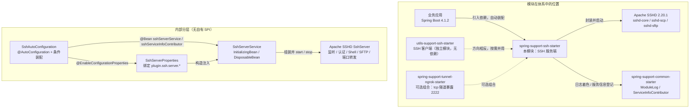
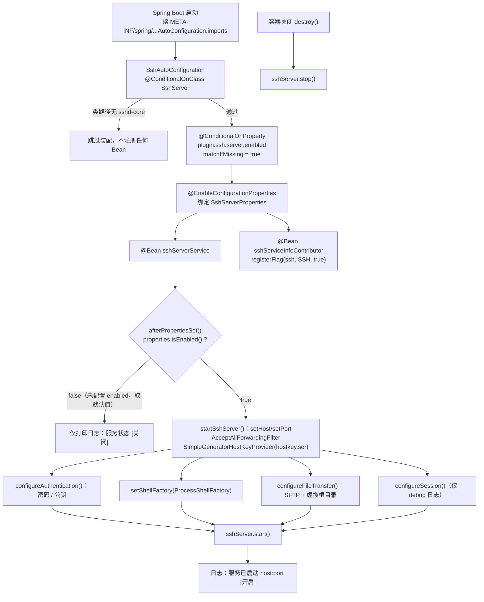

# spring-support-ssh-starter

基于 Apache SSHD 的 **SSH 服务端** starter：随 Spring Boot 应用启动一个可登录的 SSH/SFTP 服务端，支持密码/公钥认证、Shell 命令执行、SFTP 文件传输与端口转发。在 spring-support 体系中属于「网络接入类」能力模块：向下封装 Apache SSHD，向宿主应用只暴露 `SshServerService` 这一个业务 Bean（另带一个服务信息登记 Bean），并复用 `spring-support-common-starter` 的日志着色与服务信息登记。默认不启动服务端进程，必须显式设置 `plugin.ssh.server.enabled=true`。

- 坐标：`com.chua:spring-support-ssh-starter:4.0.0.51`
- 基线：Spring Boot 4.1.2（父 pom `spring-support-parent-starter` 统一管理），Apache SSHD 2.20.1（父 pom dependencyManagement 钉版），Java 25 编译，`spring-boot-maven-plugin` 已 skip（纯库 jar）
- 边界：本模块是 SSH **服务端**（让别人登录你的应用所在机器）；SSH **客户端**能力在 `utils-support-ssh-starter`（位于 `utils-support-network-parent`，与本模块互不依赖），不要混淆

## 1. 架构图



| 层 | 类 | 职责 |
|:---|:---|:---|
| 装配层 | `com.chua.starter.ssh.configuration.SshAutoConfiguration` | 条件装配两个 Bean，注册配置属性绑定 |
| 配置层 | `com.chua.starter.ssh.properties.SshServerProperties` | `@ConfigurationProperties(prefix = "plugin.ssh.server")` |
| 服务层 | `com.chua.starter.ssh.service.SshServerService` | SSHD 生命周期与全部服务端配置逻辑 |
| 运行时 | `org.apache.sshd.server.SshServer`（Apache SSHD） | 实际监听端口、处理连接、Shell/SFTP/转发 |

## 2. 核心流程图（装配与启动）



要点：自动配置类上的 `@ConditionalOnProperty(..., havingValue = "true", matchIfMissing = true)`，只有**属性缺省**（没写 `plugin.ssh.server.enabled`）时条件才视为通过；此时 Bean 照常注册，但 `SshServerService#afterPropertiesSet` 里 `properties.isEnabled()` 仍取默认 `false`，服务端不启动——「`enabled` 缺省 → Bean 在、进程不起」。一旦显式写成 `enabled=false`，`havingValue="true"` 不匹配且 `matchIfMissing` 不再生效，整个自动配置被跳过，两个 Bean **都不存在**（此时注入 `SshServerService` 会失败）。

## 3. 能力清单

| 能力域 | 关键类 | 入口/触发方式 |
|:-------|:-------|:--------------|
| 自动装配 | `SshAutoConfiguration` | `AutoConfiguration.imports` + `@ConditionalOnClass` / `@ConditionalOnProperty` |
| 配置绑定 | `SshServerProperties` | `plugin.ssh.server.*` |
| 服务端生命周期 | `SshServerService` | `InitializingBean#afterPropertiesSet` 启动 / `DisposableBean#destroy` 停止 |
| 密码认证 | `SshServerService#configureAuthentication` | SSHD `PasswordAuthenticator`（单账号 `username`+`user-password` 字面量比对） |
| 公钥认证 | `SshServerService#configureAuthentication` | SSHD `AuthorizedKeysAuthenticator`；未配文件时回退 `RejectAllPublickeyAuthenticator` |
| Shell 命令执行 | `SshServerService#startSshServer` | SSHD `ProcessShellFactory`（交给操作系统 shell 进程） |
| SFTP 文件传输 | `SshServerService#configureFileTransfer` | `SftpSubsystemFactory` + `VirtualFileSystemFactory`（虚拟根目录） |
| 端口转发 | `SshServerService#startSshServer` | `AcceptAllForwardingFilter`（无条件接受本地/远程转发） |
| 主机密钥 | `SshServerService#startSshServer` | `SimpleGeneratorHostKeyProvider`（首次启动生成工作目录下 `hostkey.ser`） |
| 运行状态查询 | `SshServerService#isRunning` / `#getActiveSessionCount` | 注入 Bean 直接调用 |
| 服务信息登记 | `SshAutoConfiguration#sshServiceInfoContributor` | 实现 common-starter 的 `ServiceInfoContributor`，向 `ServiceInfoRegistry` 注册开关 `ssh` |

本模块**没有**对外 REST 端点、没有链式 API、没有自带 SPI 接口；使用方式是「配置 + 注入 `SshServerService` 查询状态」。

## 4. Bean 能力矩阵

| Bean 名 | 类型 | 装配条件（含默认值） | 可否覆盖 | 典型用途 |
|:--------|:-----|:---------------------|:---------|:---------|
| `sshServerService` | `com.chua.starter.ssh.service.SshServerService` | 类路径存在 `org.apache.sshd.server.SshServer`，且 `plugin.ssh.server.enabled` 未配置（`matchIfMissing=true`）或配为 `true`；**显式 `enabled=false` 时条件不匹配，自动配置整体跳过、Bean 不存在** | 可以：`spring.autoconfigure.exclude` 排除本自动配置后自行声明，或声明同类型 `@Primary` Bean（同名覆盖需开 `spring.main.allow-bean-definition-overriding=true`，不推荐） | 构造器注入，调用 `isRunning()` / `getActiveSessionCount()` |
| `sshServiceInfoContributor` | `com.chua.starter.common.support.serviceinfo.ServiceInfoContributor`（函数式接口） | 同上（同一个自动配置类，同组类级条件） | 同上 | 一般不注入；由 common-starter 的服务信息横幅/端点收集展示 |
| `plugin.ssh.server-com.chua.starter.ssh.properties.SshServerProperties` | `com.chua.starter.ssh.properties.SshServerProperties` | `@EnableConfigurationProperties(SshServerProperties.class)` 随自动配置注册 | 可重复注册覆盖（一般无需动） | 注入后读取任意 `plugin.ssh.server.*` 绑定值 |

> 注意：由于 `matchIfMissing = true`，即使什么都没配置，上面两个 Bean 也会存在（显式写 `enabled=false` 则两个 Bean 都不注册）；但 `SshServerService` 构造后不会启动服务端，只打印「[SSH] 服务状态 [关闭]」。`sshServiceInfoContributor` 注册的开关值是硬编码 `true`，判断服务是否真的在跑请以 `SshServerService#isRunning()` 为准。

## 5. 完整配置

配置前缀：**`plugin.ssh.server`**（不是 `ssh.server`）。配置类 `SshServerProperties` 含 4 个嵌套类（`Authentication` / `Session` / `FileTransfer` / `Security`）。「生效」列依据 `SshServerService` 实际读取逻辑标注：✅ 运行期生效；⚠️ 仅打印日志；❌ 仅有字段、运行期未读取。

| 配置路径 | 类型 | 默认值 | 说明 | 生效 |
|:---------|:-----|:-------|:-----|:-----|
| `plugin.ssh.server.enabled` | `boolean` | `false` | 是否真正启动 SSHD，**必须显式设为 true**；同时是自动装配条件键（缺省时 Bean 仍注册但服务不启动） | ✅ |
| `plugin.ssh.server.enable` | `boolean` | `false` | 历史声明字段，运行期未读取，配置无效 | ❌ |
| `plugin.ssh.server.host` | `String` | `0.0.0.0` | 监听地址 | ✅ |
| `plugin.ssh.server.port` | `int` | `2222` | 监听端口 | ✅ |
| `plugin.ssh.server.authentication.password` | `boolean` | `true` | 启用密码认证 | ✅ |
| `plugin.ssh.server.authentication.public-key` | `boolean` | `false` | 启用公钥认证 | ✅ |
| `plugin.ssh.server.authentication.username` | `String` | `admin` | 唯一允许的用户名 | ✅ |
| `plugin.ssh.server.authentication.user-password` | `String` | 空串 | 密码；默认空串，不配置则密码登录必然失败 | ✅ |
| `plugin.ssh.server.authentication.public-key-file` | `String` | 无 | `authorized_keys` 格式公钥文件路径；`public-key=true` 时必配，否则回退为全部拒绝 | ✅ |
| `plugin.ssh.server.authentication.private-key-file` | `String` | 无 | 仅声明字段，运行期未使用 | ❌ |
| `plugin.ssh.server.session.timeout` | `long` | `3600` | 会话超时（秒）；当前只在 debug 日志打印，不真正生效 | ⚠️ |
| `plugin.ssh.server.session.max-sessions` | `int` | `10` | 最大会话数；当前只在 debug 日志打印，不限制并发 | ⚠️ |
| `plugin.ssh.server.session.idle-timeout` | `long` | `1800` | 空闲超时（秒）；设置逻辑已被注释，未使用 | ❌ |
| `plugin.ssh.server.file-transfer.scp-enabled` | `boolean` | `true` | 服务端**未注册** SCP 命令工厂，配置无效 | ❌ |
| `plugin.ssh.server.file-transfer.sftp-enabled` | `boolean` | `true` | 是否注册 SFTP 子系统与虚拟文件系统 | ✅ |
| `plugin.ssh.server.file-transfer.root-directory` | `String` | `/tmp` | SFTP 虚拟根目录（`VirtualFileSystemFactory`），建议显式平台绝对路径 | ✅ |
| `plugin.ssh.server.file-transfer.max-file-size` | `long` | `104857600`（100MB） | 仅声明字段，无大小校验逻辑 | ❌ |
| `plugin.ssh.server.security.allowed-ips` | `List<String>` | `[]` | 允许的 IP 列表；未接入运行期 | ❌ |
| `plugin.ssh.server.security.denied-ips` | `List<String>` | `[]` | 禁止的 IP 列表；未接入运行期 | ❌ |
| `plugin.ssh.server.security.max-login-attempts` | `int` | `3` | 最大登录尝试次数；未接入运行期 | ❌ |
| `plugin.ssh.server.security.lockout-duration` | `long` | `300` | 登录失败锁定时间（秒）；未接入运行期 | ❌ |
| `plugin.ssh.server.security.host-key-verification` | `boolean` | `true` | 是否启用主机密钥验证；未接入运行期 | ❌ |

另：模块 jar 内附带示例文件 `application-ssh.yml`，其前缀写的是 `ssh.server.*`，与实际绑定前缀 `plugin.ssh.server.*` **不一致**，不会被绑定生效，只可当字段清单参考，请勿照抄其前缀。

## 6. 使用方式

Maven 坐标（版本由父 pom `spring-support-parent-starter:4.0.0.51` 管理）：

```xml
<dependency>
    <groupId>com.chua</groupId>
    <artifactId>spring-support-ssh-starter</artifactId>
    <version>4.0.0.51</version>
</dependency>
```

| 依赖 | 性质 | 缺失后果 |
|:-----|:-----|:---------|
| `org.apache.sshd:sshd-core` | 必需 | `@ConditionalOnClass` 不满足，整体跳过装配（无报错） |
| `org.apache.sshd:sshd-sftp` | 必需 | SFTP 子系统不可用 |
| `org.apache.sshd:sshd-scp` | 已引入但未装配 | 无影响：服务端未注册 SCP 命令工厂，`scp-enabled` 不参与装配 |
| `org.springframework.boot:spring-boot-starter` | 必需 | 自动配置与容器不可用 |
| `com.chua:spring-support-common-starter` | 必需 | `ModuleLog` 日志着色与 `ServiceInfoContributor` 服务信息登记不可用 |
| `org.springframework.boot:spring-boot-configuration-processor` | `optional` | 仅编译期生成配置元数据（IDE 提示），无运行期作用 |

最小启用示例（`application.yml`，必须显式开启并配置凭据）：

```yaml
plugin:
  ssh:
    server:
      enabled: true          # 必须显式开启，键名是 enabled 不是 enable
      host: 0.0.0.0
      port: 2222
      authentication:
        password: true
        username: admin
        user-password: change-me   # 默认空串，必须配置
      file-transfer:
        sftp-enabled: true
        root-directory: /data/sftp  # Windows 下建议绝对路径，如 D:/sftp-root
```

连接验证与启动日志：

```bash
ssh admin@127.0.0.1 -p 2222
sftp -P 2222 admin@127.0.0.1
```

```text
 >>>>>>> 初始化SSH服务端服务，端口: 2222
[SSH] 服务已启动 0.0.0.0:2222 [开启]
[SSH] SFTP文件传输 [开启] 根目录: /data/sftp
```

未开启（`enabled=false` 或缺省）时日志为 `[SSH] 服务状态 [关闭]`，不占用端口。程序内查询状态：

```java
@Service
public class SshStatusDemo {

    private final SshServerService sshServerService;

    public SshStatusDemo(SshServerService sshServerService) {
        this.sshServerService = sshServerService;
    }

    public String status() {
        return "running=" + sshServerService.isRunning()
                + ", sessions=" + sshServerService.getActiveSessionCount();
    }
}
```

## 7. 使用场景

适用：

- 给运维/内部工具在 Spring 应用所在机器开一个受控的 SSH 登录与 SFTP 文件出入口；
- 本地或内网联调 SFTP 客户端逻辑（用本模块当被连接方）；
- 需要随应用生命周期自动启停的嵌入式 SSHD（应用关闭时自动 `stop`）；
- 配合 `spring-support-tunnel-ngrok-starter` 等 tcp 隧道，把 2222 端口临时暴露到公网做远程救援。

不适用/慎用：

- 需要真实用户体系、角色权限、登录失败锁定、IP 白名单、会话限额的场景（相关 `security.*`、`session.*` 配置**未接入**）；
- 依赖原生 SCP 协议（`scp -O`）的文件传输（服务端未注册 SCP 命令工厂）；
- 直接暴露公网的生产环境（`AcceptAllForwardingFilter` 端口转发全开放、`ProcessShellFactory` 直接起系统 shell，权限边界取决于运行应用的 OS 用户）。

与相邻模块的取舍：

| 模块 | 方向 | 取舍说明 |
|:-----|:-----|:---------|
| `spring-support-common-starter` | 本模块依赖 | 复用 `ModuleLog`、`ServiceInfoContributor`，不重复造日志/横幅 |
| `utils-support-ssh-starter` | 独立模块，无依赖关系 | SSH **客户端**（连接远程主机、读远程文件）。方向与本模块相反，按需二选一或并用 |
| `spring-support-filesystem-starter` | 间接使用 utils 层 | 其 SFTP 远程文件预览依赖 `utils-support-ssh-starter`，与本服务端模块无关 |
| `spring-support-tunnel-ngrok-starter` | 可组合，无依赖 | ngrok `tcp` 模式可把 2222 暴露公网；生产勿裸奔，建议改默认凭据 + 防火墙限流 |

## 8. 扩展点

**本模块不提供自有 SPI**：没有 `META-INF/extensions`，也没有可替换的认证/文件系统/会话策略接口；认证方式与文件系统由 `SshServerService` 内部直接装配。可行的扩展姿势：

1. **替换整个 Bean**：通过 `spring.autoconfigure.exclude=com.chua.starter.ssh.configuration.SshAutoConfiguration` 排除自动配置，再自行声明 `SshServerService`（或同类型 `@Primary` Bean），在里面重写 `configureAuthentication` 等逻辑；
2. **直接使用 Apache SSHD API**：SSHD 本身的扩展点（`PasswordAuthenticator`、`PublickeyAuthenticator`、`SftpSubsystemFactory`、`FileSystemFactory`、`ForwardingFilter`、`ShellFactory`、`CommandFactory` 等）都可以在自行组装 `SshServer` 时使用——本模块不拦截你另起一个 SSHD；
3. **消费服务信息登记**：本模块向 common-starter 的 `ServiceInfoRegistry` 注册了开关 `ssh`（分组 `SSH`），你的监控/横幅代码可通过 `ServiceInfoContributor` 体系读取展示。

## 9. 常见问题

**Q1：引入了依赖，但 2222 端口没监听？**
按顺序排查：① 类路径是否有 `sshd-core`（`@ConditionalOnClass` 不满足会整体跳过装配，且无报错）；② 是否设置的是 `plugin.ssh.server.enabled=true`——注意键名是 `enabled` 不是 `enable`（后者不生效），前缀是 `plugin.ssh.server` 不是 `ssh.server`；③ 是否被 `spring.autoconfigure.exclude` 排除；④ 启动日志应出现 `>>>>>>> 初始化SSH服务端服务，端口: 2222`；若只出现 `[SSH] 服务状态 [关闭]`，说明配置里根本没有 `enabled` 键（属性缺省 → Bean 已装配、`isEnabled()` 取默认 `false`）；若设成了 `enabled=false`，自动配置整体跳过，`SshServerService` Bean 根本不存在。

**Q2：没配任何属性，为什么 `SshServerService` Bean 也存在？**
`@ConditionalOnProperty(prefix="plugin.ssh.server", name="enabled", havingValue="true", matchIfMissing=true)`：只有属性**缺省**时条件才视为通过，Bean 会注册；但 `afterPropertiesSet()` 里 `properties.isEnabled()` 默认 `false`，服务端不会启动。注意「不写键」与「写 `false`」语义不同：不写键 → Bean 在、服务不起；显式 `enabled=false` → 条件不匹配、自动配置整体跳过，Bean 不存在（注入 `SshServerService` 会报找不到 Bean）。彻底排除装配用 `spring.autoconfigure.exclude`。

**Q3：密码登录一直失败 / `scp` 传文件失败 / 配了 `security.*` 没效果？**
密码：`user-password` 默认空串必须显式配置，认证是 `username` 与 `user-password` 的**字面量比对**，没有用户库、加密或权限模型；公钥开启但未配 `public-key-file` 时回退 `RejectAllPublickeyAuthenticator`（全部拒绝）。SCP：服务端只注册了 `SftpSubsystemFactory`，走 SFTP 协议的 `scp` 可用，纯 SCP 协议（`scp -O`）无服务端承载。占位配置：`allowed-ips`/`denied-ips`/`max-login-attempts`/`lockout-duration`/`host-key-verification`/`idle-timeout`/`max-file-size` 均未接入运行期，`timeout`/`max-sessions` 仅 debug 日志；安全边界目前依赖网络层（监听地址、防火墙、OS 权限）。

**Q4：与 Spring Boot 4 兼容性 / 客户端提示 host key 变更？**
本模块通过 `META-INF/spring/org.springframework.boot.autoconfigure.AutoConfiguration.imports` 注册 `SshAutoConfiguration`（`@AutoConfiguration` 注解），这是 Boot 2.7+ 并在 4.x 延续的标准机制；本模块**没有** `spring.factories`，不依赖已被 Boot 3+/4 移除的旧注册方式；SSHD 版本由父 pom 统一管理，随仓库升级到 Boot 4.1.2 无需本模块单独改版。host key 由 `SimpleGeneratorHostKeyProvider(Paths.get("hostkey.ser"))` 生成，落盘路径是**相对工作目录**的 `hostkey.ser`：更换应用工作目录会生成新密钥，客户端会看到 host key 变更告警；固定部署目录或把 `hostkey.ser` 纳入持久化可避免。Windows 下 `root-directory` 默认 `/tmp` 会解析为当前盘符根下 `\tmp`，目录不存在时 SFTP 操作失败，建议显式配置绝对路径（如 `D:/sftp-root`）。
