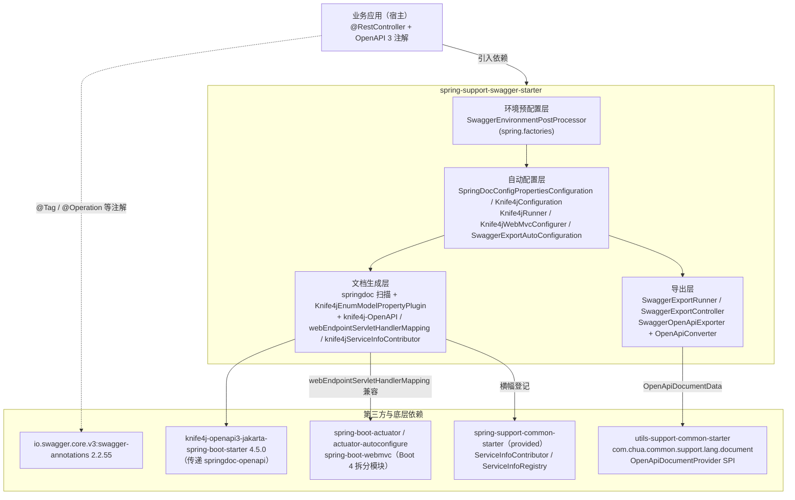
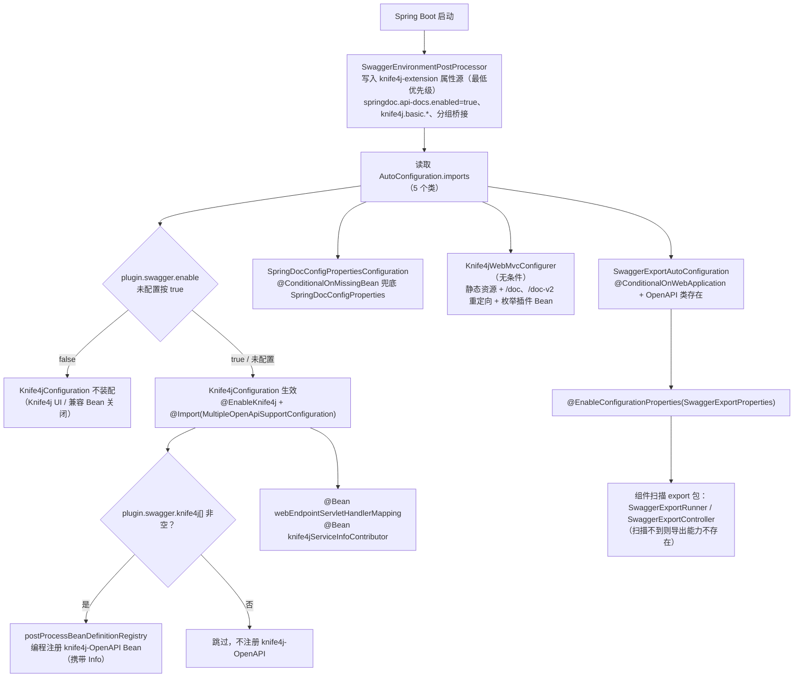
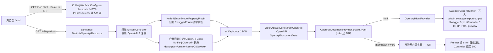

# spring-support-swagger-starter

基于 springdoc + Knife4j 的 OpenAPI 3 接口文档 starter：自动聚合 `@RestController` 生成 `/v3/api-docs` 与交互式文档（Knife4j UI），并提供启动期离线导出与在线导出端点。

- 适配 Spring Boot **4.1.2**（父 POM `spring-boot-starter-parent` 4.1.2，2026-11-19 升级）；knife4j `knife4j-openapi3-jakarta-spring-boot-starter` **4.5.0**，`swagger-annotations` **2.2.55**（父 POM 依赖管理）。
- 文档**未显式关闭时默认开启**：`Knife4jConfiguration` 的装配条件为 `@ConditionalOnProperty(prefix = "plugin.swagger", name = "enable", havingValue = "true", matchIfMissing = true)`——`Knife4jProperties.enable` 字段默认值虽是 `false`，但未配置时按 `true` 处理；显式配置 `plugin.swagger.enable=false` 才会关闭本模块的 Knife4j 装配。

## 1. 架构图



**内部分层说明**（全部为真实存在的类）：

| 层 | 类 | 职责 |
|:---|:---|:---|
| 环境预配置 | `com.chua.starter.swagger.support.environment.SwaggerEnvironmentPostProcessor` | `EnvironmentPostProcessor`，在自动配置前把 `plugin.swagger.*` 桥接为 `knife4j.*` / `springdoc.*` 属性（属性源 `knife4j-extension`，`addLast` 最低优先级） |
| 自动配置 | `SpringDocConfigPropertiesConfiguration`、`Knife4jConfiguration`、`Knife4jRunner`、`Knife4jWebMvcConfigurer`、`SwaggerExportAutoConfiguration` | 由 `META-INF/spring/org.springframework.boot.autoconfigure.AutoConfiguration.imports` 注册 |
| 文档生成 | `Knife4jEnumModelPropertyPlugin`、`SwaggerEnum`、`@HiddenParam` | springdoc 模型/属性定制与文档契约 |
| 导出 | `SwaggerExportRunner`、`SwaggerExportController`、`SwaggerOpenApiExporter`、`OpenApiConverter` | 启动期离线导出 + 在线 HTTP 导出，委托 utils 层 SPI 渲染 |
| 静态资源 | `Knife4jWebMvcConfigurer`、`static/doc-v2.html` | `/doc.html`、`/swagger-ui.html`、`/doc-v2*` 资源映射与 `/doc`、`/doc-v2` 重定向 |
| 兼容补丁 | `org.springdoc.core.service.GenericResponseService`（本模块源码内同包覆盖） | springdoc 与 Boot 4 的兼容修复，需随 knife4j/springdoc 版本维护 |

## 2. 核心流程图

**装配流程**（启动期，从 EnvironmentPostProcessor 到各 Bean 就位）：



**文档生成与导出数据流**（运行期请求 + 导出链路，图中类名均真实存在）：



## 3. 能力清单

| 能力域 | 关键类 | 入口 |
|:-------|:-------|:-----|
| 环境预配置（knife4j/springdoc 桥接） | `SwaggerEnvironmentPostProcessor` | `META-INF/spring.factories`（`EnvironmentPostProcessor`） |
| 分组 → `springdoc.group-configs` / `knife4j.documents` | `SwaggerEnvironmentPostProcessor` | `plugin.swagger.knife4j[]` |
| 文档聚合与 Knife4j UI | `Knife4jConfiguration` | `/doc.html`、`/swagger-ui.html`、`/v3/api-docs` |
| springdoc 配置兜底 | `SpringDocConfigPropertiesConfiguration` | `SpringDocConfigProperties` Bean（`@Primary`、`@ConditionalOnMissingBean`） |
| 静态资源与页面重定向 | `Knife4jWebMvcConfigurer` | `/doc.html`、`/swagger-ui.html`、`/doc-v2*`、`/doc`、`/doc-v2` |
| 枚举属性文档增强 | `Knife4jEnumModelPropertyPlugin`（springdoc `PropertyCustomizer`） | 实现 `SwaggerEnum` 接口的枚举属性 |
| 服务信息登记（控制台横幅） | `Knife4jConfiguration#knife4jServiceInfoContributor` | `ServiceInfoContributor`，登记 `knife4j · 文档` 标记 |
| Boot 4 actuator 端点映射兼容 | `Knife4jConfiguration#webEndpointServletHandlerMapping` | `WebMvcEndpointHandlerMapping`（`org.springframework.boot.webmvc.actuate.endpoint.web`） |
| 启动期离线导出 | `SwaggerExportRunner` → `SwaggerOpenApiExporter` | `plugin.swagger.export.enabled=true`（缺省） |
| 在线导出 HTTP 端点 | `SwaggerExportController` | `GET /chua/swagger/export[?format=]`、`GET /chua/swagger/export/preview` |
| 文档模型转换 | `OpenApiConverter` | springdoc `OpenAPI` → utils 层 `OpenApiDocumentData` |
| 文档渲染 SPI 消费 | `SwaggerOpenApiExporter` / `SwaggerExportController` | utils 层 `OpenApiDocumentProvider.create(type)`；当前内置实现仅 `OpenApiHtmlProvider`（`html`） |
| 枚举文档契约 | `SwaggerEnum`（接口）、`@HiddenParam`（注解） | 业务代码实现/标注后由文档层识别 |
| springdoc 兼容补丁 | `org.springdoc.core.service.GenericResponseService` | classpath 同包同类覆盖（源码目录优先于 jar） |

**已定义但当前未装配**（源码存在、无任何 `@Bean`/`@Component`/imports/META-INF-services 注册，运行期不生效，不要依赖）：
`CustomOperationCustomizer`、`CustomKnife4jOpenApiCustomizer`、`ParameterFilterOperationCustomizer`（三者会消费 `default-header`、`@HiddenParam`/`UserValue` 过滤、作者/排序扩展）、`CustomModelResolver`、`InheritedPropertyResolver`。因此「默认请求头注入」「隐藏参数过滤」「继承属性合并」「`@UserValue` 参数隐藏」目前不可用。

## 4. Bean 能力矩阵

| Bean 名 | 类型 | 装配条件 | 可否覆盖 | 典型注入姿势 |
|:--------|:-----|:---------|:---------|:-------------|
| `springDocConfigProperties` | `org.springdoc.core.properties.SpringDocConfigProperties` | 类上有 `@ConditionalOnClass(SpringDocConfigProperties)`；方法上 `@Primary` + `@ConditionalOnMissingBean`（兜底，springdoc 自动配置已注册时让位） | 可以：应用自定义同类型 Bean 后兜底 Bean 退场 | 直接 `@Autowired`；knife4j 自动配置依赖该 Bean，缺它启动会失败 |
| `knife4j-OpenAPI` | `io.swagger.v3.oas.models.OpenAPI` | `Knife4jConfiguration` 生效（`plugin.swagger.enable=true` 缺省）**且** `plugin.swagger.knife4j[]` 非空；由 `postProcessBeanDefinitionRegistry` 编程式注册 | 同名覆盖默认被禁止（Boot 默认 `allow-bean-definition-overriding=false`，重复注册会启动失败）；可另起 Bean 名自定义 `OpenAPI` 与之并存 | 一般不注入；springdoc 生成文档时会合并容器中的 `OpenAPI` Bean，其 `Info` 来自 `plugin.swagger.description/version/terms-of-service` |
| `webEndpointServletHandlerMapping` | `org.springframework.boot.webmvc.actuate.endpoint.web.WebMvcEndpointHandlerMapping` | 随 `Knife4jConfiguration`（enable=true 缺省） | 普通 `@Bean` 可覆盖，但它是 actuator 端点映射，覆盖需自担风险，一般不动 | 无需注入；解决 springdoc 与 Boot 4 的端点映射兼容问题 |
| `knife4jServiceInfoContributor` | `com.chua.starter.common.support.serviceinfo.ServiceInfoContributor` | 随 `Knife4jConfiguration` | 可以 | 无需注入；由服务信息横幅体系统一收集渲染 |
| `getKnife4jEnumModelPropertyPlugin` | `Knife4jEnumModelPropertyPlugin`（springdoc `PropertyCustomizer`） | `@ConditionalOnClass(name = "io.swagger.v3.oas.models.media.Schema")`（引入本模块即满足） | 可叠加：springdoc 收集容器中全部 `PropertyCustomizer`，可再自定义叠加 | 无需注入；业务枚举实现 `SwaggerEnum` 即自动生效 |
| `knife4jRunner` | `Knife4jRunner`（`CommandLineRunner`） | `AutoConfiguration.imports` 注册，无条件 | 可以（但无意义） | 不要依赖：`@Deprecated`，`run()` 为空，横幅由 `ServiceInfoBannerListener` 统一渲染 |
| `swaggerExportProperties`（`@EnableConfigurationProperties`） | `SwaggerExportProperties`（`plugin.swagger.export`） | `SwaggerExportAutoConfiguration`：`@ConditionalOnWebApplication` + `@ConditionalOnClass(name = "io.swagger.v3.oas.models.OpenAPI")` | 可以 | `@Autowired` 读取导出配置 |
| `swaggerExportRunner` | `SwaggerExportRunner`（`CommandLineRunner`） | `@Component` + `@ConditionalOnProperty(prefix="plugin.swagger.export", name="enabled", havingValue="true", matchIfMissing=true)`；**且宿主组件扫描覆盖 `com.chua.starter.swagger.support.export` 包** | 条件不满足则不注册；无法通过配置单独开关（受 `export.enabled` 控制） | 无需注入 |
| `swaggerExportController` | `SwaggerExportController`（`@RestController`） | 同上（组件扫描 + `@ConditionalOnProperty`） | 同上 | 无需注入；HTTP 端点 `/chua/swagger/export`、`/chua/swagger/export/preview` |

> 注意：`Knife4jWebMvcConfigurer` 本身经 `AutoConfiguration.imports` 注册且类上**没有** `plugin.swagger.enable` 条件，`enable=false` 时静态资源映射与枚举插件 Bean 仍会注册；但此时 `Knife4jConfiguration` 不装配、`knife4j.enable` 被桥接为 `false`，文档页面没有可用数据。另外 `SwaggerEnvironmentPostProcessor` 会无条件写入 `springdoc.api-docs.enabled=true`，因此总开关只关闭本模块与 knife4j 的装配，并不保证 springdoc 自身的 `/v3/api-docs` 端点消失（以 springdoc 自身条件为准）。

## 5. 完整配置

配置前缀：**`plugin.swagger`**（`Knife4jProperties`）与 **`plugin.swagger.export`**（`SwaggerExportProperties`）。
注意：历史上部分文档写过的 `plugin.knife4j` 前缀在本模块源码中**不存在**，实际前缀均为 `plugin.swagger`。

### 5.1 基础（`plugin.swagger`，`Knife4jProperties`）

| 路径 | 类型 | 默认值 | 说明 | 生效开关 |
|:-----|:-----|:-------|:-----|:---------|
| `plugin.swagger.enable` | `boolean` | 字段默认 `false`；自动配置 `matchIfMissing=true`，**未配置时文档默认开启** | 总开关：控制 `Knife4jConfiguration` 装配；经桥接决定 `knife4j.enable` | `Knife4jConfiguration` 的 `@ConditionalOnProperty` |
| `plugin.swagger.knife4j` | `List<Knife4j>` | 无 | 分组列表，见 5.2；非空时注册 `knife4j-OpenAPI` 与分组配置 | `Knife4jConfiguration#postProcessBeanDefinitionRegistry`、`SwaggerEnvironmentPostProcessor` |
| `plugin.swagger.default-header` | `Map<String, String>` | 无 | 默认请求头 | **当前不生效**：仅未被装配的 `ParameterFilterOperationCustomizer` / `CustomOperationCustomizer` 消费 |
| `plugin.swagger.username` | `String` | `""`（空串） | 文档 Basic 认证账号；经桥接为 `knife4j.basic.username=${plugin.swagger.username:root}` | `knife4j.basic.enable=true`（固定开启）时生效 |
| `plugin.swagger.password` | `String` | `""`（空串） | 文档 Basic 认证密码；经桥接为 `knife4j.basic.password=${plugin.swagger.password:root123}` | 同上 |
| `plugin.swagger.log` | `boolean` | `false` | 声明「是否开启 Swagger 注解记录操作日志」 | **当前不生效**：运行期没有任何代码读取该字段 |
| `plugin.swagger.description` | `String` | `"无"` | 文档描述，写入 `knife4j-OpenAPI` 的 `Info` | 配置了 `plugin.swagger.knife4j[]` 分组时随该 Bean 生效 |
| `plugin.swagger.version` | `String` | `"1.0"` | 文档版本，同上 | 同上 |
| `plugin.swagger.terms-of-service` | `String` | 内置服务条款长文本（12 条，含责任限制/知识产权/隐私保护等） | 服务条款，写入 `knife4j-OpenAPI` 的 `Info` | 同上 |

### 5.2 分组（`plugin.swagger.knife4j[]`，内部类 `Knife4jProperties.Knife4j`）

| 路径 | 类型 | 默认值 | 说明 | 生效开关 |
|:-----|:-----|:-------|:-----|:---------|
| `plugin.swagger.knife4j[].group` | `String` | 无 | 分组编码；为空时取 `group-name`，写入 `knife4j.documents[i].group/name` | `SwaggerEnvironmentPostProcessor` 桥接 |
| `plugin.swagger.knife4j[].group-name` | `String` | 无 | 分组名，写入 `springdoc.group-configs[i].group` 与 `display-name` | 同上 |
| `plugin.swagger.knife4j[].paths-to-match` | `String[]` | 无（桥接时空值缺省 `/**`） | 该分组匹配的路径 → `springdoc.group-configs[i].paths-to-match` | 同上 |
| `plugin.swagger.knife4j[].base-package` | `String[]` | 无 | 该分组扫描的包 → `springdoc.group-configs[i].packages-to-scan` | 同上 |
| `plugin.swagger.knife4j[].title` | `String` | `""` | 分组标题 → `springdoc.group-configs[i].title` | 同上 |
| `plugin.swagger.knife4j[].description` | `String` | `""` | 分组描述 → `springdoc.group-configs[i].description` | 同上 |
| `plugin.swagger.knife4j[].version` | `String` | `"v1.0.0"` | 分组版本 → `springdoc.group-configs[i].version` | 同上 |

### 5.3 导出（`plugin.swagger.export`，`SwaggerExportProperties`）

| 路径 | 类型 | 默认值 | 说明 | 生效开关 |
|:-----|:-----|:-------|:-----|:---------|
| `plugin.swagger.export.enabled` | `boolean` | `true` | 导出总开关 | `SwaggerExportRunner` / `SwaggerExportController` 的 `@ConditionalOnProperty`（`matchIfMissing=true`） |
| `plugin.swagger.export.output` | `String` | `./swagger-export.html` | 输出文件路径（相对工作目录）；后缀决定导出类型：`.html/.htm`→`html`、`.md/.markdown`→`markdown`、`.docx/.doc`→`word` | `SwaggerExportRunner`、`SwaggerExportController#resolveType` |
| `plugin.swagger.export.title` | `String` | `"Open API 接口文档"` | 顶部标题；**仅在原 OpenAPI 标题为空时回填**，不覆盖业务已配置的标题 | `SwaggerOpenApiExporter` |
| `plugin.swagger.export.version` | `String` | `"1.0.0"` | 版本徽标；**仅在原 OpenAPI 版本为空时回填** | `SwaggerOpenApiExporter` |
| `plugin.swagger.export.download-after-start` | `boolean` | `true` | 启动后是否立即离线导出 | `SwaggerExportRunner#run` |
| `plugin.swagger.export.include-request-sample` | `boolean` | `true` | 声明「是否生成请求/响应示例代码块」 | **当前不生效**：运行期没有任何代码读取该字段 |
| `plugin.swagger.export.path` | `String` | `/chua/swagger/export` | 在线导出端点路径；它是 `SwaggerExportController` 上 `@RequestMapping("${plugin.swagger.export.path:/chua/swagger/export}")` 的**占位符**，不是 `SwaggerExportProperties` 的字段 | 宿主 `Environment` 中存在该 key 时改变端点路径 |

### 5.4 由 `SwaggerEnvironmentPostProcessor` 桥接出的属性（属性源 `knife4j-extension`，最低优先级，应用配置可覆盖）

| 桥接 key | 值 | 是否无条件写入 |
|:---------|:---|:---------------|
| `springdoc.api-docs.enabled` | `true` | 是 |
| `springdoc.api-docs.groups.enabled` | `true` | 是 |
| `springdoc.default-flat-param-object` | `true` | 是 |
| `knife4j.enable` | `${plugin.swagger.enable:true}` | 否（跟随总开关，缺省 true） |
| `knife4j.basic.enable` | `true` | 是（Basic 认证固定开启） |
| `knife4j.basic.username` | `${plugin.swagger.username:root}` | 是（占位符缺省 `root`） |
| `knife4j.basic.password` | `${plugin.swagger.password:root123}` | 是（占位符缺省 `root123`） |
| `knife4j.documents[i].group` / `.name` | 分组 `group`（为空取 `group-name`） | 配置了分组时 |
| `springdoc.group-configs[i].group/title/description/version/display-name` | 对应分组字段 | 配置了分组时 |
| `springdoc.group-configs[i].paths-to-match` | 分组路径（空值缺省 `/**`） | 配置了分组时 |
| `springdoc.group-configs[i].packages-to-scan` | 分组 `base-package` 逗号连接 | 配置了分组时 |

## 6. 使用方式

### 6.1 Maven 坐标

```xml
<dependency>
    <groupId>com.chua</groupId>
    <artifactId>spring-support-swagger-starter</artifactId>
    <version>4.0.0.51</version>
</dependency>
```

依赖本身不需要额外配置即可工作（文档默认开启）。

### 6.2 最小可运行示例

```java
@SpringBootApplication
public class DemoApplication {
    public static void main(String[] args) {
        SpringApplication.run(DemoApplication.class, args);
    }
}
```

```java
@Tag(name = "用户管理")
@RestController
@RequestMapping("/api/users")
public class UserController {

    @Operation(summary = "获取用户信息")
    @GetMapping("/{id}")
    public Map<String, Object> getUser(@PathVariable Long id) {
        return Map.of("id", id);
    }
}
```

按需配置（不配置也默认开启；生产环境务必改掉 Basic 弱口令）：

```yaml
plugin:
  swagger:
    enable: true          # 显式关闭用 false
    username: admin       # 缺省 root
    password: admin@2026  # 缺省 root123
    description: 业务接口文档
    version: 1.0.0
    knife4j:
      - group: user
        group-name: 用户模块
        title: 用户服务
        base-package:
          - com.example.user.controller
        paths-to-match:
          - /user/**
    export:
      enabled: true
      output: ./docs/api.html   # 后缀决定导出类型（当前仅 html 有内置渲染实现）
      download-after-start: true
```

启动后验证：

```bash
# Knife4j 增强 UI（Basic 认证：配置的账号或缺省 root/root123）
curl -u admin:admin@2026 http://localhost:8080/doc.html
# 标准 Swagger UI / OpenAPI JSON
curl http://localhost:8080/swagger-ui.html
curl http://localhost:8080/v3/api-docs
# 页面重定向别名 / 自定义文档页
curl -L http://localhost:8080/doc
curl -L http://localhost:8080/doc-v2
# 在线导出（html 内置可用；markdown/word 需自行提供 SPI 实现，见第 8 节）
curl -u admin:admin@2026 'http://localhost:8080/chua/swagger/export' -o api.html
curl -u admin:admin@2026 http://localhost:8080/chua/swagger/export/preview
```

启动成功后控制台横幅会出现 `knife4j · 文档` 开关标记（由 `knife4jServiceInfoContributor` 登记、服务信息横幅体系统一渲染）；同时工作目录生成 `./swagger-export.html`（`download-after-start=true` 缺省行为）。

### 6.3 可选依赖说明

| 依赖 | 是否必选 | 作用 |
|:-----|:---------|:-----|
| `com.github.xiaoymin:knife4j-openapi3-jakarta-spring-boot-starter`（4.5.0，本模块已带） | 必选（传递引入） | Knife4j UI、springdoc 集成与 Basic 认证 |
| `io.swagger.core.v3:swagger-annotations`（2.2.55，父 POM 托管，本模块已带） | 必选（传递引入） | 业务代码编写 `@Tag` / `@Operation` / `@Schema` 等 OpenAPI 3 注解 |
| `spring-boot-actuator` / `spring-boot-actuator-autoconfigure` / `spring-boot-webmvc`（本模块已带） | 必选（传递引入） | `webEndpointServletHandlerMapping` 兼容 Bean 所需的 actuator 端点类型；Boot 4 中 `WebMvcEndpointHandlerMapping` 位于 `spring-boot-webmvc` |
| `spring-support-common-starter`（`provided`） | 可选 | `ServiceInfoContributor` / `ServiceInfoRegistry` 横幅登记；宿主未引入时仅少一条横幅标记，不影响文档功能 |
| utils 层 `com.chua.common.support.lang.document`（经 common-starter 传递） | 必选（传递引入） | `OpenApiDocumentProvider` SPI 与 `OpenApiDocumentData` 文档模型 |

## 7. 使用场景

**适用**：

- Spring MVC（Servlet Web）REST 服务需要交互式接口文档与 OpenAPI 3 JSON；
- 多模块/多分组接口聚合（`plugin.swagger.knife4j[]` 分组 → springdoc group-configs）；
- 需要离线归档接口文档（启动期导出 HTML 单页）或通过 HTTP 端点拉取文档（CI 下载）；
- 希望枚举字段在文档中展示 `code:name` 语义（业务枚举实现 `SwaggerEnum`）。

**不适用**：

- 非 Servlet/WebMvc 技术栈：本模块的静态资源、重定向与端点兼容 Bean 都基于 spring-webmvc（`WebMvcConfigurer`、`WebMvcEndpointHandlerMapping`），纯 WebFlux 响应式服务不适用；
- 不对外提供 HTTP 服务的纯后台任务/消费者进程（无端点可文档化，引入只增加无意义的自动配置）；
- 仍在使用 Swagger 2.x（`io.swagger.annotations`）注解且不想迁移的老项目——请改用姊妹模块 `spring-support-swagger2-starter`（仅 2.x 注解兼容壳，无 UI、无自动配置），二者注解包不同、可共存。

**与相邻模块的取舍**：

| 模块 | 方向 | 取舍说明 |
|:-----|:-----|:---------|
| `spring-support-common-starter` | 本模块 `provided` 依赖 | 横幅登记走它的 `ServiceInfoContributor`；common 的操作日志切面（`AbstractLoggerPointcutAdvisor`）负责识别 Swagger 注解（优先 3.x `@Operation`、回退 2.x `@ApiOperation`）。文档能力不依赖它 |
| `spring-support-swagger2-starter` | 姊妹模块，可共存 | 只提供 Swagger 2.x 注解兼容，无 UI/无自动配置；新项目直接用本模块的 3.x 注解体系 |
| springdoc / knife4j | 底层实现 | 本模块只做装配、桥接、分组、枚举增强与导出；文档协议能力全部来自 knife4j 4.5.0 + springdoc |
| utils 层 `OpenApiDocumentProvider` SPI | 下沉到最底层 | 渲染实现（HTML 单页）属于通用能力，放在 `utils-support-common-starter`，本模块只是消费方，避免重复实现 |

## 8. 扩展点

### 8.1 导出渲染 SPI：`OpenApiDocumentProvider`（主要扩展点）

本模块的导出链路不耦合具体渲染实现：`SwaggerOpenApiExporter` 与 `SwaggerExportController` 统一调用 utils 层
`com.chua.common.support.lang.document.OpenApiDocumentProvider` 的静态工厂 `create(type)`（内部经
`ServiceProvider.of(OpenApiDocumentProvider.class).getExtension(type)` 按名称发现实现）。接口方法：

```java
@Spi
public interface OpenApiDocumentProvider {
    static OpenApiDocumentProvider create(String type) { ... } // 按 type 查找
    String getType();                       // 导出格式名
    String[] getExtensions();               // 文件扩展名，如 [".html"]
    void export(OpenApiDocumentData data, File outputFile);
}
```

当前工作区**内置实现只有一个**：`OpenApiHtmlProvider`（`@Spi("html")`，泛微 E10 风格单页 HTML）。
因此 `output` 后缀为 `.md/.docx` 或 `format=markdown/word` 时，SPI 查找返回 `null`：
Runner 记录 `[SwaggerExport] 未找到 OpenApiDocumentProvider SPI` error 日志后跳过，Controller 返回 500。
要支持新格式（如 markdown、word），新增实现并标注 `@Spi("markdown")` / `@Spi("word")`（由 utils 层 SPI 机制发现，含 `META-INF/services` 解析路径），放入 classpath 即可，本模块代码零改动：

```java
@Spi("markdown")
public class OpenApiMarkdownProvider implements OpenApiDocumentProvider {
    @Override public String getType() { return "markdown"; }
    @Override public String[] getExtensions() { return new String[]{".md"}; }
    @Override public void export(OpenApiDocumentData data, File outputFile) { /* 自定义渲染 */ }
}
```

### 8.2 文档契约接口与注解

- `SwaggerEnum`：业务枚举实现 `getCode()` / `getName()` 后，`Knife4jEnumModelPropertyPlugin` 会把枚举属性文档渲染为 `code:name` 列表并写入可选值；
- `@HiddenParam`：字段/方法级隐藏标记（自带 `@Schema(hidden = true)`）。注意：模型字段上生效依赖 springdoc 原生 hidden 语义；而「参数过滤」逻辑位于未装配的 `ParameterFilterOperationCustomizer`，当前不生效。

### 8.3 springdoc 原生扩展

本模块 `Knife4jConfiguration` 上 `@Import(MultipleOpenApiSupportConfiguration.class)`，springdoc 的分组与定制机制可用。要改变文档聚合行为，可自行注册：

- `OpenAPI` 类型的 `@Bean`（另起 Bean 名，避免与 `knife4j-OpenAPI` 同名冲突）；
- springdoc 的 `PropertyCustomizer` / `GlobalOperationCustomizer` / `GlobalOpenApiCustomizer` Bean（springdoc 会收集全部实例）。

### 8.4 未装配的预留类（勿依赖）

`customize` 包（`CustomOperationCustomizer`、`CustomKnife4jOpenApiCustomizer`、`ParameterFilterOperationCustomizer`）、`resolver` 包（`CustomModelResolver`）、`converter` 包（`InheritedPropertyResolver`）源码存在但无任何注册入口。如需启用，可自行 `@Bean` 注册对应类型；否则请基于 8.3 的 springdoc 原生扩展实现同类需求。

## 9. 常见问题

**Q1：引入后 `/doc.html` 打不开或没数据？**
依次检查：① 宿主是否为 Servlet Web 应用；② 是否显式配置了 `plugin.swagger.enable=false`（未配置默认开启）；③ Basic 认证——`knife4j.basic.enable=true` 固定开启，缺省账号 `root / root123`，用配置的 `plugin.swagger.username/password` 或缺省值访问；④ `SwaggerExportRunner`/`SwaggerExportController` 是 `@Component`/`@RestController`，不在 `AutoConfiguration.imports` 中，需要宿主组件扫描覆盖 `com.chua.starter.swagger.support.export` 包，扫描不到时导出能力不存在（文档 UI 不受影响）。

**Q2：`plugin.swagger.enable=false` 后为什么 `/v3/api-docs` 还在？**
`SwaggerEnvironmentPostProcessor` 会无条件写入 `springdoc.api-docs.enabled=true`、`springdoc.api-docs.groups.enabled=true`（最低优先级属性源）。总开关只控制本模块 `Knife4jConfiguration` 的装配与 `knife4j.enable` 桥接值；springdoc 自身端点是否关闭由 springdoc 的条件决定，仅设 `enable=false` 不能保证移除 `/v3/api-docs`。

**Q3：导出 markdown / word 报「未找到 OpenApiDocumentProvider SPI」？**
当前 classpath 内置的 SPI 实现只有 `OpenApiHtmlProvider`（`html`）。`output` 后缀推断出 `markdown`/`word` 时 `create(type)` 返回 `null`：启动期 Runner 记 error 日志后跳过；在线端点返回 500。解决办法见第 8.1 节自定义 SPI 实现。

**Q4：文档 Basic 认证的默认密码是什么？要怎么改？**
固定开启（`knife4j.basic.enable=true`），未配置 `plugin.swagger.username/password` 时经占位符缺省为 `root / root123`（弱口令）。生产环境必须显式配置 `plugin.swagger.username` 与 `plugin.swagger.password`。

**Q5：配置了分组但文档里没有分组？**
分组来自 `plugin.swagger.knife4j[]`，由 `SwaggerEnvironmentPostProcessor` 桥接为 `springdoc.group-configs[i].*` 与 `knife4j.documents[i].*`。注意 `group-name` 是 springdoc 分组的 `group`/`display-name` 来源，`group` 仅作 knife4j 侧编码（为空回退 `group-name`）；`paths-to-match` 未配置时缺省 `/**`。同时只有分组列表非空时才会注册 `knife4j-OpenAPI` Bean。

**Q6：与 Spring Boot 4.x 的兼容性处理有哪些？**
① Boot 4 将 `WebMvcEndpointHandlerMapping` 从 actuator 拆分到 `spring-boot-webmvc` 模块，本模块显式依赖 `spring-boot-webmvc`，并通过 `Knife4jConfiguration#webEndpointServletHandlerMapping` 注册兼容 Bean（解决 springdoc/knife4j 与 Boot 的端点映射不兼容问题）；② `org.springdoc.core.service.GenericResponseService` 是本模块源码内的 springdoc 同包同类补丁，与 knife4j 4.5.0 传递的 springdoc 版本配对——升级 knife4j/springdoc 后必须重新核对该补丁的类签名，否则可能失效；③ 父 POM 为 `spring-boot-starter-parent` 4.1.2（2026-11-19 升级）。

**Q7：启动后没有生成 `swagger-export.html`？**
检查：① `plugin.swagger.export.enabled` 是否为 `true`（缺省 true）且组件扫描覆盖 export 包；② `download-after-start` 是否被设为 `false`；③ 容器中是否存在 `OpenAPI` Bean（springdoc 未启用时 Runner 会告警跳过）；④ 输出后缀对应的 SPI 是否存在（见 Q3）；⑤ `title`/`version` 只在原 OpenAPI 信息为空时回填，不会覆盖业务配置。

**Q8：`Knife4jRunner` 还有用吗？**
没用。它已 `@Deprecated`，`run()` 为空方法，仅保留在 `AutoConfiguration.imports` 中做兼容；启动横幅由 `ServiceInfoBannerListener` 统一渲染。不要依赖它输出日志。
